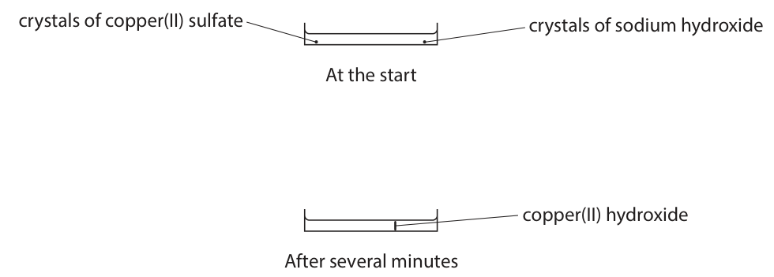
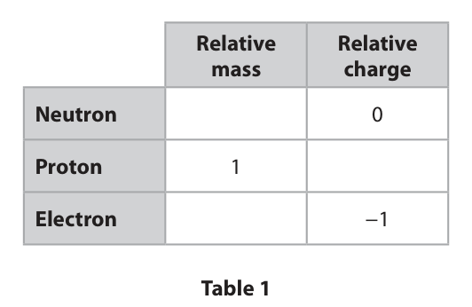
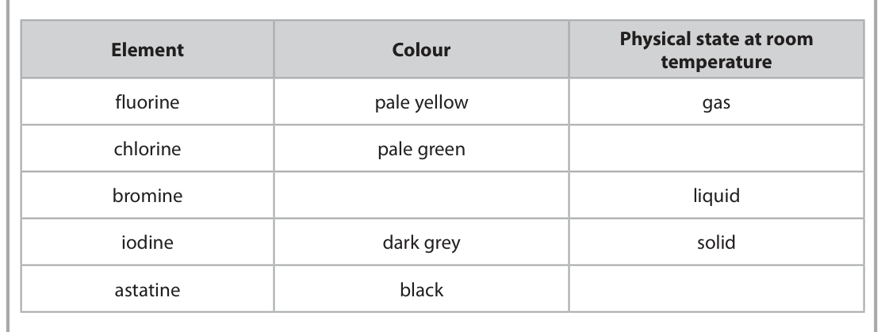
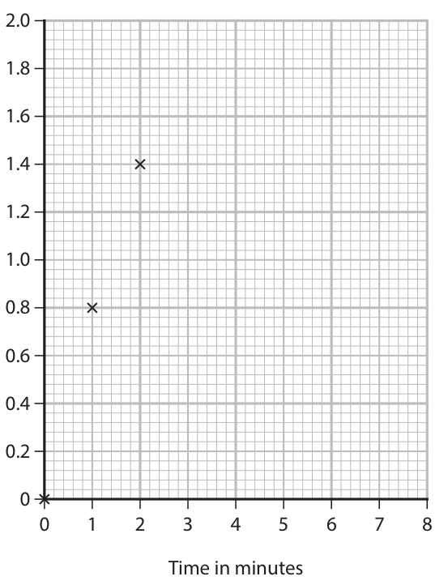
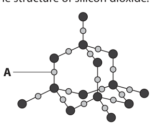
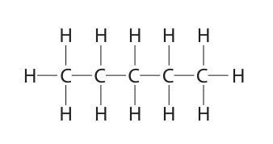
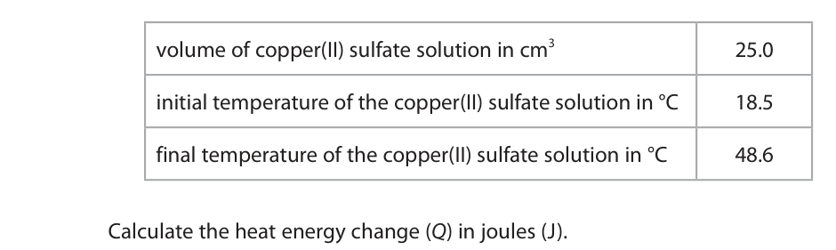

# 4CH1/1CR — 2025-06 (official extraction)

> schema `syllabai.official-paper-questions/0.2` · paper_id `pearson-edexcel:international-gcse:chemistry:4ch1:2025-06:4CH1/1CR` · qp sha256 `e366b168b09e2099…` · extraction is the disclosed baseline (ADR-039)

## Question 1 (6 marks)

This question is about the three states of matter, solid, liquid and gas.

**(a)** Solids, liquids and gases can be changed from one state to another. The box gives the names of some changes of state. condensing evaporation freezing melting sublimation Use words from the box to answer the questions.

### 1(a)(i) [1]

Give the name of the change from liquid to solid.

**Mark scheme answer**

> freezing

- **(1)** freezing

### 1(a)(ii) [1]

Give the name of the change from liquid to gas.

**Mark scheme answer**

> evaporation

- **(1)** evaporation

### 1(a)(iii) [1]

Give the name of the change from solid to gas.

**Mark scheme answer**

> sublimation

- **(1)** sublimation

### 1(b) [3]

Describe the arrangement, movement and energy of the particles in a gas.

**Mark scheme answer**

> Any 3 from
> M1 (particles) are far apart
> M2 (particles) are randomly / irregularly arranged ALLOW no arrangement
> M3 (particles) have (almost) total freedom of ALLOW random motion
> movement /move freely
> M4 particles have high/higher energy
> M1 comment on spacing
> M2 comment on arrangement
> M3 comment on moving
> M4 comment on energy

- **(3)** Any 3 from

## Question 2 (7 marks)

This question is about the rusting of iron.

**(a)** Oxygen is needed for iron to rust.

**(b)** The diagram shows method A and method B, which are both used to prevent iron from rusting. iron paint iron zinc Method A Method B

### 2(a)(i) [1]

Name one other substance needed for iron to rust.

**Mark scheme answer**

> water ALLOW moisture /water
> vapour /steam

- **(1)** water ALLOW moisture /water

### 2(a)(ii) [1]

Give the chemical name for rust.

**Mark scheme answer**

> (hydrated) iron(III) oxide ALLOW ferric oxide
> /Fe2O3
> If alternatives are
> present all must be
> correct

- **(1)** (hydrated) iron(III) oxide ALLOW ferric oxide

### 2(b)(i) [2]

Describe how method A prevents iron from rusting.

**Mark scheme answer**

> M1 (paint) acts as a barrier/coated with paint
> /protective layer
> M2 which prevents oxygen/air/water getting to the
> iron

- **(1)** (paint) acts as a barrier/coated with paint
- **(1)** which prevents oxygen/air/water getting to the

### 2(b)(ii) [1]

Name method B.

**Mark scheme answer**

> galvanising /galvanisation ALLOW sacrificial
> protection

- **(1)** galvanising /galvanisation ALLOW sacrificial

### 2(b)(iii) [2]

Explain how method B prevents iron from rusting even when the zinc layer is damaged.

**Mark scheme answer**

> M1 zinc is more reactive (than iron) ALLOW zinc is higher in
> the reactivity series
> M2 zinc oxidises /zinc reacts / zinc loses electrons REJECT zinc rusts for
> in preference to iron /zinc oxide forms /zinc M2
> corrodes /zinc is a reducing agent

- **(1)** zinc is more reactive (than iron) ALLOW zinc is higher in
- **(1)** zinc oxidises /zinc reacts / zinc loses electrons REJECT zinc rusts for

## Question 3 (6 marks)

Copper(II) sulfate and sodium hydroxide react to form the insoluble solid copper(II) hydroxide. Crystals of copper(II) sulfate and sodium hydroxide are placed at opposite ends of a container of water. Solid copper(II) hydroxide forms after several minutes. The diagram shows the container at the start and after several minutes. crystals of copper(II) sulfate crystals of sodium hydroxide At the start copper(II) hydroxide After several minutes

**(c)** The formula of copper(II) hydroxide is Cu(OH)2

### 3(a) [2]

Name the two processes that must occur before the copper(II) hydroxide forms. 1 2

**Mark scheme answer**

> M1 dissolving /dissolves /dissolution? can be either way
> round
> M2 diffusion /diffuses

- **(1)** dissolving /dissolves /dissolution? can be either way
- **(1)** diffusion /diffuses

### 3(b) [2]

The experiment is repeated with the water at a higher temperature. Explain, in terms of particles, why the copper(II) hydroxide takes less time to form.

**Mark scheme answer**

> M1 particles move faster ALLOW particles have
> more kinetic energy
> ALLOW diffuse faster
> M2 so particles collide and react after a shorter ALLOW more frequent
> period of time collisions

- **(1)** particles move faster ALLOW particles have
- **(1)** so particles collide and react after a shorter ALLOW more frequent

### 3(c)(i) [1]

Give the number of different elements in copper(II) hydroxide.

**Mark scheme answer**

> 3 /three

- **(1)** 3 /three

### 3(c)(ii) [1]

Give the charge on the copper ion in Cu(OH)2

**Mark scheme answer**

> 2+ / Cu2+ ALLOW +2 /Cu+2

- **(1)** 2+ / Cu2+ ALLOW +2 /Cu+2

## Question 4 (11 marks)

This question is about atoms and ions.

**(b)** Table 2 shows the numbers of protons, neutrons and electrons in species A, B, C, D, E and F. Number of Number of Number of Species protons neutrons electrons A 13 14 13 B 1 0 1 C 9 10 10 D 7 7 10 E 20 20 18 F 18 22 18 Table 2 Use the information in Table 2 to answer these questions. Each species may be used once, more than once or not at all.

### 4(a) [3]

Table 1 shows some information about sub‑atomic particles. Complete Table 1 by giving the missing information. Relative Relative mass charge Neutron 0 Proton 1 Electron −1 Table 1

**Mark scheme answer**

> 3
> Relative mass Relative
> charge
> REJECT any sign
> 1 0 for the relative
> mass
> 1 +1
> 0.0005 to -1
> 0.0006 or
> 1/1800 to
> 1/2000

- **(3)** 3

### 4(b)(i) [1]

Give the letter of the species that has 3 electrons in its outer shell.

**Mark scheme answer**

> A

- **(1)** A

### 4(b)(ii) [1]

Give the letter of the species that is an ion with a 3− charge.

**Mark scheme answer**

> D

- **(1)** D

### 4(b)(iii) [1]

Give the letter of the species with a mass number of 19

**Mark scheme answer**

> C

- **(1)** C

### 4(c) [2]

A sample of lithium contains two isotopes, 6Li and 7Li. In terms of sub‑atomic particles, give one similarity and one difference between these isotopes. similarity difference

**Mark scheme answer**

> similarity number of protons OR number of electrons
> /electron configuration /3 protons
> difference number of neutrons /3 or 4 neutrons
> ALLOW same
> atomic number
> and different
> mass number for
> 1 mark if no
> other mark
> awarded

- **(2)** similarity number of protons OR number of electrons

### 4(d) [3]

A sample of magnesium contains 79.0% of 24Mg, 10.0% of 25Mg and 11.0% of 26Mg. Calculate the relative atomic mass, Ar , of this sample of magnesium. Give your answer to one decimal place. Ar =

**Mark scheme answer**

> M1 ((79×24)+(10×25)+(26×11))÷100
> M2 24.32
> M3 24.3 ALLOW ecf from
> M2 to 1dp
> 24.3 scores 3

- **(1)** ((79×24)+(10×25)+(26×11))÷100
- **(1)** 24.32
- **(1)** 24.3 ALLOW ecf from

## Question 5 (9 marks)

This question is about elements in Group 7 of the Periodic Table.

**(b)** The order of reactivity of the Group 7 elements can be shown by using displacement reactions.

### 5(a) [3]

Complete the table by giving the missing information. Physical state at room Element Colour temperature fluorine pale yellow gas chlorine pale green bromine liquid iodine dark grey solid astatine black

**Mark scheme answer**

> 3
> Colour Physical state at
> room temperature
> pale yellow gas
> pale green gas
> brown liquid do not accept red alone
> /orange-brown
> /red-brown
> dark grey solid
> black solid

- **(3)** 3

### 5(b)(i) [2]

When chlorine is added to sodium bromide solution, chlorine displaces bromine. Give a chemical equation for this reaction.

**Mark scheme answer**

> Cl2 + 2NaBr → Br2 + 2NaCl IGNORE state symbols
> even if incorrect
> M1 all formulae correct
> M2 equation correctly balanced M2 dep on M1

- **(1)** all formulae correct
- **(1)** equation correctly balanced M2 dep on M1

### 5(b)(ii) [2]

Explain whether a reaction takes place when bromine water is added to sodium chloride solution.

**Mark scheme answer**

> M1 no reaction
> M2 bromine is less reactive than chlorine / chlorine ALLOW bromine is not
> is more reactive than bromine as good an oxidising
> agent as chlorine
> do not allow bromide is
> less reactive than
> chlorine OR chloride is
> more reactive than
> bromine for M2
> M2 dep on M1

- **(1)** no reaction
- **(1)** bromine is less reactive than chlorine / chlorine ALLOW bromine is not

### 5(b)(iii) [2]

The displacement reaction between potassium astatide and bromine can be represented by this ionic equation. 2At− + Br2 → At2 + 2Br− Explain why this is described as a redox reaction.

**Mark scheme answer**

> M1 astatide (ions)/At- are oxidised/reducing agent ALLOW astatide (ions)
> as they lose electrons are oxidised as their
> oxidation state
> increases
> do not allow astatine is
> oxidised OR bromide is
> reduced
> M2 bromine (molecules)/Br2 are reduced /oxidising ALLOW bromine is
> agent as they gain electrons reduced as its oxidation
> state deceases
> ALLOW astatide (ions)
> are oxidised and
> bromine is reduced for
> 1 mark
> ALLOW astatide loses
> electrons and
> bromine gains
> electrons for 1 mark

- **(1)** astatide (ions)/At- are oxidised/reducing agent ALLOW astatide (ions)
- **(1)** bromine (molecules)/Br2 are reduced /oxidising ALLOW bromine is

## Question 6 (8 marks)

A student uses the reaction between magnesium and dilute hydrochloric acid to prepare crystals of hydrated magnesium chloride. The student adds excess magnesium powder to hydrochloric acid. This is the equation for the reaction. Mg(s) + 2HCl(aq) → MgCl2(aq) + H2(g)

### 6(a) [1]

How does hydrochloric acid behave when acting as an acid?

- **(A)** as an electron acceptor
- **(B)** as an electron donor
- **(C)** as a proton acceptor
- **(D)** as a proton donor  ✔

**Mark scheme answer**

> D (as a proton donor)
> A is not the correct answer as acids are not electron
> acceptors
> B is not the correct answer as acids are not electron
> donors
> C is not the correct answer as acids are not proton
> acceptors

- **(1)** Answer D: as a proton donor

### 6(b) [1]

State one observation made during this reaction.

**Mark scheme answer**

> effervescence / bubbles / fizzing / a colourless IGNORE gas produced
> solution forms /magnesium dissolves / magnesium
> gets smaller/gets warm

- **(1)** effervescence / bubbles / fizzing / a colourless IGNORE gas produced

### 6(c) [1]

Give a reason why the student adds an excess of magnesium to the dilute hydrochloric acid.

**Mark scheme answer**

> to ensure all the (hydrochloric) acid has reacted ALLOW acid used up for
> reacted
> ALLOW to ensure it has
> neutralised

- **(1)** to ensure all the (hydrochloric) acid has reacted ALLOW acid used up for

### 6(d) [5]

Describe what the student should do to the mixture formed in (c) to produce pure, dry crystals of hydrated magnesium chloride.

**Mark scheme answer**

> A description connecting any 5 of the following:
> M1 filter (the excess magnesium)
> M2 heat
> M3 until crystals first start to form ALLOW heat to
> evaporate some of the
> water
> ALLOW heat until a
> saturated solution forms
> M4 allow to cool and crystallise
> M5 pour off excess liquid ALLOW filter / decant
> IGNORE washing the
> crystals
> M6 leave in a warm place to dry ALLOW dry with a paper
> towel OR in a warm
> oven OR dry in a
> desiccator OR leave to
> dry
> If sample is heated to
> dryness award M1 and
> M2 only

- **(5)** A description connecting any 5 of the following:

## Question 7 (15 marks)

A student reacts small chips of calcium carbonate with an excess of dilute hydrochloric acid. This is the student’s method. • add 5.00 g of small calcium carbonate chips to a conical flask • add 30 cm3 of dilute hydrochloric acid which is in excess • quickly add a cotton wool plug and place the conical flask on a balance cotton wool plug calcium carbonate dilute hydrochloric acid chips balance g This is the equation for the reaction. CaCO3(s) + 2HCl(aq) → CaCl2(aq) + H2O(l) + CO2(g) The reading on the balance decreases as carbon dioxide gas is lost through the cotton wool plug.

**(b)** The student repeats the experiment with a different mass of calcium carbonate and a different volume of dilute hydrochloric acid. The hydrochloric acid is in excess. The student records the total mass of carbon dioxide produced at 1‑minute intervals for 8 minutes. The table shows the student’s results. Time in minutes Total mass of CO2 produced in grams 0 0.00 1 0.80 2 1.40 3 1.64 4 1.72 5 1.76 6 1.80 7 1.80 8 1.80

### 7(a) [3]

Calculate the mass reading on the balance when all of the calcium carbonate has reacted. Assume that all of the carbon dioxide gas is lost through the cotton wool plug. [for CaCO3 , Mr = 100 for CO2 , Mr = 44] mass = g

**Mark scheme answer**

> M1 (moles of CaCO3) = 5÷100 OR 0.05 mol
> M2 (mass of CO2) = 0.05×44 OR 2.2g ecf for M1 if moles
> attempted
> M3 (reading on balance) 122.2-2.2 = 120.00g ecf for M2
> 120 g scores 2 marks

- **(1)** (moles of CaCO3) = 5÷100 OR 0.05 mol
- **(1)** (mass of CO2) = 0.05×44 OR 2.2g ecf for M1 if moles
- **(1)** (reading on balance) 122.2-2.2 = 120.00g ecf for M2

### 7(b)(i) [1]

Plot the student’s results. The first three have been plotted for you.

**Mark scheme answer**

> All points plotted correctly ± half a square

- **(1)** All points plotted correctly ± half a square

### 7(b)(ii) [1]

Draw a curve of best fit through the points. 2.0 1.8 1.6 1.4 1.2 Total mass of CO2 produced 1.0 in grams 0.8 0.6 0.4 0.2 0 1 2 3 4 5 6 7 8 Time in minutes

**Mark scheme answer**

> Curve of best fit joining all the points

- **(1)** Curve of best fit joining all the points

### 7(b)(iii) [3]

Calculate the rate of reaction at 2 minutes by drawing a tangent to the curve and calculating the gradient of the tangent. Give the units for the rate of reaction. rate of reaction = units =

**Mark scheme answer**

> M1 tangent drawn at 2 minutes If no tangent drawn 1
> mark for M3 only
> M2 gradient of tangent
> M3 g/minute/g minute-1/g/min/g min- do not allow g/m for
> /gram/minute M3

- **(1)** tangent drawn at 2 minutes If no tangent drawn 1
- **(1)** gradient of tangent
- **(1)** g/minute/g minute-1/g/min/g min- do not allow g/m for

### 7(b)(iv) [4]

Explain why the shape of the graph changes during the 8 minutes.

**Mark scheme answer**

> An explanation that links any 2 pairs of the
> following points
> Pair 1
> M1 (the curve) is steep(est) at the start ALLOW the gradient is
> greater at the start
> M2 because the reaction is fast(est) at the start
> / because the (acid) concentration is high(est)
> /more calcium carbonate /more chips
> Pair 2
> M3 (the curve) becomes less steep ALLOW the gradient
> decreases
> M4 because the reaction slows down / because the
> acid becomes more dilute /less calcium carbonate
> /less chips
> Pair 3
> M5 the curve levels off / the graph plateaus ALLOW the gradient
> becomes zero/0/flat
> /horizontal/constant
> M6 because all the calcium carbonate /chips have
> reacted /used up

- **(4)** An explanation that links any 2 pairs of the

### 7(c) [3]

The student repeats the experiment using the same mass of calcium carbonate but as powder rather than chips, keeping all other conditions the same. Explain the effect of this change on the rate of reaction.

**Mark scheme answer**

> M1 the rate of reaction increases If more energy is
> implied or move faster
> lose 1 mark
> M2 because the powder has a greater surface area
> M3 so there are more collisions per unit time ALLOW more frequent
> collisions /collide more
> often

- **(1)** the rate of reaction increases If more energy is
- **(1)** because the powder has a greater surface area
- **(1)** so there are more collisions per unit time ALLOW more frequent

## Question 8 (13 marks)

This question is about the covalent compounds hydrogen chloride and silicon dioxide.

**(b)** Hydrogen chloride has the formula HCl

**(c)** The diagram shows part of the structure of silicon dioxide. A

### 8(a) [2]

Describe the forces of attraction in a covalent bond.

**Mark scheme answer**

> M1 attraction between nuclei nucleus must be plural
> M2 and shared pair(s) of electrons
> OR
> M1 attraction between shared pair(s) of electrons
> M2 and nuclei nucleus must be plural
> REJECT intermolecular
> forces for both marks

- **(2)** M1 attraction between nuclei nucleus must be plural

### 8(b)(i) [2]

Draw a dot‑and‑cross diagram to show the bonding in a hydrogen chloride molecule. Show only the outer shell electrons in each atom.

**Mark scheme answer**

> ALLOW any combination
> of dots and crosses
> ALLOW any inner shells of
> chlorine as long as they
> are correct
> M1 one shared pair of electrons
> M2 rest of the molecule correct

- **(1)** one shared pair of electrons
- **(1)** rest of the molecule correct

### 8(b)(ii) [2]

Explain why the boiling point of hydrogen chloride is low.

**Mark scheme answer**

> M1 intermolecular forces of attraction are weak ALLOW weak forces
> between molecules
> M2 which require little energy to overcome M2 dep on M1
> do not allow less energy

- **(1)** intermolecular forces of attraction are weak ALLOW weak forces
- **(1)** which require little energy to overcome M2 dep on M1

### 8(c)(i) [1]

Give a reason why particle A represents an oxygen atom.

**Mark scheme answer**

> any one from:
> oxygen/it is a smaller atom than silicon
> oxygen/it has two shells, silicon has three shells
> each silicon atom is bonded to four oxygen atoms
> each oxygen atom is bonded to two silicon atoms

- **(1)** any one from:

### 8(c)(ii) [1]

This is the equation for the reaction between silicon dioxide and calcium oxide. SiO2 + CaO → CaSiO3 Give a reason why silicon dioxide reacts with calcium oxide.

**Mark scheme answer**

> silicon dioxide/SiO2 is acidic and calcium oxide/CaO ALLOW an acid base
> is basic reaction
> ALLOW one is an acid, one
> is a base
> REJECT calcium oxide is
> an alkali

- **(1)** silicon dioxide/SiO2 is acidic and calcium oxide/CaO ALLOW an acid base

### 8(c)(iii) [5]

Silicon dioxide has the same structure as diamond. Silicon dioxide is very hard and has a very high melting point. Explain these properties. Refer to the structure and bonding of silicon dioxide in your answer.

**Mark scheme answer**

> an explanation linking any 5 of the following points:
> NB do not credit high melting point as in the
> question
> M1 giant (covalent) structure / lattice
> M2 covalent bonds are strong ALLOW strong attraction
> between shared pairs of
> electrons and nuclei
> M3 which requires a lot of energy to break the M3 being dep on covalent
> (covalent) bonds
> do not allow more energy
> M4 3D / tetrahedral structure
> M5 every silicon atom makes 4 bonds / 4 pairs of
> electrons shared
> M6 no layers / atoms cannot slide over each other
> Lose 1 mark if they
> mention intermolecular
> forces or ionic bonding

- **(5)** an explanation linking any 5 of the following points:

## Question 9 (13 marks)

This question is about products from crude oil.

**(c)** The equation shows the cracking of a hydrocarbon produced from the fractional distillation of crude oil. C10H22 → C8H18 + C2H4

**(d)** The formula C5H12 represents three isomers.

### 9(a) [1]

Most of the compounds in crude oil are from the same homologous series. Give the name of this homologous series.

**Mark scheme answer**

> alkane(s) not alkene(s)

- **(1)** alkane(s) not alkene(s)

### 9(b) [3]

Many fuels are obtained from the fractional distillation of crude oil. Explain how the combustion of a common impurity in fuels causes acid rain.

**Mark scheme answer**

> M1 when sulfur (impurity in fuels) burns /combusts ALLOW sulfur reacts
> with oxygen
> M2 sulfur dioxide / SO2 forms
> M3 which dissolves / reacts with (rain) water do not allow acid rain
> alone as this is in the
> question
> IGNORE mention of
> nitrogen and NO2 and
> carbon dioxide
> M3 dep on M1 or M2

- **(1)** when sulfur (impurity in fuels) burns /combusts ALLOW sulfur reacts
- **(1)** sulfur dioxide / SO2 forms
- **(1)** which dissolves / reacts with (rain) water do not allow acid rain

### 9(c)(i) [2]

Give the temperature and the catalyst used in catalytic cracking. temperature catalyst

**Mark scheme answer**

> temperature 600-700°C
> catalyst alumina/silica/aluminosilicates/zeolites
> /Al2O3 /SiO2

- **(2)** temperature 600-700°C

### 9(c)(ii) [3]

Explain why cracking is a useful process in the oil industry.

**Mark scheme answer**

> M1 long-chain alkanes/hydrocarbons have lower ALLOW short chain
> demand or are less useful hydrocarbons/alkanes
> are more useful/higher
> demand
> M2 (cracking produces) shorter alkanes that are
> more flammable / more useful as fuels or petrol or
> gasoline
> M3 (cracking produces) alkenes that can be used to
> make polymers /alcohols

- **(1)** long-chain alkanes/hydrocarbons have lower ALLOW short chain
- **(1)** (cracking produces) shorter alkanes that are
- **(1)** (cracking produces) alkenes that can be used to

### 9(d)(i) [2]

Explain what is meant by the term isomers.

**Mark scheme answer**

> M1 same molecular formula ALLOW same number of
> carbons and hydrogens
> M2 different structural/displayed formulae ALLOW different of
> arrangement of atoms

- **(1)** same molecular formula ALLOW same number of
- **(1)** different structural/displayed formulae ALLOW different of

### 9(d)(ii) [2]

This is the displayed formula of one of the isomers. Draw the displayed formula of each of the other two isomers.

**Mark scheme answer**

> H H H H
> | | | |
> H - C - C - C - C - H
> | | | |
> H | H H
> H-C-H
> |
> H
> H
> |
> H - C - H
> |
> H - C - C - C - H
> | | |
> H | H
> H-C-H
> |
> H

- **(2)** H H H H

## Question 10 (11 marks)

A student investigates the reaction between zinc and copper(II) sulfate solution. This is the equation for the reaction. Zn(s) + CuSO4(aq) → ZnSO4(aq) + Cu(s) This is the student’s method. Step 1 add 25.0 cm3 of copper(II) sulfate solution to a glass beaker Step 2 record the temperature of the solution Step 3 add between 5 g and 6 g of zinc powder (an excess) and stir the mixture Step 4 record the highest temperature reached

### 10(a)(i) [2]

Explain an improvement to step 1 to produce a more accurate temperature rise.

**Mark scheme answer**

> Any two of the following
> M1 use a polystyrene cup ALLOW use a beaker
> with a lid
> ALLOW any piece of
> apparatus which is
> better insulated
> M2 less heat will be lost
> M3 leave to reach a steady temperature to record
> it

- **(2)** Any two of the following

### 10(a)(ii) [1]

Give a reason why the student does not need to know the exact mass of zinc powder added in step 3.

**Mark scheme answer**

> the zinc/powder/it is in excess

- **(1)** the zinc/powder/it is in excess

### 10(a)(iii) [1]

State the colour change in the solution. from to

**Mark scheme answer**

> blue to colourless

- **(1)** blue to colourless

### 10(b)(i) [3]

The table shows the student’s results. volume of copper(II) sulfate solution in cm3 25.0 initial temperature of the copper(II) sulfate solution in °C 18.5 final temperature of the copper(II) sulfate solution in °C 48.6 Calculate the heat energy change (Q) in joules (J). [for the solution, c = 4.2 J / g / °C] [mass of 1.0 cm3 of solution = 1.0 g] Q = J

**Mark scheme answer**

> M1 ΔT = 30.1(°C)
> M2 25×4.2×30.1 ALLOW ecf from M1
> M3 3160.5(J) ALLOW any number of
> significant figures from
> 2

- **(1)** ΔT = 30.1(°C)
- **(1)** 25×4.2×30.1 ALLOW ecf from M1
- **(1)** 3160.5(J) ALLOW any number of

### 10(b)(ii) [4]

The student repeats the experiment and calculates Q as 3800 J. The solution used contains 6.38 g of copper(II) sulfate. Calculate the molar enthalpy change, ΔH, in kJ / mol. Include a sign in your answer. [for CuSO4 , Mr = 159.5] ΔH = kJ / mol

**Mark scheme answer**

> M1 (moles of CuSO4) 6.38÷159.5 OR 0.04 mol
> M2 3800÷0.04 OR 95 000 ALLOW ecf from M1
> M3 division by 1000 = 95 (kJ) ALLOW ecf from M2
> M4 −95 kJ/mol correct answer -95
> scores 4
> ecf -79 scores 3 (using
> the energy change from
> (b)(i)

- **(1)** (moles of CuSO4) 6.38÷159.5 OR 0.04 mol
- **(1)** 3800÷0.04 OR 95 000 ALLOW ecf from M1
- **(1)** division by 1000 = 95 (kJ) ALLOW ecf from M2
- **(1)** −95 kJ/mol correct answer -95

## Question 11 (11 marks)

This question is about sodium sulfate, Na2SO4

**(b)** A student has a sample of crystals of hydrated sodium sulfate, Na2SO4.xH2O The student uses this apparatus to find the value of x in Na2SO4.xH2O crucible sodium sulfate crystals heat This is the student’s method. • find the mass of the empty crucible • add some hydrated sodium sulfate crystals to the crucible • find the total mass of the crucible and hydrated sodium sulfate crystals • heat the crucible to remove water from the crystals • find the mass of the crucible and its contents every 2 minutes for 10 minutes The table shows the student’s results. Mass in grams mass of empty crucible 23.57 mass of empty crucible and Na2SO4.xH2O 26.79 mass after 2 minutes 26.34 mass after 4 minutes 25.73 mass after 6 minutes 25.23 mass after 8 minutes 24.99 mass after 10 minutes 24.99

### 11(a) [5]

A teacher finds an unlabelled bottle containing a white solid. Describe tests to show that the white solid is sodium sulfate.

**Mark scheme answer**

> sodium ions
> M1 do a flame test ALLOW any description
> of a flame test
> M2 yellow / orange flame
> sulfate ions
> M3 (make a solution and) add hydrochloric acid ALLOW HCl / nitric acid
> / HNO3
> REJECT sulfuric acid
> M4 add barium chloride solution ALLOW BaCl2 / barium
> nitrate / Ba(NO3)2
> M5 white precipitate M5 dep on M4

- **(1)** do a flame test ALLOW any description
- **(1)** yellow / orange flame
- **(1)** (make a solution and) add hydrochloric acid ALLOW HCl / nitric acid
- **(1)** add barium chloride solution ALLOW BaCl2 / barium
- **(1)** white precipitate M5 dep on M4

### 11(b)(i) [1]

State how the results show that all the water has been removed from the crystals.

**Mark scheme answer**

> the last two results are the same ALLOW mass is constant
> ALLOW heat to constant
> mass

- **(1)** the last two results are the same ALLOW mass is constant

### 11(b)(ii) [1]

Calculate the mass of anhydrous sodium sulfate remaining after heating. mass of anhydrous sodium sulfate = g

**Mark scheme answer**

> 1.42 g

- **(1)** 1.42 g

### 11(b)(iii) [1]

Calculate the mass of water lost from the sodium sulfate crystals during heating. mass of water = g

**Mark scheme answer**

> 1.80 g

- **(1)** 1.80 g

### 11(b)(iv) [3]

Use the student’s results to calculate x in the formula Na2SO4.xH2O [for Na2SO4 , Mr = 142 for H2O, Mr = 18] x = J

**Mark scheme answer**

> M1 1.42÷142 OR 0.01
> M2 1.8÷18 OR 0.10
> M3 0.10÷0.01=10
> Answer of 10 or
> Na2SO4.10H2O scores 3

- **(1)** 1.42÷142 OR 0.01
- **(1)** 1.8÷18 OR 0.10
- **(1)** 0.10÷0.01=10

