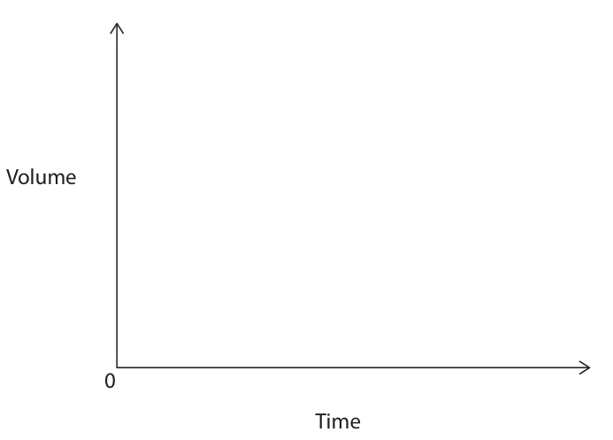
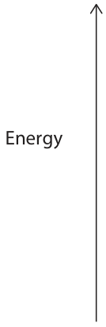
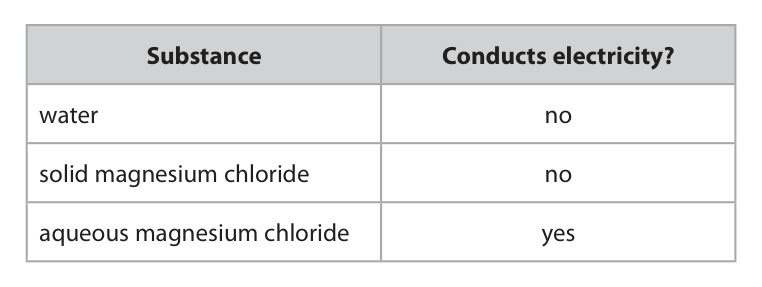
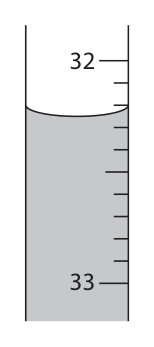
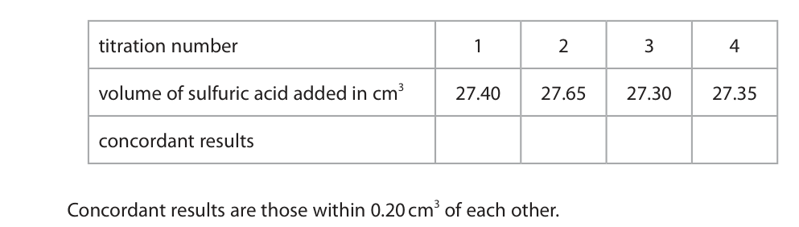

# 4CH1/2C — 2025-06 (official extraction)

> schema `syllabai.official-paper-questions/0.1` · paper_id `pearson-edexcel:international-gcse:chemistry:4ch1:2025-06:4CH1/2C` · qp sha256 `24d7789716fa324e…` · extracted verbatim, never regenerated (ADR-037)

## Question 1 (6 marks)

This question is about elements, compounds and mixtures.

**(a)** The box gives the names of some substances. calcium fluorine helium neon petrol silicon water Choose a substance from the box to answer each of these questions.

### 1(a)(i) [1]

Give the name of a compound.

**Mark scheme answer**

> water ALLOW H2O

- **(1)** water ALLOW H2O

### 1(a)(ii) [1]

Give the name of a mixture.

**Mark scheme answer**

> petrol

- **(1)** petrol

### 1(a)(iii) [1]

Give the name of a diatomic molecule.

**Mark scheme answer**

> fluorine ALLOW F2

- **(1)** fluorine ALLOW F2

### 1(a)(iv) [1]

Give the name of a metal element. 

**Mark scheme answer**

> calcium ALLOW Ca

- **(1)** calcium ALLOW Ca

### 1(b)(i) [1]

Name the technique used to separate crude oil into fractions.

**Mark scheme answer**

> fractional distillation ALLOW fractionating /
> fractionation
> IGNORE distillation alone

- **(1)** fractional distillation ALLOW fractionating /

### 1(b)(ii) [1]

Give one use of the kerosene fraction.

**Mark scheme answer**

> aircraft fuel / jet fuel / (aero)plane fuel must mention fuels, not just
> /aviation fuel aircraft etc.
> ALLOW fuel for lamps/for
> heaters/ for stoves

- **(1)** aircraft fuel / jet fuel / (aero)plane fuel must mention fuels, not just

## Question 2 (13 marks)

Magnesium reacts with dilute hydrochloric acid to form magnesium chloride and hydrogen. The hydrogen is collected in a gas syringe. gas syringe magnesium dilute ribbon hydrochloric acid The reaction is exothermic and magnesium is in excess.

### 2(a) [1]

State what is meant by the term exothermic.

**Mark scheme answer**

> heat (energy) / thermal energy is given out not just energy, needs to
> /released / lost to the surroundings be heat released or
> thermal energy released
> ALLOW gives out energy
> and raises temperature of
> surroundings

- **(1)** heat (energy) / thermal energy is given out not just energy, needs to

### 2(b) [1]

Complete the chemical equation for the reaction. Mg + 2HCl → +

**Mark scheme answer**

> Mg + 2HCl → MgCl2 + H2 subscript, superscript and
> case must be correct
> IGNORE state symbols

- **(1)** Mg + 2HCl → MgCl2 + H2 subscript, superscript and

### 2(c) [2]

Draw a sketch graph to show how the volume of hydrogen changes with time until the reaction has finished. Volume Time 

**Mark scheme answer**

> M1 smooth curve starting at the origin
> M2 levels off horizontally at constant volume M2 depends on rising

- **(1)** smooth curve starting at the origin
- **(1)** levels off horizontally at constant volume M2 depends on rising

### 2(d) [4]

Explain why increasing the temperature of the hydrochloric acid affects the rate of the reaction. Refer to collision theory in your answer.

**Mark scheme answer**

> An explanation that links the following 4 points
> M1 rate of reaction increases
> M2 particles /molecules have more (kinetic) ALLOW particles
> energy /KE /molecules move faster
> M3 more collisions per unit time ACCEPT more frequent
> collisions
> IGNORE rate of collision
> increases
> M4 more successful collisions /more particles ALLOW more frequent
> have the (necessary) activation energy/Ea successful collisions for M3
> and M4

- **(1)** rate of reaction increases
- **(1)** particles /molecules have more (kinetic) ALLOW particles
- **(1)** more collisions per unit time ACCEPT more frequent
- **(1)** more successful collisions /more particles ALLOW more frequent

### 2(e) [5]

Draw a reaction profile diagram for the reaction, showing ΔH and activation energy. Label the reactants and products. Energy

**Mark scheme answer**

> M1 label reactants and products ACCEPT names of
> reactants and products
> ALLOW formulae of
> reactants and products
> even if incorrect as not
> given in the question
> M2 product line below reactant line and to the
> right of the line
> M3 showing activation hump
> M4 activation energy/Ea labelled correctly ACCEPT with arrow
> pointing upwards
> REJECT arrow pointing
> downwards/double headed
> arrow /just a line
> M5 line showing ΔH from reactants to products ACCEPT with arrow
> pointing downwards
> REJECT arrow pointing
> upwards/double headed
> arrow /just a line
> ecf M1, M3, M4, M5 for
> endothermic reaction

- **(1)** label reactants and products ACCEPT names of
- **(1)** product line below reactant line and to the
- **(1)** showing activation hump
- **(1)** activation energy/Ea labelled correctly ACCEPT with arrow
- **(1)** line showing ΔH from reactants to products ACCEPT with arrow

## Question 3 (16 marks)

This question is about Group 2 elements and their compounds.

**(a)** A sample of magnesium contains three isotopes. Mass number of isotope 24 25 26 Percentage abundance (%) 76.5 10.5 13.0

**(e)** A concentrated aqueous solution of magnesium chloride is electrolysed. Chlorine forms at the positive electrode.

### 3(a)(i) [2]

State, in terms of subatomic particles, what is meant by the term isotopes.

**Mark scheme answer**

> M1 same number of protons IGNORE same number of
> electrons
> M2 different number of neutrons REJECT the different
> number of electrons for
> M2

- **(1)** same number of protons IGNORE same number of
- **(1)** different number of neutrons REJECT the different

### 3(a)(ii) [3]

Calculate the relative atomic mass (Ar) of magnesium. Give your answer to one decimal place. Ar =

**Mark scheme answer**

> M1 76.5 x 24 + 10.5 x 25 + 13.0 x 26 correct answer without
> 100 working scores 3
> M2 24.365
> M3 24.4
> 24 no working scores 0

- **(1)** 76.5 x 24 + 10.5 x 25 + 13.0 x 26 correct answer without
- **(1)** 24.365
- **(1)** 24.4

### 3(b) [1]

Which of these compounds is an insoluble solid? 

- **(A)** calcium nitrate
- **(B)** calcium sulfate  ✔
- **(C)** magnesium nitrate
- **(D)** magnesium sulfate

**Mark scheme answer**

> B (calcium sulfate)
> A is incorrect as calcium nitrate is soluble
> C is incorrect as magnesium nitrate is soluble
> D is incorrect as magnesium sulfate is soluble

- **(1)** Answer B: calcium sulfate

### 3(c) [3]

Magnesium oxide is an ionic compound. The diagrams show the atoms of magnesium and oxygen. Mg O Draw diagrams to show the structure of each ion in magnesium oxide. Include the charge on each ion. 

**Mark scheme answer**

> M1 diagram of magnesium ion with electron ALLOW any combination of
> configuration 2,8 dots and crosses
> M2 diagram of oxide ion with electron If the two inner circles of
> configuration 2,8 the electrons are missing
> M1 and M2 allow 1 mark
> M3 correct charges on the ions, e.g. Mg2+ and O2- M3 is an independent mark
> ALLOW Mg+2 and O-2

- **(1)** diagram of magnesium ion with electron ALLOW any combination of
- **(1)** diagram of oxide ion with electron If the two inner circles of
- **(1)** correct charges on the ions, e.g. Mg2+ and O2- M3 is an independent mark

### 3(d) [5]

The table lists some substances and shows which substance conducts electricity. Substance Conducts electricity? water no solid magnesium chloride no aqueous magnesium chloride yes Explain these observations. Refer to structure and bonding in your answer. 

**Mark scheme answer**

> An explanation that links the following five points
> M1 water is covalent /water is a molecule
> M2 water has not enough charged particles /not ALLOW no charged
> enough ions /no (delocalised) electrons particles/ no ions /no
> (delocalised) electrons
> AND so not free to move /cannot conduct
> electricity /cannot carry a current IGNORE cannot carry a
> charge
> M3 magnesium chloride is an ionic
> (compound/substance/solid/lattice)
> M4 ions in solid magnesium chloride do not move
> /ions in fixed positions (do not move)
> M5 ions in aqueous / solution magnesium chloride No M5 if any mention of
> are free to move electrons moving or
> delocalised electrons
> lose 1 mark if there is any
> mention of intermolecular
> forces in magnesium
> chloride

- **(1)** water is covalent /water is a molecule
- **(1)** water has not enough charged particles /not ALLOW no charged
- **(1)** magnesium chloride is an ionic
- **(1)** ions in solid magnesium chloride do not move
- **(1)** ions in aqueous / solution magnesium chloride No M5 if any mention of

### 3(e)(i) [1]

Give the half‑equation for the reaction at the positive electrode.

**Mark scheme answer**

> 2Cl— → Cl2 + 2e(—)

- **(1)** 2Cl— → Cl2 + 2e(—)

### 3(e)(ii) [1]

Give a reason why this reaction is classified as oxidation.

**Mark scheme answer**

> chloride (ions)/Cl— (ions) lose electron(s) ALLOW electron(s) are
> lost
> REJECT chlorine / Cl / Cl2
> loses electrons
> Total

- **(1)** chloride (ions)/Cl— (ions) lose electron(s) ALLOW electron(s) are

## Question 4 (12 marks)

This question is about the reactions of ethanol and ethanoic acid.

**(b)** Ethanoic acid reacts with solid sodium carbonate.

**(c)** A student prepares the ester, ethyl ethanoate, by reacting ethanol with ethanoic acid. This is the student’s method. • mix equal amounts of ethanol and ethanoic acid in a boiling tube • add a few drops of concentrated sulfuric acid • place the boiling tube in a hot water bath for several minutes

### 4(a)(i) [1]

Ethanol reacts with potassium dichromate(VI) to form ethanoic acid. Name the other reagent needed in this reaction.

**Mark scheme answer**

> sulfuric acid / phosphoric acid ACCEPT dilute or
> concentrated
> ALLOW H2SO4 /H3PO4

- **(1)** sulfuric acid / phosphoric acid ACCEPT dilute or

### 4(a)(ii) [2]

State the colour change that occurs when ethanol reacts with potassium dichromate(VI). from to

**Mark scheme answer**

> M1 (from) orange must be in the correct
> order
> M2 (to) green

- **(1)** (from) orange must be in the correct
- **(1)** (to) green

### 4(b)(i) [2]

Complete the chemical equation for this reaction. 2CH3COOH + Na2CO3 → + +

**Mark scheme answer**

> 2CH3COOH + Na2CO3 → 2CH3COONa + CO2 + H2O
> M1 2CH3COONa ALLOW 2NaCH3COO
> /2NaOOCCH3
> M2 CO2 + H2O

- **(1)** 2CH3COONa ALLOW 2NaCH3COO
- **(1)** CO2 + H2O

### 4(b)(ii) [2]

State two observations seen in this reaction. 1 2 

**Mark scheme answer**

> Any two from:-
> M1 bubbles/ fizzing/effervescence IGNORE gas
> produced even if
> incorrect
> M2 sodium carbonate/solid disappears /gets ALLOW dissolves
> smaller
> M3 loss of vinegar smell

- **(2)** Any two from:-

### 4(c)(i) [1]

State the role of sulfuric acid in this reaction.

**Mark scheme answer**

> catalyst / to speed up the reaction

- **(1)** catalyst / to speed up the reaction

### 4(c)(ii) [1]

State why the student heats the mixture in a water bath instead of directly with a Bunsen burner flame.

**Mark scheme answer**

> ethanol is (in)flammable /can ignite ACCEPT ethyl ethanoate
> is (in)flammable /can
> ignite
> ALLOW mixture or it is
> (in)flammable /can ignite

- **(1)** ethanol is (in)flammable /can ignite ACCEPT ethyl ethanoate

### 4(c)(iii) [1]

State how the student would know that ethyl ethanoate has formed.

**Mark scheme answer**

> distinctive/fruity/sweet smell ACCEPT oily liquid
> IGNORE nice smell

- **(1)** distinctive/fruity/sweet smell ACCEPT oily liquid

### 4(c)(iv) [2]

Draw the displayed formula of ethyl ethanoate.

**Mark scheme answer**

> M1 correct ester functional group
> M2 rest of molecule correct
> H O H H
> I II I I
> H—C—C—O—C—C—H
> I I I
> H H H
> M2 dep on M1

- **(1)** correct ester functional group
- **(1)** rest of molecule correct

## Question 5 (13 marks)

A student does a titration to find the concentration of a solution of sulfuric acid. This is the student’s method. • fill a burette with sulfuric acid and record the reading • transfer 25.0 cm3 of potassium hydroxide solution to a conical flask • add a few drops of methyl orange to the conical flask • place the conical flask on a white tile • swirl the flask continuously while adding sulfuric acid from the burette • keep adding sulfuric acid until the end-point has been reached • record the rough reading at the end-point

**(c)** The student repeats the titration more accurately four times. The table shows their results. titration number 1 2 3 4 volume of sulfuric acid added in cm3 27.40 27.65 27.30 27.35 concordant results Concordant results are those within 0.20 cm3 of each other.

**(d)** Another student also does the titration.

### 5(a)(i) [1]

Name the most suitable piece of apparatus for measuring 25.0 cm3 of potassium hydroxide solution.

**Mark scheme answer**

> pipette

- **(1)** pipette

### 5(a)(ii) [1]

State why the student places the conical flask on a white tile. 

**Mark scheme answer**

> can see colour change (more) clearly OWTTE

- **(1)** can see colour change (more) clearly OWTTE

### 5(b) [2]

The diagram shows the final burette reading. The initial burette reading is given in the table. Complete the table, giving both values to the nearest 0.05 cm3. final burette reading initial burette reading 4.15 volume of sulfuric acid added in cm3

**Mark scheme answer**

> M1 32.25
> M2 28.10 each value must be
> given to 2 decimal
> places
> ALLOW ecf for M2 if M1
> is incorrect

- **(1)** 32.25
- **(1)** 28.10 each value must be

### 5(c)(i) [1]

Place ticks (ü) in the table to show which results are concordant.

**Mark scheme answer**

> 1
> 27.40 27.65 27.30 27.35
>   

- **(1)** 1

### 5(c)(ii) [1]

Use the concordant results to calculate the mean volume of sulfuric acid added. mean volume of sulfuric acid = cm3 

**Mark scheme answer**

> (mean =) 27.35 (cm3) ALLOW ecf if different
> ticks are involved
> No ecf if no ticks or
> only one tick is present
> REJECT 3 decimal
> places

- **(1)** (mean =) 27.35 (cm3) ALLOW ecf if different

### 5(d)(i) [3]

The student uses 25.0 cm3 of potassium hydroxide solution with a concentration of 0.500 mol/dm3. The mean volume of sulfuric acid added is 26.50 cm3. This is the equation for the reaction. 2KOH(aq) + H2SO4(aq) → K2SO4(aq) + 2H2O(l) Calculate the concentration of the sulfuric acid. concentration of sulfuric acid = mol/dm3

**Mark scheme answer**

> M1 (n KOH =) 0.025 x 0.5(00) OR 0.0125 (mol) correct answer scores 3
> marks
> M2 (n H2SO4 =) 0.0125 ÷ 2 OR 0.00625 (mol)
> M3 (conc = 0.00625 ÷ 0.0265 =) 0.236 (mol/dm3) ALLOW 0.472 /0.118
> for 2 marks
> ALLOW any number of
> sig figs except 1
> REJECT incorrect
> ALTERNATIVE METHOD rounding for 1 mark
> C1 X V1 = C2 X V2
> 0.5 X 25.0 /26.5 = C2
> C2 = 0.472
> Divide by 2 =0.236
> So 1000 can be ignored

- **(1)** (n KOH =) 0.025 x 0.5(00) OR 0.0125 (mol) correct answer scores 3
- **(1)** (n H2SO4 =) 0.0125 ÷ 2 OR 0.00625 (mol)
- **(1)** (conc = 0.00625 ÷ 0.0265 =) 0.236 (mol/dm3) ALLOW 0.472 /0.118

### 5(d)(ii) [4]

The student repeats the titration without the methyl orange indicator. They add exactly 26.50 cm3 of sulfuric acid to the potassium hydroxide solution. Describe how the student could obtain pure, dry potassium sulfate crystals from the reaction mixture.

**Mark scheme answer**

> A description that refers to the following points
> M1 heat the solution of potassium sulfate until it is If heated to dryness
> partly evaporated / crystals form /saturated max 1 mark
> solution
> If just left the solution
> to evaporate only M3
> and M4 can be scored
> M2 allow the solution to cool / to crystallise
> M3 filter (the solution) to obtain the crystals ALLOW decant the
> solution/liquid from the
> crystals
> IGNORE wash the
> crystals
> M4 leave the crystals to dry / dry the crystals with ALLOW place the
> filter paper /dry in a (warm) oven /dry in a warm crystals in a desiccator
> place
> No M4 if heated directly
> with a Bunsen burner/
> hot oven

- **(1)** heat the solution of potassium sulfate until it is If heated to dryness
- **(1)** allow the solution to cool / to crystallise
- **(1)** filter (the solution) to obtain the crystals ALLOW decant the
- **(1)** leave the crystals to dry / dry the crystals with ALLOW place the

## Question 6 (10 marks)

Hydrogen reacts with iodine vapour to form hydrogen iodide, HI This is the equation for the reaction. H2(g) + I2(g)  2HI(g) ΔH = +26 kJ/mol

**(b)** In a sealed container at equilibrium, the reaction conditions are 500°C and 2 atm.

### 6(a)(i) [1]

Give the test for hydrogen.

**Mark scheme answer**

> A lighted /burning /flame splint pops REJECT a glowing splint
> IGNORE squeaky pop
> test alone

- **(1)** A lighted /burning /flame splint pops REJECT a glowing splint

### 6(a)(ii) [1]

State what the symbol  represents.

**Mark scheme answer**

> reversible (reaction) ALLOW goes both ways
> /can go forwards and
> backwards at the same
> time
> IGNORE (dynamic)
> equilibrium

- **(1)** reversible (reaction) ALLOW goes both ways

### 6(b)(i) [2]

The temperature of the reaction mixture is increased to 600°C, but the pressure is kept at 2 atm. Explain the effect, if any, on the yield of hydrogen iodide at equilibrium.

**Mark scheme answer**

> An explanation that links the following two points
> M1 yield increases AND reaction shifts towards the ALLOW yield increases
> right hand side AND forward reaction
> M2 as the (forward) reaction is endothermic M2 dep on yield
> increases or missing
> IGNORE references to
> Le Chatelier

- **(1)** yield increases AND reaction shifts towards the ALLOW yield increases
- **(1)** as the (forward) reaction is endothermic M2 dep on yield

### 6(b)(ii) [2]

The pressure of the reaction mixture is decreased to 1 atm but the temperature is kept at 500°C. Explain the effect, if any, on the yield of hydrogen iodide at equilibrium. 

**Mark scheme answer**

> An explanation that links the following two points
> M1 no effect on the yield
> M2 as there are the same number of moles /molecules M2 dep on M1 or
> /2 moles /2 molecules on both sides (so no effect on missing
> the position of the equilibrium)
> IGNORE references to
> Le Chatelier

- **(1)** no effect on the yield
- **(1)** as there are the same number of moles /molecules M2 dep on M1 or

### 6(c) [4]

An excess of hydrogen reacts with 50.8 g of iodine. At equilibrium, the yield of hydrogen iodide is 80%. Calculate the volume, in cm3, of hydrogen iodide produced at rtp. Give your answer in standard form. [at rtp, molar volume = 24 000 cm3] volume of hydrogen iodide = cm3

**Mark scheme answer**

> M1 (nI2 =) 50.8 OR 0.2(0) (mol) correct answer scores 4
> 254
> M2 (nHI =) 0.2(0) × 2 × 80 OR 0.32 (mol) ALLOW ecf throughout
> 100 as long as attempt to
> calculate moles
> M3 (volume of HI) = 0.32 × 24 000 OR 7 680 (cm3)
> M4 7.68 × 103 / 7.7 × 103 (cm3) 3.84 × 103 /9.6 × 103
> /1.92 × 103 scores 3
> 3840 / 9600 / 1920
> scores 2
> 1.5(36) x 104 scores 3
> 15360 scores 2
> ALTERNATIVE METHOD
> M1 254g gives 48000 cm3 so M2 50.8g gives 9600 cm3
> so M3 9600 x 80/100
> M4 7.68 x 103 cm3
> Pearson Education Limited. Registered company number 872828
> with its registered office at 80 Strand, London, WC2R 0RL, United Kingdom

- **(4)** M1 (nI2 =) 50.8 OR 0.2(0) (mol) correct answer scores 4

