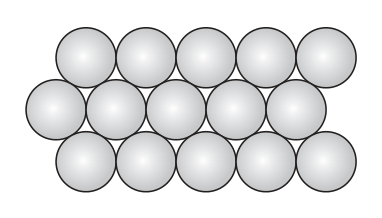
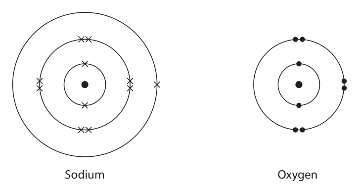
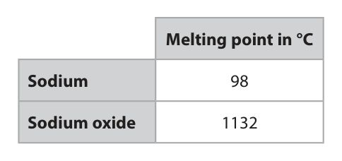

# 4CH1/2CR — 2025-06 (official extraction)

> schema `syllabai.official-paper-questions/0.1` · paper_id `pearson-edexcel:international-gcse:chemistry:4ch1:2025-06:4CH1/2CR` · qp sha256 `f0094e30d88274dc…` · extracted verbatim, never regenerated (ADR-037)

## Question 1 (6 marks)

This question is about gases.

**(a)** The box gives the names of some gases. carbon dioxide carbon monoxide helium neon nitrogen oxygen Choose gases from the box to answer questions (i) to (iv). You may use each gas once, more than once or not at all.

### 1(a)(i) [1]

Identify two gases in Group 0 of the Periodic Table.

**Mark scheme answer**

> helium and neon both are required for
> the mark

- **(1)** helium and neon both are required for

### 1(a)(ii) [1]

Identify the gas that makes up about 21% of the atmosphere.

**Mark scheme answer**

> oxygen ACCEPT O2

- **(1)** oxygen ACCEPT O2

### 1(a)(iii) [1]

Identify a greenhouse gas.

**Mark scheme answer**

> carbon dioxide ACCEPT CO2

- **(1)** carbon dioxide ACCEPT CO2

### 1(a)(iv) [1]

Identify the toxic gas formed by incomplete combustion of a hydrocarbon.

**Mark scheme answer**

> carbon monoxide ACCEPT CO

- **(1)** carbon monoxide ACCEPT CO

### 1(b) [2]

Describe a test to show that a gas is carbon dioxide.

**Mark scheme answer**

> M1 (bubble the gas through) limewater M2 dependent on M1
> M2 which turns (from colourless to) cloudy/milky ALLOW white
> precipitate
> Total = 6

- **(1)** (bubble the gas through) limewater M2 dependent on M1
- **(1)** which turns (from colourless to) cloudy/milky ALLOW white

## Question 2 (5 marks)

Crude oil is a mixture of hydrocarbons.

**(c)** The diagram shows the displayed formula of one of the alkanes in the refinery gases fraction. H H H H H C C C C H H H H H

### 2(a) [1]

Name the process used to separate crude oil into fractions.

**Mark scheme answer**

> (fractional) distillation

- **(1)** (fractional) distillation

### 2(b) [1]

Give one use for the bitumen fraction.

**Mark scheme answer**

> (surfacing) roads / road tar / tarmac/ roofs ALLOW ‘making roads’

- **(1)** (surfacing) roads / road tar / tarmac/ roofs ALLOW ‘making roads’

### 2(c)(i) [1]

Determine the molecular formula of this alkane.

**Mark scheme answer**

> C4H10

- **(1)** C4H10

### 2(c)(ii) [1]

Name this alkane.

**Mark scheme answer**

> butane

- **(1)** butane

### 2(c)(iii) [1]

Give the general formula of the homologous series of alkanes.

**Mark scheme answer**

> CnH2n+2
> Total = 5

- **(1)** CnH2n+2

## Question 3 (7 marks)

This question is about a compound called potassium permanganate.

**(a)** A teacher makes a saturated solution of potassium permanganate using this method. The teacher adds 25 cm3 of water at 50 °C to a beaker. The teacher then adds solid potassium permanganate one spatula at a time, while stirring, until the solution is saturated.

**(c)** The equation shows the thermal decomposition of potassium permanganate. 2KMnO4 → K2MnO4 + MnO2 + O2

### 3(a)(i) [1]

Give the meaning of the term saturated solution.

**Mark scheme answer**

> (a solution that) has as much ALLOW No more solute
> solute/solid/substance as possible dissolved (at a will dissolve
> particular temperature) OWTTE

- **(1)** (a solution that) has as much ALLOW No more solute

### 3(a)(ii) [1]

Give a reason why crystals form when the saturated solution cools from 50 °C to room temperature.

**Mark scheme answer**

> the solubility decreases (as the temperature
> decreases)

- **(1)** the solubility decreases (as the temperature

### 3(b) [2]

The teacher pours 25 cm3 of a saturated solution of potassium permanganate at room temperature into an evaporating dish. The teacher leaves the solution until all the water has evaporated. The teacher records the mass of the evaporating dish and the mass of the evaporating dish with the dry crystals. mass of evaporating dish = 64.10 g mass of evaporating dish with dry crystals = 65.35 g Calculate the solubility of potassium permanganate in grams per 100 g of water. [1.00 cm3 of water has a mass of 1.00 g] solubility = g per 100 g of water

**Mark scheme answer**

> M1 (mass of potassium permanganate) 1.25 (g)
> M2 (solubility of potassium manganate) 5 (g/100g) ALLOW M1×4
> 5 (g/100g) no working
> scores 2 marks

- **(1)** (mass of potassium permanganate) 1.25 (g)
- **(1)** (solubility of potassium manganate) 5 (g/100g) ALLOW M1×4

### 3(c)(i) [1]

Describe a test to show that oxygen gas is produced.

**Mark scheme answer**

> glowing splint/spill relights REJECT burning/lit
> splint

- **(1)** glowing splint/spill relights REJECT burning/lit

### 3(c)(ii) [1]

Calculate the Mr of K2MnO4 Mr =

**Mark scheme answer**

> 197 IGNORE any units given

- **(1)** 197 IGNORE any units given

### 3(d) [1]

Potassium permanganate is an oxidising agent. Give a reason why potassium permanganate is an oxidising agent.

**Mark scheme answer**

> any one from: IGNORE ‘oxidises
> another substance
> electron acceptor/gains electrons whilst being reduced
> itself’
> oxygen donor/loses oxygen
> Total = 7

- **(1)** any one from: IGNORE ‘oxidises

## Question 4 (11 marks)

This question is about Group 1 metals.

**(a)** A teacher adds a small piece of lithium metal to a trough containing water.

**(b)** Potassium is more reactive than lithium. The diagram shows the electronic structure of an atom of lithium and an atom of potassium. Lithium Potassium

### 4(a)(i) [2]

Complete the equation for the reaction between lithium and water by adding the state symbols. 2Li( ) + 2H2O( ) → 2LiOH( ) + H2( )

**Mark scheme answer**

> All four correct scores 2
> 2Li(s) + 2H2O(l) → 2LiOH(aq) + H2(g) 2 or 3 correct scores 1

- **(2)** All four correct scores 2

### 4(a)(ii) [2]

Give two observations made when the lithium is added to the water. 1 2

**Mark scheme answer**

> any two from:
> M1 effervescence ALLOW fizzing /
> bubbling
> IGNORE hydrogen/gas
> produced
> M2 gets smaller ALLOW disappears /
> dissolves
> M3 floats moves on the surface
> scores M3 and M4
> M4 moves
> REJECT melts/molten
> sphere
> REJECT flame/burning

- **(2)** any two from:

### 4(a)(iii) [3]

The reaction produces 375 cm3 of hydrogen gas at room temperature and pressure (rtp). Show, by calculation, that the mass of lithium added is between 0.20 g and 0.30 g. [1 mol of gas has a volume of 24 000 cm3 at rtp] [for lithium, Ar = 7]

**Mark scheme answer**

> M1 (amount of hydrogen) = 375÷24000 OR 0.015625
> (mol)
> M2 (amount of lithium) = 0.03125 (mol)) ALLOW M1 × 2
> M3 (mass of lithium) 0.21875 (g) ALLOW M2 × 7
> ALLOW any number of
> significant figures apart
> from 1
> REJECT incorrect
> rounding
> ALLOW any answer that
> rounds to 0.22g
> Answer with no working
> scores M3 only

- **(1)** (amount of hydrogen) = 375÷24000 OR 0.015625
- **(1)** (amount of lithium) = 0.03125 (mol)) ALLOW M1 × 2
- **(1)** (mass of lithium) 0.21875 (g) ALLOW M2 × 7

### 4(b)(i) [1]

Give one observation that is different when a small piece of potassium, instead of lithium, is added to water.

**Mark scheme answer**

> any one from:
> potassium melts / turns into a ball / potassium ALLOW
> moves faster / faster effervescence/ disappears/dissolves
> (lilac/purple/pink) flame faster

- **(1)** any one from:

### 4(b)(ii) [3]

Explain why potassium is more reactive than lithium. Refer to the electronic structure of lithium and of potassium in your answer.

**Mark scheme answer**

> M1 potassium has a bigger atom / potassium has REJECT more
> more shells / outer electron is further from the outer shells for M1
> nucleus
> M2 the outer (shell) electron is less attracted to the
> nucleus OR the outer (shell) electron is more
> shielded (from the nuclear attraction)
> M3 (so outer) electron (in potassium) more easily Should be comparative
> lost for M3
> IGNORE electrons
> (plural) in M1 and M2
> but do not allow
> electrons in M3
> ALLOW reverse
> argument throughout
> for lithium
> Total = 11

- **(1)** potassium has a bigger atom / potassium has REJECT more
- **(1)** the outer (shell) electron is less attracted to the
- **(1)** (so outer) electron (in potassium) more easily Should be comparative

## Question 5 (11 marks)

This question is about metals and metal compounds.

### 5(a) [2]

The method used to extract a metal depends on the reactivity of the metal. Explain which method is used to extract sodium metal from sodium chloride.

**Mark scheme answer**

> M1 electrolysis REJECT electrolysis of an
> aqueous solution
> M2 as sodium is more reactive than carbon ALLOW it is above
> carbon in the reactivity
> series
> ALLOW carbon cannot
> displace sodium
> M2 dependent on M1

- **(1)** electrolysis REJECT electrolysis of an
- **(1)** as sodium is more reactive than carbon ALLOW it is above

### 5(b) [2]

The diagram shows the arrangement of particles in a pure metal. Explain why pure metals are soft.

**Mark scheme answer**

> M1 layers / rows (of atoms, ions or particles) REJECT if mention of
> molecules or
> intermolecular forces for
> M1
> M2 can slide over one another
> REJECT electrons sliding
> for M2

- **(1)** layers / rows (of atoms, ions or particles) REJECT if mention of
- **(1)** can slide over one another

### 5(c) [2]

The diagram shows the electronic structure of an atom of sodium and an atom of oxygen. Sodium Oxygen Describe, in terms of electrons, what happens when sodium reacts with oxygen.

**Mark scheme answer**

> M1 sodium loses electrons and oxygen gains ACCEPT correctly
> electrons labelled diagrams
> M2 two atoms of sodium lose one electron and Mention of sharing
> oxygen gains 2 electrons electrons scores 0

- **(1)** sodium loses electrons and oxygen gains ACCEPT correctly
- **(1)** two atoms of sodium lose one electron and Mention of sharing

### 5(d) [5]

The table shows the melting points of sodium and sodium oxide. Melting point in °C Sodium 98 Sodium oxide 1132 Explain why sodium and sodium oxide have different melting points. In your answer you should refer to: • the structures of sodium and sodium oxide • the forces between the particles

**Mark scheme answer**

> Sodium:
> M1 (giant) metallic structure/lattice REJECT Intermolecular
> forces for M1 and M2
> M2 (electrostatic) attraction between positive ions
> and delocalised electrons
> Sodium oxide:
> REJECT Intermolecular
> M3 giant ionic structure OR (giant) ionic lattice forces/covalent/metallic
> for M3 and M4
> M4 (electrostatic) attraction between oppositely
> charged ions
> Comparison:
> M5 more energy is required to overcome the bonds M5 is comparative mark
> in sodium oxide than sodium ORA that is independent of
> M1-M4
> Total = 11

- **(1)** (giant) metallic structure/lattice REJECT Intermolecular
- **(1)** (electrostatic) attraction between positive ions
- **(1)** giant ionic structure OR (giant) ionic lattice forces/covalent/metallic
- **(1)** (electrostatic) attraction between oppositely
- **(1)** more energy is required to overcome the bonds M5 is comparative mark

## Question 6 (15 marks)

A student does a titration to find the volume of phosphoric acid solution (H3PO4) needed to neutralise a sample of potassium hydroxide solution (KOH). One of the products of the reaction is potassium phosphate. This is the student’s method. • use a measuring cylinder to transfer 25 cm3 of potassium hydroxide solution to a conical flask • add two drops of an indicator • fill a burette with phosphoric acid solution and record the initial reading on the burette • add the acid to the conical flask • record the final burette reading when the indicator changes colour This is the equation for the reaction. H3PO4(aq) + 3KOH(aq) → K3PO4(aq) + 3H2O(l)

**(c)** Potassium phosphate solution reacts with calcium chloride solution. One of the products is the insoluble solid, calcium phosphate.

### 6(a) [4]

Explain two improvements to the student’s method that would give more accurate results. 1 2

**Mark scheme answer**

> any two of the following pairs of points: IGNORE choice of indicator
> M2 is dependent on M1
> M1 use a pipette (instead of a measuring
> cylinder)
> M2 so the volume of alkali added is more precise ALLOW accurate
> OR
> M1 add the acid dropwise towards the endpoint
> M2 so the exact endpoint is seen
> OR
> M1 swirl the flask ALLOW stir
> M2 so the acid and alkali are fully
> mixed/reacted
> OR
> M1 repeat the titration
> M2 so concordant results are obtained OR so
> anomalous results can be ignored
> OR
> M1 do the titration on a white tile
> M2 so the colour change can easily be seen
> OR
> M1 rinse the burette with acid
> M2 so that the concentration of acid in the
> burette is not affected

- **(4)** any two of the following pairs of points: IGNORE choice of indicator

### 6(b) [4]

The student repeats the titration correctly. The potassium hydroxide solution has a concentration of 0.150 mol / dm3 . The phosphoric acid solution has a concentration of 0.0400 mol / dm3 . Calculate the volume, in cm3 , of phosphoric acid solution needed to neutralise 25.0 cm3 of 0.150 mol / dm3 potassium hydroxide solution. Give your answer to three significant figures. volume of phosphoric acid solution = cm3

**Mark scheme answer**

> M1 (amount of potassium hydroxide)
> (25 × 0.150) ÷ 1000 OR 0.00375 (mol)
> M2 0.00375 ÷ 3 OR 0.00125 (mol) ALLOW M1÷3
> M3 (0.00125 ÷ 0.04) × 1000 ALLOW ecf from M2
> M4 31.3(cm3) M3 to 3 sig figs
> 31.3 (cm3) scores 4
> 31.25 (cm3) scores 3
> 93.8 (cm3) scores 3
> 93.75 (cm3) scores 2

- **(1)** (amount of potassium hydroxide)
- **(1)** 0.00375 ÷ 3 OR 0.00125 (mol) ALLOW M1÷3
- **(1)** (0.00125 ÷ 0.04) × 1000 ALLOW ecf from M2
- **(1)** 31.3(cm3) M3 to 3 sig figs

### 6(c)(i) [1]

Complete the equation for the reaction. 2K3PO4(aq) + CaCl2(aq) → Ca3(PO4)2(s) + KCl(aq)

**Mark scheme answer**

> 2K3PO4 + 3CaCl2→ Ca3(PO4)2 + 6KCl

- **(1)** 2K3PO4 + 3CaCl2→ Ca3(PO4)2 + 6KCl

### 6(c)(ii) [3]

The student reacts a solution containing 0.0400 mol of potassium phosphate with an excess of calcium chloride solution. The student obtains 5.70 g of calcium phosphate. Show that the percentage yield for the reaction is about 90% [for Ca3(PO4)2 Mr = 310]

**Mark scheme answer**

> M1 (amount of calcium phosphate) 0.0200 (mol)
> M2 (mass of calcium phosphate) 6.2 (g) ALLOW M1 × 310
> M3 (5.7 ÷ 6.2 × 100) = 91.9 % ALLOW any number of
> significant figures from 2
> OR
> M1 (amount of calcium phosphate) = 5.7/310 OR
> 0.0184 (mol)
> M2 0.0184 × 2 OR 0.0368 (mol) ALLOW M1 × 2
> M3 (0.0368/0.04 × 100) = 91.9 % ALLOW any number of
> significant figures from 2

- **(3)** M1 (amount of calcium phosphate) 0.0200 (mol)

### 6(c)(iii) [3]

Describe how the student can obtain a pure, dry sample of calcium phosphate from the mixture at the end of the reaction.

**Mark scheme answer**

> M1 filter (the calcium phosphate) If evaporation to form
> crystals/a soluble salt
> method then M3 only for a
> suitable drying method.
> M2 wash the residue (with distilled water)
> M3 leave to dry (on a windowsill) /dry between REJECT hot oven or direct
> filter papers /dry in a desiccator / dry in a warm heating with Bunsen Burner
> oven for M3
> REJECT if solid is washed
> again after drying for M3
> Total = 15

- **(1)** filter (the calcium phosphate) If evaporation to form
- **(1)** wash the residue (with distilled water)
- **(1)** leave to dry (on a windowsill) /dry between REJECT hot oven or direct

## Question 7 (15 marks)

This question is about ethanol, C2H5OH , which can be used as a fuel. Ethanol can be produced by the fermentation of glucose solution.

**(b)** This is the equation for the combustion of ethanol. C2H5OH + 3O2 → 2CO2 + 3H2O The equation shows the displayed formulae of the reactants and products. O H H O O H H O C O H C C O H + O O + O O C O H H H H O O O H H The table shows some bond energies. Bond Bond energy in kJ / mol C H 414 C C 346 C O 358 O H 463 O O 498 C O 804

**(c)** Ethanol reacts with compound A to produce ester B and compound C. This is the equation for the reaction. H H H O H C C O H + compound A H C C H H + compound C H H H O C C H H H ester B

### 7(a)(i) [1]

Name the substance that is added that causes the fermentation of glucose solution.

**Mark scheme answer**

> yeast ALLOW
> zymase/enzymes from
> yeast

- **(1)** yeast ALLOW

### 7(a)(ii) [1]

Which temperature is most suitable for fermentation?

- **(A)** 0 °C
- **(B)** 10 °C
- **(C)** 30 °C  ✔
- **(D)** 100 °C

**Mark scheme answer**

> C 30°C
> A is not the correct answer because 0°C is too low
> for fermentation
> B is not the correct answer because 10°C is too low
> for fermentation
> D is not the correct answer because 100°C is too
> high for fermentation

- **(1)** Answer C: 30 °C

### 7(a)(iii) [2]

Explain why fermentation is done in the absence of air.

**Mark scheme answer**

> An explanation using either of the following linked
> pairs:
> M1 oxygen (in the air) would react with ethanol/ ALLOW ethanol would
> alcohol be oxidised
> M2 to form ethanoic acid ALLOW to form
> carboxylic acid
> ALLOW to form
> vinegar/acetic acid
> OR
> M1 (in the presence of air) the glucose would react ALLOW correct
> with the oxygen reference to aerobic
> respiration
> M2 so ethanol does not form ALLOW forms CO2 and
> H2O

- **(2)** An explanation using either of the following linked

### 7(b)(i) [3]

Use the bond energies to show that the molar enthalpy change, ΔH , is about −1300 kJ / mol.

**Mark scheme answer**

> M1 346 + (5 × 414) + 358 + 463 + (3 × 498) OR 4731
> M2 (4 × 804) + (6 × 463) OR 5994
> M3 −1263 (kJ/mol)
> OR
> M1 346 + (5 × 414) + 358 + (3 × 498) OR 4268
> M2 (4 × 804) + (5 × 463) OR 5531
> M3 −1263 (kJ/mol) −1263 kJ/mol scores 3
> ALLOW ecf for M3

- **(3)** M1 346 + (5 × 414) + 358 + 463 + (3 × 498) OR 4731

### 7(b)(ii) [3]

Complete the energy level diagram for the reaction between C2H5OH and O2 energy

**Mark scheme answer**

> IGNORE any activation
> energy hump
> IGNORE enthalpy
> change arrow
> M1 right-hand line below left-hand line
> M2 correct names/balanced formulae of both
> reactants If only use words
> reactants (on left) and
> M3 correct names/balanced formulae of both products (on right)
> products award
> 1 mark from M2 and M3
> If no/incorrect
> coefficients then
> 1 mark from M2 and M3

- **(1)** right-hand line below left-hand line
- **(1)** correct names/balanced formulae of both
- **(1)** correct names/balanced formulae of both products (on right)

### 7(b)(iii) [2]

Explain, in terms of bonds broken and bonds made, why this reaction is exothermic.

**Mark scheme answer**

> An explanation that links together the following two
> points:
> M1 more energy is given out when the bonds are If state/imply that
> made energy
> required to make bonds
> M2 than is taken in when the bonds are broken OR
> ACCEPT correct reverse argument If state/imply that
> energy
> released when bonds
> are broken scores 0/2
> OR
> M1 breaking bonds is endothermic/takes in energy M2 dep on M1
> AND making bonds is exothermic/releases energy
> M2 the energy released is more than the energy
> taken in

- **(2)** An explanation that links together the following two

### 7(c)(i) [2]

Draw the displayed formula for compound A and for compound C. compound A compound C

**Mark scheme answer**

> M1 displayed formula for ethanoic acid
> M2 displayed formula for water/H2O ACCEPT any shape
> ethyl ethanoate IGNORE hyphens

- **(1)** displayed formula for ethanoic acid
- **(1)** displayed formula for water/H2O ACCEPT any shape

### 7(c)(ii) [1]

Name ester B.

**Mark scheme answer**

> Total =
> Pearson Education Limited. Registered company number 872828
> with its registered office at 80 Strand, London, WC2R 0RL, United Kingdom

- **(1)** Total =

