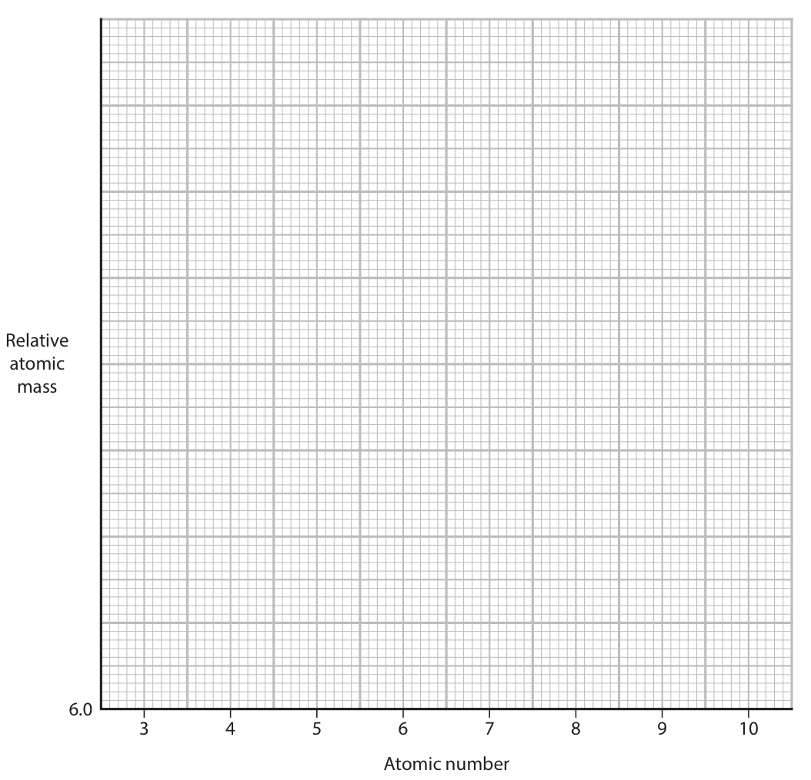
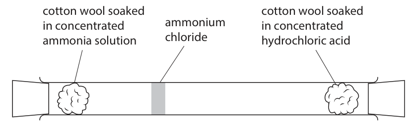
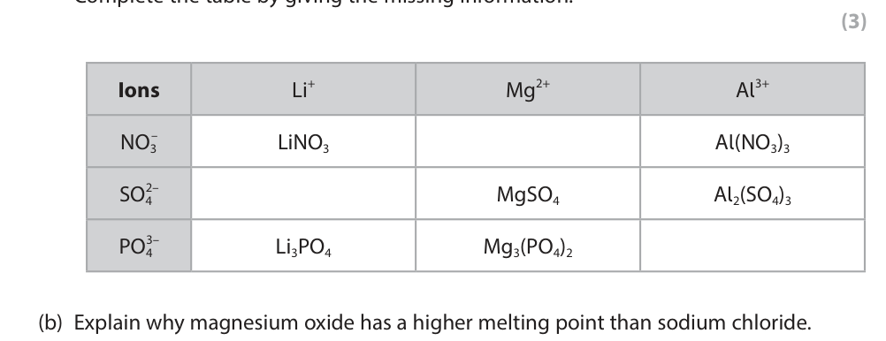

# 4CH1/1C — 2025-11 (official extraction)

> schema `syllabai.official-paper-questions/0.1` · paper_id `pearson-edexcel:international-gcse:chemistry:4ch1:2025-11:4CH1/1C` · qp sha256 `7076dc7916f25151…` · extracted verbatim, never regenerated (ADR-037)

## Question 1 (7 marks)

The diagram shows how particles are arranged in the three states of matter. Z X Y solid liquid gas

### 1(a) [3]

Give the names of the changes of state labelled X, Y and Z. X Y Z

**Mark scheme answer**

> M1 X melting
> M2 Y boiling ALLOW evaporation
> ALLOW vaporisation
> M3 Z sublimation

- **(1)** X melting
- **(1)** Y boiling ALLOW evaporation
- **(1)** Z sublimation

### 1(b) [2]

Water vapour condenses to form water. Give the equation for this change of state. Include the state symbols.

**Mark scheme answer**

> H2O (g) → H2O (l)
> M1 both formulae correct IGNORE ‘water’ instead
> of formulae
> M2 both state symbols correct IGNORE letter case
> M2 dep on M1

- **(1)** both formulae correct IGNORE ‘water’ instead
- **(1)** both state symbols correct IGNORE letter case

### 1(c) [2]

Describe how particles are arranged differently in solids and gases.

**Mark scheme answer**

> M1 solid (particles) have a regular arrangement OR IGNORE statements
> gas particles are randomly arranged related to liquids
> M2 solid (particles) are closely/tightly packed OR IGNORE diagrams
> gas particles widely spaced
> IGNORE statements
> related to movement
> including ‘random
> movement’

- **(1)** solid (particles) have a regular arrangement OR IGNORE statements
- **(1)** solid (particles) are closely/tightly packed OR IGNORE diagrams

## Question 2 (8 marks)

The box gives the names of some gases in the atmosphere. argon carbon dioxide nitrogen oxygen water vapour

**(a)** Choose gases from the box to answer these questions.

**(c)** A student uses this apparatus to calculate the percentage of oxygen in a sample of air. wet iron wool column of air water This is the student’s method. • measure the initial height of the column of air • leave the apparatus for one week • measure the final height of the column of air The table shows the student’s results. Final height of column of air in mm 77 Initial height of column of air in mm 93

### 2(a)(i) [1]

Identify the gas with a molecule that contains a triple bond.

**Mark scheme answer**

> nitrogen ALLOW N2
> IGNORE N

- **(1)** nitrogen ALLOW N2

### 2(a)(ii) [1]

Identify the gas in the atmosphere that exists as individual atoms.

**Mark scheme answer**

> argon ALLOW Ar

- **(1)** argon ALLOW Ar

### 2(a)(iii) [1]

Identify the gas needed for combustion reactions.

**Mark scheme answer**

> oxygen ALLOW O2
> IGNORE O

- **(1)** oxygen ALLOW O2

### 2(b) [2]

Explain how carbon dioxide can be formed from copper(II) carbonate. 

**Mark scheme answer**

> M1 heat (the copper(II) carbonate) ALLOW thermal
> decomposition for 2 marks
> M2 until it decomposes (into carbon dioxide) ALLOW correct equation for
> M2 only
> OR
> M1 add an acid
> M2 forming salt, water and carbon dioxide ACCEPT acid/carbonate
> equation for 2 marks

- **(2)** M1 heat (the copper(II) carbonate) ALLOW thermal

### 2(c)(i) [2]

Use the student’s results to calculate the percentage of oxygen in the sample of air. percentage = %

**Mark scheme answer**

> M1 (height of oxygen =) 93 − 77 OR 16 (mm)
> M2 16 × 100 = 17 (%) M2 subsumes M1
> ACCEPT 17/17.2/17.20 or
> any number of sig figs
> except 1
> 83/82.8 scores M2 – ecf

- **(1)** (height of oxygen =) 93 − 77 OR 16 (mm)
- **(1)** 16 × 100 = 17 (%) M2 subsumes M1

### 2(c)(ii) [1]

The percentage of oxygen in air is approximately 21%. Suggest an improvement to the method that would increase the accuracy of the student’s results.

**Mark scheme answer**

> Leave the experiment for longer (than a ALLOW use a measuring
> week)/leave until the water is at a constant cylinder/graduated tube
> height
> ALLOW use iron fillings
> ALLOW more iron wool
> ALLOW warmer temperature
> repeat/average does not
> score - apply list principle

- **(1)** Leave the experiment for longer (than a ALLOW use a measuring

## Question 3 (11 marks)

This question is about atomic structure and the Periodic Table.

**(a)** The diagram shows an atom of an element. X – + ++ – – – – + + Y W Z Use the diagram to answer these questions.

**(c)** The table shows the atomic number and the relative atomic mass (to 1 decimal place) of the elements in a period of the Periodic Table. Element Li Be B C N O F Ne Atomic number 3 4 5 6 7 8 9 10 Relative atomic mass 6.9 9.0 10.8 12.0 14.0 16.0 19.0 20.2

### 3(a)(i) [1]

Which particle is a proton?

- **(A)** W
- **(B)** X  ✔
- **(C)** Y
- **(D)** Z

**Mark scheme answer**

> B (X)
> A is incorrect as W is a neutron
> C is incorrect as Y is an electron
> D is incorrect as Z is the nucleus

- **(1)** Answer B: X

### 3(a)(ii) [1]

Which particle has a relative charge of 0?

- **(A)** W  ✔
- **(B)** X
- **(C)** Y
- **(D)** Z

**Mark scheme answer**

> A (W)
> B is X incorrect as X is a proton which has a +1
> charge
> C is incorrect as Y is an electron which has a -1
> charge
> D is incorrect as Z is the nucleus which contains
> protons so has an overall positive charge

- **(1)** Answer A: W

### 3(a)(iii) [1]

Name the part of the atom labelled Z. 

**Mark scheme answer**

> Nucleus

- **(1)** Nucleus

### 3(a)(iv) [1]

What is the group number of this element?

- **(A)** 2
- **(B)** 3  ✔
- **(C)** 5
- **(D)** 11

**Mark scheme answer**

> B (3)
> A is incorrect as it is not 2
> C is incorrect as it is not 5
> D is incorrect as it is not 11

- **(1)** Answer B: 3

### 3(a)(v) [1]

What is the period number of this element?

- **(A)** 2  ✔
- **(B)** 3
- **(C)** 5
- **(D)** 11

**Mark scheme answer**

> A (2)
> B is incorrect as it is not 3
> C is incorrect as it is not 5
> D is incorrect as it is not 11

- **(1)** Answer A: 2

### 3(a)(vi) [1]

Give the chemical symbol of this element.

**Mark scheme answer**

> B

- **(1)** B

### 3(b) [1]

State what type of particle is formed when an atom loses its outer shell electrons. 

**Mark scheme answer**

> (positive) ion/cation ALLOW ‘an ion’
> REJECT ‘anion’
> REJECT negative

- **(1)** (positive) ion/cation ALLOW ‘an ion’

### 3(c)(i) [1]

On the grid, add an appropriate scale to the y-axis, starting at 6.0

**Mark scheme answer**

> scale on y-axis starting at 6.0 and going up in twos
> for each large square

- **(1)** scale on y-axis starting at 6.0 and going up in twos

### 3(c)(ii) [2]

Plot the data on the grid. Do not join the points.  Relative atomic mass 6.0 3 4 5 6 7 8 9 10 Atomic number

**Mark scheme answer**

> all points plotted to the nearest grid line ECF for correct points
> on an appropriate
> alternative axis

- **(2)** all points plotted to the nearest grid line ECF for correct points

### 3(c)(iii) [1]

Identify the relationship between relative atomic mass and atomic number for the elements in this period.

**Mark scheme answer**

> there is a positive correlation (between the relative REJECT directly
> atomic mass and the atomic number) / as the proportional
> atomic number increases so does the relative REJECT proportional
> atomic mass REJECT linear

- **(1)** there is a positive correlation (between the relative REJECT directly

## Question 4 (12 marks)

This question is about ammonium chloride.

**(c)** A student draws a diagram to show the formation of solid ammonium chloride in a glass tube. cotton wool soaked cotton wool soaked in concentrated ammonium in concentrated ammonia solution chloride hydrochloric acid

### 4(a) [2]

Draw a diagram to show the arrangement of the electrons in a chloride ion.

**Mark scheme answer**

> M1 a correct diagram which has an inner shell ‘2,8,8’ with no
> configuration of 2,8 diagram scores 1
> mark only
> M2 a correct diagram which has an outer shell
> IGNORE charge on the
> configuration of 8
> ion

- **(1)** a correct diagram which has an inner shell ‘2,8,8’ with no
- **(1)** a correct diagram which has an outer shell

### 4(b) [6]

Two beakers are unlabelled. One beaker contains a solution of ammonium chloride and the other beaker contains a solution of ammonium sulfate. Describe tests that can be carried out to confirm that one beaker contains ammonium chloride and the other beaker contains ammonium sulfate. 

**Mark scheme answer**

> Test for chloride ions IGNORE tests for
> ammonium ions
> M1 add (nitric) acid (to the ammonium chloride)
> REJECT add HCl –
> M2 add silver nitrate solution loses M1 and M3
> M3 white precipitate forms M3 dep on addition of
> silver nitrate
> Test for sulfate ions
> M4 add (nitric acid/hydrochloric) acid (to the REJECT add H2SO4 –
> ammonium sulfate) loses M4 and M6
> M5 add barium chloride ALLOW barium
> nitrate
> M6 white precipitate forms
> M6 dep on addition of
> barium
> chloride/nitrate

- **(1)** add (nitric) acid (to the ammonium chloride)
- **(1)** add silver nitrate solution loses M1 and M3
- **(1)** white precipitate forms M3 dep on addition of
- **(1)** add (nitric acid/hydrochloric) acid (to the REJECT add H2SO4 –
- **(1)** add barium chloride ALLOW barium
- **(1)** white precipitate forms

### 4(c)(i) [3]

Explain the mistake in the student’s diagram.

**Mark scheme answer**

> M1 the ammonium chloride should be closer to the ACCEPT (reactant)
> hydrochloric acid/further from the ammonia labels should be the
> solution/further to the right other way around for
> M1
> REJECT ammonium
> chloride should be in
> the centre for M1
> M2 as hydrogen chloride has a higher Mr/relative
> molecular mass/relative formula mass ORA
> M3 so hydrogen chloride (molecules) moves more
> slowly/diffuses more slowly/travel a shorter distance
> ORA

- **(1)** the ammonium chloride should be closer to the ACCEPT (reactant)
- **(1)** as hydrogen chloride has a higher Mr/relative
- **(1)** so hydrogen chloride (molecules) moves more

### 4(c)(ii) [1]

Complete the equation for the reaction in the glass tube by adding state symbols. NH3 ( ) + HCl ( ) NH4Cl ( )

**Mark scheme answer**

> NH3 (g) + HCl (g) ⇌ NH4Cl (s) IGNORE letter case

- **(1)** NH3 (g) + HCl (g) ⇌ NH4Cl (s) IGNORE letter case

## Question 5 (13 marks)

This question is about displacement reactions. A student uses this method to investigate what happens when excess metal is added to a solution of copper(II) sulfate. • pour some copper(II) sulfate solution into a polystyrene cup and record the temperature • add excess metal W to the polystyrene cup and stir the mixture • record the maximum temperature reached • calculate the temperature increase of the solution The student repeats the method for metals X, Y and Z. For each metal, the student records three sets of results.

**(d)** The table shows the student’s results. Temperature increase in °C Mean temperature Metal increase in °C experiment 1 experiment 2 experiment 3 W 4.0 2.0 4.2 4.1 X 0.0 0.0 0.0 0.0 Y 6.1 6.3 6.0 Z 8.1 8.5 8.9 8.5

### 5(a) [1]

Give a reason why the student could not use copper(II) carbonate instead of copper(II) sulfate.

**Mark scheme answer**

> Copper(II) carbonate is insoluble/doesn’t dissolve
> (in water)

- **(1)** Copper(II) carbonate is insoluble/doesn’t dissolve

### 5(b) [2]

Explain why a polystyrene cup is used instead of a glass beaker.

**Mark scheme answer**

> M1 polystyrene cup is an insulator ALLOW ORA
> M2 so less heat is lost REJECT prevents heat
> loss/no heat loss for M2

- **(1)** polystyrene cup is an insulator ALLOW ORA
- **(1)** so less heat is lost REJECT prevents heat

### 5(c) [2]

Give two variables the student should control in the investigation. 1 2 

**Mark scheme answer**

> Allow any two from:
> M1 concentration of copper(II) sulfate IGNORE same
> mass/amount of metal W
> M2 volume of copper(II) sulfate
> If no reference to
> M3 rate of stirring concentration and
> volume allow amount of
> M4 surface area of metal (W) copper(II) sulfate for 1
> mark
> M5 Same initial temperature
> M6 Same (polystyrene) cup

- **(2)** Allow any two from:

### 5(d)(i) [2]

Calculate the mean temperature increase for metal Y. Give your answer to two significant figures. mean temperature increase = °C

**Mark scheme answer**

> M1 6.1 + 6.3 + 6.0 OR 6.13 6.1 in table or in the
> 3 space available scores 2.
> M2 6.1 Answer line takes priority
> over the table.
> ECF for correct
> calculation to 2sf for any
> data taken for metal Y

- **(1)** 6.1 + 6.3 + 6.0 OR 6.13 6.1 in table or in the
- **(1)** 6.1 Answer line takes priority

### 5(d)(ii) [2]

Explain whether the anomalous result in experiment 2 could have been caused by stirring the mixture too quickly. 

**Mark scheme answer**

> M1 any one from:
> REJECT answers which
> Overall temp change should be similar/same as Exp indicate that stirring
> 1/3 OWTTE would have caused the
> Temperature increase should not be lower than error (i.e. Yes). This
> Exp1/3 scores 0 for the question.
> Temperature increase would be higher than 2.0
> given in the table
> M2 (as stirring too quickly) would increase the rate
> of reaction/wouldn’t have reduced the amount of
> heat produced (in the reaction)

- **(1)** any one from:
- **(1)** (as stirring too quickly) would increase the rate

### 5(d)(iii) [2]

Explain the order of reactivity for metals W, X, Y and Z.

**Mark scheme answer**

> M1 Z>Y>W>X
> M2 because the higher the temperature (increase)
> the more reactive the metal
> OR
> more heat released the more reactive the metal

- **(1)** Z>Y>W>X
- **(1)** because the higher the temperature (increase)

### 5(d)(iv) [2]

Explain why metal X could be silver.

**Mark scheme answer**

> M1 silver is less reactive than copper
> M2 therefore there was no reaction/there was no M2 dep on correct M1 or
> (mean) temperature increase/no displacement M1 missing
> reaction

- **(1)** silver is less reactive than copper
- **(1)** therefore there was no reaction/there was no M2 dep on correct M1 or

## Question 6 (15 marks)

Ethene can be obtained from crude oil using these two processes. Process 1 crude oil → kerosene Process 2 kerosene → octane (C8H18) + ethene

### 6(a)(i) [1]

Give the name of process 1.

**Mark scheme answer**

> fractional distillation ACCEPT fractionation
> ACCEPT fractionating

- **(1)** fractional distillation ACCEPT fractionation

### 6(a)(ii) [5]

Sketch a labelled diagram showing how the kerosene fraction is obtained from crude oil in process 1. 

**Mark scheme answer**

> M1 a tower drawn with one entrance and more than
> one exit
> M2 crude oil heated/vapourised before entering the
> tower OR passing through a furnace
> M3 crude oil enters at bottom ‘bottom’ meaning not
> higher than the exit
> of the second lowest
> M4 kerosene leaves tower but not right at fraction
> top/bottom
> One from:
> M5 a temperature gradient up the column/hottest
> label at the bottom/coldest label at the top REJECT both M5/M6 if
> M6 3 or more other fractions labelled in correct place either is incorrect
> relative to kerosene

- **(5)** M1 a tower drawn with one entrance and more than

### 6(b)(i) [2]

Give the two conditions needed for a reaction to occur in process 2. 1 2

**Mark scheme answer**

> M1 600 to 700 oC inclusive
> M2 silica/alumina (catalyst) ACCEPT
> zeolites/SiO2/Al2O3
> aluminosilicates
> /silicon dioxide
> /aluminium oxide

- **(1)** 600 to 700 oC inclusive
- **(1)** silica/alumina (catalyst) ACCEPT

### 6(b)(ii) [1]

Complete the equation for the reaction in process 2. C14H30 → +

**Mark scheme answer**

> C14H30 → C8H18 + 3C2H4 ALLOW multiples or
> fractions

- **(1)** C14H30 → C8H18 + 3C2H4 ALLOW multiples or

### 6(c) [3]

Explain one use of octane as fuel.

**Mark scheme answer**

> An explanation that links the following three points
> M1 (octane) can be used as petrol/(fuel) for cars ALLOW other
> acceptable uses for
> petrol
> M2 (as it) undergoes combustion/reacts with
> oxygen/burns
> M3 releasing heat (energy) ACCEPT thermal
> energy

- **(1)** (octane) can be used as petrol/(fuel) for cars ALLOW other
- **(1)** (as it) undergoes combustion/reacts with
- **(1)** releasing heat (energy) ACCEPT thermal

### 6(d)(i) [2]

Using displayed formulae, give the equation for the conversion of ethene into poly(ethene).

**Mark scheme answer**

> 2
> M1 correct repeat unit with extension bonds
> M2 full equation including ethene, n and brackets M2 dep on M1

- **(1)** correct repeat unit with extension bonds
- **(1)** full equation including ethene, n and brackets M2 dep on M1

### 6(d)(ii) [1]

Give the term used to describe ethene in the polymerisation process.

**Mark scheme answer**

> monomer

- **(1)** monomer

## Question 7 (12 marks)

A student uses this method to investigate the reaction between sodium hydroxide solution and dilute nitric acid. Step 1 pour 20 cm3 of dilute nitric acid into a 100 cm3 glass beaker Step 2 measure the temperature of the acid Step 3 add 5 cm3 of sodium hydroxide solution and stir the mixture Step 4 record the highest temperature reached The student repeats steps 3 and 4 until a total of 40 cm3 of sodium hydroxide solution has been added.

**(a)** The graph shows the student’s results. Temperature change in C 0 5 10 15 20 25 30 35 40 Volume of sodium hydroxide solution in cm3

**(b)** The student makes this statement about the shape of the graph. The first line on the graph shows that the temperature rises at a steady rate as more nitric acid is added and at 40 cm3, the acid has been neutralised by the sodium hydroxide. The student’s statement includes some mistakes and is incomplete.

**(c)** The student repeats the investigation. The student starts with 25 cm3 of dilute nitric acid at 19 °C. The student finds that 25 cm3 of sodium hydroxide solution is needed for complete neutralisation. The student calculates that the heat energy (Q) released is 3780 J. [for the solution, c = 4.2 J / g / °C] [mass for 1.0 cm3 of solution = 1.0 g]

### 7(a)(i) [1]

Determine the volume of sodium hydroxide solution at the point where the lines cross. volume = cm3

**Mark scheme answer**

> any value between 21.4 and 21.8 inclusive

- **(1)** any value between 21.4 and 21.8 inclusive

### 7(a)(ii) [1]

Determine the maximum temperature change reached during the investigation. maximum temperature change = °C 

**Mark scheme answer**

> any value between 16.1 and 16.3 inclusive

- **(1)** any value between 16.1 and 16.3 inclusive

### 7(b)(i) [2]

Give two mistakes in the student’s statement. 1 2

**Mark scheme answer**

> M1 should not be nitric acid added/sodium
> hydroxide should be added (not nitric acid)
> M2 the point where the lines cross shows where
> the acid was neutralised/the acid was neutralised
> before 40 cm3/ the acid was neutralised at 21.6 ALLOW any value between
> cm3 21.4-21.8 cm3 for 21.6 cm3

- **(1)** should not be nitric acid added/sodium
- **(1)** the point where the lines cross shows where

### 7(b)(ii) [1]

Add another sentence to complete the student’s statement. 

**Mark scheme answer**

> Any one statement that is:
> A suitable description e.g. The temperature
> decreases after the neutralisation point/after
> 21.6cm3 (or any value between 21.4-21.8)
> OR
> A suitable explanation e.g. The second line shows
> that there is no further reaction and the cool
> sodium hydroxide solution decreases the
> temperature OWTTE

- **(1)** Any one statement that is:

### 7(c)(i) [4]

Calculate the maximum temperature reached. maximum temperature = °C

**Mark scheme answer**

> M1 mass of solution = 25 + 25 OR 50 (g) ALLOW ecf for M2 onwards
> M2 Q = mcΔT OR 3780 = 50 × 4.2 × ΔT answer of 36 scores 2
> M3 ΔT = 3780 OR 18 (oC) answer of 55 scores 3
> 50 × 4.2
> M4 (maximum temperature = 19 + 18 =) 37 (oC) correct answer without
> working scores 4

- **(1)** mass of solution = 25 + 25 OR 50 (g) ALLOW ecf for M2 onwards
- **(1)** Q = mcΔT OR 3780 = 50 × 4.2 × ΔT answer of 36 scores 2
- **(1)** ΔT = 3780 OR 18 (oC) answer of 55 scores 3
- **(1)** (maximum temperature = 19 + 18 =) 37 (oC) correct answer without

### 7(c)(ii) [3]

The amount of dilute nitric acid used in the investigation was 0.079 mol. Calculate the value of ΔH, in kJ / mol, for the neutralisation reaction. Include a sign in your answer. ΔH = kJ / mol

**Mark scheme answer**

> M1 3780 OR 47 848 (J/mol) correct answer without
> 0.079 working scores 3 or 2
> without or incorrect sign
> M2 47.8 (kJ/mol)
> Incorrect rounding loses M2
> M3 − 47.8 (kJ/mol)
> OR
> M1 3780 OR 3.78 (kJ)
> 1000
> M2 3.78 OR 47.8 (kJ/mol)
> 0.079
> M3 − 47.8 (kJ/mol)

- **(3)** M1 3780 OR 47 848 (J/mol) correct answer without

## Question 8 (8 marks)

This question is about ionic compounds.

### 8(a) [3]

The table shows the formulae of some ions. It also shows the formulae of some compounds containing these ions. Complete the table by giving the missing information. Ions Li+ Mg2+ Al3+ NO3– LiNO3 Al(NO3)3 SO42– MgSO4 Al2(SO4)3 PO43– Li3PO4 Mg3(PO4)2

**Mark scheme answer**

> 3
> Ions Li+ Mg2+ Al3+
> NO3- Mg(NO3)2
> SO42- Li2SO4
> PO43- AlPO4

- **(3)** 3

### 8(b) [5]

Explain why magnesium oxide has a higher melting point than sodium chloride. Refer to structure and bonding in your answer.

**Mark scheme answer**

> 5
> M1 (sodium chloride and magnesium oxide) have a Mention of covalent
> giant ionic structure /lattice bonding, intermolecular
> forces, metallic
> bonding, molecules
> loses M1-M4.
> M2 (there are) electrostatic forces / attraction
> between oppositely charged ions /negative and ALLOW ionic bonds
> positive ions / anions and cations
> M3 MgO has stronger attraction (between ions) than
> NaCl ORA ‘stronger ionic bonds in
> MgO’ scores M2 and M3
> M4 (because the) ions in MgO have a higher
> charge/higher charge density (than NaCl) ORA
> ACCEPT correct charges
> on ions
> M5 which take more energy (to overcome the
> forces / break the bonds) ORA

- **(1)** (sodium chloride and magnesium oxide) have a Mention of covalent
- **(1)** (there are) electrostatic forces / attraction
- **(1)** MgO has stronger attraction (between ions) than
- **(1)** (because the) ions in MgO have a higher
- **(1)** which take more energy (to overcome the

## Question 9 (12 marks)

This question is about propene and propane.

**(c)** Propene and propane react with bromine.

**(d)** Ethene and propene contain the same functional group.

### 9(a) [3]

Complete the table by giving the missing information about propene. Displayed formula of propene Molecular formula of propene C3H6 Empirical formula of propene Relative formula mass of propene

**Mark scheme answer**

> 3
> Displayed formula of propene Must show ALL the bonds
> or
> Molecular formula of propene C3H6
> Empirical formula of propene CH2
> Relative formula mass of propene 42 IGNORE calculation

- **(3)** 3

### 9(b) [2]

Draw a dot-and-cross diagram for propane. Include only outer shell electrons. 

**Mark scheme answer**

> M1 correct electron sharing between 3 carbon ACCEPT any combination
> atoms of dots and crosses
> M2 rest of structure correctly drawn M2 dep on M1

- **(1)** correct electron sharing between 3 carbon ACCEPT any combination
- **(1)** rest of structure correctly drawn M2 dep on M1

### 9(c)(i) [1]

Which row shows the correct number of products for these reactions? Propene and bromine Propane and bromine

- **(A)** 1                                                                                                      1
- **(B)** 1                                                                                                      2  ✔
- **(C)** 2                                                                                                      1
- **(D)** 2                                                                                                      2

**Mark scheme answer**

> B (1, 2)
> A as (1,1) is incorrect
> C as (2,1) is incorrect
> D as (2,2) is incorrect

- **(1)** Answer B: 1                                                                                                      2

### 9(c)(ii) [1]

Give the reaction condition needed for propane and bromine to react together.

**Mark scheme answer**

> ultra violet radiation / ultra violet light/UV IGNORE sunlight

- **(1)** ultra violet radiation / ultra violet light/UV IGNORE sunlight

### 9(c)(iii) [3]

A compound formed in the reaction between bromine water and an alkene has this percentage composition by mass. C = 25.9% H = 5.0% O = 11.5% Br = 57.6% Calculate the empirical formula of this compound. empirical formula = 

**Mark scheme answer**

> M1 25.9 5.0 11.5 57.6 0 marks for upside down
> 12 1 16 80 calculation or use of any
> atomic number (6/8/35)
> M2 2.16 5.0 0.72 0.72
> 0.72 0.72 0.72 0.72 ecf allowed from M2 if
> one incorrect Ar value
> OR 3 6.94 1 1 used that is not an
> atomic number for these
> M3 C3H7OBr element (6/8/35)
> correct answer without
> working scores 3

- **(1)** 25.9 5.0 11.5 57.6 0 marks for upside down
- **(1)** 2.16 5.0 0.72 0.72
- **(1)** C3H7OBr element (6/8/35)

### 9(d)(i) [1]

State what is meant by the term functional group.

**Mark scheme answer**

> atom/groups of atoms (in a compound)/part of a
> molecule that determines its chemical
> properties/reactions OWTTE

- **(1)** atom/groups of atoms (in a compound)/part of a

### 9(d)(ii) [1]

Draw an isomer of propene that does not have the same functional group.

**Mark scheme answer**

> structure of cyclopropane

- **(1)** structure of cyclopropane

## Question 10 (12 marks)

This question is about aluminium sulfate. Aluminium reacts with sulfuric acid to form aluminium sulfate. This is the equation for the reaction. 2Al + 3H2SO4 → Al2(SO4)3 + 3H2

**(b)** A student uses this method to prepare some aluminium sulfate crystals. Step 1	add powdered aluminium to a beaker of dilute sulfuric acid and stir Step 2	keep stirring and adding powdered aluminium until it is in excess Step 3	filter the reaction mixture Step 4	heat the filtrate to evaporate some water and produce a saturated solution Step 5	allow the saturated solution to cool so that crystals form Step 6 filter to obtain the crystals and leave to dry

**(c)** The student adds 3.20 g of aluminium to 0.120 mol of dilute sulfuric acid.

### 10(a) [1]

What is the total number of elements in the formula Al2(SO4)3 ?

- **(A)** 3  ✔
- **(B)** 5
- **(C)** 14
- **(D)** 17

**Mark scheme answer**

> A (3)
> B is incorrect as there are not 5 elements
> C is incorrect as there are not 14 elements
> D is incorrect as there are 17 atoms not 17 elements

- **(1)** Answer A: 3

### 10(b)(i) [2]

During step 3, the reaction mixture is filtered. Identify the substance that remains in the filter paper and the substances in the beaker after this filtration. filter paper beaker 

**Mark scheme answer**

> M1 (excess) aluminium (powder) ACCEPT (leftover)
> water
> M2 aluminium sulfate AND water IGNORE aluminium
> sulfate solution
> unless water is also
> stated
> ALLOW correct
> symbols

- **(1)** (excess) aluminium (powder) ACCEPT (leftover)
- **(1)** aluminium sulfate AND water IGNORE aluminium

### 10(b)(ii) [1]

State why the aluminium is added until it is in excess.

**Mark scheme answer**

> Ensure all the (sulfuric) acid reacts ALLOW neutralises
> (all) the acid
> IGNORE maximum
> yield

- **(1)** Ensure all the (sulfuric) acid reacts ALLOW neutralises

### 10(b)(iii) [2]

Explain why powdered aluminium is used. Question 10 continues on the next page 

**Mark scheme answer**

> M1 greater surface area (to volume ratio) REJECT kinetic
> energy for M1
> M2 increases the rate of reaction/speeds up the IGNORE dissolving
> reaction/more frequent (successful) collisions/more faster
> (successful) collisions per unit time

- **(1)** greater surface area (to volume ratio) REJECT kinetic
- **(1)** increases the rate of reaction/speeds up the IGNORE dissolving

### 10(c)(i) [2]

Show that sulfuric acid is not in excess.

**Mark scheme answer**

> M1 amount of Al = 3.20 ÷ 27 OR 0.119 (mol) alternative answer
> M2 0.120 × 2 = 0.08 (mol) of Al (so 0.1 is in excess) M1 only 0.08 (mol)
> 3 of Al needed
> OR
> M2 mass of Al =
> M2 0.119×3 = 0.179 (mol) of H2SO4 (only 0.12 used) 0.08 x 27 = 2.16g
> 2 (less than 3.20 g)

- **(2)** M1 amount of Al = 3.20 ÷ 27 OR 0.119 (mol) alternative answer

### 10(c)(ii) [3]

The student calculates the percentage yield of aluminium sulfate obtained from 0.120 mol of sulfuric acid as 113%. Calculate the mass, in grams, of aluminium sulfate produced if the yield is 113%. mass = g

**Mark scheme answer**

> M1 amount of Al2(SO4)3 = 0.120 ÷ 3 OR 0.04(00) (mol) correct answer
> without working
> scores 3
> M2 theoretical mass = (0.04(00) × 342 =) 13.68 g ALLOW ecf for
> incorrect Mr
> M3 recorded actual mass = (13.68 × 1.13) = 15.46 g ALLOW any number
> of sig figs except 1
> 46.38 scores 2 marks

- **(1)** amount of Al2(SO4)3 = 0.120 ÷ 3 OR 0.04(00) (mol) correct answer
- **(1)** theoretical mass = (0.04(00) × 342 =) 13.68 g ALLOW ecf for
- **(1)** recorded actual mass = (13.68 × 1.13) = 15.46 g ALLOW any number

### 10(c)(iii) [1]

Suggest a mistake the student made when carrying out the method that caused the percentage yield to be greater than 100%.

**Mark scheme answer**

> Any one from: ALLOW reference to
> hydrated salt
> M1 (the crystals/product) haven’t fully dried/still IGNORE calculation
> contain water/not all water evaporated error
> M2 sulfuric acid used was more concentrated REJECT add more
> aluminium
> M3 higher volume of sulfuric acid used than stated

- **(1)** Any one from: ALLOW reference to

