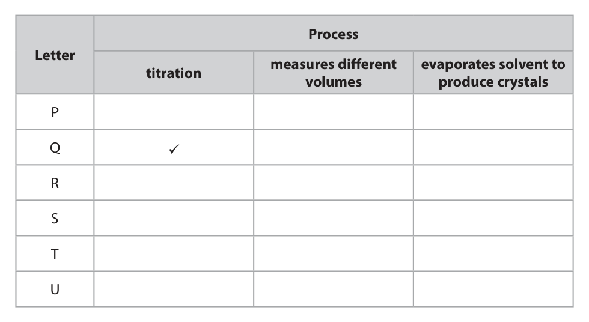
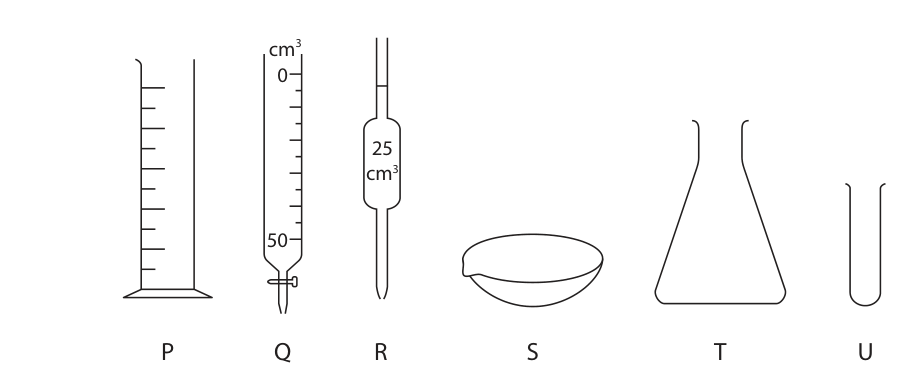
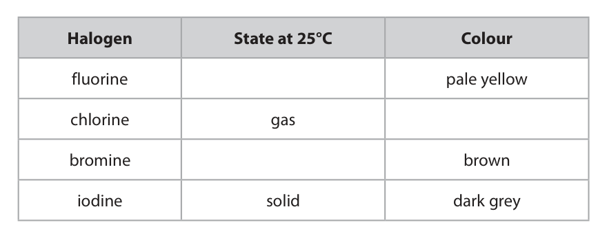
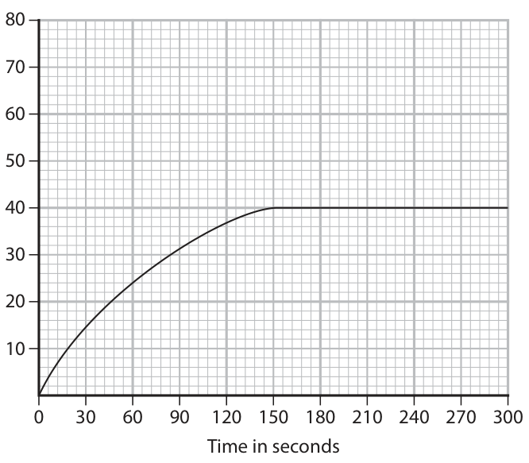
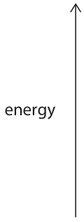
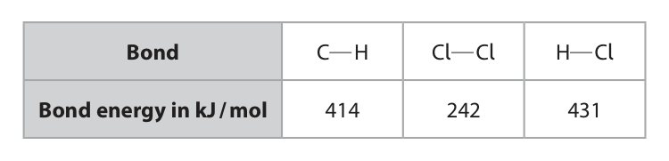

# 4CH1/2C — 2025-11 (official extraction)

> schema `syllabai.official-paper-questions/0.2` · paper_id `pearson-edexcel:international-gcse:chemistry:4ch1:2025-11:4CH1/2C` · qp sha256 `1963af3aa5a42b5a…` · extraction is the disclosed baseline (ADR-039)

## Question 1 (7 marks)

The diagram shows some pieces of apparatus that can be used for different processes. The pieces of apparatus are not to scale. cm3 cm3 P Q R S T U

### 1(a) [5]

Complete the table by placing ticks (✓) in each column to show if a piece of apparatus can be used for a process. One tick has been done for you. Each piece of apparatus can be used for one process, more than one process, or not at all. Process Letter measures different evaporates solvent to titration volumes produce crystals P Q ü R S T U

**Mark scheme answer**

> 5
> extra ticks in any row lose 1
> Letter titration measures evaporates mark
> different solvent to
> volumes produce any ticks in row U lose 1
> crystals mark
> P ✓
> Q ✓ ✓
> R ✓
> S ✓
> T ✓
> U

- **(5)** 5

### 1(b) [1]

Give the letter for the piece of apparatus that is a burette.

**Mark scheme answer**

> Q

- **(1)** Q

### 1(c) [1]

Name the piece of apparatus labelled R.

**Mark scheme answer**

> (volumetric) pipette REJECT dropping pipette

- **(1)** (volumetric) pipette REJECT dropping pipette

## Question 2 (15 marks)

This question is about the halogens.

**(d)** A sample of chlorine contains 0.75 mol of 35Cl atoms and 0.25 mol of 37Cl atoms. The table gives the relative molecular masses (Mr) of the different diatomic molecules of chlorine. The table also gives the probability of having a molecule of 37Cl37Cl in this sample. Molecule Cl35Cl 35 Cl37Cl and 37Cl35Cl 37 Cl37Cl Mr 70 72 74 Probability 0.25 × 0.25 = 0.0625

### 2(a) [3]

The table lists some halogens and their properties. Complete the table by giving the missing information. Halogen State at 25°C Colour fluorine pale yellow chlorine gas bromine brown iodine solid dark grey

**Mark scheme answer**

> 3
> Halogen State at Colour
> 25 oC
> fluorine gas pale yellow
> chlorine gas (pale) green ALLOW light green
> bromine liquid brown
> iodine solid dark grey

- **(3)** 3

### 2(b) [1]

Suggest the state of astatine at 25 °C.

**Mark scheme answer**

> solid

- **(1)** solid

### 2(c) [3]

A sample of bromine atoms contains 42.0% bromine‑79 and 58.0% bromine‑81. Calculate the relative atomic mass of this sample of bromine atoms. Give your answer to three significant figures. relative atomic mass =

**Mark scheme answer**

> correct answer without
> M1 42 x 79 + 58 x 81 OR 8016 working scores 3
> M2 8016 ÷ 100 OR 80.16 ALLOW M2 ECF M1
> M3 80.2 ALLOW M3 ECF M2
> ECF for M3 if all values in
> the question are used and
> the answer given to 3
> sig.figs.

- **(1)** 42 x 79 + 58 x 81 OR 8016 working scores 3
- **(1)** 8016 ÷ 100 OR 80.16 ALLOW M2 ECF M1
- **(1)** 80.2 ALLOW M3 ECF M2

### 2(d)(i) [1]

Calculate the probability of having a molecule with an Mr of 70 probability =

**Mark scheme answer**

> (0.75 x 0.75 =) 0.5625 ALLOW 0.56 /0.563

- **(1)** (0.75 x 0.75 =) 0.5625 ALLOW 0.56 /0.563

### 2(d)(ii) [2]

Explain why the probability of a molecule having an Mr of 72 is not 0.1875

**Mark scheme answer**

> 2
> ALLOW ECF from (i)
> M1 (0.1875 x 2=) 0.375
> M2 but need to x 2 to take into account that either ALLOW idea that shows
> Cl atom could be the 35 or 37 isotope OWTTE two combinations of 35Cl
> and 37Cl isotopes to form a
> chlorine molecule with Mr
> OR of 72
> M1 Total probability is 1
> M2 so remaining probability is 0.375 ALLOW 0.38

- **(2)** 2

### 2(e) [5]

Explain how displacement reactions involving halogens and halides provide evidence for the trend in reactivity in Group 7 of the Periodic Table. Include examples of reactions in your answer.

**Mark scheme answer**

> An explanation that links the following 5 points
> M1 reactivity decreases down the group (from F/Cl ALLOW fluorine is the
> to I) most reactive element in
> Group 7 ORA
> M2 displacement reactions happen when more ALLOW specific halogen
> reactive halogen displaces a less reactive halogen displaces a less reactive
> halogen
> e.g. Chlorine/Cl is more
> reactive so it will displace
> bromine/Br (and iodine/I)
> M3 from a solution/compound containing its halide ALLOW specific halide
> (ions) (ions)
> ALLOW ORA for M2 and
> OR M3
> ALLOW correct word or balanced chemical equation
> for M2 and M3
> M4 example of colour change in a displacement
> reaction
> M5 example of reaction where displacement does
> not occur

- **(1)** reactivity decreases down the group (from F/Cl ALLOW fluorine is the
- **(1)** displacement reactions happen when more ALLOW specific halogen
- **(1)** from a solution/compound containing its halide ALLOW specific halide
- **(1)** example of colour change in a displacement
- **(1)** example of reaction where displacement does

## Question 3 (15 marks)
**(a)** Paint can be used to coat iron, which protects iron from rusting.

**(d)** A solution of zinc sulfate is electrolysed to form zinc on the negative electrode.

### 3(a)(i) [1]

Give the chemical name for rust.

**Mark scheme answer**

> (hydrated) iron(III) oxide/ferric oxide ACCEPT Fe2O3
> REJECT iron oxide/FeO with
> incorrect oxidation state

- **(1)** (hydrated) iron(III) oxide/ferric oxide ACCEPT Fe2O3

### 3(a)(ii) [2]

Explain how painting prevents iron from rusting.

**Mark scheme answer**

> An explanation that links the following two points:
> M1 paint acts as a barrier/(protective) layer REJECT galvanising
> OWTTE /coating/covering/sacrificial
> protection
> M2 which prevents water/oxygen/air getting to the
> iron/reacting with iron

- **(1)** paint acts as a barrier/(protective) layer REJECT galvanising
- **(1)** which prevents water/oxygen/air getting to the

### 3(b) [6]

Steel is made from iron and carbon. Explain how the difference in malleability of pure iron and high-carbon steel affects the uses of these materials.

**Mark scheme answer**

> An explanation that links the following:
> M1 (high-carbon) steel is an alloy
> M2 idea of a comparison of malleability between ALLOW pure iron is more
> pure iron and (high-carbon) steel malleable than high-carbon
> steel ORA
> M3 (pure) iron can be used in ALLOW car (bodies)/ship
> gates/railings/nails/wires/chains/cookware building/decorative metal
> works
> M4 (high-carbon) steel can be used in cutting IGNORE cutlery/kitchen
> tools/knives/blades/springs/bearings/hammers/rail utensils
> tracks/car chassis ALLOW ideas of load-
> bearing
> applications/building
> reinforcement
> M5 (high carbon) steel has different-sized atoms ALLOW steel has (both iron
> /particles (which disrupt the structure/regular and carbon) atoms/particles
> arrangement) ORA which are of different sizes
> (and randomly arranged)
> M6 which means layers (of atoms/metal ALLOW rows or sheets
> ions/particles) cannot slide over each other ORA
> any mention of
> intermolecular forces/ionic
> bonds/covalent bonds/bond
> breaking max 5 marks

- **(1)** (high-carbon) steel is an alloy
- **(1)** idea of a comparison of malleability between ALLOW pure iron is more
- **(1)** (pure) iron can be used in ALLOW car (bodies)/ship
- **(1)** (high-carbon) steel can be used in cutting IGNORE cutlery/kitchen
- **(1)** (high carbon) steel has different-sized atoms ALLOW steel has (both iron
- **(1)** which means layers (of atoms/metal ALLOW rows or sheets

### 3(c) [2]

Zinc reacts with dilute sulfuric acid to produce zinc sulfate and hydrogen. This is the equation for the reaction. Zn(s) + H2SO4(aq) → ZnSO4(aq) + H2(g) A mass of 16 g of zinc reacts with an excess of sulfuric acid. Calculate the maximum volume, at rtp, of hydrogen produced. [for hydrogen at rtp, molar volume = 24 dm3] volume of hydrogen = dm3

**Mark scheme answer**

> correct answer without
> M1 (amount of zinc =) 16 ÷ 65 OR 0.246 (mol) working scores 2
> M2 (volume of hydrogen = 0.246 x 24 =) 5.9 (dm3) ALLOW ECF for incorrect Ar
> ALLOW answer correctly
> rounded to 1 sig.fig.

- **(1)** (amount of zinc =) 16 ÷ 65 OR 0.246 (mol) working scores 2
- **(1)** (volume of hydrogen = 0.246 x 24 =) 5.9 (dm3) ALLOW ECF for incorrect Ar

### 3(d)(i) [1]

The ionic half-equation at the negative electrode is Zn2+ + 2e– → Zn Give a reason why this half-equation shows reduction.

**Mark scheme answer**

> Zn2+ /Zinc ions gain electrons ALLOW Zn cations
> REJECT Zn/Zinc gains
> electrons

- **(1)** Zn2+ /Zinc ions gain electrons ALLOW Zn cations

### 3(d)(ii) [1]

Complete the ionic half-equation for the reaction that could occur at the positive electrode. ……… …… OH– → … … … … … O2 + … … … … … H2O + … … … … … e–

**Mark scheme answer**

> 4OH- → (1)O2 + 2H2O + 4e− ALLOW multiples or
> fractions
> IGNORE state symbols even
> if incorrect

- **(1)** 4OH- → (1)O2 + 2H2O + 4e− ALLOW multiples or

### 3(d)(iii) [2]

A sample of the solution surrounding the positive electrode is tested with universal indicator. Explain the final colour of the universal indicator.

**Mark scheme answer**

> An explanation that links the following two points:
> M1 concentration of hydroxide ions/OH- decreases ALLOW H+/hydrogen ions
> are formed
> IGNORE solution is
> acidic/H2SO4/acid is
> formed
> M2 so universal indicator turns red
> ALLOW orange
> IGNORE yellow
> REJECT pink

- **(1)** concentration of hydroxide ions/OH- decreases ALLOW H+/hydrogen ions
- **(1)** so universal indicator turns red

## Question 4 (14 marks)
**(a)** Steam can be used to manufacture ethanol.

**(b)** The glucose in grapes can be fermented to make ethanol.

**(c)** Grapes also contain esters. This is the structural formula of an ester. CH3COOCH2CH2CH2CH3

**(d)** These are the structural formulae of two monomers that are used to make a polyester. O O HO C CH2CH2 C OH HO CH2CH2CH2 OH

### 4(a)(i) [1]

Give the other reactant needed for this reaction.

**Mark scheme answer**

> ethene

- **(1)** ethene

### 4(a)(ii) [2]

State the pressure and catalyst used for this reaction to manufacture ethanol. pressure catalyst

**Mark scheme answer**

> M1 Pressure: 60 – 70 atm/atmosphere(s) (inclusive) ACCEPT any pressure
> between 60 and 70
> inclusive
> ACCEPT any correct
> alternative unit and
> quantity
> M2 Catalyst: Phosphoric acid ALLOW sulfuric acid
> /H2SO4

- **(1)** Pressure: 60 – 70 atm/atmosphere(s) (inclusive) ACCEPT any pressure
- **(1)** Catalyst: Phosphoric acid ALLOW sulfuric acid

### 4(b)(i) [1]

State the condition needed to prevent the formation of ethanoic acid.

**Mark scheme answer**

> anaerobic/no O2 /absence of air IGNORE respiration

- **(1)** anaerobic/no O2 /absence of air IGNORE respiration

### 4(b)(ii) [2]

Explain why fermentation needs to happen in the range of 30 °C to 40 °C.

**Mark scheme answer**

> 2
> M1 enzymes become inactive below 30°C ACCEPT ideas of rate
> of
> reaction/fermentation
> being too slow below
> 30°C
> M2 yeast cells/enzymes denature above 40oC
> If M1 and M2 not
> scored, (yeast contains)
> enzymes need an
> optimum temperature
> scores 1 mark

- **(1)** enzymes become inactive below 30°C ACCEPT ideas of rate
- **(1)** yeast cells/enzymes denature above 40oC

### 4(c)(i) [2]

Draw the displayed formula of this ester.

**Mark scheme answer**

> 2
> M1 for ester link
> M2 for the rest of the molecule with all bonds M2 dep on M1
> shown

- **(1)** for ester link
- **(1)** for the rest of the molecule with all bonds M2 dep on M1

### 4(c)(ii) [2]

Deduce the name of the carboxylic acid and the name of the alcohol that react to form this ester. carboxylic acid alcohol

**Mark scheme answer**

> M1 carboxylic acid ethanoic acid ACCEPT acetic acid
> M2 alcohol butanol ACCEPT butan-1-ol/
> 1-butanol

- **(1)** carboxylic acid ethanoic acid ACCEPT acetic acid
- **(1)** alcohol butanol ACCEPT butan-1-ol/

### 4(d)(i) [1]

Give the name of this type of polymerisation.

**Mark scheme answer**

> condensation (polymerisation)

- **(1)** condensation (polymerisation)

### 4(d)(ii) [2]

Draw the structure of the repeat unit of the polyester formed from the two monomers.

**Mark scheme answer**

> ACCEPT
> M1 ester link ALLOW −COO−
> M2 rest of the molecule correct with or without M2 dep M1
> extension bonds ALLOW C2H4 / C3H6
> IGNORE brackets and n

- **(1)** ester link ALLOW −COO−
- **(1)** rest of the molecule correct with or without M2 dep M1

### 4(d)(iii) [1]

Identify the small molecule formed when these two monomers react together.

**Mark scheme answer**

> water/H2O

- **(1)** water/H2O

## Question 5 (11 marks)

A student uses this apparatus to investigate the decomposition of hydrogen peroxide solution. hydrogen peroxide solution 0 20 40 60 80 100 manganese(IV) oxide This is the equation for the reaction. 2H2O2 → 2H2O + O2

**(b)** In the first experiment the student uses hydrogen peroxide solution with a concentration of 0.020 mol / dm3. The graph shows the student’s results. Volume of oxygen 50 in cm3 0 30 60 90 120 150 180 210 240 270 300 Time in seconds In a second experiment, the student uses hydrogen peroxide solution with a concentration of 0.025 mol / dm3. All other conditions remain the same.

### 5(a) [2]

Give a chemical test for the presence of water.

**Mark scheme answer**

> M1 anhydrous/white copper(II) sulfate/copper ALLOW anhydrous/blue
> sulfate/CuSO4 cobalt(II)
> chloride/cobalt chloride
> OR cobalt(II) chloride
> paper
> M2 turns (from white to) blue ALLOW turns (from blue
> to) pink
> M2 dep M1
> IGNORE water boils at
> 100oC

- **(1)** anhydrous/white copper(II) sulfate/copper ALLOW anhydrous/blue
- **(1)** turns (from white to) blue ALLOW turns (from blue

### 5(b)(i) [2]

On the grid, draw the curve you would expect the student to obtain from the second experiment.

**Mark scheme answer**

> M1 starts at the origin and is steeper than the original
> curve
> M2 levels off at 50 cm3

- **(1)** starts at the origin and is steeper than the original
- **(1)** levels off at 50 cm3

### 5(b)(ii) [2]

On the grid, draw the curve you would expect the student to obtain for the second experiment carried out at a lower temperature.

**Mark scheme answer**

> M1 starts at the origin and is shallower than the
> original curve
> M2 levels off at 50 cm3 ECF for M2 from 5(b)(i)

- **(1)** starts at the origin and is shallower than the
- **(1)** levels off at 50 cm3 ECF for M2 from 5(b)(i)

### 5(c) [5]

Potassium iodide has been suggested as an alternative catalyst to manganese(IV) oxide. Describe a method to show which catalyst is more effective for the decomposition of hydrogen peroxide.

**Mark scheme answer**

> A description that refers to five of the following seven
> points:
> M1 add the same mass of the potassium iodide to the ALLOW same surface
> conical flask area of catalyst
> M2 add the same volume of hydrogen peroxide
> M3 keep the temperature constant
> M4 start/set the timer
> M5 record the volume of gas produced in a given time
> OR record the time for certain volume of gas to be
> evolved
> M6 plot the results of the graph and calculate OR
> compare gradient (steepness) for each catalyst
> M7 the more effective catalyst gives the fastest rate
> of reaction OWTTE

- **(5)** A description that refers to five of the following seven

## Question 6 (8 marks)

The equation shows one of the possible substitution reactions that occurs during the reaction between methane and chlorine. CH3Cl + 3Cl2 → CCl4 + 3HCl ΔH = –339 kJ / mol

### 6(a) [3]

Complete the reaction profile diagram to show the levels of the reactants, the products and the activation energy, Ea . energy

**Mark scheme answer**

> M1 two horizontal lines in correct positions ALLOW product line
> directly below reactants
> line
> M2 horizontal lines labelled correctly with formulae IGNORE incorrect letter
> of reactants and products cases and
> subscripts/superscripts
> M3 vertical line in correct position and labelled Ea ALLOW ECF from M1
> REJECT downwards
> pointing arrow/double-
> headed arrow
> /no arrowhead

- **(1)** two horizontal lines in correct positions ALLOW product line
- **(1)** horizontal lines labelled correctly with formulae IGNORE incorrect letter
- **(1)** vertical line in correct position and labelled Ea ALLOW ECF from M1

### 6(b) [5]

The table gives some bond energies. Bond C H Cl Cl H Cl Bond energy in kJ / mol 414 242 431 Using information from the equation and the table, calculate the bond energy of the C Cl bond. C Cl bond energy = kJ / mol

**Mark scheme answer**

> correct answer without
> working scores 5
> M1 ∑ bond energies on LHS = (3 x 414) + (1 x C-Cl) +
> (3 x 242) OR (1 x C-Cl) + 1968 (kJ/mol)
> M2 ∑ bond energies on RHS = (4 x C−Cl) + (3 x 431)
> OR (4 x C−Cl) + 1293 (kJ/mol)
> M3 (1 x C-Cl + 1968) − (4 x C−Cl + 1293) = −339 ALLOW ECF calculation
> of Bonds broken – Bonds
> Made = -339
> M4 (3 x C−Cl = 339 + 675) OR 1014
> M5 (C−Cl = 1014 ÷ 3 =) 338 (kJ/mol)
> ALLOW ECF throughout

- **(1)** ∑ bond energies on LHS = (3 x 414) + (1 x C-Cl) +
- **(1)** ∑ bond energies on RHS = (4 x C−Cl) + (3 x 431)
- **(1)** (1 x C-Cl + 1968) − (4 x C−Cl + 1293) = −339 ALLOW ECF calculation
- **(1)** (3 x C−Cl = 339 + 675) OR 1014
- **(1)** (C−Cl = 1014 ÷ 3 =) 338 (kJ/mol)

