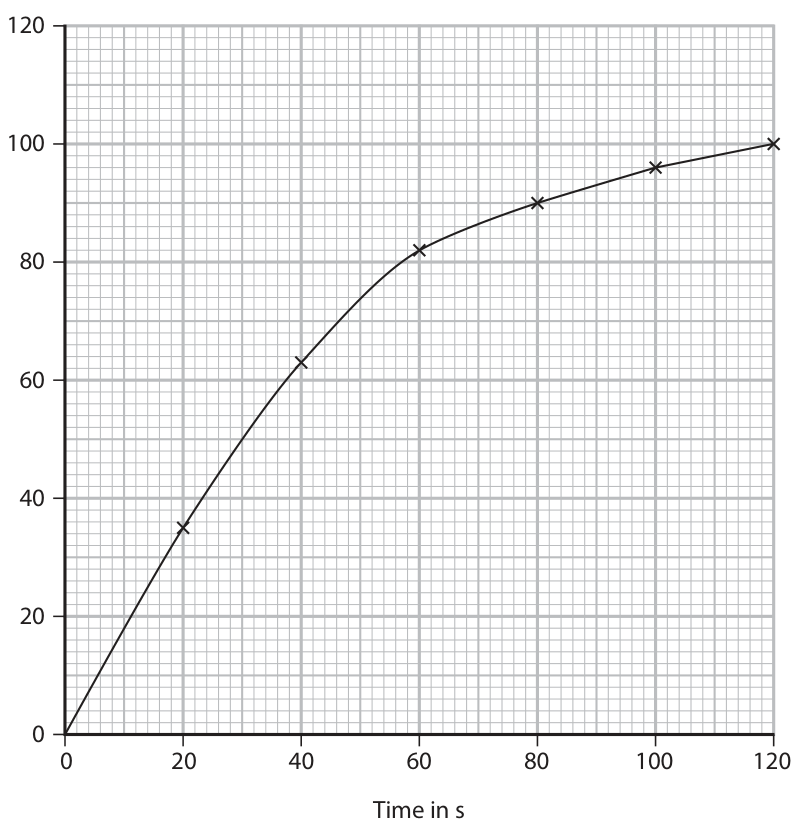

# 4CH1/1C — 2026-06 (official extraction)

> schema `syllabai.official-paper-questions/0.1` · paper_id `pearson-edexcel:international-gcse:chemistry:4ch1:2026-06:4CH1/1C` · qp sha256 `231c05743b0853aa…` · extracted verbatim, never regenerated (ADR-037)

## Question 1 (10 marks)

Ammonium carbonate is a compound used in baking powders.

**(d)** When heated, ammonium carbonate decomposes into ammonia and carbon dioxide.

### 1(a) [1]

What is the formula of the ammonium ion?

- **(A)** NH4+
- **(B)** NH3+
- **(C)** NH4
- **(D)** NH4+  ✔

**Mark scheme answer**

> 1
> D (NH4+)
> A is not the formula for the ammonium ion as it
> should only have a 1+ charge
> B is not the formula for the ammonium ion as it
> should only have four hydrogen atoms
> C is not the formula for the ammonium ion as it
> should only have a 1+ charge

- **(1)** Answer D: NH4+

### 1(b) [1]

What is the formula of the carbonate ion?

- **(A)** CO23–
- **(B)** CO32–  ✔
- **(C)** C4+
- **(D)** C4–

**Mark scheme answer**

> B (CO32-)
> A is not the formula for the carbonate ion as it has
> three oxygen atoms
> C is not the formula for the carbonate ion as it has
> three oxygen atoms and a 2- charge
> D is not the formula for the carbonate ion as it has
> three oxygen atoms and a 2- charge

- **(1)** Answer B: CO32–

### 1(c) [2]

Explain why ammonium carbonate is a compound. 

**Mark scheme answer**

> M1 2 or more/4 (different) elements ALLOW (four) different
> types of atoms
> REJECT different
> molecules
> M2 (chemically) joined/bonded together IGNORE covalent/ionic

- **(1)** 2 or more/4 (different) elements ALLOW (four) different
- **(1)** (chemically) joined/bonded together IGNORE covalent/ionic

### 1(d)(i) [2]

Describe a test for carbon dioxide.

**Mark scheme answer**

> M1 bubble/pass/add carbon dioxide/gas into IGNORE ‘limewater
> limewater test’ for M1
> M2 (limewater) turns cloudy/milky ALLOW white
> precipitate
> M2 dependent on
> mention of limewater
> REJECT addition of
> extra reagent for both
> marks

- **(1)** bubble/pass/add carbon dioxide/gas into IGNORE ‘limewater
- **(1)** (limewater) turns cloudy/milky ALLOW white

### 1(d)(ii) [1]

Calculate the relative molecular mass (Mr) of ammonia. Mr =

**Mark scheme answer**

> 17/seventeen

- **(1)** 17/seventeen

### 1(d)(iii) [1]

Using the relative molecular mass, determine the percentage by mass of nitrogen in ammonia. percentage = %

**Mark scheme answer**

> (14 ÷ 17) x 100 = 82(.35)% Allow ecf from (ii)

- **(1)** (14 ÷ 17) x 100 = 82(.35)% Allow ecf from (ii)

### 1(d)(iv) [2]

Explain why aqueous ammonia is an alkali and a base.

**Mark scheme answer**

> M1 (ammonia is an alkali as it) forms/source of ALLOW (an alkali) is a
> hydroxide/OH- ions soluble base
> M2 (ammonia is a base as it) accepts protons/H+ ALLOW references to
> ions neutralising an acid for
> M2
> IGNORE pH references
> Question
> Answer Notes Marks
> number

- **(1)** (ammonia is an alkali as it) forms/source of ALLOW (an alkali) is a
- **(1)** (ammonia is a base as it) accepts protons/H+ ALLOW references to

## Question 2 (14 marks)

This question is about some Group 1 elements and their compounds.

**(a)** A teacher adds a piece of sodium of mass 0.25 g to a trough of water.

**(b)** The teacher then reacts sodium with oxygen.

### 2(a)(i) [2]

Give two observations made when sodium reacts with water. 1 2

**Mark scheme answer**

> Any 2 from:
> M1 effervescence/bubbles/fizzing moves on surface scores
> M2 and M3
> M2 moves
> ALLOW dissolves
> M3 floats
> IGNORE heat produced
> M4 disappears/ gets smaller ALLOW sodium melts
> IGNORE flame
> M5 turns into a sphere/ball
> M6 white trail

- **(2)** Any 2 from:

### 2(a)(ii) [2]

Give the word equation for this reaction.

**Mark scheme answer**

> sodium + water → sodium hydroxide + hydrogen ACCEPT correct equation
> using formulae scores 2
> M1 correct reactants marks
> M2 correct products

- **(1)** correct reactants marks
- **(1)** correct products

### 2(a)(iii) [2]

Calculate the amount, in moles, of 0.25 g of sodium. Give your answer to two significant figures. amount = mol

**Mark scheme answer**

> M1 0.25 ÷ 23 (= 0.0108696)
> M2 0.011 (mol) ecf 0.023 (mol) scores 1

- **(1)** 0.25 ÷ 23 (= 0.0108696)
- **(1)** 0.011 (mol) ecf 0.023 (mol) scores 1

### 2(a)(iv) [2]

The teacher adds a piece of potassium of mass 0.25 g to a different trough of water. Explain whether the volume of hydrogen produced in the reaction with potassium would be more than, less than or the same as the volume of hydrogen produced in the reaction with sodium. 

**Mark scheme answer**

> M1 fewer moles of potassium reacted/fewer moles IGNORE greater Ar
> of potassium in 0.25 g/correct calculation (0.25 ÷ 39 /atomic mass but can
> (= 0.0064)) score M2
> M2 less hydrogen would be produced M2 dep on M1

- **(1)** fewer moles of potassium reacted/fewer moles IGNORE greater Ar
- **(1)** less hydrogen would be produced M2 dep on M1

### 2(b)(i) [2]

Complete the equation for the reaction. Include state symbols Na ( ) + O2 ( ) → Na2O ( )

**Mark scheme answer**

> 4Na(s) + (1)O2(g) → 2Na2O(s) ACCEPT correct multiples
> or fractions
> M1 correct state symbols
> M2 correct balancing

- **(1)** correct state symbols
- **(1)** correct balancing

### 2(b)(ii) [4]

This passage is about the reaction between sodium and oxygen. Use words from the box to complete the passage. acidic basic complete covalent endothermic exothermic ionic maximum minimum molecular Sodium reacts with oxygen to form sodium oxide. To start the reaction, the sodium needs to be heated to overcome the activation energy. Activation energy is the energy needed to start the reaction. The enthalpy change for the reaction is negative, which means that the reaction is Sodium oxide contains bonding. It is a metal oxide that has properties.

**Mark scheme answer**

> M1 minimum
> M2 exothermic
> M3 ionic
> M4 basic
> Question
> Answer Notes Marks
> number

- **(1)** minimum
- **(1)** exothermic
- **(1)** ionic
- **(1)** basic

## Question 3 (12 marks)

A student does an experiment to investigate the decomposition of hydrogen peroxide in the presence of a catalyst. This is the equation for the decomposition. 2H2O2 → 2H2O + O2 The student collects the oxygen produced from the decomposition. They record the volume of oxygen every 20 seconds until 100 cm3 of oxygen has been produced. The student does the experiment twice, first with catalyst A and then with catalyst B.

**(e)** The table shows the student’s results for catalyst A. Time in s 0 20 40 60 80 100 Volume of oxygen collected 0 54 79 91 96 100 in cm3

**(f)** The student repeats the experiment using catalyst B. Grid 2 shows the results for catalyst B. 120 100 Volume of oxygen 60 in cm3 0 20 40 60 80 100 120 Time in s Grid 2

### 3(a) [1]

Name a suitable piece of apparatus to measure the volume of oxygen collected.

**Mark scheme answer**

> gas syringe ALLOW collection over
> water using measuring
> cylinder/graduated gas
> jar

- **(1)** gas syringe ALLOW collection over

### 3(b) [2]

Give two variables that the student must control to obtain valid results. 1 2

**Mark scheme answer**

> Any TWO of the following: ACCEPT amount of
> hydrogen peroxide for
> M1 temperature one mark only as an
> alternative for both M2
> M2 concentration of hydrogen peroxide and M3
> M3 mass/volume of hydrogen peroxide ACCEPT amount of
> catalyst for one mark
> M4 mass/volume of catalyst only as an alternative
> for both M4 and M5
> M5 concentration OR surface area of catalyst

- **(2)** Any TWO of the following: ACCEPT amount of

### 3(c) [1]

Give the test for oxygen gas.

**Mark scheme answer**

> relights a glowing splint

- **(1)** relights a glowing splint

### 3(d) [2]

Explain what is meant by the term catalyst. 

**Mark scheme answer**

> M1 (a catalyst) speeds up the reaction/increases the IGNORE changes rate
> rate (of reaction)
> M2 is chemically unchanged OR mass does not change ACCEPT is not used up
> IGNORE reference to
> alternative pathway/
> lowering Ea

- **(1)** (a catalyst) speeds up the reaction/increases the IGNORE changes rate
- **(1)** is chemically unchanged OR mass does not change ACCEPT is not used up

### 3(e)(i) [1]

Plot the student’s results on grid 1.

**Mark scheme answer**

> All points plotted correctly to the nearest + or – half a
> small square

- **(1)** All points plotted correctly to the nearest + or – half a

### 3(e)(ii) [1]

Draw a curve of best fit. 120 100 Volume of oxygen 60 in cm3 0 20 40 60 80 100 120 Time in s Grid 1 

**Mark scheme answer**

> smooth curve of best fit

- **(1)** smooth curve of best fit

### 3(f)(i) [1]

On grid 2, draw a tangent to the curve for catalyst B at 60 s.

**Mark scheme answer**

> tangent drawn at 60 seconds

- **(1)** tangent drawn at 60 seconds

### 3(f)(ii) [3]

Use the tangent to determine the rate of reaction at 60 s. Include the units for the rate of reaction. rate of reaction = unit

**Mark scheme answer**

> M1 suitable values taken from the graph for two If no tangent drawn
> coordinates using their tangent then only M3 can be
> awarded.
> M2 gradient calculated (expected value approx. 0.5-
> 0.7 cm3/s)
> ALLOW cm3/second
> M3 correct units of cm /s ALLOW cm3s-1
> Question
> Answer Notes Marks
> number

- **(1)** suitable values taken from the graph for two If no tangent drawn
- **(1)** gradient calculated (expected value approx. 0.5-
- **(1)** correct units of cm /s ALLOW cm3s-1

## Question 4 (14 marks)

Diagram 1 shows the displayed formula of isoprene. H H C H H H C C C C H H H Diagram 1

**(e)** Diagram 2 shows one of the reactions of isoprene with chlorine to give product X. H H H C H H C H Cl Cl H H H C C C C + Cl2 C C C C H H H H H H H Product X Diagram 2

### 4(a) [2]

Explain why isoprene is a hydrocarbon.

**Mark scheme answer**

> M1 (a molecule/compound/substance) made of REJECT ‘carbon/hydrogen
> hydrogen and carbon molecules/ions’ for M1
> M2 only M2 dep on mention of
> hydrogen and carbon in
> M1.

- **(1)** (a molecule/compound/substance) made of REJECT ‘carbon/hydrogen
- **(1)** only M2 dep on mention of

### 4(b) [3]

Isoprene has this percentage composition by mass. C = 88.2 % H = 11.8 % Show by calculation that the empirical formula of isoprene is C5H8 

**Mark scheme answer**

> M1 amount of C = 88.2 ÷ 12 = 7.35 (mol) Calculation must be
> M2 amount of H = 11.8 ÷ 1 = 11.8 (mol) shown to score marks.
> M3 show the simplest ratio is 1:1.6 which gives
> 5:8 C5H8 alone scores 0

- **(1)** amount of C = 88.2 ÷ 12 = 7.35 (mol) Calculation must be
- **(1)** amount of H = 11.8 ÷ 1 = 11.8 (mol) shown to score marks.
- **(1)** show the simplest ratio is 1:1.6 which gives

### 4(c) [2]

Explain why isoprene does not have the same general formula as propene.

**Mark scheme answer**

> M1 general formula for propene is CnH2n ALLOW general formula
> for isoprene
> M2 more than one double bond (so doesn’t fit the
> alkene general formula).

- **(1)** general formula for propene is CnH2n ALLOW general formula
- **(1)** more than one double bond (so doesn’t fit the

### 4(d) [3]

This is the equation for the complete combustion of isoprene. C5H8 + 7O2 → 5CO2 + 4H2O Calculate the amount, in moles, of carbon dioxide produced when 50 g of isoprene undergoes complete combustion. amount = mol 

**Mark scheme answer**

> M1 Mr of isoprene = 68
> M2 amount of isoprene = 50 ÷ 68 = 0.735 mol ecf for M2
> M3 amount of CO2 = 0.735 x 5 = 3.7 mol ecf for M3
> ALLOW any number of SF
> except 1

- **(1)** Mr of isoprene = 68
- **(1)** amount of isoprene = 50 ÷ 68 = 0.735 mol ecf for M2
- **(1)** amount of CO2 = 0.735 x 5 = 3.7 mol ecf for M3

### 4(e)(i) [1]

Name the type of reaction that occurs between isoprene and chlorine.

**Mark scheme answer**

> addition (reaction) IGNORE synthesis

- **(1)** addition (reaction) IGNORE synthesis

### 4(e)(ii) [3]

0.0500 mol of isoprene reacts with chlorine. 0.212 g of product X is produced. Calculate the percentage yield of product X. Give your answer to two decimal places. [for Product X Mr = 139] percentage yield =

**Mark scheme answer**

> M1 mass of X = 0.050 x 139 = 6.95 g Correct answer 3.05%
> M2 % yield = (0.212 ÷ 6.95) x 100 scores 3
> M3 3.05 % (2 dp only) ecf for M2
> ecf for M3 but only to 2dp
> OR 6.24% scores 2 marks
> M1 – moles of X = 0.212/139 ( = 0.001525)
> M2 – % yield = M1/0.0500 x 100 ecf for M2
> M3 – 3.05 % (2 dp only) ecf for M3 but only to 2dp
> Question
> Answer Notes Marks
> number

- **(3)** M1 mass of X = 0.050 x 139 = 6.95 g Correct answer 3.05%

## Question 5 (11 marks)

Crude oil is a mixture of hydrocarbons.

### 5(a) [6]

Describe how useful hydrocarbons can be obtained from crude oil. Refer to fractional distillation and cracking in your answer. 

**Mark scheme answer**

> M1 (fractional distillation) separates the mixture Must make reference to a
> based on boiling points / fractions condense at temperature linked to
> different temperatures boiling/condensing
> M2 temperature gradient / hotter at bottom / Credit can be given for M1
> shorter chain alkanes rise higher in the column ORA and M2 even if
> fractionation is described
> after cracking.
> M3 more long chain hydrocarbons are produced ACCEPT a named example
> than can be used directly / not enough short chain e.g. not enough gasoline
> (alkanes) / greater demand for short chain
> (alkanes) ORA Must refer to supply /
> demand issues.
> Any 3 marks from the following:
> M4 cracking requires 600-700 ºC
> M5 cracking requires silica / alumina / zeolite
> catalyst
> M6 (cracking) produces (more) short chain/shorter ALLOW products which are
> alkanes more flammable
> IGNORE ‘more useful’
> M7 (cracking) produces alkenes ALLOW products which are
> used to make polymers/
> plastics

- **(6)** M1 (fractional distillation) separates the mixture Must make reference to a

### 5(b)(i) [1]

State what is meant by the term fuel.

**Mark scheme answer**

> (a substance that) when burned releases heat ALLOW burns /combusts
> (energy)/thermal energy /catches fire

- **(1)** (a substance that) when burned releases heat ALLOW burns /combusts

### 5(b)(ii) [4]

Explain how the combustion of an impurity in some hydrocarbon fuels causes an environmental problem.

**Mark scheme answer**

> M1 (a common impurity in fuels is) sulfur IGNORE C/CO/CO2
> REJECT nitrogen for M1
> M2 (sulfur) burns/combusts/reacts in (air/oxygen) Accept correct equation
> to form sulfur dioxide/SO2 for M2
> IGNORE sulfur oxide/sulfur
> trioxide for M2.
> M3 sulfur dioxide/SO2 dissolves in/reacts with IGNORE mixes
> rain/water Accept correct equation
> for M3
> M4 (to form) acid rain
> Question
> Answer Notes Marks
> number

- **(1)** (a common impurity in fuels is) sulfur IGNORE C/CO/CO2
- **(1)** (sulfur) burns/combusts/reacts in (air/oxygen) Accept correct equation
- **(1)** sulfur dioxide/SO2 dissolves in/reacts with IGNORE mixes
- **(1)** (to form) acid rain

## Question 6 (13 marks)

This question is about ethane, C2H6

**(e)** Ethane can react with bromine.

### 6(a) [2]

Explain a problem caused by a product of the incomplete combustion of ethane.

**Mark scheme answer**

> M1 carbon monoxide/CO
> M2 reduces the capacity of blood to transport ACCEPT correct references
> oxygen OWTTE/poisonous/toxic to haemoglobin
> ALLOW produces
> carboxyhaemoglobin
> OR
> M1 soot/carbon/C
> M2 causes breathing difficulties/asthma/respiratory
> problems

- **(2)** M1 carbon monoxide/CO

### 6(b) [2]

Draw a dot‑and‑cross diagram to show the outer shell electrons in a molecule of ethane.

> 🖼 crop required: diagram (qp.pdf p.18)

**Mark scheme answer**

> IGNORE inner shell on
> carbon atoms
> ACCEPT with or without
> shell drawn.
> M1 2 electrons between carbon atoms
> M2 dep on M1
> M2 rest of the molecule correct

- **(1)** 2 electrons between carbon atoms
- **(1)** rest of the molecule correct

### 6(c) [2]

Ethane has a boiling point of –89°C. Describe the arrangement and movement of particles of ethane at 25°C. 

**Mark scheme answer**

> M1 irregular/random arrangement of particles ALLOW particles are far
> apart/widely spaced
> REJECT mention of ions for
> M1
> M2 (particles) move (very) quickly/high(er) kinetic REJECT references to
> energy/random movement ethane being a liquid –
> scores 0

- **(1)** irregular/random arrangement of particles ALLOW particles are far
- **(1)** (particles) move (very) quickly/high(er) kinetic REJECT references to

### 6(d) [2]

Explain why ethane has a lower boiling point than octane.

**Mark scheme answer**

> M1 ethane has weaker intermolecular forces ORA ACCEPT forces between
> molecules
> M2 less energy needed to overcome them
> ALLOW intermolecular
> bonds
> REJECT breaking of bonds
> for M1

- **(1)** ethane has weaker intermolecular forces ORA ACCEPT forces between
- **(1)** less energy needed to overcome them

### 6(e)(i) [1]

State the condition needed for ethane to react with bromine.

**Mark scheme answer**

> ultraviolet radiation ALLOW UV light
> ALLOW ‘UV’

- **(1)** ultraviolet radiation ALLOW UV light

### 6(e)(ii) [2]

Give the displayed formula of each product. product 1 product 2

**Mark scheme answer**

> M1 H-Br/Br-H REJECT HBr as bond must
> be shown
> REJECT ‘br’ once
> REJECT structural or
> M2 molecular formula
> ALLOW bromine atom
> anywhere on molecule
> ACCEPT multiple
> substitutions on molecule

- **(1)** H-Br/Br-H REJECT HBr as bond must
- **(1)** molecular formula

### 6(f) [2]

Explain why ethane does not have any isomers.

**Mark scheme answer**

> M1 (ethane has) only one possible structure/no ALLOW (ethane) cannot be
> other way of being displayed/ cannot be rearranged branched
> REJECT references to
> double bonds for M1.
> REJECT references to
> having only two carbon
> molecules for M1.
> M2 isomers have the same molecular formula but a REJECT incorrect
> different structural/displayed formula references to general
> formula in isomer
> definition.
> Question
> Answer Notes Marks
> number

- **(1)** (ethane has) only one possible structure/no ALLOW (ethane) cannot be
- **(1)** isomers have the same molecular formula but a REJECT incorrect

## Question 7 (13 marks)
**(a)** Anhydrous copper(II) sulfate reacts with water to produce hydrated copper(II) sulfate. This is the equation for the reaction. CuSO4 + xH2O  CuSO4.xH2O

**(b)** Hydrated copper(II) sulfate crystals can also be made by reacting copper(II) oxide with dilute sulfuric acid.

### 7(a)(i) [1]

A student does an experiment and determines that 1.75 mol of CuSO4 reacts with 5.25 mol of H2O Calculate the student’s value of x in the formula of hydrated copper(II) sulfate. x =

**Mark scheme answer**

> x = (5.25 ÷ 1.75) = 3

- **(1)** x = (5.25 ÷ 1.75) = 3

### 7(a)(ii) [1]

State what the  symbol shows about this reaction.

**Mark scheme answer**

> (the reaction is) reversible ACCEPT reaction that
> goes both ways/both
> forwards and backwards
> reaction occur
> IGNORE references to
> equilibrium
> IGNORE references to
> reactants turning into
> products and products
> into reactants.

- **(1)** (the reaction is) reversible ACCEPT reaction that

### 7(a)(iii) [5]

Describe two experiments to show that the  symbol is correct for this reaction. Include any relevant observations. 

**Mark scheme answer**

> M1 – add water to anhydrous copper(II) sulfate ALLOW steps in reverse
> starting from hydrated
> M2 – turns (from white to) blue CuSO4
> M3 – heat the hydrated copper(II) sulfate (to dryness) REJECT ‘evaporate’ in a
> context that would form
> M4 – turns (from blue to) white/turns back to white hydrated crystals for M3
> Any one from:
> M5 – suitable vessel to contain the experiment (e.g.
> evaporating basin, boiling tube)
> M6 – colourless liquid/water vapour/ steam
> /condensation will be observed/produced

- **(5)** M1 – add water to anhydrous copper(II) sulfate ALLOW steps in reverse

### 7(b)(i) [1]

What is the colour of copper(II) oxide?

- **(A)** black  ✔
- **(B)** blue
- **(C)** green
- **(D)** white

**Mark scheme answer**

> A (black)
> B blue is not correct as copper(II) oxide is black
> C green is not correct as copper(II) oxide is black
> D white is not correct as copper(II) oxide is black

- **(1)** Answer A: black

### 7(b)(ii) [2]

Give the chemical equation for the reaction between copper(II) oxide and sulfuric acid.

**Mark scheme answer**

> CuO + H2SO4 → CuSO4 + H2O
> M1 – correct formula for reactants
> M2 – correct balanced chemical equation

- **(1)** – correct formula for reactants
- **(1)** – correct balanced chemical equation

### 7(b)(iii) [2]

When making copper(II) sulfate using this method, excess copper(II) oxide is used. Explain why the copper(II) oxide is chosen as the reagent in excess.

**Mark scheme answer**

> M1 (copper(II) oxide) can be easily removed by ALLOW (copper(II)oxide
> filtration (at the end)/is insoluble can be observed when in
> excess/when stopped
> reacting
> M2 all the acid is used up/neutralised ALLOW acid doesn’t
> contaminate product

- **(1)** (copper(II) oxide) can be easily removed by ALLOW (copper(II)oxide
- **(1)** all the acid is used up/neutralised ALLOW acid doesn’t

### 7(b)(iv) [1]

Give a reason why copper metal cannot be used in this reaction.

**Mark scheme answer**

> copper will not react (with a dilute acid)/copper is
> unreactive/copper is at the bottom of the reactivity
> series/copper is below hydrogen in the reactivity series
> Question
> Answer Notes Marks
> number

- **(1)** copper will not react (with a dilute acid)/copper is

## Question 8 (12 marks)

Fluorine is an element found in Group 7 of the Periodic Table.

**(b)** Fluorine gas exists as the molecule F2

**(c)** Fluorine forms fluoride ions when reacted with a metal.

### 8(a)(i) [1]

Give the electronic configuration of an atom of fluorine.

**Mark scheme answer**

> 2,7

- **(1)** 2,7

### 8(a)(ii) [1]

Which period does fluorine belong to?

- **(A)** Period 1
- **(B)** Period 2  ✔
- **(C)** Period 3
- **(D)** Period 7

**Mark scheme answer**

> B (Period 2)
> A is not correct as fluorine is in Period 2 not Period 1
> C is not correct as fluorine is in Period 2 not Period 3
> D is not correct as fluorine is in Period 2 not Period 7

- **(1)** Answer B: Period 2

### 8(b)(i) [2]

Describe how two fluorine atoms combine to form a fluorine molecule.

**Mark scheme answer**

> M1 the two (fluorine) atoms in a molecule share a pair ALLOW covalent
> of electrons bonding for M1
> M2 resulting in a full outer shell REJECT references to
> ionic bonding- scores 0
> OR
> M1 (electrostatic) attraction between a shared pair of REJECT pairs of
> electrons electrons for M1
> M2 and nuclei

- **(2)** M1 the two (fluorine) atoms in a molecule share a pair ALLOW covalent

### 8(b)(ii) [3]

One mole of fluorine gas contains 6.0 × 1023 molecules. Calculate the number of molecules in 100 g of fluorine. Give your answer in standard form. number of molecules = 

**Mark scheme answer**

> M1 Mr of F2 = 38 ecf for M2 and M3
> M2 amount of F2 = 100 ÷ 38 = 2.63 (mol) Answers must be more
> than 1sf
> M3 no. of molecules = M2 x (6.0 x 1023) = 1.6 x 1024
> 3.2 x 1024 scores 2

- **(1)** Mr of F2 = 38 ecf for M2 and M3
- **(1)** amount of F2 = 100 ÷ 38 = 2.63 (mol) Answers must be more
- **(1)** no. of molecules = M2 x (6.0 x 1023) = 1.6 x 1024

### 8(c)(i) [2]

Describe the changes in the electronic configurations of a lithium atom and a fluorine atom when they form lithium fluoride. fluorine lithium

**Mark scheme answer**

> M1 fluorine changes (from 2.7) to 2.8 ALLOW fluorine gains
> one electron
> M2 lithium changes (from 2.1) to 2 ALLOW lithium loses
> one electron
> Penalise incorrect
> number of inner
> electrons only once

- **(1)** fluorine changes (from 2.7) to 2.8 ALLOW fluorine gains
- **(1)** lithium changes (from 2.1) to 2 ALLOW lithium loses

### 8(c)(ii) [3]

Lithium fluoride has a giant ionic structure. Explain why lithium fluoride has a high melting point.

**Mark scheme answer**

> An explanation that links the three points IGNORE giant ionic
> structure
> M1 strong electrostatic (forces of) attraction
> ALLOW strong (ionic)
> bonds for M1 only
> M2 between oppositely charged ions
> M3 which require a lot of (heat) energy to break IGNORE more energy
> 0 marks if any mention
> of covalent bonds,
> intermolecular forces
> or molecules
> Question
> Answer Notes Marks
> number

- **(1)** strong electrostatic (forces of) attraction
- **(1)** between oppositely charged ions
- **(1)** which require a lot of (heat) energy to break IGNORE more energy

## Question 9 (11 marks)

A student does an experiment to investigate the reactivity of metals. The diagram shows the set‑up for the experiment. Zn(s) Fe(s) FeSO4(aq) ZnSO4(aq) beaker 1 beaker 2

**(c)** The student wants to confirm that both beakers contain sulfate ions. Before testing for sulfate ions, the student acidifies the solutions in the beakers.

### 9(a)(i) [1]

What type of reaction occurs in beaker 1?

- **(A)** addition
- **(B)** combustion
- **(C)** displacement  ✔
- **(D)** neutralisation

**Mark scheme answer**

> C (displacement)
> A is not correct as the reaction is not an addition
> reaction.
> B is not correct as the reaction is not a combustion
> reaction.
> D is not correct as the reaction is not a neutralisation
> reaction.

- **(1)** Answer C: displacement

### 9(a)(ii) [2]

Give the chemical equation for the reaction that occurs in beaker 1.

**Mark scheme answer**

> FeSO4 + Zn → ZnSO4 + Fe IGNORE state symbols
> M1 correct formulae of products Penalise use of
> incorrect letter cases
> only once
> M2 fully correct balanced equation
> FeSO4 + Zn → ZnSO4 + Fe

- **(1)** correct formulae of products Penalise use of
- **(1)** fully correct balanced equation

### 9(a)(iii) [2]

Explain which species is the oxidising agent in beaker 1. 

**Mark scheme answer**

> M1 Fe2+ (is the species in the oxidising agent) ACCEPT FeSO4/iron(II)
> sulfate /iron sulfate (is
> the oxidising agent)
> REJECT iron/Fe for M1
> M2 accepts/gains electrons (from zinc) OWTTE ALLOW causes zinc to
> be oxidised/lose (2)
> electrons
> IGNORE answers related
> to loss/gain of oxygen
> M2 dep on M1

- **(1)** Fe2+ (is the species in the oxidising agent) ACCEPT FeSO4/iron(II)
- **(1)** accepts/gains electrons (from zinc) OWTTE ALLOW causes zinc to

### 9(b) [2]

Explain why no changes are observed in beaker 2.

**Mark scheme answer**

> M1 no (displacement) reaction takes place/iron
> cannot displace zinc ORA
> M2 iron is less reactive than zinc ORA Must be a comparison
> for M2
> ACCEPT references to
> position in the
> reactivity series

- **(1)** no (displacement) reaction takes place/iron
- **(1)** iron is less reactive than zinc ORA Must be a comparison

### 9(c)(i) [2]

Describe a test to show that the solutions in the beakers contain sulfate ions.

**Mark scheme answer**

> M1 add barium chloride/barium nitrate IGNORE reference to
> (solution)/BaCl2/Ba(NO3)2 addition of an acid
> unless sulfuric acid is
> added which scores 0
> Apply list principle to
> any other additional
> reagents
> M2 (gives/forms a) white precipitate M2 dep on M1

- **(1)** add barium chloride/barium nitrate IGNORE reference to
- **(1)** (gives/forms a) white precipitate M2 dep on M1

### 9(c)(ii) [2]

Explain why the student acidifies the solutions in the beakers before testing for sulfate ions.

**Mark scheme answer**

> M1 removes other ions that would react (with the ALLOW removes
> barium ions) impurities
> ACCEPT removes
> carbonates for M1
> M2 to prevent other (white) precipitates forming IGNORE false positive

- **(1)** removes other ions that would react (with the ALLOW removes
- **(1)** to prevent other (white) precipitates forming IGNORE false positive

