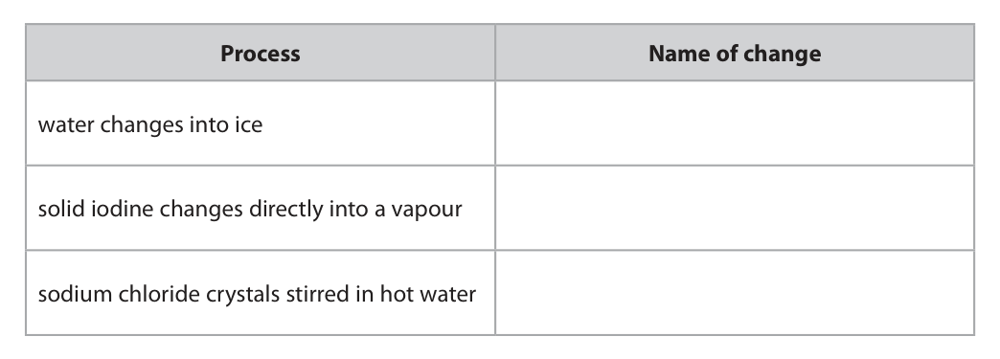
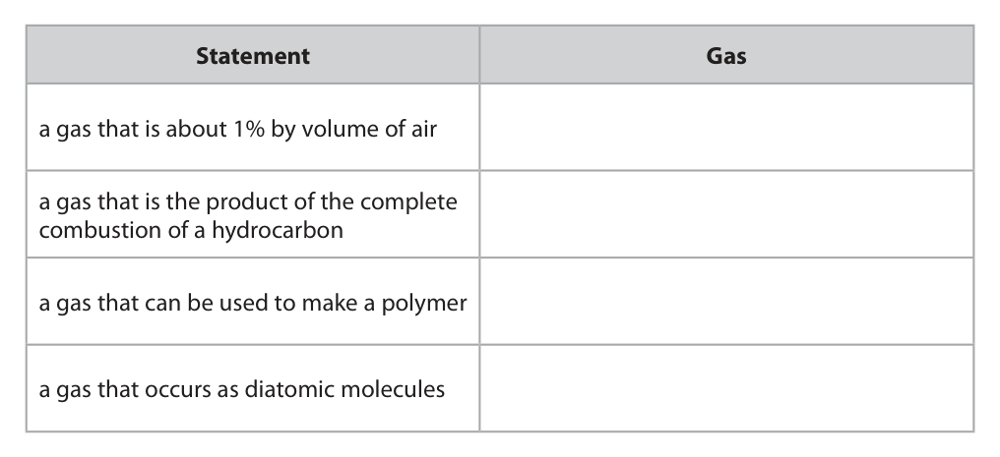
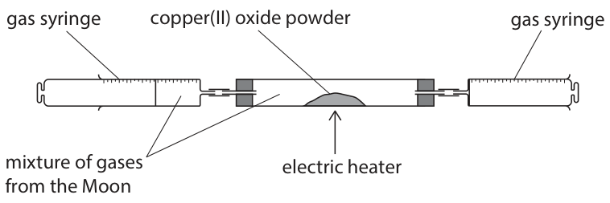
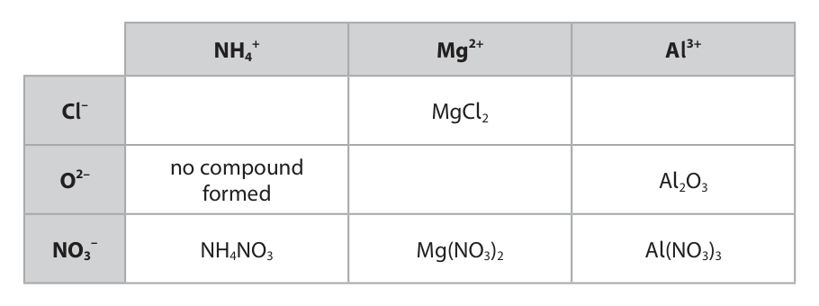
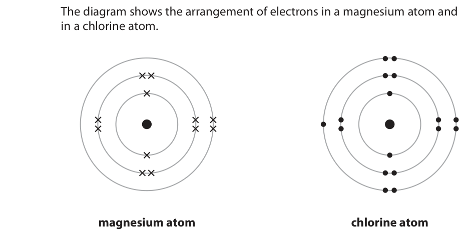
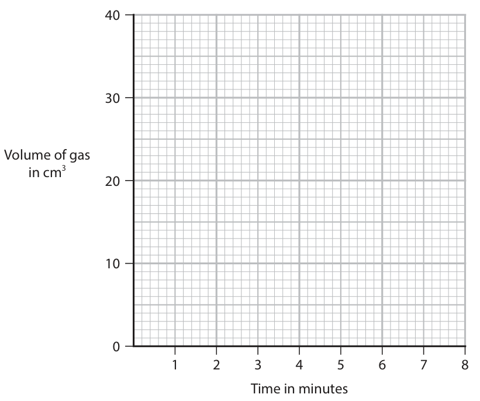
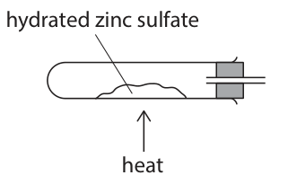
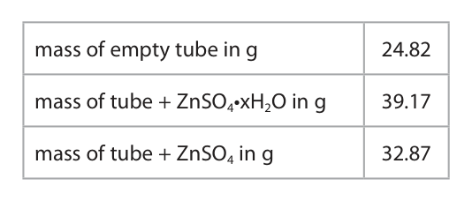

# 4CH1/1CR — 2026-06 (official extraction)

> schema `syllabai.official-paper-questions/0.1` · paper_id `pearson-edexcel:international-gcse:chemistry:4ch1:2026-06:4CH1/1CR` · qp sha256 `05e637ca01d53c70…` · extracted verbatim, never regenerated (ADR-037)

## Question 1 (7 marks)

The diagram shows the structure of an atom of an element. particle Y particle Z

### 1(a) [1]

Give the name of particle Z.

**Mark scheme answer**

> neutron

- **(1)** neutron

### 1(b) [1]

Give the mass number of this atom.

**Mark scheme answer**

> 15 ALLOW fifteen

- **(1)** 15 ALLOW fifteen

### 1(c) [2]

Give the group number and period number for this element. group number period number

**Mark scheme answer**

> M1 (group) 5
> M2 (period) 2

- **(1)** (group) 5
- **(1)** (period) 2

### 1(d) [1]

Give a reason why atoms of this element have no overall charge.

**Mark scheme answer**

> same number of protons and electrons OR each
> atom has 7 protons and 7 electrons

- **(1)** same number of protons and electrons OR each

### 1(e)(i) [1]

Identify this element.

**Mark scheme answer**

> nitrogen ALLOW N

- **(1)** nitrogen ALLOW N

### 1(e)(ii) [1]

Give the charge on an ion of this element.

**Mark scheme answer**

> 3- ALLOW -3
> Total for question 1 = 7

- **(1)** 3- ALLOW -3

## Question 2 (5 marks)

This question is about iron and its compounds.

**(b)** A student uses this apparatus to react iron with dilute sulfuric acid and to collect the gas produced. hydrogen dilute sulfuric acid water iron

### 2(a) [2]

Name the substances needed for iron to rust. 1 2

**Mark scheme answer**

> Oxygen ALLOW air
> Water ALLOW moisture/water
> vapour/steam
> answer in any
> order/correct formulae

- **(2)** Oxygen ALLOW air

### 2(b)(i) [1]

Name a metal that can safely react with dilute sulfuric acid to produce the same volume of hydrogen gas in a shorter time.

**Mark scheme answer**

> any one from
> magnesium/Mg
> aluminium/Al
> zinc/Zn

- **(1)** any one from

### 2(b)(ii) [1]

Give a test to show that the gas produced is hydrogen.

**Mark scheme answer**

> A lighted/burning/flame splint pops REJECT a glowing splint
> IGNORE squeaky pop
> test alone

- **(1)** A lighted/burning/flame splint pops REJECT a glowing splint

### 2(c) [1]

Which row gives the correct properties of iron(III) oxide? Nature of oxide Structure of oxide

- **(A)** acidic               giant ionic
- **(B)** basic            simple molecular
- **(C)** acidic            simple molecular
- **(D)** basic               giant ionic  ✔

**Mark scheme answer**

> D (basic and giant)
> A is not correct as metals do not form acidic
> oxides
> B is not correct as iron(III) oxide does not have a
> simple structure
> C is not correct as metals do not form acidic
> oxides
> Total for question 2 = 5

- **(1)** Answer D: basic               giant ionic

## Question 3 (9 marks)

A student uses paper chromatography in an experiment to separate the dyes in four different food colourings, A, B, C and D. The diagram shows the appearance of the paper at the start and at the end of the experiment. level reached by the solvent A B C D A B C D at start at end

### 3(a)(i) [3]

Describe a method the student should use after putting a spot of each food colouring on the paper.

**Mark scheme answer**

> a description including any three of the following
> points
> M1 pour (some) solvent into a beaker / ALLOW any named
> chromatography tank solvent
> M2 (place paper in the solvent/beaker) with the ALLOW with
> food colourings/spots/(samples of) A, B, C, D are start/pencil/base line
> above the level of the solvent OWTTE above solvent
> M3 leave (the paper) until solvent reaches the
> level shown on the diagram/almost reaches top of
> paper/when spots reach the level shown on the
> diagram OWTTE
> M4 (take the paper out and) leave it to dry ALLOW draw line at the
> level reached/travelled
> by solvent
> IGNORE any reference
> to spot travelling/ any
> description of the Rf
> value calculation
> All marks can be scored
> /supported from a
> labelled diagram

- **(3)** a description including any three of the following

### 3(a)(ii) [2]

Describe the composition of food colouring A.

**Mark scheme answer**

> a description containing any two of the following ACCEPT
> points compounds/solutes for
> dyes
> ALLOW components/
> substances/chemicals
> for dyes
> M1 (food colouring) A contains two dyes IGNORE (food colouring)
> A is a mixture/
> reference to
> purity/solubility
> REJECT inks/elements
> for M1 only
> ECF for M2 and M3
> M2 (food colouring) A contains (the dye in food
> colouring) B
> M3 (food colouring) A contains another dye that is
> not in any other food colouring (C/D)

- **(2)** a description containing any two of the following ACCEPT

### 3(a)(iii) [1]

Food colouring D is a mixture of dyes. Suggest how the student could separate the dyes in food colouring D.

**Mark scheme answer**

> use a different solvent OWTTE ALLOW any named
> solvent
> ALLOW thin-layer
> chromatography
> IGNORE temperature

- **(1)** use a different solvent OWTTE ALLOW any named

### 3(b) [3]

Calculate the Rf value of the most soluble dye on the chromatogram. Rf =

**Mark scheme answer**

> answer in the range of
> 0.75 _ 0.80 scores 3
> M1 distance moved by the dye AND ALLOW 4.7 _ 4.9 (cm)
> distance moved by the solvent AND 6.1_ 6.3 (cm)
> M2 distance moved by the dye ÷ distance moved ECF from M1
> by the solvent
> M3 0.75 _ 0.80 ECF from M2 for a
> correct calculation
> method only
> answer to 2 SF or more
> Total for question 3 = 9

- **(1)** distance moved by the dye AND ALLOW 4.7 _ 4.9 (cm)
- **(1)** distance moved by the dye ÷ distance moved ECF from M1
- **(1)** 0.75 _ 0.80 ECF from M2 for a

## Question 4 (8 marks)

This question is about physical changes.

### 4(a) [3]

The table gives some physical processes. Complete the table by giving the name of the change for each process. Process Name of change water changes into ice solid iodine changes directly into a vapour sodium chloride crystals stirred in hot water

**Mark scheme answer**

> 3
> Process Name of
> change
> water changes into ice freezing
> solid iodine changes sublimation
> directly into a vapour
> sodium chloride crystals dissolving
> stirred in hot water

- **(3)** 3

### 4(b) [2]

Explain why hot water evaporates more quickly than cold water.

**Mark scheme answer**

> M1 the particles/molecules have more (kinetic) IGNORE hot water has
> energy more (kinetic) energy
> ALLOW
> particles/molecules
> move faster
> IGNORE vibrate more
> M2 so can overcome / break the (intermolecular) ALLOW so can break
> forces/forces (between molecules) the bonds (between
> molecules) OR to break
> away from one another
> OR to escape more
> easily
> IGNORE references to
> collisions, activation
> energy or rate of
> reaction

- **(1)** the particles/molecules have more (kinetic) IGNORE hot water has
- **(1)** so can overcome / break the (intermolecular) ALLOW so can break

### 4(c) [3]

A student is given a pure solid and an impure solid. Describe how the student can identify which solid is pure and which solid is impure by measuring a physical property.

**Mark scheme answer**

> M1 measure the melting point ALLOW measuring
> freezing point
> IGNORE reference to
> boiling point
> M2 the pure solid has a sharp/definite/fixed
> melting point
> M3 the mixture/impure solid melts over a range of ALLOW the mixture has
> temperatures a lower melting point/a
> pure substance has a
> higher melting point
> Total for question 4 = 8

- **(1)** measure the melting point ALLOW measuring
- **(1)** the pure solid has a sharp/definite/fixed
- **(1)** the mixture/impure solid melts over a range of ALLOW the mixture has

## Question 5 (12 marks)

This question is about gases.

**(b)** A scientist analyses a sample of gases from the Moon. The sample is a mixture of the gases helium, hydrogen and neon. The scientist uses this apparatus to determine the percentage by volume of hydrogen in the mixture. gas syringe copper(II) oxide powder gas syringe mixture of gases electric heater from the Moon This is the scientist’s method. • record the total volume of the gases in the apparatus • heat the copper(II) oxide powder using the electric heater • use the gas syringes to pass the gases over the heated copper(II) oxide powder several times • allow the remaining gases to cool to room temperature and record the volume This is the equation for the reaction between copper(II) oxide and hydrogen. CuO(s) + H2(g) → Cu(s) + H2O(g)

### 5(a) [4]

The box lists the names of some gases. argon carbon dioxide ethene methane nitrogen sulfur dioxide The table gives some statements about gases. Complete the table by giving the correct gas from the box for each statement. Statement Gas a gas that is about 1% by volume of air a gas that is the product of the complete combustion of a hydrocarbon a gas that can be used to make a polymer a gas that occurs as diatomic molecules

**Mark scheme answer**

> argon
> carbon dioxide
> ethene
> nitrogen

- **(4)** argon

### 5(b)(i) [1]

Give a reason why helium and neon are unreactive.

**Mark scheme answer**

> they both have full outer shells (of electrons) ALLOW they do not
> need to lose or gain
> electrons
> IGNORE 8 electrons
> alone

- **(1)** they both have full outer shells (of electrons) ALLOW they do not

### 5(b)(ii) [1]

Give a reason why the scientist allows the remaining gases to cool before recording the volume.

**Mark scheme answer**

> the volume of a gas changes with temperature/ ALLOW to allow the
> gas expands when hot/heated/gas shrinks when steam to condense
> cooled OWTTE

- **(1)** the volume of a gas changes with temperature/ ALLOW to allow the

### 5(b)(iii) [1]

Give a reason why the scientist uses an electric heater rather than a Bunsen burner.

**Mark scheme answer**

> hydrogen is flammable/explosive IGNORE temperature
> control

- **(1)** hydrogen is flammable/explosive IGNORE temperature

### 5(b)(iv) [3]

At the start of the experiment, the initial volume of gas in the apparatus is 157.0 cm3 At the end of the experiment, the final volume of gas is 106.7 cm3 Calculate the percentage by volume of hydrogen in the mixture of gases. Give your answer to one decimal place. percentage = %

**Mark scheme answer**

> correct answer to 1dp
> scores 3
> M1 (volume of hydrogen) 157.0–106.7 OR 50.3 cm3
> M2 (50.3÷157.0) × 100 OR 32.038% ECF for M2 and M3
> M3 32.0(%) 47.1(%) scores 2 if M1
> scored
> OR
> M1 (1-(106.7 ÷157.0) =) 0.32038
> M2 0.32038 x 100
> M3 32.0(%)

- **(3)** correct answer to 1dp

### 5(b)(v) [2]

Explain why the reaction between copper(II) oxide and hydrogen is a redox reaction.

**Mark scheme answer**

> M1 copper(II) oxide is reduced OR copper(II) oxide REJECT copper alone
> loses oxygen OR Cu2+ /copper ion gains electrons
> M2 hydrogen is oxidised OR hydrogen gains oxygen
> OR H2/hydrogen loses electrons
> Total for question 5 = 12

- **(1)** copper(II) oxide is reduced OR copper(II) oxide REJECT copper alone
- **(1)** hydrogen is oxidised OR hydrogen gains oxygen

## Question 6 (12 marks)

This question is about ionic compounds.

**(a)** The table gives the formulae of some positive ions, some negative ions, and some compounds containing these ions. NH4+ Mg2+ Al3+ Cl– MgCl2 no compound O2– Al2O3 formed NO3– NH4NO3 Mg(NO3)2 Al(NO3)3

**(b)** Magnesium chloride (MgCl2) is an ionic compound. The magnesium ions and chloride ions are held together by ionic bonding.

### 6(a)(i) [3]

Complete the table by giving the three missing formulae.

**Mark scheme answer**

> 3
> NH4+ Mg2+ Al3+
> Cl– NH4Cl MgCl2 AlCl3
> O2– no
> compound MgO Al2O3
> formed
> NO3– NH4NO3 Mg(NO3)2 Al(NO3)3

- **(3)** 3

### 6(a)(ii) [1]

Give the name of the compound with the formula NH4NO3

**Mark scheme answer**

> ammonium nitrate

- **(1)** ammonium nitrate

### 6(a)(iii) [2]

Calculate the mass, in grams, of nitrogen in 100 g of NH4NO3 [for N Ar = 14] [for NH4NO3 Mr = 80] mass = g

**Mark scheme answer**

> correct answer scores 2
> marks
> M1 (28 ÷ 80) × 100
> M2 35(g) ECF from M1
> OR
> M1 (100 ÷ 80 =) 1.25
> M2 1.25 x 28 = 35 (g) 17.5 with/without
> scores 1

- **(2)** correct answer scores 2

### 6(b)(i) [2]

State the meaning of the term ionic bonding.

**Mark scheme answer**

> M1 electrostatic attraction/forces
> M2 between oppositely charged ions ACCEPT between
> cations and anions

- **(1)** electrostatic attraction/forces
- **(1)** between oppositely charged ions ACCEPT between

### 6(b)(ii) [2]

Magnesium chloride forms when magnesium reacts with chlorine. The diagram shows the arrangement of electrons in a magnesium atom and in a chlorine atom. magnesium atom chlorine atom Describe, in terms of electrons, what happens when magnesium chloride forms.

**Mark scheme answer**

> M1 magnesium loses electrons and chlorine gains
> electrons
> M2 one atom of magnesium loses two electrons M2 subsumes M1
> and two atoms of chlorine each gain one electron
> Any mention of sharing
> of electrons/covalent
> bonding scores 0

- **(1)** magnesium loses electrons and chlorine gains
- **(1)** one atom of magnesium loses two electrons M2 subsumes M1

### 6(b)(iii) [2]

Describe a test to show that magnesium chloride contains chloride ions.

**Mark scheme answer**

> M1 add (nitric) acid and silver nitrate REJECT other named
> acids
> ALLOW correct
> formulae
> M2 white precipitate M2 dep on silver nitrate
> in M1
> Total for question 6 = 12

- **(1)** add (nitric) acid and silver nitrate REJECT other named
- **(1)** white precipitate M2 dep on silver nitrate

## Question 7 (9 marks)

This question is about rates of reaction. A student uses this apparatus to investigate the rate of reaction between zinc and dilute hydrochloric acid. gas syringe zinc powder dilute hydrochloric acid The zinc powder is in excess. The student measures the volume of gas in the syringe every minute for 8 minutes. The table shows the student’s results. Time in minutes 0 1 2 3 4 5 6 7 8 Volume of gas in cm3 0 16 18 30 36 40 40 40 40

### 7(a)(i) [1]

Plot the student’s results on the grid.

**Mark scheme answer**

> all 9 points plotted ± half a square

- **(1)** all 9 points plotted ± half a square

### 7(a)(ii) [1]

Draw a curve of best fit, ignoring the anomalous result. Volume of gas in cm3 1 2 3 4 5 6 7 8 Time in minutes

**Mark scheme answer**

> points joined with a curved line of best fit,
> ignoring the anomalous point at 2 minutes

- **(1)** points joined with a curved line of best fit,

### 7(a)(iii) [1]

Suggest a mistake the student could have made to cause the anomalous result.

**Mark scheme answer**

> the student recorded the volume too early

- **(1)** the student recorded the volume too early

### 7(a)(iv) [1]

Draw a tangent to the curve at 4 minutes.

**Mark scheme answer**

> tangent drawn to the curve at 4 minutes

- **(1)** tangent drawn to the curve at 4 minutes

### 7(a)(v) [3]

Use the tangent to determine the rate of reaction at 4 minutes. Include a unit in your answer. rate = unit =

**Mark scheme answer**

> M1 suitable values taken from the graph for two If no tangent drawn
> coordinates using their tangent then only M3 can be
> awarded.
> M2 gradient of tangent calculated (expected value NO ECF from M1
> = 4.58)
> M3 cm3/minute ALLOW cm3/min OR
> cm3min-1

- **(1)** suitable values taken from the graph for two If no tangent drawn
- **(1)** gradient of tangent calculated (expected value NO ECF from M1
- **(1)** cm3/minute ALLOW cm3/min OR

### 7(b) [2]

Explain why the last four readings for the volume of gas are the same.

**Mark scheme answer**

> M1 the reaction has stopped IGNORE no more
> hydrogen/gas
> produced/reference to
> the curve plateauing
> M2 because all the acid has reacted
> Total for question 7 = 9

- **(1)** the reaction has stopped IGNORE no more
- **(1)** because all the acid has reacted

## Question 8 (13 marks)

The table shows the displayed formulae of six organic compounds. A B C H H H H H H H H H H C C C H H C C C C H H C C C H H H H H H H H H H C H H D E F H H H H H H C H H C C H H C C H H H C C H Br Br H H

**(a)** Use the letters A to F to answer these questions. You may use each letter once, more than once, or not at all.

**(b)** This equation represents a reaction that occurs during cracking. C12H26 → C8H18 + 2C2H4

### 8(a)(i) [1]

Give the letter of the compound that is not a hydrocarbon.

**Mark scheme answer**

> F

- **(1)** F

### 8(a)(ii) [1]

Give the letter of the compound that will decolourise bromine water.

**Mark scheme answer**

> B

- **(1)** B

### 8(a)(iii) [1]

Give the letter of the saturated compound with the empirical formula CH2

**Mark scheme answer**

> E

- **(1)** E

### 8(a)(iv) [1]

Give the letter of the compound that has the same molecular formula as butane.

**Mark scheme answer**

> A

- **(1)** A

### 8(b)(i) [2]

Give the temperature and the catalyst needed for cracking. temperature catalyst

**Mark scheme answer**

> temperature 600-700 °C ALLOW any
> temperature in the
> range
> ALLOW missing units
> REJECT any
> temperature outside
> the range
> catalyst alumina/silica/aluminosilicates/zeolites ALLOW correct
> formulae

- **(2)** temperature 600-700 °C ALLOW any

### 8(b)(ii) [4]

Explain why cracking is a useful process. Refer to the products of the reaction in your answer.

**Mark scheme answer**

> M1 shorter alkanes/hydrocarbons (such as C8H18) ALLOW greater demand
> are more flammable (than longer alkanes) for short chain
> alkanes/hydrocarbons
> (than long chain
> alkanes) ORA
> M2 therefore are more useful/used as fuels ALLOW short chain
> alkanes needed for
> specific uses e.g.
> petrol/gasoline
> M3 (cracking) produces alkenes (such as C2H4)
> M4 which is used to make polymers/plastics ALLOW ethanol/alcohol

- **(1)** shorter alkanes/hydrocarbons (such as C8H18) ALLOW greater demand
- **(1)** therefore are more useful/used as fuels ALLOW short chain
- **(1)** (cracking) produces alkenes (such as C2H4)
- **(1)** which is used to make polymers/plastics ALLOW ethanol/alcohol

### 8(c) [3]

Complete the equation for the polymerisation of compound B. H H H n H C C C C H H H H

**Mark scheme answer**

> M1 single bond between carbon 2 and carbon 3 REJECT if butane is
> drawn
> M2 rest of the repeat unit correct
> M3 repeat unit in brackets, trailing bonds present M3 dep on M2
> and n to the bottom right
> Total for question 8 = 13

- **(1)** single bond between carbon 2 and carbon 3 REJECT if butane is
- **(1)** rest of the repeat unit correct
- **(1)** repeat unit in brackets, trailing bonds present M3 dep on M2

## Question 9 (9 marks)

This question is about copper and copper compounds.

**(b)** Copper can be produced by reacting copper(II) sulfate solution with a metal, M. M is not the symbol for the metal. This is the equation for the reaction. M + CuSO4 → MSO4 + Cu

### 9(a) [2]

A sample of copper contains two isotopes. • Cu with relative abundance 62.5% • Cu with relative abundance 37.5% Calculate the relative atomic mass (Ar) of copper in the sample. Ar =

**Mark scheme answer**

> correct answer scores 2
> M1 ((63 × 62.5) + (65 × 37.5)) ÷ 100
> OR (63 × 62.5%) + (65 × 37.5%)
> M2 63.75 OR 63.8 NO ECF from M1
> Answer of 64
> with correct working
> scores M1
> Answer of 64
> without working scores

- **(1)** ((63 × 62.5) + (65 × 37.5)) ÷ 100
- **(1)** 63.75 OR 63.8 NO ECF from M1

### 9(b)(i) [2]

100.00 g of M produces 158.75 g of copper when reacted with an excess of copper(II) sulfate solution. Calculate the relative atomic mass (Ar ) of M. [for Cu Ar = 63.5] Ar =

**Mark scheme answer**

> M1 amount of copper = 158.75 ÷ 63.5 OR 2.5 mol
> M2 Ar of M (1000 ÷ 25 =) 40 M2 subsumes M1

- **(1)** amount of copper = 158.75 ÷ 63.5 OR 2.5 mol
- **(1)** Ar of M (1000 ÷ 25 =) 40 M2 subsumes M1

### 9(b)(ii) [1]

Use the Periodic Table to identify M.

**Mark scheme answer**

> Ca OR calcium

- **(1)** Ca OR calcium

### 9(b)(iii) [2]

This is the ionic equation for the reaction between copper(II) sulfate and M. Cu2+ + M → Cu + M2+ Explain, in terms of electrons, which species is the reducing agent.

**Mark scheme answer**

> M1 M/Ca is the reducing agent
> M2 M/Ca donates/loses electron(s) (to Cu2+) M2 dep on M1
> IGNORE M/Ca is
> oxidised

- **(1)** M/Ca is the reducing agent
- **(1)** M/Ca donates/loses electron(s) (to Cu2+) M2 dep on M1

### 9(c) [2]

Copper can also be produced by reacting copper(II) oxide with carbon. This is the equation for the reaction. 2CuO + C → 2Cu + CO2 A mixture of 10 000 mol of copper(II) oxide is heated with 70 kg of carbon. Show, by calculation, that carbon is in excess. [for C Ar = 12]

**Mark scheme answer**

> M1 10 000 mol of CuO needs 5000 mol of C
> M2 5000 mol of carbon has a mass of 60 kg
> OR
> M1 70 kg of carbon = 5833 mol
> M2 which is enough to react with 11667 mol of
> CuO ACCEPT alternative
> method e.g
> ALLOW
> M1 5000 mol of C
> needed
> M2 70000 ÷ 12 = 5833
> mol used, so C is in
> excess
> Total for question 9 = 9

- **(2)** M1 10 000 mol of CuO needs 5000 mol of C

## Question 10 (15 marks)

This question is about zinc sulfate.

**(a)** Soluble salts such as zinc sulfate can be prepared by the reaction between a metal oxide and an acid. This is the word equation for the reaction. zinc oxide + sulfuric acid → zinc sulfate + water

**(d)** Zinc sulfate solution reacts with ammonium hydroxide solution to form the insoluble solid, zinc hydroxide. This is the equation for the reaction. ZnSO4(aq) + 2NH4OH(aq) → Zn(OH)2(s) + (NH4)2SO4(aq)

### 10(a)(i) [1]

State the name of this type of reaction.

**Mark scheme answer**

> neutralisation / acid-base

- **(1)** neutralisation / acid-base

### 10(a)(ii) [1]

State, in terms of protons, what happens in this reaction.

**Mark scheme answer**

> (sulfuric) acid gives proton(s)/H+ (to zinc oxide) ALLOW (sulfuric) acid is
> a proton donor
> ALLOW zinc oxide
> accepts proton(s)

- **(1)** (sulfuric) acid gives proton(s)/H+ (to zinc oxide) ALLOW (sulfuric) acid is

### 10(b) [6]

A student is given 50 cm3 of dilute sulfuric acid and some zinc carbonate powder. Describe a method the student should use to prepare dry crystals of hydrated zinc sulfate.

**Mark scheme answer**

> a description that makes reference to the
> following three points:
> M1 add zinc carbonate/ powder to acid
> M2 until no more zinc carbonate reacts ALLOW until there is no
> more effervescence
> M3 filter (off the excess zinc carbonate/powder) M3 subsumes M2 as long
> as excess zinc
> carbonate is mentioned
> AND three of the following points:
> M4 heat the solution of zinc sulfate If heat to dryness only
> until it is partly evaporated/crystals M1, M2, M3 and M4 can
> form/saturated solution be scored
> If just left the solution
> to evaporate only M6
> and M7 can be scored
> M5 leave solution to cool/to crystallise
> M6 filter off crystals ALLOW pour off excess
> liquid/decant off the
> solution
> IGNORE references to
> washing
> M7 suitable method of drying the crystals e.g. using filter
> paper/using paper
> towel/in a (warm)
> oven/leave in a warm
> place to dry
> REJECT hot oven or any
> method of direct
> heating e.g. Bunsen
> ALLOW leave crystals to
> dry but not just dry the
> crystals
> No M7 if crystals are
> washed after drying

- **(6)** a description that makes reference to the

### 10(c) [3]

The student uses this apparatus to find the value of x in the formula ZnSO4•xH2O hydrated zinc sulfate heat When heated, the hydrated solid decomposes completely. This is the equation for the reaction. ZnSO4•xH2O → ZnSO4 + xH2O The table shows the student’s results. mass of empty tube in g 24.82 mass of tube + ZnSO4•xH2O in g 39.17 mass of tube + ZnSO4 in g 32.87 Show that the value of x is 7. [for ZnSO4 Mr = 161] [for H2O Mr = 18]

**Mark scheme answer**

> M1 mass of zinc sulfate = 8.05 (g)
> AND
> mass of water = 6.3 (g)
> M2 amount of zinc sulfate = 8.05 ÷ 161 OR 0.05 M2 subsumes M1
> (mol) ECF for M2 only
> AND 6.3 ÷ 18 OR 0.35 (mol)
> M3 0.35 ÷ 0.05 (=7) M3 subsumes M1 and
> M2
> OR
> M1 mass of hydrated zinc sulfate = 14.35 (g) AND
> mass of anhydrous zinc sulfate = 8.05 (g)
> M2 amount of zinc sulfate = 8.05 ÷ 161 OR 0.05 ALLOW Mr of hydrated
> (mol) AND zinc sulfate = 14.35 ÷
> Mr of hydrated zinc sulfate = (14.35 ÷ (0.05) =) 287 (8.05 ÷ 161) = 287 for
> M2
> M3 (287 – 161) ÷ 18 (= 7)

- **(3)** M1 mass of zinc sulfate = 8.05 (g)

### 10(d)(i) [3]

A student reacts a solution containing 0.250 mol of ammonium hydroxide with an excess of zinc sulfate. The reaction produces 11.3 g of zinc hydroxide. Calculate the percentage yield of zinc hydroxide in this reaction. [for Zn(OH)2 Mr = 99] percentage yield = %

**Mark scheme answer**

> correct answer scores 3
> M1(amount of zinc hydroxide) = 0.250 ÷ 2 OR
> 0.125 (mol)
> M2 maximum mass of zinc hydroxide = 0.125 × 99 M2 subsumes M1
> OR 12.375 (g)
> M3 ((11.3 ÷ 12.375) × 100 =) 91.3(%) ALLOW ECF from M2
> ACCEPT 87.8 OR 88(%)
> if using 0.13 x 99 in M2
> OR
> M1 (amount of zinc hydroxide) = 0.250 ÷ 2 OR
> 0.125 (mol)
> M2 amount of zinc hydroxide produced (= 11.3 ÷
> 99) = 0.114 (mol)
> M3 ((0.114 ÷ 0.125) × 100 =) 91.3(%) ALLOW 45.7(%) scores 2
> (step M1 missed)
> ALLOW any number of
> SF except 1

- **(3)** correct answer scores 3

### 10(d)(ii) [1]

The student repeats the experiment and correctly calculates a percentage yield of 107%. Suggest why this percentage yield is greater than 100%.

**Mark scheme answer**

> zinc hydroxide/sample is wet/not dry ALLOW more
> ammonium hydroxide
> OR added
> contamination of zinc hydroxide/sample is caused e.g. some left over zinc
> by an identified error that would result in a hydroxide/solids from
> greater mass previous experiments
> Total for question 10 = 15

- **(1)** zinc hydroxide/sample is wet/not dry ALLOW more

## Question 11 (11 marks)

This question is about carbon. The table shows the structures of three different forms of carbon. Diamond C60 fullerene Graphite

### 11(a) [1]

Give the reason why these forms of carbon are elements.

**Mark scheme answer**

> they contain one type of atom

- **(1)** they contain one type of atom

### 11(b) [2]

Explain, in terms of its structure, why graphite can act as a lubricant.

**Mark scheme answer**

> M1 (graphite has) weak forces between its layers REJECT weak
> intermolecular
> forces/layers of
> molecules/ions
> M2 so layers can slide/slip (over one another)

- **(1)** (graphite has) weak forces between its layers REJECT weak
- **(1)** so layers can slide/slip (over one another)

### 11(c) [5]

Explain why diamond has a much higher boiling point than C60 fullerene. Refer to structure and bonding in your answer. QUESTION 11 CONTINUES ON BACK PAGE

**Mark scheme answer**

> diamond
> M1 giant (covalent) structure/giant lattice ALLOW macromolecular
> IGNORE giant molecule
> REJECT ionic
> M2 strong covalent bonds ACCEPT strong
> (electrostatic) forces
> between the shared
> pair of electrons and
> nuclei
> no M2 if reference to
> intermolecular forces/
> ions in diamond
> C60 fullerene
> M3 simple molecular (structure) ALLOW C60 exists as
> molecules
> M4 weak intermolecular forces ALLOW the attractions
> between the molecules
> are weak
> ALLOW weak
> intermolecular bonds
> comparison
> M5 more (thermal/heat) energy is needed to break NOT just heat
> the covalent bonds (in diamond) than to break /
> overcome the intermolecular forces (in C60
> fullerene)/to separate the (C60 fullerene)
> molecules

- **(1)** giant (covalent) structure/giant lattice ALLOW macromolecular
- **(1)** strong covalent bonds ACCEPT strong
- **(1)** simple molecular (structure) ALLOW C60 exists as
- **(1)** weak intermolecular forces ALLOW the attractions
- **(1)** more (thermal/heat) energy is needed to break NOT just heat

### 11(d) [3]

Calculate the mass, in g, of one molecule of C60 fullerene. Give your answer in standard form. [one mole contains 6.02 × 1023 particles] [for C Ar = 12] mass = g

**Mark scheme answer**

> correct answer scores 3
> M1 Mr of C60 = 720
> M2 720 ÷ 6.02 × 1023 ECF from M1
> M3 mass of 1 molecule = 1.196 × 10–21(g) ECF from M2 for correct
> calculation method and
> answer in standard form
> ALLOW any number of
> SF except 1
> total for question 11 = 11

- **(1)** Mr of C60 = 720
- **(1)** 720 ÷ 6.02 × 1023 ECF from M1
- **(1)** mass of 1 molecule = 1.196 × 10–21(g) ECF from M2 for correct

