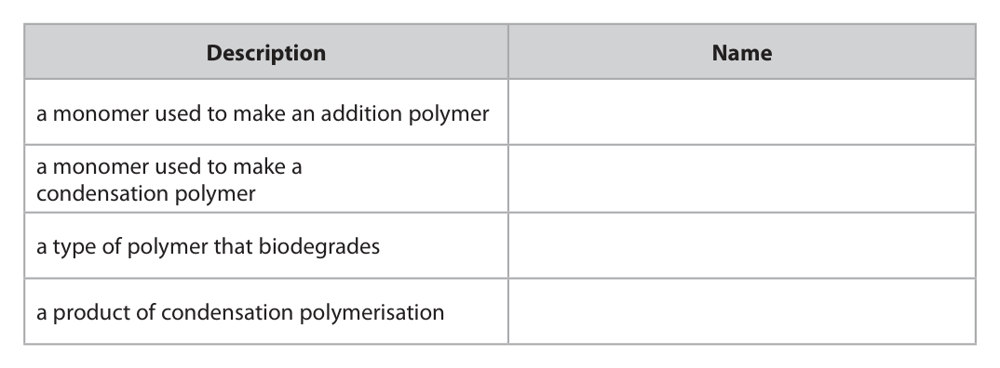
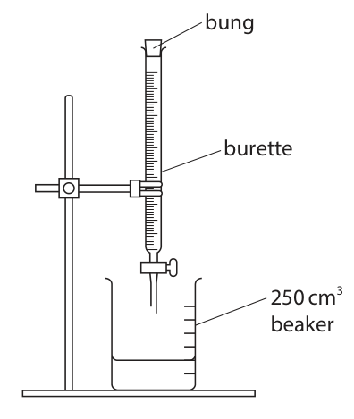
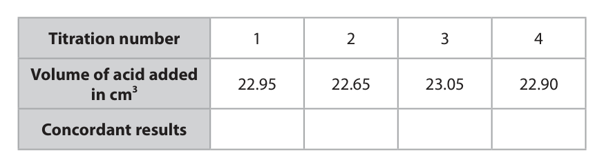
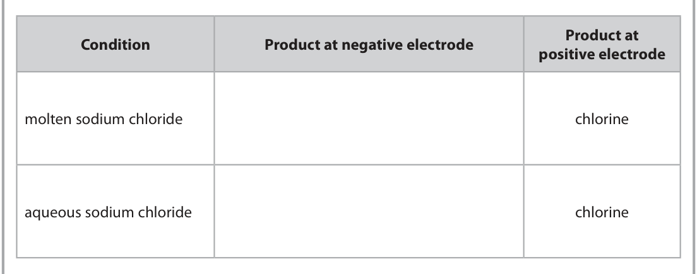
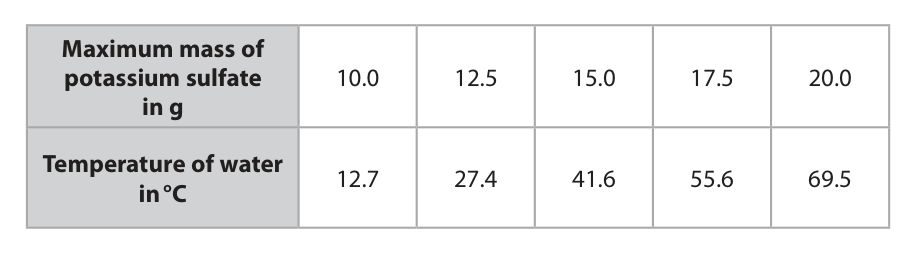

# 4CH1/2C — 2026-06 (official extraction)

> schema `syllabai.official-paper-questions/0.1` · paper_id `pearson-edexcel:international-gcse:chemistry:4ch1:2026-06:4CH1/2C` · qp sha256 `713f1fccc169d6b7…` · extracted verbatim, never regenerated (ADR-037)

## Question 1 (10 marks)

This question is about polymerisation.

**(c)** This is the displayed formula for butane‑1,4‑dioic acid. H H O O C C C C H O O H H H

### 1(a) [4]

The box gives some names used in polymerisation. addition alkane alkene condensation dicarboxylic acid poly(chloroethene) water Complete the table by choosing the correct name from the box that matches each description. Description Name a monomer used to make an addition polymer a monomer used to make a condensation polymer a type of polymer that biodegrades a product of condensation polymerisation

**Mark scheme answer**

> 4
> Description Name
> a monomer used to alkene
> make an addition
> polymer
> a monomer used to dicarboxylic acid
> make a condensation
> polymer
> a type of polymer that condensation
> biodegrades
> a product of water
> condensation
> polymerisation

- **(4)** 4

### 1(b) [1]

Which structure shows the correct repeating unit for poly(propene)? H H H H H H A C C C B C C C H H H H H CH3 H C C C D C C H H CH3 

**Mark scheme answer**

> C
> A is not the correct answer because the repeating
> unit does not have three carbons in a row.
> B is not the correct answer because the repeating
> unit does not have a double bond.
> D is not the correct answer because the repeating
> unit does not have a double bond or three carbons
> in a row.

- **(1)** C

### 1(c)(i) [1]

Determine the molecular formula for butane‑1,4‑dioic acid.

**Mark scheme answer**

> C4H6O4

- **(1)** C4H6O4

### 1(c)(ii) [2]

Complete the chemical equation for the reaction between butane‑1,4‑dioic acid and sodium. O H H O O H H O C C C C + C C C C + – – HO OH O O H H Na+ H H Na+

**Mark scheme answer**

> ….. + 2 Na → …. + H2
> M1 for Na and H2/H-H
> M2 for correct balancing M2 dep on M1

- **(1)** for Na and H2/H-H
- **(1)** for correct balancing M2 dep on M1

### 1(c)(iii) [2]

Butane‑1,4‑dioic acid can react to form this polyester. O O O CH2 CH2 CH2 CH2 O C CH2 CH2 C Draw a circle around the part of the polyester that comes from a butane‑1,4‑dioic acid molecule.

**Mark scheme answer**

> 2
> M1 for circling any 4 adjacent carbons If fewer/more than 4
> carbons are circled then
> 0 marks
> M2 for circling the correct 4 adjacent carbons IGNORE C-O- if circled
> including the two C=O
> M2 dep on M1
> Question
> Answer Notes Marks
> number
> _

- **(1)** for circling any 4 adjacent carbons If fewer/more than 4
- **(1)** for circling the correct 4 adjacent carbons IGNORE C-O- if circled

## Question 2 (14 marks)

A titration can be used to prepare soluble salts.

**(d)** Another student does a titration using the correct method. The table shows their results. Titration number 1 2 3 4 Volume of acid added 22.95 22.65 23.05 22.90 in cm3 Concordant results

**(e)** Sodium hydroxide solution is used in titrations.

### 2(a) [1]

Name a negative ion that always gives a salt that is soluble in water.

**Mark scheme answer**

> nitrate ACCEPT NO3
> penalise incorrect letter
> cases and subscripts

- **(1)** nitrate ACCEPT NO3

### 2(b) [2]

A student sets up this apparatus to do a titration. bung burette 250 cm3 beaker The student makes two mistakes when setting up their apparatus. Suggest two changes to the student’s set up that need to be made if the titration is to be done correctly. 1 2 

**Mark scheme answer**

> Any two answers from the following:
> M1 there should not be a bung (on the top of the
> burette)
> M2 a (conical) flask should be used (instead of a IGNORE size of conical
> beaker) flask
> M3 – a white tile is needed IGNORE any comments
> related to the clamp
> stand/adding acid to
> burette/using pipette to
> transfer alkali

- **(2)** Any two answers from the following:

### 2(c) [3]

The student plans this method for their titration. • add 25.0 cm3 of an alkali to the beaker • add an acid to the burette until the level reaches 0.00 cm3 • open the burette tap and add acid to the beaker until there is a colour change • record the final reading on the burette • repeat the method until concordant results have been obtained. Give three improvements to the student’s method. Do not refer to changes in apparatus in your answer. 1 2 3

**Mark scheme answer**

> M1 use an indicator (at the start) ACCEPT any suitable
> named indicator
> REJECT universal
> indicator for M1
> any two from the following:
> M2 Add 25.0 cm3 of NaOH using a pipette
> M3 rinse burette with acid solution (before filling)
> M4 make sure that the jet/space between tap and ALLOW remove bubbles
> tip contains liquid only in the burette
> M5 swirl/stir (when adding the acid)
> M6 add dropwise close to the endpoint/near the end IGNORE add dropwise
> (from the start)
> IGNORE doing a trial

- **(3)** M1 use an indicator (at the start) ACCEPT any suitable

### 2(d)(i) [1]

Concordant results are those within 0.20 cm3 of each other. Add ticks (ü) to the table to show the concordant results. 

**Mark scheme answer**

> ticks in boxes 1, 3 and 4 one incorrect or missing
> tick scores 0

- **(1)** ticks in boxes 1, 3 and 4 one incorrect or missing

### 2(d)(ii) [2]

Use the concordant results to calculate the mean volume of acid added. mean volume = cm3

**Mark scheme answer**

> M1 (22.95 + 23.05 + 22.90) ÷ 3 22.97 without working
> scores 2
> M2 = 22.97
> 23.0 with or without
> working scores 1
> If no results ticked then
> only use of 2 or 3
> concordant titres can
> scores both marks in (ii)
> If only one result ticked
> then M2 can be scored
> for averaging two or
> more titre values
> correctly
> M1 consequential on
> results ticked
> M2 consequential on
> correct calculation from
> M1
> answer to M2 must be
> correct to 2 dp

- **(1)** (22.95 + 23.05 + 22.90) ÷ 3 22.97 without working
- **(1)** = 22.97

### 2(e)(i) [2]

Explain whether sodium hydroxide solution is an acid, an alkali or a salt.

**Mark scheme answer**

> M1 alkali
> _
> M2 contains hydroxide ions / OH ALLOW is a proton
> acceptor
> M2 dep on M1

- **(1)** alkali
- **(1)** contains hydroxide ions / OH ALLOW is a proton

### 2(e)(ii) [3]

Solid sodium hydroxide is dissolved in excess water to make a solution. This process is exothermic, with 47 kJ of energy released per mole. Calculate the energy released, in kJ, when 0.55 kg of solid sodium hydroxide is dissolved in excess water. [for sodium hydroxide Mr = 40] energy released = kJ

**Mark scheme answer**

> M1 (0.55 × 1000 =) 550 (g)
> M2 amount of sodium hydroxide = 550 ÷ 40 ECF from M1
> (= 13.75 mol) 13.75 scores M1 and M2
> M3 energy released = 13.75 × 47 = 646(.25) ECF from M2
> 0.646(25) scores 2
> ACCEPT any number of
> SF except 1
> Question
> Answer Notes Marks
> number

- **(1)** (0.55 × 1000 =) 550 (g)
- **(1)** amount of sodium hydroxide = 550 ÷ 40 ECF from M1
- **(1)** energy released = 13.75 × 47 = 646(.25) ECF from M2

## Question 3 (15 marks)

This question is about electrolysis.

**(a)** Compounds that only contain covalent bonds cannot be electrolysed.

**(b)** Lead(II) bromide is an ionic compound that can be electrolysed.

**(c)** Sodium chloride can also be electrolysed.

### 3(a)(i) [2]

Describe what is meant by the term covalent bond.

**Mark scheme answer**

> M1 (electrostatic) attraction between the shared pair
> of electrons
> M2 and the (positive) nuclei REJECT nucleus for M2

- **(1)** (electrostatic) attraction between the shared pair
- **(1)** and the (positive) nuclei REJECT nucleus for M2

### 3(a)(ii) [1]

State why covalent compounds do not conduct electricity.

**Mark scheme answer**

> there are no electrons free to move/no delocalised IGNORE reference to
> electrons ions/free electrons
> alone

- **(1)** there are no electrons free to move/no delocalised IGNORE reference to

### 3(b)(i) [2]

During electrolysis, the lead(II) bromide is at a temperature of 400 °C. Explain a suitable material for the electrodes.

**Mark scheme answer**

> M1 graphite IGNORE carbon
> ALLOW platinum/a
> named transition metal
> M2 conducts electricity / high melting point / ALLOW doesn’t react
> resistance to high temperature with product/is inert
> M1 and M2 mark
> independently

- **(1)** graphite IGNORE carbon
- **(1)** conducts electricity / high melting point / ALLOW doesn’t react

### 3(b)(ii) [1]

The lead(II) ions in this electrolysis have a positive charge. Give the term used to refer to all positive ions.

**Mark scheme answer**

> cations
> _ _

- **(1)** cations

### 3(b)(iii) [1]

Give the half‑equation for the reaction at the positive electrode.

**Mark scheme answer**

> 2Br → Br2 + 2e( )

- **(1)** 2Br → Br2 + 2e( )

### 3(b)(iv) [1]

Identify the particles that flow through the wires connecting the electrodes. 

**Mark scheme answer**

> electrons IGNORE delocalised/
> charged particles
> REJECT (named) ions

- **(1)** electrons IGNORE delocalised/

### 3(c)(i) [2]

The table gives the products at the positive electrode for the electrolysis of sodium chloride under different conditions. Complete the table by giving the missing information. Product at Condition Product at negative electrode positive electrode molten sodium chloride chlorine aqueous sodium chloride chlorine

**Mark scheme answer**

> M1 sodium / Na
> M2 hydrogen / H2

- **(1)** sodium / Na
- **(1)** hydrogen / H2

### 3(c)(ii) [3]

Explain how chlorine gas forms at the positive electrode.

**Mark scheme answer**

> Penalise incorrect use
> of ide/ine once only
> M1 chloride ions are attracted to the positive
> electrode/anode
> _ _
> M2 chloride ions lose/give up electrons (to form ALLOW Cl → Cl + e( )
> chlorine atoms)
> M3 and (combine in pairs to) form chlorine ALLOW
> molecules/Cl2 OWTTE _ _
> 2Cl → Cl2 + 2e( )
> Scores M2 and M3

- **(1)** chloride ions are attracted to the positive
- **(1)** chloride ions lose/give up electrons (to form ALLOW Cl → Cl + e( )
- **(1)** and (combine in pairs to) form chlorine ALLOW

### 3(c)(iii) [2]

Molten sodium chloride is electrolysed to give 5000 mol of chlorine gas. Calculate the maximum volume, in dm3, of chlorine gas produced at rtp. [molar volume of chlorine at rtp = 24 000 cm3] maximum volume = dm3

**Mark scheme answer**

> Correct answer with or
> without working scores
> M1 (5000 × 24 000 =) 120 000 000 (cm3)
> M2 120 000 (dm3) ALLOW
> 5000 x 24 = 120 000
> (dm3) scores 2
> Question
> Answer Notes Marks
> number

- **(1)** (5000 × 24 000 =) 120 000 000 (cm3)
- **(1)** 120 000 (dm3) ALLOW

## Question 4 (10 marks)

Potassium chloride is a soluble salt with the formula KCl

### 4(a) [1]

A flame test is done on a sample of potassium chloride. State the colour of the flame.

**Mark scheme answer**

> lilac (flame)

- **(1)** lilac (flame)

### 4(b)(i) [1]

Give a reason why adding blue litmus paper to a solution of potassium chloride is not a suitable test for chloride ions.

**Mark scheme answer**

> the test is for chlorine gas (not chloride ions)

- **(1)** the test is for chlorine gas (not chloride ions)

### 4(b)(ii) [2]

Give a suitable test for chloride ions. 

**Mark scheme answer**

> M1 add (nitric) acid and silver nitrate REJECT other named
> acids
> ALLOW correct formulae
> M2 white precipitate M2 dep on silver nitrate
> in M1

- **(1)** add (nitric) acid and silver nitrate REJECT other named
- **(1)** white precipitate M2 dep on silver nitrate

### 4(c) [6]

A student is given a sample of solid potassium chloride. Describe a method that the student could use to make 250 cm3 of 0.500 mol/dm3 potassium chloride solution. Include suitable calculations and apparatus in your answer. [for potassium chloride Mr = 74.5]

**Mark scheme answer**

> M1 amount of KCl (= 0.25 × 0.500 )= 0.125 mol
> M2 mass of KCl (= 0.125 × 74.5)= 9.31 g 9.3(1) scores M1 and M2
> ECF for M2
> M3 measure out the (calculated mass of) KCl using ACCEPT (measuring)
> a (mass) balance scales
> M4 place/transfer KCl into a suitable container ALLOW beaker
> M5 add (deionised) water until a total solution ALLOW add distilled
> volume (of 250 cm3) is reached using a water to the line for M5
> measuring cylinder/pipette/burette when (250 cm3)
> volumetric flask is given
> for M4
> M6 stir (using a stirring rod) until KCl has ALLOW invert volumetric
> dissolved flask for M6
> Question
> Answer Notes Marks
> number

- **(1)** amount of KCl (= 0.25 × 0.500 )= 0.125 mol
- **(1)** mass of KCl (= 0.125 × 74.5)= 9.31 g 9.3(1) scores M1 and M2
- **(1)** measure out the (calculated mass of) KCl using ACCEPT (measuring)
- **(1)** place/transfer KCl into a suitable container ALLOW beaker
- **(1)** add (deionised) water until a total solution ALLOW add distilled
- **(1)** stir (using a stirring rod) until KCl has ALLOW invert volumetric

## Question 5 (12 marks)

Ethanoic acid reacts with ethanol to produce ethyl ethanoate and water. This reaction is reversible.

**(c)** The reaction between ethanoic acid and ethanol can be catalysed by sulfuric acid.

### 5(a) [2]

Complete the equation for the reaction between ethanoic acid and ethanol by adding the displayed formula of the missing reactant and the missing product. CH3COOH +  + H2O

**Mark scheme answer**

> M1 If M1 and M2 not fully
> displayed/structural
> formulae, max 1 mark
> ALLOW both correct
> structural formulae scores
> M2 max 1 mark

- **(1)** If M1 and M2 not fully
- **(1)** max 1 mark

### 5(b) [1]

Ethanoic acid and ethanol are mixed in a beaker. ethanoic acid and ethanol Give a reason why this reaction is unlikely to reach equilibrium.

**Mark scheme answer**

> not a closed system/not a sealed container OR ALLOW reactants/products
> open container could escape/evaporate
> ALLOW no acid catalyst /
> no H2SO4
> IGNORE reference to rate
> of reaction

- **(1)** not a closed system/not a sealed container OR ALLOW reactants/products

### 5(c)(i) [2]

Explain how a catalyst works. 

**Mark scheme answer**

> M1 provides an alternative pathway/route
> M2 with a lower activation energy M2 dep on M1
> IGNORE lowers the
> activation energy

- **(1)** provides an alternative pathway/route
- **(1)** with a lower activation energy M2 dep on M1

### 5(c)(ii) [2]

Describe the effect of adding a catalyst on the yield of ethyl ethanoate at equilibrium. Give a reason for your answer.

**Mark scheme answer**

> M1 the yield (of ethyl ethanoate) would not change
> M2 (the catalyst) increases the rate of the forward M2 dep on M1
> and backward reaction equally OWTTE

- **(1)** the yield (of ethyl ethanoate) would not change
- **(1)** (the catalyst) increases the rate of the forward M2 dep on M1

### 5(d) [5]

The reaction between ethanoic acid and ethanol is exothermic. Explain the effect that increasing the temperature would have on • yield of ethyl ethanoate at equilibrium • rate at which equilibrium is reached.

**Mark scheme answer**

> an explanation linking any 5 of the following points: M3 or M6 incorrect, max 4
> yield
> M1 (the forwards reaction is exothermic) therefore IGNORE favours
> the backwards reaction is endothermic endothermic change
> M2 the reaction moves backwards/shifts to
> left/reactants side to oppose the increase in
> temperature
> M3 (therefore) yield decreases
> rate
> M4 particles have more/increased (kinetic) energy
> M5 so more frequent successful collisions
> OR so more frequent collisions that have energy
> equal to/greater than activation energy
> M6 rate increases
> Question
> Answer Notes Marks
> number

- **(5)** an explanation linking any 5 of the following points: M3 or M6 incorrect, max 4

## Question 6 (9 marks)

This question is about the solubility of potassium sulfate in water.

**(e)** The table shows the maximum mass of potassium sulfate that dissolves in 100 cm3 of water at different temperatures. Maximum mass of potassium sulfate 10.0 12.5 15.0 17.5 20.0 in g Temperature of water 12.7 27.4 41.6 55.6 69.5 in °C

### 6(a) [1]

Give the formula for potassium sulfate. This method can be used to determine the solubility of potassium sulfate at different temperatures. • add a known mass of potassium sulfate to 25 cm3 of water in a boiling tube • warm the boiling tube until all the potassium sulfate has dissolved • cool the solution until crystals first appear, and record the temperature of the solution Repeat the method with different masses of potassium sulfate.

**Mark scheme answer**

> K2SO4 penalise incorrect letter
> cases and subscripts

- **(1)** K2SO4 penalise incorrect letter

### 6(b) [1]

Give a suitable piece of equipment to measure the temperature of the solution.

**Mark scheme answer**

> thermometer ALLOW digital
> thermometer/temperature
> probe

- **(1)** thermometer ALLOW digital

### 6(c) [1]

State the independent variable in this method.

**Mark scheme answer**

> mass (of potassium sulfate)

- **(1)** mass (of potassium sulfate)

### 6(d) [1]

State why this method is not suitable for determining the solubility of barium sulfate. 

**Mark scheme answer**

> barium sulfate is insoluble (in water)

- **(1)** barium sulfate is insoluble (in water)

### 6(e)(i) [2]

Use data from the table to determine the mass of potassium sulfate dissolved in the boiling tube at 27.4 °C. mass = g

**Mark scheme answer**

> M1 12.5 (g)
> M2 M1 ÷ 4 = 3.125 or 3.1(3) (g)

- **(1)** 12.5 (g)
- **(1)** M1 ÷ 4 = 3.125 or 3.1(3) (g)

### 6(e)(ii) [3]

A 200 cm3 saturated solution of potassium sulfate is cooled from 55.6 °C to 27.4 °C. Determine the mass, in g, of solid potassium sulfate that would crystallise. mass = g

**Mark scheme answer**

> ALLOW alternative method
> M1 17.5 (g) M1 17.5 x 2 = 35.0
> M2 17.5 − 12.5 M2 12.5 x 2 = 25.0
> M3 (M1 − M2) x 2 = 10(.0) (g) M3 35 − 25 = 10(.0) (g)

- **(1)** 17.5 (g) M1 17.5 x 2 = 35.0
- **(1)** 17.5 − 12.5 M2 12.5 x 2 = 25.0
- **(1)** (M1 − M2) x 2 = 10(.0) (g) M3 35 − 25 = 10(.0) (g)

