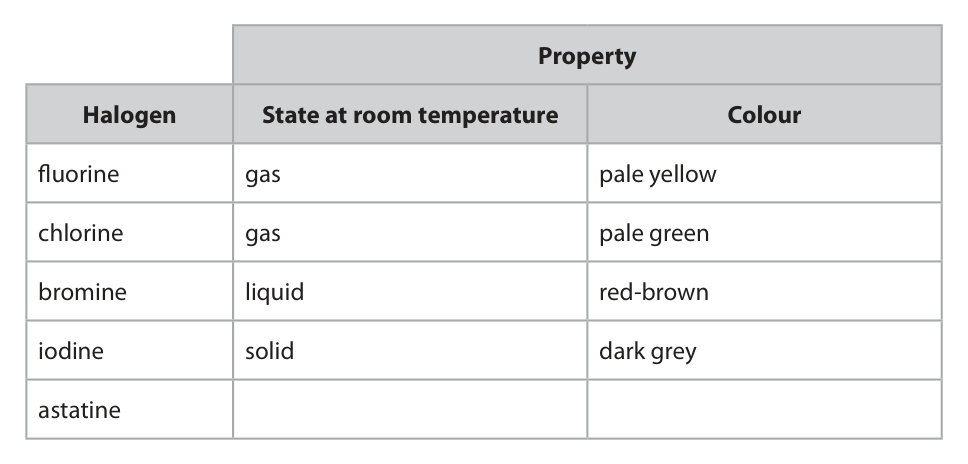
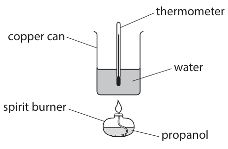

# 4CH1/2CR — 2026-06 (official extraction)

> schema `syllabai.official-paper-questions/0.1` · paper_id `pearson-edexcel:international-gcse:chemistry:4ch1:2026-06:4CH1/2CR` · qp sha256 `5ee0d5b49eac889d…` · extracted verbatim, never regenerated (ADR-037)

## Question 1 (6 marks)

This question is about elements, compounds and mixtures.

**(c)** The box gives the names of some substances. air helium gallium mercury sulfur dioxide Choose substances from the box to answer these questions.

### 1(a) [1]

Name the element that burns with a lilac flame.

**Mark scheme answer**

> potassium accept symbol

- **(1)** potassium accept symbol

### 1(b) [1]

Name the technique used to separate a mixture of liquids with different boiling points.

**Mark scheme answer**

> fractional distillation

- **(1)** fractional distillation

### 1(c)(i) [1]

Identify the substance that is a mixture.

**Mark scheme answer**

> air

- **(1)** air

### 1(c)(ii) [1]

Identify the substance in Group 3 of the Periodic Table.

**Mark scheme answer**

> gallium

- **(1)** gallium

### 1(d) [2]

Explain why hydrogen chloride is a compound.

**Mark scheme answer**

> M1 (two) different elements ALLOW (two) different
> types of atoms
> REJECT ions for M1
> M2 (chemically) joined/bonded together REJECT molecules
> scores 0
> Total = 6

- **(1)** (two) different elements ALLOW (two) different
- **(1)** (chemically) joined/bonded together REJECT molecules

## Question 2 (7 marks)

This question is about aluminium.

**(b)** Aluminium is extracted from aluminium oxide by electrolysis. The diagram shows the electrolysis of aluminium oxide. + – positive electrode negative electrode molten aluminium oxide molten aluminium steel tank

### 2(a)(i) [1]

Why does solid aluminium conduct electricity?

- **(A)** electrons are free to move in the solid  ✔
- **(B)** electrons and neutrons are free to move in the solid
- **(C)** electrons and protons are free to move in the solid
- **(D)** ions are free to move in the solid

**Mark scheme answer**

> A (electrons are free to move in the solid)
> B is not the correct answer as neutrons are not
> free to move in the solid
> C is not the correct answer as protons are not free
> to move in the solid
> D is not the correct answer as ions are not free to
> move in the solid

- **(1)** Answer A: electrons are free to move in the solid

### 2(a)(ii) [2]

Explain why aluminium is malleable.

**Mark scheme answer**

> M1 layers / rows (of atoms or ions) REJECT negative ions
> REJECT molecules
> REJECT electrons
> M2 can slide over one another

- **(1)** layers / rows (of atoms or ions) REJECT negative ions
- **(1)** can slide over one another

### 2(b)(i) [1]

Why is aluminium not extracted by heating aluminium oxide with carbon?

- **(A)** aluminium is more reactive than carbon  ✔
- **(B)** carbon is an oxidising agent
- **(C)** the reaction has a low activation energy
- **(D)** the reaction is explosive

**Mark scheme answer**

> A (aluminium is more reactive than carbon)
> B is not the correct answer as carbon is not an
> oxidising agent
> C is not the correct answer as the reaction would
> have a very high activation energy
> D is not the correct answer as carbon and
> aluminium oxide do not react

- **(1)** Answer A: aluminium is more reactive than carbon

### 2(b)(ii) [1]

Aluminium is formed at the negative electrode. Name the product formed at the positive electrode.

**Mark scheme answer**

> oxygen

- **(1)** oxygen

### 2(b)(iii) [1]

Suggest why the electrolysis of aluminium oxide is expensive.

**Mark scheme answer**

> any one from:
> aluminium oxide has a high melting point ACCEPT high
> temperature required
> aluminium oxide needs to be molten
> the process needs a lot of energy
> the process needs a lot of electricity

- **(1)** any one from:

### 2(c) [1]

Aluminium is used to make cans for drinks because it is malleable. Give another reason why aluminium is used to make cans for drinks.

**Mark scheme answer**

> any one from:
> aluminium is unreactive IGNORE high melting
> point
> aluminium has a low density
> aluminium is strong
> aluminium is non-toxic
> aluminium is corrosion resistant
> aluminium can be recycled
> REJECT will not rust
> Total = 7

- **(1)** any one from:

## Question 3 (8 marks)

This question is about the solubility of salts.

**(b)** The graph shows the solubilities of sodium chloride and potassium chloride at different temperatures. 55 potassium chloride 45 sodium chloride Solubility in g per 100 g of water 0 20 40 60 80 100 Temperature in C

**(c)** A student uses this apparatus to determine the solubility of potassium nitrate in water. thermometer water potassium nitrate beaker of hot water heat This is the student’s method. Step 1 add 6.2 g of potassium nitrate to a boiling tube Step 2 add 20 cm3 of water to the boiling tube Step 3	place the boiling tube in a beaker of water Step 4	heat the beaker gently, stirring the mixture in the boiling tube continuously until the potassium nitrate dissolves Step 5	remove the boiling tube from the beaker and allow the mixture to cool Step 6	record the temperature at which crystals start to form in the boiling tube

### 3(a) [1]

State what is meant by the term saturated solution.

**Mark scheme answer**

> (a solution that) has as much ALLOW no more solute
> solute /solid /substance as possible dissolved will dissolve
> (at a particular temperature)
> REJECT ‘reacts’

- **(1)** (a solution that) has as much ALLOW no more solute

### 3(b)(i) [1]

Deduce the temperature at which sodium chloride and potassium chloride have the same solubility. temperature = °C

**Mark scheme answer**

> 47 (°C) ALLOW 46-48 °C

- **(1)** 47 (°C) ALLOW 46-48 °C

### 3(b)(ii) [2]

A saturated solution of potassium chloride in 100 g of water is cooled from 80 °C to 60 °C. Determine the mass, in grams, of potassium chloride that crystallises. mass = g

**Mark scheme answer**

> M1 47 - 40
> M2 7.0 (g) ALLOW ecf from M1
> M2 dep on at least one
> correct value from M1
> correct answer scores 2
> marks

- **(1)** 47 - 40
- **(1)** 7.0 (g) ALLOW ecf from M1

### 3(c)(i) [1]

Name a piece of apparatus that the student could use in step 2 to measure 20 cm3 of water.

**Mark scheme answer**

> measuring cylinder ALLOW (volumetric)
> pipette / burette

- **(1)** measuring cylinder ALLOW (volumetric)

### 3(c)(ii) [1]

Give a reason why the student uses a beaker of hot water in step 3, rather than directly heating the boiling tube with a Bunsen burner.

**Mark scheme answer**

> (to ensure) the boiling tube/water bath is evenly
> heated OR greater control over the heating
> M1 (6.2 ÷ 20)

- **(1)** (6.2 ÷ 20)

### 3(c)(iii) [2]

In step 6, crystals start to form at 32 °C. Calculate the solubility of the solid, in g per 100 g of water, at 32 °C. [1.0 cm3 of pure water has a mass of 1.0 g] solubility = g per 100 g of water

**Mark scheme answer**

> M2 (M1 x 100) AND correctly evaluated correct answer scores 2
> = 31 g per 100 g water marks
> Total = 8

- **(2)** M2 (M1 x 100) AND correctly evaluated correct answer scores 2

## Question 4 (12 marks)

The table gives some properties of the halogens fluorine, chlorine, bromine and iodine. Property Halogen State at room temperature Colour fluorine gas pale yellow chlorine gas pale green bromine liquid red-brown iodine solid dark grey astatine

**(b)** A sample of fluorine contains two isotopes.

### 4(a) [2]

Complete the table by giving the predicted properties of astatine.

**Mark scheme answer**

> (physical state at room temperature) solid
> (colour of halogen) black ALLOW very dark grey

- **(2)** (physical state at room temperature) solid

### 4(b)(i) [2]

Describe, in terms of sub-atomic particles, what is meant by the term isotopes.

**Mark scheme answer**

> M1 atoms with the same number of protons REJECT
> molecule/compound
> once only
> M2 and different numbers of neutrons

- **(1)** atoms with the same number of protons REJECT
- **(1)** and different numbers of neutrons

### 4(b)(ii) [2]

The two isotopes in this sample of fluorine are 189 F and 199 F The relative atomic mass (Ar) of the sample of fluorine is 18.998 Explain the relative abundances of the two isotopes. You do not need to do a calculation.

**Mark scheme answer**

> M1 19F is much more abundant (than 18F) OWTTE
> M2 as the Ar is much closer to 19 than 18

- **(1)** 19F is much more abundant (than 18F) OWTTE
- **(1)** as the Ar is much closer to 19 than 18

### 4(c)(i) [3]

A student is given colourless solutions of chlorine and sodium bromide. Describe how the student can use these two solutions to show that chlorine is more reactive than bromine.

**Mark scheme answer**

> M1 mix the solutions (of chlorine and the solution
> of sodium bromide)
> M2 (the mixture of the two solutions) turns orange ALLOW any combination
> of orange / yellow /
> brown
> IGNORE other
> observations
> eg bubbles
> M3 because bromine is formed/produced IGNORE state of
> bromine
> REJECT bromide
> IGNORE a displacement
> reaction occurs
> M3 can be scored by Br2
> as a product in an
> equation

- **(1)** mix the solutions (of chlorine and the solution
- **(1)** (the mixture of the two solutions) turns orange ALLOW any combination
- **(1)** because bromine is formed/produced IGNORE state of

### 4(c)(ii) [3]

Explain why chlorine is more reactive than bromine. Refer to the atomic structures of chlorine and bromine in your answer.

**Mark scheme answer**

> M1 atoms of chlorine are smaller / have fewer ALLOW reverse
> shells than atoms of bromine argument throughout
> ALLOW outer
> shell/electron is further
> from nucleus
> M2 there is therefore more attraction between the ALLOW less repulsion
> nucleus and the outer shell (from inner shells) or
> less shielding (from
> nuclear attraction)
> M3 therefore an electron is more easily
> gained/accepted
> Total = 12

- **(1)** atoms of chlorine are smaller / have fewer ALLOW reverse
- **(1)** there is therefore more attraction between the ALLOW less repulsion
- **(1)** therefore an electron is more easily

## Question 5 (13 marks)

This question is about alcohols.

**(b)** A student uses this apparatus to find the molar enthalpy change, ΔH, for the combustion of propanol, C3H7OH thermometer copper can water spirit burner propanol

**(c)** This is the equation for the combustion of ethanol. C2H5OH + 3O2 → 2CO2 + 3H2O

### 5(a) [2]

Give two conditions needed for the production of ethanol by the fermentation of glucose. 1 2

**Mark scheme answer**

> any two from:
> temperature of 30°C ALLOW a range of
> 30-40°C
> yeast ALLOW enzymes from
> yeast
> absence of air/oxygen ALLOW anaerobic
> aqueous solution

- **(2)** any two from:

### 5(b)(i) [3]

These are the student’s results. mass of water 125 g initial temperature of water 19.5 °C maximum temperature of water 52.8 °C Calculate the heat energy change, Q, in joules. [for water, c = 4.2 J / g / °C] Q = J

**Mark scheme answer**

> M1 (52.8 – 19.5) = 33.3 Correct answer scores 3
> ECF incorrect
> temperature
> M2 125 × 4.2 × 33.3
> M3 17482.5 J ALLOW any number of
> significant figures other
> than 1

- **(1)** (52.8 – 19.5) = 33.3 Correct answer scores 3
- **(1)** 125 × 4.2 × 33.3
- **(1)** 17482.5 J ALLOW any number of

### 5(b)(ii) [3]

In a different experiment, the student burns 0.75 g of propanol. The heat energy change for this experiment is 19 500 J. Calculate the molar enthalpy change, ΔH, in kJ / mol. Include a sign in your answer. [for propanol, Mr = 60] ΔH = kJ / mol

**Mark scheme answer**

> M1 (conversion to kJ) = 19.5 kJ
> M2 amount propanol = 0.75 ÷ 60 OR 0.0125 (mol)
> M3 -1560 kJ/mol Correct answer scores 3

- **(1)** (conversion to kJ) = 19.5 kJ
- **(1)** amount propanol = 0.75 ÷ 60 OR 0.0125 (mol)
- **(1)** -1560 kJ/mol Correct answer scores 3

### 5(c)(i) [2]

Explain, in terms of bonds broken and bonds made, why this reaction is exothermic.

**Mark scheme answer**

> M1 more energy is given out when the bonds are If state/imply that
> made energy required to
> make bonds
> M2 than is taken in when the bonds are broken OR
> If state/imply that
> energy released when
> bonds are broken scores
> 0/2
> ACCEPT correct reverse
> argument
> OR
> M1 breaking bonds is endothermic/takes in energy
> and making bonds is exothermic/releases energy
> M2 more energy is released than taken in M2 dep on M1

- **(2)** M1 more energy is given out when the bonds are If state/imply that

### 5(c)(ii) [3]

Draw an energy level diagram for this reaction. You should show ΔH as a single-headed arrow. Energy

**Mark scheme answer**

> M1 right-hand line below left-hand line
> M2 correct names/formulae of both reactants and
> products
> M3 ΔH correctly shown as a downward arrow and
> labelled (see diagram below)
> Total = 13

- **(1)** right-hand line below left-hand line
- **(1)** correct names/formulae of both reactants and
- **(1)** ΔH correctly shown as a downward arrow and

## Question 6 (10 marks)

This question is about sugars.

### 6(a) [4]

Sugar A has this percentage composition by mass. C = 44.7% H = 7.5% O = 47.8% Determine the empirical formula of sugar A. [Ar values: C = 12 H=1 O = 16] empirical formula =

**Mark scheme answer**

> M1 44.7÷12 7.5÷1 47.8÷16 0 marks for upside down
> calculation or use of
> atomic numbers
> M2 (moles of each element) 3.725 7.5 2.99
> M3 (ratio) 1.25 : 2.5 : 1
> M4 C5H10O4 Correct answer scores 4

- **(1)** 44.7÷12 7.5÷1 47.8÷16 0 marks for upside down
- **(1)** (moles of each element) 3.725 7.5 2.99
- **(1)** (ratio) 1.25 : 2.5 : 1
- **(1)** C5H10O4 Correct answer scores 4

### 6(b) [3]

A 5.00 cm3 sample of blood contains 0.00510 g of glucose, C6H12O6 Calculate the concentration, in mol / dm3, of glucose in this sample. Give your answer to three significant figures. [1 dm3 = 1000 cm3] [for C6H12O6 Mr = 180] concentration = mol / dm3

**Mark scheme answer**

> M1 (amount of glucose in 5 cm3) = 0.00510 ÷ 180
> OR 0.00002833 (mol)
> M2 (concentration of glucose) = ALLOW M1×200
> 0.00566667(mol/dm3)
> M3 0.00567(mol/dm3) ALLOW ecf from M2
> Correct answer scores 3

- **(1)** (amount of glucose in 5 cm3) = 0.00510 ÷ 180
- **(1)** (concentration of glucose) = ALLOW M1×200
- **(1)** 0.00567(mol/dm3) ALLOW ecf from M2

### 6(c) [3]

This equation represents the complete combustion of 1 mol of sugar B. B + y O2 → 12CO2 + zH2O 8.55 g of sugar B is burned, producing 7200 cm3 of carbon dioxide at rtp. Use the equation to calculate the Mr of sugar B. [one mole of any gas occupies 24 000 cm3 at rtp] Mr =

**Mark scheme answer**

> M1 (amount of CO2) 7200 ÷ 24000 OR 0.3 (mol)
> M2 amount of sugar B = 0.025 (mol) ALLOW M1÷ 12
> M3 (8.55 ÷ 0.025) = 342 28.5 scores 2
> Correct answer scores 3
> Total = 10

- **(1)** (amount of CO2) 7200 ÷ 24000 OR 0.3 (mol)
- **(1)** amount of sugar B = 0.025 (mol) ALLOW M1÷ 12
- **(1)** (8.55 ÷ 0.025) = 342 28.5 scores 2

## Question 7 (14 marks)

This question is about nitric acid. This is the equation for a reaction that occurs in the manufacture of nitric acid. 4NH3(g) + 5O2(g) ⇌ 4NO(g) + 6H2O(g) ΔH = –900 kJ / mol After several hours in a closed system, this reaction reaches dynamic equilibrium.

**(b)** Typical conditions for this reaction are a temperature of 800 °C and a pressure of 10 atm.

### 7(a)(i) [1]

Give the meaning of the symbol ⇌

**Mark scheme answer**

> (the reaction is) reversible ACCEPT reaction that
> goes both ways/both
> forwards and backwards
> reaction occur
> IGNORE references to
> equilibrium
> IGNORE references to
> reactants turning into
> products and products
> into reactants.

- **(1)** (the reaction is) reversible ACCEPT reaction that

### 7(a)(ii) [2]

State what is meant by the term dynamic equilibrium.

**Mark scheme answer**

> M1 the forward and reverse reactions occur at the
> same/equal rate
> M2 the concentrations of reactants and products
> remain constant ALLOW amounts
> REJECT concentrations
> of reactants and
> products are the same

- **(1)** the forward and reverse reactions occur at the
- **(1)** the concentrations of reactants and products

### 7(b)(i) [5]

Explain the effects on rate of reaction and yield of products if the temperature is changed to 1000 °C but the pressure is kept at 10 atm. rate of reaction yield of products

**Mark scheme answer**

> an explanation linking any 5 of the following:
> rate
> M1 rate increases
> M2 particles have increased (kinetic) energy /
> particles have energy (on average) greater than
> activation energy
> M3 so more frequent (successful) collisions/more
> (successful) collisions per unit time
> yield
> M4 the (forwards) reaction is exothermic OR the
> backwards reaction is endothermic
> M5 (increasing temperature) shifts the reaction in
> the endothermic direction
> M6 yield decreases M6 dep on M4 or M5

- **(5)** an explanation linking any 5 of the following:

### 7(b)(ii) [1]

Lowering the pressure would increase the yield of products. Give a reason why a lower pressure is not used. QUESTION 7 CONTINUES ON BACK PAGE

**Mark scheme answer**

> the rate of reaction would be too slow OWTTE

- **(1)** the rate of reaction would be too slow OWTTE

### 7(c) [5]

A student does a titration using dilute nitric acid and a solution of sodium hydroxide with a known concentration. These are the first four steps in the student’s method. • add 25.0 cm3 of nitric acid to a conical flask • add sodium hydroxide solution to a burette and record the initial volume • add a few drops of methyl orange indicator to the flask • use the burette to add sodium hydroxide solution to the flask until the indicator changes colour Describe how the student could modify their method to obtain an accurate value for the volume of sodium hydroxide solution needed to neutralise 25.0 cm3 of nitric acid.

**Mark scheme answer**

> a description including any 5 of the following
> points:
> M1 rinse/wash burette with sodium hydroxide ALLOW remove (air)
> (before filling) bubbles (in the burette)
> M2 use a (volumetric) pipette to add (25.0 cm3 of)
> nitric acid
> M3 rinse / wash the conical flask (with distilled or REJECT if rinsed using
> deionised water) acid for M3
> M4 use a white tile (underneath the conical flask)
> M5 swirl the flask IGNORE stir
> M6 (repeat) adding sodium hydroxide dropwise IGNORE add dropwise
> near the end point (from the start)
> M7 record the volume of sodium hydroxide added
> (at the end point)
> M8 repeat until concordant results ALLOW results within
> 0.1-0.2 cm3 of one
> another
> Total = 14

- **(5)** a description including any 5 of the following

