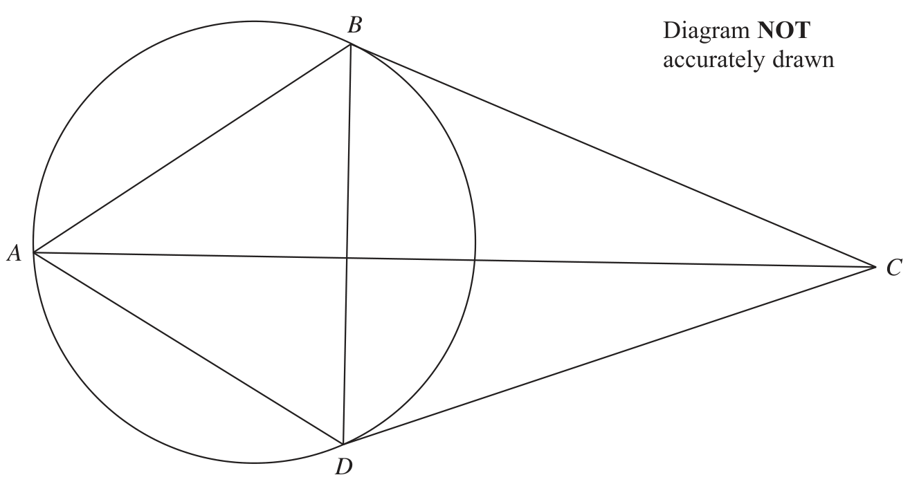
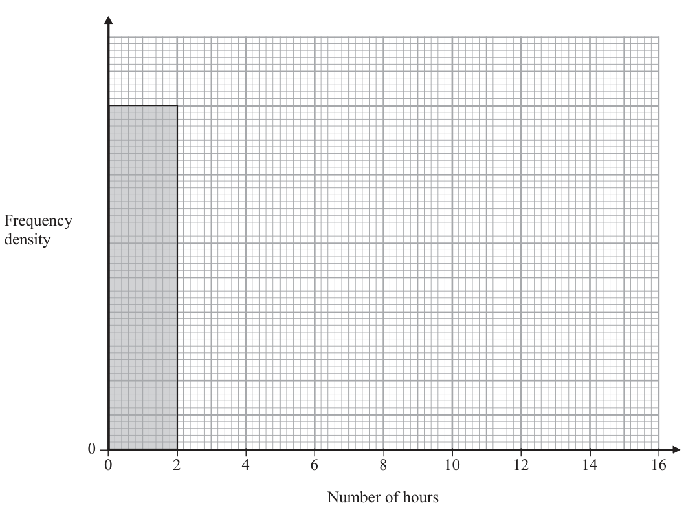
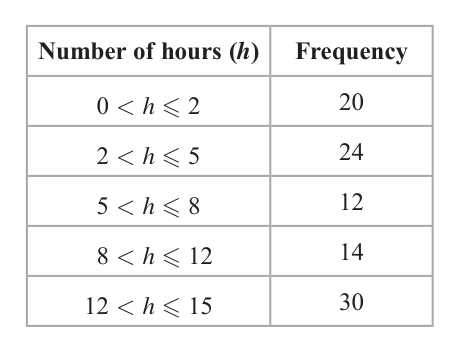
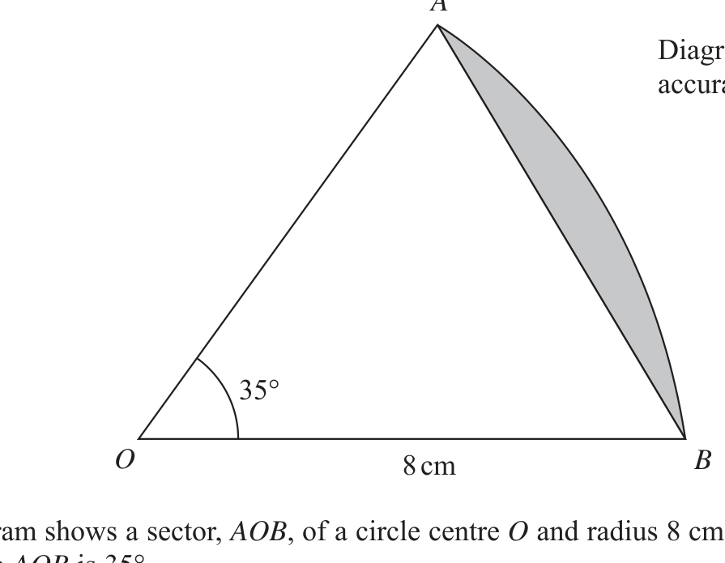
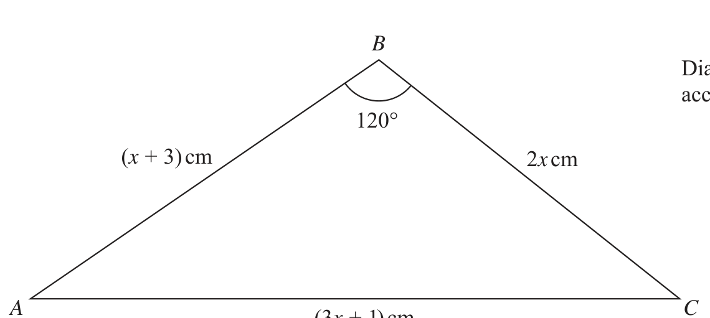

# 4MB1/01 — 2018-06 (official extraction)

> schema `syllabai.official-paper-questions/0.2` · paper_id `pearson-edexcel:international-gcse:mathematics-b:4mb1:2018-06:4MB1/01` · qp sha256 `4bcabda63f95c9db…` · extraction is the disclosed baseline (ADR-039)

## Question 1 (2 marks)

The nth term of a sequence is given by 5n – 7 Write down the second, third and fourth terms of the sequence. ............................ , ............................ , ............................

### 1 [2]

The nth term of a sequence is given by 5n – 7 Write down the second, third and fourth terms of the sequence …………… , …………… , ……………

**Mark scheme answer**

> 3, 8, 13 -1 for every error or B2
> omission

- **(2)** 3, 8, 13 -1 for every error or B2

## Question 2 (2 marks)

The bearing of town A from town B is 054° Find the bearing of town B from town A. °

### 2 [2]

The bearing of town A from town B is 054° Find the bearing of town B from town A.

…………… °

**Mark scheme answer**

> 180 + 54 M1
> 234° A1

- **(2)** 180 + 54 M1

## Question 3 (2 marks)

At the beginning of the summer, Amrit’s weight was 75 kg. At the end of the summer, his weight was 69 kg. Calculate the percentage loss in Amrit’s weight. ..................................................................... %

### 3 [2]

At the beginning of the summer, Amrit’s weight was 75 kg. At the end of the summer, his weight was 69 kg. Calculate the percentage loss in Amrit’s weight

…………… %

**Mark scheme answer**

> (75 − 69) M1
> ×100 ± ( 75 − 69 )
> 75 M1 for
> ± ( 75 − 69 )
> or
> 8 A1

- **(2)** (75 − 69) M1

## Question 4 (2 marks)

The point A is mapped onto the point (–1, 3) under the translation ⎜ ⎟ ⎝ −5⎠ Find the coordinates of A. (. . . . . . . . . . . . . . . . . . . . . . . . . . . . , . . . . . . . . . . . . . . . . . . . . . . . . . . . . )

### 4 [2]

The point A is mapped onto the point (–1, 3) under the translation −5 Find the coordinates of A. ( …………… , …………… )

**Mark scheme answer**

> A(−3,8) B1 for each coordinate B2
> SC B1B0 for (1, −2 )
> SC B1B0 for ( 8, −3)

- **(2)** A(−3,8) B1 for each coordinate B2

## Question 5 (2 marks)

BEARING Write down all the letters of the above word that have

### 5(a) [1]

exactly two lines of symmetry

**Mark scheme answer**

> I B1 1

- **(1)** I B1 1

### 5(b) [1]

rotational symmetry of order 2

**Mark scheme answer**

> IN B1

- **(1)** IN B1

## Question 6 (2 marks)

Write down which two of the following six numbers are equivalent to irrational numbers. 7 27 1 2π 16 4 4 2 0.3 12 3

### 6 [2]

Write down which two of the following six numbers are equivalent to irrational numbers. 7 27 1 2π 16 4 4 2 0.3 12 3

**Mark scheme answer**

> 2π -1 for each error or B2
> omission
> 4 2
> Question Working Answer Notes Mark Sub- Total
> Total

- **(2)** 2π -1 for each error or B2

## Question 7 (3 marks)

Without using a calculator and showing all your working, calculate 7 ⎛1 1⎞ −⎜ ×2 ⎟ 8 ⎝3 4⎠ Give your answer as a fraction in its simplest form.

### 7 [3]

Without using a calculator and showing all your working, calculate 7 ⎛1 1⎞ −⎜ ×2 ⎟ 8 ⎝3 4⎠ Give your answer as a fraction in its simplest form.

**Mark scheme answer**

> 1 9 B1
> 2 =
> 4 4
> 1 9 3 1 M1
> × = Correctly multiplying
> 3 4 4
> and their “ ”
> −

- **(3)** 1 9 B1

## Question 8 (3 marks)

Solve the equation 4x + (5.2 q 105) = (7.1 q 107) – 12x Give your answer in standard form.

### 8 [3]

Solve the equation 4x + (5.2 × 10⁵) = (7.1 × 10⁷) – 12x Give your answer in standard form.

**Mark scheme answer**

> 4
> 16 x = ( 7.1× 107 ) − ( 5.2 × 105 )
> x=
> ( 7.1×10 ) − ( 5.2 ×10 )
> 7 5 M1 for correct order of
> operations to make x the
> M1
> 16 subject
> x = 4405000 4.405 × 106 A1
> Accept 4.41×106
> M2 for 4.41×10n or
> 4.405 ×10n or 4.4 ×106
> Question Working Answer Notes Mark Sub- Total
> Total

- **(3)** 4

## Question 9 (3 marks)

Showing all your working, express 3 180 − 2 80 in the form a b where a is an integer and b is a prime number.

### 9 [3]

Showing all your working, express 3 180 − 2 80 in the form a b where a is an integer and b is a prime number.

**Mark scheme answer**

> =
> 80 ( 16 × =5 ) 4 5 M1 for one term simplified
> correctly
> M1
> M2 for both terms M1
> 180= 36 × 5= 6 5
> simplified correctly (with
> one step of working for
> 180 )
> ( ) ( )
> 3 180 − 2 80 = 3 6 5 − 2 4 5 10 5
> A1
> det 4 ( 2 x ) − 1( 5 x )

- **(3)** =

## Question 10 (3 marks)

The determinant of the matrix ⎜ is equal to 9 ⎝ 5 x 4⎟⎠ Find the value of x. x = .....................................................................

### 10 [3]

The determinant of the matrix is equal to 9 5 x 4 Find the value of x. x =

**Mark scheme answer**

> B1
> =
> 8 x − 5 x = 9 ⇒ x = ... Sets their determinant = 9 M1
> and attempts to solve
> x=3 A1

- **(3)** B1

## Question 11 (3 marks)

Express as a single fraction in its simplest form 3 4 − 2x − 1 x + 2

### 11 [3]

Express as a single fraction in its simplest form 3 4 − 2x − 1 x + 2

**Mark scheme answer**

> 3 ( x + 2 ) − 4 ( 2 x − 1) M1 for correct first stage M1
> ( 2 x − 1)( x + 2 )
> 3x + 6 − 8 x + 4 M1 for correct expansion M1dep
> ( 2 x − 1)( x + 2 ) of numerator in single
> fraction (allow one sign
> slip
> Final answer - allow A1
> 5( 2 − x) 10 − 5x in numerator or
> 2 x 2 + 3 x − 2 in the
> ( 2 x − 1)( x + 2 ) denominator
> Question Working Answer Notes Mark Sub- Total
> Total

- **(3)** 3 ( x + 2 ) − 4 ( 2 x − 1) M1 for correct first stage M1

## Question 12 (3 marks)

Diagram NOT accurately drawn A O 32q C B ABC is a triangle such that the points A, B and C lie on a circle, centre O. BC = BA and ∠CAB = 32° Find the size, in degrees, of

### 12(a) [1]

Diagram NOT accurately drawn A O 32° C B ABC is a triangle such that the points A, B and C lie on a circle, centre O. BC = BA and ∠CAB = 32° Find the size, in degrees, of

∠COB

…………… °

**Mark scheme answer**

> 64 B1 1

- **(1)** 64 B1 1

### 12(b) [2]

∠OCA

…………… °

**Mark scheme answer**

> 180 − "64" M1 for M1
> − 32
> ∠ACB =32, ∠OCB =38
> 26 A1

- **(2)** 180 − "64" M1 for M1

## Question 13 (3 marks)

Prove that (4n + 3)2 – (4n – 3)2 is a multiple of 12 for all positive integer values of n.

### 13 [3]

Prove that (4n + 3)² – (4n – 3)² is a multiple of 12 for all positive integer values of n.

**Mark scheme answer**

> (16n + 24n + 9 ) − (16n − 24n + 9 )
> 2 2 Either bracket expanded
> correctly
> M1
> = 48n A1
> 12 ( 4n ) so is a
> Or equivalent e.g. A1
> 48n
> = 4n
> multiple of 12

- **(3)** (16n + 24n + 9 ) − (16n − 24n + 9 )

## Question 14 (3 marks)

⎛ 2 x − 1⎞ a=⎜ ⎝ −3 ⎟⎠ Given that a = 5 find the possible values of x.

### 14 [3]

⎛ 2 x − 1⎞ a= −3 Given that a = 5 find the possible values of x.

**Mark scheme answer**

> Attempt at modulus (or M1
> = ( 2 x − 1) + ( −3)
> 2
> square) of a
> Getting to pre-factorising M1
> ( 2 x − 1) + 9 = 25 ⇒ x = ...
> stage or at least one
> solution for x
> 5 3 A1
> x= or −
> 2

- **(3)** Attempt at modulus (or M1

## Question 15 (3 marks)

B Diagram NOT accurately drawn A C D A, B and D are three points on a circle. The point C is such that CD and CB are tangents to the circle. ∠ADB = ∠ABD Prove that 'ABC and 'ADC are congruent.

### 15 [3]

A, B and D are three points on a circle. The point C is such that CD and CB are tangents to the circle. ∠ADB = ∠ABD Prove that △ABC and △ADC are congruent.

> *Figure not shown in this reconstruction — the printed paper includes a diagram (not drawn accurately).*
> Labels in the original figure: B, A, C, D.

**Mark scheme answer**

> AB = AD - triangle is isosceles M1 for each M1
> BC = CD - tangents to a circle from an external M1
> point are equal in length (either circle or length)
> AC = AC - common side Congruent from A1 for all three + SSS A1
> SSS
> Question Working Answer Notes Mark Sub- Total
> Total

- **(3)** AB = AD - triangle is isosceles M1 for each M1

## Question 16 (4 marks)
### 16(a) [2]

Simplify (4x5)²

**Mark scheme answer**

> 16x10 B1 for either 16 or for x10 B2 2

- **(2)** 16x10 B1 for either 16 or for x10 B2 2

### 16(b) [2]

Simplify (27 y 9 ) 3

**Mark scheme answer**

> B2
> 81y12 B1 for either 81 or for y12

- **(2)** B2

## Question 17 (4 marks)

The lengths of the sides of a rectangular piece of paper, measured to the nearest mm, are 296 mm and 210 mm. Calculate

### 17(a) [2]

the lower bound, in mm, for the perimeter of the piece of paper, mm

**Mark scheme answer**

> LB = 295.5 and 209.5 One correct lower bound M1 2
> 2 ( 295.5 ) + 2 ( 209.5 )
> 1010 A1

- **(2)** LB = 295.5 and 209.5 One correct lower bound M1 2

### 17(b) [2]

the upper bound, to the nearest mm², for the area of the piece of paper

…………… mm²

**Mark scheme answer**

> UB = 296.5 and 210.5 One correct upper bound M1
> 296.5 × 210.5 = 62413.25 62413 A1

- **(2)** UB = 296.5 and 210.5 One correct upper bound M1

## Question 18 (4 marks)

y varies inversely as the cube of x. y = 297 when x = Find the value of x2 when y = 704 x2 = . . . . . . . . . . . . . . . . . . . . . . . . . . . . . . . . . . . . . . . . . . . . . . . . . . . . . . . . . . . . . . . . . . . . .

### 18 [4]

y varies inversely as the cube of x. y = 297 when x = Find the value of x² when y = 704 x² =

**Mark scheme answer**

> −3 M1
> ⎛1⎞ SC B1 for 297 =
> k
> 297 = k 3
> k = 11 Or equivalent M1
> 2 M1dep
> ⎛ ''11'' ⎞
> x 2 = 3 704 
> ( x ) = 161
> 2 Or equivalent A1
> Question Working Answer Notes Mark Sub- Total
> Total
> 5( 2x + y ) − x ( 2x + y )

- **(4)** −3 M1

## Question 19 (4 marks)

Simplify fully 10 x + 5 y − 2 x 2 − xy 4 x2 − y 2

### 19 [4]

Simplify fully 10 x + 5 y − 2 x 2 − xy 4 x² − y 2

**Mark scheme answer**

> Correct first step for M1
> factorising numerator
> ( 2 x − y )( 2 x + y ) One term correctly M1
> factorised
> ( 5 − x )( 2 x + y ) Both terms correct M1
> ( 2 x − y )( 2 x + y )
> Final answer A1
> 5− x
> or
> 2x − y
> x −5
> y − 2x

- **(4)** Correct first step for M1

## Question 20 (4 marks)

The table shows information about the number of hours for which each of 100 children used a computer one week. Number of hours (h) Frequency h-2 20 h-5 24 h-8 12 h - 12 14 h - 15 30 The diagram below is an incomplete histogram representing this information. Use the information in the table to complete the histogram. Frequency density 0– – – – – – – – – – 0 2 4 6 8 10 12 14 16 Number of hours

### 20 [4]

The table shows information about the number of hours for which each of 100 children used a computer one week. Number of hours (h) Frequency h-2 20 h-5 24 h-8 12 h - 12 14 h - 15 30 The diagram below is an incomplete histogram representing this information. Use the information in the table to complete the histogram. Frequency density 0– – – – – – – – – – 0 2 4 6 8 10 12 14 16 Number of hours

**Mark scheme answer**

> Heights at (10), B1 for each correct bar B4
> 8, 4, 3.5 and 10 (widths and heights). For
> Widths at full marks scale on freq.
> (0 - 2), 2 - 5, density axis required. SC if
> 5 - 8, 8 - 12, no marks then B1 for
> 12 - 15 correct scale
> Question Working Answer Notes Mark Sub- Total
> Total

- **(4)** Heights at (10), B1 for each correct bar B4

## Question 21 (4 marks)

A Diagram NOT accurately drawn 35q O 8 cm B The diagram shows a sector, AOB, of a circle centre O and radius 8 cm. The angle AOB is 35° Find the area, in cm2 to 3 significant figures, of the segment shaded in the diagram. ..................................................................... cm2

### 21 [4]

The diagram shows a sector, AOB, of a circle centre O and radius 8 cm. The angle AOB is 35° Find the area, in cm² to 3 significant figures, of the segment shaded in the diagram cm²

> *Figure not shown in this reconstruction — the printed paper includes a diagram (not drawn accurately).*
> Labels in the original figure: A, O, B · Figure values: 35°, 8.

**Mark scheme answer**

> 35 Correct method for sector M1
> Area of sector = × π × 82
> 360 area
> 1 Correct method for triangle M1
> Area of triangle = ( 8)( 8) sin 35°
> 2 area
> Area of segment = 19.54… − 18.35… Area of sector – area of M1
> triangle (dependent on
> previous M marks)
> 1.19 Correct answer A1

- **(4)** 35 Correct method for sector M1

## Question 22 (4 marks)

Two containers, A and B, are mathematically similar. Container A has a volume of 4500 cm3 and a total surface area of 1500 cm2 Container B has a volume of 972 cm3 Calculate the total surface area, in cm2, of container B. ..................................................................... cm2

### 22 [4]

Two containers, A and B, are mathematically similar. Container A has a volume of 4500 cm³ and a total surface area of 1500 cm² Container B has a volume of 972 cm³ Calculate the total surface area, in cm², of container B

…………… cm²

**Mark scheme answer**

> 1 972 M2
> ⎛ 972 ⎞ 3 M1 for
>  (length scale factor) oe 4500
> ⎝ 4500 ⎠
> 2 1 M1
> ⎧
> ⎫ ⎛ 972 ⎞ 3
> ⎪⎛ 972 ⎞ 3 ⎪ Squaring their - DEP
> ⎨ ⎬ ⎝ 4500 ⎠
> ⎪⎩⎝ 4500 ⎠ ⎪⎭
> dependent on first M mark
> 540 A1
> Question Working Answer Notes Mark Sub- Total

- **(4)** 1 972 M2

## Question 23 (4 marks)

Jenny has 18 sweets in a bag. There are 11 orange sweets and 7 green sweets in the bag. Jenny takes at random 3 sweets from the bag. Calculate the probability that the 3 sweets are not all of the same colour.

### 23 [4]

Jenny has 18 sweets in a bag. There are 11 orange sweets and 7 green sweets in the bag. Jenny takes at random 3 sweets from the bag. Calculate the probability that the 3 sweets are not all of the same colour.

**Mark scheme answer**

> 11 10 9 7 6 5 M1 for one correct term M2
> × × and × ×
> 18 17 16 18 17 16
> 11 10 9 7 6 5 Attempt at correct M1
> 1− × × − × ×
> 18 17 16 18 17 16 calculation (or equivalent) DEP
> 77 Or equivalent A1
> 102
> OR
> 11 10 7 11 7 6 M1 for one correct term M2
> × × and × ×
> 18 17 16 18 17 16
> Attempt at correct M1
> ⎛ 11 10 7 ⎞ ⎛ 11 7 6 ⎞
> 3⎜ × × ⎟ + 3⎜ × × ⎟ calculation (or equivalent) DEP
> ⎝ 18 17 16 ⎠ ⎝ 18 17 16 ⎠
> 77 A1
> 102
> Question Working Answer Notes Mark Sub- Total
> Total

- **(4)** 11 10 9 7 6 5 M1 for one correct term M2

## Question 24 (5 marks)

Diagram NOT accurately drawn O The diagram shows a circle and a square. The circle has centre O and diameter k cm and each vertex of the square lies on the circle. The total area of the regions shown shaded in the diagram is A cm2

### 24(a) [3]

Diagram NOT accurately drawn O The diagram shows a circle and a square. The circle has centre O and diameter k cm and each vertex of the square lies on the circle. The total area of the regions shown shaded in the diagram is A cm²

Show that 8A = 2λN 2 – 3k2

**Mark scheme answer**

> 2 Correct expression for the M1 3
> ⎛k⎞
> Area of circle = π area of the circle
> ⎝2⎠
> 1 Correct expression for area M1
> Area of square = k 2 or
> 2 of square or quarter-square
> 1 2
> Area of quarter-square = k
> 1 2 1 2 1 2 8 A 2π k 2 − 3k 2 - note that
> = A1
> A= πk − k + k
> 4 2 8 answer given so sufficient
> working must be shown
> 8 A k 2 ( 2π − 3)

- **(3)** 2 Correct expression for the M1 3

### 24(b) [2]

Hence find an expression for k in terms of A and λ. k =

**Mark scheme answer**

> Correct factorisation M1
> =
> 8A A1
> k2 = 8A
> 2π − 3 k=
> 2π − 3

- **(2)** Correct factorisation M1

## Question 25 (5 marks)

A particle is moving along a straight line. At time t seconds, the displacement, x metres, of the particle from a fixed point O on the line is given by x = t3 – 6t2 + 15t t.0 At time t seconds, the acceleration of the particle is a m/s2

### 25(a) [3]

Find an expression for a in terms of t. a =

**Mark scheme answer**

> Two terms correct for M1 M1 3
> v = 3t 2 − 12t + 15 A1
> (a) = 6t – 12 A1

- **(3)** Two terms correct for M1 M1 3

### 25(b) [2]

Find the least speed of the particle m/s

**Mark scheme answer**

> 6t − 12 =
> 0 Sets their a equal to zero M1
> A1
> vmin = 3
> Question Working Answer Notes Mark Sub- Total
> Total

- **(2)** 6t − 12 =

## Question 26 (6 marks)

The straight line L has equation 2x + y = 8

### 26(a) [2]

Find the gradient of L. L meets the y-axis at the point A and the x-axis at the point B.

**Mark scheme answer**

> y=−2 x + 8 Complete re-arrangement M1 2
> to make y the subject
> −2 A1

- **(2)** y=−2 x + 8 Complete re-arrangement M1 2

### 26(b) [4]

Find the area of triangle AOB, where O is the origin.

**Mark scheme answer**

> A(0,8) B1
> B ( 4,0 )
> B1
> 1 Follow through final two M1
> Area = ( 4 )( 8)
> 2 marks for A(0, 8) and
> B(0,4)
> 16 A1
> ( 3x + 1) =( x + 3) + ( 2 x ) − 2 ( x + 3)( 2 x ) cos (120° )

- **(4)** A(0,8) B1

## Question 27 (6 marks)

B Diagram NOT accurately drawn 120q (x + 3) cm 2x cm A (3x + 1) cm C The diagram shows triangle ABC in which AB = (x + 3) cm BC = 2x cm AC = (3x + 1) cm ∠ABC = 120° Find the size, in degrees to 3 significant figures, of ∠ACB. ∠ACB = ................................................................................... °

### 27 [6]

(x + 3) cm 2x cm A (3x + 1) cm C The diagram shows triangle ABC in which AB = (x + 3) cm BC = 2x cm AC = (3x + 1) cm ∠ABC = 120° Find the size, in degrees to 3 significant figures, of ∠ACB. ∠ACB = °

> *Figure not shown in this reconstruction — the printed paper includes a diagram (not drawn accurately).*
> Labels in the original figure: B, A, C · Figure values: 120° · Other figure text: (x + 3) cm, 2x cm, (3x + 1) cm.

**Mark scheme answer**

> 2 2 2 M1
> $9x^2$ + 6x + 1 = x² + 6 x + 9 + 4 x² + 2 x² + 6 x Expand brackets (condone M1
> at most one error)
> $x^2$ − 3x − 4 =0 Simplifying to TQ M1
> ( x + 1)( x − 4 ) =
> Solving trinomial quadratic M1
> marking rules
> Sine rule with their value M1
> sin θ sin120°
> = for x substituted or in terms
> x+3 3x + 1
> of x – independent of
> previous M marks
> 27.8 A1

- **(6)** 2 2 2 M1

## Question 28 (7 marks)
### 28(a) [2]

Solve the inequality 4(x – 2) 1 + x

**Mark scheme answer**

> 4 x − 8 < 1 + x ⇒ 3x < 9 Expanding and M1 2
> re-arranging to ax < b with
> either a or b correct
> x<3 A1
> 2 x 2 − 7 x − 9 ≤ 0 ⇒ ( 2 x − 9 )( x + 1) ≤ 0

- **(2)** 4 x − 8 < 1 + x ⇒ 3x < 9 Expanding and M1 2

### 28(b) [4]

Without using a calculator and showing all your working, solve the inequality 2x2 - 7x + 9

**Mark scheme answer**

> Rewriting and solving M1
> trinomial quadratic
> marking rules
> 9 A1
> x= or −1
> Chooses inside region for M1
> their critical values
> 9 A1
> −1 ≤ x ≤

- **(4)** Rewriting and solving M1

### 28(c) [1]

Hence find the range of values of x for which both 4(x – 2) 1 + x and 2x2 - 7x + 9

**Mark scheme answer**

> −1 ≤ x < 3 Follow through their values B1ft
> but must be correct
> inequalities and dependent
> on all previous M marks

- **(1)** −1 ≤ x < 3 Follow through their values B1ft

