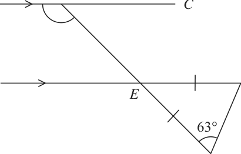
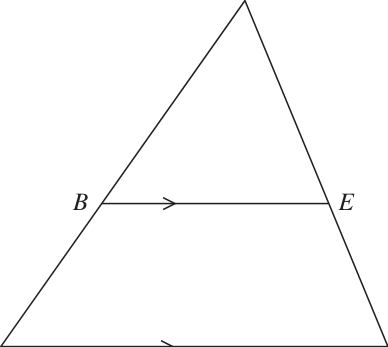
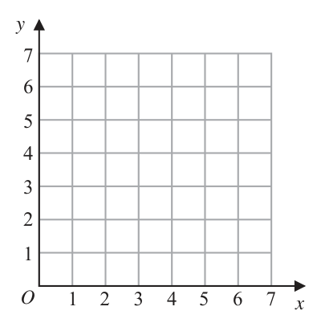
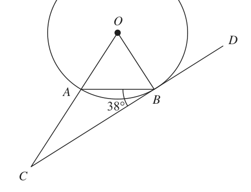
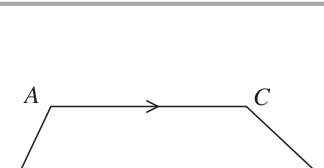
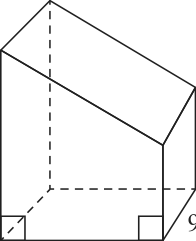
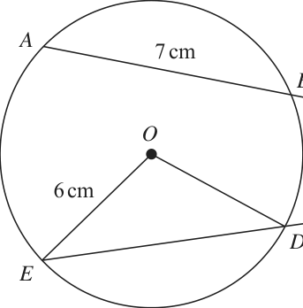

# 4MB1/01R — 2018-06 (official extraction)

> schema `syllabai.official-paper-questions/0.2` · paper_id `pearson-edexcel:international-gcse:mathematics-b:4mb1:2018-06:4MB1/01R` · qp sha256 `af3e12b849bf5174…` · extraction is the disclosed baseline (ADR-039)

## Question 1 (2 marks)

Without using a calculator and showing all your working, calculate 7 3 2 ×1 8 5 Give your answer as a mixed number in its simplest form.

### 1 [2]

Without using a calculator and showing all your working, calculate 7 3 2 ×1 8 5 Give your answer as a mixed number in its simplest form.

**Mark scheme answer**

> 23 8 23 8 23 184
> × M1 Need to see × and or
> 8 5 8 5 5
> 3 NB no marks for an answer without any
> 4 A1 working. Must be the mixed fraction in
> its simplest form

- **(2)** 23 8 23 8 23 184

## Question 2 (2 marks)

Each interior angle of a regular polygon is 168° Calculate the number of sides of the polygon.

### 2 [2]

Each interior angle of a regular polygon is 168° Calculate the number of sides of the polygon.

**Mark scheme answer**

> 360 ÷ 12 or 360 ÷ (180 − 168)
> M1
> 180(n − 2) = 168n oe NB 180(n − 2) = 168 is M0
> 30 A1

- **(2)** 360 ÷ 12 or 360 ÷ (180 − 168)

## Question 3 (2 marks)

The number of people living in Delhi is 1.7 q 107 The land area of Delhi is 1.5 q 103 square kilometres. Calculate the average number of people per square kilometre living in Delhi. Give your answer in standard form to 2 significant figures.

### 3 [2]

The number of people living in Delhi is 1.7 × 10⁷ The land area of Delhi is 1.5 × 10³ square kilometres. Calculate the average number of people per square kilometre living in Delhi. Give your answer in standard form to 2 significant figures.

**Mark scheme answer**

> •
> for 1.1(3)×10n
> (1.7 ×10 ) ÷ (1.5 ×10 )
> 7
> M1 or correct value to 2 or more significant
> figures. Eg11333.33... 11000, 11300
> 1.1×104 A1 cao 1.1×104

- **(2)** •

## Question 4 (2 marks)

Given that y = 3 − x5 x dy find dx dy = .................................................................... dx

### 4 [2]

Given that y = 3 − x⁵ x dy find dx dy = ……………dx

Given that y = 3 − x⁵ x dy find dx dy = dx

**Mark scheme answer**

> −4
> −3 × 7 x − 5 x
> M1 for one correct term (allow −3 ×7x−4)
> −21x −4 − 5 x 4 A1 oe e.g. − − 5x 4
> x⁴

- **(2)** −4

## Question 5 (2 marks)

Without using your calculator, and showing all your working, express 12/(3 − √5) in the form a + b√5 where a and b are integers.

### 5 [2]

Without using your calculator, and showing all your working, express 12/(3 − √5) in the form a + b√5 where a and b are integers.

**Mark scheme answer**

> 12 3+ 5
> × or
> 3− 5 3+ 5 M1
> 12 = 3a + 3b 5 − a 5 − 5b and
> 3a – 5b = 12, 3b – a = 0 oe
> Correct expansion/correct method for
> 36 + 12 5 solving simultaneous equations with a
> or 4b =12 or 4a = 36 9+3 5 A1
> 9−5 correct answer and no errors. NB no
> marks for answer without any working.
> Question Working Answer Mark Notes Sub- Total
> Total

- **(2)** 12 3+ 5

## Question 6 (3 marks)

B A C Diagram NOT accurately drawn D F E 63° G In the diagram, ABC is parallel to DEF. BEG is a straight line and ΔEFG is isosceles with EF = EG and ∠EGF = 63° Find the size, in degrees, of ∠ABE. ° ∠ABE = . . . . . . . . . . . . . . . . . . . . . . . . . . . . . . . . . . . . . . . . . .

### 6 [3]

In the diagram, ABC is parallel to DEF. BEG is a straight line and ΔEFG is isosceles with EF = EG and ∠EGF = 63° Find the size, in degrees, of ∠ABE. ° ∠ABE =

> *Figure not shown in this reconstruction — the printed paper includes a diagram (not drawn accurately).*
> Labels in the original figure: B, A, C, D, F, E, G · Figure values: 63°.

**Mark scheme answer**

> ∠ EFG = 63° M1 May be marked on diagram
> ∠ GEF = 54° or Allow 180 – "their ∠FEG " from correct
> ∠ BEF or ∠ DEG = 126° M1 work
> May be marked on diagram
> 126 A1

- **(3)** ∠ EFG = 63° M1 May be marked on diagram

## Question 7 (3 marks)

Solve the simultaneous equations 4x − y = 4 2 x + y = −10 Show clear algebraic working. x = .................................................................... y = ....................................................................

### 7 [3]

Solve the simultaneous equations 4x − y = 4 2 x + y = −10 Show clear algebraic working. x = y =

**Mark scheme answer**

> e.g. 8x + 14y = −40 4x − y =4 First stage of method to eliminate one
> (−)8x − 2y = 8 (−) 4 x + 7 y =
> −20 variable – allow one error only in
> multiplication or one sign error
> 16y = −48 −8y = 24 M1 eg 4 x= 4 − y – with intention to add or
> or
> y = 4x – 4 and 2x + 3.5(4x – 4) = −10 subtract as appropriate or correct
> substitution.
> Dep on first M1 method to find second
> e.g. 4x − −3 = 4 M1
> variable or starting again.
> x = 0.25
> A1 for both 0.25 oe and −3 dep on first M1
> y=−3

- **(3)** e.g. 8x + 14y = −40 4x − y =4 First stage of method to eliminate one

## Question 8 (3 marks)

When a biased coin is thrown once, the probability that it lands Heads is 0.6 The coin is thrown 4 times. Find the probability that the coin lands Heads exactly 3 times.

### 8 [3]

When a biased coin is thrown once, the probability that it lands Heads is 0.6 The coin is thrown 4 times. Find the probability that the coin lands Heads exactly 3 times.

**Mark scheme answer**

> 54
> 0.6³ × 0.4 (= (0.0864)) M1
> 625
> 0.6³ × 0.4 × 4 M1 Dep on 1st M1
> 216
> or 0.346 or 0.345
> 0.3456 A1 625
> NB if working shown can allow 0.35

- **(3)** 54

## Question 9 (3 marks)

Solve = 2x − 3 Show clear algebraic working. x = ....................................................................

### 9 [3]

Solve = 2x − 3 Show clear algebraic working. x = ……………Solve = 2x − 3 Show clear algebraic working. x =

**Mark scheme answer**

> 3 2
> 3 – 2x = 5(2x – 3) or 3 – 2x = 10x − 15 M1 or − x =2 x − 3 oe
> 5 5
> 3 + 15 = 10x + 2x or −2x−10x = −15−3 dep on first M1 for isolating x terms and
> M1
> oe e.g. 18 = 12x or 2.4x = 3.6, etc numerical terms
> 1.5 A1 oe dep on at least one M1
> Question Working Answer Mark Notes Sub- Total
> Total

- **(3)** 3 2

## Question 10 (3 marks)

X = 2a + b X = 19.4 to 1 decimal place. a = 2.4 to 1 decimal place. Calculate the upper bound for the value of b. Show your working clearly.

### 10 [3]

X = 2a + b X = 19.4 to 1 decimal place. a = 2.4 to 1 decimal place. Calculate the upper bound for the value of b. Show your working clearly.

**Mark scheme answer**

> 19.45 or 19.35 or 2.35 or 2.45 B1
> Or for UB1 − 2 × LB2 or UB1 =
> 2 × LB2 + b
> (b =) 19.45 – 2 × 2.35 M1
> where 19.4 < UB1 ≤ 19.5 & 2.3 ≤ LB2 < 2.4
> 14.75 A1

- **(3)** 19.45 or 19.35 or 2.35 or 2.45 B1

## Question 11 (3 marks)

Make x the subject of = c − x3 3 x = ....................................................................

### 11 [3]

Make x the subject of = c − x³ 3 x = ……………Make x the subject of = c − x³ 3 x =

**Mark scheme answer**

> 3(x³ + a) = 4(c – x³) oe M1
> 3x³ + 4x³ = 4c – 3a or Collecting x terms on one side and other
> M1
> 3a – 4c = −4x3 −3x3 terms on the opposite side
> oe. Do not ISW
> 4c − 3a
> 3 A1 4c − 3a 4c − 3a
> 7 NB A0 for ± 3
> 7 7

- **(3)** 3(x³ + a) = 4(c – x³) oe M1

## Question 12 (3 marks)

Given that 6 q 53k + 4 = 750 find the exact value of k. k = ....................................................................

### 12 [3]

Given that 6 × $5^{3k+4}$ = 750 find the exact value of k. k = ……………Given that 6 × $5^{3k+4}$ = 750 find the exact value of k. k =

**Mark scheme answer**

> 750
> 53k + 4 = 125 M1 Allow
> Dep first M1 Writing “125” as a power
> 3k + 4 = 3 M1
> of 5 and equating powers, 0.33(0.33…)
> − A1 cao

- **(3)** 750

## Question 13 (3 marks)

A Diagram NOT accurately drawn B E C D 9.6 cm The diagram shows triangle ACD and triangle ABE. The point B is on AC and the point E is on AD such that BE is parallel to CD. CD = 9.6 cm Area of triangle ABE = 27 cm2 Area of trapezium BCDE = 21 cm2 Calculate the length, in cm, of BE. .................................................................... cm

### 13 [3]

The diagram shows triangle ACD and triangle ABE. The point B is on AC and the point E is on AD such that BE is parallel to CD. CD = 9.6 cm Area of triangle ABE = 27 cm² Area of trapezium BCDE = 21 cm² Calculate the length, in cm, of BE cm

> *Figure not shown in this reconstruction — the printed paper includes a diagram (not drawn accurately).*
> Labels in the original figure: A, B, E, C, D · Figure values: 9.6.

**Mark scheme answer**

> 9
> ⎡ BE 2 ⎤ ⎛ 9 ⎞ ⎛ 27 ⎞ For or
> ⎢ 9.62 = 16 ⎟ or ⎜ 21 + 27 ⎟ oe M1 16 21 + 27
> ⎣ ⎦⎝ ⎠ ⎝ ⎠ Alternate h = 10 , 0.5 BE × x =27
> " "
> [ BE ]
> =
> × 9.6 M1 Alternate ( 9.6 + BE )(10 − x ) =
> 7.2 A1
> Question Working Answer Mark Notes Sub- Total

- **(3)** 9

## Question 14 (4 marks)

y O 1 2 3 4 5 6 7 x

**(a)** On the grid, draw and label the straight line with equation

### 14(a)(i) [?]

y=2

**Mark scheme answer**

> y=2 B1 correct line

### 14(a)(ii) [?]

x + y = 5

**Mark scheme answer**

> x+y=5 B1 correct line (condone incorrect labelling)

### 14(a)(iii) [3]

y = 2x + 1

**Mark scheme answer**

> y = 2x + 1 B1 correct line

- **(3)** y = 2x + 1 B1 correct line

### 14(b) [1]

On the grid, show by shading, the region defined by the inequalities y . 2 and x + y - 5 and y - 2x + 1 Label the region R.

**Mark scheme answer**

> R correctly Do not award if lines incorrect
> B1
> placed Ignore labelling of lines

- **(1)** R correctly Do not award if lines incorrect

## Question 15 (4 marks)

Barry and Carlos share $120 in the ratio 3 : 2 Barry gives of his share to Mary. Carlos gives 35% of his share to Mary. Express the total amount that Barry and Carlos give to Mary as a fraction of the $120 Give your answer in its simplest form.

### 15 [4]

Barry and Carlos share \$120 in the ratio 3 : 2 Barry gives of his share to Mary. Carlos gives 35% of his share to Mary. Express the total amount that Barry and Carlos give to Mary as a fraction of the \$120 Give your answer in its simplest form.

**Mark scheme answer**

> 1 ⎛ 120 ⎞ 3 1
> ×⎜ × 3 ⎟ (= 14.4(0)) M1 or (Barry:) × (= )
> 5 ⎝ 5 ⎠ 5 5 25
> ⎛ 120 ⎞ 35 2
> × (=
> =
> 0.35 × ⎜ × 2 ⎟ (= 16.8(0)) M1 or (Carlos:) )
> ⎝ 5 ⎠ 100 5 100 50
> '14.4 '+ '16.8' "31.2" 3
> = M1 Dep on M2 or for ' '+ ' '
> 120 120 25 50
> or 0.26 A1
> 50
> Question Working Answer Mark Notes Sub- Total
> Total

- **(4)** 1 ⎛ 120 ⎞ 3 1

## Question 16 (4 marks)
### 16(a) [2]

Simplify 2w4y3 q 3wy5

**Mark scheme answer**

> B1 for 2 terms correct as part of a
> 6w5 y 8 B2
> product. Do not ISW

- **(2)** B1 for 2 terms correct as part of a

### 16(b) [2]

Simplify (27a c ) 6 3 3

**Mark scheme answer**

> B1 for 2 terms correct as part of a
> 3a 2 c B2
> product, allow 3a 2 c1 . Do not ISW

- **(2)** B1 for 2 terms correct as part of a

## Question 17 (4 marks)

Diagram NOT accurately drawn O D A B 38° C A and B are points on the circumference of a circle, centre O. CBD is the tangent to the circle at B. CAO is a straight line. ∠ABC = 38° Giving your reasons, find the size, in degrees, of ∠ACB. ° ∠ACB = ................................................ . . . . . . . . . . . . . . . . . . .

### 17 [4]

and B are points on the circumference of a circle, centre O. CBD is the tangent to the circle at B. CAO is a straight line. ∠ABC = 38° Giving your reasons, find the size, in degrees, of ∠ACB. ° ∠ACB =

> *Figure not shown in this reconstruction — the printed paper includes a diagram (not drawn accurately).*
> Labels in the original figure: O, D, A, B, C, A · Figure values: 38°.

**Mark scheme answer**

> OBA = 52° M1 may be marked on diagram
> may be marked on diagram
> AOB = 76° or BAC = 128° M1
> must be identified as correct angles
> 14 A1
> e.g. angle between tangent and
> radius = 90°
> base angles/radii equal / isosceles
> triangle
> B1 for 2 correct reasons for method used
> Angle sum of triangle
> Angle sum of triangle =180
> Angle sum of straight line
> Angle sum of straight line = 180

- **(4)** OBA = 52° M1 may be marked on diagram

## Question 18 (4 marks)

OA = ⎜ ⎟ and OB = ⎜ ⎟ ⎝ −2⎠ ⎝ 6⎠ →

### 18(a) [2]

OA = and OB = −2⎠ ⎝ 6⎠ →

Find AB as a column vector. ⎛ ⎞ → AB = →

**Mark scheme answer**

> ⎛ −4 ⎞ ⎛ −2 ⎞ ⎛ −2 ⎞ ⎛ 4 + or − M1 oe
> ⎝ 2⎠ ⎝ 6⎠ ⎝ 6 ⎠ ⎝ −2 ⎠
>  −6 A1
> ⎝8⎠

- **(2)** ⎛ −4 ⎞ ⎛ −2 ⎞ ⎛ −2 ⎞ ⎛ 4 ⎞

### 18(b) [2]

Calculate the modulus of AB

**Mark scheme answer**

> "(−6)"2 + "8"2 M1ft ft part(a). Condone missing minus.
> 10 A1ft ft part (a) 2
> Question Working Answer Mark Notes Sub- Total
> Total

- **(2)** "(−6)"2 + "8"2 M1ft ft part(a). Condone missing minus.

## Question 19 (4 marks)

Write (3 x + 2) ÷ ⎜ ⎟ − as a single fraction in its simplest form. ⎝ 5 ⎠ x+3 Show clear algebraic working.

### 19 [4]

Write (3 x + 2) ÷ − as a single fraction in its simplest form. ⎝ 5 ⎠ x+3 Show clear algebraic working.

**Mark scheme answer**

> 5 ⎡ 5 ⎤ For × by reciprocal condone missing
> (3 x + 2) × −
> 3 x − 7 x − 6 ⎢⎣ x + 3 ⎥⎦
> 2 M1 bracket round 3x + 2
> 5 ⎡ 5 ⎤ Factorising correctly
> (3 x + 2) × −
> (3 x + 2)( x − 3) ⎢⎣ x + 3 ⎥⎦
> M1
> 5( x + 3) − 5( x − 3) Correct method for combining into a single
> M1
> ( x − 3)( x + 3) fraction
> 5 x + 15 − 5 x + 15
> ( x + 3)( x − 3)
> 30
> A1 or
> x −9
> ( x + 3)( x − 3)

- **(4)** 5 ⎡ 5 ⎤ For × by reciprocal condone missing

## Question 20 (4 marks)

A C Diagram NOT accurately drawn O B The diagram shows a trapezium OACB in which → → → OA = a, AC = 3b, OB = 5b The point P lies on OC such that OP : PC = 5 : 1 D is the point such that OBD is a straight line and APD is a straight line. Prove that OB : OD = 1 : 3

### 20 [4]

The diagram shows a trapezium OACB in which → → → OA = a, AC = 3b, OB = 5b The point P lies on OC such that OP : PC = 5 : 1 D is the point such that OBD is a straight line and APD is a straight line. Prove that OB : OD = 1 : 3

> *Figure not shown in this reconstruction — the printed paper includes a diagram (not drawn accurately).*
> Labels in the original figure: A, C, O, B.

**Mark scheme answer**

> → 5 1 5 →
> AP = −a + (a + 3b) [= − a + b] M1 For correct vector for AP
> 6 6
> → → →
> AD = −a + nb or −a + (5+n)b M1 indep allow OD = a + n AP
> → 1 5 1 →
> AD = 6( − a + b) [=−a + 15b] M1 or AD = 6AP or 1 − n = 0 and OD =15b
> 6 2
> Seeing 5 : 15 or 5b : 15b equals 1 : 3 from
> OB : OD = 5 : 15 1:3 A1
> correct working
> Question Working Answer Mark Notes Sub- Total
> Total

- **(4)** → 5 1 5 →

## Question 21 (5 marks)

Diagram NOT accurately drawn 18 cm 10 cm 9 cm 15 cm The diagram shows a right prism of length 9 cm. A cross section of the prism is a trapezium in which the parallel sides are of length 18 cm and 10 cm and the distance between these parallel sides is 15 cm. Calculate the total surface area, in cm2, of the prism. .................................................................... cm2

### 21 [5]

The diagram shows a right prism of length 9 cm. A cross section of the prism is a trapezium in which the parallel sides are of length 18 cm and 10 cm and the distance between these parallel sides is 15 cm. Calculate the total surface area, in cm², of the prism cm²

> *Figure not shown in this reconstruction — the printed paper includes a diagram (not drawn accurately).*
> Figure values: 18, 10, 9, 15.

**Mark scheme answer**

> $8^2$ + $15^2$ (=17) M1 Using Pythagoras correctly
> 10×9+18×9+15×9 M1 correct areas of the 3 rectangles
> 18 + 10 8 ×15
> ×15 or 10 ×15 + [=210] M1 Attempt at area of trapezium
> 2
> 2 × "210"+ 10 × 9 + 18 × 9 + 15 × 9 + "17"× 9 dep on previous method marks – for adding
> M1
> the six areas together
> 960 A1

- **(5)** $8^2$ + $15^2$ (=17) M1 Using Pythagoras correctly

## Question 22 (5 marks)

T varies inversely as the square of y. T = 0.32 when y = 5

### 22(a) [3]

Find a formula for T in terms of y.

**Mark scheme answer**

> k k
> [T =] 2 M1 For
> y y²
> k Subst 0.32 for T and 5 for y
> 0.32 = M1
> 8 k
> T= A1 NB SCB1 for 0.32 =
> y²

- **(3)** k k

### 22(b) [2]

Find the positive value of y when T = 200

**Mark scheme answer**

> "8"
> 200 = M1
> y²
> 0.2 A1 oe 2
> Question Working Answer Mark Notes Sub- Total

- **(2)** "8"

## Question 23 (5 marks)
### 23(a) [2]

Write x² + 10x – 7 in the form (x + p)² + q

**Mark scheme answer**

> or for p = 5 and q = −32 B1 for (x +
> (x+5)² − 32 B2
> 5)², B1 for −32

- **(2)** or for p = 5 and q = −32 B1 for (x +

### 23(b) [3]

Hence solve the equation x² + 10x – 7 = 0 Give your answer in the form a ± b where a and b are integers. Show your working clearly.

**Mark scheme answer**

> (x + ‘5’)² = ‘32’ M1 ft from (a)
> x + ‘5’ = ± '32 ' M1 ft
> −5 ± 4 2 gets A0
> −5 ± 32 A1 SCB1 for use of formula with correct
> answers although −5 ± 4 2 is B0

- **(3)** (x + ‘5’)² = ‘32’ M1 ft from (a)

## Question 24 (5 marks)

(x + 2) is a factor of x3 – 3x2 + ax + 12 where a is a constant.

### 24(a) [2]

(x + 2) is a factor of x³ – 3x2 + ax + 12 where a is a constant.

Show that a = – 4

**Mark scheme answer**

> (−2)³ − 3 × (−2)² − 2a + 12 (=0)
> M1
> Or (−2)³ − 3 × (−2)² − 2 × − 4 + 12
> 2a = −8 or −2a = 8 or 2a = −20 + 12,
> a = −4 A1 no working gains zero marks
> Or – 8 – 12 + 8 + 12 = 0 so a = −4

- **(2)** (−2)³ − 3 × (−2)² − 2a + 12 (=0)

### 24(b) [3]

Factorise completely x³ – 3x2 – 4x + 12

**Mark scheme answer**

> (x + 2) (x² − 5x + 6) or
> M1 Allow a sign error
> x²(x − 3) −4(x − 3)
> For factorising any 3 term quadratic
> which when expanded, the result gives
> at least 2 of the 3 terms from their
> x² − 5x + 6 = ( x − 2 )( x − 3) trinomial,
> M1
> e.g. (x – 6)(x – 1)(=0) will give x² and
> +6 terms
> or (x² − 4)(x – 3)
> Indep of previous M mark
> (x+2)(x−3)(x−2) A1 3
> Question Working Answer Mark Notes Sub- Total
> Total

- **(3)** (x + 2) (x² − 5x + 6) or

## Question 25 (6 marks)

A box of toy bricks contains only red bricks, blue bricks, green bricks, yellow bricks and orange bricks. A brick is taken at random from the box. The table gives information about the probabilities that the brick is red or is blue or is green or is yellow or is orange. Colour red blue green yellow orange Probability 0.15 0.13 0.2 0.32 x

### 25(a) [2]

Calculate the value of x. x = There are 39 blue bricks in the box.

**Mark scheme answer**

> 1 – (0.15+0.13+0.2+0.32) M1
> 0.2 A1

- **(2)** 1 – (0.15+0.13+0.2+0.32) M1

### 25(b) [2]

Find the number of yellow bricks in the box. Alvaro draws a pie chart to show information about the number of bricks of each colour.

**Mark scheme answer**

> 0.32
> × 39 or 0.32 × (39 ÷ 0.13)
> 0.13 M1 oe
> or 0.32 × 300
> 96 A1

- **(2)** 0.32

### 25(c) [2]

Calculate the size of the angle, in degrees, of the sector for red bricks.

…………… °

**Mark scheme answer**

> 0.15 × 360 M1 oe
> 54 A1 2

- **(2)** 0.15 × 360 M1 oe

## Question 26 (6 marks)

A = ⎜ B= ⎜ C = (5 2) ⎝ −2 1⎟⎠ ⎝ 1 4 ⎟⎠ Find

### 26(a) [2]

A = $\begin{pmatrix} 4 & 3 \\ -2 & 1 \end{pmatrix}$ B = $\begin{pmatrix} 2 & -3 \\ 1 & 4 \end{pmatrix}$ C = $\begin{pmatrix} 5 & 2 \end{pmatrix}$ Find

3A + 2B 

**Mark scheme answer**

>  16 3 B2 -1eeoo
> ⎝ −4 11⎠

- **(2)** ⎛ 16 3 ⎞

### 26(b) [2]

AB 

**Mark scheme answer**

>  11 0 B2 -1eeoo
> ⎝ −3 10 ⎠

- **(2)** ⎛ 11 0 ⎞

### 26(c) [2]

CB

**Mark scheme answer**

> (12 −7 ) B1 for matrix of correct order or for 12 and
> −7 seen. Allow 10 + 2, -15 + 8 or
> 5 × 2 + 2 ×1 and 5 × −3 + 2 × 4
> B1 fully correct including brackets
> Question Working Answer Mark Notes Sub- Total
> Total

- **(2)** (12 −7 ) B1 for matrix of correct order or for 12 and

## Question 27 (6 marks)

Diagram NOT A 7 cm accurately drawn B 9 cm O C 6 cm D E F In the diagram, ABDFE is a circle, centre O and radius 6 cm. ABC and EDC are straight lines. The arc EFD is of length π cm. Calculate the length, in cm to 3 significant figures, of DC. .................................................................... cm

### 27 [6]

In the diagram, ABDFE is a circle, centre O and radius 6 cm. ABC and EDC are straight lines. The arc EFD is of length π cm. Calculate the length, in cm to 3 significant figures, of DC cm

> *Figure not shown in this reconstruction — the printed paper includes a diagram (not drawn accurately).*
> Labels in the original figure: A, B, O, C, D, E, F · Figure values: 7, 9, 6.

**Mark scheme answer**

> 360 × 3.5π
> =
> ∠EOD = oe( 105)
> 12π M1 method to find angle EOD
> ED = $6^2$ + $6^2$ − 2 × 6 × 6 × cos105 or M1 method to find length ED
> ED = 2 × 6sin52.5 oe (=9.52) oe
> correct equation for DC Allow 9.5 or
> DC × (DC + "9.52") = 9 ×16 M1
> better for ED
> Dep on previous M mark. correct
> DC² + 9.52DC – 144 (= 0) oe M1
> equation in form to solve
> −9.52 + $9.52^2$ − 4 ×1× −144
> DC = Dep on previous two M marks fully
> 2 ×1 M1
> correct method to find DC
> 8.15 A1

- **(6)** 360 × 3.5π

