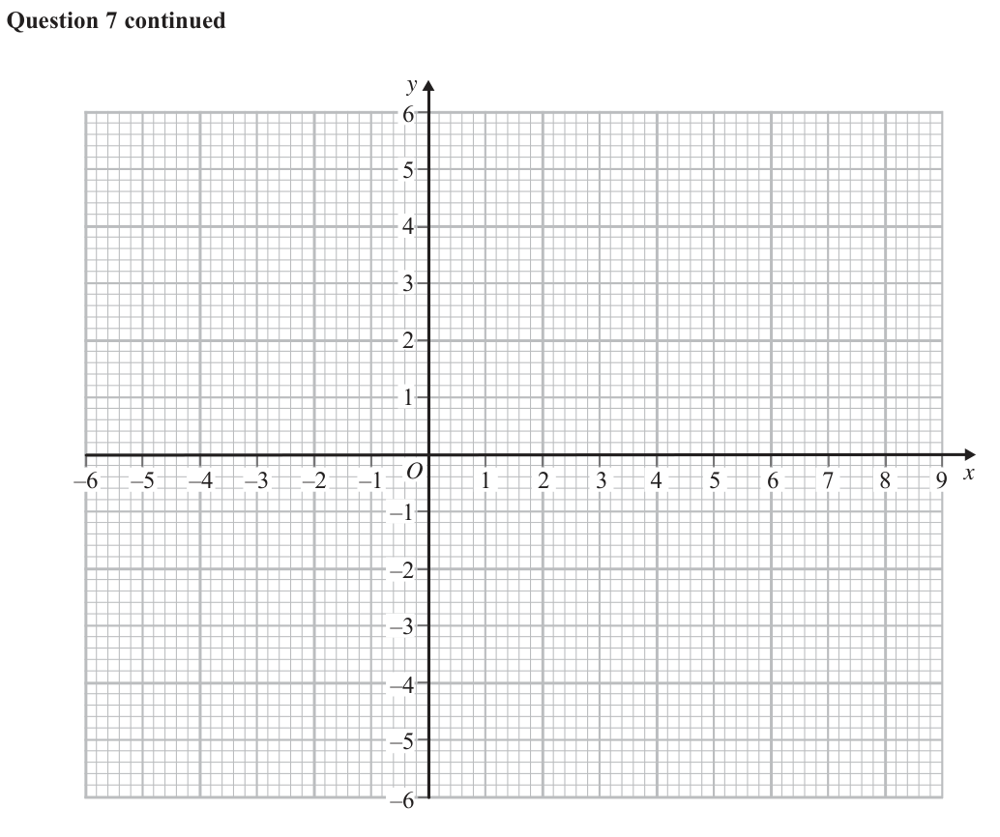
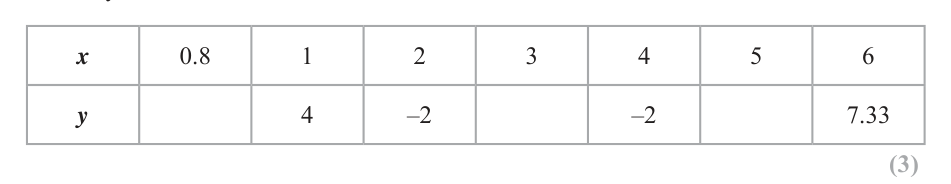
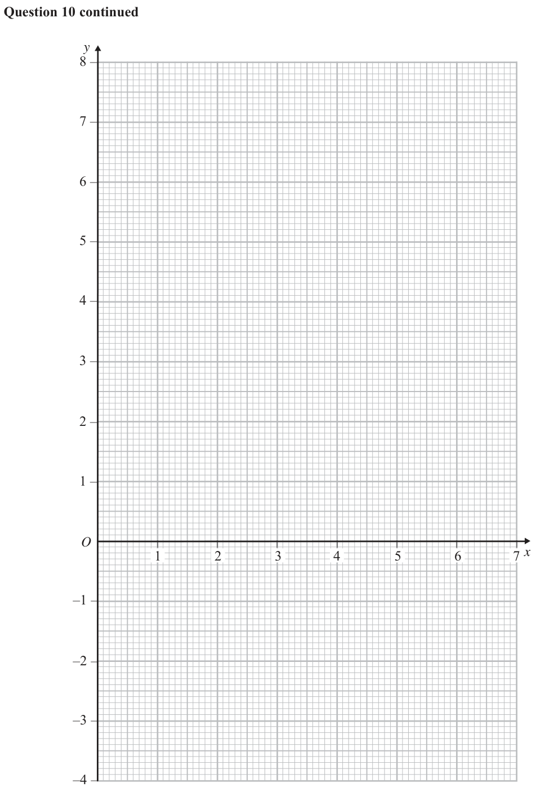
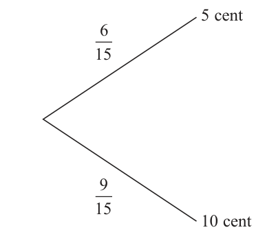

# 4MB1/02 — 2018-06 (official extraction)

> schema `syllabai.official-paper-questions/0.2` · paper_id `pearson-edexcel:international-gcse:mathematics-b:4mb1:2018-06:4MB1/02` · qp sha256 `c56feff316165c24…` · extraction is the disclosed baseline (ADR-039)

## Question 1 (7 marks)

For concerts in a theatre, people can buy tickets in the Stalls, in the Dress Circle and in the Balcony. The number of seats in the Stalls is S, the number of seats in the Dress Circle is D and the number of seats in the Balcony is B where S : D : B = 12 : 9 : 4 Given that B = 600

### 1(a) [2]

find the total number of seats in the theatre. The following table gives information about the cost of tickets and the number of tickets sold for a concert held in the theatre in 2017 Cost of each ticket Number of tickets sold Stalls $65 S Dress Circle $40 90% of D Balcony $25 1 4B

> 🖼 crop required: table (qp.pdf p.None)

**Mark scheme answer**

> Full method to find total M1
> 600
> × (12 + 9 + 4 ) oe number of seats
> 3750 A1

- **(2)** Full method to find total M1

### 1(b) [3]

Calculate the total amount of money, in $, paid for all the tickets sold for this concert. For a concert held in 2018, the total amount of money paid for all the tickets sold was $175 000 For this concert in 2018, the costs of each ticket for a seat in the Stalls, in the Dress Circle and in the Balcony were the same as the costs in 2017 Also for this concert, the number of tickets sold for seats in the Stalls was the same as in 2017 and the number of tickets sold for seats in the Dress Circle was the same as in 2017

**Mark scheme answer**

> Stalls: 1800 Dress Circle: 1350 B1
> ( ''1800''× 65) + ( 0.9 × ( ''1350''× 40 ) ) + ( 0.25 × ( 600 × 25) ) M1
> $169,350 A1

- **(3)** Stalls: 1800 Dress Circle: 1350 B1

### 1(c) [2]

Calculate the number of tickets sold for seats in the Balcony for the concert in 2018

**Mark scheme answer**

> 175000 − ''169350 '' M1
> (= 226) or
> 175000 − "117000"− "48600"
> 376 A1 2
> Question Working Answer Notes Mark Sub- Total
> Total

- **(2)** 175000 − ''169350 '' M1

## Question 2 (5 marks)

E Diagram NOT accurately drawn 11 cm D C O 5 cm A 12 cm B Figure 1 Figure 1 shows a rectangular based right pyramid, ABCDE. The point O is the centre of the rectangular base so that OE is the perpendicular height of the pyramid. AB = 12 cm and BC = 5 cm AE = BE = CE = DE = 11 cm Calculate the exact volume of the pyramid. Give your answer in the form p q cm3 where p and q are integers. ⎡ 1 ⎤ ⎢⎣ Volume of pyramid = 3 × base area × height ⎥⎦

### 2 [5]

E Diagram NOT accurately drawn 11 cm D C O 5 cm A 12 cm B Figure 1 Figure 1 shows a rectangular based right pyramid, ABCDE. The point O is the centre of the rectangular base so that OE is the perpendicular height of the pyramid. AB = 12 cm and BC = 5 cm AE = BE = CE = DE = 11 cm Calculate the exact volume of the pyramid. Give your answer in the form p q cm3 where p and q are integers. ⎡ 1 ⎤ ⎢⎣ Volume of pyramid = 3 × base area × height ⎥⎦

> 🖼 crop required: diagram (qp.pdf p.None)

**Mark scheme answer**

> AC=
> 52 + 122 or AC = 13 or Correct method to find M1
> 6² + 2.5² (=42.25) side of triangle in first
> stage to find height of
> 3 51
> (E to middle of BC)² = 11² − 2.5² or E-midBC = pyramid
> (E to middle of AB)² = 11² − 6² or E-midAB = 85
> OE 2 =112 − ( (0.5 × "13") 2 ) or 11² − 2.5² − 6² oe
> Correct statement for
> (OE)² oe M1
> Allow 8.87(41...) A1
> 3 35
> OE =
> 1 (dep on M2) or for an M1
> V = (12 )( 5 )( OE )

- **(5)** AC=

## Question 3 (5 marks)

A=⎜ B=⎜ ⎝ 4 −1⎟⎠ ⎝ 4 10⎟⎠ ⎛ 1 0⎞ Given that A2 – B = λI where λ is an integer and I = ⎜ ⎝ 0 1⎟⎠ find the value of a and the value of λ.

### 3 [5]

A=⎜ B=⎜ ⎝ 4 −1⎟⎠ ⎝ 4 10⎟⎠ ⎛ 1 0⎞ Given that A2 – B = λI where λ is an integer and I = ⎜ ⎝ 0 1⎟⎠ find the value of a and the value of λ.

**Mark scheme answer**

> answer of 177.(4823...)
> Or p = 30, q = 35 A1
> 30 35
> Question Working Answer Notes Mark Sub- Total
> Total
> ⎛ a 2 + 12 3a − 3 ⎞
> A =⎜
> ⎟ (-1 eeoo)
> ⎝ 4a − 4 13 ⎠
> λI
> Their A 2 − B = M1
> ⎛ a 2 + 12 3a − 3 ⎞ ⎛13 3 ⎞ ⎛1 0⎞
> ⎜ ⎟−⎜ ⎟=λ⎜ ⎟
> ⎝ 4a − 4 13 ⎠ ⎝ 4 10 ⎠ ⎝0 1⎠
> a=2 A1
> λ =3 A1
> Question Working Answer Notes Mark Sub- Total
> Total

- **(5)** answer of 177.(4823...)

## Question 4 (6 marks)

The Venn diagram shows information about the elements in a universal set, E, and the three sets X, Y and Z. E X a Y h f b c g l i j k d e m n Z Using the information in the Venn diagram, write down the elements in

### 4(a) [1]

X ∩ Y

**Mark scheme answer**

> {h, l} B1

- **(1)** {h, l} B1

### 4(b) [1]

(X ∪ Y ) ∩ Z′ Find

**Mark scheme answer**

> {a, b, c, f, g, h} B1

- **(1)** {a, b, c, f, g, h} B1

### 4(c) [1]

n([X ∪ Y ]′)

**Mark scheme answer**

> 4 B1

- **(1)** 4 B1

### 4(d) [1]

n([X ∩ Z ] ∪ Y′) Here are five symbols used in connection with sets. ∈ ∅ ⊂ ∉ ∩

**Mark scheme answer**

> 10 B1

- **(1)** 10 B1

### 4(e) [1]

Use one of these symbols to complete the following statement correctly {d, e} Z A letter is chosen at random from E

**Mark scheme answer**

> ⊂ B1

- **(1)** ⊂ B1

### 4(f) [1]

Find the probability that this letter is in set Y given that it is in set X.

**Mark scheme answer**

> 2 Decimals or % to 2dp B1 1
> 7 truncated or rounded
> 0.28(5714...)
> Question Working Answer Notes Mark Sub- Total
> Total

- **(1)** 2 Decimals or % to 2dp B1 1

## Question 5 (13 marks)

f and g are two functions such that f : x 6 3 + 5x where x < 0 5 − 4x g:x 6 3x − 2

### 5(a) [2]

Find the value of a for which f(a) = 0

**Mark scheme answer**

> 3 + 5a =
> 0 M1
> a = −0.6 oe A1

- **(2)** 3 + 5a =

### 5(b) [1]

Write down the range of f

**Mark scheme answer**

> Accept any equivalent B1
> f(x) < 3
> notation but not x < 3

- **(1)** Accept any equivalent B1

### 5(c) [1]

State the value of x that must be excluded from any domain of g

**Mark scheme answer**

> 2 B1
> x=

- **(1)** 2 B1

### 5(d) [5]

Find the value of x for which f(x) = g(x) Show your working clearly. Give your answer to 3 significant figures.

**Mark scheme answer**

> ( 3 + 5 x )( 3x − 2 ) =5 − 4 x Removing denominator M1oe
> in a correct equation
> 15 x 2 + 3 x − 11 =
> 0 A1
> Solving their 3 term M1oe
> −3 ± 32 − 4 (15 )( −11) −3 ± 69
> = quadratic
> 2 (15 )
> 0.762... and/or −0.962... Or A1
> awrt −0.962 −0.962 Rejection of positive root A1

- **(5)** ( 3 + 5 x )( 3x − 2 ) =5 − 4 x Removing denominator M1oe

### 5(e) [4]

Express the inverse function g–1 in the form g–1 : x 6 … ⎡ 2 −b ± b 2 − 4ac ⎤ ⎢Solutions of ax + bx + c = 0 are x = ⎥ ⎣⎢ 2a ⎦⎥

**Mark scheme answer**

> Write in x or y in terms of M1
> y= x= y or x and multiply
> 3x − 2 3y − 2
> y(3x – 2) = 5 – 4x
> x(3y – 2) = 5 – 4y
> 3xy – 2y = 5 – 4x 3xy – 2x = 5 – 4y expand and isolate terms M1
> 3xy + 4x = 5 + 2y 3xy + 4y = 5 + 2x in x or y
> x(3y + 4) = 5 + 2y y(3x + 4) = 5 + 2x Factorise out x or y and M1
> 5 + 2x divide.
> 5+ 2y
> x= y=
> 3y + 4 3x + 4
> 5 + 2x Correct answer written in A1 4
> g −1 : x →
> 3x + 4 fully correct form.
> Question Working Answer Notes Mark Sub- Total
> Total

- **(4)** Write in x or y in terms of M1

## Question 6 (7 marks)

The six numbers x y y 12 (x + y) 12 are in ascending order of size. The mode of the six numbers is 12 and the mean of the six numbers is 9.5

### 6(a) [5]

Find the value of x and the value of y.

**Mark scheme answer**

> B1indep
> x+ y =
> M1indep
> x + y + y + 12 + ( x + y ) + 12
> = 9.5
> Terms in x and y and A1
> eg 2 x + 3 y =
> numerical terms
> simplified
> 2 x + 3 (12 − x ) =
> Solve simultaneous M1 dep
> equations (dependent on
> previous M mark)
> =
> x 3,=
> y 9 A1

- **(5)** B1indep

### 6(b) [2]

Hence find the median of the six numbers.

**Mark scheme answer**

> "9"+ 12 Correct calculation with M1ft
> Median =
> 2 their value of y
> 10.5 cao A1 2
> Question Working Answer Notes Mark Sub- Total
> Total

- **(2)** "9"+ 12 Correct calculation with M1ft

## Question 7 (13 marks)

The points (1, 1), (1, 3) and (0, 3) are the vertices of triangle A.

### 7(a) [1]

On the grid, draw and label triangle A. Triangle A is transformed to triangle B by a reflection in the line with equation x = –2

**Mark scheme answer**

> Triangle A drawn Penalise labelling B1
> ONCE only

- **(1)** Triangle A drawn Penalise labelling B1

### 7(b) [2]

On the grid, draw and label triangle B. ⎛ 1⎞ Triangle B is transformed to triangle C under the translation ⎜ ⎟ ⎝ −3⎠

**Mark scheme answer**

> x = −2 drawn Implied by correct B1
> triangle or two correct
> coordinates
> Triangle B drawn
> ( −5,1) , ( −5,3) , ( −4,3) B1

- **(2)** x = −2 drawn Implied by correct B1

### 7(c) [2]

On the grid, draw and label triangle C. Triangle C is transformed to triangle D under the transformation with matrix M where ⎛ −2 0 ⎞ M= ⎜ ⎝ 0 −2⎟⎠

**Mark scheme answer**

> ( −4, −2 ) , ( −4,0 ) , ( −3,0 ) Triangle C drawn ft from their B B2 (-1 ee)

- **(2)** ( −4, −2 ) , ( −4,0 ) , ( −3,0 ) Triangle C drawn ft from their B B2 (-1 ee)

### 7(d) [3]

On the grid, draw and label triangle D.

**Mark scheme answer**

> NB: coordinates may be M1ft
> ⎛ −2 0 ⎞ ⎛ −4 −4 −3 ⎞
> ⎜ ⎟ '' ⎜ ⎟ '' in any order
> ⎝ 0 −2 ⎠ ⎝ −2 0 0 ⎠
> A1ft
> ⎛8 8 6⎞
> ⎜ ⎟
> ⎝ 4 0 0⎠
> Triangle D drawn cao A1

- **(3)** NB: coordinates may be M1ft

### 7(e) [2]

Find the inverse matrix, M–1, of the matrix M

**Mark scheme answer**

> B1 for one correct row B2
> ⎛ −0.5 0 ⎞ 1 ⎛ −2 0 ⎞
> ⎜ ⎟
> −0.5 ⎠ ⎜ ⎟ oe or column & correct
> ⎝ 0 4 ⎝ 0 −2 ⎠
> expression for det.

- **(2)** B1 for one correct row B2

### 7(f) [3]

Describe fully the single transformation represented by the matrix M–1 ⎡ ⎛ a b⎞ 1 ⎛ d − b⎞ ⎤ ⎢The inverse of matrix ⎜ is ⎥ ⎣ ⎟ ⎝ c d⎠ ad − bc ⎜⎝ −c a ⎟⎠ ⎦ y 6– 5– 4– 3– 2– 1– – – – – – – – – – – – – – – – –6 –5 –4 –3 –2 –1 O 1 2 3 4 5 6 7 8 9 x –1 – –2 – –3 – –4 – –5 – –6 – for a spare grid if you need to redraw your triangles. Only use this grid if you need to redraw your triangles. y 6– 5– 4– 3– 2– 1– – – – – – – – – – – – – – – – –6 –5 –4 –3 –2 –1 O 1 2 3 4 5 6 7 8 9 x –1 – –2 – –3 – –4 – –5 – –6 –

**Mark scheme answer**

> enlargement
> scale factor −0.5 oe B1
> centre (0, 0) oe B1
> B1
> Question Working Answer Notes Mark Sub- Total
> Total

- **(3)** enlargement

## Question 8 (11 marks)

The equation of a curve is y = x ( x − 1) − x3 + 11x + 2 3 3 The point A on the curve has coordinates (p, q) The gradient of the curve at A is 5

### 8(a) [3]

Show that p is a root of the equation 2p3 – 5p2 – p + 6 = 0

**Mark scheme answer**

> Expanding(at least1 M1
> 1 4 1 2 5 3
> y= x − x − x + 11x + term correct) and
> 2 2 3
> differentiating (at least
> one term correct)
> Sets their derivative = 5 M1
> dy dy
> = 2 x 3 − x − 5 x 2 + 11 and = 5 when x = p with at least two terms
> dx dx
> differentiated correctly
> giving 2 p 3 − p − 5 p 2 + 11 =
> Dep on M2 A1
> 2 p3 − 5 p 2 − p + 6 =0
> NB: answer given

- **(3)** Expanding(at least1 M1

### 8(b) [2]

Show that (2p – 3) is a factor of 2p3 – 5p2 – p + 6

**Mark scheme answer**

> Substitute 1.5 into cubic M1
> 2 (1.5 ) − 5 (1.5 ) − (1.5 ) + 6
> 3
> or by algebraic division
> Showing that the A1
> 2 (1.5 ) − 5 (1.5 ) − (1.5 ) + 6 = 0
> 3
> remainder is zero

- **(2)** Substitute 1.5 into cubic M1

### 8(c) [4]

Hence factorise completely 2p3 – 5p2 – p + 6 Given that p >

**Mark scheme answer**

> p²....... Showing division with M1
> at least p² in quotient
> p² − p – 2 Fully correct quotient A1
> p² − p – 2 correctly
> ( p + 1)( p − 2 ) M1
> factorised
> ( 2 p − 3)( p + 1)( p − 2 ) Fully factorised A1
> expression
> ( 2 ) ( 22 − 1) − ( 2 ) + 11( 2 ) +

- **(4)** p²....... Showing division with M1

### 8(d) [2]

find the value of q.

**Mark scheme answer**

> 1 5 1 substitution of 2 into y to M1
> =
> 2
> q
> 2 3 3 give q
> 15 A1
> Question Working Answer Notes Mark Sub- Total
> Total

- **(2)** 1 5 1 substitution of 2 into y to M1

## Question 9 (13 marks)

E ȝa D Diagram NOT accurately drawn λb F C B b O A a Figure 2 → → → → In Figure 2, OA = a, OB = b, FE = λb and ED = μa, where λ and μ are positive constants. B is the point of intersection of OC and AF such that OB : OC = AB : AF = 1 : 3

**(a)** Find, in terms of a or b or a and b, simplifying your answers where possible, → →

**(b)** Find, in terms of a, b, λ and where necessary μ, simplifying your answers where possible, → →

### 9(a)(i) [2]

AB (ii) CF

**Mark scheme answer**

> b−a Must be lower case a, b B1

- **(2)** b−a Must be lower case a, b B1

### 9(b)(i) [3]

CD (ii) AE → → Given that AE = 4CD

**Mark scheme answer**

> → → M1ft
> CD = '− 2a '+ λb + µa or AE= 3' ( b − a ) '+ λb
> → → Expressions for A1ft
> CD = '− 2a '+ λb + µa and AE= 3' ( b − a ) '+ λb → →
> CD and AE

- **(3)** → → M1ft

### 9(c) [4]

find the value of μ and the value of λ. Given also that ]a] = 4 cm, ]b] = 1 cm and that the area of the trapezium CDEF is 5 cm2

**Mark scheme answer**

> Forming equation for a M1ft
> −3
> 5 A1
> µ= oe
> 4λ = 3 + λ Forming equation for b M1ft
> λ =1 A1
> →

- **(4)** Forming equation for a M1ft

### 9(d) [4]

calculate the size, in degrees to 3 significant figures, of ∠CFE. ⎡ 1 ⎤ ⎢⎣ Area of trapezium = 2 (a + b)h ⎥⎦

**Mark scheme answer**

> 1
> ( 4µ + −2a ) h =5 oe eg ½(5 + 8)h = 5 Using their
> µ
> CF and M1
> 10 A1
> h=
> h 10 M1
> sin ∠CFE = =
> λ
> 50.3° A1 4
> Question Working Answer Notes Mark Sub- Total
> Total

- **(4)** 1

## Question 10 (11 marks)

The equation of a curve is given by y = x2 − 5x + x

### 10(a) [3]

Complete the table of values for y, giving your values of y to 2 decimal places where necessary. x 0.8 1 2 3 4 5 6 y 4 –2 –2 7.33

**Mark scheme answer**

> 6.64, −3.33, 1.6 Penalise rounding once B1,B1,B1

- **(3)** 6.64, −3.33, 1.6 Penalise rounding once B1,B1,B1

### 10(b) [3]

On the grid, plot the points from your completed table and join them to form a smooth curve.

**Mark scheme answer**

> Curve -1 mark for straight line segments A correct curve B3 ft
> Each point missed (−1 eeoo)
> Each missed segment
> Each point incorrectly plotted
> Tramlines
> Very poor curve
> N.B. Accuracy for both plotting and drawing is
> ± ss

- **(3)** Curve -1 mark for straight line segments A correct curve B3 ft

### 10(c) [5]

By drawing a suitable straight line on the grid, find an estimate, to 1 decimal place, for the range of values of x in 0.8 - x - 6 for which 4x3 – 21x2 – 12x + 32 y 8– 7– 6– 5– 4– 3– 2– 1– O – – – – – – – 1 2 3 4 5 6 7x –1 – –2 – –3 – –4 – for a spare grid if you need to redraw your graph. Only use this grid if you need to redraw your graph. y 8– 7– 6– 5– 4– 3– 2– 1– O – – – – – – – 1 2 3 4 5 6 7x –1 – –2 – –3 – –4 –

**Mark scheme answer**

> M1
> x2 − 5x + = ax + b or x 2 + 8 < 21 x + 3 oe
> x x 4
> 4 x3 + 4 ( −5 − a ) x 2 − 4bx + 32 =0 oe
> Re-arrange and attempt M1
> to solve for a and b
> 8 1
> Or x 2 − 5 x + < x+3
> x 4
> and b = 3 Draw line A1
> a=
> 4
> =
> y x+3
> 1.1 and 5.5 A1
> 1.1 < x < 5.5 Dep on previous marks A1 5
> ft their graph. Must be
> correct inequality signs
> Question Working Answer Notes Mark Sub- Total
> Total

- **(5)** M1

## Question 11 (9 marks)

A bag contains 6 five cent coins and 9 ten cent coins. Coins are taken at random from the bag, one at a time without replacement, until the total value of the coins taken from the bag is at least 15 cents. No more coins are then taken from the bag.

### 11(a) [3]

Complete the probability tree diagram. First coin Second coin Third coin 5 cent 10 cent

**Mark scheme answer**

> 5 9 Ignore extra branches B1
> ,
> 14 14 completed
> 3 4 B1
> ,
> 7 7 oe
> 4 9 B1
> ,
> 13 13

- **(3)** 5 9 Ignore extra branches B1

### 11(b) [3]

Calculate the probability that exactly two coins are taken from the bag. A is the event that the total value of the coins taken from the bag is 15 cents. B is the event that the total value of the coins taken from the bag is 20 cents.

**Mark scheme answer**

> 2 9 3 3 3 4 3 6 5 ft their tree diagram M1
> × ' ' or × ' ' or × ' ' or ×1 or ×
> 5 14 5 7 5 7 5 15 14
> 2 9 3 3 3 4 6 5 ft their tree diagram M1dep
> × ' '+ × ' '+ × ' ' or 1 − ×
> 5 14 5 7 5 7 15 14
> oe 0.85(714...) decimals A1
> 7 and % to 2dp truncated
> or rounded

- **(3)** 2 9 3 3 3 4 3 6 5 ft their tree diagram M1

### 11(c) [3]

Determine which of the events, A or B, is the more likely. Show your working clearly.

**Mark scheme answer**

> Complete method to M1ft
> ⎛2 9 ⎞ ⎛2 5 4 ⎞ ⎛3 3 ⎞
> P(A): ⎜ × ' ' ⎟ + ⎜ × ' '× ' ' ⎟ + ⎜ × ' ' ⎟ oe calculate either 15 (A) or
> ⎝ 5 14 ⎠ ⎝ 5 14 13 ⎠ ⎝ 5 7 ⎠ 20 (B) cents removed
> = 254
> 455 0.55(824...)
> Correct probability for A1ft
> ⎛2 5 9 ⎞ ⎛3 4 ⎞
> P(B): ⎜ × ' '× ' ' ⎟ + ⎜ × ' ' ⎟ oe = 201 either 15 or 20 ft
> ⎝ 5 14 13 ⎠ ⎝ 5 7 ⎠ 455
> 0.44(175...)
> A is more likely as Correct conclusion with A1 cao
> 254 201 correct reason dep on
> >
> 455 455 both A and B correct

- **(3)** Complete method to M1ft

