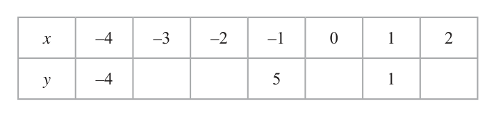
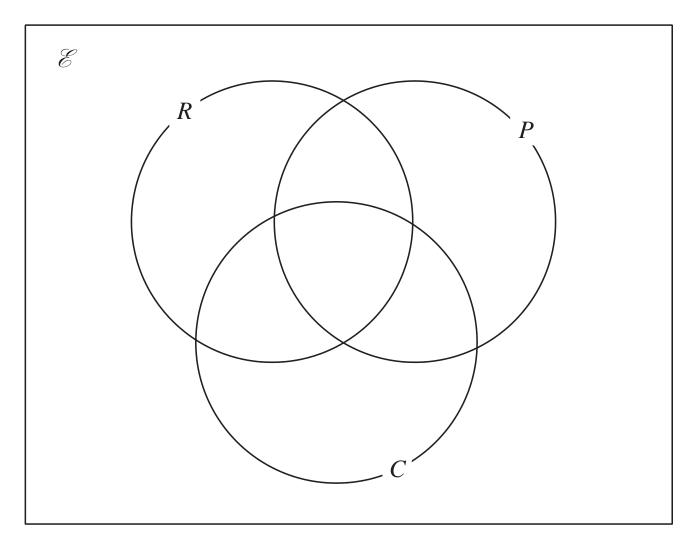
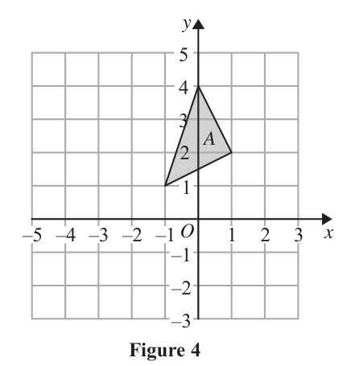

# 4MB1/02R — 2018-06 (official extraction)

> schema `syllabai.official-paper-questions/0.2` · paper_id `pearson-edexcel:international-gcse:mathematics-b:4mb1:2018-06:4MB1/02R` · qp sha256 `4ad4b89c0fac7cc8…` · extraction is the disclosed baseline (ADR-039)

## Question 1 (5 marks)

Write your name here Surname Other names Centre Number Candidate Number Pearson Edexcel International GCSE Mathematics B Level 2 Paper 2R Thursday 7 June 2018 – Morning Paper Reference Time: 2 hours 30 minutes 4MB1/02R You must have: Total Marks Ruler graduated in centimetres and millimetres, protractor, compasses, pen, HB pencil, eraser, calculator. Tracing paper may be used. Instructions • Use black ink or ball-point pen. • centre Fill in the boxes at the top of this page with your name, number and candidate number. • Answer allthequestions. Answer • – there may bequestions in the spaces provided more space than you need. • Calculators may be used. Information • The total mark for this paper is 100. • –Theusemarks for each question are shown in brackets this as a guide as to how much time to spend on each question. Advice • Check Read each question carefully before you start to answer it. • Withoutyoursufficient answers if you have time at the end. • working, correct answers may be awarded no marks. P59015A ©2018 Pearson Education Ltd. 1/1/1/ Answer ALL TWELVE questions. Write your answers in the spaces provided. You must write down all the stages in your working. Diagram NOT (2x + 3) cm accurately drawn x cm (2x – 2) cm (x + 3) cm (x + 1) cm Figure 1 Figure 1 shows a triangle and a rectangle. The triangle has sides of length x cm, (2x – 2) cm and (x + 1) cm. The rectangle has length (2x + 3) cm and width (x + 3) cm. The perimeter of the rectangle is 3 times the perimeter of the triangle.

### 1(a) [2]

Diagram NOT (2x + 3) cm accurately drawn x cm (2x – 2) cm (x + 3) cm (x + 1) cm Figure 1 Figure 1 shows a triangle and a rectangle. The triangle has sides of length x cm, (2x – 2) cm and (x + 1) cm. The rectangle has length (2x + 3) cm and width (x + 3) cm. The perimeter of the rectangle is 3 times the perimeter of the triangle.

Write down an equation in x to represent the given information.

**Mark scheme answer**

> x + 2 x − 2 + x + 1 or 2(2 x + 3) + 2( x + 3) 2 M1oe correct expression for perimeter of either shape
> 3( x + 2 x − 2 + x + 1)
> = 2(2 x + 3) + 2( x + 3) Correct A1oe correct equation
> equation

- **(2)** x + 2 x − 2 + x + 1 or 2(2 x + 3) + 2( x + 3) 2 M1oe correct expression for perimeter of either shape

### 1(b) [3]

Solve your equation to find the value of x. Show clear algebraic working.

**Mark scheme answer**

> 3(4x – 1) = 6x + 12 3 M1 for a fully correct equation with all terms expanded and
> 12x – 3 = 6x + 12 or 4x – 1 = 2x + 4 simplified or shows division of 6x + 12 by 3
> 12x – 6x = 12 + 3 or M1ft for terms in x one one side and numerical terms on the other
> 4x – 2x = 4 + 1 (only ft a linear equation)
> 6x = 15
> x = 15 ÷ 6 = 2.5 2.5 A1oe dep on M1
> Ques Working Answer Mark Notes

- **(3)** 3(4x – 1) = 6x + 12 3 M1 for a fully correct equation with all terms expanded and

## Question 2 (6 marks)

Part of the curve with equation y = x 2 – 3x – 1 is drawn on the grid on the opposite page. The equation of another curve is y = –x 2 – 2x + 4

### 2(a) [2]

Complete the table of values for y = –x 2 – 2x + 4 x –4 –3 –2 –1 0 1 2 y –4 5 1

**Mark scheme answer**

> 1, 4, 4, −4 2 B2 all correct or B1 for 2 or 3 correct

- **(2)** 1, 4, 4, −4 2 B2 all correct or B1 for 2 or 3 correct

### 2(b) [2]

On the grid, plot the points from your completed table and join them to form a smooth curve.

**Mark scheme answer**

> Correct graph 2 B2 for completely correct graph. B1ft for at least 5 points correctly
> plotted and joined.

- **(2)** Correct graph 2 B2 for completely correct graph. B1ft for at least 5 points correctly

### 2(c) [2]

Use the two curves on the grid to find estimates, to 1 decimal place, for the solutions of the equation 2x 2 – x – 5 = 0 y –4 –3 –2 –1 O 1 2 3 x –1 –2 –3 –4 –5

**Mark scheme answer**

> −1.4 & 1.9 2 B1B1 both points ±0.1 ft their graph
> NB: coordinates gains B1 for both x values correct
> Total 6 marks

- **(2)** −1.4 & 1.9 2 B1B1 both points ±0.1 ft their graph

## Question 3 (7 marks)

Diagram NOT 2.5 m accurately drawn 1.6 m Figure 2 Figure 2 shows an empty tank in the shape of a right circular cylinder. The axis of the cylinder is vertical. Adelih is going to put water into the tank so that the surface of the water is level with the top of the tank. The water flows into the tank at a constant rate of R litres per minute. Given that R = 109

### 3(a) [5]

calculate, in hours and minutes to the nearest minute, the time taken by the water to flow into the tank. Adelih wants the time taken by the water to flow into the tank to be 3 hours.

**Mark scheme answer**

> π ×2.5²×1.6 5 M1 or π ×250² ×160(=10 000 000 π )
> (=10 π /31.415...)
> 10 π ×1000 (10 000 π )(litres) M1 or 10 000 000 π ÷1000
> 10 000π M1
> 109
> 288.219... (mins)(=4.80...(hrs)) M1
> 4 hours 48 mins A1

- **(5)** π ×2.5²×1.6 5 M1 or π ×250² ×160(=10 000 000 π )

### 3(b) [2]

Calculate the value, to the nearest whole number, of R. ⎛ 1 m³ = 1000 litres Volume of cylinder = πr 2h ⎠

**Mark scheme answer**

> 10 000π 2 ' 288.219...'
> M1 or ×109
> 180 180
> 175 l/min A1 [allow 174.4 – 175]
> Total 7 marks

- **(2)** 10 000π 2 ' 288.219...'

## Question 4 (7 marks)

The functions f and g are defined as f : x 6 3x + 4 g:x 6 x−3

### 4(a) [1]

State the value of x that must be excluded from any domain of g.

**Mark scheme answer**

> 3 1 B1

- **(1)** 3 1 B1

### 4(b) [1]

Find f(5)

**Mark scheme answer**

> 19 1 B1

- **(1)** 19 1 B1

### 4(c) [2]

Find fg(2) The function h is defined as h : x 6 x 2 – 6x – 8 where x . 3

**Mark scheme answer**

> g(2) = −5 2 M1
> −11 A1

- **(2)** g(2) = −5 2 M1

### 4(d) [3]

Express the inverse function h–1 in the form h–1 : x 6 ... ⎡The solutions of ax 2 + bx + c = 0 where a v 0 are given by⎤ ⎢ ⎥ ⎢ ⎥ ⎢ −b ± b 2 − 4ac ⎥ ⎢⎣ x= ⎥⎦ 2a

**Mark scheme answer**

> y − 6 y − (8 + x) = 0
> 3 M1oe e.g. x = ( y − 3) 2 − 9 − 8
> 6 + 36 + 4(8 + x) M1oe e.g. x + 17 = ( y − 3) 2
> h-1: x → 3 + x + 17 A1oe
> Total 7 marks

- **(3)** y − 6 y − (8 + x) = 0

## Question 5 (8 marks)
### 5(a) [2]

Solve the inequality 5(x + 1) < x Show clear algebraic working.

**Mark scheme answer**

> 5x + 5 < x, 5x – x < −5 oe 2 M1 for terms in x one side and number terms on the other side of a
> correct equation or inequality or for x = −1.25 or x > −1.25
> x < −1.25 A1oe cao

- **(2)** 5x + 5 < x, 5x – x < −5 oe 2 M1 for terms in x one side and number terms on the other side of a

### 5(b) [5]

Solve the simultaneous equations 3x 2 + y 2 – 7 = 0 y – 3x – 5 = 0 Show clear algebraic working.

**Mark scheme answer**

> 5 M1 for substitution e.g. 3x² + (3x + 5)² − 7 = 0
> 3x² + 9x² + 15x + 15x + 25 – 7 (= 0) oe M1 for expansion of bracket after substitution (at least 3 terms
> correct)
> 12x² + 30x + 18 (=0) or M1 for forming quadratic ready for solving e.g. 12x² + 30x + 18
> 2x² + 5x + 3 (=0) (=0) oe
> e.g. (2x + 3)(x + 1) (=0) M1ft for factorising or correct use of formula by substituting values
> in correctly or completing the square.
> x = −1.5, y = 0.5 A1 must be clearly paired
> x = −1, y = 2 dep on M2 for all 4 values correct

- **(5)** 5 M1 for substitution e.g. 3x² + (3x + 5)² − 7 = 0

### 5(c) [1]

Hence find the value of x for which 5(x + 1) < x and 3x 2 + y 2 – 7 = 0 and y – 3x – 5 = 0

**Mark scheme answer**

> x = −1.5 1 B1 cao
> Total 8 marks

- **(1)** x = −1.5 1 B1 cao

## Question 6 (8 marks)

The curve C has equation y = 2x 3 + 3x 2 – 12x + 1 The point P and the point Q are the turning points on C. Find an equation of the straight line that passes through P and Q.

### 6 [8]

The curve C has equation y = 2x 3 + 3x 2 – 12x + 1 The point P and the point Q are the turning points on C. Find an equation of the straight line that passes through P and Q.

**Mark scheme answer**

> 6x² + 6x − 12 8 B2 fully correct
> B1 for at least 2 of these 3 terms correct
> 6x² + 6x – 12 = 0 or M1ft their dy/dx = 0 dep on at least B1 scored
> x² + x – 2 = 0
> (x + 2)(x – 1) (=0) M1ft for factorising and correct method to find x values or correct
> x = −2 or x = 1 use of formula or completing the square. Ft from their dy/dx dep
> on 3 term quadratic.
> e.g. y = 2(−2)³+3(−2)²−12×−2+1(=21) M1ft for substitution of x values into formula to find y values
> and 2(1)³+3(1)²−12×1+1(=−6)
> 21 − −6 M1ft correct method to find gradient of line
> m= (= −9)
> −2 − 1
> 21 = −9 × −2 + c or M1ft for substitution to find c or c = 3
> −6 = −9 × 1 + c or
> y – 21 = −9(x − −2) oe or c = 3
> y = −9x + 3 A1 oe eg y – 21 = −9(x + 2)
> Total 8 marks

- **(8)** 6x² + 6x − 12 8 B2 fully correct

## Question 7 (8 marks)

Mr Ng is the head of mathematics at a school. He asked the students in Year 9 which of a ruler (R), a protractor (P) and a calculator (C) they each had. Of these students 10 students had a ruler, a protractor and a calculator 25 students had a ruler and a protractor 18 students had a protractor and a calculator 17 students had a ruler and a calculator 54 students had a ruler 49 students had a protractor 29 students had a calculator 8 students did not have a ruler or a protractor or a calculator.

### 7(a) [3]

Show all this information in the Venn diagram. E R P C

**Mark scheme answer**

> 3 B3 completely correct
> R P
> B2 for 5 correct entries
> 22 15 16
> B1 for 3 correct entries
> 10 8
> 4
> C

- **(3)** 3 B3 completely correct

### 7(b) [2]

Find the number of students in Year 9

**Mark scheme answer**

> Adding all 8 entries oe ft 2 M1ft allow one omission
> 90 A1 cao

- **(2)** Adding all 8 entries oe ft 2 M1ft allow one omission

### 7(c) [1]

Find n([R ∪ P]a) One of the students in Year 9 is chosen at random.

**Mark scheme answer**

> 12 1 B1ft their Venn diagram

- **(1)** 12 1 B1ft their Venn diagram

### 7(d) [2]

Given that this student had a calculator, find the probability that this student had a ruler but not a protractor.

**Mark scheme answer**

> 7 2 n
> B2ft B1ft for (0 < n < 29) or for (m > 7)
> 29 29 m
> Total 8 marks

- **(2)** 7 2 n

## Question 8 (9 marks)

y A –5 –4 –3 –2 –1 O 1 2 3 x –1 –2 –3 Figure 3 Figure 3 shows a triangle, A, drawn on a grid. Triangle A is transformed to triangle B under the transformation with matrix P where ⎛2 −1 ⎞ P= ⎜3 ⎟ ⎜ 1⎟ − ⎟ ⎜⎝ 2 2⎠

### 8(a) [4]

y A –5 –4 –3 –2 –1 O 1 2 3 x –1 –2 –3 Figure 3 Figure 3 shows a triangle, A, drawn on a grid. Triangle A is transformed to triangle B under the transformation with matrix P where ⎛2 −1 ⎞ P= ⎜3 1⎟ − 2 2⎠

On the grid in Figure 3, draw and label triangle B. y A –5 –4 –3 –2 –1 O 1 2 3 x –1 –2 –3 Figure 4 Figure 4 shows triangle A drawn on a grid. Triangle B is transformed to triangle C under the transformation with matrix Q where ⎛ 3 −4⎞ Q= 1 −2⎠

**Mark scheme answer**

> ⎛2 −1 ⎞ ⎛ −3 0 −4 ⎞ 4 B1 for correct matrix from coordinates – any order
>  −1 1 0 = M1 for a correctly calculated coordinate
> 3 1 
> − 1 2 4 −2 −2 A1 for all coordinates correctly calculated
> ⎝2 2⎠ ⎝ 2 ⎠
> A1 for correct plotting of triangle B

- **(4)** ⎛2 −1 ⎞ ⎛ −3 0 −4 ⎞ 4 B1 for correct matrix from coordinates – any order

### 8(b) [3]

On the grid in Figure 4, draw and label triangle C. Triangle C is the image of triangle A under a single transformation.

**Mark scheme answer**

> ⎛ 0 ⎞ 3 M1ft a correctly calculated coordinate
>  3 −4 −3 −4 −1 −2 −4 1 = A1ft for all correctly calculated coordinates
> ⎝ 1 −2 −2 −2 1 −1 0 ⎠
> B1cao for correctly plotting C
> ⎝ 2 ⎠

- **(3)** ⎛ 0 ⎞ 3 M1ft a correctly calculated coordinate

### 8(c) [2]

Describe fully this transformation. for a spare copy of Figure 3 and Figure 4 if you need to redraw your triangles. Only use these grids if you need to redraw your triangles. y A –5 –4 –3 –2 –1 O 1 2 3 x –1 –2 –3 Figure 3 y A –5 –4 –3 –2 –1 O 1 2 3 x –1 –2 –3 Figure 4

**Mark scheme answer**

> Reflection in 2 B1 reflection
> y = −x B1 y = −x oe
> Total 9 marks

- **(2)** Reflection in 2 B1 reflection

## Question 9 (9 marks)

One Saturday, each of the 100 people who visited a library was asked how long they were in the library. The table below shows information about the results. Time (t mins) Frequency t - 10 16 t - 30 22 t - 35 10 t - 60 40 t - 100 12

**(b)** Find, to 3 decimal places, the probability that

### 9(a) [4]

Calculate an estimate for the mean length of time, in minutes to 3 significant figures, these people were in the library. Two of the 100 people who visited the library that Saturday are picked at random.

**Mark scheme answer**

> 5 ×16 + 20 × 22 + 32.5 ×10 + 47.5 × 40 + 80 ×12 4 M2 for all correct products, M1 for at least 3 correct products
> 5 ×16 + 20 × 22 + 32.5 ×10 + 47.5 × 40 + 80 ×12 M1 for dividing sum of products by 100 dep on
> 100 previous M1
> 37.1 A1 awrt to 37.1, allow 37 if M3 awarded
> 62 61 2 M1

- **(4)** 5 ×16 + 20 × 22 + 32.5 ×10 + 47.5 × 40 + 80 ×12 4 M2 for all correct products, M1 for at least 3 correct products

### 9(b)(i) [?]

both people were in the library for more than 30 minutes …………… , ……………

**Mark scheme answer**

> ×
> 100 99
> 0.382 1891
> A1 awrt (0.382)02020...
> 4950
> 62 38 38 62 3 M2 for adding both products, M1 for one correct product

### 9(b)(ii) [5]

one of the two people was in the library for more than 30 minutes and one was in the library for 30 minutes or less.

**Mark scheme answer**

> × + × (allow M1 only for fully correct method with replacement)
> 100 99 100 99
> 0.476 1178
> A1 0.476
> 2475
> Total 9 marks

- **(5)** × + × (allow M1 only for fully correct method with replacement)

## Question 10 (12 marks)

Zahur made 250 cakes to sell at a cake sale. Of the cakes made by Zahur, 28% were chocolate cakes.

### 10(a) [2]

Calculate the number of chocolate cakes made by Zahur. All the other cakes made by Zahur were either lemon cakes or vanilla cakes. The ratio of the number of lemon cakes to the number of vanilla cakes was 4 : 5

**Mark scheme answer**

> 0.28 × 250 oe 2 M1oe
> 70 A1

- **(2)** 0.28 × 250 oe 2 M1oe

### 10(b) [2]

Calculate the number of lemon cakes made by Zahur. Zahur put icing on each of the vanilla cakes he made. The icing for each vanilla cake needed 75 g of icing sugar.

**Mark scheme answer**

> (250 – ‘70’) ÷ 9 = 20 × 4 oe 2 M1oe
> 80 A1

- **(2)** (250 – ‘70’) ÷ 9 = 20 × 4 oe 2 M1oe

### 10(c) [2]

Calculate the total amount, in kg, of icing sugar needed for all the vanilla cakes made by Zahur. At the start of the cake sale, the selling price of each of the cakes made by Zahur was \$4 and he sold 204 cakes at this price. Zahur then reduced the selling price of each cake by 30% and he sold all the remaining cakes.

**Mark scheme answer**

> (250 – ‘70’) ÷ 9 = 20 × 5 × 75 2 M1oe
> (=7500) oe
> 7.5 kg A1

- **(2)** (250 – ‘70’) ÷ 9 = 20 × 5 × 75 2 M1oe

### 10(d) [3]

Calculate the total amount of money, in \$, that Zahur received by selling all 250 cakes. When Zahur had subtracted the cost of all the ingredients he needed to make his cakes from the total amount of money he received by selling all the cakes, he found that he had made a profit of 60%

**Mark scheme answer**

> 0.7 × 4 (=2.8) oe 3 M1
> 4 × 204 + 2.8 × 46 M1
> (\$)944.8(0) A1 allow (\$)945

- **(3)** 0.7 × 4 (=2.8) oe 3 M1

### 10(e) [3]

Calculate, in \$, the cost of all the ingredients Zahur needed.

**Mark scheme answer**

> eg 160% = 944.8 or 3 M1ft recognition that 944.8 is 160%
> 1.6c = 944.8 or
> 944.8 − c = 0.6c or
> 944.8 − c
> = 0.6 oe
> c
> 944.8 ÷ 1.6 oe M1ft oe
> (\$)590.5(0) A1

- **(3)** eg 160% = 944.8 or 3 M1ft recognition that 944.8 is 160%

## Question 11 (10 marks)

K Diagram NOT F J accurately drawn O D C E G N H 6 cm 8 cm A M B Figure 5 Figure 5 shows a right prism ABCDEFGHJK. A cross section of the prism is a regular pentagon with sides of length 6 cm. BH = 8 cm. M is the midpoint of AB. N is the midpoint of GH. O is the centre of pentagon FGHJK.

### 11(a) [5]

Find, in cm to 3 significant figures, the length of AO.

**Mark scheme answer**

> Recognition of an appropriate triangle 5 B1 may be seen on diagram or evident from further working
> (AN² =) 3² +8² (=73) or 3 3 6sin 54
> M1 or GO = = = =( 5.1039...) oe
> (AN =) $3^2$ + $8^2$ = '73' (8.544...) cos 54 sin 36 sin 72
> (NO =) 3 tan 54° or M1 or (=
> $AO^2$ )"5.10..."$^2$=
> + $8^2$ ( 90.049...) oe
> (=4.129..)
> tan 360
> (AO=) ' 4.129 '$^2$ + '73' M1 or (AO =) "5.10..."$^2$ + $8^2$ oe
> 9.49 A1

- **(5)** Recognition of an appropriate triangle 5 B1 may be seen on diagram or evident from further working

### 11(b) [5]

Calculate the size, in degrees to 1 decimal place, of the angle between MK and MN.

**Mark scheme answer**

> 3 5 M1 for OK or other relevant partial height of pentagon.
> OK = (5.10...) or
> cos 54
> N to midpt FJ = 6cos18 or 6sin72°(=5.706...)
> or
> Midpt FJ to K = 6cos54° or 6sin36°(=3.5267...)
> or
> GK²=6² + 6² − 2 × 6 × 6 × cos 108 (=94.249..)
> 3 3 M1oe complete method to find perpendicular height of pentagon
> + (“5.10...”+”4.129...”) oe or
> cos54° tan 36° ( = 9.233...)
> 6 cos 54° + 6 cos 18° (“3.5267...”+“5.706...”)
> or "94.249.."− $3^2$
> '9.233..' M1 for correct angle ratio from correct working
> tan ∠ = oe
> ⎛ '9.233..' ⎞ M1 for fully correct method from correct working to find
> ∠ = tan$^{-1}$ oe required angle
> ⎝ 8 ⎠
> 49.1° A1 awrt 49.1°

- **(5)** 3 5 M1 for OK or other relevant partial height of pentagon.

## Question 12 (11 marks)

cm Figure 6 Figure 6 shows a triangle ABC and a circle PQR, centre O. The triangle is such that side AB is the tangent to the circle at P, side BC is the tangent to the circle at Q and side AC is the tangent to the circle at R. The region inside the circle is shaded, as shown in Figure 6. AB = 14 cm, BC = 12 cm and AC = 8 cm. Let BP = x cm and by considering the lengths of the tangents to the circle,

### 12(a) [4]

cm Figure 6 Figure 6 shows a triangle ABC and a circle PQR, centre O. The triangle is such that side AB is the tangent to the circle at P, side BC is the tangent to the circle at Q and side AC is the tangent to the circle at R. The region inside the circle is shaded, as shown in Figure 6. AB = 14 cm, BC = 12 cm and AC = 8 cm. Let BP = x cm and by considering the lengths of the tangents to the circle …………… , ……………
obtain an equation in x only and solve it to find the length, in cm, of BP.

**Mark scheme answer**

> 2x + y + z = 26 or 2x = 26 – y – z oe 4 M1 or correct use in equation of AR = 14 – x or RC = 12 – x oe
> y + z = 8 oe M1 or correct use in equation of AR = 14 – x and RC = 12 – x
> oe
> 2x + 8 = 26 or 2x = 26 – 8 oe A1 must be a formula in x they can obtain from knowledge of
> tangents
> 9 cm A1 SCB1 for BP = 9 cm without equation

- **(4)** 2x + y + z = 26 or 2x = 26 – y – z oe 4 M1 or correct use in equation of AR = 14 – x or RC = 12 – x oe

### 12(b) [7]

Find, to 3 significant figures, the area of the circle as a percentage of the total area of triangle ABC. Cosine rule: $a^2$ = $b^2$ + $c^2$ − 2bc cos A 1 Area of triangle = ab sin C 

**Mark scheme answer**

> 8² = 14² +12² − 2 × 12 × 14 × cosABC or 7 M1 For method to start to find ∠CAB, ∠ABC or ∠ACB
> 14² = 8² +12² − 2 × 8 × 12 × cosACB or
> 12² = 8² +14² − 2 × 8 × 14 × cosCAB
> ⎛ $8^2$ + $14^2$ − $12^2$ ⎞ M1 Complete method to find one angle
> CAB = cos$^{-1}$ (=58.8°)or
> ⎝ 2 × 8 ×14 ⎠
> ⎛ $14^2$ + $12^2$ − $8^2$ ⎞
> ABC = cos$^{-1}$ (=34.77°)or
> ⎝ 2 × 14 × 12 ⎠
> ⎛ $8^2$ + $12^2$ − $14^2$ ⎞
> ACB = cos$^{-1}$ (=86.4°)
> ⎝ 2 × 8 ×12 ⎠
> Area of triangle = 0.5×8×14×sin(58.8..°) M1 Method to find area of triangle (from fully correct working,
> or 0.5×14×12×sin(34.77..°) ie M2 previously gained) (could use Hero’s formula
> or 0.5×8×12×sin(86.4..°) 17(17 − 14)(17 − 12)(17 − 8) )
> (=47.9061...)
> Radius = 3tan(½×86.4..°) or M1 Method to find radius of circle from fully correct working
> 5tan(½×58.8..°) or 9tan(½×34.77..°)oe Or radius = 47.9061÷(0.5×(12+14+8))
> (=2.818...)
> π ×2.818..² ( =24.947.....) M1 Method to find area of circle from fully correct working
> 24.947... M1 Method to find required %
> %= ×100
> 47.906...
> 52.1 A1 awrt

- **(7)** 8² = 14² +12² − 2 × 12 × 14 × cosABC or 7 M1 For method to start to find ∠CAB, ∠ABC or ∠ACB

