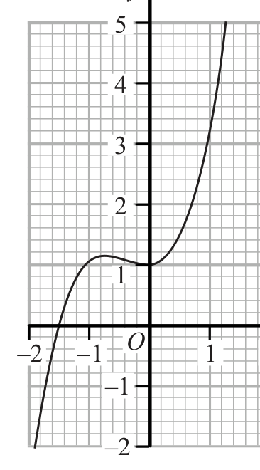
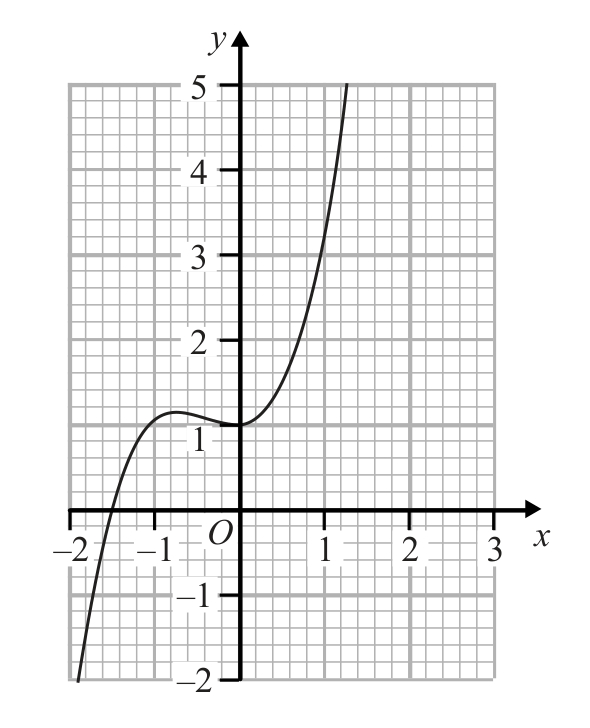
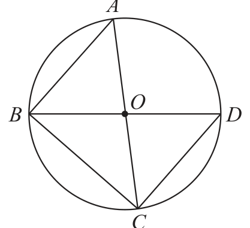
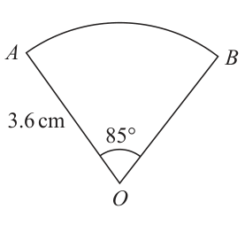
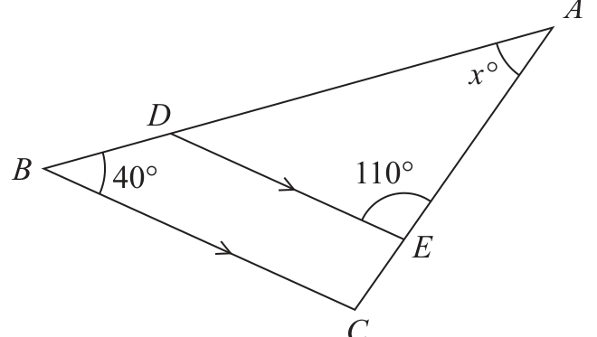
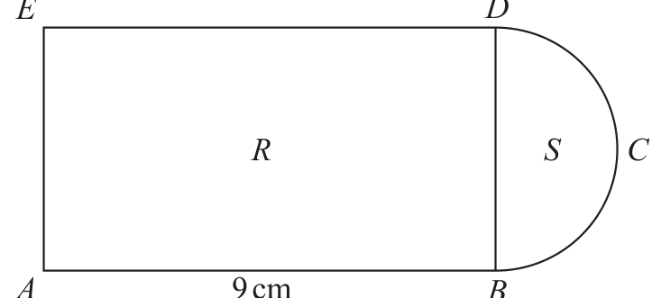
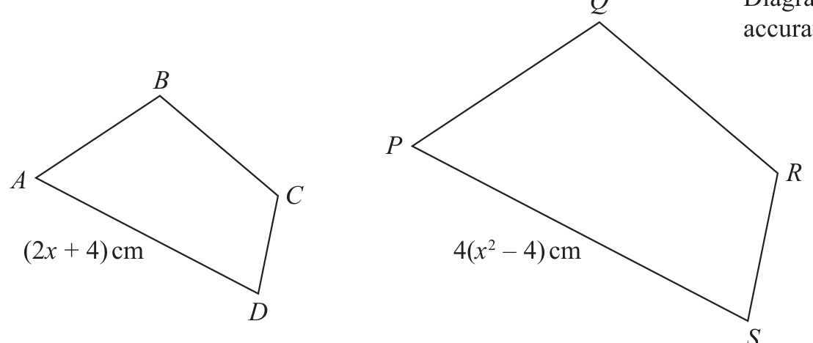
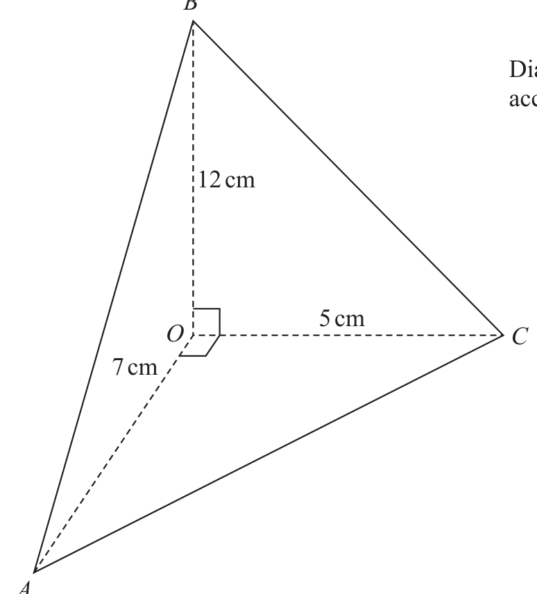

# 4MB1/01 — 2019-01 (official extraction)

> schema `syllabai.official-paper-questions/0.2` · paper_id `pearson-edexcel:international-gcse:mathematics-b:4mb1:2019-01:4MB1/01` · qp sha256 `79ecd1c184eda0d8…` · extraction is the disclosed baseline (ADR-039)

## Question 1 (2 marks)

A shop sells a tablet computer for $230 The shop increases the price of the tablet computer by 5% Calculate the price of the tablet computer after this price increase. $

### 1 [2]

A shop sells a tablet computer for \$230 The shop increases the price of the tablet computer by 5% Calculate the price of the tablet computer after this price increase. \$

**Mark scheme answer**

> 230 × 1.05 or 230 + 0.05 × 230 M1
> 241.5(0) 2 A1

- **(2)** 230 × 1.05 or 230 + 0.05 × 230 M1

## Question 2 (2 marks)

The nth term of a sequence is given by 5n2 – 2 Find the first 3 terms of this sequence. , ,

### 2 [2]

The nth term of a sequence is given by 5n2 – 2 Find the first 3 terms of this sequence. …………… , …………… , ……………

**Mark scheme answer**

> 3, 18, 43 2 B2

- **(2)** 3, 18, 43 2 B2

## Question 3 (2 marks)

The lengths of the sides of a triangle are in the ratios 4 : 5 : 6 The perimeter of the triangle is 80 cm. Find the length of the longest side of the triangle. cm

### 3 [2]

The lengths of the sides of a triangle are in the ratios 4 : 5 : 6 The perimeter of the triangle is 80 cm. Find the length of the longest side of the triangle. cm

**Mark scheme answer**

> × 80 oe M1
> 32 2 A1

- **(2)** × 80 oe M1

## Question 4 (2 marks)

Factorise fully 9x 2 y + 12xy 2z

### 4 [2]

Factorise fully 9x 2 y + 12xy 2z

**Mark scheme answer**

> M1
> 3 x ( 3 xy + 4 y 2 z )
> 3 xy ( 3 x + 4 yz ) 2 A1

- **(2)** M1

## Question 5 (2 marks)

Make x the subject of y = w

### 5 [2]

Make x the subject of y = w

**Mark scheme answer**

> wy = 8 ( x + 1) oe M1
> wy
> x= − 1 or
> 2 A1 (no isw)
> wy − 8
> x=
> Expression in the form mx p y q with two of m, p or q

- **(2)** wy = 8 ( x + 1) oe M1

## Question 6 (2 marks)

Simplify fully 4 xy 2

### 6 [2]

Simplify fully 4 xy 2

**Mark scheme answer**

> M1
> correct
> 2x 2 y 4 2 A1
> Tangent drawn at x = 1

- **(2)** M1

## Question 7 (2 marks)

y –2 –1 O 1 2 3 x –1 –2 The diagram shows a curve drawn on a grid. By drawing a suitable straight line on the grid, find an estimate, to one decimal place, of the gradient of the curve at the point when x = 1

### 7 [2]

y –2 –1 O 1 2 3 x –1 –2 The diagram shows a curve drawn on a grid. By drawing a suitable straight line on the grid, find an estimate, to one decimal place, of the gradient of the curve at the point when x = 1

**Mark scheme answer**

> M1
> (Must touch the curve. Professional judgement needed.)
> 5 ±0.5 2 A1

- **(2)** M1

## Question 8 (3 marks)
### 8(a) [2]

Solve the inequality 5x + 4 < 20 − 3x

**Mark scheme answer**

> 5x + 3x < 20 – 4 oe M1
> x<2 2 A1

- **(2)** 5x + 3x < 20 – 4 oe M1

### 8(b) [1]

Represent, on the number line below, your solution of the inequality in part (a). −5 −4 −3 −2 −1 0 1 2 3 4 5 x

**Mark scheme answer**

> 1 B1 ft
> Condone missing arrow if line extends beyond
> –5
> ⎛ −8 ⎞
> −OB + OA + AC = or a right angled triangle with

- **(1)** 1 B1 ft

## Question 9 (3 marks)

The points O, A, B and C are such that OA = ( −2 4 ), OB = ( 5 −3 ) and AC = ( −1 −1 ) Find |BC| |BC| =

### 9 [3]

The points O, A, B and C are such that OA = ( −2 4 ), OB = ( 5 −3 ) and AC = ( −1 −1 ) Find |BC| |BC| =

**Mark scheme answer**

> ⎝ 6⎠ M1
> sides 8 and 6
> BC " 8" "6"2 M1
> 10 2 A1

- **(3)** ⎝ 6⎠ M1

## Question 10 (3 marks)
### 10(a) [1]

Write 340 000 000 in standard form.

**Mark scheme answer**

> 3.4 ×10⁸ 1 B1

- **(1)** 3.4 ×10⁸ 1 B1

### 10(b) [2]

Calculate, giving your answer in standard form, (2 × 1099) ÷ (5 × 10110 )

**Mark scheme answer**

> 0.4 × 10 −11 oe M1
> 4 × 10 −12 2 A1

- **(2)** 0.4 × 10 −11 oe M1

## Question 11 (3 marks)

Given that, for all values of x, 2x 2 – 3x + 21 = a(x – b)2 + c find the value of a, the value of b and the value of c. a= b= c=

### 11 [3]

Given that, for all values of x, 2x 2 – 3x + 21 = a(x – b)² + c find the value of a, the value of b and the value of c. a= b= c=

**Mark scheme answer**

> 2( x − ...) 2 + ... M1
> ⎛ 3⎞
> a=2
> 2 ⎜ x − ⎟ + ... b = ¾ oe M1
> ⎝ 4⎠
> 2 c = 159/8 oe
> ⎛ 3 ⎞ 159
> 2⎜ x − ⎟ + 3 A1
> ⎝ 4⎠
> One correct
> BC is common
> statement M1

- **(3)** 2( x − ...) 2 + ... M1

## Question 12 (3 marks)

A Diagram NOT accurately drawn O B D C AOC and BOD are diameters of a circle, centre O. Prove that triangle ABC and triangle DCB are congruent.

### 12 [3]

AOC and BOD are diameters of a circle, centre O. Prove that triangle ABC and triangle DCB are congruent.

> *Figure not shown in this reconstruction — the printed paper includes a diagram (not drawn accurately).*
> Labels in the original figure: A, O, B, D, C.

**Mark scheme answer**

> AC = BD both diameters
> 3 correct M1
> ∠ABC = ∠DCB = 90 angles in semicircle
> statements
> RHS with correct
> 3 A1 cao
> reasons given
> ∠BAC = ∠CDB angles in the same segment
> (M1)
> ALT ∠ABC = ∠DCB = 90 angles in semicircle AC = BD
> (M1)
> both diameters or BC is common
> ASA with correct
> (A1cao)
> reasons given

- **(3)** AC = BD both diameters

## Question 13 (3 marks)

A B Diagram NOT accurately drawn 3.6 cm 85° O The diagram shows a sector OAB of a circle, centre O. OA = OB = 3.6 cm Angle AOB = 85° Calculate the perimeter, in cm to 3 significant figures, of the sector OAB. cm

### 13 [3]

A B Diagram NOT accurately drawn 3.6 cm 85° O The diagram shows a sector OAB of a circle, centre O. OA = OB = 3.6 cm Angle AOB = 85° Calculate the perimeter, in cm to 3 significant figures, of the sector OAB. cm

**Mark scheme answer**

> × 2 π × 3.6 [ = 5.34 ] M1
> 360
> "5.34 "+ 7.2 M1
> awrt 12.5 3 A1
> ∠ACB = 110 or ∠ADE = 30 Corresponding angles (or
> o o

- **(3)** × 2 π × 3.6 [ = 5.34 ] M1

## Question 14 (3 marks)

A x° D Diagram NOT accurately drawn B 40° 110° E C In the diagram, ABC is a triangle with point D on AB and point E on AC such that DE is parallel to BC. ∠ABC = 40° ∠AED = 110° ∠BAC = x° Find the value of x. Give reasons for each stage of your working. x=

### 14 [3]

A x° D Diagram NOT accurately drawn B 40° 110° E C In the diagram, ABC is a triangle with point D on AB and point E on AC such that DE is parallel to BC. ∠ABC = 40° ∠AED = 110° ∠BAC = x° Find the value of x. Give reasons for each stage of your working. x=

> *Figure not shown in this reconstruction — the printed paper includes a diagram (not drawn accurately). Use the text description to work through it.*

**Mark scheme answer**

> co-interior/allied and angles on a straight line add to B1
> 180°); full reasons
> 180 − "110"− 40 or 180 − 110 − " 40" angles in a triangle
> M1
> add up to 180° (full method)
> 30 3 A1

- **(3)** co-interior/allied and angles on a straight line add to B1

## Question 15 (4 marks)

A car travelled at an average speed of 96 km/h for 1 hours and then travelled at an average speed of 56 km/h for 2 hours. Calculate the average speed of the car for the whole journey. km/h

### 15 [4]

A car travelled at an average speed of 96 km/h for 1 hours and then travelled at an average speed of 56 km/h for 2 hours. Calculate the average speed of the car for the whole journey. km/h

**Mark scheme answer**

> 1.5 × 96 + 2.5 × 56 M1
> 284 A1
> “284”÷ 4 or “284”÷ (1.5+2.5) M1
> 71 4 A1

- **(4)** 1.5 × 96 + 2.5 × 56 M1

## Question 16 (4 marks)

N N Diagram NOT accurately drawn B R N L The diagram shows the position of a rock R, a boat B and a lighthouse L. The bearing of L from R is 156°

### 16(a) [1]

N N Diagram NOT accurately drawn B R N L The diagram shows the position of a rock R, a boat B and a lighthouse L. The bearing of L from R is 156°

Calculate the bearing of R from L. ° Given that the bearing of B from R is 072° and that RB = RL …………… , ……………

**Mark scheme answer**

> 360 – 24 or 180 + 156 336 1 B1
> 180 − 84

- **(1)** 360 – 24 or 180 + 156 336 1 B1

### 16(b) [3]

calculate the bearing of L from B.

…………… °

**Mark scheme answer**

> = 48 M1
> 180 + 72 − "48" or 360 − 108 − "48" oe M1
> 204 3 A1
> 1 2

- **(3)** = 48 M1

## Question 17 (4 marks)

E D Diagram NOT accurately drawn R S C A 9 cm B The diagram shows a shape ABCDE made from a rectangle R and a semicircle S. The side DB of the rectangle is the diameter of the semicircle. Given that AB = 9 cm and that the area of S = 2π cm2 find the area of R. cm2

### 17 [4]

The diagram shows a shape ABCDE made from a rectangle R and a semicircle S. The side DB of the rectangle is the diameter of the semicircle. Given that AB = 9 cm and that the area of S = 2π cm² find the area of R. cm²

> *Figure not shown in this reconstruction — the printed paper includes a diagram (not drawn accurately).*
> Labels in the original figure: E, D, R, S, C, A, B · Figure values: 9.

**Mark scheme answer**

> π r = 2π oe M1
> r=2 A1
> Area = 2 × " 2 "× 9 M1
> SCM1 for d = 2 2
> , area = 2 2 × 9 4 A1

- **(4)** π r = 2π oe M1

## Question 18 (4 marks)

A=⎜ BA = ⎜ ⎝ 1 3⎟⎠ ⎝1 2⎟⎠ Find the matrix B. ⎛ ⎞ ⎜ ⎟ ⎜ ⎟ ⎜ ⎟ ⎜⎝ ⎟⎠

### 18 [4]

A= BA = 1 3 1 2 Find the matrix B. 

**Mark scheme answer**

> −2 × 3 + 4 × 1 [ = 2 ] or
> ⎛a b ⎞ ⎛ −2 −4 ⎞ ⎛ 2 −8 = M1
> ⎝c d ⎠⎝ 1 3 ⎠ ⎝1 2⎠
> 1 ⎛ 3 4 ⎞
> "− " oe set up 4 equations and find a correct M1
> 2 ⎝ −1 −2 ⎠
> value for at least one of a,b,c or d
> ⎛ 3 ⎞
> − −2 2 −8 2
>  " " oe
> ⎝1 2 1 ⎟ M1
> ⎜ 1 2 ⎠
> or 3 of a,b,c and d correct
>  −7 −12 4 A1
> ⎜− 1 0 2 ⎠

- **(4)** −2 × 3 + 4 × 1 [ = 2 ] or

## Question 19 (4 marks)

A solid cone has a mass of 1200 g, to 2 significant figures. The area of the base of the cone is 38.5 cm2, to 1 decimal place. The height of the cone is 5.0 cm, to 2 significant figures. Given that mass density = volume calculate the upper bound of the density of the cone. Give your answer to 3 significant figures. g/cm3

### 19 [4]

A solid cone has a mass of 1200 g, to 2 significant figures. The area of the base of the cone is 38.5 cm², to 1 decimal place. The height of the cone is 5.0 cm, to 2 significant figures. Given that mass density = volume calculate the upper bound of the density of the cone. Give your answer to 3 significant figures. g/cm³

**Mark scheme answer**

> 1200 ± 50 M1
> × area of base × h where
> M1
> area of base = 38.5 ± 0.05 and h = 5.0 ± 0.05
> or π r 2 = 38.55
> 1250
> where the volume is calculated using r = 38.45
> Volume M1
> and h = 4.95
> awrt 19.7 4 A1

- **(4)** 1200 ± 50 M1

## Question 20 (4 marks)

Q Diagram NOT accurately drawn B P A R C (2x + 4) cm 4(x 2 – 4) cm D S ABCD and PQRS are two similar quadrilaterals. The side AD of length (2x + 4) cm is the longest side of quadrilateral ABCD. The side PS of length 4(x 2 – 4) cm is the longest side of quadrilateral PQRS. The area of the quadrilateral ABCD is 10 cm2 Show that the area, in cm2, of the quadrilateral PQRS is a(x – b)2 where a and b are integers to be found.

### 20 [4]

+ 4) cm 4(x² – 4) cm D S ABCD and PQRS are two similar quadrilaterals. The side AD of length (2x + 4) cm is the longest side of quadrilateral ABCD. The side PS of length 4(x² – 4) cm is the longest side of quadrilateral PQRS. The area of the quadrilateral ABCD is 10 cm² Show that the area, in cm², of the quadrilateral PQRS is a(x – b)² where a and b are integers to be found.

> *Figure not shown in this reconstruction — the printed paper includes a diagram (not drawn accurately).*
> Labels in the original figure: Q, B, P, A, R, C, D, S · Figure values: 2 · Other figure text: (2x + 4) cm, 4(x² – 4) cm.

**Mark scheme answer**

> 4 x²
> M1
> 2x
> ⎛ 4 ( x² − 4) ⎞
> Use of ratio squared eg 10 × ⎜ " "⎟ M1
> ⎜ 2x + 4 4 ( x − 2 )( x + 2 ) ⎞
> 10 × "
> 
> " 
> M1 dep 2nd M1
> ⎝ 2 ( x + 2) ⎠
> 40 ( x − 2 )
> 4 A1

- **(4)** 4 x2

## Question 21 (5 marks)

The lengths of cod caught by fishermen in a small fishing boat last month were measured. The incomplete table and histogram below give information about the length of each cod caught last month. Length (l cm) Number of cod 5 < l ≤ 25 30 25 < l ≤ 40 75 40 < l ≤ 50 100 50 < l ≤ 60 155 60 < l ≤ 80 80 < l ≤ 100 20 Frequency density 0 5 10 15 20 25 30 35 40 45 50 55 60 65 70 75 80 85 90 95 100 Length (l cm)

### 21(a) [2]

The lengths of cod caught by fishermen in a small fishing boat last month were measured. The incomplete table and histogram below give information about the length of each cod caught last month. Length (l cm) Number of cod 5 < l ≤ 25 30 25 < l ≤ 40 75 40 < l ≤ 50 100 50 < l ≤ 60 155 60 < l ≤ 80 80 < l ≤ 100 20 Frequency density 0 5 10 15 20 25 30 35 40 45 50 55 60 65 70 75 80 85 90 95 100 Length (l cm)

Complete the table and the histogram. Cod that have a length less than 35 cm are returned to the sea.

**Mark scheme answer**

> Relationship between frequency and area M1
> 50, Bar drawn
> height 10 small A1
> squares

- **(2)** Relationship between frequency and area M1

### 21(b) [3]

Calculate an estimate, to one decimal place, of the percentage of cod caught that were returned to the sea from the boat last month.

…………… %

**Mark scheme answer**

> 30 + × 75 [ = 80 ] M1
> "80"
> × 100 M1 ft
> 30 + 75 + 100 + 155 + "50"+ 20
> awrt 18.6 5 A1

- **(3)** 30 + × 75 [ = 80 ] M1

## Question 22 (5 marks)

The width of a rectangle is x metres. The length of the rectangle is 7 m longer than the width of the rectangle. Find the set of values of x for which the area of the rectangle is less than 44 m2 Show clear algebraic working.

### 22 [5]

The width of a rectangle is x metres. The length of the rectangle is 7 m longer than the width of the rectangle. Find the set of values of x for which the area of the rectangle is less than 44 m² Show clear algebraic working.

**Mark scheme answer**

> x ( x + 7 ) oe M1
> x(x + 7) < 44 or x² + 7x – 44 < 0 A1
> (x + 11)(x – 4) [= 0] M1
> x = 4 or – 11 A1
> 0<x<4 5 A1ft

- **(5)** x ( x + 7 ) oe M1

## Question 23 (5 marks)

Josh asks the students in his form how many hours they played sport last week. The table shows information about his results. Number of hours (t) Frequency 0≤ t<1 9 1≤ t<2 8 2≤ t<3 5 3≤ t<4 7 4≤ t<6 3 6 or more 0

### 23(a) [1]

Find the class interval that contains the median number of hours.

**Mark scheme answer**

> 1≤ t < 2 B1
> 0.5 × 9 + 1.5 × 8 + 2.5 × 5 + 3.5 × 7 + 5 × 3 ( = 68.5 )

- **(1)** 1≤ t < 2 B1

### 23(b) [4]

Calculate an estimate, to 3 significant figures, for the mean number of hours that the students in Josh’s form played sport last week. hours

**Mark scheme answer**

> M2
> M1 – for consistent value within the interval
> "68.5"
> M1 dep
> awrt 2.14 5 A1

- **(4)** M2

## Question 24 (6 marks)

The function f is defined by f : x ↦ 4 + x>0 x

### 24(a) [1]

Find f (2)

**Mark scheme answer**

> 5.5 B1

- **(1)** 5.5 B1

### 24(b) [1]

Find the range of f.

**Mark scheme answer**

> Allow y > 4 or use of set notation f(x) > 4 B1

- **(1)** Allow y > 4 or use of set notation f(x) > 4 B1

### 24(c) [3]

Express the inverse function f –1 in the form f –1 : x ↦ ... The function g is defined by g : x ↦ 4x – 5

**Mark scheme answer**

> y−4= or yx = 4 x + 3 M1
> x
> x= M1
> y−4
> f −1 : x A1
> x−4
> fg( x ) = 4 +

- **(3)** y−4= or yx = 4 x + 3 M1

### 24(d) [1]

Express the composite function fg in the form fg(x) = ...

**Mark scheme answer**

> 4x − 5 6 B1
> oe
> 1 1

- **(1)** 4x − 5 6 B1

## Question 25 (8 marks)

B Diagram NOT accurately drawn 12 cm 5 cm O C 7 cm A The diagram shows a pyramid with triangular base OAC. The edges OA, OB and OC of the pyramid are perpendicular to each other. OA = 7 cm OB = 12 cm OC = 5 cm

### 25(a) [2]

B Diagram NOT accurately drawn 12 cm 5 cm O C 7 cm A The diagram shows a pyramid with triangular base OAC. The edges OA, OB and OC of the pyramid are perpendicular to each other. OA = 7 cm OB = 12 cm OC = 5 cm

Calculate the volume, in cm³, of the pyramid.

…………… cm³

**Mark scheme answer**

> × × 5 × 7 × 12 M1
> 3 2
> 70 2 A1

- **(2)** × × 5 × 7 × 12 M1

### 25(b) [6]

Calculate the area, in cm² to 3 significant figures, of triangle ABC.

…………… cm²

**Mark scheme answer**

> AB = 193 AC = 74 BC = 13 B1
> 74 = 193 + 169 − 2 × 193 × 13cos B
> Or 193 = 74 + 169 − 2 × 74 ×13cos C M1
> Or 169 = 74 + 193 − 2 × 74 × 193 cos A oe
> cos B = 0.797... cos C = 0.2235... cos A = 0.410... M1
> B = 37.12 B = 77.08 A = 65.79 A1
> 1
> × 193 × 13sin B or × 193 × 74 sin A or
> 2
> M1
> × 74 × 13sin C
> 54.5 6 A1
> ⎛5− x ⎞
> ( 5 − 2 y ) = 10 − y 2

- **(6)** AB = 193 AC = 74 BC = 13 B1

## Question 26 (6 marks)

Solve the simultaneous equations x 2 = 10 – y 2 x + 2y = 5 Show clear algebraic working.

### 26 [6]

Solve the simultaneous equations x 2 = 10 – y 2 x + 2y = 5 Show clear algebraic working.

**Mark scheme answer**

> 2
> x = 10 − M1
> ⎝ 2 ⎠
> x 2 − 2 x − 3(= 0) oe y 2 − 4 y + 3( = 0) oe Correct 3 term quadratic A1
> Solving their 3 term
> ( x − 3 )( x + 1) ( y − 3 )( y − 1) quadratic
> M1
> x = 3 x = −1 A1
> 5 − "3"
> y= or
> 2 x = 5 − "6" or
> M1
> 5 − "− 1" x = 5 − "2 × 1"
> y=
> y = 1, y = 3 6 A1

- **(6)** 2

## Question 27 (6 marks)

A curve has equation y = x 3 – 4x 2 + 2x Find the x coordinate of each of the points on the curve at which the gradient of the tangent to the curve is 2

### 27 [6]

A curve has equation y = x 3 – 4x 2 + 2x Find the x coordinate of each of the points on the curve at which the gradient of the tangent to the curve is 2

**Mark scheme answer**

> One term correctly differentiated M1
> 3x 2 8x 2 A1
> 3x 2 − 8 x + 2 = 2 M1
> 3x 2 − 8 x = 0 A1
> x (3 x 8) 0 M1
> x 0, 6 A1

- **(6)** One term correctly differentiated M1

