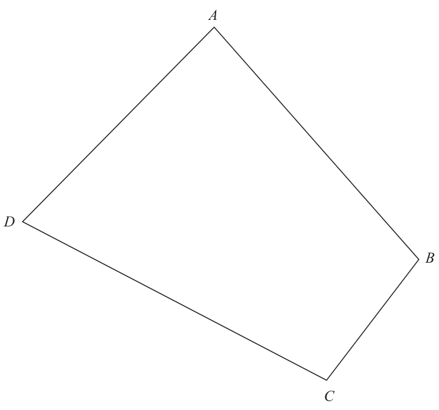

# 4MB1/01R — 2019-01 (official extraction)

> schema `syllabai.official-paper-questions/0.2` · paper_id `pearson-edexcel:international-gcse:mathematics-b:4mb1:2019-01:4MB1/01R` · qp sha256 `46d9fc614ed41b1c…` · extraction is the disclosed baseline (ADR-039)

## Question 1 (2 marks)

Express 15 centimetres as a percentage of 3 metres. %

### 1 [2]

Express 15 centimetres as a percentage of 3 metres. %

**Mark scheme answer**

> × 100 oe
> 300
> 5 2 A1

- **(2)** × 100 oe

## Question 2 (2 marks)

A B The diagram shows shape A and shape B. Write down,

### 2(a) [1]

the number of lines of symmetry of shape A,

**Mark scheme answer**

> 6 1 B1

- **(1)** 6 1 B1

### 2(b) [1]

the order of rotational symmetry of shape B.

**Mark scheme answer**

> 2 1 B1

- **(1)** 2 1 B1

## Question 3 (2 marks)

The bearing of ship P from ship Q is 057° Find the bearing of ship Q from ship P. °

### 3 [2]

The bearing of ship P from ship Q is 057° Find the bearing of ship Q from ship P. °

**Mark scheme answer**

> 180 + 57 or 360 – (180 – 57 ) oe M1
> 237 2 A1
> ⎛ 4 1⎞ 2 B2 fully correct. Award B1 for 2 or 3 correct

- **(2)** 180 + 57 or 360 – (180 – 57 ) oe M1

## Question 4 (2 marks)

A= ⎜ ⎟ B = ⎜ ⎝ −3 5⎠ ⎝ 3 −3⎟⎠ Calculate 3A + 2B ⎛ ⎞ ⎜ ⎟ ⎜ ⎟ ⎝ ⎠

### 4 [2]

A= ⎜ ⎟ B = ⎜ ⎝ −3 5⎠ ⎝ 3 −3⎟⎠ Calculate 3A + 2B ⎛ ⎞ ⎜ ⎟ ⎜ ⎟ ⎝ ⎠

**Mark scheme answer**

> ⎜ ⎟ entries.
> ⎝ −3 9 ⎠
> 9 8 27 32 M1 for correct improper fractions with intention

- **(2)** ⎜ ⎟ entries.

## Question 5 (2 marks)

Without using a calculator and showing all your working, evaluate 1 2 2 ×2 4 3 Give your answer in its simplest form.

### 5 [2]

Without using a calculator and showing all your working, evaluate 1 2 2 ×2 4 3 Give your answer in its simplest form.

**Mark scheme answer**

> × oe e.g. ×
> 4 3 12 12 to multiply
> 9 8
> A1 dep on M1 – M1 only for × =6
> 6 2 4 3

- **(2)** × oe e.g. ×

## Question 6 (2 marks)

Given that y = 7x2 − x dy find dx dy = dx

### 6 [2]

Given that y = 7x2 − x dy find dx dy = dx

**Mark scheme answer**

> 14x + 3x−2 2 B2 oe B1 for 14x or + 3x−2 oe
> 16, −4 2 B1, B1 accept 24, −22
> 7(i)
> Correct 1 B1 eg divided the previous term by −4 or
> explanation +/− alternates and it goes down by 2² each time –
> must see either ‘divide/multiply’ (oe)
> Question Working Answer Mark Notes
> 8 4 × 11.5 (=46) or 3 × 9 (=27) M1
> (4 × 11.5 + 3 × 9) ÷ 7 M1 (“46” + “27”) ÷ 7
> 10.4 3 A1
> 9 −2 x − 4 x ≥ −20 − 17 oe M1 for collecting terms in x and number terms
> on either side of a correct inequality – allow one
> slip
> 37 M1 – must be of the form x ≤ positive value
> x≤ or x ≤ “−37” ÷ “6”
> 6 3 A1 dep on accurate working
> 10 x + x + 135 = 180 (x = 22.5) oe M1 M2 for 2 × (360 ÷ 45)
> 360 ÷ “22.5” M1
> 16 3 A1
> 180(n−2) 360 180(𝑛−2)
> M2 for − = 135 (M1 for a single slip) SC B1 for = 135 leading to n = 8 or
> n n 𝑛
> x + 135 = 180 then 360 / 45 = 8
> 11 9 ÷ (3 + 5 + 7) (=0.6) or 7 ÷ (3 + 5 + 7) M1
> M2 for × 9 or M1 for a correct
> “0.6” × 7 or “0.4666…” × 9 M1
> method to find one of the smaller
> pieces (1.8, 3)
> 4.2 3 A1
> Question Working Answer Mark Notes

- **(2)** 14x + 3x−2 2 B2 oe B1 for 14x or + 3x−2 oe

## Question 7 (3 marks)

Here are the first 4 terms of a sequence. 4096 −1024 256 −64

### 7 [3]

4096 −1024 256 −64 (i) Write down the next 2 terms of the sequence. , (ii) Explain how you found your answer.

## Question 8 (3 marks)

Ying has 4 black counters and 3 white counters. There is a number on each counter. The mean of the numbers on the black counters is 11.5 The mean of the numbers on the white counters is 9 Calculate the mean, to 3 significant figures, of the numbers on all 7 counters.

### 8 [3]

Ying has 4 black counters and 3 white counters. There is a number on each counter. The mean of the numbers on the black counters is 11.5 The mean of the numbers on the white counters is 9 Calculate the mean, to 3 significant figures, of the numbers on all 7 counters.

## Question 9 (3 marks)

Find the largest integer value of x such that 17 − 2x ≥ 4(x – 5) Show clear algebraic working.

### 9 [3]

Find the largest integer value of x such that 17 − 2x ≥ 4(x – 5) Show clear algebraic working.

## Question 10 (3 marks)

A regular polygon has n sides. Each interior angle of the regular polygon is 135° greater than each exterior angle of the polygon. Find the value of n. n=

### 10 [3]

A regular polygon has n sides. Each interior angle of the regular polygon is 135° greater than each exterior angle of the polygon. Find the value of n. n=

## Question 11 (3 marks)

A piece of ribbon 9 metres long is cut into 3 parts in the ratios 3 : 5 : 7 by length. Calculate the length, in metres, of the longest piece. m

### 11 [3]

A piece of ribbon 9 metres long is cut into 3 parts in the ratios 3 : 5 : 7 by length. Calculate the length, in metres, of the longest piece. m

## Question 12 (3 marks)
### 12(a) [1]

Write 9.6 × 10−7 as an ordinary number. 2.4 × 10199

**Mark scheme answer**

> 0.000 000 96 1 B1

- **(1)** 0.000 000 96 1 B1

### 12(b) [2]

Calculate 9.6 × 10 −7 Give your answer in standard form.

**Mark scheme answer**

> M1 for 0.25 × 10206 or 2.5 × 10n where n ≠ 205
> 2.5 × 10205 2 A1

- **(2)** M1 for 0.25 × 10206 or 2.5 × 10n where n ≠ 205

## Question 13 (3 marks)

Without using a calculator and showing all your working, express 605 − 80 in the form n where n is an integer.

### 13 [3]

Without using a calculator and showing all your working, express 605 − 80 in the form n where n is an integer.

**Mark scheme answer**

> M1
> 121 × 5 − 16 × 5 or
> 605 = 11 × 11 × 5 and
> 80 = 4 × 4 × 5 or 2 × 2 × 2 × 2 × 5
> 11 5 − 4 5 (= 7 5 ) M1dep
> 245 3 A1dep on first M1 [allow n = 245]
> SC B1 √605 − √80 = 11 5 − 4 5 = 7 5 = 245

- **(3)** M1

## Question 14 (3 marks)

Solve the equation 5x2 = 7 − 9x Give your solutions to 3 significant figures. Show your working clearly.

### 14 [3]

Solve the equation 5x2 = 7 − 9x Give your solutions to 3 significant figures. Show your working clearly.

**Mark scheme answer**

> 5x² + 9x – 7 (=0) M1 for correctly rearranging
> −9 ± 9 2 − 4 × 5 × −7 B1 NB: this is an independent B mark and can
> be earned from previous incorrect working for
> 2×5
> correct substitution into formula
> 0.587, −2.39 3 A1 dep on M1
> Question Working Answer Mark Notes

- **(3)** 5x² + 9x – 7 (=0) M1 for correctly rearranging

## Question 15 (4 marks)

A D B C The diagram shows quadrilateral ABCD. The point P lies inside the quadrilateral, such that P is 5.5 cm from C and equidistant from AD and AB. Using ruler and compasses only and showing all your construction lines, show the point P on the diagram.

### 15 [4]

A D B C The diagram shows quadrilateral ABCD. The point P lies inside the quadrilateral, such that P is 5.5 cm from C and equidistant from AD and AB. Using ruler and compasses only and showing all your construction lines, show the point P on the diagram.

**Mark scheme answer**

> arc of circle centred on C, radius 5.5 cm M1
> Arcs on AD and AB equal distance from A and M1
> used to form arc for bisector
> Bisector of BAD drawn through correct M1
> intersecting arcs
> P correctly 4 A1 dep on M3 being awarded
> located
> SC B3 if no arc drawn centred on C but P located
> correctly by drawling line from C to the bisector of
> BAD

- **(4)** arc of circle centred on C, radius 5.5 cm M1

## Question 16 (4 marks)

t varies inversely as the square of a where a > 0 t = 14 when a = 5 Calculate the value of a when t = 224 a=

### 16 [4]

t varies inversely as the square of a where a > 0 t = 14 when a = 5 Calculate the value of a when t = 224 a=

**Mark scheme answer**

> k M1
> t=
> a2
> k M1 assumes previous M1
> 14 = 2 or k = 350
> 350
> 224 = 2 M1 or 5 ×
> a
> 1.25 4 A1 oe
> Question Working Answer Mark Notes

- **(4)** k M1

## Question 17 (4 marks)

Diagram NOT accurately drawn 20 cm 6 cm A B The diagram shows two similar jugs. The height of jug A is 20 cm and the height of jug B is 6 cm. Given that volume of jug A − volume of jug B = 1459.5 cm3 calculate the volume, in cm3, of jug B. cm3

### 17 [4]

Diagram NOT accurately drawn 20 cm 6 cm A B The diagram shows two similar jugs. The height of jug A is 20 cm and the height of jug B is 6 cm. Given that volume of jug A − volume of jug B = 1459.5 cm3 calculate the volume, in cm3, of jug B. cm3

> 🖼 crop required: diagram (qp.pdf p.11)

**Mark scheme answer**

> 10³ : 3³ (1000 : 27) or M1 correct ratio for volume
> 20³ : 6³ (8000 : 216) oe
> 1459.5 ÷ (1000 – 27) (=1.5) or M1 correct calculation for SF needed to find
> 1459.5 ÷ (8000−216) (=0.1875) oe volume of B or M2 for 1000𝑥 − 27𝑥 = 1459.5
> 8000𝑣𝐵 6 3
> or − 𝑣𝐵 = 1459.5 or ( ) =
> 216
> 𝑣𝐵
> 𝑣𝐵 +1459.5
> “1.5” × 27 or M1
> 0.1875 × 216 oe
> 40.5 4 A1

- **(4)** 10³ : 3³ (1000 : 27) or M1 correct ratio for volume

## Question 18 (4 marks)

E = {positive integers from 1 to 15 inclusive} A = {multiples of 3} B = {even numbers}

### 18(a) [1]

Find A ∪ B A∪B={ }

**Mark scheme answer**

> 2,3,4,6,8,9,10, 1 B1 – no repeated values
> 12,14,15

- **(1)** 2,3,4,6,8,9,10, 1 B1 – no repeated values

### 18(b)(i) [1]

Find A ∩ B A∩B={ }

**Mark scheme answer**

> 6,12 1 B1

- **(1)** 6,12 1 B1

### 18(b)(ii) [1]

Find n([A ∩ B]ʹ) n([A ∩ B]ʹ) = The set C has 8 elements and B ∩ C = ∅

**Mark scheme answer**

> 13 1 B1ft from (b)(i)

- **(1)** 13 1 B1ft from (b)(i)

### 18(c) [1]

Write down the elements of set C. C={ }

**Mark scheme answer**

> 1,3,5,7,9,11, 1 B1
> 13,15

- **(1)** 1,3,5,7,9,11, 1 B1

## Question 19 (4 marks)

Solve the simultaneous equations 10x + 2y = 17 15x − 3y = 39 x= ,y=

### 19 [4]

Solve the simultaneous equations 10x + 2y = 17 15x − 3y = 39 x= ,y=

**Mark scheme answer**

> e.g. 30x +6y = 51 30x + 6y = 51 M1 first stage of method to eliminate one variable
> (+)30x− 6y = 78 (−)30x − 6y = 78 – allow one error only in multiplication – with
> 60x = 129 12y = −27 intention to add or subtract as appropriate
> A1 for x = 2.15 or y = −2.25
> e.g. 10 × 2.15 + 2y = 17 M1 (dep on M1) method to find second variable.
> x = 2.15, 4 A1 for both 2.15oe and −2.25 oe dep on at least
> y = − 2.25 M1
> Question Working Answer Mark Notes

- **(4)** e.g. 30x +6y = 51 30x + 6y = 51 M1 first stage of method to eliminate one variable

## Question 20 (4 marks)

The coordinates of point A are (7, 2) and the coordinates of point B are (−5, y). → The modulus of the vector AB is 13 Calculate the possible values of y. y=

### 20 [4]

The coordinates of point A are (7, 2) and the coordinates of point B are (−5, y). → The modulus of the vector AB is 13 Calculate the possible values of y. y=

**Mark scheme answer**

> ⃗⃗⃗⃗⃗⃗⃗ −12 M1 oe eg 13 − (7 − −5) 2
> 𝐴𝐵 = ( ) ⇔ 169 = (𝑦 − 2)2 + 144
> 𝑦−2
> y – 2 = ±5
> 2 + 5 (=7) or 2 – 5 (= −3) M1
> 7 or −3 4 A1, A1 allow (−5, 7) and (−5, −3) – one value
> find geometrically scores 3 marks

- **(4)** ⃗⃗⃗⃗⃗⃗⃗ −12 M1 oe eg 13 − (7 − −5) 2

## Question 21 (4 marks)

The straight line joining the points with coordinates (−a, −22) and (3a, 38) has equation y = mx + a Calculate the value of a and the value of m. a= m=

### 21 [4]

The straight line joining the points with coordinates (−a, −22) and (3a, 38) has equation y = mx + a Calculate the value of a and the value of m. a= m=

**Mark scheme answer**

> 38 − − 22 60 15 M1 correct substitution for M2 for
> m= (= = )
> 3a − − a 4a a gradient −66 = −3ma + 3a
> 38 = 3ma + a
> 15 15 M1 correct substitution of −28 = 4a
> −22 = × − a + a or 38 = × 3a + a oe
> a a gradient into formula Allow one slip
> a = −7, 4 A1
> m= −
> 7 A1

- **(4)** 38 − − 22 60 15 M1 correct substitution for M2 for

## Question 22 (4 marks)

A Diagram NOT accurately drawn D C B E In the diagram ACE and BCD are straight lines such that the point C is the midpoint of BD. AB is parallel to DE. Prove that the triangles ABC and EDC are congruent.

### 22 [4]

A Diagram NOT accurately drawn D C B E In the diagram ACE and BCD are straight lines such that the point C is the midpoint of BD. AB is parallel to DE. Prove that the triangles ABC and EDC are congruent.

> 🖼 crop required: diagram (qp.pdf p.None)

**Mark scheme answer**

> M1 BC = DC (given C is midpoint of BD)
> M1 ACB = ECD (opposite angle) or BAC = CED
> (alternate angles) or ABC = EDC (alternate
> angles)
> M1 States 3rd link – one of equal angles not
> already mentioned
> Shows proof 4 A1 Concludes proof by stating ABC and EDC are
> congruent due to ASA
> Question Working Answer Mark Notes

- **(4)** M1 BC = DC (given C is midpoint of BD)

## Question 23 (4 marks)

A right circular cone has a curved surface area of 136 π cm2 The radius of the base of the cone is 8 cm The volume of the cone is k π cm3 Find the value of k. k=

### 23 [4]

A right circular cone has a curved surface area of 136 π cm2 The radius of the base of the cone is 8 cm The volume of the cone is k π cm3 Find the value of k. k=

**Mark scheme answer**

> slant height = 136 ÷ 8 (=17) M1
> height = 17 2 − 8 2 (=15) M1 dependent on first M mark
> 1 M1 dependent on first two M marks
> volume = × π × 82 × 15 (=1005.3...) or
> 1 2
> k = × 8 × 15
> 320 4 A1
> Question Working Answer Mark Notes

- **(4)** slant height = 136 ÷ 8 (=17) M1

## Question 24 (4 marks)

Solve 3 − − =1 2x + 9x − 5 x+5 Show clear algebraic working. x=

### 24 [4]

Solve 3 − − =1 2x + 9x − 5 x+5 Show clear algebraic working. x=

**Mark scheme answer**

> x +1 (2 x − 1) 2 M1 for use of a correct common denominator (no
> 3− − = 1 oe need to collect terms)
> (2 x − 1)( x + 5) (2 x − 1)( x + 5)
> 4 x 2 − 3x + 2 M1 or 2(2x − 1)(x + 5) = x + 1 + (2x − 1)2 –
> 2= oe dependent on previous M mark
> (2 x − 1)( x + 5)
> 2(2 x 2 + 9 x − 5) = 4 x 2 − 3 x + 2 M1 – dependent on both previous M marks
> 4 4 A1oe allow 0.57 or better (0.5714....)

- **(4)** x +1 (2 x − 1) 2 M1 for use of a correct common denominator (no

## Question 25 (5 marks)

There are 20 counters in a bag. There are 7 red counters. The rest of the counters are green or white. Bernard takes at random 2 counters from the bag. The probability that Bernard will take 2 white counters is Calculate the probability that Bernard will take 1 green counter and 1 white counter.

### 25 [5]

There are 20 counters in a bag. There are 7 red counters. The rest of the counters are green or white. Bernard takes at random 2 counters from the bag. The probability that Bernard will take 2 white counters is Calculate the probability that Bernard will take 1 green counter and 1 white counter.

**Mark scheme answer**

> w w −1 1 M1
> × = oe
> 20 19
> w(w – 1) =20 oe M1
> g=8 w=5 M1
> 8 5 5 8 1 8
> × + × M1 or 2 × ×
> 20 19 20 19 4 19
> 80 5 A1 oe allow 0.21 or better (0.21052...)
> 380
> Question Working Answer Mark Notes

- **(5)** w w −1 1 M1

## Question 26 (6 marks)

The table below gives information about the lengths of time that 50 people have been waiting for a train. Waiting time (m minutes) Frequency 0 < m ≤ 5 4 5 < m ≤ 10 5 10 < m ≤ 15 11 15 < m ≤ 20 8 20 < m ≤ 25 22

### 26(a) [1]

Find the modal class.

**Mark scheme answer**

> 20 < m ≤ 25 1 B1

- **(1)** 20 < m ≤ 25 1 B1

### 26(b) [2]

Find the class interval that contains the median waiting time.

**Mark scheme answer**

> M1 for 25.5 or between 25th and 26th
> 15 < m ≤ 20 2 A1

- **(2)** M1 for 25.5 or between 25th and 26th

### 26(c) [3]

Calculate an estimate for the mean waiting time. minutes

**Mark scheme answer**

> M1 for xf calculated for at least 4 class intervals
> where x is a consistent number in the range for at
> least 5 values
> (2.5×4+7.5×5+12.5×11+17.5×8+22.5×22) ÷ 50 M1 for xf calculated using the correct mid-values
> (10+37.5+137.5+140+495) ÷ 50 and dividing total by 50
> 16.4 3 A1

- **(3)** M1 for xf calculated for at least 4 class intervals

## Question 27 (6 marks)

B Diagram NOT accurately drawn (2x − 5) cm 30° (x + 5) cm A C The diagram shows △ ABC in which AB = (2x − 5) cm BC = (x + 5) cm Ð ABC = 30° The area of △ ABC is 15.75 cm2 Calculate the length, in cm to 3 significant figures, of AC. cm

### 27 [6]

B Diagram NOT accurately drawn (2x − 5) cm 30° (x + 5) cm A C The diagram shows △ ABC in which AB = (2x − 5) cm BC = (x + 5) cm Ð ABC = 30° The area of △ ABC is 15.75 cm2 Calculate the length, in cm to 3 significant figures, of AC. cm

> 🖼 crop required: diagram (qp.pdf p.None)

**Mark scheme answer**

> 0.5(2x – 5)(x + 5) × sin30° = 15.75 M1
> 2x² + 5x – 88 = 0 M1
> (2x – 11)(x + 8) (=0) or correct use of quadratic M1 independent of previous M marks
> formula
> x = 5.5 M1 and rejecting x = −8
> AC= 6² + 10.5² − 2 × 6 × 10.5 × cos30 M1
> 6.09 6 A1
> Question Working Answer Mark Notes

- **(6)** 0.5(2x – 5)(x + 5) × sin30° = 15.75 M1

## Question 28 (7 marks)
### 28(a) [2]

Factorise fully 15x3 y − 20x2 y2 (27 x ) 6 3

**Mark scheme answer**

> 2
> 5 x y (3 x − 4 y ) 2 B2 B1 for 2 of 5, x² or y factorised with correct
> contents of brackets for this factor, e.g.
> 5 x 2 (3 xy − 4 y 2 ) ,
> 5y(3x³ − 4x²y), x²y(15x – 20y), 5xy(3x² − 4xy)

- **(2)** 2

### 28(b) [3]

Simplify fully 18 x 3

**Mark scheme answer**

> 9x4 M1 for correct numerator
> x 3 A2 fully correct, A1 for numerator of x or
> oe
> 2 denominator of 2 or coefficient of ½ or 0.5

- **(3)** 9x4 M1 for correct numerator

### 28(c) [2]

Given that (x − 2) is a factor of 2x3 + 3x2 + kx − 6 find the value of k. k=

**Mark scheme answer**

> 2 × 2³ + 3 × 2² + k × 2 – 6 (=0) M1
> −11 2 A1

- **(2)** 2 × 2³ + 3 × 2² + k × 2 – 6 (=0) M1

