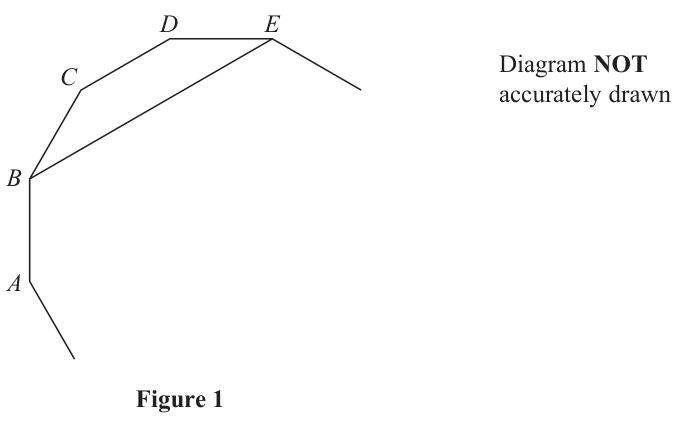
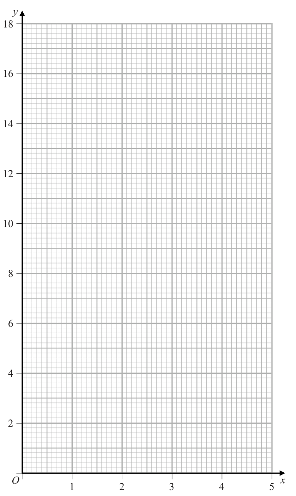
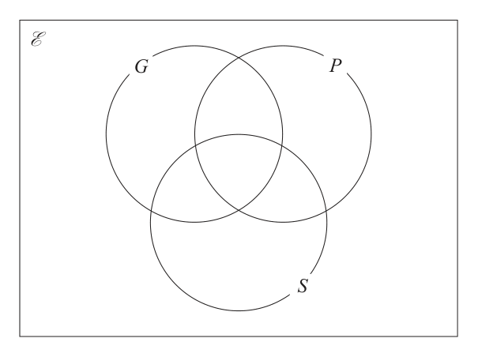
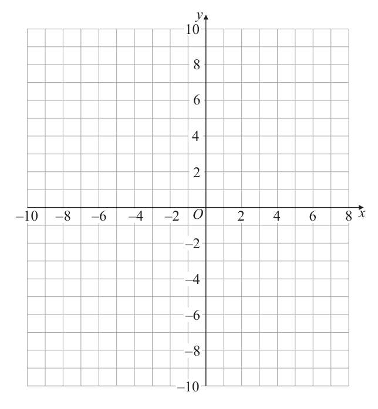
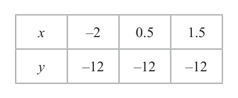
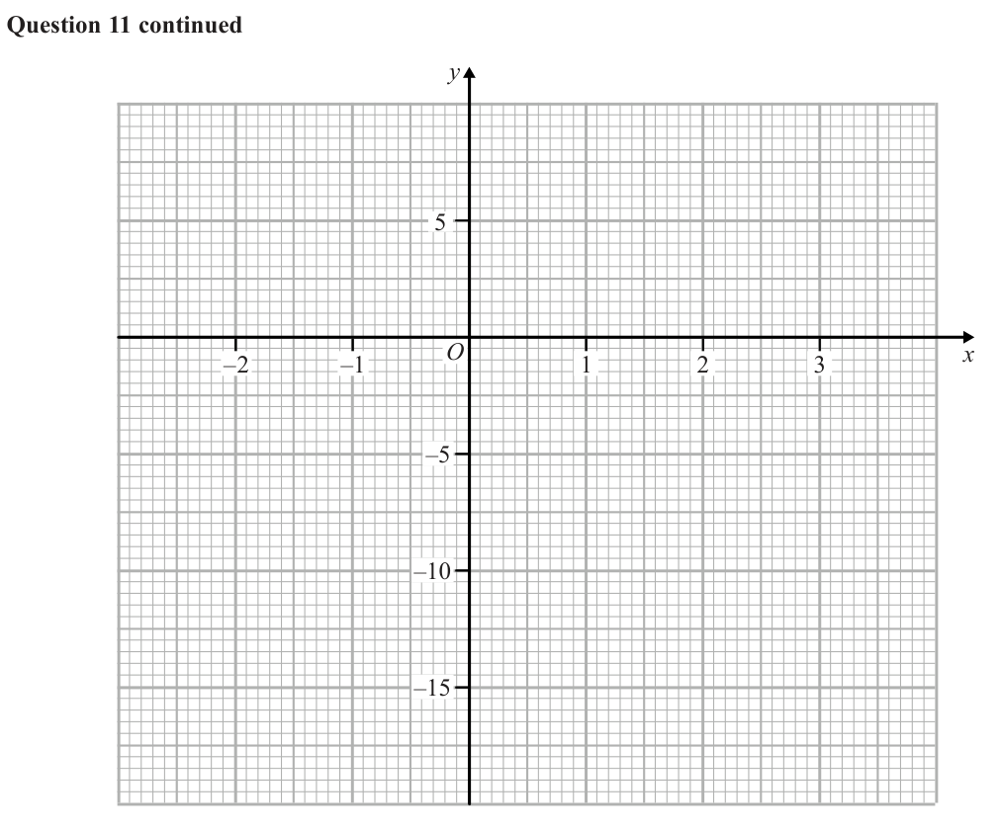
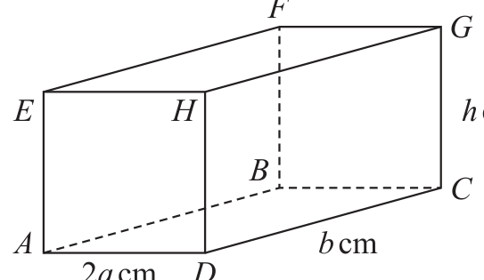

# 4MB1/02 — 2019-01 (official extraction)

> schema `syllabai.official-paper-questions/0.2` · paper_id `pearson-edexcel:international-gcse:mathematics-b:4mb1:2019-01:4MB1/02` · qp sha256 `c17befeaaecf9d1c…` · extraction is the disclosed baseline (ADR-039)

## Question 1 (4 marks)

Answer ALL TWELVE questions. Write your answers in the spaces provided. You must write down all the stages in your working. D E C Diagram NOT accurately drawn B A Figure 1 Figure 1 shows part of a regular 12‑sided polygon. The vertices B and E of the polygon are joined with a straight line. Calculate the size, in degrees, of ∠ABE. Give reasons for each stage of your working.

### 1 [4]

D E C Diagram NOT accurately drawn B A Figure 1 Figure 1 shows part of a regular 12‑sided polygon. The vertices B and E of the polygon are joined with a straight line. Calculate the size, in degrees, of ∠ABE. Give reasons for each stage of your working.

**Mark scheme answer**

> 360
> 180 − = 150 M1
> 360 − 2 × 150
> 150 − = 120 oe M1
> Angles in a quadrilateral/ exterior angles
> add to 360 or
> B1d
> BE and CD are parallel and co- interior /allied
> angles add to 180
> 120° 4 A1

- **(4)** 360

## Question 2 (4 marks)

Solve the simultaneous equations 3x – 2y = 7 x + 6y = 15 Show clear algebraic working.

### 2 [4]

Solve the simultaneous equations 3x – 2y = 7 x + 6y = 15 Show clear algebraic working.

**Mark scheme answer**

> 3x − 2 y = 7 9 x − 6 y = 21 x = 15 − 6 y 2 y = 3x − 7 M1

- **(4)** 3x − 2 y = 7 9 x − 6 y = 21 x = 15 − 6 y 2 y = 3x − 7 M1

## Question 3 (5 marks)

The original price of each 6‑day ski pass is reduced by 15% in a sale. In the sale the price of each 6‑day ski pass is $272

### 3(a) [2]

The original price of each 6‑day ski pass is reduced by 15% in a sale. In the sale the price of each 6‑day ski pass is \$272

Calculate the original price of each 6‑day ski pass. The price of each 3‑day ski pass is £110 The exchange rate is £1 = \$1.70

**Mark scheme answer**

> 272
> × 100 M1
> 320 2 A1

- **(2)** 272

### 3(b) [3]

Calculate how much Andrew will save by buying one 6‑day ski pass in the sale rather than two 3‑day ski passes.

**Mark scheme answer**

> 272
> 220 × 1.7 or M1
> 1.7
> 272
> 220 × 1.7 − 272 or 220 − M1
> 1.7
> \$102 or £60 3 A1

- **(3)** 272

## Question 4 (4 marks)
### 4(a) [1]

Express 56 as the product of its prime factors. Trains to Watson leave Denby station every 56 minutes. Trains to Barbe leave Denby station every 24 minutes. A train to Watson and a train to Barbe both leave Denby station at 12 00.

**Mark scheme answer**

> 2 × 2 × 2 × 7 or 23 × 7 1 B1

- **(1)** 2 × 2 × 2 × 7 or 23 × 7 1 B1

### 4(b) [3]

Find the next time that a train to Watson and a train to Barbe leave Denby station at the same time.

**Mark scheme answer**

> Method to find the LCM
> 2× 2× 2×3
> or 56,112,168 and 24,48,72,96,120,144,168 M1
> or 12 00, 12 56, 13 52, 14 48 and 12 00, 12
> 24, 12 48, 13 12, 13 36, 14 05, 14 00, 14 24,
> 14 48
> LCM = 168 A1
> 14:48 or 2.48 pm 3 A1

- **(3)** Method to find the LCM

## Question 5 (5 marks)
### 5(a) [2]

On the grid opposite, draw the graph of y = 3x + 2 for the values of x from 0 to 5

**Mark scheme answer**

> M1
> Straight line with a gradient
> of 3 or two correct points
> plotted or line through (0,2)
> Correct line.
> 2 A1

- **(2)** M1

### 5(b) [3]

Show, by shading on the grid, the region R defined by all of the inequalities y ≤ 3x + 2 and y ≥ 4 and 8 ≤ 4x ≤ 18 Label the region R. y O x 1 2 3 4 5

**Mark scheme answer**

> Line y = 4 B1
> Lines x = 2 and x = 4.5 B1
> R
> Correct region identified
> 3 B1

- **(3)** Line y = 4 B1

## Question 6 (6 marks)

One day, 80 customers at a health spa were asked if they used any of the gym (G), the pool (P) and the sauna (S). Of these 80 customers 34 had used the gym 60 had used the pool 30 had used the sauna 20 had used the gym and the pool but not the sauna 17 had used the pool and the sauna but not the gym 6 had used the gym, the pool and the sauna no one had used the gym and the sauna but not the pool.

**(b)** Find (i) n([G ∪ P ∪ S ]ʹ )

### 6(a) [3]

Using this information, complete the Venn diagram to show the number of elements in each appropriate subset. E G P S

**Mark scheme answer**

> 6,17,20,0 3 B1
> 8,17,7 B1
> G P 5 B1
> 20
> 0
> 5 S

- **(3)** 6,17,20,0 3 B1

### 6(b)(ii) [?]

n(G ∪ S)

**Mark scheme answer**

> 58 1 B1

### 6(b)(iii) [3]

n(P ∩ Sʹ )

**Mark scheme answer**

> 37 1 B1

- **(3)** 37 1 B1

## Question 7 (10 marks)

Vincent plays a game in which he can score 0, 1, 2, 3 or 4 each time he plays the game. The score he gets in a game is independent of the score he got in the previous games. The table gives information about the probability of getting each score in a game. Score 0 1 2 3 4 Probability x 3x x 0.2 0.1 Vincent plays the game 150 times.

### 7(a) [4]

Calculate the number of times he would expect to score 1 Vincent plays the game another two times and records his two scores. He adds these two scores together to get his Total.

**Mark scheme answer**

> 1 − 0.2 − 0.1 = 0.7 M1
> "0.7"
> [ = "0.14"] M1
> 3 × "0.14" × 150 M1
> 63 4 A1

- **(4)** 1 − 0.2 − 0.1 = 0.7 M1

### 7(b) [3]

Calculate the probability that Vincent’s Total is greater than 6 Given that for these two games Vincent has a Total greater than 6 points …………… , ……………

**Mark scheme answer**

> 3,4 4,3 4,4 M1
> 0.2 × 0.1 + 0.2 × 0.1 + 0.1 × 0.1 M1
> 0.05 oe 3 A1

- **(3)** 3,4 4,3 4,4 M1

### 7(c) [3]

calculate the probability that he got a score of 4 in the first of these two games.

**Mark scheme answer**

> 0.2 × 0.1 + 0.1 × 0.1 = 0.03 M1
> 0.03 M1
> "0.05"
> 0.6 oe 3 A1

- **(3)** 0.2 × 0.1 + 0.1 × 0.1 = 0.03 M1

## Question 8 (10 marks)

A Diagram NOT accurately drawn C O P D B Q Figure 2 → → Figure 2 shows the triangle OAB with OA = 2a and OB = 3b → 1→ The point C lies on OA such that OC = OA → 2→ The point D lies on OB such that OD = OB →

### 8(a) [2]

Find CD in terms of a and b. The point P is such that ODBP is a straight line and AP is parallel to CD. →

**Mark scheme answer**

> 2
> − a +... M1
> − a +2b 2 A1

- **(2)** 2

### 8(b) [4]

Find OP in terms of b. → → The point Q is such that CD = DQ

**Mark scheme answer**

> ⎛ 2 ⎞
> OP = 2a + k ⎜ − a + 2 b ⎟ M1
> ⎝ 3 ⎠
> 2 a − ka = 0 M1
> k =3
> OP = "3" × "2 b" M1
> 6b 4 A1
> Alternative for M1M1 OP : 2a = 2b : a

- **(4)** ⎛ 2 ⎞

### 8(c) [4]

Show that A, B and Q are collinear.

**Mark scheme answer**

> 4 ⎛ 2 ⎞ M1
> AQ = − a + 2 × ⎜ " − a + 2 b " ⎟
> 3 ⎝ 3 ⎠
> AQ = − a + 4 b
> AB = −2a + 3b or BQ = − a + b B1
> 4 AB = 3BQ ∴ A,B and
> AQ = AB ∴ A ,B
> 3 Q are collinear 4 A1
> and Q are collinear
> ALT 2 ⎛ 2 ⎞ (M1)
> BQ = −3 b + a + 2 × ⎜" − a + 2b" ⎟
> 3 ⎝ 3 ⎠
> 2 (A1)
> BQ = − a + b
> AB = −2a + 3b or AQ = − a + 4 b (B1)
> AB = 3BQ ∴ A,B AQ = 4BQ ∴ A,B and (A1)
> and Q are collinear Q are collinear
> Condone missing label

- **(4)** 4 ⎛ 2 ⎞ M1

## Question 9 (11 marks)

The vertices of triangle A are the points with coordinates (0, 0), (1, 0) and (0, 2)

### 9(a) [1]

The vertices of triangle A are the points with coordinates (0, 0), (1, 0) and (0, 2)

On the grid opposite, draw and label triangle A. Triangle A is transformed to triangle B under the transformation with matrix M where ⎛ 3 −4⎞ M= 4 3 

**Mark scheme answer**

> Correct triangle drawn 1 B1
> ⎛ 3 −4 ⎞ ⎛ 0 1 0 ⎞

- **(1)** Correct triangle drawn 1 B1

### 9(b) [3]

On the grid, draw and label triangle B. The transformation with matrix M is equivalent to an enlargement with centre the origin, with scale factor k followed by an anticlockwise rotation of θ° about the origin.

**Mark scheme answer**

>  M1
> ⎝ 4 3 ⎠⎝0 0 2⎠
> 0 3 −8 A1
> ⎝0 4 6 ⎠
> Condone missing label Correct triangle drawn 3 A1

- **(3)** ⎜ ⎟⎜ ⎟ M1

### 9(c) [2]

Calculate the value of k.

**Mark scheme answer**

> 32 + 4 2 M1
> 5 2 A1

- **(2)** 32 + 4 2 M1

### 9(d) [2]

Calculate the value, to one decimal place, of θ. Triangle B is transformed to triangle C under a reflection in the x‑axis.

**Mark scheme answer**

> θ = tan −1 M1
> 53.1 2 A1

- **(2)** θ = tan −1 M1

### 9(e) [1]

On the grid, draw and label triangle C. Triangle A is transformed to triangle C under the transformation with matrix T.

**Mark scheme answer**

> Correct triangle drawn 1 B1
> ⎛1 0 ⎞⎛ 3 −4 ⎞ st

- **(1)** Correct triangle drawn 1 B1

### 9(f) [2]

Find matrix T.

**Mark scheme answer**

>  or 1 column correct M1
> ⎝0 −1 ⎠ ⎝ 4 3 ⎠
>  3 −4 2 A1
> ⎝ −4 −3 ⎠

- **(2)**  or 1 column correct M1

## Question 10 (13 marks)

A rocket is launched from a point which is 5 m above horizontal ground. The rocket moves vertically upwards so that at time t seconds, the height, h metres, of the rocket above the ground is given by h = 5 + 3t + 9t 2 – t 3 At time t seconds, the velocity of the rocket is v m/s and the acceleration of the rocket is a m/s2

### 10(a) [2]

Find an expression for v in terms of t.

**Mark scheme answer**

> Differentiate x → x
> n n −1
> M1
> 3 + 18t − 3t 2 2 A1

- **(2)** Differentiate x → x

### 10(b) [1]

Find an expression for a in terms of t.

**Mark scheme answer**

> 18 − 6t 1 B1
> "18 − 6t " = 0

- **(1)** 18 − 6t 1 B1

### 10(c) [2]

Find the time when the rocket stops accelerating upwards. The rocket is instantaneously at rest when it is at point A.

**Mark scheme answer**

> M1
> t =3
> 2 A1

- **(2)** M1

### 10(d) [6]

Show that the height, in metres to one decimal place, of A above the ground is 131.2 m. The rocket now falls vertically downwards and hits the ground.

**Mark scheme answer**

> "3 + 18t − 3t 2 " = 0 M1
> 6 ± 36 + 4
> t= M1(dep)
> awrt 6.16, - 0.16 A1
> selecting “6.16” since time cannot be
> B1
> negative
> 5 + 3 × 6.16 + 9 × 6.16 2 − 6.16 3 M1
> 131.2 with all M and A marks awarded 131.2* 6 A1 cso
> 131.2 × 2 − 5

- **(6)** "3 + 18t − 3t 2 " = 0 M1

### 10(e) [2]

Find the total distance, to the nearest metre, travelled by the rocket at the instant it hits the ground. ⎡ −b ± (b 2 − 4ac) ⎤ ⎢Solutions of ax 2 + bx + c = 0 are x = ⎥ ⎣⎢ 2a ⎦⎥

**Mark scheme answer**

> M1
> awrt 257 2 A1
> ⎛ 1⎞ ⎛ 1⎞

- **(2)** M1

## Question 11 (16 marks)

f (x) = 4x3 – 13x – 6

### 11(a) [2]

Use the factor theorem to show that (2x + 1) is a factor of f (x).

**Mark scheme answer**

> 4 × ⎜ − ⎟ − 13 × ⎜ − ⎟ − 6 M1
> ⎝ 2⎠ ⎝ 2⎠
> = 0 ∴ (2 x + 1) is a factor 2 A1

- **(2)** 4 × ⎜ − ⎟ − 13 × ⎜ − ⎟ − 6 M1

### 11(b) [4]

Hence factorise f (x) fully. The curve C has equation y = f (x)

**Mark scheme answer**

> 2
> 2 x − ... M1
> 2x2 − x − 6 A1
> ( 2 x + 3 )( x − 2 ) M1
> ( 2 x + 1)( 2 x + 3 )( x − 2 ) 4 A1

- **(4)** 2

### 11(c) [2]

Find the coordinates of the points of intersection of C with the x‑axis.

**Mark scheme answer**

> ( 2 x + 1)( 2 x + 3 )( x − 2 ) = 0 M1
> ⎛ 1 ⎞ ⎛ 3 − , 0 ⎟ , ⎜ − , 0 ⎟ , ( 2, 0 ) 2 A1
> ⎝ 2 ⎠ ⎝ 2 ⎠

- **(2)** ( 2 x + 1)( 2 x + 3 )( x − 2 ) = 0 M1

### 11(d) [5]

Find the coordinates, to 2 decimal places, of the turning points of C. The table below gives the coordinates of three points on C. x –2 0.5 1.5 y –12 –12 –12

**Mark scheme answer**

> dy
> = 12 x 2 − 13 M1
> dx

- **(5)** dy

### 11(e) [3]

On the grid opposite, draw the curve C for –2 ≤ x ≤ 2 Clearly label the coordinates of the turning points of C and the coordinates of the points of intersection with the x‑axis and the y‑axis.

**Mark scheme answer**

> *The official mark scheme line for this part was not captured by the digitised extraction — treat the worked values above the line with care and check against the paper's own mark scheme.*

## Question 12 (12 marks)

Diagram NOT accurately drawn 2a cm b cm b cm Figure 3 Figure 3 shows a solid silver paperweight made from a cuboid and a half cylinder. The cuboid is 2a cm wide, b cm long and b cm high. The plane face of the half cylinder coincides with the top face of the cuboid. The total surface area of the paper weight is A cm2

### 12(a) [2]

Diagram NOT accurately drawn 2a cm b cm b cm Figure 3 Figure 3 shows a solid silver paperweight made from a cuboid and a half cylinder. The cuboid is 2a cm wide, b cm long and b cm high. The plane face of the half cylinder coincides with the top face of the cuboid. The total surface area of the paper weight is A cm²

Find an expression for A in terms of π, a and b. Given that a = 6 5 and that the surface area of the paperweight can be written as (2b2 + 6ab + 60π 15)

…………… cm²

**Mark scheme answer**

> [ A = ] 6ab + 2b 2 + ... or
> M1
> [ A =] π a 2 + π ab + ...
> [A =] 6ab + 2b2 + 𝜋a2 +
> 2 A1
> 𝜋ab
> ( ) ( )

- **(2)** [ A = ] 6ab + 2b 2 + ... or

### 12(b) [5]

show that the exact value of b is 10 3 – 6 5 The paperweight is melted down to form a different cuboid. This second cuboid is 2a cm wide, b cm long and h cm high, as shown in Figure 4. F G Diagram NOT accurately drawn E H h cm B C A b cm 2a cm D Figure 4

> *Figure not shown in this reconstruction — the printed paper includes a diagram (not drawn accurately). Use the text description to work through it.*

**Mark scheme answer**

> π(6√5)² or π(6√5)b M1
> π(6√5)² + π(6√5)b = 60π√15 M1
> b = (60π√15 − π(6√5)²)/(π(6√5)) M1
> b = (60π√15 − π(6√5)²)/(π(6√5)) × √5/√5 or M1
> b = 60√15/(6√5) − (6√5)²/(6√5) or b = (60√75 − 180√5)/30
> b = 10√3 − 6√5 A1 cso

- **(5)** π(6√5)² or π(6√5)b M1

### 12(c) [5]

Calculate the size, to the nearest degree, of angle GAC. ⎡ Volume of cylinder πr 2 h ⎤ ⎢ ⎥ ⎣Curved surface area of cylinder 2πrh⎦

**Mark scheme answer**

> 2abh = "2ab² + (1/2)πa²b" M1
> (h = b + (1/4)πa)
> h = 10√3 − 6√5 + (1/4)π × 6√5 or awrt 14.4 M1
> AC = √((10√3 − 6√5)² + (12√5)²) or awrt 27.1 M1
> [∠GAC] = tan⁻¹("14.4"/"27.1") M1
> awrt 28 A1

- **(5)** 2abh = "2ab² + (1/2)πa²b" M1

