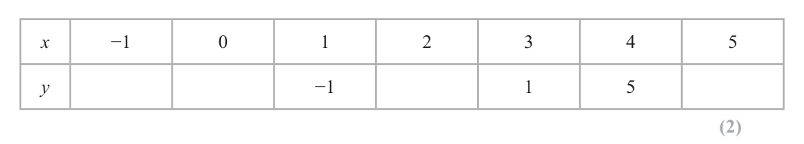
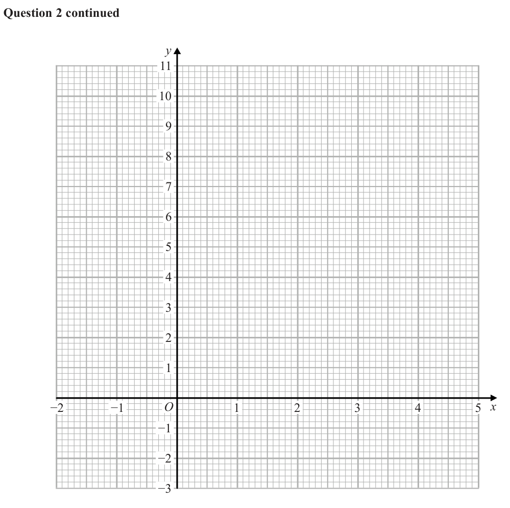
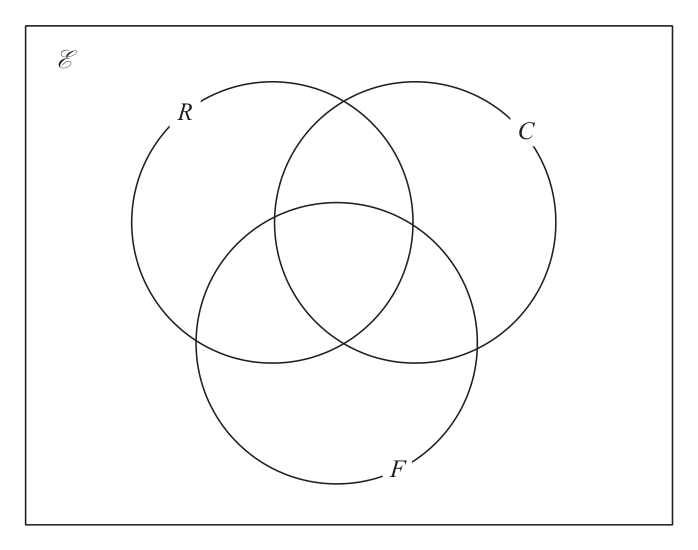

# 4MB1/02R — 2019-01 (official extraction)

> schema `syllabai.official-paper-questions/0.2` · paper_id `pearson-edexcel:international-gcse:mathematics-b:4mb1:2019-01:4MB1/02R` · qp sha256 `848256f9a89fa6d7…` · extraction is the disclosed baseline (ADR-039)

## Question 1 (4 marks)

Answer ALL ELEVEN questions. Write your answers in the spaces provided. You must write down all the stages in your working. Z Diagram NOT accurately drawn h cm X Y Figure 1 In Figure 1, △XYZ has base XY and height h cm. The length of XY is 7.2 cm, to 2 significant figures.

### 1(a) [1]

Write down the lower bound for the length of XY. The area of △XYZ is 29 cm2, to 2 significant figures.

**Mark scheme answer**

> 7.15 (cm) 1 B1

- **(1)** 7.15 (cm) 1 B1

### 1(b) [1]

Write down the upper bound for the area of △XYZ.

**Mark scheme answer**

> 29.5 (cm²) 1 B1

- **(1)** 29.5 (cm²) 1 B1

### 1(c) [2]

Calculate, to 3 decimal places, the upper bound of h.

**Mark scheme answer**

> “29.5” ÷ (0.5 × “7.15”) 2 M1 “their (b)” ÷ (0.5 × “their(a)”)
> Or their (b) = (0.5 × “their(a)”) × h
> 8.252 A1 cao
> Question Working Answer Mark Notes

- **(2)** “29.5” ÷ (0.5 × “7.15”) 2 M1 “their (b)” ÷ (0.5 × “their(a)”)

## Question 2 (9 marks)
### 2(a) [2]

Complete the table of values for y = x2 − 3x + 1 x −1 0 1 2 3 4 5 y −1 1 5

**Mark scheme answer**

> 5, 1, −1, 11 2 B2 all correct or B1 for 2 or 3 correct

- **(2)** 5, 1, −1, 11 2 B2 all correct or B1 for 2 or 3 correct

### 2(b) [2]

On the grid opposite, plot the points from your completed table and join them to form a smooth curve.

**Mark scheme answer**

> (–1,5)(0,1)(1, –1)(2, –1)(3,1)(4,5)(5,11) Correct 2 B1 Completely correct curve.
> curve
> B1ft for at least 5 points correctly plotted
> and joined.

- **(2)** (–1,5)(0,1)(1, –1)(2, –1)(3,1)(4,5)(5,11) Correct 2 B1 Completely correct curve.

### 2(c) [1]

Use your graph to find an estimate for the minimum value of y.

**Mark scheme answer**

> −1.25 1 B1ft from their graph but not −1 as an
> answer, theirs ±0.1

- **(1)** −1.25 1 B1ft from their graph but not −1 as an

### 2(d) [1]

Use your graph to find estimates, to one decimal place, for the solutions of the equation x2 − 3x + 1 = 0

**Mark scheme answer**

> 2.6, 0.4 1 B1 answers ±0.1

- **(1)** 2.6, 0.4 1 B1 answers ±0.1

### 2(e) [3]

By drawing a suitable straight line on your grid, find estimates, to one decimal place, for the solutions of the equation x2 − 4x + 2 = 0 y −2 −1 O 1 2 3 4 5 x −1 −2 −3 for a spare grid if you need to redraw your graph. Only use this grid if you need to redraw your graph. y −2 −1 O 1 2 3 4 5 x −1 −2 −3

**Mark scheme answer**

> Line y = x – 1 3 M1 for indication that y = x – 1 is the
> graph. Allow written if incorrectly drawn
> but must have a straight line drawn.
> 0.6, 3.4 A2 answers ±0.1 Incorrect line or no line
> A0A0
> Question Working Answer Mark Notes

- **(3)** Line y = x – 1 3 M1 for indication that y = x – 1 is the

## Question 3 (9 marks)

Hugh and Pau are planning to sell ice creams at a charity event. They buy enough ingredients to make exactly 270 ice creams. Hugh and Pau make vanilla flavour, strawberry flavour and chocolate flavour ice creams. The numbers of vanilla flavour, strawberry flavour and chocolate flavour ice creams they make are in the ratios 2 : 3 : 4

### 3(a) [3]

Calculate the number of chocolate flavour ice creams they make. Hugh and Pau buy all the ingredients for the 270 ice creams at a total cost of £64.80 They calculate the selling price of each ice cream so that if they sell all 270 ice creams, they would make a profit of £1.20 on each ice cream.

**Mark scheme answer**

> 270 ÷ (2 + 3 + 4) (=30) 3 M1
> 30 × 4 M1
> 120 A1

- **(3)** 270 ÷ (2 + 3 + 4) (=30) 3 M1

### 3(b) [3]

Calculate the percentage profit that Hugh and Pau would make if they sell all 270 ice creams at their calculated selling price. At the charity event, Hugh and Pau sell of the 270 ice creams at their calculated selling price. 9 They then sell the remainder of the ice creams at half this selling price.

**Mark scheme answer**

> 270 × 1.2(0) (=324) or 64.8(0) ÷ 270 (=0.24) oe 3 M1
> 324÷64.8(0) × 100 or 1.2(0) ÷ 0.24 × 100 oe M1
> 500% A1

- **(3)** 270 × 1.2(0) (=324) or 64.8(0) ÷ 270 (=0.24) oe 3 M1

### 3(c) [3]

Calculate the total profit, in pounds, that they make by selling all 270 ice creams.

**Mark scheme answer**

> 8 1 3 M1
> × 270( = 240) or × 270( = 30)
> 9
> 64.80 64.80 M1
> 240 × 1.2(0) + 30 × (0.5 × (1.20 + )) – 30 ×
> 270 270
> 302.40 A1 allow 302.4
> Question Working Answer Mark Notes

- **(3)** 8 1 3 M1

## Question 4 (10 marks)

B 3a C Diagram NOT 6b accurately drawn M O 6a A Figure 2 → → → In Figure 2, OACB is a trapezium in which OA = 6a, OB = 6b and BC = 3a M is the point on AC such that AM : AC = 1 : 3

**(a)** Find, in terms of a and b, simplifying your answer where possible, → → →

### 4(a)(i) [3]

AB (ii) AC (iii) AM → → The point N is such that ON = μOM where μ > 1 and such that BCN is a straight line. →

**Mark scheme answer**

> 6b – 6a 1 B1 oe

- **(3)** 6b – 6a 1 B1 oe

### 4(b) [4]

Find and simplify an expression, in terms of a and b, for ON . Given that the area of △OAM is 12 cm2

**Mark scheme answer**

> ON = μ (5a + 2b ) or ON = 6b + na M1
> ON = μ (5a + 2b ) and ON = 6b + na M1
> n = 15 oe.e.g. 3(5a + 2b) M1
> 6b + 15a 4 A1

- **(4)** ON = μ (5a + 2b ) or ON = 6b + na M1

### 4(c) [3]

find the area, in cm2, of △NMC.

**Mark scheme answer**

> for sides in ratio 1 : 2 oe M1
> 2² × 12 M1
> 48 3 A1
> Question Working Answer Mark Notes

- **(3)** for sides in ratio 1 : 2 oe M1

## Question 5 (11 marks)

On the grid opposite, triangle B is the image of triangle A under a single transformation.

### 5(a) [3]

Describe fully the single transformation. Triangle B is transformed to triangle C under the transformation with matrix M where ⎛ −1 0⎞ M= ⎜ ⎝ −3 −1⎟⎠

**Mark scheme answer**

> Enlargement, 3 B1 Enlargement (not stretch)
> scale factor 0.5, B1 scale factor 0.5
> centre B1 centre of enlargement (-6, 0)
> (−6, 0)

- **(3)** Enlargement, 3 B1 Enlargement (not stretch)

### 5(b) [3]

On the grid, draw and label triangle C. Triangle C is transformed to triangle D under the transformation with matrix N where ⎛ 3 −1⎞ N= ⎜ ⎝ −1 0⎟⎠

> 🖼 crop required: grid (qp.pdf p.16)

**Mark scheme answer**

> ⎛ −1 0 ⎞ ⎛ −1 −1 −2 ⎞ ⎛ 1 1 2 ⎞ C correctly plotted 3 B2 for all points correctly calculated (may
> ⎜ ⎟⎜ ⎟=⎜ ⎟ be in any order)
> ⎝ −3 −1 ⎠ ⎝ 1 3 1 ⎠ ⎝2 0 5⎠
> B1 for 2 correctly calculated coordinates
> B1 for correctly plotting C

- **(3)** ⎛ −1 0 ⎞ ⎛ −1 −1 −2 ⎞ ⎛ 1 1 2 ⎞ C correctly plotted 3 B2 for all points correctly calculated (may

### 5(c) [3]

On the grid, draw and label triangle D. Triangle D is the image of triangle B under a single transformation.

> 🖼 crop required: grid (qp.pdf p.16)

**Mark scheme answer**

> ⎛ 3 −1 ⎞ ⎛ 1 1 2 ⎞ ⎛ 1 3 1⎞ D correctly 3 B2 for all points correctly calculated (ft (b))
> ⎜ ⎟⎜ ⎟=⎜ ⎟ plotted B1 for 2 correctly calculated coordinates
> ⎝ − 1 0 ⎠ ⎝ 2 0 5 ⎠ ⎝ −1 −1 −2 ⎠
> B1for correctly plotting D

- **(3)** ⎛ 3 −1 ⎞ ⎛ 1 1 2 ⎞ ⎛ 1 3 1⎞ D correctly 3 B2 for all points correctly calculated (ft (b))

### 5(d) [2]

Describe fully this transformation.

**Mark scheme answer**

> Reflection in 2 NB: If not a single transformation then
> y=x B0B0
> B1 reflection
> B1 in y = x (must be true for their triangle B
> and triangle D)
> Question Working Answer Mark Notes

- **(2)** Reflection in 2 NB: If not a single transformation then

## Question 6 (11 marks)

All 35 students in class 11T were asked which of rugby (R), cricket (C ) and football (F ) they like. Of these 35 students 14 like rugby 20 like cricket 12 like football 6 like both cricket and football 7 like both rugby and football 4 like all three sports 5 do not like any of rugby, cricket or football. Let x be the number of students in class 11T who like both rugby and cricket.

**(c)** Find

### 6(a) [3]

Show all this information on the Venn diagram, giving the number of elements in each appropriate subset, in terms of x where necessary. E R C F

**Mark scheme answer**

> 3 B3 fully correct
> B2 for 6 or 7 correct entries
> B1 for 3, 4 or 5 correct entries
> Allow 4,3 and 11 instead of
> 11– x, x – 4, 18– x.

- **(3)** 3 B3 fully correct

### 6(b) [2]

Find the value of x.

**Mark scheme answer**

> 11− x + x – 4 + 18 – x + 3 + 4 + 2 + 3 + 5 = 35 M1 Sum of all their 8 values = 35
> or “their 3” + “their 4”
> 7 2 A1

- **(2)** 11− x + x – 4 + 18 – x + 3 + 4 + 2 + 3 + 5 = 35 M1 Sum of all their 8 values = 35

### 6(c)(i) [?]

n(R ∪ F )

**Mark scheme answer**

> 19 2 B1ft

### 6(c)(ii) [2]

n(R ∩ [C ∪ F ]) Some of the 14 students in class 11T, who like rugby, play for a rugby club team. The incomplete probability tree diagram gives information about these 14 students. plays for a club team boy does not play for a club team plays for a club team girl does not play for a club team

**Mark scheme answer**

> 10 B1 ft

- **(2)** 10 B1 ft

### 6(d) [2]

Complete the probability tree diagram. A student who likes rugby in class 11T is to be chosen at random.

**Mark scheme answer**

> 5 3 1 2 5 3 1
> , , B2 for all of , ,
> 14 9 5 14 9 5
> B1 for 1 correct

- **(2)** 5 3 1 2 5 3 1

### 6(e) [2]

Find the probability that this student plays rugby for a club team.

**Mark scheme answer**

> 9 6 5 4 M1 Correct method using their prob from
> × + × oe
> 14 9 14 5 tree diagram DO Not ISW
> 5 2 A1 oe allow 0.71 or better
> Question Working Answer Mark Notes

- **(2)** 9 6 5 4 M1 Correct method using their prob from

## Question 7 (14 marks)

B Diagram NOT accurately drawn A O F 59° D C 27° 12 cm E Figure 3 In Figure 3, ABCD is a circle, centre O. EA is the tangent to the circle at A. ECF is the tangent to the circle at C. EDO is a straight line. ÐOEC = 27° ÐBCF = 59° EC = 12 cm

### 7(a) [1]

Explain why ÐOCE = 90°

**Mark scheme answer**

> The angle between a radius and 1 B1 Oe
> a tangent is 90°

- **(1)** The angle between a radius and 1 B1 Oe

### 7(b) [4]

Calculate the area, in cm2 to 3 significant figures, of △OEC.

**Mark scheme answer**

> OC 12 M1 for correct use of trig
> e.g. tan 27° = or tan 63° =
> 12 OC
> 12 M1 correct equation for OC
> OC = 12 tan 27 or OC = (=6.11..)
> tan 63
> 0.5 × 12 × 12 tan 27° oe M1
> 36.7 cm² A1 awrt 36.7 /36.8

- **(4)** OC 12 M1 for correct use of trig

### 7(c) [4]

Giving reasons, calculate the size, in degrees, of ÐABC.

**Mark scheme answer**

> AOC = 126° or DOC and DOA both marked or M1 0.5 × 126
> stated as 63°
> 63° 4 A1
> for angles in a triangle total 180° , EOC = AOE as Correct reasons B2 (B1 for one correct reason)
> AO = CO, EA = EC for their method
> and EO is a common side and angle at centre is
> twice angle at circumference. oe

- **(4)** AOC = 126° or DOC and DOA both marked or M1 0.5 × 126

### 7(d) [2]

Calculate the size, in degrees, of ÐADC.

**Mark scheme answer**

> 180 – “63” or 0.5 × (360 – 2 × “63”) M1 180 – their (c)
> 117° 2 A1

- **(2)** 180 – “63” or 0.5 × (360 – 2 × “63”) M1 180 – their (c)

### 7(e) [3]

Calculate the size, in degrees, of ÐBAO.

**Mark scheme answer**

> OCB BAC = 59 reflex AOC = M1 1 of the angles. May be on diagram
> = 90 – 59 OAC = 360 – 2 × “63”
> (31) (180− 2 × “63”) ÷ 2 (=234)
> (=27) OCB = 90 – 59
> (=31)
> BAO = BAO = 59 – “27” 360 – “63” – M1
> “63” – 31 “234” – “31”
> 32° 3 A1
> Question Working Answer Mark Notes

- **(3)** OCB BAC = 59 reflex AOC = M1 1 of the angles. May be on diagram

## Question 8 (6 marks)

Solve the simultaneous equations 2x2 + y2 = 6 x − 2y = 3 Show clear algebraic working. (6)

### 8 [6]

Solve the simultaneous equations 2x2 + y2 = 6 x − 2y = 3 Show clear algebraic working.

**Mark scheme answer**

> 2
> ⎛ x−3⎞
> 2(3 + 2y)² + y² = 6 or 2 x 2 + ⎜ ⎟ =6 M1 for correct substitution for x or y
> ⎝ 2 ⎠
> e.g. 2(9 + 12y + 4y²) + y² = 6 or
> M1 for correct expansion in correct
> x2 − 6x + 9
> 2x2 + =6 equation
> M1 for correct 3 term quadratic dep on
> e.g. 9y² + 24y + 12 (= 0) or 9x² − 6x – 15 (=0)
> M1( one of the 2 above)
> M1 Solving 3 term quadratic .For correct
> (3y + 2)(y + 2) (=0)
> factorising or correct use of formula or
> (3x – 5)(x + 1) (=0)
> completing the square.
> 5
> x= ,y=− A1 for correct x or y values
> 3
> x = −1, y = −2 6 A1 for all 4 values correctly paired
> Question Working Answer Mark Notes

- **(6)** 2

## Question 9 (5 marks)

Frequency density 0 10 20 30 40 50 60 Time (minutes) Figure 4 Figure 4 shows a histogram that gives information about the time, in minutes, each of 440 people spent in a supermarket. Two people are chosen at random from the 440 people. Calculate an estimate, to 3 significant figures, for the probability that both of these people spent more than 45 minutes in the supermarket. (5)

### 9 [5]

Frequency density 0 10 20 30 40 50 60 Time (minutes) Figure 4 Figure 4 shows a histogram that gives information about the time, in minutes, each of 440 people spent in a supermarket. Two people are chosen at random from the 440 people. Calculate an estimate, to 3 significant figures, for the probability that both of these people spent more than 45 minutes in the supermarket.

**Mark scheme answer**

> eg (3×5+2×15+3.6×10+0.6×20+1.7×10) M1 for use of area of bar, showing at least
> or 2 products or for statement such as 44
> (6×5+4×15+7.2×10+1.2×20+3.4×10) blocks of 25 squares or 11 blocks of 100
> or squares. Allow 44 squares. Implied by
> (30×5+20×15+36×10+6×20+17×10) following Method mark
> M1 for complete method to find total area
> (3×5+2×15+3.6×10+0.6×20+1.7×10) [= 110] of bars
> or 8
> (6×5+4×15+7.2×10+1.2×20+3.4×10) [=220] or for >45 = or or
> or 44 11
> (30×5+20×15+36×10+6×20+17×10) [=1100] for FD scale of 1cm = FD of 2 , 0.4 [per
> small square] oe
> M1 for correct method to find frequency of
> freq of 30 – 50 bar = 20 × 2.4 [=48] 30-50 or 50-60 bar or 45 – 50 or for
> or freq of 50 – 60 bar = 10 × 6.8[=68] 8
> or freq of 45 – 50 = 5 × 2.4[=12] × 440 or × 440 oe
> 44
> "80" "80"− 1
> × M1 oe
> 440 439
> 158
> A1 0.032718989..., awrt 0.0327
> 0.0327 5 4829
> Question Working Answer Mark Notes

- **(5)** eg (3×5+2×15+3.6×10+0.6×20+1.7×10) M1 for use of area of bar, showing at least

## Question 10 (7 marks)

Diagram NOT accurately drawn 2x cm y cm 2x cm Figure 5 Figure 5 shows a cuboid with width 2x cm, height 2x cm and length y cm. Given that the total surface area of the cuboid is 240 cm2

### 10(a) [2]

show that x2 + xy − 30 = 0

**Mark scheme answer**

> 8x² + 8xy = 240 M1
> 8x² + 8xy = 240
> x² + xy = 30 A1 cso Completely correct rearrangement
> x² + xy – 30 = 0

- **(2)** 8x² + 8xy = 240 M1

### 10(b) [5]

Using calculus, calculate the exact value of x for which the volume of the cuboid is a maximum.

**Mark scheme answer**

> (volume = ) 4x²y M1 Correct volume
> 30 − x 2 M1 Finding y in terms of x allow 1 sign
> y=
> x error
> 30 − x 2
> (volume = ) 4x² × ( ) = 120x – 4x³ M1 Subst y into Volume
> x
> dy M1 Multiplying out and Differentiating
> = 120 − 12 x 2 = 0
> dx one term correct
> 10 5 A1 Must be exact
> Question Working Answer Mark Notes

- **(5)** (volume = ) 4x²y M1 Correct volume

## Question 11 (14 marks)

The three functions, f, g and h, are defined as f : x ↦ x2 + 3x − 4 g : x ↦ 2x + 3 x h:x ↦ 3 x − 25

### 11(a) [1]

Write down the value of x that must be excluded from any domain of h.

**Mark scheme answer**

> 25 1 B1 oe

- **(1)** 25 1 B1 oe

### 11(b) [1]

Find f(6)

**Mark scheme answer**

> 50 1 B1

- **(1)** 50 1 B1

### 11(c) [3]

Solve the equation h(x) = 7

**Mark scheme answer**

> x M1 for h = 7 and for getting rid of
> = 7 and 7(3x − 25) = x
> 3 x − 25 denominator
> e.g. 21x – x = 175 M1 collecting terms in x on one side and
> number terms the other in correct equation
> 8.75 3 A1 oe

- **(3)** x M1 for h = 7 and for getting rid of

### 11(d) [2]

Find hg(4)

**Mark scheme answer**

> g(4) = 11 2x + 3
> M1 hg( x ) =
> 3 ( 2 x + 3 ) − 25
> 1.375 A1 oe

- **(2)** g(4) = 11 2x + 3

### 11(e) [3]

Express the inverse function h−1 in the form h−1 : x ↦ …

**Mark scheme answer**

> y (3 x − 25) = x or x (3 y − 25) = y M1 for y = or x = and first stage of
> rearrangement.
> 3xy – x = 25y or 3xy – y = 25x oe M1 for collecting terms in x or y (as
> appropriate) on the same side.
> 25 x 25 x
> h −1 : x 3 A1
> 3x − 1 3x − 1

- **(3)** y (3 x − 25) = x or x (3 y − 25) = y M1 for y = or x = and first stage of

### 11(f) [4]

Solve the equation fg(x) = 0

**Mark scheme answer**

> [fg(x) =] (2x + 3)² + 3(2x + 3) − 4 M1 fg(x)correct or x² + 3x – 4 = 0 oe
> 4x² + 18x + 14 (= 0) oe M1 Allow for g(x) = 1 or g(x) = −4
> M1 a correct method to solve their quad or
> 2(2x + 7)(x + 1) (=0)
> for 2x + 3 = 1 and 2x + 3 = −4
> −3.5, −1 4 A1 both answers

- **(4)** [fg(x) =] (2x + 3)² + 3(2x + 3) − 4 M1 fg(x)correct or x² + 3x – 4 = 0 oe

