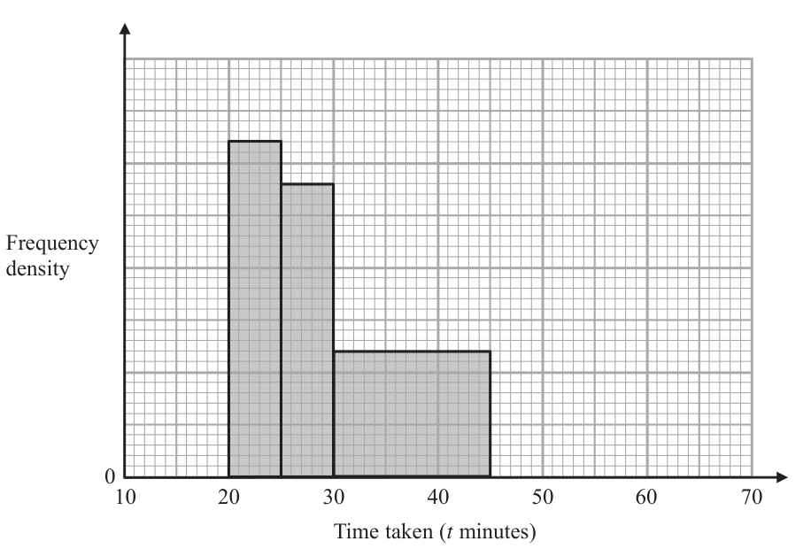
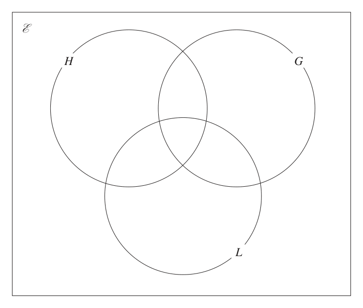
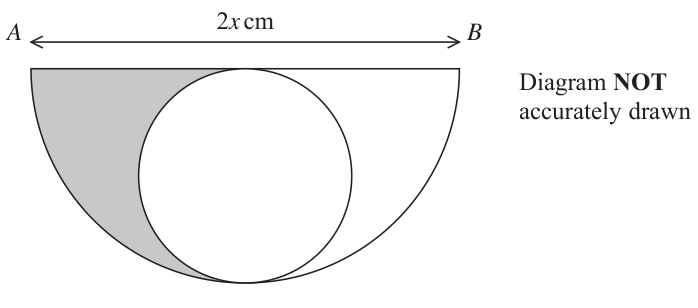

# 4MB1/01 — 2019-06 (official extraction)

> schema `syllabai.official-paper-questions/0.2` · paper_id `pearson-edexcel:international-gcse:mathematics-b:4mb1:2019-06:4MB1/01` · qp sha256 `84be5ea015c65808…` · extraction is the disclosed baseline (ADR-039)

## Question 1 (2 marks)
### 1(a) [1]

Write 8693 to 2 significant figures.

**Mark scheme answer**

> 8700 1 B1 oe

- **(1)** 8700 1 B1 oe

### 1(b) [1]

Write 0.0374 to 2 significant figures.

**Mark scheme answer**

> 0.037 1 B1 oe
> Total 2 marks

- **(1)** 0.037 1 B1 oe

## Question 2 (2 marks)

Find the Lowest Common Multiple (LCM) of 18, 30 and 48 Show your working clearly.

### 2 [2]

Find the Lowest Common Multiple (LCM) of 18, 30 and 48 Show your working clearly.

**Mark scheme answer**

> 18 = 2 × 32
> or 18 = 6 × 3 or 2 18 30 48
> 30 = 2 × 3 × 5 30 = 6 × 5 3 9 15 24
> 48 = 24 × 3 48 = 6 × 8 M1 Prime factors for two of 18, 30, 48 (or equivalent) or
> 3 5 8
> 2 18 30 48 lists multiples of 18, 30 and 48 (at least 2 multiples,
> or oe
> 2 9 15 24 not inc number itself for all three of the numbers, ie
> 2 9 15 12 (18),36,54, … (30),60,90, … (48),96,144,…)
> 2 9 15 6 or
> 3 9 15 3
> 3 3 5 1 table method
> 5 1 5 1
> 1 1 1
> 720 2 A1
> Total 2 marks

- **(2)** 18 = 2 × 32

## Question 3 (2 marks)

A pattern is made with white squares and shaded squares.

### 3(a) [1]

Shade one more square to make a pattern with exactly 1 line of symmetry.

**Mark scheme answer**

> Second row
> 1 B1 Or row four third square
> first square

- **(1)** Second row

### 3(b) [1]

Shade one more square to make a pattern with rotational symmetry of order 2

**Mark scheme answer**

> Second row
> 1 B1
> third square
> Total 2 marks

- **(1)** Second row

## Question 4 (2 marks)

Work out 2 ÷3 4 6 Show your working clearly and give your answer as a fraction in its simplest form.

### 4 [2]

Work out 2 ÷3 4 6 Show your working clearly and give your answer as a fraction in its simplest form.

**Mark scheme answer**

> 9 6 9 23
> × or ÷ M1 Or equivalent method for dividing two fractions
> 54 27 9 3 27 9 23 27 27 46 27
> = or × = or ÷ = or ÷ = oe 2 A1 Dependent on all working seen
> 92 46 2 23 46 2 3 46 12 12 47
> Total 2 marks
> Question Working Answer Mark Notes

- **(2)** 9 6 9 23

## Question 5 (2 marks)

Given that y = 2 x 4 − 2 x dy find dx dy . . . . . . . . . . . . . . . . . . . . . . . . . . . . . . . . . . . . . . . . . . . . . . . . . . . . . . . = dx

### 5 [2]

Given that y = 2 x 4 − 2 x dy find dx dy = dx

**Mark scheme answer**

> M1 One term differentiated correctly
> 8x 3 + 2 A1 oe (e.g. 8x3 + 6x−3 )
> x3
> Total 2 marks

- **(2)** M1 One term differentiated correctly

## Question 6 (2 marks)

A straight line passes through the points with coordinates (2, –10) and (–3, 5) Calculate the gradient of the line.

### 6 [2]

A straight line passes through the points with coordinates (2, –10) and (–3, 5) Calculate the gradient of the line.

**Mark scheme answer**

> 5 − ( −10 )
> M1 Condone one sign error or award if gradient of 3
> −3 − 2
> −3 2 A1
> Total 2 marks

- **(2)** 5 − ( −10 )

## Question 7 (2 marks)

Expand and simplify (4x – 5)(2x + 3)

### 7 [2]

Expand and simplify (4x – 5)(2x + 3)

**Mark scheme answer**

> 2 M1 Four terms seen with at least three correct (with signs)
> 8x + 12x −10x −15 or two terms correct in a three term expression
> A1 Correct answer with no working scores both marks. Do
> 8x2 + 2 x −15
> not ignore subsequent working.
> Total 2 marks

- **(2)** 2 M1 Four terms seen with at least three correct (with signs)

## Question 8 (2 marks)

The nth term of a sequence is given by 24 – 5n Find the sum of the 3rd term and the 10th term of the sequence.

### 8 [2]

The nth term of a sequence is given by 24 – 5n Find the sum of the 3rd term and the 10th term of the sequence.

**Mark scheme answer**

> M1 Or both terms correct but not added. Terms are 9 and -
> ( 24 − 5(3)) + ( 24 − 5(10))
> −17 2 A1
> Total 2 marks

- **(2)** M1 Or both terms correct but not added. Terms are 9 and -

## Question 9 (2 marks)

Each exterior angle of a regular polygon is 9° Calculate the number of sides of the polygon.

### 9 [2]

Each exterior angle of a regular polygon is 9° Calculate the number of sides of the polygon.

**Mark scheme answer**

> 360
> or 9n = 360 or 180 ( n − 2 ) = 171n oe M1
> 40 A1
> Total 2 marks

- **(2)** 360

## Question 10 (2 marks)

In a sale, the price of a book is reduced by 15% The price of the book before the sale was £7.60 Calculate the sale price of the book. £ .......................................................

### 10 [2]

In a sale, the price of a book is reduced by 15% The price of the book before the sale was £7.60 Calculate the sale price of the book. £

**Mark scheme answer**

> M1 Or for working out 15% of £7.60 (=£1.14 or 114p) and
> 7.60 × 0.85
> taking away from £7.60 or 760. Units not needed
> £6.46 2 A1 accept 646p
> Total 2 marks
> Question Working Answer Mark Notes

- **(2)** M1 Or for working out 15% of £7.60 (=£1.14 or 114p) and

## Question 11 (3 marks)
### 11(a) [1]

Simplify 2x2 q 3x5

**Mark scheme answer**

> 6x 7 1 B1

- **(1)** 6x 7 1 B1

### 11(b) [2]

Simplify (4a2b3)3

**Mark scheme answer**

> M1 for two terms correct as part of a product. Do not ISW
> 64a6b9 2 A1
> Total 3 marks

- **(2)** M1 for two terms correct as part of a product. Do not ISW

## Question 12 (3 marks)

The function f is defined for all values of x by f : x 6 x2 – 2

### 12(a) [1]

Write down the range of f. The function g is given by g : x 6 3 where x ≠ 3 − 4 x +4

**Mark scheme answer**

> B1 or y ≥ −2 or f ≥ −2 or set notation [-1, ∞) or
> f ( x) ≥ − 2
> f : x ≥ −2 but do not allow x ≥ −2

- **(1)** B1 or y ≥ −2 or f ≥ −2 or set notation [-1, ∞) or

### 12(b) [2]

Calculate fg(2)

**Mark scheme answer**

> 12
> 2 M1 Evidence of correct first step eg or g(2) = 1 or
> ⎛ 12 ⎞
> ⎛ 12 ⎞ 2 +4
> [fg(2) =]f ⎜ 3 ⎟ [ =f (1)] or [fg( x) =]⎜ x 3 + 4 ⎟ − 2 ⎛ 12 ⎞
> ⎝2 +4⎠ ⎝ ⎠ f(1) or ⎜ 3 ⎟ −2
> ⎝ x +4⎠
> −1 2 A1 Must not come from any incorrect working
> Total 3 marks

- **(2)** 12

## Question 13 (3 marks)
### 13(a) [1]

Find the value of 3c2 when c = –8

**Mark scheme answer**

> 192 1 B1

- **(1)** 192 1 B1

### 13(b) [2]

Factorise completely 3c2 + 6c

**Mark scheme answer**

> 3 ( c + 2c ) or c ( 3c + 6 )
> M1
> 3c ( c + 2) 2 A1 allow (3c + 0)(c + 2) Do not IS
> Total 3 marks
> Question Working Answer Mark Notes

- **(2)** 3 ( c + 2c ) or c ( 3c + 6 )

## Question 14 (3 marks)

Simplify fully 4 x 2 − 36

### 14 [3]

Simplify fully 4 x 2 − 36

**Mark scheme answer**

> ( x − 3)( 3x + 1) M1 allow any one correct factorisation of numerator or
> 4 ( x − 3)( x + 3) denominator 4 ( x 2 − 9 ) , ( 2 x + 6 )( 2 x − 6 ) ,
> ( 4 x − 12 )( x + 3) , ( x − 3)( 4 x + 12 ) , 2 ( x − 3)( 2 x + 6 )
> 2 ( 2 x − 6 )( x + 3) oe or (x – 3)(3x + 1) These may
> appear on their own rather than as part of the fraction
> M1 Both numerator and denominator factorised correctly.
> These may appear on their own rather than as part of
> the fraction.
> The denominator does not need to have a common
> factor but it must have a pair of correct brackets.
> (not 4(x² − 9)) but allow other factorisation.
> 3x + 1 A1 Final answer – allow 4x + 12 in the denominator. Do
> 4 ( x + 3) Not allow 2(2x + 6)
> Total 3 marks
> Question Working Answer Mark Notes

- **(3)** ( x − 3)( 3x + 1) M1 allow any one correct factorisation of numerator or

## Question 15 (3 marks)

A Diagram NOT R accurately drawn C P Q B The diagram shows ABC. APQR is a parallelogram where P is the midpoint of AB, Q is the midpoint of BC and R is the midpoint of AC. Prove that PBQ and RQC are congruent.

### 15 [3]

A Diagram NOT R accurately drawn C P Q B The diagram shows ABC. APQR is a parallelogram where P is the midpoint of AB, Q is the midpoint of BC and R is the midpoint of AC. Prove that PBQ and RQC are congruent.

> 🖼 crop required: diagram (qp.pdf p.None)

**Mark scheme answer**

> Side/Angle Reason
> BQ = QC Q is midpoint/bisection of BC
> PQ = RC AR = RC and AR = PQ (opposite side of a M1 Identifying a pair of equal sides/angles with a reason.
> parallelogram are equal) They must state the pair of sides/angles and the reason
> QR = BP AP = PB and AP = RQ (opposite side of a must include the words in bold.
> parallelogram are equal)
> ∠PBQ = ∠RQC Corresponding angles
> ∠BQP = ∠QCR Corresponding angles M1 identifying a second relevant pair of equal sides/angles
> ∠BPQ = ∠QRC ∠BPQ = ∠PQR and ∠PQR = ∠QRC with a reason. They must state the pair of sides/angles
> Alternate angles or and the reason must include the words in bold.
> ∠APQ = ∠ARQ & angle on a straight line
> SSS or SAS or
> A1 must state SSS, SAS, ASA or AAS and have all 3
> ASA or AAS
> relevant sides/angles shown to be equal
> with the third
> relevant angle
> NB There may be alternative reasons. Look for at least 1
> or side shown
> correct mathematical word for each pair
> to be equal.
> Total 3 marks

- **(3)** Side/Angle Reason

## Question 16 (4 marks)

Here is a biased spinner labelled 1, 2, 3, 4, 5, 6 6 2 5 3 The table below shows information about the probability that when the spinner is spun once it will land on each of the numbers 1, 2, 3, 4, 5, 6 Number 1 2 3 4 5 6 Probability 0.05 0.1 2x – 0.1 0.2 0.3 3x + 0.2 Abdul is going to spin the spinner 300 times.

### 16(a) [1]

Calculate an estimate for the number of times the spinner will land on number 1

**Mark scheme answer**

> 15 1 B1

- **(1)** 15 1 B1

### 16(b) [3]

Calculate the probability that when the spinner is spun once it lands on number 6

**Mark scheme answer**

> 0.05 + 0.1 + ( 2 x − 0.1) + 0.2 + 0.3 + ( 3x + 0.2 ) = 1 oe M1 Using Σ p = 1. You may award the mark if this is
> seen in part (a) Award if they get x = 0.05 oe
> M1ft for subst their x into 3x + 0.2 need to see working
> (or into 2x – 0.1 and doing 1 – 0.65 – (“their 2x – 0.1”))
> to find the probability of 6. (x must be between 0 and
> 0.27)
> 0.35 3 A1 Allow 35%, oe
> Total 4 marks
> Question Working Answer Mark Notes

- **(3)** 0.05 + 0.1 + ( 2 x − 0.1) + 0.2 + 0.3 + ( 3x + 0.2 ) = 1 oe M1 Using Σ p = 1. You may award the mark if this is

## Question 17 (4 marks)

Here is ABC. C Diagram NOT accurately drawn 6 cm 30q A 2 cm B

### 17(a) [2]

Calculate the area, in cm2, of ABC cm2 Here is PQR. Q Diagram NOT accurately drawn 12 cm x° R 4 cm P

> 🖼 crop required: diagram (qp.pdf p.None)

**Mark scheme answer**

> 1
> ( 2 )( 6 ) sin 30 oe M1
> 3 2 A1

- **(2)** 1

### 17(b) [2]

Calculate the value, to 3 significant figures, of x. x =

**Mark scheme answer**

> 4 [(sin 90)] 122 − 42
> cos x = or sin x° = or
> 12 12 M1 Complete method (e.g. Pythagoras followed by sine,
> cosine rule, etc.)
> 122 − 42 122 + 42 − ( 122 − 42 )2
> tan x° = or cos x° = Allow 8 2 or awrt 11.3 for 122 − 42
> 4 2 ×12 × 4
> 70.5 2 A1 awrt 70.5
> Total 4 marks
> Question Working Answer Mark Notes

- **(2)** 4 [(sin 90)] 122 − 42

## Question 18 (4 marks)

There are 9 marbles in bag A and 11 marbles in bag B. In bag A, there are 3 red marbles, 2 yellow marbles and 4 green marbles. In bag B, there are 2 red marbles, 4 yellow marbles and 5 purple marbles. Ted takes at random one marble from bag A and one marble from bag B. Calculate the probability that the two marbles are not the same colour.

### 18 [4]

There are 9 marbles in bag A and 11 marbles in bag B. In bag A, there are 3 red marbles, 2 yellow marbles and 4 green marbles. In bag B, there are 2 red marbles, 4 yellow marbles and 5 purple marbles. Ted takes at random one marble from bag A and one marble from bag B. Calculate the probability that the two marbles are not the same colour.

**Mark scheme answer**

> 3 2 2 4
> M1 One of × or ×
> 9 11 9 11
> 3 9 ⎛3 4 3 5 ⎞
> or P( R, not R) ie × accept ⎜ × + × ⎟
> 9 11 ⎝ 9 11 9 11 ⎠
> 2 7 ⎛2 2 2 5 ⎞
> or P( Y, not Y) ie × accept ⎜ × + × ⎟
> 9 11 ⎝ 9 11 9 11 ⎠
> 4 ⎛4 2 4 4 4 5 ⎞
> or P( G, not G) ie × 1 accept ⎜ × + × + × ⎟
> 9 ⎝ 9 11 9 11 9 11 ⎠
> 3 9 ⎛3 4 3 5 ⎞
> M1 Or two of × accept ⎜ × + × ⎟
> 9 11 ⎝ 9 11 9 11 ⎠
> ⎛3 2 ⎞ ⎛2 4 ⎞ 2 7 ⎛2 2 2 5 ⎞
> ⎜ × ⎟+⎜ × ⎟ or × accept ⎜ × + × ⎟
> ⎝ 9 11 ⎠ ⎝ 9 11 ⎠ 9 11 ⎝ 9 11 9 11 ⎠
> 4 ⎛4 2 4 4 4 5 ⎞
> or × 1 accept ⎜ × + × + × ⎟
> 9 ⎝ 9 11 9 11 9 11 ⎠
> ⎛⎛ 3 2 ⎞ ⎛ 2 4 ⎞⎞ M1dep on both previous method marks being awarded.
> 1− ⎜⎜ × ⎟ + ⎜ × ⎟⎟
> ⎝ ⎝ 9 11 ⎠ ⎝ 9 11 ⎠ ⎠ Attempt at correct calculation (oe)
> 4 A1 oe awrt 0.86 awrt 85%
> Total 4 marks

- **(4)** 3 2 2 4

## Question 19 (4 marks)

The period, T seconds, of a simple pendulum of length L metres is given by the formula L T = 6.28 g L = 1.32 to 3 significant figures. g = 9.8 to 2 significant figures. Calculate the upper bound, to 3 significant figures, of T.

### 19 [4]

The period, T seconds, of a simple pendulum of length L metres is given by the formula L T = 6.28 g L = 1.32 to 3 significant figures. g = 9.8 to 2 significant figures. Calculate the upper bound, to 3 significant figures, of T.

**Mark scheme answer**

> UB of 1.32 is 1.325 B1 1.325 seen implied by correct answer
> LB of 9.8 is 9.75 B1 9.75 seen implied by correct answer
> 1.325
> 6.28 M1 Subst in their L > 1.32 and g < 9.8
> 9.75
> 2.32 4 A1 awrt 2.32
> Total 4 marks

- **(4)** UB of 1.32 is 1.325 B1 1.325 seen implied by correct answer

## Question 20 (4 marks)

The incomplete histogram and the incomplete table give information about the time taken, in minutes, for some students to each complete a piece of homework. No student took less than 10 minutes to complete the homework and no student took longer than 60 minutes to complete the homework. Frequency density 10 20 30 40 50 60 70 Time taken (t minutes) Time taken (t minutes) Number of students 10 - t 20 5 20 - t 25 8 25 - t 30 - t 45 - t 60 3 Complete the histogram and the table.

### 20 [4]

The incomplete histogram and the incomplete table give information about the time taken, in minutes, for some students to each complete a piece of homework. No student took less than 10 minutes to complete the homework and no student took longer than 60 minutes to complete the homework. Frequency density 10 20 30 40 50 60 70 Time taken (t minutes) Time taken (t minutes) Number of students 10 - t 20 5 20 - t 25 8 25 - t 30 - t 45 - t 60 3 Complete the histogram and the table.

**Mark scheme answer**

> fd = 1.6 , 0.5, 1.4, 0.6, 0.2 M1 for use of area to work out freq density. Implied by the
> Question Working Answer Mark Notes
> frequency of 30 – 45 being 9 or a bar drawn at the
> correct height
> A3 for all four correct, A2 for three and A1 for two
> 7, 9
> The heights must be drawn on the histogram and be for 10
> Heights at 0.5
> – 20 10 small squares high, for 45 – 60 4 small square
> and 0.2
> 4 high
> Total 4 marks

- **(4)** fd = 1.6 , 0.5, 1.4, 0.6, 0.2 M1 for use of area to work out freq density. Implied by the

## Question 21 (4 marks)

Make x the subject of x x + 2y −5= 3 3w − 2 y Give your answer as a single fraction.

### 21 [4]

Make x the subject of x x + 2y −5= 3 3w − 2 y Give your answer as a single fraction.

**Mark scheme answer**

> x(3w − 2 y ) − 15(3w − 2 y ) = 3 ( x + 2 y ) or M1 Multiply through by ( 3w − 2 y ) and 3 – not necessarily
> ( 3w − 2 y )( x − 15) = 3( x + 2 y ) at the same time
> 3x + 2 xy − 3xw = 24 y − 45w M1 Collect x terms on one side and other terms on the
> opposite side (indep of first M)
> M1 taking x out as a common factor of an equation
> x ( 3 + 2 y − 3w ) = 24 y − 45w
> correctly
> 24 y − 45w A1 Final answer – or equivalent – but must a single
> x=
> 3 + 2 y − 3w 4 fraction . The numerator and denominator need not be
> simplified. Do not ISW
> Total 4 marks

- **(4)** x(3w − 2 y ) − 15(3w − 2 y ) = 3 ( x + 2 y ) or M1 Multiply through by ( 3w − 2 y ) and 3 – not necessarily

## Question 22 (5 marks)

E Diagram NOT accurately drawn C D F 2.3 m 0.5 m A 1.2 m B ABCDEF is a right triangular prism in which AB = 1.2 m BC = 2.3 m AF = 0.5 m ∠FAB = 90° Calculate the total surface area, in m2, of the prism. . . . . . . . . . . . . . . . . . . . . . . . . . . . . . . . . . . . . . . .. . . . . . . . . . . . . m2

### 22 [5]

E Diagram NOT accurately drawn C D F 2.3 m 0.5 m A 1.2 m B ABCDEF is a right triangular prism in which AB = 1.2 m BC = 2.3 m AF = 0.5 m ∠FAB = 90° Calculate the total surface area, in m2, of the prism m2

> 🖼 crop required: diagram (qp.pdf p.None)

**Mark scheme answer**

> 2
> M1 Award for 0.5 + 1.2 or 1.3 or correct method
> BF = 0.52 + 1.22 [⇒ BF = 1.3]
> using trig to find an angle and then to find FB
> [Area of triangle ABF (or CDE)] = 0.5 × 0.5 ×1.2 [=0.3] M1 Allow use of ab sin c with a correct method used to
> or [area of ABF + DCE =] 2 × 0.5 × 0.5 ×1.2 [=0.6]
> find the angle
> [Area of rectangle ADEF] = 0.5 × 2.3 [=1.15]
> M1
> and [Area of rectangle ABCD] = 1.2 × 2.3 [=2.76]
> [Area of rectangle BCEF]= 2.3 × "1.3" [=2.99] M1 dep on 1st M1 being awarded – allow their 1.3
> 7.5 5 A1 cao
> Total 5 marks
> Question Working Answer Mark Notes

- **(5)** 2

## Question 23 (5 marks)

In a survey, 60 students were asked whether they study any of History (H), Geography (G) or Latin (L). Of these students 27 study History 25 study Geography 18 study Latin 13 study both History and Latin 2 study both Geography and Latin 8 study History only No students study History and Geography and Latin.

### 23(a) [3]

Use the information to complete the Venn diagram. E H G L

**Mark scheme answer**

> B3 for all 8 correct
> B2 for 6 or 7 correct
> B1 for 4 or 5 correct
> If all other numbers are correct allow a blank for zero.
> Allow if written as a sum eg 18 – 2 – 13
> Do not allow entries in terms of a letter eg x

- **(3)** B3 for all 8 correct

### 23(b) [1]

Find the number of students who study History but not Latin.

**Mark scheme answer**

> 1 B1ft Allow ft for "their 8"+ "their 6" but do not award ft
> if one of the required areas is a blank or if in terms of x

- **(1)** 1 B1ft Allow ft for "their 8"+ "their 6" but do not award ft

### 23(c) [1]

Find n(H‫[ ˆ މ‬L ‰ G])

**Mark scheme answer**

> 1 B1ft Allow ft for "their 17"+ "their 2"+ "their 3" but do
> not award ft if one of the required areas is a blank
> Total 5 marks
> Question Working Answer Mark Notes

- **(1)** 1 B1ft Allow ft for "their 17"+ "their 2"+ "their 3" but do

## Question 24 (5 marks)

Y Diagram NOT Z accurately drawn –3a + 5b X 2a + 3b O → → The diagram shows OXY where OX = 2a + 3b and OY = –3a + 5b →

### 24(a) [2]

Find and simplify an expression, in terms of a and b, for YX . → 2 35 The point Z on YX is such that OZ = − a + b 9 9

**Mark scheme answer**

> YX = YO + OX or YX = OX − OY or 3a – 5b + 2a + 3b M1do not accept XY
> 5a − 2b 2 A1 oe

- **(2)** YX = YO + OX or YX = OX − OY or 3a – 5b + 2a + 3b M1do not accept XY

### 24(b) [3]

Calculate, in its simplest form, the ratio of YZ : ZX

**Mark scheme answer**

> 2
> ⎡YZ = OZ − OY = ⎤ ⎜⎛ − a + b ⎞⎟ − ( −3a + 5b ) M1 any 1 correct method. ft their YX from part a. and their
> ⎣ ⎦⎝ 9 9 ⎠ KZ in the 4/5th line. May be implied by one of
> 2 35 25 10
> ⎡ ZX = ZO + OX = ⎤ − ⎛⎜ − a + b ⎞⎟ + 2a + 3b YZ = a− b
> ⎣ ⎦ ⎝ 9 9 ⎠ 9
> 25 10 20
> ⎡ ZX = YX − YZ = ⎤ ("5a − 2b ") − ⎛⎜ a − b ⎞⎟ ZX = a − b
> ⎣ ⎦ ⎝ 9 9 ⎠ 9
> 20 8 ⎞
> ("5a − 2b ") = k ⎛⎜ " a − b "⎟ k=
> ⎝ 9 9 ⎠
> ⎛ 20 8 ⎞ j=
> j ("5a − 2b ") = ⎜ " a − b " ⎟
> ⎝ 9 9 ⎠

- **(3)** 2

## Question 25 (6 marks)

A Diagram NOT B accurately drawn 62° C 126° O D In the diagram, A, B, C and D are points on a circle, centre O. ∠CBO = 62° and ∠BCD = 126°

### 25(a) [2]

Find the size, in degrees, of ∠BAD. Give a reason for your answer. ° ∠BAD =

**Mark scheme answer**

> 54 B1
> B1 need bold – other reasons may be given - must be
> eg The sum of the opposite angles in a cyclic quadrilateral is
> Reason 2 associated with method used (see below for bold
> 180°
> words)

- **(2)** 54 B1

### 25(b) [4]

Find the size, in degrees, of ∠ODC. Give reasons for your working. ° ∠ODC =

**Mark scheme answer**

> 10 20 8
> YZ = a − b and ZX = a − b
> 9 9 9
> A1 accept decimals for fractions if meaning clear
> 4
> or k = or j =
> 9
> 5
> A1 Allow :1 or 1: or 1.25 : 1 or 1 : 0.8 do not
> 4
> 5: 4
> allow YX = ZX oe
> Total 5 marks
> Question Working Answer Mark Notes
> 360 – (108 + 126 + 62) M1ft their 108 but must be clear it is BOD
> 64 A1
> Angle at centre of a circle is twice angle at the circumference
> B1 need one reason only and bold words – must be
> or angles in a quadrilateral add up to 360° Reason
> associated with method used
> or angles at a point add up to 360°
> Alternative method marks 1
> M1
> ∠BCO = 62
> ∠OCD = 126 − 62 M1ft their 62 but must be clear it is BCO
> 64 A1
> Base(oe) angles of an isosceles triangle are the same B1 need bold words – must be associated with method used
> Alternative method marks 2
> Let ∠ODA = y ∴∠ABO = "54"+ y M1ft Using their part (a)
> ∠CDA = 360 − 126 − 62 − "54"− ("54"+ y ) M1
> 64 A1
> Isosceles triangle, angles in a triangle add up to 180° and angles B1 need one reason only and bold words – must be
> Reason
> in a quadrilateral add up to 360° associated with method used
> Total 6 marks
> Question Working Answer Mark Notes

- **(4)** 10 20 8

## Question 26 (6 marks)

A=⎜ B=⎜ ⎝ −5 1⎟⎠ ⎝ 1 −1⎟⎠ The determinant of the matrix A2 – AB is equal to 3k + 28 Find the value of k. k = .......................................................

### 26 [6]

A=⎜ B=⎜ ⎝ −5 1⎟⎠ ⎝ 1 −1⎟⎠ The determinant of the matrix A2 – AB is equal to 3k + 28 Find the value of k. k =

**Mark scheme answer**

> ⎛ −11 9 ⎞
> A2 = ⎜ ⎟ M1Condone one error
> ⎝ −15 −14 ⎠
> ⎛ 11 2k − 3 ⎞
> AB = ⎜ ⎟ M1 Condone one error
> ⎝ −19 −5k − 1⎠
> ⎛ −22 12 − 2k ⎞
> A2 − AB = ⎜ ⎟ A1 cao
> ⎝ 4 5k − 13 ⎠
> det ( A2 − AB ) = −22 ( 5k − 13) − 4 (12 − 2k ) M1 ft their A2 − AB
> M1dep on previous M1- Sets their determinant equal to
> −22(5k −13) − 4(12 − 2k ) = 3k + 28 ⇒ k = ...
> 3k + 28 and attempts to solve for k
> k =2 6 A1
> Total 6 marks

- **(6)** ⎛ −11 9 ⎞

## Question 27 (6 marks)

A 2x cm B Diagram NOT accurately drawn The diagram shows a semicircle, with diameter AB, where AB = 2x cm. The diagram also shows a circle, which is the circle with the greatest possible radius that can be drawn inside the semicircle. The perimeter of the shaded region is P cm and the area of the shaded region is A cm2. Given that P = A, find an expression for x in terms of ʌ x = .......................................................

### 27 [6]

A 2x cm B Diagram NOT accurately drawn The diagram shows a semicircle, with diameter AB, where AB = 2x cm. The diagram also shows a circle, which is the circle with the greatest possible radius that can be drawn inside the semicircle. The perimeter of the shaded region is P cm and the area of the shaded region is A cm2. Given that P = A, find an expression for x in terms of ʌ x =

**Mark scheme answer**

> 1 2
> Area of large semicircle = π x or half large semicircle = π x 2 M1
> 2
> 2
> ⎛ x⎞ 1 ⎛ x⎞
> Area of small circle = π ⎜ ⎟ or half small circle = π ⎜ ⎟ M1
> 2 ⎝ ⎠ 2 ⎝2⎠
> 1⎛1 2 ⎛ x ⎞ ⎞⎡ 1 2⎤
> Shaded region = ⎜ πx − π ⎜ ⎟ ⎟⎟ ⎢ = πx ⎥ A1
> 2 ⎜⎝ 2 ⎝ 2 ⎠ ⎠⎣ 8 ⎦
> 1 1⎛ x ⎞
> Perimeter = x + ( 2π x ) + ⎜ 2π ⎜⎛ ⎞⎟ ⎟ [ = πx + x] M1 dep on first two methods.
> 4 2 ⎝ ⎝ 2 ⎠⎠
> π x2 M1 Equates their expressions for the perimeter and area of
> " " = "π x + x "
> 8 shaded region
> 8 (π + 1)
> x= 6 A1 Or equivalent
> π
> Total 6 marks
> \
> Question Working Answer Mark Notes

- **(6)** 1 2

## Question 28 (8 marks)

A particle P is moving along a straight line. At time t seconds, the displacement, x metres, of P from a fixed point O on the line is given by x = –3t3 + 6t2 + kt + 4 t.0 At time t seconds, the velocity of P is v m/s such that v = 9 when t = 2

### 28(a) [3]

Show that k = 21 Particle P comes to instantaneous rest at the point A.

**Mark scheme answer**

> M1 A three term expression is needed with 1 correct term
> [v =] − 9t 2 + 12t + k or a 4 term expression with 2 terms correct
> M1dep Substituting t = 2 into their equation and equating
> −9 ( 2) + 12(2) + k = 9
> to 9 Allow substitution of 21 and showing it equals 9
> A1 stating k = 21 following a fully correct solution with no
> k = 21
> errors. Note that answer given in question

- **(3)** M1 A three term expression is needed with 1 correct term

### 28(b) [3]

Using k = 21, find the value of t when P is at A. t =

**Mark scheme answer**

> −9t 2 + 12t + 21 = 0 M1
> M1 Solving their trinomial quadratic.
> eg ( 3t − 7 )( t + 1) = 0 For factorising any 3 term quadratic which when
> expanded, the result gives at least 2 of the 3 terms
> from their trinomial.
> correct use of formula by substituting values in
> correctly or completing the square. Allow one slip.
> 3 A1 oe awrt 2.3 with negative value rejected

- **(3)** −9t 2 + 12t + 21 = 0 M1

### 28(c) [2]

Find, to the nearest metre, the distance OA m

**Mark scheme answer**

> M1ft Substitute their positive t from part (b) into expression
> OA = −3("7 / 3") + 6 ("7 / 3") + 21("7 / 3") + 4
> 3
> for x
> 48 2 A1 cao do not ISW
> Total 8 marks
> Pearson Education Limited. Registered company number 872828
> with its registered office at 80 Strand, London, WC2R 0RL, United Kingdom

- **(2)** M1ft Substitute their positive t from part (b) into expression

