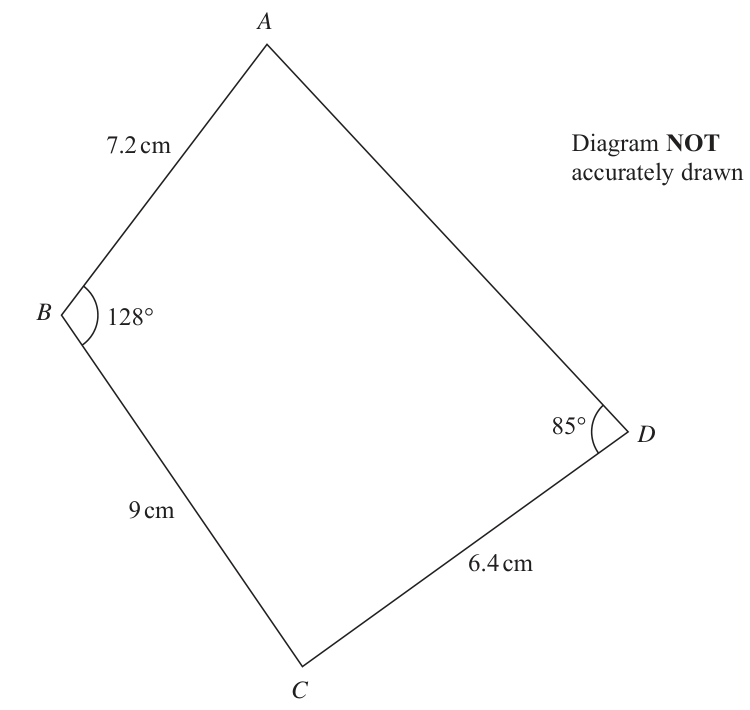

# 4MB1/01R — 2019-06 (official extraction)

> schema `syllabai.official-paper-questions/0.2` · paper_id `pearson-edexcel:international-gcse:mathematics-b:4mb1:2019-06:4MB1/01R` · qp sha256 `7c5e919e253cda4d…` · extraction is the disclosed baseline (ADR-039)

## Question 1 (2 marks)

Find the Lowest Common Multiple (LCM) of 60 and 135 Show your working clearly.

### 1 [2]

Find the Lowest Common Multiple (LCM) of 60 and 135 Show your working clearly.

**Mark scheme answer**

> 60, 120, 180, 240, 300, 360, 420, 480, 540, ... M1 for a correct list of multiples up to 540 or 60 and 135 written as a correct
> 135, 270, 405, 540, ... product of primes - factors may be on ends of trees or in ladder diagrams (so
> expect to see 3, 3, 3, 4 and 5 or equivalent e.g. 3, 4, 5, 9) or correct factor grid
> or
> The following is common:
> 60 = 2×2×3×5 or 15×2×2
> 135 = 3×3×3×5 or 15×3×3
> 5 60 135
> or 3 12
> 4 4
> 5 60 135 9 1
> 3 12 27 1
> 4
> 540 2 A1
> Total 2 marks

- **(2)** 60, 120, 180, 240, 300, 360, 420, 480, 540, ... M1 for a correct list of multiples up to 540 or 60 and 135 written as a correct

## Question 2 (2 marks)

The nth term of a sequence is given by 9n í Determine whether 214 is a term of this sequence. Show your working clearly.

### 2 [2]

The nth term of a sequence is given by 9n í Determine whether 214 is a term of this sequence. Show your working clearly.

**Mark scheme answer**

> 9n – 7 = 214 M1 or for working out the 24th and 25th terms
> No and n = 2 A1 oe (e.g. No with either 24.5 or 24.6 (or better)) – for A1 must
> 24.55... or see ‘No’ + appropriate values
> 9n = 221 and
> 221 is not a 221
> multiple of 9 A0 if No and n = only
> or 24th term =
> 209, For A1 it must be explicitly clear that n =
> 221
> is not an integer
> 25th term =
> 218 221
> e.g. No and n = is not an integer/whole number is A1
> Total 2 marks

- **(2)** 9n – 7 = 214 M1 or for working out the 24th and 25th terms

## Question 3 (2 marks)

Here are four numbers written in order of size. w x 24 The range of the four numbers is 18 The median of the four numbers is 10 Find the value of w and the value of x. w = ...................................................... x = ......................................................

### 3 [2]

Here are four numbers written in order of size. w x 24 The range of the four numbers is 18 The median of the four numbers is 10 Find the value of w and the value of x. w = x =

**Mark scheme answer**

> 7+ x
> M1 for 24 – 18 (= 6) or = 10 oe or one value correctly stated
> w=6 2 A1
> x = 13 SC B1 for w = 13, x = 6
> Total 2 marks

- **(2)** 7+ x

## Question 4 (2 marks)

8 cm Diagram NOT accurately drawn 12 cm The diagram shows a right circular cylinder of radius 8 cm and height 12 cm. Calculate the volume, in cm3 to the nearest cm3, of the cylinder. ...................................................... cm3

### 4 [2]

8 cm Diagram NOT accurately drawn 12 cm The diagram shows a right circular cylinder of radius 8 cm and height 12 cm. Calculate the volume, in cm3 to the nearest cm3, of the cylinder cm3

> 🖼 crop required: diagram (qp.pdf p.None)

**Mark scheme answer**

> π × 8² × 12 M1 (or for 768π )
> 2413 2 A1 accept answer in the range 2412 – 2413
> Total 2 marks

- **(2)** π × 8² × 12 M1 (or for 768π )

## Question 5 (2 marks)

Solve =9 x = ......................................................

### 5 [2]

Solve =9 x =

**Mark scheme answer**

> 2x 3 M1 (oe)
> 2x = 5 × 9 + 3 or = 9+
> 5
> 24 2 A1
> Total 2 marks

- **(2)** 2x 3 M1 (oe)

## Question 6 (2 marks)

Q = cð í c Work out the value of Q when c í Q = ......................................................

### 6 [2]

Q = cð í c Work out the value of Q when c í Q =

**Mark scheme answer**

> (−6)² − 4 ×−6 oe M1 (must include a bracket around the –6 unless recovered later)
> e.g. 36 − − 24 or −6(−6 – 4) or for (+)36 or (+)24 seen in their working
> M0 if –12 seen with no working
> M0 if –12 comes from –62− 4 ×−6 without seeing (+)24
> 60 2 A1
> Total 2 marks

- **(2)** (−6)² − 4 ×−6 oe M1 (must include a bracket around the –6 unless recovered later)

## Question 7 (2 marks)

Without using a calculator and showing all your working, work out 3 11 2 ÷ 4 12 Give your answer in its simplest form.

### 7 [2]

Without using a calculator and showing all your working, work out 3 11 2 ÷ 4 12 Give your answer in its simplest form.

**Mark scheme answer**

> 11 12 33 11 33 M1
> × or ÷ =
> 4 11 12 12 11
> 3 2 A1 dependent on all working seen
> = 3 or × = 3 oe
> 132 1 12 12 1 3
> = 3 or × =
> 44 4 1 4 1 1
> (cancelling of 11s and 4 and 12 seen) or 11 12 33 12
> 33 11 33 11 12 12 × = 3 or × = 3 is A0 unless explicit cancelling seen
> ÷ = = 3 or × = =3 4 11 12 11
> 12 12 11 4 11 4
> Total 2 marks

- **(2)** 11 12 33 11 33 M1

## Question 8 (2 marks)

B Diagram NOT accurately drawn A O x 132° D C A, B, C and D are points on a circle, centre O. Angle ADC = 132° Calculate, in degrees, the size of angle x. °

### 8 [2]

B Diagram NOT accurately drawn A O x 132° D C A, B, C and D are points on a circle, centre O. Angle ADC = 132° Calculate, in degrees, the size of angle x. °

> 🖼 crop required: diagram (qp.pdf p.None)

**Mark scheme answer**

> M1 for ABC = 48° or reflex AOC = 264° stated or marked on diagram
> 96 2 A1
> Total 2 marks

- **(2)** M1 for ABC = 48° or reflex AOC = 264° stated or marked on diagram

## Question 9 (2 marks)

y = 4x3 í x2 dy Find dx dy = ...................................................... dx

### 9 [2]

y = 4x3 í x2 dy Find dx dy = dx

**Mark scheme answer**

> 14
> M1 for 12x² or 14x−3 oe (e.g. )
> x3
> 12x² + 14x−3 2
> A1 oe (e.g. 12x 2 + ) must be + in between the two terms – mark final
> x3
> answer
> Total 2 marks

- **(2)** 14

## Question 10 (2 marks)

Given that a is a positive integer, expand and simplify fully 5a ( 20a + a 5a )

### 10 [2]

Given that a is a positive integer, expand and simplify fully 5a ( 20a + a 5a )

**Mark scheme answer**

> M1 for writing 100a 2 + a 25a 2 or 20a = 2 5a or for 10a or 5a²
> 10a + 5a² 2 A1 or equivalent e.g. 5a ( 2 + a ) but A0 if correct answer replaced
> with 2a + a 2 (or other incorrect simplification)
> Total 2 marks

- **(2)** M1 for writing 100a 2 + a 25a 2 or 20a = 2 5a or for 10a or 5a²

## Question 11 (2 marks)

A Diagram NOT accurately drawn FP C P 4 cm D 5 cm B A, C, B and D are four points on a circle. The chord AB intersects the chord CD at P. AP FP PB = 5 cm PD = 4 cm Calculate, in cm, the length of CP. ...................................................... cm

### 11 [2]

A Diagram NOT accurately drawn FP C P 4 cm D 5 cm B A, C, B and D are four points on a circle. The chord AB intersects the chord CD at P. AP FP PB = 5 cm PD = 4 cm Calculate, in cm, the length of CP cm

> 🖼 crop required: diagram (qp.pdf p.None)

**Mark scheme answer**

> (7 × 5) ÷ 4 or 5 × 7 = 4 × CP M1
> oe e.g. 4CP = 35, ×7 =CP etc
> 8.75 2 A1
> Total 2 marks

- **(2)** (7 × 5) ÷ 4 or 5 × 7 = 4 × CP M1

## Question 12 (3 marks)

y x=1 4 1 y= x x+y=6 O 1 2 3 4 5 6 x Write down the three inequalities that define the shaded region in the diagram above.

### 12 [3]

y x=1 4 1 y= x x+y=6 O 1 2 3 4 5 6 x Write down the three inequalities that define the shaded region in the diagram above.

> 🖼 crop required: diagram (qp.pdf p.None)

**Mark scheme answer**

> x≥1 B1oe accept use of > oe (but B0 for 1 ≤ x ≤ 4 )
> y ≥ ½x B1oe accept use of > oe (e.g. 2 y ≥ x or y − 12 x ≥ 0 etc.)
> x+y≤6 3 B1oe accept use of > oe (e.g. y ≤ 6 − x etc.) - condone for full marks
> inconsistent use of > or ≥
> Total 3 marks

- **(3)** x≥1 B1oe accept use of > oe (but B0 for 1 ≤ x ≤ 4 )

## Question 13 (3 marks)

A motorbike was bought for £8600 The motorbike depreciated in value by 20% in the first year after it was bought and by 15% in each of the following years. Find the value of the motorbike exactly 3 years after it was bought. £ ......................................................

### 13 [3]

A motorbike was bought for £8600 The motorbike depreciated in value by 20% in the first year after it was bought and by 15% in each of the following years. Find the value of the motorbike exactly 3 years after it was bought. £

**Mark scheme answer**

> 0.2 × 8600 (=1720) or 0.8 × 8600(=6880) M1 – award M1 only for 5848 (from 8600 × 0.8 × 0.85)
> M0 for 4300 (reducing by 50%) unless first year explicitly seen
> (e.g. either 1720 or 6880 seen in calculation)
> 0.85² × “6880” M1ft sight of multiplying their ‘6880’ (which cannot be 8600 but
> allow for say 1720 or a different changed value) by 0.852 – so a
> correct method for years 2 and 3 following on from their possibly
> incorrect year 1) or M2 for 0.8 × 0.85² × 8600
> 4970.8(0) 3 A1 - award M2 only for 4970
> or 4971
> Total 3 marks

- **(3)** 0.2 × 8600 (=1720) or 0.8 × 8600(=6880) M1 – award M1 only for 5848 (from 8600 × 0.8 × 0.85)

## Question 14 (3 marks)

A= ⎜ B= ⎜ ⎝ 2 −1⎟⎠ ⎝ 2 y 7⎟⎠ ⎛ 8 27⎞ Given that 5A + nB = ⎜ where n is an integer, ⎝ 1 −26⎟⎠ find the value of n, the value of x and the value of y. n = ...................................................... x = ...................................................... y = ......................................................

### 14 [3]

A= ⎜ B= ⎜ ⎝ 2 −1⎟⎠ ⎝ 2 y 7⎟⎠ ⎛ 8 27⎞ Given that 5A + nB = ⎜ where n is an integer, ⎝ 1 −26⎟⎠ find the value of n, the value of x and the value of y. n = x = y =

**Mark scheme answer**

> ⎛ 20 15 ⎞ ⎛ 4 x⎞ M1 for correct matrix sum or 20 + 4n = 8 or −5 + 7n = −26 or
> ⎜ ⎟ + n⎜ ⎟ oe ⎛ −12 12 ⎞
> ⎝ 10 −5 ⎠ ⎝2y 7⎠ nB = ⎜ ⎟
> ⎝ −9 −21⎠
> n = −3, x 3 A2 for all 3 values correct, A1 for 2 correct values
> = −4, y=
> 1.5
> Total 3 marks

- **(3)** ⎛ 20 15 ⎞ ⎛ 4 x⎞ M1 for correct matrix sum or 20 + 4n = 8 or −5 + 7n = −26 or

## Question 15 (4 marks)
### 15(a) [2]

x u 105 + y u 103 = k u 105 Express k in terms of x and y. Give your answer in its simplest form. k =

**Mark scheme answer**

> (x × 105 + y × 103) ÷ 105 oe M1 for dividing a correct expression in x and y by 105
> x + y × 10−2 2 A1 oe (e.g. x + 10y2 or x + 100 or
> y 100 x + y
> or
> 102 x + y
> or x + 0.01 y ) but A0
> 100 102
> for ( x + y ) × 10
> −2
> - mark answer line or final answer if no expression given on
> answer line

- **(2)** (x × 105 + y × 103) ÷ 105 oe M1 for dividing a correct expression in x and y by 105

### 15(b) [2]

Calculate (8.5 u 1064) u (4 u 1068) Give your answer in standard form.

**Mark scheme answer**

> M1 for 34 × 10132
> 3.4 × 10133 2 A1
> Total 4 marks

- **(2)** M1 for 34 × 10132

## Question 16 (3 marks)

C Diagram NOT accurately drawn B D A E The diagram shows triangle ACE. The point B on CA and the point D on CE are such that BD is parallel to AE. BD FP WR VLJQLILFDQW ILJXUHV AE = 9.3 cm to 2 significant figures. Area of BCD = 15.4 cm2 to 3 significant figures. Calculate the upper bound, to 3 significant figures, for the area of ACE. ...................................................... cm2

### 16 [3]

C Diagram NOT accurately drawn B D A E The diagram shows triangle ACE. The point B on CA and the point D on CE are such that BD is parallel to AE. BD FP WR VLJQLILFDQW ILJXUHV AE = 9.3 cm to 2 significant figures. Area of BCD = 15.4 cm2 to 3 significant figures. Calculate the upper bound, to 3 significant figures, for the area of ACE cm2

> 🖼 crop required: diagram (qp.pdf p.None)

**Mark scheme answer**

> 7.15, 7.25, 9.25, 9.35, 15.35, 15.45 γ
> B1 for one of the given values, accept 7.149 etc.
> 2
> ⎛ 9.35 ⎞ ⎛ UB( AE ) ⎞
> ⎜ ⎟ ×15.45 M1 or for ⎜ ⎟ × (UB( BCD) ) where
> ⎝ 7.15 ⎠ ⎝ LB( BD) ⎠
> 9.3 < UB(AE) ≤ 9.35
> 7.15 ≤ LB(BD) < 7.2
> 15.4 < UB(BCD) ≤ 15.45
> 26.4 3 A1 (26.4204142...) – must come from correct bounds (9.35, 7.15 and 15.45
> only) – allow 26.5
> Total 3 marks

- **(3)** 7.15, 7.25, 9.25, 9.35, 15.35, 15.45 γ

## Question 17 (4 marks)

D A ƒ B Diagram NOT accurately drawn 123° x F G E C The diagram shows three straight lines ABC, DBE and FECG. ‘ABD ƒ DQG ‘BEF = 123° Calculate the size, in degrees, of angle x. Give a reason for each stage of your working. °

### 17 [4]

D A ƒ B Diagram NOT accurately drawn 123° x F G E C The diagram shows three straight lines ABC, DBE and FECG. ‘ABD ƒ DQG ‘BEF = 123° Calculate the size, in degrees, of angle x. Give a reason for each stage of your working. °

> 🖼 crop required: diagram (qp.pdf p.None)

**Mark scheme answer**

> 67 + (180 – 123) or M1 – angle(s) could be shown on the diagram
> 180 − [180− (67 + (180−123)] or
> 360 − 123 – (180 – 67) or for one of
> EBC = 67° BEC=57° BCE = 56°
> 124 A1
> 4 B2 (dependent on M1 A1) for all correct reasons for method used.
> e.g. angles on a straight line, opposite angles & exterior angle (is equal to the
> sum of the 2 opposite interior angles) (so the word ‘angle’ only needs to be used
> once) allow symbols for ‘angles’ and ‘triangle’ and allow abbreviations for the
> underlined words (e.g. VOA or OA for opposite angles) or angles on a straight
> line (mentioned twice), opposite angles, angles in a triangle oe (condone
> ‘adjacent angles on a straight line’ but not ‘alternate angles on a straight line’) -
> reasons must be given alongside the corresponding working (and
> not just appearing somewhere in their response)
> B1 (dependent on M1) for 2 correct reasons for method used
> Total 4 marks

- **(4)** 67 + (180 – 123) or M1 – angle(s) could be shown on the diagram

## Question 18 (4 marks)

Martin, Jonas and Suzy are three art students. Martin has x crayons. Jonas has three times as many crayons as Martin. 6X]\ KDV IHZHU FUD\RQV WKDQ -RQDV These three students have a total of 56 crayons.

### 18(a) [2]

Use all this information to write down an equation in x.

**Mark scheme answer**

> x + 3x + 3x – 7 oe M1
> x + 3x + 3x – 7 = 56 oe 2 A1 – award if seen in working – condone incorrect simplification

- **(2)** x + 3x + 3x – 7 oe M1

### 18(b) [2]

Find the number of crayons Suzy has.

**Mark scheme answer**

> 7x = 56 + 7 or x = 9 M1ft dep on 3 people’s crayons (so must have three terms in x) – must isolate x
> terms correctly - award this mark if x = 9 stated in part (a)
> 20 2 A1
> Total 4 marks

- **(2)** 7x = 56 + 7 or x = 9 M1ft dep on 3 people’s crayons (so must have three terms in x) – must isolate x

## Question 19 (3 marks)

19 7KH VXP RI WKH LQWHULRU DQJOHV RI D UHJXODU SRO\JRQ LV ƒ Calculate the size, in degrees to one decimal place, of each interior angle of the regular polygon. °

### 19 [3]

19 7KH VXP RI WKH LQWHULRU DQJOHV RI D UHJXODU SRO\JRQ LV ƒ Calculate the size, in degrees to one decimal place, of each interior angle of the regular polygon. °

**Mark scheme answer**

> M1 a fully correct method to find the number of sides
> + 4) or 180 ( n − 2 ) =
> 1 2700
> e.g. ( 2700
> 2 90
> or (2700 + 360) ÷ 180 oe
> 17 (sides) A1
> 158.8 or better 3 A1 – note that 159 without 158.8 (or better) seen is A0
> Total 3 marks

- **(3)** M1 a fully correct method to find the number of sides

## Question 20 (3 marks)

A B Diagram NOT ( í 2 ) cm accurately drawn D C The diagram shows rectangle ABCD. AD = BC = ( í 2 ) cm Area of ABCD = 3(5 2 í ) cm2 Show that the length of AB can be written in the form (a + b 2 ) cm where a and b are integers to be found. Show your working clearly.

### 20 [3]

A B Diagram NOT ( í 2 ) cm accurately drawn D C The diagram shows rectangle ABCD. AD = BC = ( í 2 ) cm Area of ABCD = 3(5 2 í ) cm2 Show that the length of AB can be written in the form (a + b 2 ) cm where a and b are integers to be found. Show your working clearly.

> 🖼 crop required: diagram (qp.pdf p.None)

**Mark scheme answer**

> 3(5 2 − 2) M1
> oe
> 2− 2
> 3(5 2 − 2) 2 + 2 M1
> × oe
> 2− 2 2+ 2
> 9 + 12 2 3 A1 dep on M2
> Total 3 marks
> ( a + b 2 )( 2 − 2 )= 3 (5 2 − 2) M1 (allow one slip) – getting to simultaneous equations in a and b
> ( 2a − 2b ) + ( −a + 2b ) 2 =−6 + 15 2
> 2a − 2b =−6, − a + 2b =15
> a − b =−3, − a + 2b =15 M1dep solve simultaneous equations (see Qu21 first M mark for
> applying the method mark for solving simultaneous equations)
> =
> a 9,=
> b 12 A1

- **(3)** 3(5 2 − 2) M1

## Question 21 (4 marks)

Solve the simultaneous equations 3x + 4y = 4.5 2x – 3y = 11.5 Show clear algebraic working. x = ...................................................... y = ......................................................

### 21 [4]

Solve the simultaneous equations 3x + 4y = 4.5 2x – 3y = 11.5 Show clear algebraic working. x = y =

**Mark scheme answer**

> 6x + 8y = 9 OR 9x + 12y = 13.5 oe M1 for coefficient of x or y the same in both equations and correct operation to
> 6x – 9y = 34.5 8x – 12y = 46 eliminate selected variable (condone one arithmetic error) or for correct
> 17y = −25.5 17x = 59.5 rearrangement of one equation followed by correct substitution into the other
> OR
> 11.5 + 3 y ⎛ 4.5 − 4 y ⎞
> =x =
> and 2 ⎜ ⎟ − 3 y 11
> 2 ⎝ 3 ⎠
> OR
> 4.5 − 3 x ⎛ 4.5 − 3 x ⎞
> =
> y and 2 x − 3 ⎜ =⎟ 11.5
> 4 ⎝ 4 ⎠
> e.g. 3 × 3.5 + 4y = 4.5 or M1dep for substituting their found value correctly into one of the correct
> 3x + 4 × −1.5 = 4.5 equations or correct use of elimination or substitution again.
> x = 3.5, 4 First A1 dep on first M1 (so for their first value)
> y = −1.5 Second A1 dep on second M1 (so for their second value)
> Total 4 marks
> ⎜ ⎟⎜ ⎟ = ⎜ ⎟
> ⎝ 2 −3 ⎠ ⎝ y ⎠ ⎝11.5 ⎠
> −1
> ⎛3 4 ⎞ 1 ⎛ −3 −4 ⎞
> ⎜ ⎟ = ⎜ ⎟
> ⎝ 2 −3 ⎠ 3 ( −3) − 2 ( 4 ) ⎝ −2 3 ⎠
> 1 ⎛ −3 −4 ⎞ ⎛ 4.5 ⎞ 1 ⎛ −59.5 ⎞ ⎛ 4.5 ⎞
> − ⎜ ⎟⎜ ⎟= − ⎜ ⎟ M1dep multiplying their inverse by ⎜ ⎟ to obtain at least a 2 by 1 matrix
> 17 ⎝ −2 3 ⎠ ⎝11.5 ⎠ 17 ⎝ 25.5 ⎠ ⎝11.5 ⎠
> x = 3.5, A2 (A1 for one correct value)
> y = −1.5

- **(4)** 6x + 8y = 9 OR 9x + 12y = 13.5 oe M1 for coefficient of x or y the same in both equations and correct operation to

## Question 22 (4 marks)

A Diagram NOT accurately drawn D E B C ABC is an isosceles triangle with AB = AC. D and E are the midpoints of the sides AB and AC respectively. Prove that triangles EBC and DCB are congruent.

### 22 [4]

A Diagram NOT accurately drawn D E B C ABC is an isosceles triangle with AB = AC. D and E are the midpoints of the sides AB and AC respectively. Prove that triangles EBC and DCB are congruent.

> 🖼 crop required: diagram (qp.pdf p.None)

**Mark scheme answer**

> M1 for EC = DB together with D and E are midpoints (oe e.g. middle but must
> be in words and not just shown algebraically) and one of: equal sides or
> mention isosceles or AB = AC
> M1 for BC common side or BC = BC or BC = CB
> M1 for ∠DBC = ∠ECB (oe e.g. ∠ABC = ∠ACB ) together with base
> angles in an isosceles triangle are equal
> All M marks are independent of each other but reasons must be
> given alongside the corresponding result (and not just appearing
> somewhere in their response)
> SAS 4 A1 for all correct reasons stated and SAS (dependent on all previous M marks)
> Total 4 marks
> 2 x + x +1

- **(4)** M1 for EC = DB together with D and E are midpoints (oe e.g. middle but must

## Question 23 (4 marks)

Given that = 32x × 3x + 1 9y find an expression for y in terms of x. Give your answer in its simplest form. y = ......................................................

### 23 [4]

Given that = 32x × 3x + 1 9y find an expression for y in terms of x. Give your answer in its simplest form. y =

**Mark scheme answer**

> 3 3x
> (3 ) M1 for one of (3 ) 3 3x 2 y
> or (3 ) or 3 (or better)
> 2 y
> = 32 x + x +1
> (3 )
> (33 )3 x 2 x + x +1 M1 for all of three of (33 )3 x , (32 ) y and 32 x + x +1 (or better)
> =3
> (32 ) y
> 9x – 2y = 3x + 1 M1 for α x − β y = 2 x + x + 1 (oe) with either α = 9 or β = 2 (so
> dependent on first M mark only)
> 6x −1 4 A1 oe
> y=
> Total 4 marks

- **(4)** 3 3x

## Question 24 (5 marks)

The scale drawing shows the positions of two posts, A and B. N N A B Scale: 1 cm represents 50 metres A third post, C, is equidistant from A and B.

### 24(a) [2]

Using ruler and compasses only, construct the locus of points that are equidistant from A and B. Given that C is also on a bearing of 250° from B,

**Mark scheme answer**

> Correct 2 B2 correct perpendicular bisector of AB, with 2 sets of arcs and bisector drawn
> bisector B1 for 2 sets of arcs with no line drawn or for a bisector drawn without arcs
> M1 for a correct bearing of 250° drawn

- **(2)** Correct 2 B2 correct perpendicular bisector of AB, with 2 sets of arcs and bisector drawn

### 24(b) [2]

find and mark the position of C on the scale drawing with a cross (×). Label the cross C.

**Mark scheme answer**

> C correctly 2 A1 for C in the correct position
> positioned

- **(2)** C correctly 2 A1 for C in the correct position

### 24(c) [1]

Find by measurement from the scale drawing, the distance, in metres to the nearest metre, of C from A m

**Mark scheme answer**

> 210 – 230 1 B1
> Inclusive
> Total 5 marks

- **(1)** 210 – 230 1 B1

## Question 25 (5 marks)

The line L1 has equation 5x + 4y = 16 The line L2 is parallel to L1 and passes through the point with coordinates (8, 15) L2 crosses the x-axis at the point A and the y-axis at the point B. Calculate the length, to the nearest whole number, of AB.

### 25 [5]

The line L1 has equation 5x + 4y = 16 The line L2 is parallel to L1 and passes through the point with coordinates (8, 15) L2 crosses the x-axis at the point A and the y-axis at the point B. Calculate the length, to the nearest whole number, of AB.

**Mark scheme answer**

> 5 5 M1 or for 5 × 8 + 4 × 15 (=100)
> − x (+4) or gradient = −
> y=
> 4
> 5 A1 for any correct form of the equation of the parallel line – or for one correct
> y=
> − x + 25 value (20 or 25) seen (if working shown then it must be correct)
> or 5x + 4y = 100
> − ( x − 8 ) (oe)
> or y − 15 =
> A(20, 0) and B(0, 25) A1 for 20 and 25 (condone if 25 stated as A and 20 as B) – A and B do not
> need to be given as coordinates
> 202 + 252 M1 – correct method for finding their AB from their found values
> – using their equation but not from 5 x + 4 y =
> 16 (independent
> of previous M mark)
> 32 5 A1 (awrt)
> Total 5 marks

- **(5)** 5 5 M1 or for 5 × 8 + 4 × 15 (=100)

## Question 26 (6 marks)
### 26(a) [2]

Use the factor theorem to show that (2x í LV D IDFWRU RI x3 + 23x2 í x í 6 x + 23 x − 5 x − 4 3 2

**Mark scheme answer**

> Use of 0.5 in the factor theorem M1
> 6 × 0.5³ + 23 × 0.5² − 5 × 0.5 – 4 = 0 Shown 2 A1 – must have = 0

- **(2)** Use of 0.5 in the factor theorem M1

### 26(b) [4]

Hence, solve =0 2x − 1 Show clear algebraic working.

**Mark scheme answer**

> (3x².....) M1
> (3x² + 13x + 4) A1 for correct 3TQ (correct 3TQ implies previous M mark)
> (3x + 1)(x + 4)(=0) M1 a correct method to solve their 3TQ (that is must have ( 3x + a )( x + b )
> with ab = 4 or 3b + a = 13 for their 4 and 13) – or correct substitution into
> correct formula - dependent on first M mark
> − 13 , −4 only 4 A1dep both solutions and no extra solutions (e.g. A0 if 12 included)
> Condone for the first three marks if a factor of (2x – 1) is retained throughout
> Total 6 marks

- **(4)** (3x².....) M1

## Question 27 (6 marks)

The diagram shows quadrilateral ABCD. A FP Diagram NOT accurately drawn B 128° 85° D 9 cm 6.4 cm C AB FP BC = 9 cm CD = 6.4 cm ‘ ABC = 128° ‘ ADC = 85° Calculate the area, in cm2 to 3 significant figures, of quadrilateral ABCD. ...................................................... cm2

### 27 [6]

The diagram shows quadrilateral ABCD. A FP Diagram NOT accurately drawn B 128° 85° D 9 cm 6.4 cm C AB FP BC = 9 cm CD = 6.4 cm ‘ ABC = 128° ‘ ADC = 85° Calculate the area, in cm2 to 3 significant figures, of quadrilateral ABCD cm2

**Mark scheme answer**

> (AC²=)7.2² + 9² − 2 × 7.2 × 9 × cos(128°) M1 (correct application of cosine rule – condone if stated as AC)
> 212.6... (=14.58...) A1
> sin CAD sin 85o M1 or for AC 2 = AD 2 + 6.42 - 2( AD )(6.4) cos85o (oe complete method
> = (CAD = 25.9...)
> 6.4 "14.58..." with AD in cosine rule) with their AC substituted
> ( AD 2 - 1.1155903507 AD - 171.6697272 = 0
> AD = (13.6(719426)))
> dependent on previous M mark
> 0.5 × 7.2 × 9 × sin(128°)(=25.5...) M1 (correct application of 0.5absin C for triangle ABC) – independent of
> previous M marks
> 0.5 × 7.2 × 9 × sin(128°) + M1 for adding the areas of their two triangles together –
> 0.5 × 6.4 × “14.58...” × sin(180 – 85 − “25.9...”) dependent on all previous M marks
> 25.5... + 43.5...... (oe for triangle ACD e.g. 0.5 × 6.4 × “13.6” × sin 85o )
> 69.1 6 A1 accept answers in range 69.0 – 69.1
> Total 6 marks

- **(6)** (AC²=)7.2² + 9² − 2 × 7.2 × 9 × cos(128°) M1 (correct application of cosine rule – condone if stated as AC)

## Question 28 (8 marks)

28 7KH WDEOH EHORZ JLYHV LQIRUPDWLRQ DERXW WKH OHQJWKV RI WLPH LQ PLQXWHV WKDW FDUV were parked in a car park on Sunday. Time (t minutes) Frequency t-5 8 t - 20 10 t - 30 15 t - 40 t - 60 25

### 28(a) [4]

Calculate an estimate for the mean length of time, in minutes to one decimal place, WKDW WKH FDUV ZHUH SDUNHG LQ WKH FDU SDUN RQ 6XQGD\ minutes The incomplete table and incomplete histogram give information about the lengths of time, in minutes, that 132 cars were parked in the car park on Monday. Time (t minutes) Frequency t-5 12 t - 20 t - 30 t - 40 t - 60 18

> 🖼 crop required: table (qp.pdf p.22)

**Mark scheme answer**

> 2.5 × 8 + 12.5 × 10 + 25 × 15 + 35 × 17 + 50 × M2 (Condone any one error only) if not M2 then
> 25 award M1 for multiplication of all midpoints by frequencies (without addition) or
> 20 + 125 + 375 + 595 + 1250 (= 2365) multiplication of frequencies by one end of interval consistently and addition
> “2365” ÷ 75 M1ft dep on M1
> 31.5 4 A1 (31.5 or better)

- **(4)** 2.5 × 8 + 12.5 × 10 + 25 × 15 + 35 × 17 + 50 × M2 (Condone any one error only) if not M2 then

### 28(b) [4]

Complete the histogram and the table. Frequency density 0 10 20 30 40 50 60 Time (t minutes)

> 🖼 crop required: table (qp.pdf p.23)

**Mark scheme answer**

> M1 for 30 × 1cm² = 75 cars or correct frequency densities (2.4, 2.7 and 0.9)
> either stated by table or labelled on histogram or one correct value in table
> Correct values A1 correct values of 30 and 45 in table
> in table
> 2.4, 2.7, 0.9 M1 two correct bars in histogram – must be using 2 cm = a frequency density of
> 1 if vertical axis not labelled (however, if vertical axis is labelled it must be
> correct)
> Correctly 4 A1 including frequency density axis labelled correctly (2 cm is equivalent to 1
> completed unit) – note that a single value on the vertical axis is sufficient - heights of the
> histogram bars are 2.4 (between 0 and 5), 2.7 (between 30 and 40) and 0.9 (between 40
> and 60)
> Total 8 marks

- **(4)** M1 for 30 × 1cm² = 75 cars or correct frequency densities (2.4, 2.7 and 0.9)

## Question 29 (6 marks)

Given that P is inversely proportional to the square of w and that P = 16 when w = 5

### 29(a) [3]

find the value of P when w = 12.5 P = Given also that P is inversely proportional to y and that P ZKHQ y = 4

**Mark scheme answer**

> k M1
> P= 2
> w
> k A1
> 16 = 2 or k = 400
> 2.56 3 A1

- **(3)** k M1

### 29(b) [3]

find the value of y when w = 2 y =

**Mark scheme answer**

> k k M1 – obtaining correct value of k
> P= , 75 = → k = 300
> y
> ' 400 ' M1 dependent on both previous M marks (in (a) and (b))
> =P = 100 and ‘300’ ÷ ‘100’ or
> w y
> = and ‘300’ ÷ ‘100’ oe
> '400 ' '300 '
> 3 3 A1
> Total 6 marks

- **(3)** k k M1 – obtaining correct value of k

