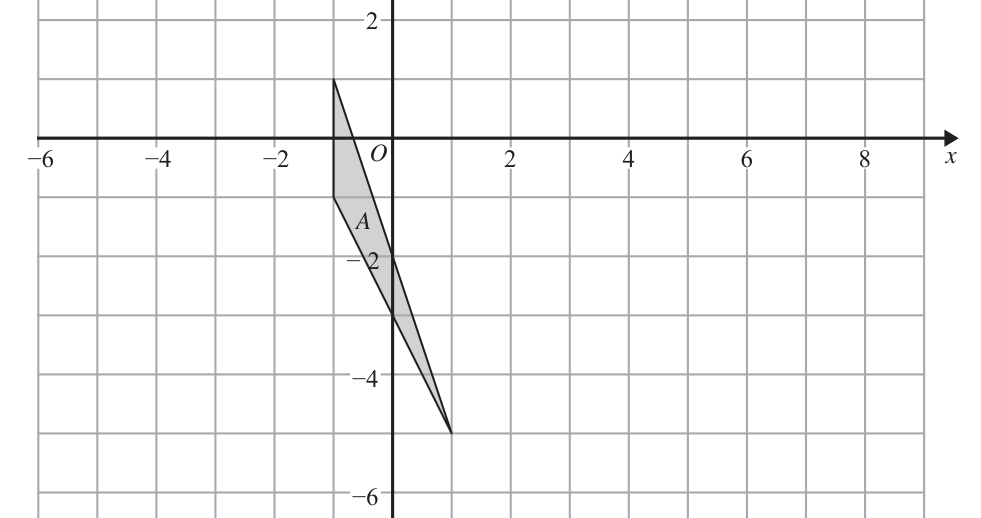
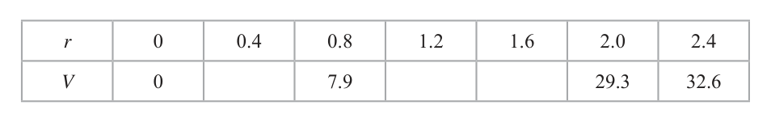
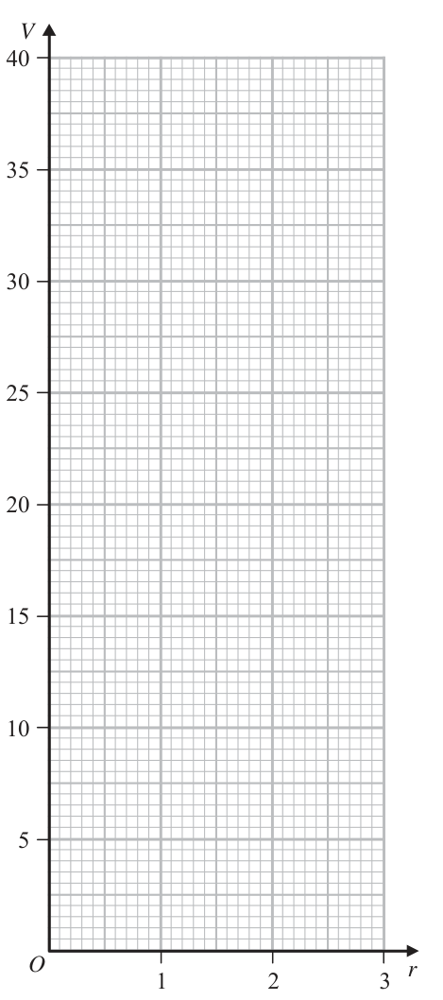

# 4MB1/02 — 2019-06 (official extraction)

> schema `syllabai.official-paper-questions/0.2` · paper_id `pearson-edexcel:international-gcse:mathematics-b:4mb1:2019-06:4MB1/02` · qp sha256 `e34f60817da8d4c1…` · extraction is the disclosed baseline (ADR-039)

## Question 1 (6 marks)

Malcolm is investigating the ages of the 200 members of a theatre company. The table below gives information about the age group of each member of the company. Age (t years) Frequency t - 20 23 t - 30 47 t - 40 56 t - 50 48 t - 60 26 Malcolm is going to draw a pie chart for this information.

### 1(a) [2]

Calculate the size, in degrees, of the angle of the sector in the pie chart for those members of the company whose age group is 40 t - 50

**Mark scheme answer**

> 2 M1 Allow 23+47+56+48+26 for denominator.
> (48/200) × 360
> 86.4 A1 Ignore anything after number (eg. %)
> Allow 86 with working seen.

- **(2)** 2 M1 Allow 23+47+56+48+26 for denominator.

### 1(b) [4]

Calculate an estimate for the mean age, to the nearest year, of the members of the theatre company.

**Mark scheme answer**

> 23 × 15 + 47 × 25 + 56 × 35 + 4 M2 For M2 require exactly 5 products with at least 4
> 48 × 45 + 26 × 55 (=7070) correct. There must be a clear intention to add seen.
> Or 7070 seen gains M2.
> 345 + 1175 + 1960 + 2160 + M1 for freq. × consistent value within interval
> 1430 (=7070) For M1 Require 4-6 products with at least 3 correct
> frequency × consistent values within their intervals (allow
> minimum value for this)
> Products seen beside the table can be awarded this mark
> if an attempt to total them is seen.
> M1 Dependent on at least M1 already gained.
> "7070"
> 200
> 35 A1 Allow 35.3, 35.35 or 35.4 with working seen.
> ISW incorrect rounding after any of these values seen.
> Correct answer with no incorrect working scores full
> marks.
> Total 6 marks
> Question Working Answer Mark Notes

- **(4)** 23 × 15 + 47 × 25 + 56 × 35 + 4 M2 For M2 require exactly 5 products with at least 4

## Question 2 (8 marks)

In 2017, country A had a population of 2.35 × 107 people. Of these people, 48% were male.

### 2(a) [2]

Calculate the number of males in country A in 2017 Country A is divided into three regions. These three regions are called East Region, Central Region and West Region. In 2017, the ratio of the number of males in the East Region to the number of males in the Central Region to the number of males in the West Region was 5 : 3 : 2

**Mark scheme answer**

> 2.35 × 107 × 0.48 2 M1 NB 2.35 × 107 × 48% is not sufficient for this mark
> unless it leads to the correct answer.
> 1.128 × 107 or A1 Allow 1.13 × 107 oe eg 11.3 × 106
> 11 280 000

- **(2)** 2.35 × 107 × 0.48 2 M1 NB 2.35 × 107 × 48% is not sufficient for this mark

### 2(b) [2]

Calculate the number of males in the Central Region in 2017 Give your answer in standard form. In 2017, the number of females in the Central Region was 12.5% greater than the number of males in the Central Region.

**Mark scheme answer**

> 2 M1
> ("11 280 000"/10) × 3
> 3.384 × 106 A1 Allow answers between 3.38 × 106 and 3.39 × 106
> inclusive must be in standard form. Allow a final answer
> of 3.4 × 106 if an acceptable value is seen not written in
> standard form.

- **(2)** 2 M1

### 2(c) [2]

Calculate the number of females in the Central Region in 2017 In 2010, country B had a population of 2.5 × 107 people. From 2010 to 2014, the population of country B increased by 2.4% From 2014 to 2018, the population of country B decreased by 2.4%

**Mark scheme answer**

> "3 384 000" × 1.125 2 M1 NB “3 384 000” × 112.5% is not sufficient for this
> mark unless their answer is equal to their value × 1.125
> 3.807 × 106 or A1 Allow answers between 3.8 × 106 and 3.814 × 106
> 3 807 000 inclusive oe

- **(2)** "3 384 000" × 1.125 2 M1 NB “3 384 000” × 112.5% is not sufficient for this

### 2(d) [2]

Calculate the population of country B in 2018

**Mark scheme answer**

> 2.5 × 107 × 1.024 × 0.976 2 M1
> 2.49856 × 10 or A1 Allow answers between 24 986 000 and 24 990 000
> 24 985 600 inclusive oe ISW rounding.
> Total 8 marks
> Question Working Answer Mark Notes

- **(2)** 2.5 × 107 × 1.024 × 0.976 2 M1

## Question 3 (6 marks)

Diagram NOT accurately drawn C 8 cm D T O B 10 cm A Figure 1 Figure 1 shows the circle ABCD with centre O and diameter DC. The point T is such that TCOD is a straight line and TA is the tangent to the circle at A. AT = 10 cm TC = 8 cm

### 3(a) [3]

Calculate the radius, in cm, of the circle.

**Mark scheme answer**

> 8 × (8 + 𝐶𝐶𝐶𝐶) = 102 3 M1 Allow use of x, d, 2r etc.. for CD
> Method to find DT does not gain this mark until either an
> expression involving CD or r is formed.
> 102 M1 dep. Fully correct expression for CD or r
> (𝐶𝐶𝐶𝐶 =) − 8(= 4.5) oe
> 2.25 (cm) oe A1
> ALT
> 100 = 64 + 16𝑟𝑟 oe M1 dep. Correct equation involving only linear terms in r.
> 2.25 (cm) oe A1

- **(3)** 8 × (8 + 𝐶𝐶𝐶𝐶) = 102 3 M1 Allow use of x, d, 2r etc.. for CD

### 3(b) [3]

Calculate the length, in cm to 3 significant figures, of the arc ABC.

**Mark scheme answer**

> tan∠𝐴𝐴𝐴𝐴𝐴𝐴 = "2.25" or 3 M1 Any correct expression for sin, cos or tan of ∠AOC or
> ∠AOC
> sin∠𝐴𝐴𝐴𝐴𝐴𝐴 = 8+"2.25" or If candidate gives an expression for ∠ATO this mark is
> only gained when they use ∠ATO to find ∠AOC.
> "2.25"
> cos∠𝐴𝐴𝐴𝐴𝐴𝐴 = 8+"2.25"
> (⇒ ∠𝐴𝐴𝐴𝐴𝐴𝐴 = 77.3∘ )
> Allow
> 102 = (8 + "2.25")2 + "2.25"2 −
> 2 × (8 + "2.25") × 2.25 cos ∠AOC
> "77.3" M1 dep.
> arc length = 360 × 2𝜋𝜋 × "2.25"
> Do not follow through if 64º ≤ ∠AOC ≤ 68º or
> ∠AOC ≥ 90º
> AWRT 3.03 or A1
> 3.04 (cm)
> Total 6 marks
> Question Working Answer Mark Notes

- **(3)** tan∠𝐴𝐴𝐴𝐴𝐴𝐴 = "2.25" or 3 M1 Any correct expression for sin, cos or tan of ∠AOC or

## Question 4 (12 marks)

Triangle A is drawn on the grid opposite. The points (1, 2), (3, −2) and (1, 4) are the vertices of triangle B.

### 4(a) [1]

On the grid, draw and label triangle B.

**Mark scheme answer**

> Triangle B drawn 1 B1 Do not penalise missing label across (a), (c) and (d).

- **(1)** Triangle B drawn 1 B1 Do not penalise missing label across (a), (c) and (d).

### 4(b) [2]

Describe fully the single transformation that maps triangle A onto triangle B. Triangle C is the image of triangle B under an enlargement with scale factor 2 and centre of enlargement the origin.

**Mark scheme answer**

> Translation 2 B1 B1 These 2 marks are independent. Do not award
> ⎛ 2⎞ either if more than one transformations given (including
> ⎜ ⎟ two translations).
> ⎝ 3⎠

- **(2)** Translation 2 B1 B1 These 2 marks are independent. Do not award

### 4(c) [3]

On the grid, draw and label triangle C. Triangle D is the image of triangle C under the transformation with matrix M where ⎛ 1 ⎞ − 0 ⎜ 2 ⎟ M=⎜ ⎟ ⎜ 1 −1⎟ ⎝ 2 ⎠

**Mark scheme answer**

> Triangle C drawn 3 B3 (2,4), (6, −4), (2,8) plotted and triangle drawn
> -1 for each error or omission
> B2 ft maximum for correct enlargement and centre from
> incorrect B,
> B1ft maximum for correct enlargement but incorrect
> centre

- **(3)** Triangle C drawn 3 B3 (2,4), (6, −4), (2,8) plotted and triangle drawn

### 4(d) [3]

On the grid, draw and label triangle D. Triangle C is the image of triangle D under the transformation with matrix N.

**Mark scheme answer**

> (−0.5 0) (2 6 2) = 3 M2 for a matrix solution or list of coordinates containing
> ( 0.5 −1) (4 −4 8) at least 4 correct values seen or for 2 correct coordinates
> (−1 −3 −1)
> (−3 7 −7)
> calculate the coordinates of triangle D
> Triangle D drawn A1 cao

- **(3)** (−0.5 0) (2 6 2) = 3 M2 for a matrix solution or list of coordinates containing

### 4(e) [3]

Find the matrix N. ⎡ ⎛ a b⎞ 1 ⎛ d − b⎞ ⎤ ⎢The inverse of matrix ⎜ is ⎥ ⎣ ⎝ c d ⎟⎠ ad − bc ⎜⎝ −c a ⎟⎠ ⎦ y −6 −4 −2 A −2 −4 −6 −8 for a spare grid if you need to redraw your triangles. Only use this grid if you need to redraw your triangles. y −6 −4 −2 A −2 −4 −6 −8

**Mark scheme answer**

> Recognising that N = M −1 3
> M1 Either state N = M −1 or NM=I or −1×−0.5−0×0.5 seen
> or (−1 0 / −0.5 −0.5) seen.
> A2
> 2 (−1 0 / −0.5 −0.5)
> Any A marks imply M1 if not already awarded.
> ALT (𝑃𝑃 𝑄𝑄) (−1 −3 −1) =
> (𝑅𝑅 𝑆𝑆) (−3 7 −7)
> (2 6 2)
> (4 −4 8)
> and states at least 2 linear equations
> in 2 variables derived from this.
> −2
> (−2 0 / −1 −1) A1 for one correct row or column or for 3 of the variables
> listed correctly 𝑃𝑃 = −2, 𝑄𝑄 = 0, 𝑅𝑅 = −1, 𝑆𝑆 = −1
> Total 12 marks
> C
> B
> D
> Question Working Answer Mark Notes

- **(3)** Recognising that N = M −1 3

## Question 5 (10 marks)

cm E D Figure 2 Figure 2 shows the triangles ABE and ACD where B lies on AC and E lies on AD. The triangles are similar with ·ABE = ·ACD. AB = 8 cm AE = 5 cm ·BAE = 30°

### 5(a) [3]

Calculate the length, in cm to 3 significant figures, of BE.

**Mark scheme answer**

> 3 M1 Correct expression for 𝐵𝐵𝐵𝐵 2
> (𝐵𝐵𝐵𝐵 2 =)52 + 82 − 2(5)(8)cos(30)
> M1 dep. Correct expression for BE.
> Must demonstrate correct order of operations.
> (𝐵𝐵𝐵𝐵 =)√(52 + 82 − 40√3) We must see 40√3 or values which round to 69.3, 19.7 or
> 4.4 to award this mark.
> AWRT 4.44 (cm) A1

- **(3)** 3 M1 Correct expression for 𝐵𝐵𝐵𝐵 2

### 5(b) [3]

Calculate the size, in degrees to 3 significant figures, of ·ABE. The area of quadrilateral BCDE is 18.9 cm2

**Mark scheme answer**

> sin(∠𝐴𝐴𝐴𝐴𝐴𝐴) sin30
> 3 M1 Correct equation involving ∠ABE could be labelled x,
> = θ etc...
> M1 dep. Correct expression for any trig ratio of ∠ABE or
> 5 sin 30
> sin(∠𝐴𝐴𝐴𝐴𝐴𝐴) = correct expression for ∠ABE
> "4.44"
> AWRT 34.3(º) A1

- **(3)** sin(∠𝐴𝐴𝐴𝐴𝐴𝐴) sin30

### 5(c) [4]

Calculate the length, in cm to 3 significant figures, of CD. ⎡ ⎤ ⎢Cosine rule : a = b + c − 2bc cos A⎥ 2 2 2 ⎢ a b c ⎥ ⎢ Sine rule : = = ⎥ ⎢ sin A sin B sin C ⎥ ⎢ 1 ⎥ ⎢ Area of triangle = ab sin C ⎥ ⎢⎣ 2 ⎥⎦

**Mark scheme answer**

> 1 4 M1
> Area of 𝛥𝛥𝛥𝛥𝛥𝛥𝛥𝛥 = 2 (8)(5)sin30
> (=10) or
> Area of ∆𝐴𝐴𝐴𝐴𝐴𝐴 =
> × 8 × "4.44" × sin "34.3"
> M1 dep. This mark is not awarded until a square root is
> Length scale factor
> 18.9 + "10"
> (𝑘𝑘 =)√((18.9 + "10")/"10") (= 1.7)
> M1 dep. Length scale factor multiplied by their value
> 𝐶𝐶𝐶𝐶 = "1.7" × "4.44"
> from (a)
> 7.55 (cm) A1 Allow any answer between 7.54 and 7.55 inclusive.
> Total 10 marks
> Question Working Answer Mark Notes

- **(4)** 1 4 M1

## Question 6 (4 marks)

A = {a, b, c, d} Write down all the subsets of A that contain the element b.

### 6 [4]

A = {a, b, c, d} Write down all the subsets of A that contain the element b.

**Mark scheme answer**

> {𝑏𝑏}, {𝑎𝑎, 𝑏𝑏, 𝑐𝑐, 𝑑𝑑}, {𝑎𝑎, 𝑏𝑏} B4 B4 all correct exactly 8 sets listed.
> {𝑏𝑏, 𝑐𝑐}, {𝑏𝑏, 𝑑𝑑}, {𝑎𝑎, 𝑏𝑏, 𝑐𝑐}, B3 – 6 or 7 correct
> {𝑏𝑏, 𝑐𝑐, 𝑑𝑑}, {𝑎𝑎, 𝑏𝑏, 𝑑𝑑} B2 – 4 or 5 correct
> B1 – 2 or 3 correct
> Do not penalise lack of commas
> Penalise one mark maximum for any of the following:
> Repetition within a set eg {b,b}
> Repetition of a set in the list eg. {a,b},...,{a,b}
> Repetition of a set in different order {a,b}, {b,a}
> Missing brackets eg. ab (however condone none standard
> set brackets eg [a,b] )
> Extra sets listed not involving b for example eg {a,c}
> NB Multiples written in sets eg. { b, ab, bc, bd} is in this
> case counted as 4 correct sets with a penalty for missing
> brackets. (ie 1 mark)
> Total 4 marks
> Question Working Answer Mark Notes

- **(4)** {𝑏𝑏}, {𝑎𝑎, 𝑏𝑏, 𝑐𝑐, 𝑑𝑑}, {𝑎𝑎, 𝑏𝑏} B4 B4 all correct exactly 8 sets listed.

## Question 7 (8 marks)

To pass a course, Preety has to pass two tests, test A and test B. Each test only has to be passed once. Passing test A and passing test B are independent events. Preety has three attempts to pass test A. The probability that she passes test A on her first attempt is If she fails on her first attempt, the probability that she passes on her second attempt is If she fails on her second attempt, the probability that she passes on her third attempt is

### 7(a) [3]

Calculate the probability she passes test A. Preety has two attempts to pass test B. The probability that she passes test B on her first attempt is The probability that she passes test B is

**Mark scheme answer**

> 3
> 3/5 + (2/5 × 2/5) + (2/5 × 3/5 × 3/8) M2, M1 for either 5 × 5 or 5 × 5 × 8
> 17 A1 oe.
> or 0.85
> ALT 1− × × M2, M1 for 5 × 5 × 8
> 5 5 8
> 17 A1 oe
> or 0.85

- **(3)** 3

### 7(b) [3]

Calculate the probability that Preety passes test B on her second attempt, given that she fails test B on her first attempt. Preety decides to take the two tests only if the probability that she passes the course is greater than 0.5

**Mark scheme answer**

> 3
> 3/5 + 2/5 𝑝𝑝 = 3/4 or (3/4 − 3/5) ÷ 2/5 M2 or M1 for 2/5 𝑝𝑝 (oe) or (3/4 − 3/5) seen
> 3 A1 oe
> or 0.375
> ALT
> 1/4 = 2/5 × 𝑞𝑞 (𝑞𝑞 = 5/8)
> 5 M1 dep. Do not award if their value of q is not in the
> 1−" " range 0 ≤ 𝑞𝑞 ≤ 1
> 3 A1 oe
> or 0.375

- **(3)** 3

### 7(c) [2]

State whether or not Preety should take the two tests. Give a reason for your answer.

**Mark scheme answer**

> 3 17 2 M1 ft their answer from part (a) only if it is between 0
> ×" " and 1 inclusive.
> 4
> 51 1 A1 cao must follow from correct part (a)
> > 2 so yes
> = 0.6375 allow any rounded value with full working
> (Preety should take
> seen.
> the tests)
> Total 8 marks
> Question Working Answer Mark Notes

- **(2)** 3 17 2 M1 ft their answer from part (a) only if it is between 0

## Question 8 (10 marks)

C 5x m D Diagram NOT accurately drawn (5x + 3) m (2x + 3) m A 4x m B Figure 3 Figure 3 shows the plan for a lawn that is in the shape of a trapezium ABCD in which AB = 4x metres BC = (5x + 3) metres CD = 5x metres DA = (2x + 3) metres The perimeter of the lawn is P metres.

### 8(a) [2]

Find and simplify an expression for P in terms of x. The area of the lawn is A m2

**Mark scheme answer**

> (𝑃𝑃 =)4𝑥𝑥 + (5𝑥𝑥 + 3) + (2𝑥𝑥 + 3) + 5𝑥𝑥 2 M1 Sum of four terms in x
> (𝑃𝑃 =)16𝑥𝑥 + 6 oe A1

- **(2)** (𝑃𝑃 =)4𝑥𝑥 + (5𝑥𝑥 + 3) + (2𝑥𝑥 + 3) + 5𝑥𝑥 2 M1 Sum of four terms in x

### 8(b) [2]

Show that A = 14x2 + 12x The owner of the lawn wants the perimeter of the lawn to be greater than 52 m. He also wants the area of the lawn to be at most 162 m2

**Mark scheme answer**

> 𝐴𝐴 = ½((2𝑥𝑥 + 3) + (5𝑥𝑥 + 3))(4𝑥𝑥) oe 2 M1 Allow 𝐴𝐴 = (2𝑥𝑥 + 3) × 4𝑥𝑥 + 2 × 3𝑥𝑥 × 4𝑥𝑥 or
> ½(7𝑥𝑥 + 6) × 4𝑥𝑥
> 𝐴𝐴 = 14𝑥𝑥 2 + 12𝑥𝑥 A1 Must be clearly shown with no incorrect steps. At
> least one correct intermediate step must be seen.

- **(2)** 𝐴𝐴 = ½((2𝑥𝑥 + 3) + (5𝑥𝑥 + 3))(4𝑥𝑥) oe 2 M1 Allow 𝐴𝐴 = (2𝑥𝑥 + 3) × 4𝑥𝑥 + 2 × 3𝑥𝑥 × 4𝑥𝑥 or

### 8(c) [6]

Find the range of possible values of x. Show clear algebraic working. ⎡ 1 ⎤ ⎢⎣ Area of trapezium = 2 (a + b)h ⎥⎦

**Mark scheme answer**

> "16𝑥𝑥 + 6" > 52 6 M1 Their perimeter > 52, condone ≥. or =
> 𝑥𝑥 > 2.875 A1 ft their answer to part (a) as long as it it a linear
> expression in x.
> Allow as a fraction 8 oe allow 2.88.
> Condone ≥ or =
> 14𝑥𝑥 2 + 12𝑥𝑥 ≤ 162 M1 Accept < 162 may be inferred by an inequality for x
> stated inbetween their solutions to their quadratic.
> (𝑥𝑥 − 3)(7𝑥𝑥 + 27) ≤ 0 M1 indep. ‘equating’ to zero and solving (oe)
> Independent of previous mark, need not be expressed as
> inequality, condone an equality or any inequality sign.
> Must be solving quadratic trinomial.
> By factorising brackets must expand to give 2 out of 3
> terms correct or fully correct substitution into fully
> correct formula.
> 27 A1 Correct interval accept 𝑥𝑥 ≤ 3 or 𝑥𝑥 < 3 if no other
> − ≤ 𝑥𝑥 ≤ 3
> 7 inequality stated in relation to this inequality.
> 2.875 < 𝑥𝑥 ≤ 3 A1 cao. Must follow from completely correct working.
> Condone only finding critical values in working as long
> as the working contains no ambiguous or incorrect
> inequalities.
> Total 10 marks
> Question Working Answer Mark Notes

- **(6)** "16𝑥𝑥 + 6" > 52 6 M1 Their perimeter > 52, condone ≥. or =

## Question 9 (12 marks)

⎛ 2 x − 1⎞ ⎛ y + 3⎞ p=⎜ q=⎜ ⎝ y ⎟⎠ ⎝ − y ⎟⎠ ⎛ 7⎞ The vectors p and q are such that |p| = 98 and p + q = ⎜ ⎟ ⎝ 0⎠

### 9(a) [5]

Show that x2 − 3x − 9 = 0 Given that x > 0

**Mark scheme answer**

> √((2𝑥𝑥 − 1)2 + 𝑦𝑦 2) = √98 5 M1 Correct use of modulus to form any correct equation
> (2𝑥𝑥 − 1) + (𝑦𝑦 + 3) = 7 M1 oe e.g. 2𝑥𝑥 + 𝑦𝑦 = 5
> (2𝑥𝑥 − 1)2 + (5 − 2𝑥𝑥)2 = 98 oe M1 dep. on both previous M marks.
> Remove square-roots and substitute to gain an equation in
> terms of x only. May be seen in expanded form.
> Eg. −4𝑥𝑥 2 + 4𝑥𝑥 + 97 = 25 + 4𝑥𝑥 2 − 20𝑥𝑥
> For this and next M mark allow a maximum of 1 sign or
> numerical error.
> 8𝑥𝑥 2 − 24𝑥𝑥 − 72 = 0 M1 dep. previous mark.
> Expand and attempt to form 3 term quadratic
> For this and previous M mark allow a maximum of 1 sign
> or numerical error.
> 𝑥𝑥 2 − 3𝑥𝑥 − 9 = 0 A1 As answer given sufficient working must be shown.
> No incorrect work can be seen.

- **(5)** √((2𝑥𝑥 − 1)2 + 𝑦𝑦 2) = √98 5 M1 Correct use of modulus to form any correct equation

### 9(b)(i) [2]

find the exact value of x,

**Mark scheme answer**

> 2 M1 Solving quadratic using formula or completing square
> − ( −3) ± ( −3) − 4(1)(−9)
> x=
> 2(1)
> or (𝑥𝑥 − 3/2)2 − 9/4 − 9 = 0
> 3 + 3√5 3+√45
> 𝑥𝑥 = A1 Accept other equivalent exact forms eg 2
> 2 Do not accept ± for the final answer, they must indicate
> positive solution.
> Do not isw answer given as a decimal.

- **(2)** 2 M1 Solving quadratic using formula or completing square

### 9(b)(ii) [2]

show that y = 2 − 3√5

**Mark scheme answer**

> 3 + 3√5 2 M1 Substitute their x which must be an expression
> 𝑦𝑦 = 5 − 2 ((3 + 3√5)/2) involving surds into linear equation to find y
> If using equation for y2 must obtain
> 𝑦𝑦 2 = 98 − 49 − 12√5 or simpler to gain this mark.
> 𝑦𝑦 = 2 − 3√5 A1 As answer given sufficient working must be shown
> Allow 𝑦𝑦 2 = 49 − 12√5 from modulus equation and
> expansion of (2 − 3√5)2 = 49 − 12√5 along with an
> appropriate comment.
> Do not isw answer given as a decimal.

- **(2)** 3 + 3√5 2 M1 Substitute their x which must be an expression

### 9(c) [3]

Find the exact value of |q|2 Show your working clearly. ⎡ 2 −b ± b 2 − 4ac ⎤ ⎢ Solutions of ax + bx + c = 0 are x = ⎥ ⎢⎣ 2a ⎥⎦

**Mark scheme answer**

> (|𝐪𝐪|2 =) 3 M1 Attempt q= q12 + q2 2 - allow in terms of y or x
> 2
> (2 − 3√5 + 3)2 + (−(2 − 3√5))2 Eg. (𝑦𝑦 + 3)2 + 𝑦𝑦 2 or (8 − 2𝑥𝑥)2 + (5 − 2𝑥𝑥)2
> Allow an expression for |𝐪𝐪|
> = 25 − 30 5 + 45 + 45 − 12 5 + 4 M1 dep expand brackets must involve surds.
> Allow square root of this.
> 119 − 42√5 or A1 cao Do not isw answer given as a decimal.
> 7(17 − 6√5)
> Total 12 marks
> Question Working Answer Mark Notes

- **(3)** (|𝐪𝐪|2 =) 3 M1 Attempt q= q12 + q2 2 - allow in terms of y or x

## Question 10 (10 marks)

The curve C has equation y = 2x3 + ax2 + bx + 10 where a and b are constants. The point A, with coordinates (1, 3), lies on C.

### 10(a) [1]

Write down an equation in a and b. The tangent to C at the point A has gradient −8

**Mark scheme answer**

> 2 × 13 + 𝑎𝑎 × 12 + 1 B1 oe
> 𝑏𝑏 × 1 + 10 = 3

- **(1)** 2 × 13 + 𝑎𝑎 × 12 + 1 B1 oe

### 10(b) [3]

Show that 2a + b = −14

**Mark scheme answer**

> 3 M1 at least two of these terms shown
> (𝑓𝑓′(𝑥𝑥) =)6𝑥𝑥 2 + 2𝑎𝑎𝑎𝑎 + 𝑏𝑏
> M1 dep clear indication of substitution for x = 1 into their
> 6 × 12 + 2𝑎𝑎 × 1 + 𝑏𝑏 = −8
> derivative and equates to −8
> 2𝑎𝑎 + 𝑏𝑏 = −14 A1 Note that answer given in question

- **(3)** 3 M1 at least two of these terms shown

### 10(c) [3]

Hence find the value of a and the value of b. Show clear algebraic working. Using the value of a and the value of b found in part (c),

**Mark scheme answer**

> Correct method for solving 2 linear 3 M1ft Correct method to form an equation in a single
> simultaneous equations variable. Allow a maximum of 1 sign or numerical error.
> Either 𝑎𝑎 = ±5 or 𝑏𝑏 = ±4 with no incorrect working seen
> implies this.
> 𝑎𝑎 = −5 A1 cao
> 𝑏𝑏 = −4 A1 cao

- **(3)** Correct method for solving 2 linear 3 M1ft Correct method to form an equation in a single

### 10(d) [3]

find the x coordinate of each of the points on C where the tangent to C is parallel to the line with equation y = 7 − 4x. Show clear algebraic working.

**Mark scheme answer**

> 6𝑥𝑥 2 − 10𝑥𝑥 − 4 = −4 3 M1 Substitutes their a and their b into their f/ (𝑥𝑥) and
> equate to −4
> 𝑥𝑥(3𝑥𝑥 − 5) = 0 M1 dep. Solve their 2 or 3 term quadratic
> By factorising brackets must expand to give 2 out of 3
> terms correct or fully correct substitution into fully
> correct formula.
> They must have a factorised expression with 2 factors
> 5
> 𝑥𝑥 = 0 and 𝑥𝑥 = 3 A1 cao for 𝑥𝑥 = 3 accept 1.67 or better.
> Total 10 marks
> Question Working Answer Mark Notes

- **(3)** 6𝑥𝑥 2 − 10𝑥𝑥 − 4 = −4 3 M1 Substitutes their a and their b into their f/ (𝑥𝑥) and

## Question 11 (14 marks)

Diagram NOT accurately drawn h cm r cm Figure 4 A child’s toy is made by fixing a solid right circular cone, with base radius r cm and height h cm, on the flat circular face of a solid hemisphere of radius r cm. The centre of the base of the cone coincides with the centre of the hemisphere, as shown in Figure 4 Given that h + 6r = 15

### 11(a) [2]

find the upper bound for the value of r. Give a reason for your answer. The volume of the toy is V cm3

**Mark scheme answer**

> 15 − 6𝑟𝑟 > 0 2 M1 Consideration that h > 0
> Alternatively award for 2.5 oe. seen in working.
> r = 2.5 A1 Do not isw. Allow r < 2.5 or r ≤ 2.5

- **(2)** 15 − 6𝑟𝑟 > 0 2 M1 Consideration that h > 0

### 11(b) [3]

Show that V = (1/3)πr2(15 − 4r) ⎡ 1 2 ⎤ ⎢ Volume of cone = 3 πr h ⎥ ⎢ ⎥ ⎢ Volume of sphere = 4 πr 3 ⎥ ⎢⎣ 3 ⎥⎦ 1 2

**Mark scheme answer**

> 3 M1
> 1
> (𝑉𝑉 =) 𝜋𝜋𝑟𝑟 2 ℎ + 𝜋𝜋𝑟𝑟 3
> 3
> M1 Substitutes ℎ = 15 − 6𝑟𝑟 to obtain an expression in π
> 1
> (𝑉𝑉 =) 𝜋𝜋𝑟𝑟 2 (15 − 6𝑟𝑟) + 𝜋𝜋𝑟𝑟 3or and r only
> 3
> 1 2 or fully factorise expression for V.
> (𝑉𝑉 =) 𝜋𝜋𝑟𝑟 (ℎ + 2𝑟𝑟) 1 𝑛𝑛
> 3 Must have V in the form (𝑉𝑉 =) 3 𝜋𝜋𝑟𝑟 2 ℎ + 3 𝜋𝜋𝑟𝑟 3 to award
> this method mark.
> 𝑉𝑉 = A1 Answer given must see evidence of both factorisation
> 1 2 and substitution to award this mark.
> 𝜋𝜋𝑟𝑟 (15 − 4𝑟𝑟)
> 3 Penalise lack of V= for this mark only.

- **(3)** 3 M1

### 11(c) [3]

Complete the following table of values for V = (1/3)πr2(15 − 4r) Give your values of V to one decimal place. r 0 0.4 0.8 1.2 1.6 2.0 2.4 V 0 7.9 29.3 32.6

**Mark scheme answer**

> 2.2, 15.4, 23.1 3 B3 Penalise rounding to 1dp. once only. Treat 15.3 and
> 23.0 as rounding errors.

- **(3)** 2.2, 15.4, 23.1 3 B3 Penalise rounding to 1dp. once only. Treat 15.3 and

### 11(d) [2]

On the grid opposite, plot the points from your completed table and join them to form a smooth curve. The volume of one particular toy is 26 cm3

**Mark scheme answer**

> At least 5 points plotted correctly 2 M1 ft. points from (c) as long as at least B1 gained in (c).
> Points clearly plotted correct to ½ a small square or if not
> clearly plotted a curve drawn which goes within ½ a
> small square of the correct points. Measure closest point
> on curve to the correct point not necessarily horizontally
> or vertically.
> Fully correct curve A1 ignore anything to the right of r=2.4

- **(2)** At least 5 points plotted correctly 2 M1 ft. points from (c) as long as at least B1 gained in (c).

### 11(e) [1]

Use your curve to find, to one decimal place, the value of r. The manufacturer of the toy decides that the value of V should be twice the value of h.

**Mark scheme answer**

> Value must be read 1 B1 ft. their graph.
> from their graph Answer given to accuracies beyond 2 dp. should not gain
> (eg. 1.8) this mark.
> Answer must be consistent with their graph.

- **(1)** Value must be read 1 B1 ft. their graph.

### 11(f) [3]

By drawing a suitable straight line on the grid, find an estimate, to the nearest integer, for the value of V. V O 1 2 3 r for a spare grid if you need to redraw your curve. Only use this grid if you need to redraw your curve. V O 1 2 3 r

**Mark scheme answer**

> (𝑉𝑉 =)30 − 12𝑟𝑟 3 M1
> Line with negative gradient, y- M1 indep
> intercept of 30 and only one Line through (1,18) and (2,6) would imply both this and
> intersection point with curve drawn. the previous M mark.
> 15 or 16 A1 cao Must come from correct line drawn.
> Total 14 marks

- **(3)** (𝑉𝑉 =)30 − 12𝑟𝑟 3 M1

