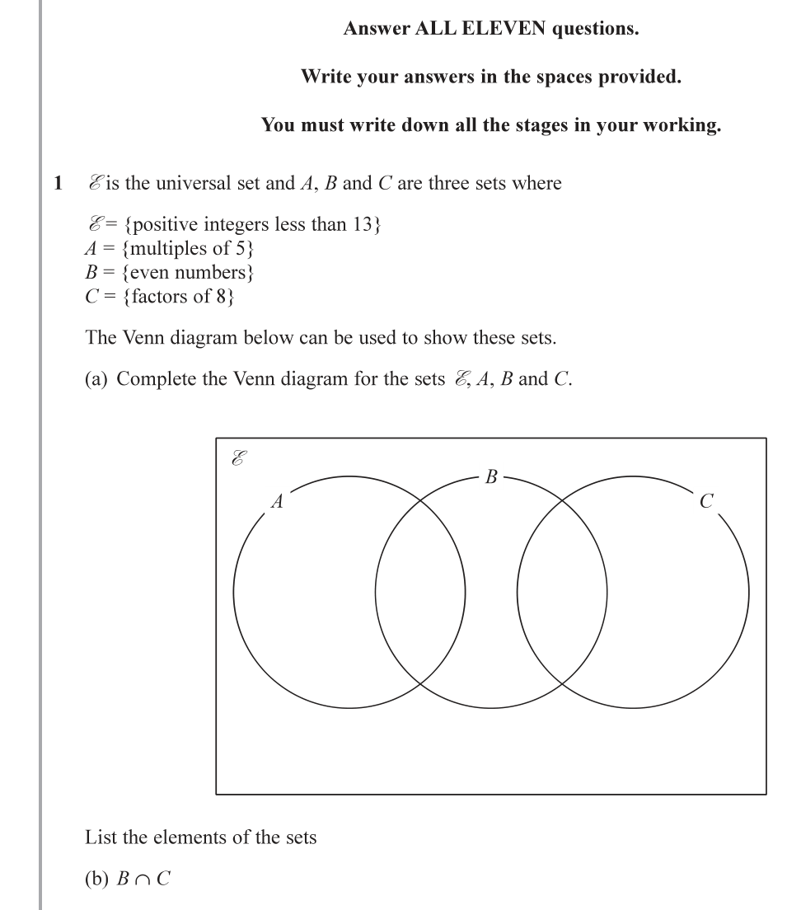
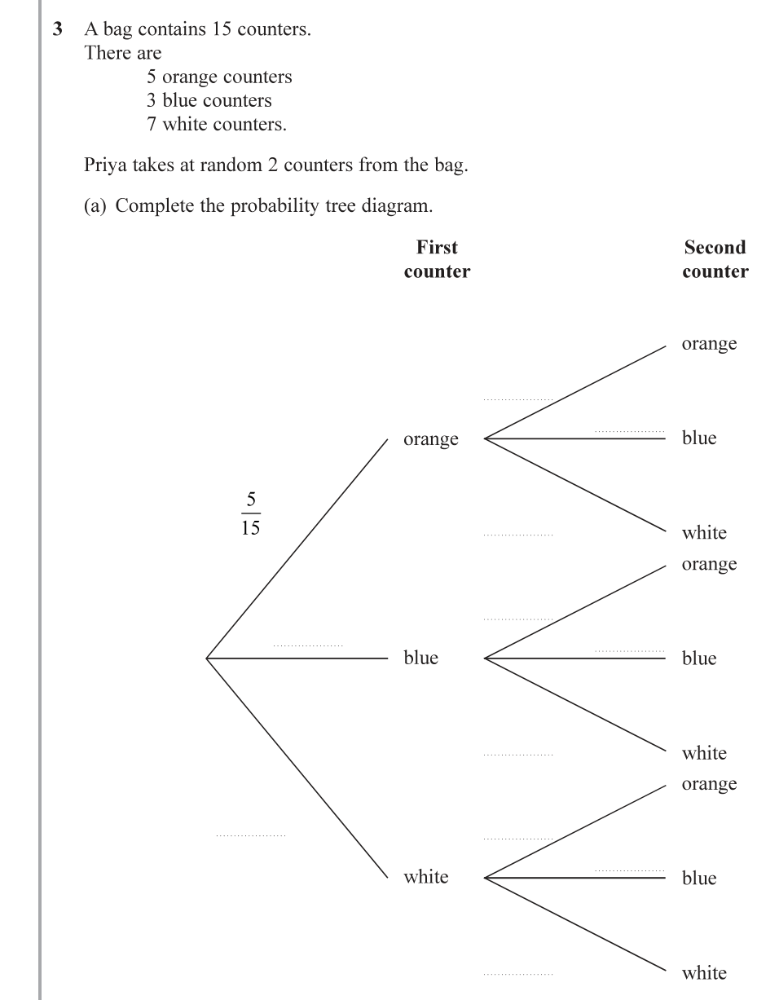
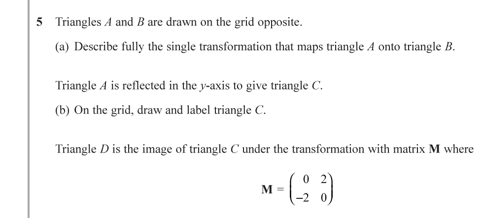
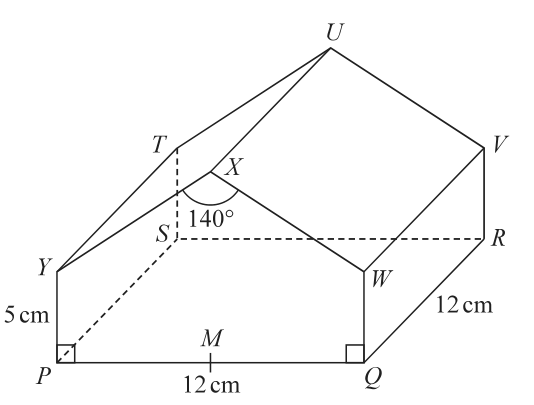
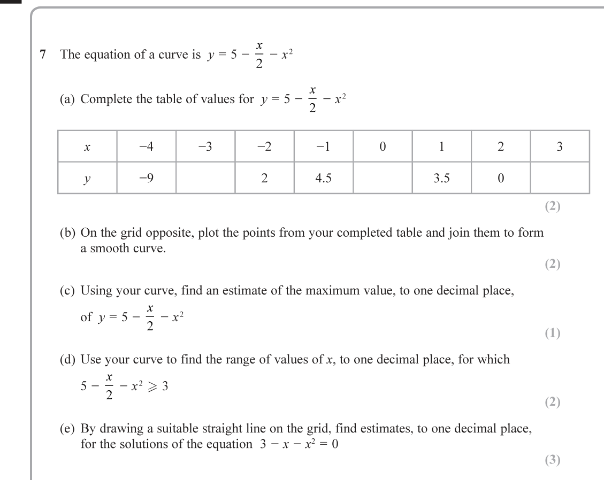
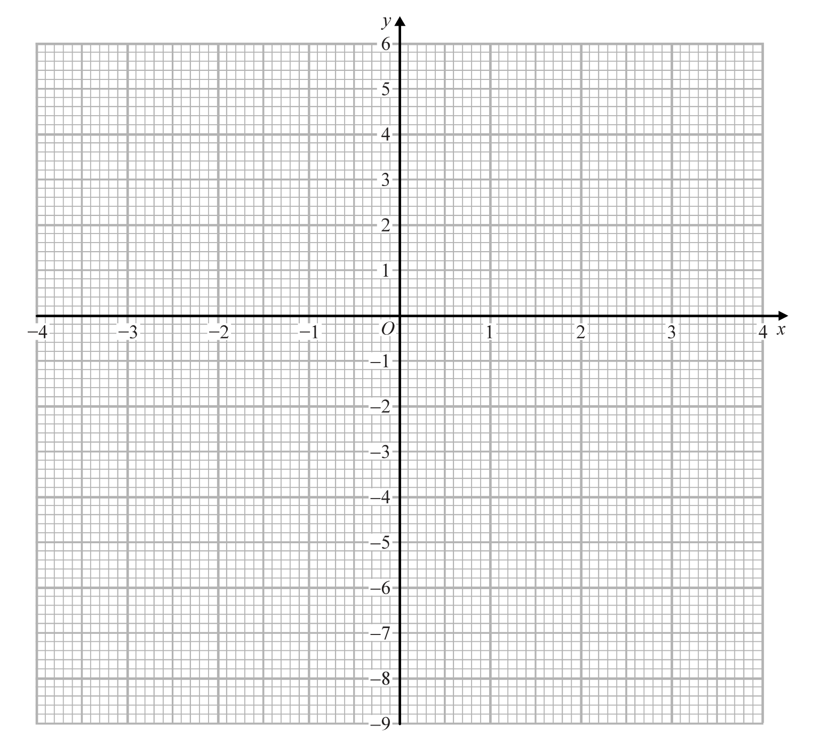
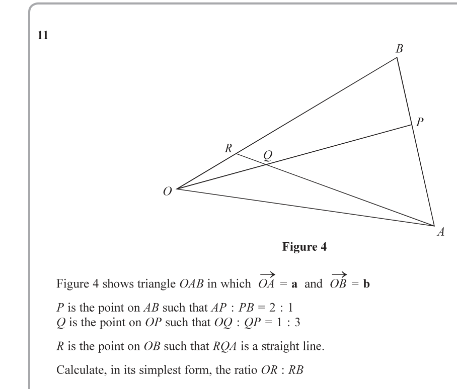

# 4MB1/02R — 2019-06 (official extraction)

> schema `syllabai.official-paper-questions/0.2` · paper_id `pearson-edexcel:international-gcse:mathematics-b:4mb1:2019-06:4MB1/02R` · qp sha256 `43e05b1dc1d04c1b…` · extraction is the disclosed baseline (ADR-039)

## Question 1 (8 marks)

Gis the universal set and A, B and C are three sets where &={multiples A {positiveofintegers 5} less than 13} B= {even numbers} C = {factors of 8} The Venn diagram below can be used to show these sets.

### 1(a) [3]

Complete the Venn diagram for the sets 2 A, B and C. é B AC List the elements of the sets

**Mark scheme answer**

> 3 B3 all 6 regions correct
> B2 4 or 5 regions correct
> B1 2 or 3 regions correct

- **(3)** 3 B3 all 6 regions correct

### 1(b) [1]

BANC

**Mark scheme answer**

> {2, 4, 8} 1 B1 or ft their Venn diagram

- **(1)** {2, 4, 8} 1 B1 or ft their Venn diagram

### 1(c) [1]

AUB

**Mark scheme answer**

> {2,4,5,6,8,10,12} 1 B1 or ft their Venn diagram With or without
> brackets

- **(1)** {2,4,5,6,8,10,12} 1 B1 or ft their Venn diagram With or without

### 1(d) [1]

(AUBUCY Find

**Mark scheme answer**

> {3,7,9,11} 1 B1 or ft their Venn diagram

- **(1)** {3,7,9,11} 1 B1 or ft their Venn diagram

### 1(e) [1]

(BUC)

**Mark scheme answer**

> 7 1 B1 or ft their Venn diagram

- **(1)** 7 1 B1 or ft their Venn diagram

### 1(f) [1]

Find

n(B′ ∩ C′)

**Mark scheme answer**

> 5  B1 or ft their Venn diagram, also
> ft number of elements in answer to (d) + number of elements
> in Venn diagram in ‘just A’

- **(1)** 5  B1 or ft their Venn diagram, also

## Question 2 (10 marks)
### 2(a)(i) [2]

Solve the inequality 6x + 10 > 2x + 2

**Mark scheme answer**

> 6x – 2x ≥ 2 – 10 oe eg 4x ≥ 2 M1 allow = sign for this mark
> −8
> x ≥ −2 A1 oe eg [−2, ∞ )

- **(2)** 6x – 2x ≥ 2 – 10 oe eg 4x ≥ 2 M1 allow = sign for this mark

### 2(a)(ii) [1]

Represent your solution onthe number line on the next page.

**Mark scheme answer**

> Shaded circle at −2 1 B1ft (if line has arrow, it can stop anywhere, without arrow it
> and line to right of −2 must go to at least 3 on the scale)

- **(1)** Shaded circle at −2 1 B1ft (if line has arrow, it can stop anywhere, without arrow it

### 2(b)(i) [5]

Solve the inequality (4x + 3)(2x — 1) < (6x + 5)(x — 2)

**Mark scheme answer**

> 8x² + 2x − 3 < 6x² − 7x − 10 5 M1 oe correctly expanding brackets in a correct equation or
> inequality – allow one error (simplified or unsimplified)
> 2x² + 9x + 7 (< 0) oe A1 correct 3 term quadratic
> eg (2x + 7)(x + 1) (< 0) M1ft for a method to solve quadratic independent of previous
> mark, need not be expressed as inequality, condone an equality
> or any inequality sign.
> Must be solving quadratic trinomial.
> By factorising brackets must expand to give 2 out of 3 terms
> correct or fully correct substitution into fully correct formula.
> (x =) −3.5 (x =) −1 A1 correct critical values seen in this part of the question
> −3.5 < x < −1 A1 oe eg x > −3.5 (and) x < −1 or −1 > x > −3.5 or
> (−3.5, −1)stated clearly in this part of the question

- **(5)** 8x² + 2x − 3 < 6x² − 7x − 10 5 M1 oe correctly expanding brackets in a correct equation or

### 2(b)(ii) [1]

Represent your solution on the same number line.

**Mark scheme answer**

> Open circles at −3.5 1 B1ft an inequality of the form a < x < b where a and b are
> and −1 and line values from −5 to 5
> joining circles Allow a single line joining open circles.

- **(1)** Open circles at −3.5 1 B1ft an inequality of the form a < x < b where a and b are

### 2(c) [1]

Write down the set of values for which

**both** $6x + 10 \geqslant 2x + 2$ **and** $(4x + 3)(2x - 1) < (6x + 5)(x - 2)$

**Mark scheme answer**

> −2 ≤ x < −1  B1 for the correct answer oe eg −1 > x ≥ −2 or x < −1 (and) x ≥
> −2 or [−2, −1) even if (b)(i) does not have the correct answer
> displayed or ft dep on M1 in both (a) and (b) and answers for
> (b)(i) in the form a < x < b and answer in (a)(i) an answer
> which overlaps the answer in (b)(i)

- **(1)** −2 ≤ x < −1  B1 for the correct answer oe eg −1 > x ≥ −2 or x < −1 (and) x ≥

## Question 3 (8 marks)

counters 7 blue whitecounters counters. Priya takes at random 2 counters from the bag.

### 3(a) [3]

Complete the probability tree diagram. First counter Second counter orange orange blue 3 fe) white orange blue blue white orange white blue white

**Mark scheme answer**

> 3 7 3 B1 oe
> ,
> 15 15

- **(3)** 3 7 3 B1 oe

### 3(b) [2]

Calculate the probability that Priya takes 2 white counters.

**Mark scheme answer**

> *The official mark scheme line for this part was not captured by the digitised extraction — treat the worked values above the line with care and check against the paper's own mark scheme.*

### 3(c) [3]

Calculate the probability that the counters Priya takes are not of the same colour.

**Mark scheme answer**

> 5/15 × 3/14 + 5/15 × 7/14 + 3/15 × 5/14 + 3/15 × 7/14 +
> 7/15 × 5/14 + 7/15 × 3/14  or
> 5/15 × 10/14 + 3/15 × 12/14 + 7/15 × 8/14  oe  or
> 1 − 5/15 × 4/14 − 3/15 × 2/14 − “1/5”  oe
> 
> M2ft for a fully correct method, ft dep on probabilities between 0 and 1
> M1ft for at least 2 correct products (or one product of eg O, O′ or for 1 minus at least one product for 2 of the same colour, ft the answer to (b))
> 
> 71/105
> A1 oe allow decimals of 0.68 or better and 68% or better (0.67619...)

## Question 4 (14 marks)

The total amount of money that was spent last March by Marco’s family was $4200 The four table itemsbelow gives information about the amount Marco’s family spent on each of last March. Item Amount healthcare insurance $504 $336 food $546 travel $630 housing entertainment other items

### 4(a) [2]

The total amount of money that was spent last March by Marco’s family was \$4200 The four table itemsbelow gives information about the amount Marco’s family spent on each of last March. Item Amount healthcare insurance \$504 \$336 food \$546 travel \$630 housing entertainment other items

Calculate the percentage of the total amount that was spent on healthcare. The amount transport spent in the on 4 ratios travel : 3 : 2was divided between Marco’s car, his wife’s car and other

**Mark scheme answer**

> 3 7 5 2 7 5 3 6 B2 for all remaining branches correct, B1 for 5,6, 7 or 8 correct
> , , , , , , , , (where necessary decimals must be 2dp or better truncated or
> 14 14 14 14 14 14 14 14 14
> [NB: may have been cancelled] rounded 0.285..., 0.214...,0.5, 0.357..., 0.5, 0.357..., 0.214...,
> 0.428...)
> ×100
> 4200
> 8(%) A1

- **(2)** 3 7 5 2 7 5 3 6 B2 for all remaining branches correct, B1 for 5,6, 7 or 8 correct

### 4(b) [2]

Calculate the amount, in \$, that was spent on Marco’s car. The amount last February. that was spent on food last March was 12% more than was spent on food

**Mark scheme answer**

> 7 6 2 M1ft their tree diagram for white, white
> × Ft dep on probabilities between 0 and 1
> 15 14
> 1 A1 oe cao
> × 630
> (\$)280 A1

- **(2)** 7 6 2 M1ft their tree diagram for white, white

### 4(c) [3]

Calculate the amount, in \$, that was spent on food last February. The amount of money of was that moneynot spent spent on on entertainment last March healthcare, insurance, was food 12.5% and of the total amount travel.

**Mark scheme answer**

> 5 3 5 7 3 5 3 7 3 M2ft for a fully correct method
> × + × + × + × + ft dep on probabilities between 0 and 1
> 15 14 15 14 15 14 15 14
> 7 5 7 3
> × + × or M1ft for at least 2 correct products (or one product of eg O, O' or
> 15 14 15 14
> for 1 minus at least one product for 2 of the same colour (ft the
> M2 for
> (546 ÷ 112) × 100 M1 1.12
> (\$)487.5(0) A1

- **(3)** 5 3 5 7 3 5 3 7 3 M2ft for a fully correct method

### 4(d) [3]

Calculate the amount, in \$, that was spent on entertainment. Marco draws a pie chart for the amounts his family spent on all the items last March.

**Mark scheme answer**

> 4200 – (336 + 504 + 546 + 3 M1
> 630)(=2184)
> 12.5 M1 a correct calculation to find 12.5% of “2184”
> “2184 × 0.125 oe eg 2184 ×
> 100 “2184” must come from correct working
> (\$)273 A1

- **(3)** 4200 – (336 + 504 + 546 + 3 M1

### 4(e) [2]

Calculate the size of the angle, in degrees, for insurance. The angle in the pie chart for housing is 114°

**Mark scheme answer**

> 504 2 M1
> × 360
> 4200
> 43.2(°) A1 allow 43° if working seen

- **(2)** 504 2 M1

### 4(f) [2]

The angle in the pie chart for housing is 114°

Calculate the amount, in \$, that was spent on housing.

**Mark scheme answer**

> 114/360 × 4200  oe   M1
> 
> (\$)1330  A1

- **(2)** 114/360 × 4200  oe   M1

## Question 5 (10 marks)

Triangles 4 and B are drawn on the grid opposite.

### 5(a) [3]

Describe fully the single transformation that maps triangle A onto triangle B. Triangle A is reflected in the y-axis to give triangle C.

**Mark scheme answer**

> Enlargement, 3 B1 Enlargement, enlarge, enlarged If more than one
> transformation is
> Scale factor 2, B1 Scale factor 2 (allow SF 2) mentioned then no
> marks can be scored
> centre of enlargement B1 (centre of enlargement) (−1, 5) as asked for a single
> (−1, 5) transformation

- **(3)** Enlargement, 3 B1 Enlargement, enlarge, enlarged If more than one

### 5(b) [1]

On the grid, draw and label triangle C. Triangle D is the image of triangle C under the transformation with matrix M where M(2 0 2«0

**Mark scheme answer**

> Correct reflection 1 B1
> (−2, 1),(−2, 4),(−3, 3)

- **(1)** Correct reflection 1 B1

### 5(c) [3]

On the grid, draw and label triangle D. Triangle D is the image of triangle A under the transformation with matrix N.

**Mark scheme answer**

> 10 3 12 7 8
> × + × + × oe answer to (b))
> 15 14 15 14 15 14
> 1 − × − × − " " oe
> 15 14 15 14 5
> 71 A1 oe allow decimals of 0.68 or better and 68% or better
> 105 (0.67619...)
>  coordinates or for at least 2 correct coordinates listed or
> ⎝ −2 0 ⎠⎝ 1 4 3 ⎠ plotted.
> ⎛ 2 8 6⎞ If not M2 then M1 for a correct matrix product with all
> = 4 4 6 coordinates in the matrix and multiplied firstly by the
> transformation matrix.
> (2, 4), (8, 4), (6, 6) A1 for a fully correct triangle plotted on grid

- **(3)** 10 3 12 7 8

### 5(d) [3]

Triangle $D$ is the image of triangle $A$ under the transformation with matrix $\mathbf{N}$.

Find the matrix $\mathbf{N}$.

**Mark scheme answer**

> $\begin{pmatrix} 0 & 2 \\ -2 & 0 \end{pmatrix}$ $\begin{pmatrix} -1 & 0 \\ 0 & 1 \end{pmatrix}$  or
> 
> 2a + b = 2,  2a + 4b = 8,
> 3a + 3b = 6,  2c + d = 4
> 2c + 4d = 4,  3c + 3d = 6  oe
> 
> M1 for both matrices (either order) with intention to multiply or for any 2 correct entries in matrix N or for at least 2 correct equations from list
> 
> $\begin{pmatrix} 0 & 2 \\ 2 & 0 \end{pmatrix}$  A2 award A1 for 3 correct entries (A marks assume M mark is gained)

- **(3)** $\begin{pmatrix} 0 & 2 \\ -2 & 0 \end{pmatrix}$ $\begin{pmatrix} -1 & 0 \\ 0 & 1 \end{pmatrix}$  or

## Question 6 (7 marks)

MUM ACA A Turnover > P60 2 5 8 A 01 5 3 6 U <S = Diagram NOT accurately drawn gj 140" OS R as Sem an y : 12cm > P 12cm Q 7 Figure 1 Figure 1 shows a right pentagonal prism, with a horizontal square base PORS of side 12cm. YP =WQO=5cm ZWXY = 140° ZYPO = ZWOP = 90° M is the midpoint of PO so that XM is an axis of symmetry of the pentagon.

### 6 [7]

Figure 1 shows a right pentagonal prism, with a horizontal square base $PQRS$ of side 12 cm.

YP = WQ = 5 cm
∠WXY = 140°
∠YPQ = ∠WQP = 90°
M is the midpoint of PQ so that XM is an axis of symmetry of the pentagon.

(a) Calculate the size, in degrees to one decimal place, of ∠VMR.

(b) Calculate the length, in cm to one decimal place, of PU.

**Mark scheme answer**

> (MR =) √(6² + 12²)  (= √180 = 6√5 = 13.4...)  M1
> 
> tan VMR = 5 ÷ “√180”
> M1 oe ft their MR as long as clear intention to be MR, eg labelled or shown on diagram
> 
> 20.4(°)  A1 allow 20.4 – 20.5
> 
> (height of triangle =) 6 ÷ tan(70°)  (= 2.18...)
> M1 oe eg 6tan20 (= 2.18...)
> 
> PU² = (“2.18...” + 5)² + (“√180”)²  or  eg UM = √(12² + (“2.18...” + 5)²)  (= 13.985...)
> M1 ft their MR as long as clear intention to be MR; “2.18” must come from correct working
> 
> PU = √((“2.18...” + 5)² + (“√180”)²)  or  PU = √(“13.985...”² + 6²)
> M1 ft their MR as long as clear intention to be MR; “2.18” must come from correct working
> 
> 15.2 (cm)  A1 15.2 – 15.3

- **(7)** (MR =) √(6² + 12²)  (= √180 = 6√5 = 13.4...)  M1

## Question 7 (10 marks)

The equation of a curve is y= 5 — 5 x?

### 7(a) [2]

Complete the table of values for y = 5 — 5 — x? x —4 —3 —2 —l 0 1 2 3 y 9 2 4.5 3.5 0

**Mark scheme answer**

> −2.5, 5, −5.5 2 B2 all correct, B1 for 2 correct

- **(2)** −2.5, 5, −5.5 2 B2 all correct, B1 for 2 correct

### 7(b) [2]

On the grid opposite, plot the points from your completed table and join them to form a smooth curve.

> *Figure not shown in this reconstruction — the printed paper includes a diagram (not drawn accurately). Use the text description to work through it.*

**Mark scheme answer**

> 2 M1 for at least 6 points plotted correctly ft table
> A1 a fully correct graph where all points have been
> plotted correctly (clear intention to go through all the
> correct points and join them with a curve)

- **(2)** 2 M1 for at least 6 points plotted correctly ft table

### 7(c) [1]

Using x your curve, find an estimate of the maximum value, to one decimal place, of y=5- a x?

**Mark scheme answer**

> 5.1 1 B1ft their graph (must be 1 dp and not part of a
> coordinate)

- **(1)** 5.1 1 B1ft their graph (must be 1 dp and not part of a

### 7(d) [2]

xUse your curve to find the range of values of x, to one decimal place, for which 5 - 5 -x?>3

**Mark scheme answer**

> −1.7 ≤ x ≤ 1.2 2 B2ft oe eg 1.2 ≥ x ≥ −1.7 or [−1.7, 1.2] ft from their
> graph and not from calculation (allow 2 dp but readings
> must be correct from their graph)
> (B1 for one end of inequality correct (eg could be
> x ≥ −1.7))
> Allow < or ≤ etc

- **(2)** −1.7 ≤ x ≤ 1.2 2 B2ft oe eg 1.2 ≥ x ≥ −1.7 or [−1.7, 1.2] ft from their

### 7(e) [3]

By drawing a suitable straight line on the grid, find estimates, to one decimal place, for the solutions of the equation $3 - x - x^2 = 0$

**Mark scheme answer**

> M1 for $y = 0.5x + 2$ stated or shown in working,
> eg $5 - 0.5x - x^2 = 2 + 0.5x$
> 
> M1 for drawing $y = 0.5x + 2$ accurately going through the
> points (−2, 1), (0, 2), (2, 3) (or would if extended)
> 
> −2.3, 1.3  A1 ft from their graph — both values dependent on M2 awarded
> 
> Must not be given as part of a coordinate

- **(3)** M1 for $y = 0.5x + 2$ stated or shown in working,

## Question 8 (14 marks)

The functions f and g are defined as fixr3x-5 gixre 2x —3

### 8(a) [1]

State the value of x that must be excluded from any domain of g.

**Mark scheme answer**

> 1.5 1 B1

- **(1)** 1.5 1 B1

### 8(b) [2]

Find gf(4) The function h is defined as h:ixre x where x # 3 x_

**Mark scheme answer**

> f(4) = 7 2 M1
> 1 A1

- **(2)** f(4) = 7 2 M1

### 8(c) [3]

Solve fh(x) = 7

**Mark scheme answer**

> 6x 3 2x
> − 5(= 7) or 3x – 5 =7 M1 allow 3. − 5(=7)
> x −3 x −3
> 2x M1 or 36 = 6x or −6x = −36 oe
> 6x = 12x – 36 or = 4 or
> x −3
> 6 A1

- **(3)** 6x 3 2x

### 8(d) [3]

Express the inverse function h™! in the form ht! : x +>...

**Mark scheme answer**

> 2x 2y 3 M1
> y= x=
> x −3 y −3
> y ( x − 3) =
> 2x x( y − 3) =
> 2y
> xy − 2 x =3y xy − 2 y =3x M1
> x( y − 2) =3y y ( x − 2) =
> 3x
> 3x 3x
> h−1 : x ↦ A1oe allow h−1 (x) =
> x−2 x−2

- **(3)** 2x 2y 3 M1

### 8(e) [5]

Solve the equation $g(x) + h(x) = 1$

Show your working clearly.

Give your solutions in the form $a \pm \sqrt{b}$ where $a$ and $b$ are integers.

**Mark scheme answer**

> eg $\dfrac{1(x - 3)}{(2x - 3)(x - 3)} + \dfrac{2x(2x - 3)}{(2x - 3)(x - 3)}$  (= 1)  oe
> 
> M1 for writing fractions correctly over the same common denominator oe
> 
> g eg 4x² − 5x − 3 = 2x² − 6x − 3x + 9  oe
> M1 correct expansion of brackets in a correct equation, allow one error
> 
> 2x² + 4x − 12 (＝0)  or  x² + 2x − 6 (＝0)  oe
> A1 correct 3 term quadratic
> 
> eg $\dfrac{-2 \pm \sqrt{2^2 - 4 \times 1 \times -6}}{2 \times 1}$  or  $\dfrac{-2 \pm \sqrt{4 + 24}}{2}$
> M1 ft their 3TQ correct substitution into formula or completing the square [eg (x + 1)² − 7 (＝0)] oe
> 
> −1 ± √7
> A1 dep on at least M2

- **(5)** eg $\dfrac{1(x - 3)}{(2x - 3)(x - 3)} + \dfrac{2x(2x - 3)}{(2x - 3)(x - 3)}$  (= 1)  oe

## Question 9 (8 marks)

MUA EAC EA > P60 2 5 8 A 02 7 3 6 9A Diagram NOT accurately drawn Figure 2 Figure 2 shows The volume a solidisright of the pyramid square-based pyramid with height 20cm. 960 cm? The pyramid is standing with its square base on a horizontal table. Diagram NOT accurately drawn LD Figure 3 The pyramid frustum is pyramid, of the divided into a smaller as shown right square-based in Figure pyramid 3, by a horizontal cut. of height 10cm and a

### 9(a) [3]

Figure 2 shows a solid right square-based pyramid with height 20 cm.
The volume of the pyramid is 960 cm³
The pyramid is standing with its square base on a horizontal table.

The pyramid is divided into a smaller right square-based pyramid of height 10 cm and a frustum of the pyramid, as shown in Figure 3, by a horizontal cut.

Calculate the volume, in cm³, of the smaller pyramid.

**Mark scheme answer**

> Volume = 1³ : 2³  oe  or
> side of square base of pyramid = √(960 × 3 ÷ 20)  (= 12)
> 
> M1 for a correct volume scale factor in any form or for a calculation to find the side of the square base of the pyramid
> 
> 1/8 × 960  or  1/3 × (0.5 × “12”)² × 10
> 
> M1 a correct calculation to find the volume of the smaller pyramid
> 
> 120 (cm³)  A1

- **(3)** Volume = 1³ : 2³  oe  or

### 9(b) [5]

Calculate the total surface area, in cm² to 3 significant figures, of the frustum of the pyramid.

**Mark scheme answer**

> eg 960 × 3 ÷ 20 + “120” × 3 ÷ 10  or  12² + 6²  or  144 + 36
> 
> M1 Award for sight of calculations for 144 and 36 or for 144 and 36 as part of a calculation for the total surface area. 12 & 6 may be found in (a)
> 
> area of one triangular face of pyramid lge/sml
> 0.5 × “12” × √(20² + 6²)  (= 12√109 = 125.(28...))  or
> 0.5 × 6 × √(10² + 3²)  (= 3√109 = 31.(32...))  oe  or
> height of trapezium = √(3² + 10²) = √109 (= 10.4...)  oe
> 
> M1 for a correct calculation for area of a triangular face of the large pyramid (NB: √(20² + 6²) = 2√109 = 20.88...) or The area of a triangular face of the small pyramid (NB: √(10² + 3²) = √109 = 10.44...) or the height of the trapezium (any ft figures must have come from a correct method)
> 
> Area of trapezoidal face of frustum = “12√109” − “3√109”  or
> (6 + 12) ÷ 2 × √109  (= 9√109 = 93.9(6...))
> 
> M1 ft area of trapezoidal face of frustum (any ft figures must have come from a correct method)
> 
> 4 × “9√109” + “12” × “12” + “6” × “6”  oe
> 
> M1 ft a fully correct method from fully correct working
> 
> 556 (cm²)  A1 (answers in range 555.8 – 556)

- **(5)** eg 960 × 3 ÷ 20 + “120” × 3 ÷ 10  or  12² + 6²  or  144 + 36

## Question 10 (5 marks)

A particle, P, is moving along a straight line through the fixed point O. The displacement, s metres, of P from O at time ¢ seconds is given by s=f-7P —5t+ 121 t>0 Find the displacement, in metres, of P from O when P is instantaneously at rest. P60 2 5 8 A 0 3 2 3 6 pe PMT = cs cossssussustteennitnevivivesisssssvssisssssssasnesasesesesisiniieiniiiiisiistssvvsssssssssstsssssssssesisisisitiniiiisssiiisissssvsssssssssissssssssssisisiiisiiininiisiiisssssssvsssiisssisssisesesisiiutiiniinie cn oc cs cossssussustteennitnevivivesisssssvssisssssssasnesasesesesisiniieiniiiiisiistssvvsssssssssstsssssssssesisisisitiniiiisssiiisissssvsssssssssissssssssssisisiiisiiininiisiiisssssssvsssiisssisssisesesisiiutiiniinie

### 10 [5]

A particle, P, is moving along a straight line through the fixed point O.
The displacement, s metres, of P from O at time t seconds is given by

s = t³ − 7t² − 5t + 121    (t ⩾ 0)

Find the displacement, in metres, of P from O when P is instantaneously at rest.

**Mark scheme answer**

> (v =) 3t² − 14t − 5
> 
> M1 all correct
> 
> 3t² − 14t − 5 = 0
> 
> M1 ft for their v = 0
> 
> (3t + 1)(t − 5)
> (t = −1/3)  t = 5
> 
> M1 ft method to solve quadratic equation for ft this must be a 3 term quadratic
> By factorising brackets must expand to give 2 out of 3 terms correct or fully correct substitution into fully correct formula or completing the square
> 
> t = 5 (only) substituted into s
> 
> M1
> 
> 46 (m)  A1

- **(5)** (v =) 3t² − 14t − 5

## Question 11 (6 marks)

| P 602 58 A 0 3 3P60 MUM ACA EA > 36258A03336 B; Diagram NOT accurately drawn R ; — Figure 4A Figure 4 shows triangle OAB in which OA =a and OB =b . . . . =~ =~ P Q is is the thepoint pointon onAB OPsuch suchthat thatAP OO: PB=2: : OP =11 : 3 R is the point on OB such that RQA is a straight line. Calculate, in its simplest form, the ratio OR : RB ee eee eee seen cesta catia esau esis sini g P60 2 5 8 A 0 3 4 3 6 pe PMT a ee MUM EAC A > | P6025 8A 03 5 3P60 6 258A03536 suosstisstissonisitissussiuisiisiussiusiisiastiisinasiiiosiusiiasiniiiaiosiinisiaintiiaioininiiaiinanannini4n§nn~€,s« og co osseseeuetntenietvevivivvssssvsvsvssvssissssnsananasasiiininiiniisiisississsssvssssisstsassnsnisasisiiiiniiisssisissssissssssisssissinnnsiasisiiiiiiiiiiniiiisissssssssssrisssissinsiisiiiiiini =

### 11 [6]

Figure 4 shows triangle OAB in which $\overrightarrow{OA} = \mathbf{a}$ and $\overrightarrow{OB} = \mathbf{b}$

P is the point on AB such that AP : PB = 2 : 1
Q is the point on OP such that OQ : QP = 1 : 3
R is the point on OB such that RQA is a straight line.

Calculate, in its simplest form, the ratio OR : RB

**Mark scheme answer**

> $\overrightarrow{AP} = \frac{2}{3}\mathbf{b} - \frac{2}{3}\mathbf{a}$  or  $\overrightarrow{PA} = \frac{2}{3}\mathbf{a} - \frac{2}{3}\mathbf{b}$  or
> $\overrightarrow{BP} = \frac{1}{3}\mathbf{a} - \frac{1}{3}\mathbf{b}$  or  $\overrightarrow{PB} = \frac{1}{3}\mathbf{b} - \frac{1}{3}\mathbf{a}$  or
> $\overrightarrow{OP} = \frac{1}{3}\mathbf{a} + \frac{2}{3}\mathbf{b}$  or  $\overrightarrow{PO} = -\frac{1}{3}\mathbf{a} - \frac{2}{3}\mathbf{b}$
> 
> M1 oe must be labelled, need not be simplified
> 
> $\overrightarrow{OQ} = \frac{1}{4}\left(\frac{1}{3}\mathbf{a} + \frac{2}{3}\mathbf{b}\right) = \frac{1}{12}\mathbf{a} + \frac{1}{6}\mathbf{b}$  or
> $\overrightarrow{PQ} = \frac{3}{4}\left(-\frac{1}{3}\mathbf{a} - \frac{2}{3}\mathbf{b}\right) = -\frac{1}{4}\mathbf{a} - \frac{1}{2}\mathbf{b}$
> 
> M1 oe or for $\overrightarrow{QO}$ or $\overrightarrow{QP}$, must be labelled, need not be simplified
> 
> $\overrightarrow{AQ} = \frac{1}{6}\mathbf{b} - \frac{11}{12}\mathbf{a}$  or  $\overrightarrow{QA} = \frac{11}{12}\mathbf{a} - \frac{1}{6}\mathbf{b}$
> or eg $\overrightarrow{RA} = (1-k)\mathbf{b} + \mathbf{a} - \mathbf{b}$
> 
> M1 oe must be labelled, need not be simplified
> 
> $\overrightarrow{AR} = n\left(\frac{1}{6}\mathbf{b} - \frac{11}{12}\mathbf{a}\right)$ and $\overrightarrow{AR} = -\mathbf{a} + m\mathbf{b}$  or
> $\overrightarrow{RQ} = (\frac{1}{6} - k)\mathbf{b} + \frac{1}{12}\mathbf{a}$  &  $\overrightarrow{RQ} = \mu(\mathbf{a} - k\mathbf{b})$  or
> $\overrightarrow{OR} = (\frac{1}{12} - \mu)\mathbf{a} + (\frac{1}{6} + \mu k)\mathbf{b}$  oe
> $\overrightarrow{OR} = \frac{1}{12}\mathbf{a} + \frac{1}{6}\mathbf{b} + \frac{1}{6}n\mathbf{b} - \frac{11}{12}n\mathbf{a}$  $(n = \frac{1}{11})$
> 
> M1 oe or for use of the relationship between RQ and QA or RQ and RA or AQ and AR or AQ and QR or a correct statement for OR
> 
> $m = \frac{2}{11}$  or
> $\overrightarrow{OR} = \frac{12}{11} \times \frac{1}{6}\mathbf{b} \; (= \frac{2}{11}\mathbf{b})$
> 
> M1 for a solution showing the line divided in the correct fraction eg
> OR = 2/11 OB or BR = 9/11 BO or the value of a term such as μ oe
> 
> THERE ARE OTHER CORRECT METHODS
> 
> 2 : 9  A1 correct answer from no incorrect working

- **(6)** $\overrightarrow{AP} = \frac{2}{3}\mathbf{b} - \frac{2}{3}\mathbf{a}$  or  $\overrightarrow{PA} = \frac{2}{3}\mathbf{a} - \frac{2}{3}\mathbf{b}$  or

