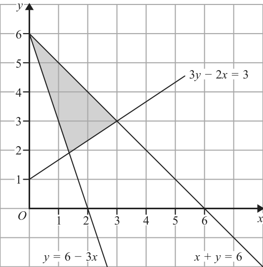
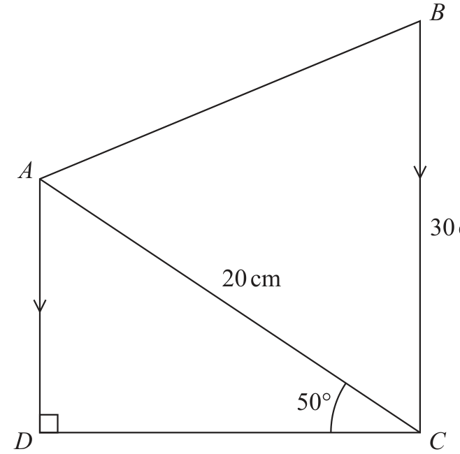
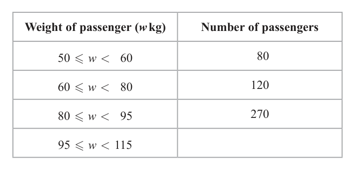
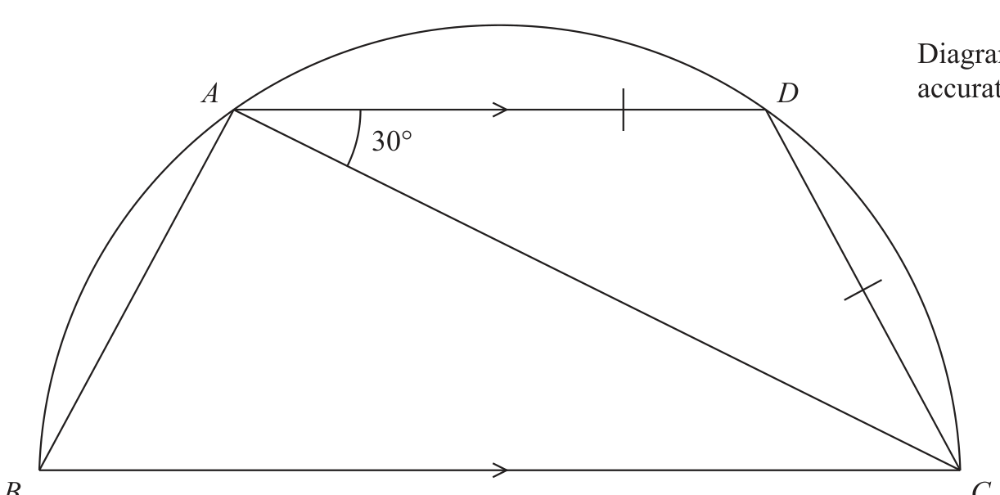
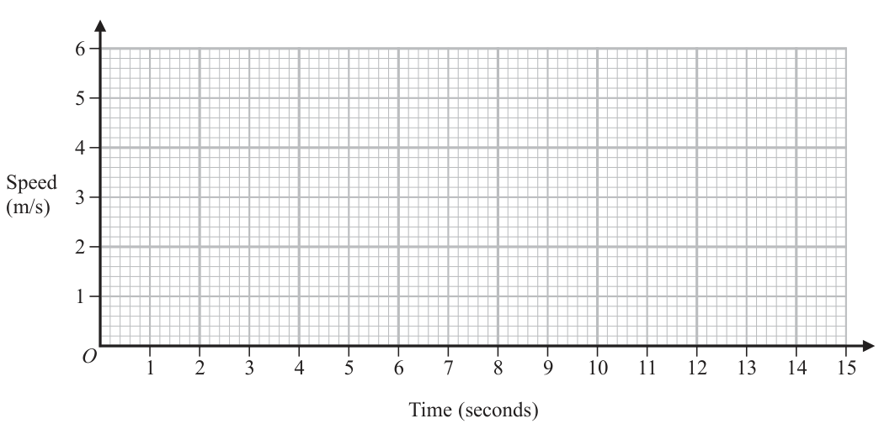
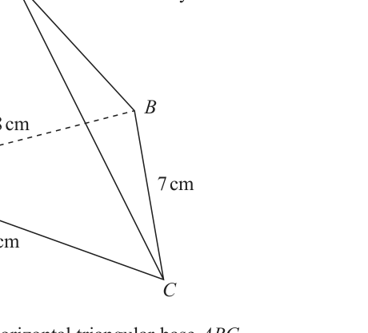

# 4MB1/01R — 2020-01 (official extraction)

> schema `syllabai.official-paper-questions/0.2` · paper_id `pearson-edexcel:international-gcse:mathematics-b:4mb1:2020-01:4MB1/01R` · qp sha256 `8818980b758a55ea…` · extraction is the disclosed baseline (ADR-039)

## Question 1 (2 marks)

Express 7 minutes as a fraction of 24 hours. Give your answer in its simplest form.

### 1 [2]

Express 7 minutes as a fraction of 24 hours. Give your answer in its simplest form.

**Mark scheme answer**

> 7.5 2 M1
> (oe)
> 60 × 24
> 1 A1
> 192
> Total 2 marks

- **(2)** 7.5 2 M1

## Question 2 (2 marks)

The nth term of a sequence is given by the expression 2n2 − 5 Find the first term of the sequence and the third term of the sequence. First term = . . . . . . . . . . . . . . . . . . . . . .. . . . . . . . . . . . . . . . . . . . . . . . . . . . . . . . . Third term = . . . . . . . . . . . . . . . . . . . . . .. . . . . . . . . . . . . . . . . . . . . . . . . . . . . . . . .

### 2 [2]

The nth term of a sequence is given by the expression 2n2 − 5 Find the first term of the sequence and the third term of the sequence. First term = Third term =

**Mark scheme answer**

> 2 × (1)² − 5 or 2 ×3² − 5 oe 2 M1 or for one correct value
> −3, 13 A1
> Total 2 marks

- **(2)** 2 × (1)² − 5 or 2 ×3² − 5 oe 2 M1 or for one correct value

## Question 3 (2 marks)

Solve − = x 3 2 x = . . . . . . . . . . . . . . . . . . . . . .. . . . . . . . . . . . . . . . . . . . . . . . . . . . . . . . .

### 3 [2]

Solve − = x 3 2 x = ……………Solve − = x 3 2 x =

**Mark scheme answer**

> 2 ( 3 − x ) = 3x 2 M1 remove denominators
> 2×3 OR a correct expression for x OR (must be a single fraction)
> OR x= x
> 3+ 2
> 1 5
> OR =
> x 6
> A1 oe
> 6 1
> x = , 1 , 1.2
> 5 5
> Total 2 marks

- **(2)** 2 ( 3 − x ) = 3x 2 M1 remove denominators

## Question 4 (2 marks)

Factorise completely 2x2 − 6xy + 5wx − 15wy

### 4 [2]

Factorise completely 2x2 − 6xy + 5wx − 15wy

**Mark scheme answer**

> 2 x ( x − 3 y ) + 5w ( x − 3 y ) 2 M1
> OR x ( 2 x + 5w ) − 3 y ( 2 x + 5w )
> ( 2 x + 5w)( x − 3 y ) A1
> Total 2 marks

- **(2)** 2 x ( x − 3 y ) + 5w ( x − 3 y ) 2 M1

## Question 5 (2 marks)

The function g where g: x ↦ 16 − x2 is defined for all values of x. Write down

### 5 [2]

The function g where g: x ↦ 16 − x² is defined for all values of x. Write down

Write down (i) the maximum value of g(x), (ii) the range of g.

**Mark scheme answer**

> 16 2 B1
> Eg. Range is B1 allow ( −∞,16] or {g : g ≤ 16} or g ≤ 16
> “y ≤ 16”
> OR g(x) ≤ 16 (No mark for x ≤ 16)
> Total 2 marks

- **(2)** 16 2 B1

## Question 6 (2 marks)

Find the value of 16 × 1050 Give your answer in standard form.

### 6 [2]

Find the value of 16 × 1050 Give your answer in standard form.

**Mark scheme answer**

> 1.25…×10n OR 2 −3 × 10−148 2 M1
> OR 0.125 × 10 −148 (oe)
> 1.25×10-149 A1
> Total 2 marks

- **(2)** 1.25…×10n OR 2 −3 × 10−148 2 M1

## Question 7 (2 marks)

Given that y = − 4 4 x dy find dx dy = . . . . . . . . . . . . . . . . . . . . . .. . . . . . . . . . . . . . . . . . . . . . . . . . . . . . . . . dx

### 7 [2]

Given that y = − 4 4 x dy find dx dy = ……………dx

Given that y = − 4 4 x dy find dx dy = dx

**Mark scheme answer**

> 2 M1 One term correct (allow unsimplified)
> x³ + 5 A1 Fully correct oe eg x³ + 16x−5
> x

- **(2)** 2 M1 One term correct (allow unsimplified)

## Question 8 (2 marks)

Write down

### 8(a) [1]

Write down

the number of lines of symmetry of the figure …………… , ……………

**Mark scheme answer**

> 0 or None (oe) 1 B1

- **(1)** 0 or None (oe) 1 B1

### 8(b) [1]

the order of rotational symmetry of the figure.

**Mark scheme answer**

> 2 1 B1
> Total 2 marks

- **(1)** 2 1 B1

## Question 9 (3 marks)

Find the range of values of x for which x − 10 < 3x + 4 ≤ 20 − 5x

### 9 [3]

Find the range of values of x for which x − 10 < 3x + 4 ≤ 20 − 5x

**Mark scheme answer**

> One of 3 M1
> −14 < 2 x (oe) OR 8 x ≤ 16 (oe)
> Both M1(DEP)
> -7 < x ≤ 2 A1
> Accept − 7 < x and x ≤ 2 oe
> Total 3 marks

- **(3)** One of 3 M1

## Question 10 (3 marks)

A factory produces 2500 plates. There are large plates and small plates. There are 800 large plates which have a mean weight of 600 grams. The small plates have a mean weight of 450 grams. Calculate the mean weight, in grams, of all 2500 plates. ....................................................... grams

### 10 [3]

A factory produces 2500 plates. There are large plates and small plates. There are 800 large plates which have a mean weight of 600 grams. The small plates have a mean weight of 450 grams. Calculate the mean weight, in grams, of all 2500 plates grams

**Mark scheme answer**

> Total weight of the 800 large plates 3 M1 for a method to find one of the totals.
> = 800 × 600 (= 480 000)
> OR
> Total weight of the small plates =
> ( 2500 − 800 ) × 450
> (= 765 000)
> " ( 2500 − 800 ) × 450"+ "800 × 600" M1(DEP)
> NB: DEP on correct methods for both weights
> 2500
> 498 A1 (cao)
> Total 3 marks

- **(3)** Total weight of the 800 large plates 3 M1 for a method to find one of the totals.

## Question 11 (3 marks)

Find, showing your working clearly,

### 11 [3]

Find, showing your working clearly …………… , ……………
(i) the lowest common multiple (LCM) of 42, 54 and 66 (ii) the highest common factor (HCF) of 42, 54 and 66 (i) LCM = (ii) HCF =

**Mark scheme answer**

> 42 = 2 × 3 × 7 ✓ 3 M1 (may be numbers at the end of a factor tree or in a factor
> ⎪ ladder)
> 54 = 2 × 33 ⎫ Two of
> 66 = 2 × 3 × 11⎪⎭ OR: (NB: 2 and 3 may be replaced by 6)
> OR 2 42 54
> 2 42 54 66 3 21 27
> 3 21 27 33 7 9
> 3 7 9
> 3 7 3
> Correct columns for two of 42, 54 or 66
> LCM = 4158 A1 dep on M1
> HCF = 6 A1 dep on M1
> NB: SC Deduct one A mark if correct values for LCM and
> HCF are swapped
> Total 3 marks

- **(3)** 42 = 2 × 3 × 7 ✓ 3 M1 (may be numbers at the end of a factor tree or in a factor

## Question 12 (3 marks)

During a week, 500 trains will arrive at a station. Each train will be late, on time or early. The probability of a train arriving late is 0.85 The probability of a train arriving on time is 0.07 Calculate an estimate for the number of trains that will arrive early during the week.

### 12 [3]

During a week, 500 trains will arrive at a station. Each train will be late, on time or early. The probability of a train arriving late is 0.85 The probability of a train arriving on time is 0.07 Calculate an estimate for the number of trains that will arrive early during the week.

**Mark scheme answer**

> Prob (not arriving early) = 0.85 + 3 M1
> 0.07
> OR
> 0.85 × 500 + 0.07 × 500 ( = 425 + 35)
> No. of trains arriving early = M1(DEP)
> (1 – (“0.85 + 0.07” )) × 500
> OR
> 500 − ("425"+ "35")
> 40 (trains) A1
> Total 3 marks

- **(3)** Prob (not arriving early) = 0.85 + 3 M1

## Question 13 (3 marks)

y 3y − 2x = 3 O 1 2 3 4 5 6 x y = 6 − 3x x + y =6 Write down the three inequalities that define the shaded region in the diagram.

### 13 [3]

y 3y − 2x = 3 O 1 2 3 4 5 6 x y = 6 − 3x x + y =6 Write down the three inequalities that define the shaded region in the diagram.

> *Figure not shown in this reconstruction — the printed paper includes a diagram (not drawn accurately). Use the text description to work through it.*

**Mark scheme answer**

> 3 2x
> 3y − 2x ≥ 3 B1 oe eg y ≥ +1
> y ≥ 6 − 3x B1 oe eg y + 3x ≥ 6
> B1 oe eg y ≤ 6 − x
> x+ y≤6
> NB: Allow > for ≥ and < for ≤
> Total 3 marks

- **(3)** 3 2x

## Question 14 (3 marks)

P = { a, b, c, d } Write down all of the subsets of P that have 2 elements.

### 14 [3]

P = { a, b, c, d } Write down all of the subsets of P that have 2 elements.

**Mark scheme answer**

> {a, b}, {a, c}, {a, d}, {b, c}, 3 B3 (-1eeoo)
> {b, d}, {c, d}
> NB: Penalise extra permutations once only
> Total 3 marks

- **(3)** {a, b}, {a, c}, {a, d}, {b, c}, 3 B3 (-1eeoo)

## Question 15 (3 marks)

Simplify fully (7x − 3) − (5x − 9) 6 3

### 15 [3]

Simplify fully (7x − 3) − (5x − 9) 6 3

**Mark scheme answer**

> x ( 7 x − 3) − 2 x ( 5 x − 9 ) 3 M1 oe
> x
> OR ⎡( 7 x − 3) − 2 ( 5 x − 9 ) ⎤⎦
> 6
> 7 x 2 3x 5 x 2 9 x
> OR − − +
> 6 6 3
> 7 x − 3 x − 10 x + 18 x
> 2
> M1(DEP)
> x
> OR [7 x − 3 − 10 x + 18]
> ⎛ 7 10 ⎞ 2 ⎛ 1 ⎞
> OR ⎜ − ⎟ x − ⎜ − 3⎟ x
> ⎝6 6 ⎠ ⎝2 ⎠
> − x² + 5x A1 (oe but must be fully simplified)

- **(3)** x ( 7 x − 3) − 2 x ( 5 x − 9 ) 3 M1 oe

## Question 16 (3 marks)

ABCD is a rectangle with perimeter 28 m. The length of AB is 8 m. Calculate the length, in m, of the diagonal AC of the rectangle. ....................................................... m

### 16 [3]

ABCD is a rectangle with perimeter 28 m. The length of AB is 8 m. Calculate the length, in m, of the diagonal AC of the rectangle m

**Mark scheme answer**

> 28 − 2 × 8 3 M1
> Length of other side is (oe) (= 6)
> Length of diagonal = 82 + "6"2 M1 (DEP)
> 10 A1
> Total 3 marks

- **(3)** 28 − 2 × 8 3 M1

## Question 17 (3 marks)

B Diagram NOT accurately drawn A 30 cm 20 cm 50° D C The diagram shows the trapezium ABCD in which AD and BC are parallel. AC = 20 cm BC = 30 cm ∠ACD = 50° ∠ADC = 90° Calculate the area, in cm2 to 3 significant figures, of the trapezium ABCD. ....................................................... cm2

### 17 [3]

The diagram shows the trapezium ABCD in which AD and BC are parallel. AC = 20 cm BC = 30 cm ∠ACD = 50° ∠ADC = 90° Calculate the area, in cm² to 3 significant figures, of the trapezium ABCD cm²

> *Figure not shown in this reconstruction — the printed paper includes a diagram (not drawn accurately).*
> Labels in the original figure: B, A, D, C · Figure values: 30, 20, 50°.

**Mark scheme answer**

> AD DC 3 M1
> sin 50o = or cos 50o = (oe)
> 20 20 (AD = 15.321 and DC = 12.856)
> 1 (oe for both lengths)
> OR Area of ∆ABC= × 20 × 30 × sin(40) ( = 192.836...)
> 1 M1 (DEP)
> × " DC "× ( 30 + " AD ")
> OR × 20 × " DC "× sin 50o + "192.836..."
> OR
> “12.856” × “15.321” + (0.5 × “12.856” × (30 −“15.321”))
> 291 A1
> Total 3 marks

- **(3)** AD DC 3 M1

## Question 18 (3 marks)

Express 5−2 in the form m + n, where m and n are integers. Show your working clearly.

### 18 [3]

Express 5−2 in the form m + n, where m and n are integers. Show your working clearly.

**Mark scheme answer**

> ( 35 + 3 5 − 2 7 − 6) × ( 5 + 2) 3 M1 showing clear intention to Remove
> denominator by multiplying numerator and
> denominator by ( 5 + 2)
> 35 × 5 + 3 5 × 5 − 2 7 × 5 − 6 5 + 2 35 + 6 5 − 4 7 − 12 oe M1(DEP) Expanding numerator (allow one
> error) oe
> OR
> 3+ 7 A1(DEP on M2)
> Alternative method
> 5 ( 7 + 3) - 2( 7 + 3) 7( 5 − 2) + 3( 5 − 2)
> M2 for correct factorisation
> or or
> 5 -2 5 −2
> ( 5 - 2)( 7 + 3)
> 5 -2
> 3+ 7 A1(DEP on M2)
> Total 3 marks

- **(3)** ( 35 + 3 5 − 2 7 − 6) × ( 5 + 2) 3 M1 showing clear intention to Remove

## Question 19 (4 marks)

Given that 1 mile = 1.609 kilometres and 1 gallon = 4.546 litres, change 35 miles per gallon into litres per 100 kilometres. Give your answer correct to 3 significant figures. ....................................................... litres per 100 kilometres

### 19 [4]

Given that 1 mile = 1.609 kilometres and 1 gallon = 4.546 litres, change 35 miles per gallon into litres per 100 kilometres. Give your answer correct to 3 significant figures litres per 100 kilometres

**Mark scheme answer**

> 1 4 M1 (possibly seen in an expression) (ie invert 35)
> 35 miles per gallon → gallons per mile
> OR
> 35 mpg ´1.609 (= 56.315 km/gallon) mpg to km/gallon
> OR
> 100 ÷ 1.609 (=62.1504…) number of miles in 100 km
> 4.546 M1(DEP)
> (litres/mile)
> 35 Litres per mile
> 1 100 OR
> OR × (gallons/100km)oe eg "62.1504" ÷ 35(=1.7757...) gallons per 100 km
> 35 1.609
> OR
> “56.315 km/gallon” ÷ 4.546 OR
> ( = 12.3878 km/litre) km per litre
> 1 100 M1(DEP) for a fully correct method
> × 4.546 × oe eg "1.7757... × 4.546 (litres/ 100km)
> 35 1.609
> OR
> 100 ÷ 12.3878 (all units converted)
> awrt A1
> 8.07
> Total 4 marks

- **(4)** 1 4 M1 (possibly seen in an expression) (ie invert 35)

## Question 20 (4 marks)

A = ⎜ ⎝ 5 −7⎟⎠

### 20(a) [2]

A = 5 −7 

Find A2 −1 2⎞ B = ⎜ −3 5 4 −3⎠

**Mark scheme answer**

> ⎛ 19 −27 ⎞ 2 B2( − 1eeoo in a matrix of the correct order)
>  −45 64 

- **(2)** ⎛ 19 −27 ⎞ 2 B2( − 1eeoo in a matrix of the correct order)

### 20(b) [2]

Find BA 

**Mark scheme answer**

> ⎛ 12 − 17 ⎞ 2 B2( − 1eeoo in a matrix of the correct order )
>  31 − 44 − 23 33 

- **(2)** ⎛ 12 − 17 ⎞ 2 B2( − 1eeoo in a matrix of the correct order )

## Question 21 (4 marks)

The weights of 710 passengers boarding buses at a bus station were recorded. The incomplete table and histogram give information about these passengers. Weight of passenger (w kg) Number of passengers 50 ≤ w < 60 80 60 ≤ w < 80 120 80 ≤ w < 95 270 95 ≤ w < 115

### 21(a) [1]

Complete the table.

**Mark scheme answer**

> 240 1 B1 (No. of passengers in 95 ≤ w < 115 )

- **(1)** 240 1 B1 (No. of passengers in 95 ≤ w < 115 )

### 21(b) [3]

Complete the histogram. Frequency density 50 60 70 80 90 100 110 120 Weight of passenger (kg)

**Mark scheme answer**

> (Ht. of 50 ≤ w < 60 bar) – FD = 8 3 M1 for a correct bar OR a correct scale for FD
> (Ht. of 80 ≤ w < 95 bar) – FD = 18 A1 for 2 correct bars OR one correct bar and correct
> (Ht. of 95 ≤ w < 115 bar) – FD = 12 Completely correct scale for FD
> (NB: 1 cm = 2 units on FD axis) histogram A1 for all bars correct and correct scale for FD
> Total 4 marks

- **(3)** (Ht. of 50 ≤ w < 60 bar) – FD = 8 3 M1 for a correct bar OR a correct scale for FD

## Question 22 (4 marks)

In a survey of 55 farmers who keep animals, the numbers of farmers who keep cattle (C ), goats (G ) and sheep (S ) were recorded. The Venn diagram shows information about the results of the survey. The numbers shown in the Venn diagram are the number of farmers in the given subset of E. E S G C 22 5 10 3 15

### 22(a)(i) [?]

Find n(C ∩ G ∩ S )

**Mark scheme answer**

> 10 2 B1

### 22(a)(ii) [2]

Describe the members of the subset C ∩ G ∩ S

**Mark scheme answer**

> Farmers who keep B1 oe
> cattle, sheep and goats

- **(2)** Farmers who keep B1 oe

### 22(b)(i) [?]

Find n(C ′ ∩ G ′ ∩ S )

**Mark scheme answer**

> 15 2 B1

### 22(b)(ii) [2]

Describe the members of the subset C ′ ∩ G ′ ∩ S

**Mark scheme answer**

> Farmers who keep B1 oe eg sheep farmers only
> sheep but not goats
> and cattle
> Total 4 marks

- **(2)** Farmers who keep B1 oe eg sheep farmers only

## Question 23 (4 marks)

A particle is dropped from rest and falls a distance of s metres in time t seconds. In the first 4 seconds after it has been dropped, the particle falls a distance of 96 metres. At time 5 seconds after it has been dropped, the particle is at the point A. At time 6 seconds after it has been dropped, the particle is at the point B. Given that s is directly proportional to the cube of t, calculate, in metres, the distance AB. ....................................................... m

### 23 [4]

A particle is dropped from rest and falls a distance of s metres in time t seconds. In the first 4 seconds after it has been dropped, the particle falls a distance of 96 metres. At time 5 seconds after it has been dropped, the particle is at the point A. At time 6 seconds after it has been dropped, the particle is at the point B. Given that s is directly proportional to the cube of t, calculate, in metres, the distance AB m

**Mark scheme answer**

> 96 = k × 43 4 M1
> k = 3/2 A1 oe eg k = 1.5, k = 96/4³ (Might be seen in
> working)
> 3 3 M1 (DEP on M1)
> ( s(6) − s(5) = ) " "× 63 − " "× 53
> 2
> (324 − 187.5 ) OR " " ( 216 − 125 )
> 136.5 A1 Accept awrt 137
> Total 4 marks

- **(4)** 96 = k × 43 4 M1

## Question 24 (5 marks)

The scale of a map is 1 : 40 000 The actual area of a field is 2.4 km2

### 24(a) [3]

The scale of a map is 1 : 40 000 The actual area of a field is 2.4 km²

Calculate the area, in cm², of the field on the map cm² Given that n is an integer, the scale of another map is 1 : n The length of a road shown on this map is 8 cm. The actual length of this road is 2 km.

**Mark scheme answer**

> 100 000 : 40 000 oe 3 M1 or 1 : 1 600 000 000 oe
> OR Statement or use of area equivalence or ratio
> 1 km² = 1 × 1010 cm²
> OR
> 2.4 km² = 2.4 × 1010 cm²
> OR
> 1 cm² represents 0.16 km² oe
> ⎛ 100 000 ⎞ 2.4 M1 a fully correct method to find the area of the field
>  × 2.4 oe eg OR in cm² or a fully correct equation for the area of the
> ⎝ 40 000 ⎠ 0.16
> field
> 2.4 ×100 000² ÷ 1 600 000 000 oe
> OR
> 0.16A = 2.4
> 15 A1

- **(3)** 100 000 : 40 000 oe 3 M1 or 1 : 1 600 000 000 oe

### 24(b) [2]

Find the value of n. n =

**Mark scheme answer**

> n 2 M1 oe eg (2 × 100 000) ÷ 8
> ×8 = 2 (oe)
> 100 000
> 25 000 A1
> Total 5 marks

- **(2)** n 2 M1 oe eg (2 × 100 000) ÷ 8

## Question 25 (5 marks)

Given that w = 5x + y − 1 express x in terms of y and w. Give your answer as a single fraction. x = .......................................................

### 25 [5]

Given that w = 5x + y − 1 express x in terms of y and w. Give your answer as a single fraction. x =

**Mark scheme answer**

> x − y − 3w2 5 M1 (Squaring)
> w2 =
> 5x + y − 1
> w2 ( 5 x + y − 1) = ( x − y − 3w2 ) M1 (DEP) (Remove denominator)
> 5 xw2 + w2 y − w2 = x − y − 3w2 M1 (DEP) (Expanding – allow one error only)
> x ( 5w2 − 1) = − w2 y − y − 2 w2 M1 (DEP) (Collecting terms in x on one side and
> factorising and other terms the other side – ft one
> error)
> w2 y + y + 2 w2 w2 (− y − 2) − y
> x=− A1 (oe) eg x =
> 5 w2 − 1 5 w2 − y
> Total 5 marks

- **(5)** x − y − 3w2 5 M1 (Squaring)

## Question 26 (5 marks)

Diagram NOT A D accurately drawn 30° B C The diagram shows part of a circle through the points A, B, C and D. AD is parallel to BC, AD = DC and ∠CAD = 30° Giving your reasons, prove that BC is a diameter of the circle.

### 26 [5]

The diagram shows part of a circle through the points A, B, C and D. AD is parallel to BC, AD = DC and ∠CAD = 30° Giving your reasons, prove that BC is a diameter of the circle.

> *Figure not shown in this reconstruction — the printed paper includes a diagram (not drawn accurately).*
> Labels in the original figure: A, D, B, C · Figure values: 30°.

**Mark scheme answer**

> Method 1
> ∠ ACD = 30 5 M1
> ∠ ADC = 180 – 30 – 30 (=120) M1
> ∠ ABC = 180 – 120 (=60) and 90 A1 dep on M2 for showing a full method to ∠ BAC = 90°
> ∠ BAC = 90
> And full B2 dep on A1 for all correct reasons for method used:
> reasons for (allow ∠ for angle and Vfor triangle)
> method Base angles of isosceles triangle
> used Angles in triangle total 180°/angles in triangle total 180°
> Opposite angles in cyclic quadrilateral total 180°
> BC is a diameter as the angle in a semi-circle is a right angle oe
> BC is a diameter as the angle at the centre is double the angle at
> the circumference oe
> (B1 dep on M1for one reason that is a circle theorem)
> Method 2
> ∠ ACD = 30 5 M1
> ∠ ACB = 30 M1
> ∠ BAC = 180 – (30 + 30 + 30) =90 90 A1 dep on M2 for showing a full method to ∠ BAC = 90°
> And full B2 dep on A1 for all correct reasons for method used:
> reasons for (allow ∠ for angle and Vfor triangle)
> method Base angles of isosceles triangle
> used Alternate angles
> Opposite angles in cyclic quadrilateral total 180°
> BC is a diameter as the angle in a semi-circle is a right angle oe
> BC is a diameter as the angle at the centre is double the angle at
> the circumference oe
> (B1 for one reason that is a circle theorem)
> Total 5 marks

- **(5)** Method 1

## Question 27 (5 marks)

At time t = 0 seconds, a cyclist passed the point P on a straight horizontal road. The cyclist was moving with a constant speed of 5 m/s. The cyclist travelled a distance of 35 m at this speed to the point Q on the road. On reaching Q, the cyclist decelerated at a constant rate, coming to rest at the point R on the road such that PQR is a straight line and QR = 10 m. Represent, on the grid, the information for the journey of the cyclist from P to R as a speed-time graph. Speed (m/s) 3 O 1 2 3 4 5 6 7 8 9 10 11 12 13 14 15 Time (seconds)

### 27 [5]

At time t = 0 seconds, a cyclist passed the point P on a straight horizontal road. The cyclist was moving with a constant speed of 5 m/s. The cyclist travelled a distance of 35 m at this speed to the point Q on the road. On reaching Q, the cyclist decelerated at a constant rate, coming to rest at the point R on the road such that PQR is a straight line and QR = 10 m. Represent, on the grid, the information for the journey of the cyclist from P to R as a speed-time graph. Speed (m/s) 3 O 1 2 3 4 5 6 7 8 9 10 11 12 13 14 15 Time (seconds)

**Mark scheme answer**

> 35
> Time to travel 35 m at 5 m/s = s M1
> 7s A1 shown clearly in working or graph correctly drawn
> 1 M1
> × 5 × t = 10 (oe)
> 4s A1
> 2 straight lines B1 Line 1: Straight line drawn from (0, 5) to (7, 5)
> drawn Line 2: Straight line drawn from (7, 5) to
> (7 + 4, 0) ie (11, 0)
> Total 5 marks

- **(5)** 35

## Question 28 (7 marks)

B Diagram NOT accurately drawn F H A C M O N G J D The diagram shows circle ABCD with centre O, diameter AMONC and radius r. The diagram also shows circle AFOG, with centre M, and circle OHCJ, with centre N.

### 28(a) [3]

The diagram shows circle ABCD with centre O, diameter AMONC and radius r. The diagram also shows circle AFOG, with centre M, and circle OHCJ, with centre N.

Find and simplify an expression, in terms of r and π, for the perimeter of the shaded region in the diagram. The line FH is the tangent to the circle AFOG at the point F. The line FH is also the tangent to the circle OHCJ at the point H. The point P on circle ABCD is such that OFP is a straight line. The point Q on circle ABCD is such that OHQ is a straight line. The region FPBQH inside circle ABCD is bounded by the straight line FP, the arc PBQ of circle ABCD and the two straight lines QH and HF.

> *Figure not shown in this reconstruction — the printed paper includes a diagram (not drawn accurately).*
> Labels in the original figure: B, F, H, A, C, M, O, N, G, J, D.

**Mark scheme answer**

> 3 M1
> π r OR 2π 
> r
> ⎝2⎠
> ⎛r⎞ M1 (DEP) for complete method to find perimeter of
> π r + 2π oe shaded region
> ⎝ ⎠
> 2π r A1

- **(3)** 3 M1

### 28(b) [4]

Find and simplify an expression, in terms of r and π, for the area of FPBQH.

**Mark scheme answer**

> FH = r and ∠FOH = 90 o
> 4 B1
> 1 r M1
> (Area of ΔFHO =) × × r oe eg 0.25r²
> 2 2
> "90" 1 r M1 (DEP) for complete method to find area FPBQH
> ∴ Area of FPBQH = ×π r2 − × × r
> 360 2 2
> r2 A1 (oe)
> (π − 1)
> Total 7 marks

- **(4)** FH = r and ∠FOH = 90 o

## Question 29 (7 marks)

D Diagram NOT accurately drawn B 8 cm A 7 cm 6 cm C The diagram shows a pyramid ABCD with a horizontal triangular base ABC. The face ADB of the pyramid is perpendicular to the base ABC. In ΔABC, AB = 8 cm, BC = 7 cm and CA = 6 cm.

### 29(a) [3]

Calculate the size, in degrees to 3 significant figures, of ∠ACB. ∠ACB = ° In ΔADB, AD = DB and ∠ADB = 50°

**Mark scheme answer**

> 82 = 62 + 7 2 − 2 × 6 × 7 × cos ∠ACB 3 M1
> ⎛ 6 2 + 7 2 − 82 ⎞ M1 (DEP)
> ∠ACB = cos −1 2×6×7 
> 75.5 A1

- **(3)** 82 = 62 + 7 2 − 2 × 6 × 7 × cos ∠ACB 3 M1

### 29(b) [4]

Calculate the volume, in cm³ to 3 significant figures, of the pyramid ABCD

…………… cm³

**Mark scheme answer**

> 4 4 M1 (oe, where h is the perpendicular height of ΔADB
> tan 25 = oe eg
> h and so of the pyramid)
> ⎛ 8sin 65 ⎞
> h= − 4 (=8.578…)
> ⎝ sin 50 ⎠
> 1 M1 (award even if part of a calculation)
> Area of VABC = × 6 × 7 × sin" ∠ACB "
> (=20.311)
> Volume of ABCD = M1(DEP)
> × "Area of VABC "× " h "
> 58.1 A1

- **(4)** 4 4 M1 (oe, where h is the perpendicular height of ΔADB

