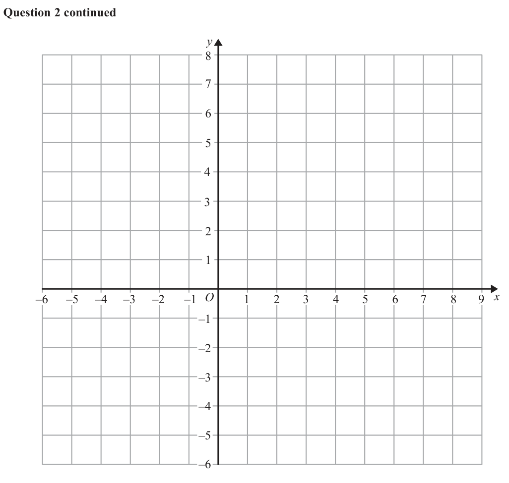
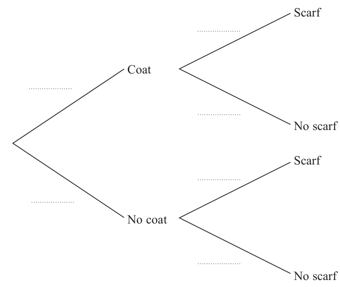
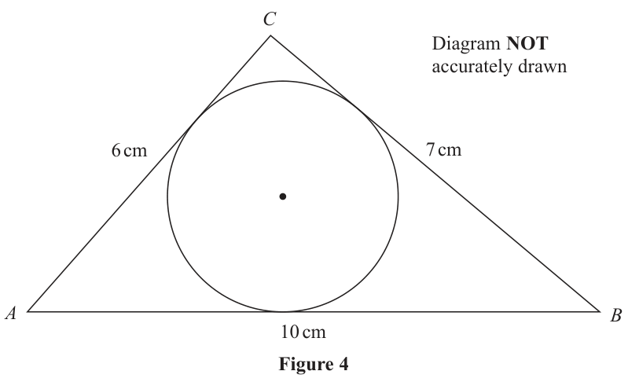

# 4MB1/02 — 2020-01 (official extraction)

> schema `syllabai.official-paper-questions/0.2` · paper_id `pearson-edexcel:international-gcse:mathematics-b:4mb1:2020-01:4MB1/02` · qp sha256 `b00961390e8b93d5…` · extraction is the disclosed baseline (ADR-039)

## Question 1 (5 marks)

A = 23 × 32 × 5 × 7 B = 2 × 34 × 52 × 11

### 1(a) [1]

Find the highest common factor (HCF) of A and B.

**Mark scheme answer**

> 90 1 B1oe Allow 2 × 32 × 5 ISW

- **(1)** 90 1 B1oe Allow 2 × 32 × 5 ISW

### 1(b) [1]

Find the lowest common multiple (LCM) of A and B.

**Mark scheme answer**

> 1 247 400 1 B1oe Allow 23 × 34 × 52 × 7 ×11 ISW
> SC If both answers correct but the wrong way round award (a) B1
> (b) B0.

- **(1)** 1 247 400 1 B1oe Allow 23 × 34 × 52 × 7 ×11 ISW

### 1(c) [1]

Find the least number that A must be multiplied by to give a square number. C = 3 × 10205 × 5 × 10205

**Mark scheme answer**

> 70 1 B1 oe 2 × 5 × 7 ISW
> 410

- **(1)** 70 1 B1 oe 2 × 5 × 7 ISW

### 1(d) [2]

Work out the value of C, giving your answer as a number in standard form.

**Mark scheme answer**

> 15 × 10 or 1.5 × 10 where n is
> n
> 2 M1 Allow 3 × 5 × 10410
> an integer
> 1.5 × 10411 A1
> Total 5 marks
> Question Working Answer Mark Notes

- **(2)** 15 × 10 or 1.5 × 10 where n is

## Question 2 (7 marks)

The points with coordinates (2, 1), (5, 1), (3, 3) and (6, 3) are the vertices of parallelogram A.

### 2(a) [1]

On the grid, draw and label parallelogram A. ⎛ 2⎞ Parallelogram A is transformed to parallelogram B under the translation ⎜ ⎟ ⎝ −5⎠

**Mark scheme answer**

> Parallelogram 1 B1
> drawn at (2,1),
> (5,1), (3,3) and
> (6,3)

- **(1)** Parallelogram 1 B1

### 2(b) [2]

On the grid, draw and label parallelogram B. Parallelogram B is transformed to parallelogram C by a reflection in the line with equation x = 2

**Mark scheme answer**

> for an attempt to translate their 2 M1 Allow 3 points of their shape moved +2 horizontally or 3
> parallelogram A points of their shape moved -5 vertically
> Translation A1ft their shape A
> ⎛2⎞ or Vertices at (5, −2), (8, −2) (4, −4), (7, −4)
> ⎜ ⎟
> ⎝ −5 ⎠

- **(2)** for an attempt to translate their 2 M1 Allow 3 points of their shape moved +2 horizontally or 3

### 2(c) [2]

On the grid, draw and label parallelogram C. Parallelogram C is transformed to parallelogram D by a rotation through 90° anticlockwise about the point with coordinates (–5, 0)

**Mark scheme answer**

> for line x = 2 drawn and one correct 2 M1
> point ft their shape B
> or 2 correct ft points of their shape
> B given
> or their shape A correctly reflected
> in the line x = 2
> Parallelogram A1ft their shape B.
> C drawn or Vertices at ( −1, −2), (0, −4) (−4, −2), (−3, −4)

- **(2)** for line x = 2 drawn and one correct 2 M1

### 2(d) [2]

On the grid, draw and label parallelogram D. y –6 –5 –4 –3 –2 –1 O 1 2 3 4 5 6 7 8 9 x –1 –2 –3 –4 –5 –6 for a spare grid if you need to redraw your parallelograms. Only use this grid if you need to redraw your parallelograms. y –6 –5 –4 –3 –2 –1 O 1 2 3 4 5 6 7 8 9 x –1 –2 –3 –4 –5 –6

**Mark scheme answer**

> They do not need to label their shapes to gain the marks.
> their shape C
> Parallelogram A1cao Vertices at ( −3,1), ( −1, 2) ( −3, 4), ( −1, 5) .
> D drawn
> Total 7 marks
> Question Working Answer Mark Notes

- **(2)** They do not need to label their shapes to gain the marks.

## Question 3 (7 marks)

Diagram NOT accurately drawn O B 25° C A 15 cm Figure 1 In Figure 1, A and B are two points on a circle with centre O. The line AC is the tangent to the circle at A and OBC is a straight line. AC = 15 cm and ÐOCA = 25°

### 3(a) [3]

Calculate the area, in cm2 to 3 significant figures, of the circle. The region inside triangle OAC but outside the circle is shown shaded in Figure 1

**Mark scheme answer**

> [OA =]15tan 25 oe 3 M1 A correct method for finding OA eg
> 15 ⎛ 15 ⎞
> ⎟ − 15
> or ⎜ or awrt 6.99
> tan 65 ⎝ cos 25 ⎠
> [ Area of circle = ]π (" OA ") M1 Correct method for finding the area of the circle.
> Allow use of their OA( may be on diagram) and 22/7 for π
> 154 or 153 A1 Allow awrt 154 or awrt 153, Ignore units
> [cm2]

- **(3)** [OA =]15tan 25 oe 3 M1 A correct method for finding OA eg

### 3(b) [4]

Calculate the area, in cm2 to 3 significant figures, of this shaded region.

**Mark scheme answer**

> [Area of triangle = ] 4 M1 Correct method for finding the area of the triangle. ft their OA
> 1 from part(a) if working shown eg
> (15)("6.9946...")
> 2
> (15 ) ⎛⎜
> 15 ⎞
> ( )
> ⎟ sin 25 or (15) 15 + "6.9946..." sin25 or awrt
> ⎝ cos 25 ⎠
> 2
> 52.4 or 52.5
> [Area of sector =] M1 Allow 22/7 for π . ft their part(a) or OA if working shown or
> 65 65 awrt 8.83π or awrt 27.8/ 27.7
> π (" OA ") or
> × (a)
> 360 360
> [Area of shaded ABC = ] M1 dependent on both previous M marks
> 65 Implied by awrt 24.7
> "52.4596…" – ("153.70128...")
> 360
> 24.7 [cm2] A1 awrt 24.6 – 24.8 with no incorrect working. Ignore units
> Total 7 marks
> Question Working Answer Mark Notes

- **(4)** [Area of triangle = ] 4 M1 Correct method for finding the area of the triangle. ft their OA

## Question 4 (6 marks)

In a race, Akaash ran a distance of (8x2 – 105) metres in (6x + 1) seconds. His average speed for the race was x m/s.

### 4(a) [2]

Show that x satisfies the equation 2x2 – x – 105 = 0

**Mark scheme answer**

> 8 x 2 − 105 2 M1 for a correct equation. May be see in part (b)
> x=
> 6x +1
> x ( 6 x + 1) = 8 x 2 − 105 2 x 2 − x − 105 = A1 Note that answer is given so sufficient working must be given.
> At least one step between initial equation and final given equation.
> May be see in part (b) – no incorrect working

- **(2)** 8 x 2 − 105 2 M1 for a correct equation. May be see in part (b)

### 4(b) [4]

Hence calculate the distance, in metres, that Akaash ran in the race. Show clear algebraic working.

**Mark scheme answer**

> ( 2 x − 15)( x + 7 ) = 0 4 M1 May be seen in part(a) For solving the given 3TQ - 2 terms
> correct when multiplied out.
> Allow use of quadratic formula / completing the square with no
> errors for the given 3TQ (Not implied by correct values of x)
> x = 7.5 ( x = −7) A1 Correct working must be shown. 7.5 with no algebraic method
> shown gains M0A0 May be seen in part(a)
> 8 ( 7.5 ) − 105 M1Substituting at least one of their x values into 8 x 2 − 105 (allow
> subst of –ve values). Working must be shown. May be seen in
> part(a)
> 345[ m] A1dependent on at least 1 M mark being awarded Do not ISW. No
> need for units. Do not award if more than one value given. Do not
> award from incorrect working (eg use of -7.5) May be seen in
> part(a)
> Total 6 marks
> Question Working Answer Mark Notes

- **(4)** ( 2 x − 15)( x + 7 ) = 0 4 M1 May be seen in part(a) For solving the given 3TQ - 2 terms

## Question 5 (10 marks)

When Joe goes to school in winter, the probability that he wears a coat is If he wears a coat, the probability that he wears a scarf is If he does not wear a coat, the probability that he wears a scarf is

### 5(a) [3]

Complete the probability tree diagram. Scarf Coat No scarf Scarf No coat No scarf On a day Joe goes to school in winter, calculate the probability that

**Mark scheme answer**

> 5 3 3 B1 for each correct pair of values in the correct place
> ,
> 8 8
> 1 3 Allow 0.625 and 0.375
> , Allow 0.25 and 0.75
> 4 4 Allow awrt 0.17 awrt 0.83
> 1 5 Allow as percentages
> ,
> 6 6

- **(3)** 5 3 3 B1 for each correct pair of values in the correct place

### 5(b) [2]

he is not wearing a coat and is not wearing a scarf,

**Mark scheme answer**

> 3 5 2 M1 ft their probabilities if 0 < p < 1
> ' '× ' ' oe
> 8 6
> 5 A1 oe allow awrt 0.31

- **(2)** 3 5 2 M1 ft their probabilities if 0 < p < 1

### 5(c) [2]

he is wearing a coat or he is wearing a scarf but he is not wearing both a coat and a scarf. On a day Joe goes to school in winter, if he is wearing a coat and a scarf then the probability that he is also wearing a hat is

**Mark scheme answer**

> ⎛ 5 3 ⎞ ⎛ 3 1 ⎞ 2 M1 ft their probabilities if 0 < p < 1
> ⎜ ' '× ' ' ⎟ + ⎜ ' '× ' ' ⎟ oe ⎛ 5 1 ⎞ ⎛ 3 5 ⎞
> ⎝ 8 4 ⎠ ⎝ 8 6 ⎠ Allow 1 − ⎜ ' '× ' ' ⎟ + ⎜ ' '× ' ' ⎟
> ⎝ 8 4 ⎠ ⎝ 8 6 ⎠
> 17 A1 oe allow awrt 0.53

- **(2)** ⎛ 5 3 ⎞ ⎛ 3 1 ⎞ 2 M1 ft their probabilities if 0 < p < 1

### 5(d) [3]

Calculate the probability, that on a day Joe goes to school in winter, he is not wearing all three of a coat, a scarf and a hat.

**Mark scheme answer**

> 5 1 3 5 1 2 3 M1 ft their probabilities if 0 < p < 1
> ' '× ' '× or ' '× ' '× Allow even if embedded in an incorrect calculation
> 8 4 5 8 4 5
> ⎛ 5 1 3 ⎞ M1dep on previous method mark being awarded ft if 0 < p < 1.
> 1 − ⎜ ' '× ' '× ⎟ oe 5 1 2 5 3
> ⎝ 8 4 5⎠ ' '× ' '× + ' '× ' ' + ' ' oe
> or 8 4 5 8 4
> ' '× ' '× + ' '× ' ' + ' ' oe
> 8 4 5 8 4
> 29 A1 oe Allow awrt 0.91
> 3 5
> SC " "× " "× seen as method can earn the first M1
> 8 6
> Total 10 marks
> Question Working Answer Mark Notes

- **(3)** 5 1 3 5 1 2 3 M1 ft their probabilities if 0 < p < 1

## Question 6 (15 marks)

f and g are two functions such that f : x ↦ x2 + x – 6 where x ≥ − 2 x − 24 g : x ↦ 3 − 2x

### 6(a) [1]

State the value of x that must be excluded from any domain of g

**Mark scheme answer**

> [ x = ]1.5 1 B1 oe eg allow [ x ≠ ]1.5 or 1.5 on its own

- **(1)** [ x = ]1.5 1 B1 oe eg allow [ x ≠ ]1.5 or 1.5 on its own

### 6(b) [2]

Find the value of a and the value of b such that f (x) = (x + a)2 + b

**Mark scheme answer**

> ⎛
> 1 ⎞ 25 2 1
> B1 for a = oe B1 for b = − oe
> ⎜x+ ⎟ − 2
> ⎝ 2⎠

- **(2)** ⎛

### 6(c) [1]

Hence write down the range of f

**Mark scheme answer**

> 25 1 B1 ft correct answer or follow through their value of b.
> f ( x) ≥ − Allow f or y instead of f(x) but do not allow x

- **(1)** 25 1 B1 ft correct answer or follow through their value of b.

### 6(d) [2]

Find the value of c for which g–1(0) = c Given that f (x) = g (x)

**Mark scheme answer**

> 2c − 24 2 3 x + 24
> =0 M1 Set g(x) equal to zero or for ⎡⎣ g −1 ( x ) = ⎤⎦ oe
> 3 − 2c 2 + 2x
> c = 12 A1 check for incorrect working

- **(2)** 2c − 24 2 3 x + 24

### 6(e) [3]

show that 2x3 – x2 – 13x – 6 = 0 Show clear algebraic working.

**Mark scheme answer**

> ( x + x − 6 ) ( 3 − 2 x ) = 2 x − 24
> 2 3 M1 Equate and multiply both sides by 3 – 2x. Implied
> by next line. Condone missing brackets if clear from
> following line they are there.
> 3 x 2 − 2 x 3 + 3 x − 2 x 2 − 18 + 12 x = 2 x − 24 M1 dep dependent on previous method mark being
> awarded. Expanding brackets (allow one slip)
> 2 x 3 − x 2 − 13 x − 6 = 0 A1 Note: the answer is given so sufficient working must
> be seen. Both Method marks must be awarded and a
> fully correct solution with no errors.

- **(3)** ( x + x − 6 ) ( 3 − 2 x ) = 2 x − 24

### 6(f) [2]

Use the factor theorem to show that (2x + 1) is a factor of 2x3 – x2 – 13x – 6 The curve with equation y = f (x) intersects the curve with equation y = g (x) at the point A with coordinates ( p, q), where p > −

**Mark scheme answer**

> Substitute – 0.5 into the cubic 2 M1 Allow 1 slip
> ⎛ 1⎞ ⎛ 1⎞
> ⎛ 1⎞ =0 A1 must have = 0
> 2 ⎜ − ⎟ − ⎜ − ⎟ − 13 ⎜ − ⎟ − 6 =0
> ⎝ 2⎠ ⎝ 2⎠ ⎝ 2⎠

- **(2)** Substitute – 0.5 into the cubic 2 M1 Allow 1 slip

### 6(g) [4]

Find the coordinates of A.

**Mark scheme answer**

> x + ax − 6 or 2 x + ax − 12
> 2
> 4 M1 dividing by 2x + 1 to get quadratic of form
> x 2 + ax − 6 or 2 x 2 + ax − 12 May be seen in part (f).
> May be implied by a correct quadratic. NB x2 + x – 6
> scores M0 because this is f(x)
> x 2 − x − 6 or 2 x 2 − 2 x − 12 A1 May be seen in part (f)
> ( x − 3)( x + 2) or 2 ( x − 3)( x + 2) oe M1dep on previous M mark being awarded. Solving
> their 3TQ from division - 2 terms correct when × out.
> NB use of calculator to gain values of – 0.5, – 2 and 3
> gains M1A1M1 and
> ( 3, 6 ) A1 only one set of coordinates must be given.
> Total 15 marks
> Question Working Answer Mark Notes

- **(4)** x + ax − 6 or 2 x + ax − 12

## Question 7 (9 marks)

Diagram NOT accurately drawn 2h cm 4 cm Figure 2 Figure 2 shows a right circular cylinder cut from a solid sphere of radius 4 cm. The height of the cylinder is 2h cm. The volume of the cylinder is V cm3

### 7(a) [3]

Show that V = 32πh – 2πh3

**Mark scheme answer**

> eg ⎡⎣ r = ⎤⎦ 16 − h or [ r =] 16 − h
> 2 2 2 3 82 − (2h) 2
> M1 Use of Pythagoras’ to find r2 or r eg
> V = π (16 − h 2 ) ( 2 h ) M1dep dependent on previous method mark being
> awarded. ft their r if previous M awarded
> V = 32π h − 2π h3 A1 Note that answer given so sufficient working must
> be given. No incorrect working seen.

- **(3)** eg ⎡⎣ r = ⎤⎦ 16 − h or [ r =] 16 − h

### 7(b) [4]

Using calculus, find the stationary value, to 3 significant figures, of V. Show your working clearly. ⎡⎣ Volume of cylinder = πr 2 h ⎤⎦ Part of the curve with equation V = 32πh – 2πh3 is drawn on the grid. V 160 150 140 130 120 110 100 O h 0.5 1 1.5 2 2.5 3 3.5 4

> 🖼 crop required: grid (qp.pdf p.18)

**Mark scheme answer**

> ⎡ dV ⎤ 4 M1 Differentiate – at least one term correct
> ⎢⎣ dh = ⎥⎦ 32π − 6π h
> dV M1dep dependent on previous method mark being
> = 0 ⇒ h = ... awarded. Set derivative equal to zero and solve for h
> dh
> ⎛ 4 ⎞ ⎛ 4 ⎞
> M1 Substitute their h into correct V – dependent on both
> Vmax = 32π ⎜ ⎟ − 2π ⎜ ⎟ previous M marks Allow subst of awrt 2.31
> ⎝ 3⎠ ⎝ 3⎠
> 155 A1 awrt 155

- **(4)** ⎡ dV ⎤ 4 M1 Differentiate – at least one term correct

### 7(c) [2]

Find an estimate, to one decimal place, of each of the two values of h for which the volume of the cylinder is 100 cm3

**Mark scheme answer**

> 1.0 to 1.1 inclusive 2 B1
> 3.3 to 3.4 inclusive B1
> Total 9 marks
> Question Working Answer Mark Notes

- **(2)** 1.0 to 1.1 inclusive 2 B1

## Question 8 (10 marks)

C x metres D Diagram NOT accurately drawn A B y metres F E Figure 3 Figure 3 shows the plan of a floor ABCDEF in which all the corners are right angles and CD = x metres AF = y metres The length of DE is twice the length of CD. The length of FE is twice the length of AF. The perimeter of the floor plan is 68 metres.

### 8(a) [2]

Find and simplify an equation in terms of x and y for this information. The area of the floor plan is 248 m2

**Mark scheme answer**

> [Perimeter = ] 2 M1 Correct perimeter eg 4y + 4x Implied by a correct
> x + 2 x + 2 y + y + ( 2 y − x ) + ( 2 x − y ) (oe) simplified equation
> x + y = 17 A1 oe

- **(2)** [Perimeter = ] 2 M1 Correct perimeter eg 4y + 4x Implied by a correct

### 8(b) [3]

Show that 2y 2 + 2x2 – xy = 248

**Mark scheme answer**

> [Area =] ( 2 y )( 2 x ) − ( 2 y − x )( 2 x − y ) 3 M1 Valid method for finding the area
> Allow 2 x × x + 2 y × y − xy but must not be 2x2 etc and
> or 2 x × x + 2 y × y − xy with FE = 2y and
> must be clear FE = 2y and DE = 2x. May be on diagram
> DE = 2x clear
> 4 xy − ( 4 xy − 2 y 2 − 2 x 2 + xy ) oe M1 correct expansion of brackets
> Or
> Or
> reason why subtracting
> explanation of why subtracting xy eg
> CD × AF or square highlighted on
> diagram
> NB Allow M2 for 2x2 +y(2y – x) or 2y2 +x(2x – y)
> 2 y 2 + 2 x2 - xy = 248 A1 Note that answer given so sufficient working must
> be given. Previous M marks must be awarded. No
> incorrect working seen.

- **(3)** [Area =] ( 2 y )( 2 x ) − ( 2 y − x )( 2 x − y ) 3 M1 Valid method for finding the area

### 8(c) [5]

Find the possible lengths of AB. Show clear algebraic working.

**Mark scheme answer**

> 2 (17 − x ) + 2 x 2 − x (17 − x ) = 248 (oe) 5 M1 Substitute to eliminate either x or y using their
> answer to (a) and the equation given in (b)
> 2 ( 289 − 34 x + x 2 ) + 2 x 2 − 17 x + x 2 = 248 M1 dep dependent on the previous method mark being
> awarded. Correctly expand and reduce theirs to a 3TQ in
> ⇒ x 2 − 17 x + 66 = 0 terms of x or y (does not need to equal zero eg allow
> (oe) x 2 − 17 x = −66 )
> ( x − 11)( x − 6 ) = 0 M1 correct method seen for solving their three term
> quadratic. Allow correct use of formula.
> x = 11 and y = 6 A1 dep on at least two M1 being awarded. At least one
> or y = 11 and x = 6 correct pair
> AB = 1 m or 16 m A1 dep on at least two M1 being awarded. Both
> answers needed including units.
> Total 10 marks
> Question Working Answer Mark Notes

- **(5)** 2 (17 − x ) + 2 x 2 − x (17 − x ) = 248 (oe) 5 M1 Substitute to eliminate either x or y using their

## Question 9 (5 marks)

A=⎜ B=⎜ ⎝ −1 2⎟⎠ ⎝ 2 −2⎟⎠ The transformation with matrix A is equivalent to the transformation with matrix B followed by the transformation with matrix C, where C is a 2 × 2 matrix. Find matrix C. (5) ⎡ ⎛ a b⎞ 1 ⎛ d − b⎞ ⎤ ⎢The inverse of matrix ⎜ is ⎥ ⎣ ⎝ c d ⎟⎠ ad − bc ⎜⎝ −c a⎟⎠ ⎦

### 9 [5]

A=⎜ B=⎜ ⎝ −1 2⎟⎠ ⎝ 2 −2⎟⎠ The transformation with matrix A is equivalent to the transformation with matrix B followed by the transformation with matrix C, where C is a 2 × 2 matrix. Find matrix C. ⎡ ⎛ a b⎞ 1 ⎛ d − b⎞ ⎤ ⎢The inverse of matrix ⎜ is ⎥ ⎣ ⎝ c d ⎟⎠ ad − bc ⎜⎝ −c a⎟⎠ ⎦

**Mark scheme answer**

> ⎛ 3 4⎞ ⎛ 3 −1 ⎞ 5 M1 setting up the correct equation
> A = CB or ⎜ ⎟ = C⎜ ⎟ oe Allow if written or used C = AB-1
> ⎝ −1 2 ⎠ ⎝ 2 −2 ⎠
> ⎛ 3 −1 ⎞
> −1
> 1 ⎛ −2 1 ⎞ B1 for determinant – may be unsimplified.
> ⎜ ⎟ = ⎜ ⎟ ⎛ d −b ⎞
> ⎝ 2 −2 ⎠ −6 + 2 ⎝ −2 3 ⎠ B1 for ⎜ ⎟
> ⎝ −c a ⎠
> 1 ⎛ 3 4 ⎞ ⎛ −2 1 ⎞ M1dep dependent on the first M1 and at least one B1
> C = "− " ⎜ ⎟ "⎜ ⎟" Must use their B-1
> 4 ⎝ −1 2 ⎠ ⎝ −2 3 ⎠
> 1 ⎛ −14 15 ⎞ ⎛ 3.5 −3.75 ⎞
> C=− ⎜ ⎟ A1 oe eg ⎜ ⎟
> 4 ⎝ −2 5 ⎠ ⎝ 0.5 −1.25 ⎠
> Total 5 marks
> Alternative
> A = CB M1 setting up the correct equation. Implied by 4 correct
> ⎛ 3 4⎞ ⎛ 3 −1 ⎞ equations.
> or ⎜ ⎟ = C⎜ ⎟ or
> ⎝ −1 2 ⎠ ⎝ 2 −2 ⎠
> ⎛ 3 4 ⎞ ⎛ a b ⎞ ⎛ 3 −1 ⎞
> ⎜ ⎟=⎜ ⎟⎜ ⎟ oe
> ⎝ −1 2 ⎠ ⎝ c d ⎠ ⎝ 2 −2 ⎠
> 3 = 3a + 2b B2 for 4 correct equations. Implied by both a and b
> 4 = −a − 2b correct and both c and d correct
> −1 = 3c + 2d (B1 for 2 correct equations. Implied by both a and b
> 2 = −c − 2d correct or both c and d correct)
> 7 15 1 5 M1dep dependent on the first M1 and at least one B1.
> a= b=− c= d =−
> 2 4 2 4 For solving to gain 2 correct values
> 1 ⎛ −14 15 ⎞ ⎛ 3.5 −3.75 ⎞
> C=− ⎜ ⎟ A1 oe eg ⎜ ⎟
> 4 ⎝ −2 5 ⎠ ⎝ 0.5 −1.25 ⎠
> NB Correct answer with no incorrect working gains full marks
> Question Working Answer Mark Notes

- **(5)** ⎛ 3 4⎞ ⎛ 3 −1 ⎞ 5 M1 setting up the correct equation

## Question 10 (8 marks)

Triangle ABC has sides AB = 10 cm, BC = 7 cm and CA = 6 cm.

### 10(a) [5]

Calculate the area, in cm2 to 3 significant figures, of triangle ABC. C Diagram NOT accurately drawn 6 cm 7 cm A B 10 cm Figure 4 Figure 4 shows triangle ABC and a circle inside the triangle so that each side of the triangle is a tangent to the circle.

**Mark scheme answer**

> eg 62 = 102 + 72 − 2 ×10 × 7 × cos(θ ) (oe) 5 M1 Use of cosine rule in any form to find any angle (ignore
> incorrect labels). May be seen in part (b)
> 6 + 7 + 10
> Use of Heron’s formula S = [ = 11.5]
> 10 2 + 7 2 − 6 2 M1dep Dependent on first M mark. Ignore incorrect labels.
> cos ∠θ = (oe) Using Heron’s
> 2(10)(7)
> "11.5"× ( 6 − "11.5") × ( 7 − "11.5") × (10 − "11.5")
> [ = 426.9375]
> May be seen in part (b)
> [∠ABC =] 36.1822... or A1 one correct angle. Allow awrt 3 sf. Ignore incorrect labels.
> Using Heron’s awrt 427
> [∠ACB =]100.2865... or May be seen in part (b)
> [∠CAB =] 43.5311...
> 1 M1dep Dependent on first M mark. Must use the correct sides
> Area = (10)(7)sin ( 36.1822...) or with the correct angle. For angle allow awrt 36, awrt 44, awrt
> 100
> Area = (7)(6) sin(100.2865...) or
> Using Heron’s "426.9375"
> Area = (10)(6) sin(43.5311...) May be seen in part (b)
> 20.7 [cm2] A1 awrt 20.7 May be seen in part (b)

- **(5)** eg 62 = 102 + 72 − 2 ×10 × 7 × cos(θ ) (oe) 5 M1 Use of cosine rule in any form to find any angle (ignore

### 10(b) [3]

Calculate the radius, in cm to 2 significant figures, of the circle. ⎡Cosine rule: a 2 = b 2 + c 2 − 2bc cos A⎤ ⎢ ⎥ ⎢ 1 ⎥ Area of triangle = ab sin C ⎢⎣ 2 ⎦⎥

**Mark scheme answer**

> Splitting up triangle into 3 each with 3 M1
> height r
> 1 1 1 M1dep Dependent on first M mark
> (10)(r ) + ( 6 ) (r ) + ( 7 ) (r ) = 20.6624.
> 2 2
> 1.8 [cm] A1 Please check working is valid
> Total 8 marks
> NB Alternative for (b) on next page
> Alternative for (b)
> r ⎛ "36.1822" ⎞ 3 M1 Setting up two equations, in any form, to find the length of
> eg = tan ⎜ ⎟ and
> XB ⎝ 2 ⎠ any side of triangle
> r ⎛ "43.531" ⎞
> = tan ⎜ ⎟
> AX ⎝ 2 ⎠
> r r M1dep Dependent on first M mark. For adding the 2 parts and
> eg. + = 10
> tan("18.09...") tan("21.765...") equating
> 1.8 [cm] A1 Please check working is valid
> Question Working Answer Mark Notes

- **(3)** Splitting up triangle into 3 each with 3 M1

## Question 11 (7 marks)

Find the range of values of x for which both 2x + 3(4 – 3x) < 8x and 6x – 5 ≤ (2x – 3)2 Show clear algebraic working. (7)

### 11 [7]

Find the range of values of x for which both 2x + 3(4 – 3x) < 8x and 6x – 5 ≤ (2x – 3)2 Show clear algebraic working.

**Mark scheme answer**

> 2 x + 3 ( 4 − 3x ) < 8 x ⇒ 15 x > 12 7 M1 Reduce linear inequality to ax > b with either a or b
> correct or allow 15x < 12 oe
> 6 x − 5 ≤ 4 x 2 − 12 x + 9 M1 Expand brackets in an equation or inequality – allow one
> sign or numerical error(simplified or unsimplified)
> 2 x2 − 9 x + 7 ≥ 0 M1 a correct 3TQ in an equation or inequality
> ( 2 x − 7 )( x − 1) [≥ 0] M1 Factorise their 3TQ (oe) to find 2 critical values. 2 terms
> correct when multiplied out. Or a correct method if formula
> used. Implied by 1 and 7/2
> 7 M1 Choose outside region for their 2 different critical values
> x ≤ "1" and x ≥ " "
> 2 obtained from their 3TQ. Allow “ ” ≤ x ≤ ”1”
> x > OR
> A1 Dependent on at least one M1
> x ≤ 1 and x ≥
> < x ≤1
> A1 Dependent on at least 4 M1’s
> and x ≥
> Total 7 marks
> Question Working Answer Mark Notes

- **(7)** 2 x + 3 ( 4 − 3x ) < 8 x ⇒ 15 x > 12 7 M1 Reduce linear inequality to ax > b with either a or b

## Question 12 (11 marks)

A company produces bird food made with sunflower seeds, corn and millet. The weights of sunflower seeds, corn and millet in each bag of the bird food are in the ratios sunflower seeds : corn : millet = 8 : 3 : 1 The total weight of the bird food in each bag is 30 kg.

### 12(a) [2]

Calculate the weight, in kg, of corn in each bag of the bird food. Tom buys bags of the bird food from the company and sells them in his shop. He sells each bag for $15.04 He makes a profit of 17.5% on each bag he sells.

**Mark scheme answer**

> 3 2 M1
> × 30
> 8 + 3 +1
> 7.5 [kg] A1

- **(2)** 3 2 M1

### 12(b) [2]

Calculate, in $, how much Tom pays the company for each bag of the bird food he buys. The bags are filled with the bird food at a rate of 530 grams per second.

**Mark scheme answer**

> 15.04 2 M1
> 1.175
> [$]12.8(0) A1

- **(2)** 15.04 2 M1

### 12(c) [4]

Calculate the number of bags of the bird food that are filled completely in 6 hours. Sunflower seeds cost £150.75 for 30 kg from farmer A. Sunflower seeds cost $162.35 for 25 kg from farmer B. Using an exchange rate of £1 = $1.315

**Mark scheme answer**

> 6 × 60 × 60 [=21600] 4 M1 Correctly converting 6 hours into seconds
> “21600” × 530 [=11448000] M1dep for no of grams in 6 hours
> "11448000" M1dep Dependent on both previous M marks
> [=381.6 oe] or
> 30000
> 381 [bags] A1 cao
> Alternative
> 6 × 60 × 60 [=21600] M1 Correctly converting 6 hours into seconds
> "21600" M1dep for no of seconds per gram
> [=0.72]
> 30000
> “0.72” × 530 [=381.6 oe] M1dep Dependent on both previous M marks
> 381 [bags] A1 cao

- **(4)** 6 × 60 × 60 [=21600] 4 M1 Correctly converting 6 hours into seconds

### 12(d) [3]

find which of the two farmers, A or B, sells sunflower seeds at the cheaper cost per kilogram. You must give a reason for your answer.

**Mark scheme answer**

> There are many ways of comparing the costs. Some are below but this is not an exhaustive list.
> 150.75 3 M1 Calculate the cost per kg for either farmer
> e.g. Farmer A: ( = £5.025 per kg)
> 162.35 M1 Calculate comparable cost(s) for both farmers with
> Farmer B: (= £4.938... per kg) same units
> 1.315 × 25
> Farmer B is A1 Dependent on both previous M marks. No incorrect
> cheaper working seen. Allow truncation or rounding of £/$
> Total 11 marks
> NB Alternatives for (d) M1M1 next page
> Alternatives for (d) M1M1
> A1 162.35 M1 Calculate the cost per kg for either farmer
> Farmer B: ( = $6.494 per kg)
> 150.75 M1 Calculate comparable cost(s) for both farmers with
> Farmer A: ×1.315 (= $6.607... per kg) same units
> A2 Farmer A: £150.75 × 1.315 [=$198.24] M1 Converting cost of 30kg to $
> 162.35 M1 Calculate comparable cost(s) for both farmers for
> Farmer B : × 30 [=$194.82]
> 25 the same weight
> A3 162.35 M1 Converting cost of 25kg to £
> Farmer B: [=£123.46]
> 1.315
> 150.75 M1 Calculate comparable cost(s) for both farmers for
> Farmer A : × 25 [=£125.625]
> 30 the same weight
> Helpful figures
> Kg/$ 0.151 and 0.153 Kg/£ 0.199 and 0.202

- **(3)** There are many ways of comparing the costs. Some are below but this is not an exhaustive list.

