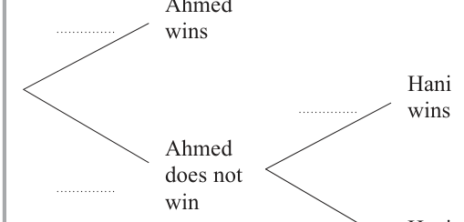
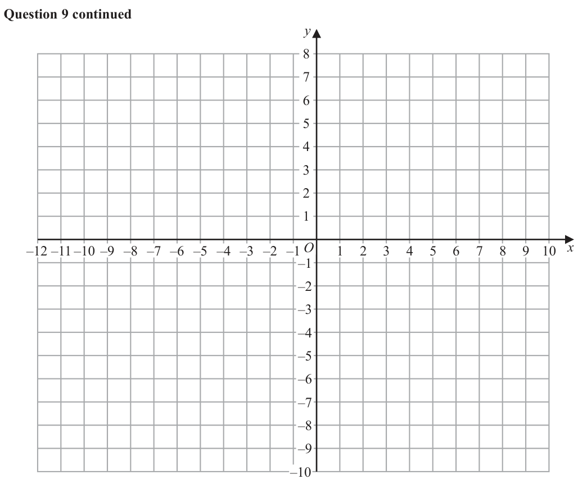
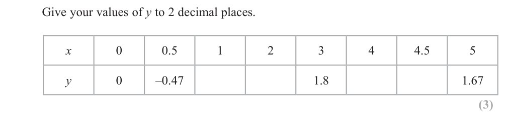

# 4MB1/02R — 2020-01 (official extraction)

> schema `syllabai.official-paper-questions/0.2` · paper_id `pearson-edexcel:international-gcse:mathematics-b:4mb1:2020-01:4MB1/02R` · qp sha256 `e80c973d7937fbf0…` · extraction is the disclosed baseline (ADR-039)

## Question 1 (5 marks)

James bought a car on 1st March 2016 On 1st March 2017, the value of the car was 20% less than the amount that James paid for the car on 1st March 2016 On 1st March 2018, the value of the car was 10% less than the value of the car on 1st March 2017 On 1st March 2018, the value of the car was £20 340

### 1(a) [3]

Calculate the amount, in £, that James paid for the car on 1st March 2016 On 1st March 2019, the value of the car was £19 323

**Mark scheme answer**

> 0.8 × 0.9 ( = 0.72 ) M1 or for
> 20340
> (= 22600 - value in 2017)
> 0.9
> 20340 ' 22600 '
> M1 (DEP) or for
> 0.8 × 0.9 0.8
> (£)28 250 3 A1

- **(3)** 0.8 × 0.9 ( = 0.72 ) M1 or for

### 1(b) [2]

Calculate the percentage decrease in the value of the car from 1st March 2018 to 1st March 2019

**Mark scheme answer**

> 20340 − 19323 19323 − 20340
> × 100 M1 or for × 100
> 20340 20340
> 5(%) 2 A1 allow -5
> Total 5 marks

- **(2)** 20340 − 19323 19323 − 20340

## Question 2 (5 marks)

A mixture for concrete is made up of 105 kg of cement, 252 kg of sand and 273 kg of gravel. Given that the mass of cement : the mass of sand : the mass of gravel = 1 : (2x + y) : (x + 2y)

### 2(a) [2]

write down two different equations in x and y. Simplify your equations.

**Mark scheme answer**

> Two of 2 B1 (one mark for each)
> 2x + y = 2.4 (oe) B1 (oe)
> x + 2y = 2.6 (oe) 2x + y
> 3x + 3y = 5 (oe) = ,
> 1+ ( 2x + y ) + ( x + 2 y ) 5
> eg
> x + 2y
> =
> 1 + ( 2 x + y ) + ( x + 2 y ) 30
> 1
> =
> 1+ ( 2x + y ) + ( x + 2 y ) 6

- **(2)** Two of 2 B1 (one mark for each)

### 2(b) [3]

Hence solve these two equations for the value of x and for the value of y. Give each value as a simplified fraction.

**Mark scheme answer**

> Isolating x or y or rearranging such that M1 – follow through on their linear
> coefficients of x or y are the same in both simultaneous equations
> equations NB: Condone one arithmetic error
> Correctly substituting their expression for x or y M1 (DEP) – e.g. obtaining an equation in x e.g.
> to obtain y or x or correct operation to eliminate 15x = 11 followed by x = … (but condone
> selected variable and solve for remaining incorrect x value from their linear equation)
> variable
> 11 14 3 A1
> x= y=
> 15
> Total 5 marks
> OR (a) 2 X + Y = 252 SC: B1 for both equations
> X + 2Y = 273
> coefficients of x or y are the same in both simultaneous equations
> equations NB: condone one arithmetic error
> Correctly substituting their expression for x or y M1 (DEP) as above
> to obtain y or x or correct operation to eliminate
> selected variable and solve
> NB: 2(a) equations give X = 77 and Y = 98 11 14 A1
> which need to be divided by 105 x= y=
> 15

- **(3)** Isolating x or y or rearranging such that M1 – follow through on their linear

## Question 3 (8 marks)
### 3(a) [2]

Find the inverse of the matrix ⎜ ⎝ 5 4⎟⎠

**Mark scheme answer**

> −2 (value of the determinant) B1
> 1 ⎛ 4 −2 ⎞ 2 B1 (oe)
> ⎜ ⎟
> −2 ⎝ −5 2⎠

- **(2)** −2 (value of the determinant) B1

### 3(b) [6]

Use your answer to part (a) to find the value of x and the values of y that satisfy ⎛ 2 2⎞ ⎛ y 2 − 9 x⎞ ⎛ 0 ⎞ = ⎜⎝ 5 4⎟⎠ ⎜⎝ x ⎟⎠ ⎜⎝ −2⎟⎠ ⎡ ⎛ a b⎞ 1 ⎛ d − b⎞ ⎤ ⎢Inverse of matrix: ⎜ = ⎥ ⎣ ⎝ c d ⎟⎠ ad − bc ⎜⎝ −c a ⎟⎠ ⎦

**Mark scheme answer**

> 1 ⎛ 4 −5 ⎞ ⎛ 2 2 ⎞ ⎛ y2 − 9x ⎞ M1
> " ⎜ ⎟ "⎜ ⎟⎜ ⎟ −1
> −2 ⎝ −2 2 ⎠ ⎝5 4⎠⎝ x ⎠ ⎛ y2 − 9x ⎞ ⎛ 2 2 ⎞ ⎛ 0 ⎞
> Or ⎜ ⎟=⎜ ⎟ ⎜ ⎟
> 1 ⎛ 4 −5 ⎞ ⎛ 0 ⎞ ⎝ x ⎠ ⎝ 5 4 ⎠ ⎝ −2 ⎠
> =" ⎜ ⎟ "⎜ ⎟
> −2 ⎝ −2 2 ⎠ ⎝ −2 ⎠
> ⎛ y2 − 9x ⎞ 1 ⎛ 4 −2 ⎞ ⎛ 0 ⎞ M1 (DEP)
> ⎜ ⎟=" ⎜ ⎟ "⎜ ⎟
> ⎝ x ⎠ −2 ⎝ −5 2 ⎠ ⎝ −2 ⎠
> ⎛ y 2 − 9 x ⎞ ⎛ −2 ⎞ ⎛ −2 ⎞
> ⎜ ⎟=⎜ ⎟ A1 for ⎜ ⎟
> ⎝ x ⎠ ⎝ 2⎠ ⎝ 2⎠
> x=2 A1
> y − 9" x " = "− 2" (substituting their value of
> M1 – dependent on both previous M marks
> x, RHS must be a constant)
> y=±4 6 A1
> Total 8 marks
> OR (b) 2 ( y2 − 9x) + 2x = 0 M1 – two equations in y 2 and x
> 5 ( y 2 − 9 x ) + 4 x = −2
> A1
> 5 ( − x ) + 4 x = −2 M1 (DEP) – eliminate y 2 or x to obtain an
> equation in x or y 2
> x=2 A1
> y=±4 A1 – so can score a maximum of 5 out of 6 if
> not using inverse

- **(6)** 1 ⎛ 4 −5 ⎞ ⎛ 2 2 ⎞ ⎛ y2 − 9x ⎞ M1

## Question 4 (9 marks)

Bag B1 and bag B2 each contain soil. The weight of soil in B1 is 7.5 kg to the nearest 100 g. The weight of soil in B2 is 5 kg to the nearest 10 g.

**(a)** Find

### 4(a)(i) [1]

the lower bound for the total weight of soil in the two bags,

**Mark scheme answer**

> 12 445g

- **(1)** 12 445g

### 4(a)(ii) [2]

the upper bound for the difference in the weights of soil in the two bags,

**Mark scheme answer**

> 7550 − 4995 M1
> 2.555 kg or 2555g 2 A1

- **(2)** 7550 − 4995 M1

### 4(a)(iii) [2]

the lower bound, to the nearest 50 g, for the difference in the weights of soil in the two bags. A large jar is to be filled with sweets. The jar will be filled using bags of sweets. The weight of the sweets in each bag of sweets is 220 g to the nearest 5 g. When the jar is full of sweets, the weight of sweets in the jar is 10 kg to the nearest 0.2 kg. Bertie has 45 bags of sweets.

**Mark scheme answer**

> 7450 − 5005 M1 (= 2.445 kg or 2445g)
> 2.45 kg or 2450g 2 A1

- **(2)** 7450 − 5005 M1 (= 2.445 kg or 2445g)

### 4(b) [4]

Giving your reasons, determine whether Bertie has a sufficient number of bags of sweets to be sure that he can fill the jar with sweets.

**Mark scheme answer**

> 0.2175, 0.2225, 10.1, 9.9 M1 any one correct bound (217.5, 222.5, 10100,
> 9900)
> 10.1 9.9
> Largest number of bags = (oe) M1 – oe smallest number of bags = or
> 0.2175 0.2225
> OR 217.5 × 45 ( = 9787.5 ) 222.5 × 45 ( = 10012.15) - allow values
> (10,10.1] , [0.2175, 0.220 ) , [9.9,10 ) or
> ( 0.220, 0.2225] for this mark
> 46.4(4…) OR 9787.5 & 9900 A1 (Dependent on both M marks)
> (For reference
> 44.49438.... < bags < 46.43678... )
> No and since needs 47 bags 4 B1 (Dependent on previous three marks) – B0
> to be sure that the jar is if UB stated as 46 (not 47)
> filled
> OR Lower bound for the weight of 45 bags is less
> than the lower bound for the weight of the jar
> Total 9 marks

- **(4)** 0.2175, 0.2225, 10.1, 9.9 M1 any one correct bound (217.5, 222.5, 10100,

## Question 5 (4 marks)

Solve = 54 Show clear algebraic working. (4)

### 5 [4]

Solve = 54 Show clear algebraic working.

**Mark scheme answer**

> Rewrite 45 as 32 × 5 (can be implied) M1
> 1− 2 x 2(1− 2 x ) 1− 2 x M1 (DEP)
> 45 = 3 ×5
> 34 x × 53 x +1 × 32(1− 2 x ) × 51−2 x M1 (DEP on both previous M marks) –
> ∴ = 54 forming an equation using the powers of 5 only
> – note that
> ⇒ ( 3x + 1) + (1 − 2 x ) = 4
> 4 x + 3x + 1 + 2 (1 − 2 x ) + (1 − 2 x ) − 2 = 4 is M0
> x=2 4 A1 – note that the correct answer is often seen
> fortuitously so working must be checked
> carefully
> If no marks scored and correct answer stated
> with no working or if candidates confirm that x
> = 2 via substitution with no algebraic working,
> then award SC B1 (otherwise mark to scheme).
> So e.g. those that earn M1 M1 then sub. x = 2
> and verify this value holds score 2 marks only
> Total 4 marks

- **(4)** Rewrite 45 as 32 × 5 (can be implied) M1

## Question 6 (11 marks)

The functions f, g and h are defined as f : x ↦ x + 3 g : x ↦ x2 – 2x + 3 h : x ↦ x ≠ 0 x ⎛ 1⎞

### 6(a) [2]

Find (i) g(–3) (ii) f h ⎜ − ⎟ ⎝ 4⎠

### 6(b)(i) [?]

Express the inverse of the composite function hf in the form (hf)–1 : x ↦ ... and simplify your answer.

**Mark scheme answer**

> x+3
> y ( x + 3) = 6 OR x ( y + 3) = 6 M1 (DEP)
> 6 − 3x A1 (must be in terms of x)
> ( hf ) : x a
> −1
> x

### 6(b)(ii) [4]

State the value of x that must be excluded from any domain of (hf )–1

**Mark scheme answer**

> x = 0 is excluded 4 B1 ft (oe) NB: ft on an inverse function (eg “y =
> ax + b
> …”) which is of the form where d can be 0
> cx + d

- **(4)** x = 0 is excluded 4 B1 ft (oe) NB: ft on an inverse function (eg “y =

### 6(c) [5]

Find the two values of x for which hgf(x) = 2

**Mark scheme answer**

> 6 M1 Must be of the form
> hgf(x)=
> ( x + 3) − 2 ( x + 3) + 3
> 2 a
> ( hgf(x) = )
> b ( x + 3) + c ( x + 3) + d
> trinomial quadratic dominator and expansion
> of ( x + 3) must contain 3 terms
> 2 x 2 + 8 x + 6 = 0 ⇒ ( 2 x + 6 )( x + 1) = 0 M1 (not dependent on either of the previous M
> ⇒ x = ... marks) – solving a three term quadratic (if
> using formula or completing the square must
> lead to real roots) – requires a correct method to
> solve their 3TQ (that is must have ( 2x + a )( x + b )
> with ab = 6 or 2b + a = 8 for their 6 and 8) – or
> correct substitution into correct formula – must
> lead to two real values of x
> x = −1 A1 (cao)
> x = −3 5 A1 (cao)
> Total 11 marks

- **(5)** 6 M1 Must be of the form

## Question 7 (10 marks)
### 7(a) [1]

Write down all the multiples of 3 lying between 1 and 20 Ahmed and Hani play a game with 20 numbered balls. The 20 balls are numbered from 1 to 20 1 2 3 20 The balls are put in a bag. Ahmed takes at random a ball from the bag, makes a note of its number and puts the ball back into the bag. If the number of the ball is a multiple of 5, Ahmed wins the game. If Ahmed does not win the game, Hani takes at random a ball from the bag, makes a note of its number and puts the ball back into the bag. If the number of the ball is a multiple of 3, Hani wins the game. If Hani does not win the game, Ahmed takes at random a ball from the bag, makes a note of its number and puts the ball back into the bag. If the number of the ball is a multiple of 6, Ahmed wins the game. If Ahmed does not win the game, Hani takes at random a ball from the bag, makes a note of its number and puts the ball back into the bag. If the number of the ball is a multiple of 4, Hani wins the game. If Hani does not win the game, the game stops and the result is a draw. The incomplete probability tree diagram for the game is shown below.

**Mark scheme answer**

> 3, 6, 9, 12, 15, 18 1 B1

- **(1)** 3, 6, 9, 12, 15, 18 1 B1

### 7(b) [4]

Complete the probability tree diagram for Ahmed and Hani’s game.

**Mark scheme answer**

> 4 16 B1
> (oe), (oe)
> 20
> 6 14 B1ft (the number of multiples of 3 stated in
> (oe), (oe)
> 20 20 (a))
> 3 17 B1
> (oe), (oe)
> 20
> 5 15 4 B1
> (oe), (oe)
> 20

- **(4)** 4 16 B1

### 7(c) [5]

Determine which player, Ahmed or Hani, is more likely to win the game. Give a reason for your answer. Ahmed wins Hani wins Ahmed does not Ahmed win wins Hani Hani does not wins win Ahmed does not win Hani does not win

**Mark scheme answer**

> 4 16 14 3 M1
> P(Ahmed wins) = " "+ " "× " " × " "
> 20 20 20
> 71 A1 (cao)
> , 0.284
> 250
> P(Hani wins) = M1
> 16 6 16 14 17
> " "× " "+" "× " " × " " × " "
> 20 20 20 20 20
> 359 A1(cao)
> , 0.359
> 1000
> Hani wins as P(Hani wins) 5 A1 (Dependent on both previous A marks)
> > P(Ahmed wins), cso
> Total 10 marks

- **(5)** 4 16 14 3 M1

## Question 8 (10 marks)

Diagram NOT A accurately drawn 100 cm E D 30 cm 70° B M C Figure 1 Figure 1 shows triangle ABC in which AB = 100 cm, AC = 30 cm and ∠ACB = 70° Calculate, to 3 significant figures,

### 8(a) [3]

the size, in degrees, of ∠ABC,

**Mark scheme answer**

> 30 100 M1
> =
> sin ∠ ABC sin 70
> ⎛ 30 × sin 70 ⎞ M1 (DEP)
> ∠ABC = sin −1 ⎜ ⎟
> ⎝ 100 ⎠
> 16.4o 3 A1 (for reference: 16.3741004…)
> Accept awrt to 3 sf

- **(3)** 30 100 M1

### 8(b) [3]

the length, in cm, of BC. As shown in Figure 1, the point E lies on AB and the point D lies on AC such that ED and BC are parallel and AD : DC = 1 : 2

**Mark scheme answer**

> BC 100 M1
> =
> sin (180 − (" ∠ABC "+ 70 ) ) sin 70
> OR
> BC 2 = 100 2 + 30 2 − 2 × 100 × 30 × cos" ∠BAC "
> 100 × sin (180 − (" ∠ABC "+ 70 ) ) M1 (DEP)
> BC =
> sin 70
> OR
> BC = 10900 − 6000 cos" ∠BAC "
> 106 (cm) 3 A1 (for reference: 106.2047547…)
> Accept awrt to 3 sf

- **(3)** BC 100 M1

### 8(c) [1]

Write down the length, in cm, of DC. The midpoint of BC is the point M.

**Mark scheme answer**

> 20 (cm) 1 B1

- **(1)** 20 (cm) 1 B1

### 8(d) [2]

Calculate the area, in cm2 to 3 significant figures, of triangle DCM. area Δ ABC Given that = k, area ΔDCM

**Mark scheme answer**

> VDCM = 12 × ⎛⎜⎝ 12 × " BC "⎞⎟⎠ × (" DC ") × sin 70 M1
> 498, 499 (cm2) 2 A1 (for reference: 498.9991215…)
> Accept awrt to 3 sf

- **(2)** VDCM = 12 × ⎛⎜⎝ 12 × " BC "⎞⎟⎠ × (" DC ") × sin 70 M1

### 8(e) [1]

find the value of k without working out the area of triangle ABC. ⎡ Sine rule a = b = c ⎤ ⎢ sin A sin B sin C ⎥ ⎢ ⎥ ⎢Cosine rule a 2 = b 2 + c 2 − 2bc cos A ⎥ ⎢ ⎥ ⎢ 1 ⎥ ⎢⎣ Area of triangle = ab sin C ⎥⎦

**Mark scheme answer**

> 3 1 B1
> Total 10 marks

- **(1)** 3 1 B1

## Question 9 (10 marks)

The triangle A has vertices with coordinates (–5, 2), (–11, 0) and (–7, 6).

### 9(a) [1]

On the grid, draw and label triangle A. Triangle B is the image of triangle A under the enlargement with centre (1, 4) and scale factor −

**Mark scheme answer**

> Triangle A drawn 1 B1 vertices of A are ( −5, 2 ) , ( −11, 0 ) , ( −7, 6 )

- **(1)** Triangle A drawn 1 B1 vertices of A are ( −5, 2 ) , ( −11, 0 ) , ( −7, 6 )

### 9(b) [3]

On the grid, draw and label triangle B. Triangle C is the image of triangle B under a rotation of 180° about the point (3, 1).

**Mark scheme answer**

> Either lengths of sides of B half that of A (so M1 – two correct points can imply this mark
> implying a scale factor of a half)
> OR At least two construction lines through
> (1, 4) from A going past A
> ( VB = (4, 5) , (7, 6), (5, 3) ) Triangle B drawn 3 A2 (-1eeoo e.g. two points correct scores A1)
> or A1 for a scale factor of –0.5 but not with
> centre (1, 4)

- **(3)** Either lengths of sides of B half that of A (so M1 – two correct points can imply this mark

### 9(c) [3]

On the grid, draw and label triangle C.

**Mark scheme answer**

> Either lengths of sides of C same as B M1 – two correct points imply this mark
> OR At least two construction lines through (3,1)
> ( ΔC = (2, − 3) , ( −1, − 4), (1, − 1) ) Triangle C drawn 3 A2 (-1eeoo e.g. two points correct scores A1)

- **(3)** Either lengths of sides of C same as B M1 – two correct points imply this mark

### 9(d) [3]

Describe fully the single transformation that maps triangle C onto triangle A. y –12 –11 –10 –9 –8 –7 –6 –5 –4 –3 –2 –1 O 1 2 3 4 5 6 7 8 9 10 x –1 –2 –3 –4 –5 –6 –7 –8 –9 –10 for a spare grid if you need to redraw your triangles. Only use this grid if you need to redraw your triangles. y –12 –11 –10 –9 –8 –7 –6 –5 –4 –3 –2 –1 O 1 2 3 4 5 6 7 8 9 10 x –1 –2 –3 –4 –5 –6 –7 –8 –9 –10

**Mark scheme answer**

> Enlargement B1 – note that more than one transformation
> stated scores no marks in this part
> ( 9, −8) B1
> (Scale) factor 2 3 B1
> Total 10 marks
> uuur

- **(3)** Enlargement B1 – note that more than one transformation

## Question 10 (14 marks)

a C 2 B Diagram NOT accurately drawn M N D O A a Figure 2 Figure 2 shows trapezium ABCD in which the point O is the midpoint of AD and the point M is the midpoint of CD. → → 1 → Given that OA = a, CB = a and OB = b,

**(a)** find, in terms of a and b, simplifying your answers where possible, → → → →

### 10(a)(i) [7]

AB (ii) AC (iii) CD (iv) AM → → → → The lines OB and AM intersect at N so that AN = λ AM and ON = μOB , where λ and μ are positive constants. →

### 10(b)(i) [2]

Find and simplify an expression in terms of a, b and λ for ON

**Mark scheme answer**

> ⎝ 4 2 ⎠ ON = OD + DC + CB + BA + AN in terms of a,
> b and λ
> uuur ⎛ 7λ ⎞ λ 2 A1 (two
> ON = a ⎜ 1 − uuur terms in a and one term in b) – note
> ⎟+ b that ON = μ b is no marks in this part unless
> ⎝ 4 ⎠ 2
> uuur
> they go and find ON in terms of a, b and λ

- **(2)** ⎝ 4 2 ⎠ ON = OD + DC + CB + BA + AN in terms of a,

### 10(b)(ii) [4]

Hence find the value of λ and the value of μ The area of triangle OAB is 14 square units.

**Mark scheme answer**

> 7 M1
> uuur or uuu
> equivalent
> r uuur complete method e.g.
> Component of a: 1 − λ =0
> 4 AN = AO + ON = −a + μ b and
> uuur ⎛ 7 1 ⎞
> AN = λ ⎜ "− a + b " ⎟
> ⎝ 4 2 ⎠
> 7
> ⇒ −a + μ b = − λa + λb and compare
> 4
> components for a
> 4 A1
> λ=
> "λ " M1 – comparing components for b (not
> Component of b: =μ dependent on previous M mark)
> 2 4 A1
> μ=

- **(4)** 7 M1

### 10(c) [1]

Find the area of triangle BNA.

**Mark scheme answer**

> 5 10 (sq units) 1 B1
> (area of BNA = " "× area of OAB)
> Total 14 marks

- **(1)** 5 10 (sq units) 1 B1

## Question 11 (14 marks)

Part of the curve with equation y = x2 – 5x + 3 is drawn on the grid. x3 6 x 2 3x The equation of another curve is y = – + − 6 5 2 x3 6 x 2 3x

### 11(a) [3]

Complete the table of values for y = – + − 6 5 2 Give your values of y to 2 decimal places. x 0 0.5 1 2 3 4 4.5 5 y 0 –0.47 1.8 1.67

**Mark scheme answer**

> − 0.47, 0.47, 2.53, 2.36 3 B3 (-1eeoo)

- **(3)** − 0.47, 0.47, 2.53, 2.36 3 B3 (-1eeoo)

### 11(b) [3]

On the grid opposite, plot the points from your completed table and join them to form a smooth curve.

**Mark scheme answer**

> Curve drawn 3 B3ft (NB: ft on their (a) values)
> For reference: −1 mark for
> straight line segments
> each point missed
> x y
> 0 0 each missed segment
> 0.5 −0.47
> 1 each point not plotted
> ‘−0.47’
> 2 ‘0.47’ each point incorrectly plotted
> 3 1.8
> 4 ‘2.53’ tramlines
> 4.5 ‘2.36’
> very poor curve
> 5 1.67
> NB: Accuracy for both plotting and drawing is
> ± ss = 0.05

- **(3)** Curve drawn 3 B3ft (NB: ft on their (a) values)

### 11(c) [4]

Use the two curves on the grid to find an estimate, to 2 decimal places, of the range x3 x 2 7 x of positive values of x for which − − +3<0 6 5 2 Show your working clearly. For positive values of x, the two curves on the grid intersect at the points P and Q.

**Mark scheme answer**

> Penalise failure to round correctly ONCE
> only
> − + − > x2 − 5x + 3 the intersection of the two curves)
> 6 5
> 0.85 ± 0.05 A1ft (one intersection of their graphs)
> 4.80 ± 0.05 A1ft (second intersection of their graphs)
> 0.85 ± 0.05 < x < 4.80 ± 0.05 4 A1ft (must be using strict inequalities)

- **(4)** Penalise failure to round correctly ONCE

### 11(d) [2]

Find an estimate, to 1 decimal place, of the gradient of the straight line through P and Q. The equation of the straight line through P and Q has the form y = ax + b

**Mark scheme answer**

> (Accurate values for P and Q are (0.845, −0.511) M1 Using their coordinates for P and Q (or any
> and other points on their line)
> (4.796, 2.022) respectively )
> "2.022"− ("− 0.511")
> Gradient =
> "4.796"− "0.845"
> (= 0.641)
> 0.6, 0.7 2 A1

- **(2)** (Accurate values for P and Q are (0.845, −0.511) M1 Using their coordinates for P and Q (or any

### 11(e) [2]

Find, to 1 decimal place, the value of b. y 3.5 3.0 2.5 2.0 1.5 1.0 0.5 –1.0 –0.5 O 0.5 1.0 1.5 2.0 2.5 3.0 3.5 4.0 4.5 5.0 5.5 x –0.5 –1.0 –1.5 –2.0 –2.5 –3.0 –3.5 for a spare grid if you need to redraw your curve. Only use this grid if you need to redraw your curve. y 3.5 3.0 2.5 2.0 1.5 1.0 0.5 –1.0 –0.5 O 0.5 1.0 1.5 2.0 2.5 3.0 3.5 4.0 4.5 5.0 5.5 x –0.5 –1.0 –1.5 –2.0 –2.5 –3.0 –3.5

**Mark scheme answer**

> (a = 0.641) ∴ M1 Using their gradient (which must be positive)
> e.g. b = "− 0.511"− "( d )"× "0.845" and their coordinates for P or Q (or any other point
> e.g. b = "2.022"− "( d )"× "4.796" (oe) on their line) to obtain a value for b
> b = −1.0, −1.1 2 A1
> Total 14 marks

- **(2)** (a = 0.641) ∴ M1 Using their gradient (which must be positive)

