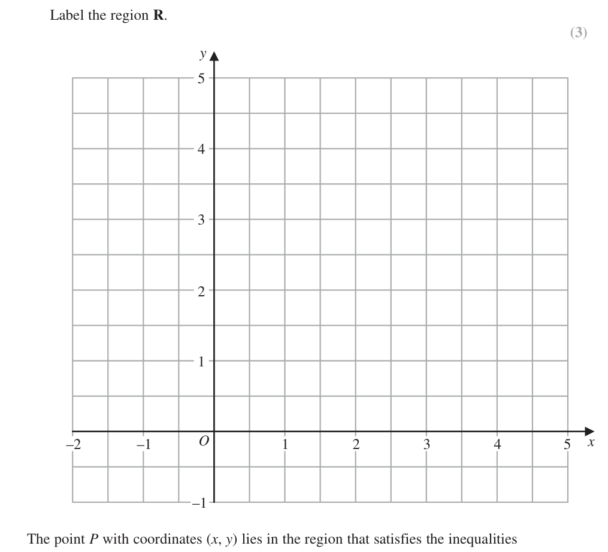
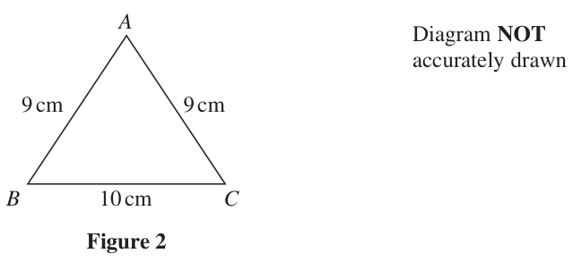
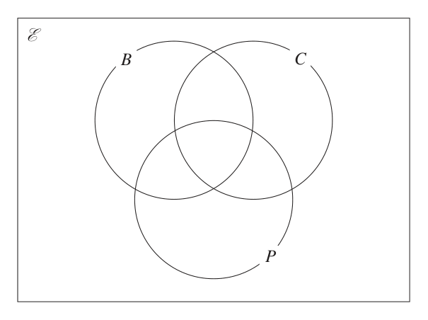
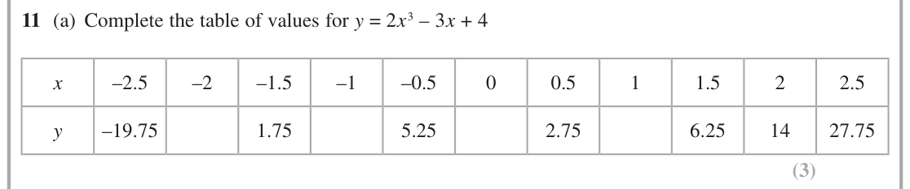
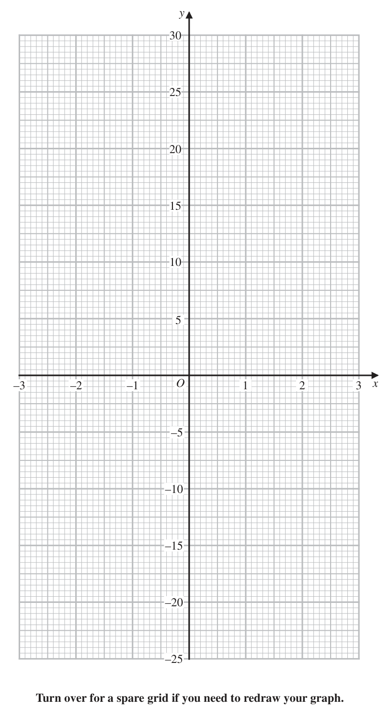

# 4MB1/02 — 2020-06 (official extraction)

> schema `syllabai.official-paper-questions/0.2` · paper_id `pearson-edexcel:international-gcse:mathematics-b:4mb1:2020-06:4MB1/02` · qp sha256 `a1ee62240d0b766c…` · extraction is the disclosed baseline (ADR-039)

## Question 1 (5 marks)

Please check the examination details below before entering your candidate information Candidate surname Other names Centre Number Candidate Number Pearson Edexcel International GCSE Thursday 4 June 2020 Morning (Time: 2 hours 30 minutes) Paper Reference 4MB1/02 Mathematics B Paper 2 You must have: Total Marks Ruler graduated in centimetres and millimetres, protractor, pair of compasses, pen, HB pencil, eraser, calculator. Tracing paper may be used. Instructions • Use black ink or ball-point pen. • centre Fill in the boxes at the top of this page with your name, number and candidate number. • Answer allthequestions. Answer • – there may bequestions in the spaces provided more space than you need. • Calculators may be used. Information • The total mark for this paper is 100. • The marks for each question are shown in brackets – use this as a guide as to how much time to spend on each question. Advice • Read each question carefully before you start to answer it. • Check your answers if you have time at the end. • Without sufficient working, correct answers may be awarded no marks. P61907A ©2020 Pearson Education Ltd. 1/1/1/1/ Answer ALL TWELVE questions. Write your answers in the spaces provided. You must write down all the stages in your working. A Diagram NOT x° accurately drawn 9.3 cm 5 cm 10.8 cm 124° B C y° D Figure 1 Figure 1 shows a quadrilateral ABCD. AB = 9.3 cm AC = 5 cm AD = 10.8 cm ∠ACD = 124° ∠ACB = 90° ∠CAB = x° ∠ADC = y° Calculate to one decimal place,

### 1(a) [2]

the value of x,

**Mark scheme answer**

> 5 2 M1 A fully correct method to find the value of x
> cos x = [0.537…]
> 9.3 9.32 − 52 9.32 − 52 ⎛ 5 ⎞
> eg sin x = or tan x = or 90 − sin −1 ⎜ ⎟ or
> 9.3 5 ⎝ 9.3 ⎠
> 9.32 + 52 − 9.32 − 52
> cos x =
> 2 × 9.3 × 5
> 57.5 A1 awrt to 57.5

- **(2)** 5 2 M1 A fully correct method to find the value of x

### 1(b) [3]

the value of y. ⎡ a b c ⎤ ⎢⎣Sine rule: sin A = sin B = sin C ⎥⎦

**Mark scheme answer**

> sin124 sin y 3 M1 A fully correct method to find the value of y
> = oe
> 10.8
> ⎛ 5sin124 ⎞ M1dep on previous method mark being awarded. For rearranging to find a
> y = sin −1 ⎜ ⎟ oe 5 × sin124
> ⎝ 10.8 ⎠ value of y or sin y = Allow sin y = awrt 0.38 or
> 10.8
> y = sin −1 ( awrt 0.38) oe
> 22.6 A1 awrt 22.6
> Total 5 marks
> Question Working Answer Mark Notes

- **(3)** sin124 sin y 3 M1 A fully correct method to find the value of y

## Question 2 (5 marks)
### 2(a) [3]

On the grid below, by drawing suitable straight lines and using shading, show the region R that satisfies the inequalities 2x + 3y ≥ 6 1≤x≤3 y≤4 Label the region R. y –2 –1 O 1 2 3 4 5 x –1 The point P with coordinates (x, y) lies in the region that satisfies the inequalities 2x + 3y > 6 1<x<3 y<4 Given that x and y are integers,

**Mark scheme answer**

> 3 M1 for the intention to draw the line 2x + 3y = 6 correctly.
> Line must go through at least one of (0, 2) or (3, 0)
> M1 for lines x = 1, x = 3 and y = 4 drawn correctly.
> Correct region A1 correct area only. Both method marks need to be awarded.
> indicated

- **(3)** 3 M1 for the intention to draw the line 2x + 3y = 6 correctly.

### 2(b) [2]

write down the coordinates of all possible points P.

**Mark scheme answer**

> (2, 1),(2, 2),(2, 3) 2 B2 all 3 correct coordinates and no extras,
> B1 for 2 correct coordinates and no extras or 3 correct.
> coordinates and all correct integer boundary coordinates stated.
> (1,2) (1,3) (1,4) (2,4) (3,0) (3,1) (3,2) (3,3) (3,4)
> SC If no marks are awarded using the main scheme in part (b) and at
> least one M1 awarded in part (a) and the area identified is bounded
> by "their 4 lines drawn", award B1ft if all correct integer
> coordinates from their graph are stated with no extras.
> Total 5 marks
> Question Working Answer Mark Notes

- **(2)** (2, 1),(2, 2),(2, 3) 2 B2 all 3 correct coordinates and no extras,

## Question 3 (4 marks)

Express (5x – 6) ÷ ⎜ ⎟ − as a single fraction in its simplest form. ⎝ x+3 ⎠ x+2 Show clear algebraic working. (4)

### 3 [4]

Express (5x – 6) ÷ ⎜ ⎟ − as a single fraction in its simplest form. ⎝ x+3 ⎠ x+2 Show clear algebraic working.

**Mark scheme answer**

> x+3 4 M1 use of reciprocal and factorising using the difference of
> eg ×
> (5 x + 6)(5 x − 6) 2 squares.
> These two steps may occur at different stages.
> ( x + 2)( x + 3) − (5 x + 6) M1 for clear intention to get a common denominator by
> eg
> (5 x + 6)( x + 2) multiply all terms by (5x + 6)( x + 2) or (25 x 2 − 36)( x + 2)
> or (allow multiples of these).
> [(5x − 6)( x + 3)( x + 2)] − [(5x + 6)(5x − 6)] May be expressed as a single fraction or two fractions
> subtracted. Allow equivalent eg
> (5 x − 6)(5 x + 6)( x + 2)
> [(5 x − 6)( x + 3)( x + 2)] − ( 25x 2 − 36 )
> (5 x − 6) ( 25 x 2 − 36 )
> Can be implied by correct expansions.
> x + 5x + 6 − 5x − 6
> 2 M1 dep on 2nd M1 being awarded. For correct expansion of
> eg terms including dealing correctly with negative sign on the
> (5 x + 6)( x + 2)
> numerator. This needs to be in a single fraction. Allow
> 5 x3 − 6 x 2
> or oe 5 x3 + 10 x 2 + 9 x 2 + 18 x − 18 x − 36 − 25 x 2 + 36
> ( x + 2) ( 25 x 2 − 36 ) oe
> ( x + 2) ( 25 x 2 − 36 )
> x2 x2
> A1 oe eg 2 dep on two M marks awarded.
> (5 x + 6)( x + 2) 5 x + 16 x + 12
> Total 4 marks
> Question Working Answer Mark Notes

- **(4)** x+3 4 M1 use of reciprocal and factorising using the difference of

## Question 4 (8 marks)

A Diagram NOT accurately drawn 9 cm 9 cm B 10 cm C Figure 2 Figure 2 shows triangle ABC. AB = 9 cm AC = 9 cm BC = 10 cm

### 4(a) [3]

Calculate the area, in cm2 to one decimal place, of triangle ABC. Figure 3 shows two solid right prisms, each of length 7 cm. One of the prisms has triangle ABC as a cross section of the prism. The other prism has trapezium DEFG as a cross section of the prism. Diagram NOT A accurately drawn F E 9 cm 9 cm 5.5 cm 4.5 cm 7 cm D G 7 cm B 10 cm C Figure 3 In trapezium DEFG, DE = 4.5 cm FG = 5.5 cm The perimeter of trapezium DEFG is equal to the perimeter of triangle ABC.

**Mark scheme answer**

> 9² − 5² ( = 56 ) 3 M1 Implied by awrt 7.5 or " 56 "
> Allow for a correct method to find one of the angles of the
> triangle. Note ∠A = 67.498 ∠B = ∠C = 56.251
> 0.5 × 10 × " 56 " M1dep on 1st M1 being awarded. Allow for correct use of
> ab sin C
> 37.4 (cm²) A1 allow 10 14 oe or awrt 37.4

- **(3)** 9² − 5² ( = 56 ) 3 M1 Implied by awrt 7.5 or " 56 "

### 4(b) [5]

Calculate the difference, in cm3 to one decimal place, between the volumes of the two prisms. ⎡ 1 ⎤ ⎢⎣ Area of trapezium = 2 (a + b)h ⎥⎦

**Mark scheme answer**

> "37.4" × 7 [=261.9...] 5 M1 ft allow use of their part(a) or correct method if they start again.
> Condone 262.5 if they have given their answer to part (a) as 37.5
> 9 + 9 + 10 = 4.5 + 5.5 + EF + DG M1 EF + DG = 18
> or 9 + 9 + 10 = 4.5 + 5.5 + a a = 18
> 18 − 10
> EF = = 7.4...
> or 9 + 9 + 10 = 4.5 + 5.5 + 2 EF + 10
> 18 + 10
> DG = = 10.58...
> or 9 + 9 + 10 = 4.5 + 5.5 + 2 DG − 10 .
> Allow awrt 3.2 for 10 (=3.162…)
> Can be implied by a correct area for DEFG ( = 40.5)or a correct
> volume of ("283.5" − "261.9...")
> 1
> Area of DEFG = × "18"× 4.5 (= 40.5) oe M1 for × "their EF + DG "× 4.5 EF and DG may come from their
> 2
> diagram.
> Can be implied by a correct volume of ("283.5" − "261.9...")
> 0.5 × 18 × 4.5 × 7 − "37.4" × 7 oe M1 dep on 1st and 3rd M1 being awarded.
> Allow the use of their value of EF + DG ("18")
> or ± ("40.5" – "37.417...") × 7
> or ± ("283.5" − "261.9...")
> 21.6 (cm3) A1 ± (21– 21.7) inclusive Allow ± 21.6
> Total 8 marks
> Question Working Answer Mark Notes

- **(5)** "37.4" × 7 [=261.9...] 5 M1 ft allow use of their part(a) or correct method if they start again.

## Question 5 (12 marks)

Tahina travels to work by bus. Her total bus fare last week was £12.50 This week her total bus fare has increased by 8%

### 5(a) [2]

Calculate her total bus fare for this week. Tahina works in a kiosk selling hot drinks. She sells coffee, tea and hot chocolate. On Monday, Tahina sold a total of 378 hot drinks. The numbers of cups of coffee, tea and hot chocolate she sold were in the ratios 5 : 3 : 1

**Mark scheme answer**

> 12.5 × 1.08 oe 2 M1
> (£)13.5(0) A1

- **(2)** 12.5 × 1.08 oe 2 M1

### 5(b) [3]

Calculate the difference between the number of cups of coffee and the number of cups of hot chocolate that Tahina sold on Monday. On Monday, of the number of cups of coffee Tahina sold were sold without milk.

**Mark scheme answer**

> 378 ÷ (5 + 3 + 1) (= 42) 3 M1
> 378 378 M1 or 210 – 42
> 5× – oe
> 9
> 168 A1

- **(3)** 378 ÷ (5 + 3 + 1) (= 42) 3 M1

### 5(c) [2]

Calculate the number of cups of coffee that Tahina sold without milk. The cost of each cup of coffee that Tahina sells from the kiosk is £2.80 Tahina went on holiday to the USA and to Canada. She bought a cup of coffee in the USA for $3.20 Using an exchange rate of £1 = $1.24

**Mark scheme answer**

> 3 2
> (5 × "42 ") × oe eg 3 × 15 M1ft their 42 or their 210 in part(b) ie ("their 210 ") ×
> 14
> 45 A1

- **(2)** 3 2

### 5(d) [2]

compare the cost of each cup of coffee sold from Tahina’s kiosk with the cost of the cup of coffee that Tahina bought in the USA. In Canada, Tahina bought a sandwich for 5.28 Canadian dollars. Using exchange rates of £1 = $1.24 and 1 Canadian dollar = $0.75

**Mark scheme answer**

> 2.80 × 1.24 [=($)3.47(2)] or 2 M1 Allow for 3.47… or 2.58… if working not shown.
> 3.20 ÷ 1.24 [(£)2.58...] Allow n × 2.80 × 1.24 and n × 3.2
> NB for n = 210 the figures are ($)729.12 and ($)672
> Allow m × 3.20 ÷ 1.24 and m × 2.80
> NB for m = 210 the figures are (£)541.94 and (£)588
> The coffee is A1 dep oe must have a correct conversion and comparison
> more expensive in words.
> from the kiosk eg the difference is ($)0.27 or ($)57.12
> the difference is (£)0.22 or (£)46.06
> NB the difference must be correct for these 2 statements.
> coffee is more expensive in UK,
> coffee is cheaper in the USA etc.

- **(2)** 2.80 × 1.24 [=($)3.47(2)] or 2 M1 Allow for 3.47… or 2.58… if working not shown.

### 5(e) [3]

convert 5.28 Canadian dollars to pounds (£) Give your answer to 2 decimal places.

**Mark scheme answer**

> 5.28 × 0.75 (= 3.96) 3 M1
> 5.28 × 0.75 ÷ 1.24 or "3.96" ÷ 1.24 M1
> (£)3.19 A1 Ignore incorrect currency signs.
> Total 12 marks
> Question Working Answer Mark Notes

- **(3)** 5.28 × 0.75 (= 3.96) 3 M1

## Question 6 (6 marks)

Solve the simultaneous equations x 2 + y 2 = 26 2x + y = 9 Show clear algebraic working. (6)

### 6 [6]

Solve the simultaneous equations x 2 + y 2 = 26 2x + y = 9 Show clear algebraic working.

**Mark scheme answer**

> x + (9 − 2 x) 2 = 26
> 2 6 M1 for substituting a correct linear equation into the quadratic
> equation.
> ⎛9− y ⎞
> ⎟ + y = 26
> or ⎜
> ⎝ 2 ⎠
> x + (81 − 18 x − 18 x + 4 x 2 ) = 26
> 2 M1 correct expansion of brackets, condone one sign error .
> ⎛ 81 − 9 y − 9 y + y 2 ⎞ 2
> or ⎜ ⎟ + y = 26
> ⎝ 4 ⎠
> 5 x − 36 x + 55 (= 0)
> 2 A1 dependent on M1( one of the 2 above) for a correct
> expression .
> or 5 y 2 − 18 y − 23 (= 0)
> eg M1 dependent on M1( one of the 2 above). Method may be
> (5x − 11)( x − 5)(= 0) or implied by 2 correct solutions.
> Solving their 3 term quadratic equation using any correct method
> 36 ± ( 36 ) − 4 × 5 × 55
> - if factorising, allow brackets which expanded give 2 out of 3
> 2×5 terms correct. If using formula or completing the square allow
> or one sign error.
> (5 y − 23)( y + 1)(= 0) or We will condone some simplification as their first step but no
> 36 ± 1296 − 1100
> 18 ± (18) − 4 × 5 × ( −23)
> further than oe accept (– 36) 2 or(36) 2 for
> 2×5 1296
> ⎛ 18 ⎞
> or eg ⎜ x − ⎟ − 1 oe
> ⎝ 5⎠
> Working must be shown if their quadratic is incorrect to gain this
> method mark.
> x = 2.2 oe and x = 5 A1 both x values correct or both y values correct or one pair of
> or y = 4.6 oe and y = −1 correct values.
> x = 2.2, y = 4.6 A1 dependent on 2 method marks being awarded. It must be
> x = 5 , y = −1 clear which value of x goes with which value of y
> Total 6 marks
> Question Working Answer Mark Notes

- **(6)** x + (9 − 2 x) 2 = 26

## Question 7 (6 marks)

A 10b C 4a Diagram NOT accurately drawn O 6b B Figure 4 Figure 4 shows a trapezium OACB. → → → OA = 4a OB = 6b AC = 10b P is the point on AB such that OPC is a straight line. → Find an expression for PC in terms of a and b. Give your answer in its simplest form. (6)

### 7 [6]

A 10b C 4a Diagram NOT accurately drawn O 6b B Figure 4 Figure 4 shows a trapezium OACB. → → → OA = 4a OB = 6b AC = 10b P is the point on AB such that OPC is a straight line. → Find an expression for PC in terms of a and b. Give your answer in its simplest form.

> 🖼 crop required: diagram (qp.pdf p.None)

**Mark scheme answer**

> eg AP = μ (6b − 4a) 6 M1 A correct expression, in terms of a and b. for AP or OP or
> BP or CP which involves a variable eg µ
> eg AP = −4a + λ (4a + 10b) & M1 Two correct expressions for AP or OP or BP or CP which
> AP = μ (6b − 4a) involves a different variable eg λ such that one vector involves a
> multiple of ± ( 4a − 6b ) and the other vector has to involve a
> 4 4 − 4μ
> multiple of ± ( 4a + 10b ) or = oe
> 10 6μ
> eg M1 dep on 2nd M being awarded. For equating coefficients for a
> 6μ = 10λ and − 4μ = −4 + 4λ oe and for vector b or 24μ = 40 − 40μ
> 3 A1 a correct value for µ or λ oe
> eg λ = oe
> 3 M1 dep on 3rd M1 being awarded and a value for one of their
> eg PC = (4a + 10b) − (4a + 10b)
> 8 variables being found. Stating any correct path for PC in terms of a
> and b which involves a correct value for µ or λ
> 5 25 5⎛ 5 ⎞
> a+ b A1 oe ⎜ a + b ⎟ Accept equivalent fractions eg ( 2a + 5b )
> 2 4 2⎝ 2 ⎠
> NB award 6 marks if the final answer is correct.
> Total 6 marks
> NB: There are many ways to solve this question. You will need to check their working carefully.
> Alternative – using similar triangles.
> M1 for stating that OBP and ACP are similar (triangles). Implied by a correct ratio.
> M1 for (lengths) OP : PC = 6:10 oe (ratio statement).
> M1 for 3/5 PC = OP oe “vector” equation.
> A1 for reaching 3/5 PC + PC = 4a +10b or another correct equation involving point P.
> M1 for PC = (4a + 10b) ÷ 8/5 oe
> A1 for 2.5a + 6.25b oe
> Question Working Answer Mark Notes

- **(6)** eg AP = μ (6b − 4a) 6 M1 A correct expression, in terms of a and b. for AP or OP or

## Question 8 (10 marks)

The diagram shows kite A. Kite B is the image of kite A under a reflection in the line with equation y = –1

### 8(a) [2]

On the grid opposite, draw and label kite B. Kite A is transformed to kite C by a reflection in the line with equation x = 4 followed by ⎛ −8⎞ the translation ⎜ ⎟ ⎝ −6⎠ Kite C is the image of kite B under a rotation through 180° about the point P.

> 🖼 crop required: grid (qp.pdf p.20)

**Mark scheme answer**

> Kite B correctly 2 B2 (B1 for a kite reflected in y = k or for 3
> drawn correct points or for kite A reflected in x = −1)

- **(2)** Kite B correctly 2 B2 (B1 for a kite reflected in y = k or for 3

### 8(b)(i) [?]

On the grid opposite, draw and label kite C.

> 🖼 crop required: grid (qp.pdf p.20)

**Mark scheme answer**

> Kite C correctly 2 ⎛ −8 ⎞ ⎛ m ⎞
> drawn B2 (B1 for “C” drawn using ⎜ ⎟ or ⎜ ⎟
> ⎝ n ⎠ ⎝ −6 ⎠
> from kite A)

### 8(b)(ii) [3]

Find the coordinates of P. ⎛ 0 −1⎞ ⎛ 0 −1⎞ M= ⎜ ⎝ −2 0⎟⎠ N= ⎜ ⎝ 1 0⎟⎠ Kite A is transformed to kite D under the combined transformation with matrix MN.

**Mark scheme answer**

> (0, −4) 1 ⎡0⎤
> B1 Condone answer in incorrect form ⎢ ⎥
> ⎣ −4 ⎦

- **(3)** (0, −4) 1 ⎡0⎤

### 8(c) [4]

On the grid opposite, draw and label kite D. area of kite D Given that =k area of kite A

> 🖼 crop required: grid (qp.pdf p.20)

**Mark scheme answer**

> ⎛ 0 −1⎞⎛ 4 6 4 2 ⎞ ⎡ ⎛ −1 −3 −4 −3 ⎞ ⎤ 4 M1 The result of the matrix product is not
> ⎜ ⎟⎜ ⎟ ⎢= ⎜ ⎟ ⎥ or needed. The coordinates of the kite can be in
> ⎝ 1 0 ⎠⎝ 1 3 4 3 ⎠ ⎣ ⎝ 4 6 4 2 ⎠ ⎦ any order.
> ⎛ 0 −1 ⎞⎛ 0 −1 ⎞ ⎡ ⎛ −1 0 ⎞ ⎤
> ⎜ ⎟⎜ ⎟ ⎢= ⎜ ⎟⎥
> ⎝ −2 0 ⎠⎝ 1 0 ⎠ ⎣ ⎝ 0 2 ⎠ ⎦
> ⎛ 0 −1⎞ ⎛ −1 −3 −4 −3 ⎞ ⎡ ⎛ −4 −6 −4 −2 ⎞ ⎤ M1ft dep The coordinates of the kite can be in
> ⎜ ⎟ "⎜ ⎟ " ⎢= ⎜ ⎟⎥ any order.
> ⎝ −2 0 ⎠ ⎝ 4 6 4 2 ⎠ ⎣ ⎝ 2 6 4 2 ⎠ ⎦
> The result of the matrix product is not needed.
> or
> ⎛ −1 0 ⎞ ⎛ 4 6 4 2 ⎞ ⎡ ⎛ −4 −6 −4 −2 ⎞ ⎤
> "⎜ ⎟ "⎜ ⎟ ⎢= ⎜ ⎟⎥
> ⎝ 0 2 ⎠ ⎝ 1 3 4 3 ⎠ ⎣ ⎝ 2 6 8 6 ⎠⎦
> ⎛ −4 −6 −4 −2 ⎞ A1 at least 2 points correct. This is not
> ⎜ ⎟ implied by 2 points on the diagram .The
> ⎝ 2 6 8 6⎠
> coordinates of the kite can be in any order.
> Kite D correctly A1
> drawn NB If the kite is drawn correctly award 4
> marks.

- **(4)** ⎛ 0 −1⎞⎛ 4 6 4 2 ⎞ ⎡ ⎛ −1 −3 −4 −3 ⎞ ⎤ 4 M1 The result of the matrix product is not

### 8(d) [1]

find the value of k. y A –7 –6 –5 –4 –3 –2 –1 O 1 2 3 4 5 6 7 x –1 –2 –3 –4 –5 –6 –7 for a spare grid if you need to redraw your kites. Only use this grid if you need to redraw your kites. y A –7 –6 –5 –4 –3 –2 –1 O 1 2 3 4 5 6 7 x –1 –2 –3 –4 –5 –6 –7

> 🖼 crop required: grid (qp.pdf p.None)

**Mark scheme answer**

> 2 1 B1
> Total 10 marks
> Question Working Answer Mark Notes

- **(1)** 2 1 B1

## Question 9 (10 marks)

9 90 students from a sixth form college were each asked the following question. “Do you study any of Biology (B), Chemistry (C) or Physics (P)?” Of these 90 students 7 study all three subjects 15 study Biology and Chemistry 20 study Chemistry and Physics 37 study Chemistry 14 study Biology only 15 study Physics only The number of these students who study Biology and Physics but not Chemistry is three times the number of these students who study none of these three subjects. Let x be the number of these students who study none of these three subjects.

**(c)** Find

### 9(a) [3]

Show all this information on the Venn diagram, giving the number of students in each appropriate subset, in terms of x where necessary. E B C P

**Mark scheme answer**

> 3 B3 for all correct entries.
> B2 for 5, 6 or 7 correct entries.
> B1 for 3 or 4 correct entries.
> Allow 24 – x instead of 3x
> Allow a sum that gives the required number. eg 20 – 7 for the 13
> Allow 6 and 18 instead of x and 3x respectively.

- **(3)** 3 B3 for all correct entries.

### 9(b) [2]

Find the value of x.

**Mark scheme answer**

> "14 + 8 + 9 + 7 + 13 + 15 + 3x + x" = 90 oe 2 M1ft For an equation equivalent to 4x + 66 = 90 or 3x = 24 – x
> or for the sum of their 8 values from their Venn diagram = 90
> Do not ft if one of the 8 values is blank.
> SC: Award M1 for an equation equivalent to x + 66 = 90
> 6 A1cao This is not implied by 6 on the diagram.

- **(2)** "14 + 8 + 9 + 7 + 13 + 15 + 3x + x" = 90 oe 2 M1ft For an equation equivalent to 4x + 66 = 90 or 3x = 24 – x

### 9(c)(i) [?]

n(B¢ ∩ C)

**Mark scheme answer**

> 22 1 B1ft "their 9" + "their 13" Condone n("their 22") Do not ft if either
> required area is blank. Ft their x in part (b) Allow in terms of x

### 9(c)(ii) [?]

n(B ∪ C ∪ P)

**Mark scheme answer**

> 84 1 B1ft 90 − "their part(b)" or 90 – "their x from the diagram" or adding
> their values in the circles. Condone n("their 84") Do not ft if any of
> the required areas are blank. Ft their x in part (b) Allow in terms of x

### 9(c)(iii) [3]

n(B ∩ C ∩ P¢) One of the students is to be chosen at random. Given that this student studies Chemistry,

**Mark scheme answer**

> 8 1 B1ft “their 8” Condone n("their 8") Do not ft if the required area is
> blank. Ft their x in part (b) Allow in terms of x
> SC: If the numbers are listed rather than added or written as a fraction
> eg 22/90. Award B0 for the first fully correct list/fraction following
> through from their diagram. The following B marks can then be
> awarded for a correct list/fraction following through from their
> diagram.

- **(3)** 8 1 B1ft “their 8” Condone n("their 8") Do not ft if the required area is

### 9(d) [2]

find the probability that this student also studies Physics.

**Mark scheme answer**

> 20 2 B2 Allow awrt 0.54
> 20 n
> 37 B1 for where m ≥ 20 or where n ≤ 37 . This should be their
> m
> final answer and not be in part of a calculation. Ignore cancelling.
> "20"
> SC: B1ft for with "their 20" ie "their 7" + "their 13" as long
> m
> as neither blank where m ≥ 20 Ignore cancelling.
> Total 10 marks
> Question Working Answer Mark Notes

- **(2)** 20 2 B2 Allow awrt 0.54

## Question 10 (14 marks)

The function g is such that g:x ↦ x−3

### 10(a) [1]

State the value of x that must be excluded from any domain of g. The function h is defined for all values of x by h : x ↦ x2 + 4

**Mark scheme answer**

> 3 1 B1 Accept x = 3 or x ≠ 3

- **(1)** 3 1 B1 Accept x = 3 or x ≠ 3

### 10(b) [1]

Write down the range of h.

**Mark scheme answer**

> h ≥4 1 B1 allow y ≥ 4 or h(x) ≥ 4 or [4, ∞] or ]4, ∞] or [4, ∞) or
> ]4, ∞) Allow missing bracket at the infinity end.
> Do not allow x ≥ 4 or ≥ 4 or range ≥ 4

- **(1)** h ≥4 1 B1 allow y ≥ 4 or h(x) ≥ 4 or [4, ∞] or ]4, ∞] or [4, ∞) or

### 10(c) [1]

Find h(–9)

**Mark scheme answer**

> 85 1 B1

- **(1)** 85 1 B1

### 10(d) [2]

Find hg(5)

**Mark scheme answer**

> g(5) = 6 2 4(45 − 6 × 5 + 52 )
> ⎛ 12 ⎞
> M1 Allow or ⎜ ⎟ + 4 oe
> (5 − 3) 2
> ⎝ 5−3⎠
> 40 A1

- **(2)** g(5) = 6 2 4(45 − 6 × 5 + 52 )

### 10(e) [2]

Express the inverse function g–1 in the form g–1 : x ↦ ... 4(45 − 6 x + x ) 2

**Mark scheme answer**

> 12 12
> y= and y ( x − 3) = 12 or x − 3 = or
> x−3 y
> M1 Implied by a correct answer in terms of any letter.
> 12
> x= and x( y − 3) = 12 or y − 3 =
> y −3 x
> ⎡⎣ g −1 : x ⎤⎦
> 12 + 3 x 12 + 3x
> A1 oe must be in terms of x
> x x

- **(2)** 12 12

### 10(f) [4]

Show that hg(x) can be written as ( x − 3) 2

**Mark scheme answer**

> ⎛ 12 ⎞
> 2
> ⎜ ⎟ + 4 oe M1 A correct expression. May be implied by the 2nd M1
> ⎝ x −3⎠
> 144 122
> +4 M1 accept +4
> ( x − 3) ( x − 3)
> 2
> 144 + 4( x − 3) 2 M1 dep on 1st M1 Correct method to reduce to a single
> oe
> ( x − 3) 2 fraction.
> 144 + 4 x 2 − 24 x + 36 4(45 − 6 x + x 2 ) A1 dep on all 3 method marks being awarded Multiply out
> oe leading to
> ( x − 3) 2 ( x − 3) 2 brackets correctly followed by the given answer.

- **(4)** ⎛ 12 ⎞

### 10(g) [3]

Solve hg(x) = 5 Show clear algebraic working.

**Mark scheme answer**

> 4(45 − 6 x + x 2 ) ⎛ 12 ⎞
> 2
> =5 or ⎜ ⎟ + 4 = 5 oe M1 equating correct equation to 5
> ( x − 3) 2
> ⎝ x −3⎠
> x 2 − 6 x − 135( = 0) or 12² = (x – 3)² oe M1 rearranging to get a correct 3 term quadratic.
> x = 15 or −9 A1
> Total 14 marks
> Question Working Answer Mark Notes

- **(3)** 4(45 − 6 x + x 2 ) ⎛ 12 ⎞

## Question 11 (10 marks)
### 11(a) [3]

Complete the table of values for y = 2x 3 – 3x + 4 x –2.5 –2 –1.5 –1 –0.5 0 0.5 1 1.5 2 2.5 y –19.75 1.75 5.25 2.75 6.25 14 27.75

**Mark scheme answer**

> −6, 5, 4, 3 3 B3 for all 4 correct values (B2 for 3 correct, B1 for 2 correct)

- **(3)** −6, 5, 4, 3 3 B3 for all 4 correct values (B2 for 3 correct, B1 for 2 correct)

### 11(b) [3]

On the grid, plot the points from your completed table and join them to form a smooth curve.

**Mark scheme answer**

> A single 3 B3 ft A single smooth curve passing through all the correct
> smooth curve points or all "their points" from the table.
> passing B2 ft For a single curve going through at least 8 points from
> through all "their table".
> their points B1 ft straight lines joining points rather than a curve going
> through at least 8 points from" their table" or all points from
> "their table" plotted but not connected.
> NB accuracy is ±1 small square

- **(3)** A single 3 B3 ft A single smooth curve passing through all the correct

### 11(c) [2]

By drawing on the grid a suitable tangent to the curve, find an estimate, to the nearest whole number, of the gradient of the curve at the point where x = 2

**Mark scheme answer**

> 2 M1 clear tangent drawn at x = 2
> Must touch their graph.
> 17-25 A1 dep on M1

- **(2)** 2 M1 clear tangent drawn at x = 2

### 11(d) [2]

Use your graph to find the range of values of x, in –2.5 ≤ x ≤ 2.5, for which 2x 3 – 3x + 4 > 5x y –3 –2 –1 O 1 2 3 x –5 –10 –15 –20 –25 for a spare grid if you need to redraw your graph. Only use this grid if you need to redraw your graph. y –3 –2 –1 O 1 2 3 x –5 –10 –15 –20 –25

**Mark scheme answer**

> 2 M1ft drawing the line y = 5x from x = − 2 to x = +2
> A1ft dep on M1. "−2.2" < x < "0.5" and "1.7" < x ≤ "2.5"
> −2.2 < x < 0.5
> Allow use their values ± 0.1 or ("−2.2, 0.5") brackets can
> and
> be square or round.[allow use of < or ≤]
> 1.7 < x ≤ 2.5
> Total 10 marks
> Question Working Answer Mark Notes

- **(2)** 2 M1ft drawing the line y = 5x from x = − 2 to x = +2

## Question 12 (10 marks)

Harvey has two bags of counters, bag A and bag B. Bag A contains 8 red counters, 3 orange counters and 4 yellow counters only. Bag B contains 3 red counters, 2 orange counters and 5 green counters only. Harvey takes at random one counter from bag A and one counter from bag B.

### 12(a) [3]

Complete the probability tree diagram on the opposite page.

> 🖼 crop required: diagram (qp.pdf p.34)

**Mark scheme answer**

> 3 4 3 B3 for all correct branches (B2 for 3 of 4 sets
> , of branches correct, B1 for 2 out of 4 sets of
> 15 15
> 3 2 5 branches correct) Allow equivalent fraction
> , , or decimals.
> 10 10 10
> 3 2 5
> , ,
> 10 10 10
> 3 2 5
> , ,
> 10 10 10
> [RO+RG =] ⎛⎜ " "× " "+ " "× " " ⎞⎟ or ⎛⎜ " "× " " ⎞⎟

- **(3)** 3 4 3 B3 for all correct branches (B2 for 3 of 4 sets

### 12(b) [3]

Calculate the probability that the two counters taken have different colours. Harvey replaces the counters into the bags from which he took the counters. Chen has a bag, bag C, that contains 10 red counters and x orange counters only. Chen takes at random one counter from bag A, one counter from bag B and one counter from bag C. The probability that all three counters that Chen takes have the same colour is

**Mark scheme answer**

> 8 2 8 5 8 7 3 M1ft their tree diagram.
> ⎝ 15 10 15 10 ⎠ ⎝ 15 10 ⎠ For one of these 4 correct.
> The probabilities are
> ⎛ 3 8 ⎞
> [OR+OG =] ⎛⎜ " "× " "+ " "× " " ⎞⎟ or ⎜ " "× " " ⎟
> 3 3 3
> ⎡ 28 ⎤ ⎡ 24 ⎤ ⎡ 4 ⎤ ⎡ 1 ⎤
> ⎝ 15 10 15 10 ⎠ ⎝ 15 10 ⎠ ⎢⎣ = 75 ⎥⎦ ⎢⎣ = 150 ⎥⎦ ⎢⎣ = 15 ⎥⎦ ⎢⎣ = 5 ⎥⎦
> ⎛ 4 ⎞
> [YR+YO+YG = ] ⎛⎜ " "× " "+ " "× " "+ " "× " " ⎞⎟ or ⎜ " "× 1⎟
> 4 3 4 2 4
> May be implied by
> ⎝ 15 10 15 10 15 10 ⎠ ⎝ 15 ⎠
> ⎛ 8 3 3 2 ⎞
> for 1 − ⎜ " "× " "+ " "× " " ⎟
> ⎝ 15 10 15 10 ⎠
> (RO+RG)+(OR+OG)+(YR+YO+YG) or 1 – (RR+OO) M1ft their tree diagram. For all correct
> ⎛ 8 7 ⎞ ⎛ 3 8 ⎞ ⎛ 4 ⎞
> ⎜ " "× " " ⎟ + ⎜ " "× " " ⎟ + ⎜ " "×1⎟ or products added or = 1 − "their "
> ⎝ 15 10 ⎠ ⎝ 15 10 ⎠ ⎝ 15 ⎠
> ⎛ 8 3 3 2 ⎞
> 1 − ⎜ " "× " "+ " "× " " ⎟ oe
> ⎝ 15 10 15 10 ⎠
> 4 A1 Allow equivalent fraction or decimals.
> 8 3 10 3 2 x 1 4 M2ft for a complete equation (ft their tree

- **(3)** 8 2 8 5 8 7 3 M1ft their tree diagram.

### 12(c) [4]

Find the value of x. Bag A Bag B red red orange 8 green red orange orange green red yellow orange green

**Mark scheme answer**

> " "× " "× + " "× " "× = diagram)
> 15 10 x + 10 15 10 x + 10 15
> (M1ft for one product (RRR or OOO)
> 15(240 + 6x) = 150(x + 10) oe M1 Fully correct equation with no
> denominators.
> 35 A1
> Total 10 marks

- **(4)** " "× " "× + " "× " "× = diagram)

