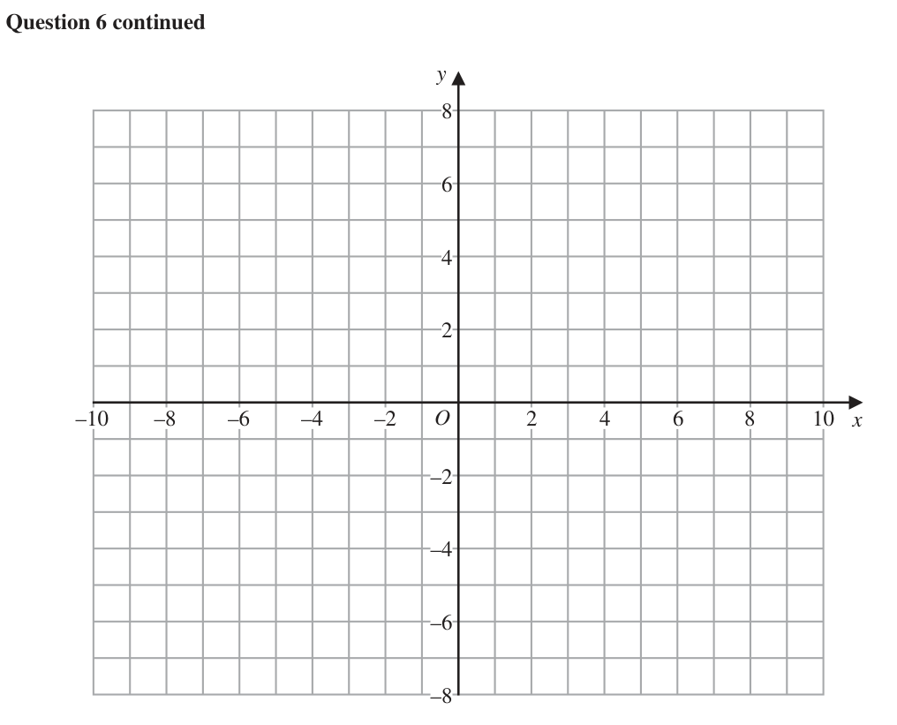
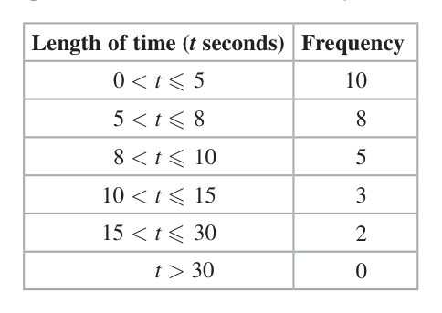
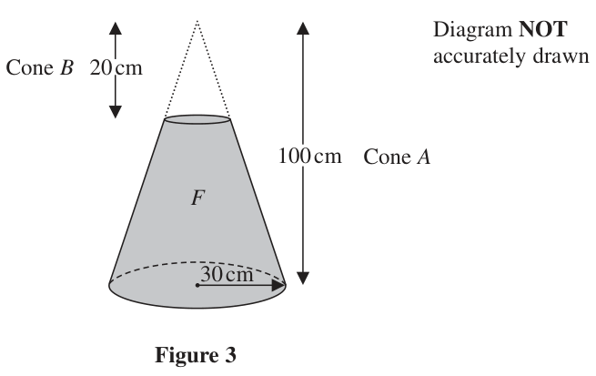

# 4MB1/02R — 2020-06 (official extraction)

> schema `syllabai.official-paper-questions/0.2` · paper_id `pearson-edexcel:international-gcse:mathematics-b:4mb1:2020-06:4MB1/02R` · qp sha256 `5c6b9b5f5a7e39da…` · extraction is the disclosed baseline (ADR-039)

## Question 1 (8 marks)

The manufacturer’s price for a Jinko car is $x Ben was given a 7% discount on the manufacturer’s price when he bought a Jinko. Ben paid $23 622 when he bought his Jinko.

### 1(a) [2]

Calculate the value of x. After a year Ben sold his Jinko for $19 880

**Mark scheme answer**

> 23622 M1 Alt x – 0.07x = 23 622 oe
> 0.93
> ($) 25 400 2 A1

- **(2)** 23622 M1 Alt x – 0.07x = 23 622 oe

### 1(b) [2]

Calculate the percentage loss, to 3 significant figures, on the price Ben paid for his Jinko. During the year that Ben owned the Jinko, he travelled d km in the car. The average fuel consumption of the car was 10 km per litre. The average cost of the fuel he used was $1.40 per litre. Other costs for the car in the year came to $938 The cost per km, including the loss in value, of his Jinko to Ben during the year that he owned the car was $0.40

**Mark scheme answer**

> 23622 − 19880[= 3742] M1dep
> ×100 or
> 23 622
> 19880
> ×100 (=84.158...)
> 23622
> 15.8(%) 2 A1

- **(2)** 23622 − 19880[= 3742] M1dep

### 1(c) [4]

Calculate the value of d.

**Mark scheme answer**

> d M1
> ×1.4(0)

- **(4)** d M1

## Question 2 (4 marks)
### 2(a) [2]

Find the Highest Common Factor (HCF) of 75, 90 and 120 . Bhu sets the alarm on her phone to sound at 09 10 Her alarm then sounds every 12 minutes. Dax sets the alarm on his phone to sound at 09 30 His alarm then sounds every 8 minutes. Bhu’s alarm sounds at 09 10 and Dax’s alarm sounds at 09 30

**Mark scheme answer**

> 75 = 3 × 5 × 5 M1 implied by correct answer
> 90 = 2 × 3 × 3 × 5
> 120 = 2 × 2 × 2 × 3 × 5
> or correct factor trees
> or

- **(2)** 75 = 3 × 5 × 5 M1 implied by correct answer

### 2(b) [2]

Find the first time after 09 30 that both alarms will sound at the same time.

## Question 3 (8 marks)
### 3(a) [2]

Solve the equation 3a + 6 = 4 – 5a

**Mark scheme answer**

> 75 90 120
> 5 25 30
> 5 6
> 15 2 A1
> − 2 A1

- **(2)** 75 90 120

### 3(b) [2]

Solve the inequality 3p > 6p + 12 An inequality, in w, is shown on a number line below. –3 –2 –1 0 1 2 3 4 5 6 7 w

**Mark scheme answer**

> Both could sound together at 9.22 and M1
> LCM of 8 and 12 is 24
> or
> 930 938 946
> 910 922 934 946
> 09 46 oe 2 A1
> Total 4 marks
> Question Working Answer Mark Notes
> p < −4 2 A1

- **(2)** Both could sound together at 9.22 and M1

### 3(c) [1]

Write down the inequality.

**Mark scheme answer**

> w≤5 1 B1 allow use of x ≤ 5

- **(1)** w≤5 1 B1 allow use of x ≤ 5

### 3(d) [3]

Write down the 3 inequalities that define the shaded region R in Figure 1 y 1 R –4 –3 –2 –1 O 1 2 3 4 5 x –1 –2 –3 Figure 1

**Mark scheme answer**

> x ≥ −1 or x > −1 and allow − 1 < x < n where n ≥ 2
> 1 B1
> y ≥ 0 or y > 0 allow 0 < y < m where m ≥ 6
> M1
> y = −2x + ... or y = ...x + 4
> y ≤ −2 x + 4 or 2 A1
> oe
> y < −2 x + 4
> Total 8 marks
> Question Working Answer Mark Notes

- **(3)** x ≥ −1 or x > −1 and allow − 1 < x < n where n ≥ 2

## Question 4 (9 marks)

A youth club has introduced three new activities badminton (B), cookery (C) and drama (D). Each of the 75 members of the youth club is asked to say in which of these activities they have participated. Their answers showed that of the 75 members all have participated in at least one of these activities 27 have participated in badminton and drama 31 have participated in badminton and cookery 23 have participated in cookery and drama 48 have participated in badminton 49 have participated in cookery 40 have participated in drama. Let x be the number of members of the youth club who have participated in all three activities.

**(c)** Find

### 4(a) [3]

Using all this information, complete the Venn diagram opposite to show, in terms of x, the number of elements in each appropriate subset.

> 🖼 crop required: diagram (qp.pdf p.8)

**Mark scheme answer**

> x, 23 – x , 31 – x, 27 – x 3 B1
> x – 5, x – 10, x – 10 B1
> 0 B1

- **(3)** x, 23 – x , 31 – x, 27 – x 3 B1

### 4(b) [2]

Find the value of x.

**Mark scheme answer**

> x + 56 = 75 M1ft
> 19 2 A1

- **(2)** x + 56 = 75 M1ft

### 4(c)(i) [?]

n (B ∩ C ʹ)

**Mark scheme answer**

> 17 1 B1ft their "27" – " 10"

### 4(c)(ii) [2]

n B C D One of the members of the youth club is picked at random. Given that this member has participated in cooking,

**Mark scheme answer**

> 44 1 B1ft 2 x − "5"+ "31"− "20

- **(2)** 44 1 B1ft 2 x − "5"+ "31"− "20

### 4(d) [2]

find the probability that this member has not participated in any other activity. E C D B for a spare Venn diagram if you need to redraw your diagram. Only use this diagram if you need to redraw your Venn diagram. E C D B

> 🖼 crop required: diagram (qp.pdf p.None)

**Mark scheme answer**

> "19"− 5 M1 denominator of 49,
> 49 numerator < 49
> 14 A1ft oe (0.2857... allow 2dp
> 49 truncated or rounded)
> Total 9 marks
> Question Working Answer Mark Notes

- **(2)** "19"− 5 M1 denominator of 49,

## Question 5 (5 marks)
### 5(a) [2]

Factorise x2 + 5x − 6

**Mark scheme answer**

> Factorising into 2 brackets M1 When multiplied out it must
> give at least 2 of the 3 terms
> correct
> ( x + 6)( x −1) 2 A1
> 4 ( x + 3) − 5 ( 2 x − 2 )

- **(2)** Factorising into 2 brackets M1 When multiplied out it must

### 5(b) [3]

Express as a single fraction in its simplest form x 3 2x 5 4

**Mark scheme answer**

> or x + 3 − x − 1 M1
> 20 5
> 4 x + 12 − 10 x + 10
> or 2 x + 6 − 5 x + 5 M1
> 20
> −3x + 11
> 10 A1oe
> Total 5 marks
> Question Working Answer Mark Notes

- **(3)** or x + 3 − x − 1 M1

## Question 6 (12 marks)

The points with coordinates (1, 1), (3, 1) and (4, 3) are the vertices of triangle A.

### 6(a) [1]

On the grid opposite, draw and label triangle A. Triangle B is the image of triangle A under the transformation with matrix M where 2 0 M = 0 2

**Mark scheme answer**

> Triangle A 1 B1

- **(1)** Triangle A 1 B1

### 6(b) [3]

On the grid opposite, draw and label triangle B. Triangle C is the image of triangle B under a reflection in the line with equation y = 0

**Mark scheme answer**

> ⎛ −2 0 ⎞⎛1 3 4 ⎞ M1
> ⎜ ⎟⎜ ⎟
> ⎝ 0 2 ⎠⎝1 1 3 ⎠
> ⎛ −2 −6 −8 ⎞ A1
> ⎜ ⎟
> ⎝ 2 2 6⎠
> Triangle B 3 A1

- **(3)** ⎛ −2 0 ⎞⎛1 3 4 ⎞ M1

### 6(c) [1]

On the grid opposite, draw and label triangle C. Triangle A is transformed to triangle C under the transformation with matrix N.

**Mark scheme answer**

> Triangle C 1 B1
> Question Working Answer Mark Notes

- **(1)** Triangle C 1 B1

### 6(d) [2]

Find matrix N. Triangle D is the image of triangle C under a rotation through 180º about the point (1, 1)

**Mark scheme answer**

> 1 0 2 0 2 0 ⎛ 0 −2 ⎞
> N M1 Allow M1 for ⎜ ⎟
> 0 1 0 2 0 2 ⎝ −2 0 ⎠
> Or
> A C is an enlargement with centre O and
> scale factor 2 so that
> 1 2 0
> and
> 0 0 1
> ⎛ −2 0 ⎞ A1
> ⎜ ⎟
> ⎝ 0 −2 ⎠

- **(2)** 1 0 2 0 2 0 ⎛ 0 −2 ⎞

### 6(e) [2]

On the grid opposite, draw and label triangle D.

**Mark scheme answer**

> Rotation 180º about any point M1
> Triangle D 2 A1

- **(2)** Rotation 180º about any point M1

### 6(f) [3]

Describe fully the single transformation that maps triangle D onto triangle A. y –10 –8 –6 –4 –2 O 2 4 6 8 10 x –2 –4 –6 –8 for a spare copy of the grid if you need to redraw your triangles. Only use this grid if you need to redraw your triangles. y –10 –8 –6 –4 –2 O 2 4 6 8 10 x –2 –4 –6 –8

**Mark scheme answer**

> Enlargement 1 B1
> SF 1 B1
> centre (–2, –2)
> B1
> Total 12 marks
> Question Working Answer Mark Notes

- **(3)** Enlargement 1 B1

## Question 7 (7 marks)

The table gives information about the length of time, in seconds, that each of 28 birds spent on Ali’s bird table on Monday. Length of time (t seconds) Frequency 0<t≤ 5 10 5<t≤ 8 8 8 < t ≤ 10 5 10 < t ≤ 15 3 15 < t ≤ 30 2 t > 30 0

### 7(a) [1]

Find the class interval that contains the median length of time that the birds spent on the bird table on Monday.

**Mark scheme answer**

> 5<t ≤8 1 B1
> M2 for at least 4 correct

- **(1)** 5<t ≤8 1 B1

### 7(b) [4]

Calculate an estimate, in seconds to one decimal place, for the mean length of time that the birds spent on the bird table on Monday. The incomplete histogram below gives some information about the length of time, in seconds, that each of 35 birds spent on Ali’s bird table on Tuesday. Frequency density 0 10 20 30 40 Length of time (seconds) On Tuesday 9 of the birds spent between 5 seconds and 8 seconds on the bird table 6 of the birds spent between 8 seconds and 10 seconds on the bird table no bird spent longer than 40 seconds on the bird table.

**Mark scheme answer**

> products added OR
> 2.5 ×10 + 6.5 × 8 + 9 × 5 + 12.5 × 3 + 22.5 × 2 (M1 for use of a value within
> ( = 204.5) interval (incl. end points) for at
> least 4 products, which must be
> added).
> "204.5" M1(dep) on at least M1
> 4 A1
> awrt 7.3
> Bar drawn height 30 1 B1

- **(4)** products added OR

### 7(c) [1]

Use this information to complete the histogram.

**Mark scheme answer**

> little squares
> oe 1 B1 (0.14(28571...) or

- **(1)** little squares

### 7(d) [1]

Find the proportion of birds on Tuesday that spent longer than 15 seconds on the bird table. for a spare copy of the histogram if you need to redraw your bar. Only use this histogram if you need to redraw your bar. Frequency density 0 10 20 30 40 Length of time (seconds)

**Mark scheme answer**

> 35 14(.28571)%)
> Total 7 marks
> Question Working Answer Mark Notes

- **(1)** 35 14(.28571)%)

## Question 8 (5 marks)

Jenny ran a road race. The distance Jenny ran was 5 km, to the nearest 20 m. Jenny’s time for the race was 34 minutes, to the nearest minute. Colin ran a different road race. The distance Colin ran was 10 km, to the nearest 200 m. Colin’s time for the race was 1 hour 8 minutes, to the nearest minute. Colin’s average speed for his race is greater than Jenny’s average speed for her race. Calculate the upper bound for the difference, in km/h, between Colin’s average speed and Jenny’s average speed. Show your working clearly. (5)

### 8 [5]

Jenny ran a road race. The distance Jenny ran was 5 km, to the nearest 20 m. Jenny’s time for the race was 34 minutes, to the nearest minute. Colin ran a different road race. The distance Colin ran was 10 km, to the nearest 200 m. Colin’s time for the race was 1 hour 8 minutes, to the nearest minute. Colin’s average speed for his race is greater than Jenny’s average speed for her race. Calculate the upper bound for the difference, in km/h, between Colin’s average speed and Jenny’s average speed. Show your working clearly.

**Mark scheme answer**

> 5010, 4990, 10100, 9900,
> M1 at least 1 from each row.
> 33.5, 34.5, 68.5, 67.5
> Colin 10100 or
> 67.5
> A1
> 10.1
> 67.5
> Jenny 4990 or
> 34.5
> 4.99 A1
> 34.5
> ⎛ 10100 4990 ⎞
> ⎜ − ⎟ × 60
> ⎝ 67.5 34.5 ⎠ M1
> 1000
> 0.2995 (km/h) 5 A1
> Total 5 marks
> Questi
> Working Answer Mark Notes
> on

- **(5)** 5010, 4990, 10100, 9900,

## Question 9 (8 marks)

Figure 2 shows two shapes A and B. All the lengths are in metres. Diagram NOT accurately drawn P 2x x 2y A 6y – 3 B 4y + 4 4y Q 2x + 4 R Figure 2 The corners of shape A are all right angles. The area of shape A is 400 m2 Shape B is triangle PQR. The perimeter of shape A is equal to the perimeter of shape B.

### 9(a) [3]

Show that 4y2 – x2 = 200 and that 2y = 2x + 5

**Mark scheme answer**

> 8y² − ... = 400 or ...−2x² = 400 or
> 2y(4y – x) + ... = 400 or ... + x(2y – x) = 400 M1
> 4y² − x² = 200 A1cso
> 10y + 2x + 5 = 2y therefore 2y = 2x + 5 3 B1cso
> ⎛ 2y −5 ⎞

- **(3)** 8y² − ... = 400 or ...−2x² = 400 or

### 9(b) [5]

Find the value of x and the value of y. Show clear algebraic working.

**Mark scheme answer**

> ( 2 x + 5) − x 2 = 200 4 y2 − ⎜ ⎟ = 200
> M1
> ⎝ 2 ⎠
> M1 Rearranging correctly to get
> 3x² + 20x – 175 = 0 12y² + 20y – 825 = 0
> a 3 term quadratic
> ( 3x + 35)( x − 5) = 0 ( 2 y − 15)( 6 y + 55) = 0
> M1 dep on M1 for solving their
> −20 ± 202 − 4 × 3 × −175 −20 ± 202 − 4 ×12 × −825 quadratic equation using any
> 2×3 2 ×12 correct method - if factorising,
> allow brackets which expanded
> 20 2 20 2 20 2 20 2 give 2 out of 3 terms correct (if
> 3[( x + ) − ( ) ] − 175 12[( y + ) − ( ) ] − 825 using formula or completing the
> 6 6 24
> square allow one sign error and
> some simplification – allow as
> −20 ± 400 + 2100
> far as eg
> ⎛ 20 ⎞ 625
> or eg 3 ⎜ x + ⎟ − )
> ⎝ 6 ⎠
> A1 one correct result for x or for
> x=5 y = 7.5 y (ignore negative value for this
> mark)
> 2 × "5"+ 5 2 × "7.5"− 5
> y= x= M1
> 2
> A1 dep on M2 (positive values
> x = 5 and y = 7.5
> only)
> Total 8 marks
> Question Working Answer Mark Notes
> ⎛1⎞
> ⎛1⎞
> 1 M1

- **(5)** ( 2 x + 5) − x 2 = 200 4 y2 − ⎜ ⎟ = 200

## Question 10 (13 marks)

f(x) = 3x3 – 7x2 + 5x – 1

### 10(a) [2]

Use the factor theorem to show that (3x – 1) is a factor of f(x).

**Mark scheme answer**

> 3× ⎜ ⎟ − 7 × ⎜ ⎟ + 5× −1
> ⎝3⎠ ⎝ 3⎠
> = 0, (3x – 1)is a factor 2 A1

- **(2)** 3× ⎜ ⎟ − 7 × ⎜ ⎟ + 5× −1

### 10(b) [3]

Hence solve the equation f(x) = 0 Show clear algebraic working. The curve C has equation y = f(x)

**Mark scheme answer**

> x² − 2x + 1 M1
> ( x −1)( x −1) M1
> 1 A1
> x= or 1

- **(3)** x² − 2x + 1 M1

### 10(c) [5]

Find the exact coordinates of the turning points on C. The curve C crosses the y-axis at the point P.

**Mark scheme answer**

> dy M1
> = 9 x 2 − 14 x + 5
> dx
> ( x − 1) (9 x − 5) = 0 M1
> 5 A1
> 1,
> Substituting x values into M1
> y = 3x³ − 7x² + 5x − 1
> (1, 0) A1
> ⎛ 5 32 ⎞
> ⎜ , ⎟
> ⎝ 9 243 ⎠

- **(5)** dy M1

### 10(d)(i) [1]

Find the gradient of C at P.

**Mark scheme answer**

> B1ft (ft dy )
> 5
> dx

- **(1)** B1ft (ft dy )

### 10(d)(ii) [2]

Hence find an equation of the tangent to C at P.

**Mark scheme answer**

> y = “5”x – 1 M1
> y = 5x – 1 2 A1oe
> Total 13 marks
> Question Working Answer Mark Notes

- **(2)** y = “5”x – 1 M1

## Question 11 (10 marks)

Diagram NOT accurately drawn Cone B 20 cm 100 cm Cone A F 30 cm Figure 3 A right circular cone, A, has height 100 cm and base radius 30 cm. The shaded solid, F, is formed by removing the right circular cone, B, of height 20 cm from the top of A, as shown in Figure 3 The volume of F is k π cm3 where k is an integer.

### 11(a) [3]

Find the value of k. Diagram NOT 20 cm accurately drawn 102 cm Figure 4 Figure 4 shows a solid circular cylinder. The cylinder has a radius of 20 cm, a height of 102 cm and a volume of V cm3

> 🖼 crop required: diagram (qp.pdf p.None)

**Mark scheme answer**

> 1 B1 use or statement of the
> SF
> 5 correct SF
> 1
> (π ) × 302 × 100 − (π ) × "6"2 × 20 oe M1
> 3
> 29760 3 A1

- **(3)** 1 B1 use or statement of the

### 11(b) [1]

Calculate the value of V. Give your answer in terms of π. Volume of a cylinder πr 2 h Volume of a cone 1 2 = πr h Figure 5 below shows a door stop made from a hollow hemisphere and a hollow right circular cone. Diagram NOT accurately drawn 108 cm h cm 30 cm Figure 5 The radius of the base of the cone and the radius of the hemisphere are both 30 cm. The centre of the base of the cone coincides with the centre of the hemisphere. The height of the cone is 108 cm. The door stop rests on horizontal ground with the cone on top of the hemisphere and the axis of symmetry of the door stop vertical. The door stop contains sand to a height of h cm. Given that the volume of sand in the door stop is V cm3, where V cm3 is the volume of the cylinder in Figure 4

**Mark scheme answer**

> 40800π 1 B1

- **(1)** 40800π 1 B1

### 11(c) [6]

calculate the value of h. 4 3 Volume of a sphere 3 πr

**Mark scheme answer**

> π × 303 + ... M1
> g = height of small cone
> π × 303 +
> 3 M1 Condone 30k2
> 2 or
> 1 1 ⎛ 30 ⎞ A1 Correct equation
> π × 302 × 108 − π × ⎜ g ⎟ × g = "40800π "
> 3 3 ⎝ 108 ⎠
> 0.02 572g³ = 9 600
> g = 72 A1
> h = 30 + (108 − 72) M1
> awrt 66 6 A1
> Alternate method
> V hemisphere = 2 π × 303 [ = 18000π ] M1
> V frustrum = 40800π − 18000π [ = 22800π ]
> V whole cone = 1 π × 302 ×108 [ = 32400π ]
> V top cone 32400π − 22800π [ = 9600π ] M1
> V top cone: V whole cone = 9600π : 32400π A1
> = 8 : 27
> H top cone: H whole cone = 2 : 3 A1
> 138 − h 2
> = M1
> 108
> awrt 66 A1
> Total 10 marks
> Question Working Answer Mark Notes

- **(6)** π × 303 + ... M1

## Question 12 (11 marks)

A Diagram NOT B accurately drawn C F E O Figure 6 Figure 6 shows triangle OAB. The point E lies on OB such that OE : OB = 1 : 2 → 1 → The point F lies on OA such that OF = OA → → 5 Given that OA = a and OB = b →

### 12(a) [2]

find FE in terms of a and b The point C is such that ABC is a straight line and AB = BC.

**Mark scheme answer**

> b ±
> a M1
> 2
> 1 1 2 A1
> − a+ b
> 5

- **(2)** b ±

### 12(b) [4]

Show that F, E and C are not collinear. Given that ABG and FEG are straight lines, →

**Mark scheme answer**

> FC = a + 2 AB
> 5 M1 or EC = − 1 b + a + 2 AB
> " "
> FC = a + 2 (b – a) M1 or EC = − 1 b + a+ 2 (b – a)
> 5
> FC = 2b – 6 a A1 or EC = 3 b –a
> 2b – 6 a is not a multiple of 4 A1 5 b –a is not a multiple of
> 5
> b – 1 a therefore F, E and C are not
> 2 5 b – 1 a therefore F, E and C are not
> 2
> collinear. collinear.

- **(4)** FC = a + 2 AB

### 12(c) [5]

find OG in terms of a and b

**Mark scheme answer**

> OG = a + m ( b − a ) M1
> 1 ⎛ 1 1 ⎞
> OG = a + n ⎜ "− a + b " ⎟ M1
> 5 ⎝ 5 2 ⎠
> ⎛1 1 ⎞
> ⎜ − n ⎟ = 1 − m or m = n
> 1 M1
> ⎝ 5 5 ⎠
> n= or m = 4 A1
> 3
> OG = a + 4 (b – a ) or 1
> − a+ b 5 A1
> 3 3
> Total 11 marks

- **(5)** OG = a + m ( b − a ) M1

