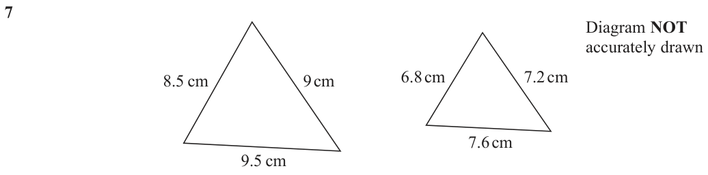
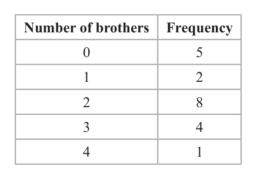
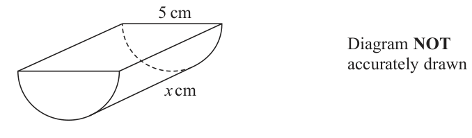
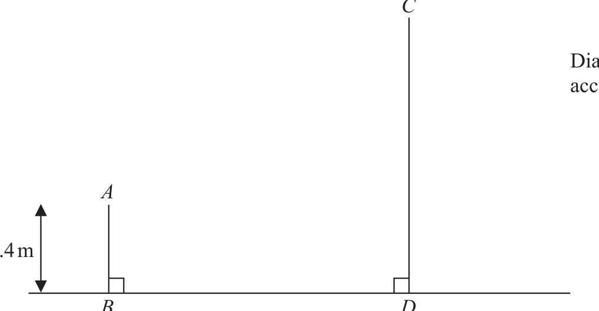
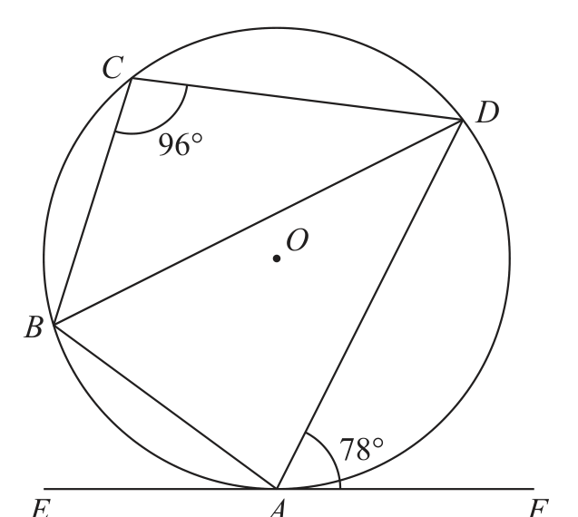
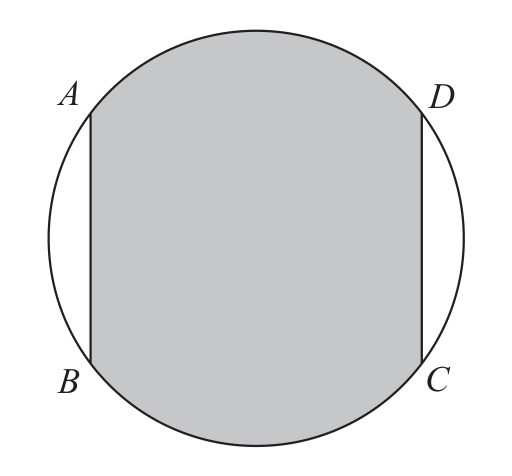
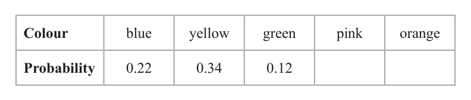
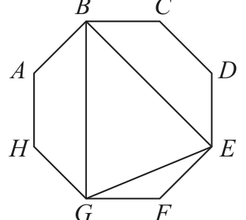

# 4MB1/01 — 2020-11 (official extraction)

> schema `syllabai.official-paper-questions/0.2` · paper_id `pearson-edexcel:international-gcse:mathematics-b:4mb1:2020-11:4MB1/01` · qp sha256 `4dbc9aa2cf711c37…` · extraction is the disclosed baseline (ADR-039)

## Question 1 (2 marks)

Solve the inequality 7x + 3 ≤ 4x – 15

### 1 [2]

Solve the inequality 7x + 3 ≤ 4x – 15

**Mark scheme answer**

> eg 7x – 4x ≤ −15 − 3 2 M1 for collecting terms in x on one side and
> numerical terms the other side, allow an equation
> or incorrect inequality sign.
> x ≤ −6 A1 Do not ISW.

- **(2)** eg 7x – 4x ≤ −15 − 3 2 M1 for collecting terms in x on one side and

## Question 2 (2 marks)

Show that 2 5 4 ÷ = 18 7 21

### 2 [2]

Show that 2 5 4 ÷ = 18 7 21

**Mark scheme answer**

> 30 21 90 5 2 M1 must see correct fractions for multiplying or
> × oe or ÷ oe correct fraction division both over the same
> 7 5 21 21
> common denominator
> 30 6 21 3 shown A1 dep on M1 must see at least one additional
> eg 7 × 5 =18 or 6 × 3 =18 or
> stage of working after the M1
> 630
> = 18 or = 18
> 35

- **(2)** 30 21 90 5 2 M1 must see correct fractions for multiplying or

## Question 3 (2 marks)

The nth term of a sequence is given by 3n 2 + 11 Calculate the difference between the 6th term and the 9th term of the sequence.

### 3 [2]

The nth term of a sequence is given by 3n 2 + 11 Calculate the difference between the 6th term and the 9th term of the sequence.

**Mark scheme answer**

> 3 × 6² + 11(=119) or 3 × 9² + 11(=254) 2 M1
> or 3 × 9² − 3 × 6²
> 135 A1 allow −135

- **(2)** 3 × 6² + 11(=119) or 3 × 9² + 11(=254) 2 M1

## Question 4 (2 marks)

A = 23 × 3 × 52 B = 22 × 32 × 5 × 7

### 4(i) [1]

A = 2³ × 3 × 5² B = 2² × 3² × 5 × 7

Find the Lowest Common Multiple (LCM) of A and B.

**Mark scheme answer**

> LCM = 2³ × 3² × 5² × 7 = **12 600**
> 
> Take the highest power of each prime that appears in either A or B.

- **(1)** 12 600

### 4(ii) [1]

Find the Highest Common Factor (HCF) of A and B.

**Mark scheme answer**

> HCF = 2² × 3 × 5 = **60**
> 
> Take the lowest power of each prime that appears in both A and B.

- **(1)** 60

## Question 5 (2 marks)

The price of each sandwich in a cafe was increased by 4% Chris bought a sandwich after the price increase for $3.64 Calculate the increase in the price of the sandwich Chris bought. $ . . . . . . . . . . . . . . . . . . . . . .. . . . . . . . . . . . . . . . . . . . . . . . . . . . .. . . .

### 5 [2]

The price of each sandwich in a cafe was increased by 4% Chris bought a sandwich after the price increase for \$3.64 Calculate the increase in the price of the sandwich Chris bought. \$

**Mark scheme answer**

> 104 2 3.64×100
> 3.64 ÷ 1.04 (=3.50) oe or 3.64 ÷ oe M1 allow
> 4 104
> NB 3.5, 3.50 or 0.14 seen from a 4% decrease do
> not award any marks
> 0.14 A1 NB 0.14 seen with no incorrect working score
> full marks.

- **(2)** 104 2 3.64×100

## Question 6 (2 marks)

Given that a : b = 3 : 5 and that a : c = 7 : 4 find a : b : c Give your answer in its simplest form. a : b : c = . . . . . . . . . . . . . . . . . . . . . .. . . . . . . . . . . . . . . . . . . . . . . . . . . . .. . . .

### 6 [2]

Given that a : b = 3 : 5 and that a : c = 7 : 4 find a : b : c Give your answer in its simplest form. a : b : c =

**Mark scheme answer**

> [ a : b = ] 21 : 35 and [a : c = ] 21 : 12 oe 2 M1 two correct two part ratios with equal a or
> or (3 : 5) × 7 and (7 : 4) × 3 correct 3 part ratio but not in simplest form eg
> 12
> 42 : 70 : 24 or 3 : 5 : or 7 : : 4
> 7
> 21 : 35 : 12 A1

- **(2)** [ a : b = ] 21 : 35 and [a : c = ] 21 : 12 oe 2 M1 two correct two part ratios with equal a or

## Question 7 (2 marks)

Diagram NOT accurately drawn 8.5 cm 9 cm 6.8 cm 7.2 cm 7.6 cm 9.5 cm The diagram shows two triangles. Show that the triangles are similar.

### 7 [2]

Diagram NOT accurately drawn 8.5 cm 9 cm 6.8 cm 7.2 cm 7.6 cm 9.5 cm The diagram shows two triangles. Show that the triangles are similar.

**Mark scheme answer**

> Method 1 Corresponding sides 2 B2 for calculating or finding any of the following:
> 8.5 9 9.5 • SF for all three pairs of corresponding
> and and = 1.25
> 6.8 7.2 7.6 sides, and the 1.25 or 0.8 seen (Method 1)
> • Two pairs of corresponding angles from
> 6.8 7.2 7.6 each triangle with either the corresponding
> or and and = 0.8
> 8.5 9 9.5 cosine value 0.579 or 0.505 or 0.412 or
> Method 2 Angles (Any 2 of these required) angle 59.7 or 65.7 or 54.6 correct to 3sf.
> (Method 2)
> 9.52 +92 –8.52 7.62 +7.22 –6.82
> • and and 0.579 or 54.6 • Two pairs of corresponding ratios with the
> 2×9.5×9 2×7.6×7.2 corresponding value 0.94 or 0.89 or 0.95
> 9.52 +8.52 –92 7.62 +6.82 –7.22 correct to 2 sf
> • and and 0.505 or 59.7
> 2×9.5×8.5 2×7.6×6.8 (Method 3)
> 8.52 +92 –9.52 7.22 +6.82 –7.62 B1 for evaluating or equating
> • and and 0.412 or 65.7 • two pairs of corresponding sides
> 2×8.5×9 2×7.2×6.8
> • one pair of corresponding angles
> Method 3 Ratio (Any 2 of these required) • one pair of corresponding ratios
> 8.5 6.8
> • = and awrt 0.94
> 9 7.2
> 8.5 6.8
> • = and awrt 0.89
> 9.5 7.6
> 9 7.2
> • = and 0.95 or awrt 0.947
> 9.5 7.6

- **(2)** Method 1 Corresponding sides 2 B2 for calculating or finding any of the following:

## Question 8 (2 marks)

Given that y = x 4 – x2 dy find dx dy = . . . . . . . . . . . . . . . . . . . . . . . . . . . . . . . . . . . . . . . . . . . . . . . . . . .. . . . dx

### 8 [2]

Given that y = x 4 – x² dy find dx dy = ……………dx

Given that y = x 4 – x² dy find dx dy = dx

**Mark scheme answer**

> 4x3 + 16x−3 2 B2 oe (B1 for one correct term)
> or 4x3 + 3
> x

- **(2)** 4x3 + 16x−3 2 B2 oe (B1 for one correct term)

## Question 9 (3 marks)

The table gives information about the number of brothers that each student in a class has. Number of brothers Frequency 0 5 1 2 2 8 3 4 4 1 Calculate the mean number of brothers.

### 9 [3]

The table gives information about the number of brothers that each student in a class has. Number of brothers Frequency 0 5 1 2 2 8 3 4 4 1 Calculate the mean number of brothers.

**Mark scheme answer**

> (0×5+)1×2+2×8+3×4+4×1 (=34) 3 M1 for correct products allowing one error with
> Or (0+)²+16+12+4 intention to add
> (0 × 5) + 1 × 2 + 2 × 8 + 3 × 4 + 4 × 1 M1 fully correct method (condone one error in
> 5+2+8+4+1 products)
> (34÷20)
> 1.7 A1 oe

- **(3)** (0×5+)1×2+2×8+3×4+4×1 (=34) 3 M1 for correct products allowing one error with

## Question 10 (3 marks)

Without using a calculator and showing your working clearly, find the value of the integer a so that 180 − 27 − 20 + 147 = a( 5 + 3 ) a = . . . . . . . . . . . . . . . . . . . . . . . . . . . . . . . . . . . . . . . . . . . . . . . . . . .. . . .

### 10 [3]

Without using a calculator and showing your working clearly, find the value of the integer a so that 180 − 27 − 20 + 147 = a( 5 + 3 ) a =

**Mark scheme answer**

> (√180 =)√36 × 5 or (√180 =)²√45 3 M1 for clearly showing understanding of surd
> or (√180 =)³√20 or (180 =) 2²×3²×5 form must include a decomposition of either 180
> or 147
> or (√147 =)√49 × 3 or (147 =) 3 × 7²
> 6 5 −3 3 −2 5 +7 3 M1 dep at least 3 terms correct
> 4( 5 + 3) 4 A1 dep on both M marks

- **(3)** (√180 =)√36 × 5 or (√180 =)2√45 3 M1 for clearly showing understanding of surd

## Question 11 (3 marks)

Solve + =2 4 5 Show clear algebraic working. x = . . . . . . . . . . . . . . . . . . . . . .. . . . . . . . . . . . . . . . . . . . . . . . . . . . .. . . .

### 11 [3]

Solve + =2 4 5 Show clear algebraic working. x = ……………Solve + =2 4 5 Show clear algebraic working. x =

**Mark scheme answer**

> 5( x + 5) 4( x − 3) 3 M1 For clear intention to multiply all terms by
> + (= 2) 20 or a multiple of 20. Do not award if one term
> 20
> 5( x + 5) + 4( x − 3) is not multiplied.
> or (= 2) LHS over common denominator or equation with
> 20 no fractions
> or 5(x + 5) + 4(x – 3) = 2 × 20
> 5x + 25 + 4x – 12 = 40 M1 dep an equation with brackets expanded and
> (9x = 27) no denominators (allow a single numerical or
> sign error)
> 3 A1 dep on first M1

- **(3)** 5( x + 5) 4( x − 3) 3 M1 For clear intention to multiply all terms by

## Question 12 (3 marks)

The diagram shows a half cylinder. 5 cm Diagram NOT accurately drawn x cm The half cylinder has a length of x cm and a semicircular cross section of diameter 5 cm. The volume of the half cylinder is 35π cm3 Calculate the value of x. x = . . . . . . . . . . . . . . . . . . . . . .. . . . . . . . . . . . . . . . . . . . . . . . . . . . .. . . .

### 12 [3]

The diagram shows a half cylinder. 5 cm Diagram NOT accurately drawn x cm The half cylinder has a length of x cm and a semicircular cross section of diameter 5 cm. The volume of the half cylinder is 35π cm³ Calculate the value of x. x =

**Mark scheme answer**

> 1 ⎛5⎞
> 2 3 M1 oe
> × π × × x (= 35π ) oe
> 2 ⎝2⎠
> ⎛2⎞
> 2 M1 dep oe
> x = 35 × × 2
> ⎝5⎠
> 11.2 A1 oe
> SC If no marks awarded otherwise 5.6 or 2.8
> given as final answer award B1

- **(3)** 1 ⎛5⎞

## Question 13 (3 marks)
### 13(a) [1]

Simplify m12 ÷ m³ 3 3

**Mark scheme answer**

> m9 1 B1

- **(1)** m9 1 B1

### 13(b) [2]

Simplify fully $(125p^9w^3)^{\frac{2}{3}}$

**Mark scheme answer**

> 25p6w2 2 B2 (B1 for 2 correct part of a product, may be
> seen in working)
> NB 52p6w2 gains B1

- **(2)** 25p6w2 2 B2 (B1 for 2 correct part of a product, may be

## Question 14 (3 marks)

Given that 2 5 p= and n = 6n + 5 4m + 2 find an expression for p in terms of m. Give your answer in its simplest form. p = . . . . . . . . . . . . . . . . . . . . . .. . . . . . . . . . . . . . . . . . . . . . . . . . . . .. . . .

### 14 [3]

Given that 2 5 p= and n = 6n + 5 4m + 2 find an expression for p in terms of m. Give your answer in its simplest form. p =

**Mark scheme answer**

> 2 3 M1 correct expression for p in terms of m
> (p = ) 6 × 5 oe or or correct simplification of 6n+5
> +5
> 4m + 2 or correct simplified expression for n in terms of
> 30 30 + 5(4m + 2) p
> (4m + 2 + 5 =) oe
> 4m + 2
> 2−5p
> or n = oe
> 6p
> 2(4m + 2) M1 correct equation linking p and m with no
> (p = ) oe or nested fractions
> 30 + 5(4m + 2)
> 2 30 + 5(4m + 2)
> = oe or
> p 4m + 2
> 2 – 5p
> = oe
> p 4m+2
> 2m + 1 2m + 1
> p= A1 or p = oe simplified form
> 10 + 5m 5(m + 2)

- **(3)** 2 3 M1 correct expression for p in terms of m

## Question 15 (4 marks)

Akash drove from his home to his friend’s house. The distance Akash drove was 190 km, to the nearest 5 km. His average speed for the journey was 62 km/h, to the nearest km/h. Calculate the upper bound for the time taken by Akash to drive from his home to his friend’s house. Give your answer in hours and minutes, to the nearest minute. . . . . . . . . . . . . . . . . . . . . . . . . . . . . . . . . . . . . . . . . . . . . . . . . . . .. . . . hours . . . . . . . . . . . . . . . . . . . . . . . . . . . . . . . . . . . . . . . . . .. . . . . . . . .. . . . minutes

### 15 [4]

Akash drove from his home to his friend’s house. The distance Akash drove was 190 km, to the nearest 5 km. His average speed for the journey was 62 km/h, to the nearest km/h. Calculate the upper bound for the time taken by Akash to drive from his home to his friend’s house. Give your answer in hours and minutes, to the nearest minute hours minutes

**Mark scheme answer**

> For 192.5 or 187.5 3 M1
> For 61.5 or 62.5 M1
> “192.5” ÷ “61.5” (=3.13...) M1 where 190 < “192.5” ≤ 195 and
> 61 ≤ “61.5” < 62
> 3hrs 8 mins A1 cao

- **(4)** For 192.5 or 187.5 3 M1

## Question 16 (4 marks)

C Diagram NOT accurately drawn A 1.4 m B D 5m In the diagram, AB represents a vertical wall and CD represents a vertical building. The height of the wall is 1.4 m. The bottom of the wall, B, and the bottom of the building, D, are on horizontal ground, such that BD = 5 m. The angle of elevation of C from A is 75° Calculate the height, in m to one decimal place, of the building. . . . . . . . . . . . . . . . . . . . . . . . . . . . . . . . . . . . . . . . . . . . . . . . . . . .. . . . m

### 16 [4]

5m In the diagram, AB represents a vertical wall and CD represents a vertical building. The height of the wall is 1.4 m. The bottom of the wall, B, and the bottom of the building, D, are on horizontal ground, such that BD = 5 m. The angle of elevation of C from A is 75° Calculate the height, in m to one decimal place, of the building m

> *Figure not shown in this reconstruction — the printed paper includes a diagram (not drawn accurately).*
> Labels in the original figure: C, A, B, D · Figure values: 1.4.

**Mark scheme answer**

> x 4 M1 Correct expression involving x must use
> tan 75 = oe correct angle.
> Allow tan 15º =
> x
> x = 5 tan 75 (=18.7) M1 Correct expression for x condone use of 15º
> in place of 75º (or value of 1.34)
> Height = 5tan75° + 1.4 M1 Correct expression for height condone use of
> 15º in place of 75º (or value of 2.74)
> 20.1 A1 awrt 20.1

- **(4)** x 4 M1 Correct expression involving x must use

## Question 17 (3 marks)

The histogram below shows information about the age of each person on a plane. Frequency density 0 5 10 15 20 25 30 35 40 45 50 55 60 65 70 75 80 Age (years) There were 7 people on the plane with an age of 5 years or under. Calculate the number of people on the plane with an age of over 20 years.

### 17 [3]

The histogram below shows information about the age of each person on a plane. Frequency density 0 5 10 15 20 25 30 35 40 45 50 55 60 65 70 75 80 Age (years) There were 7 people on the plane with an age of 5 years or under. Calculate the number of people on the plane with an age of over 20 years.

**Mark scheme answer**

> 7 3 M1
> 1.4 or or 2 × 10 (=20) or
> 2.5 × 30 (=75) or 0.9 × 20 (=18) seen
> 2 × 10 + 2.5 × 30 + 0.9 × 20 oe M1 Allow an error on one bar, but must see all 3
> bars added.
> 113 A1

- **(3)** 7 3 M1

## Question 18 (3 marks)

A varies directly as the square of c A = 950 when c = 5 Calculate the value of A when c = 7 A = . . . . . . . . . . . . . . . . . . . . . . . . . . . . . . . . . . . . . . . . . . . . . . . . . . .. . . .

### 18 [3]

A varies directly as the square of c A = 950 when c = 5 Calculate the value of A when c = 7 A =

**Mark scheme answer**

> 950 A 3 M1
> 950 = k × 5² or k = 38 or 2 = 2 oe
> 5
> 950 M1 dep
> (A = ) 2 × 7 2 or (A = ) “38” × 72 oe
> 1862 A1

- **(3)** 950 A 3 M1

## Question 19 (4 marks)

Solve the simultaneous equations 5x – 3y = 21 3x – 4y = 22.5 Show clear algebraic working. x = . . . . . . . . . . . . . . . . . . . . . . . . . . . . . . . . . . . . . . . . . . . . . . . . . . .. . . . y = . . . . . . . . . . . . . . . . . . . . . . . . . . . . . . . . . . . . . . . . . . . . . . . . . . .. . . .

### 19 [4]

Solve the simultaneous equations 5x – 3y = 21 3x – 4y = 22.5 Show clear algebraic working. x = y =

**Mark scheme answer**

> 20x – 12y = 84 5x – 21 4 M1 for a correct method to eliminate x or y:
> – y= giving coefficients of x or y the same and correct
> 9x – 12y = 67.5 5x – 21 operation to eliminate selected variable (condone
> 3x – 4( 3 ) = 22.5
> (11x = 16.5) 1 arithmetical error)
> or or
> or
> 15x – 9y = 63 21 + 3y
> x= giving for correctly writing x or y in terms of the other
> –
> 21 + 3y variable and correctly substituting (condone 1
> 15x – 20y = 112.5 3( ) – 4y = 22.5 arithmetical error)
> (11y = – 49.5)
> x = 1.5 or A1 dep on M1
> y = −4.5
> oe
> 5 × “1.5” – 3y = 21 or M1 dep on M1 for substitution of found variable
> 3 × “1.5” – 4y = 22.5 or
> 5x – 3 × “–4.5” = 21 or or
> 3x – 4 × “–4.5” = 22.5
> repeating the steps in first M1 for the second
> variable
> x = 1.5 A1 dep on M1
> and
> y = −4.5
> oe

- **(4)** 20x – 12y = 84 5x – 21 4 M1 for a correct method to eliminate x or y:

## Question 20 (4 marks)

⎛ 4 3⎞ ⎛ −7 −2⎞ A= ⎜ B= ⎜ ⎝ −2 1⎟⎠ ⎝ 1 3 ⎟⎠ Find

### 20(a) [2]

⎛ 4 3⎞ ⎛ −7 −2⎞ A= ⎜ B= −2 1 1 3 Find

A – B

**Mark scheme answer**

> ⎛ 11 5 ⎞ 2 B2 −1 eeoo
>  −3 −2 

- **(2)** ⎛ 11 5 ⎞ 2 B2 −1 eeoo

### 20(b) [2]

AB

**Mark scheme answer**

> ⎛ −25 1 ⎞ 2 B2 −1 eeoo
>  15 7 

- **(2)** ⎛ −25 1 ⎞ 2 B2 −1 eeoo

## Question 21 (4 marks)

C Diagram NOT D accurately drawn 96° O B 78° E A F ABCD is a quadrilateral such that the points A, B, C and D lie on a circle, centre O. EAF is the tangent to the circle at A. ∠DAF = 78° ∠BCD = 96° Calculate the size, in degrees, of ∠BDA. Give reasons for each stage of your working. ° ∠BDA = . . . . . . . . . . . . . . . . . . . . . . . . . . . . . . . . . . . . . . . . . . . . . . . . . . .. . . .

### 21 [4]

ABCD is a quadrilateral such that the points A, B, C and D lie on a circle, centre O. EAF is the tangent to the circle at A. ∠DAF = 78° ∠BCD = 96° Calculate the size, in degrees, of ∠BDA. Give reasons for each stage of your working. ° ∠BDA =

> *Figure not shown in this reconstruction — the printed paper includes a diagram (not drawn accurately).*
> Labels in the original figure: C, D, O, B, E, A, F · Figure values: 96°, 78°.

**Mark scheme answer**

> BAD = 180 – 96(=84) or 4 M1 may be marked on diagram. Must be clear it
> OAD = 90 – 78(=12) is the correct angle.
> We will allow A = 180 – 96(=84)
> EAB = 180 – 78 – “84”(=18) or M1 may be marked on diagram.
> ABD = 0.5 × (180 – 2 × “12”)(=78) Must be clear it is the correct angle.
> 18° A1
> NB an answer of 18° gains 3 marks.
> Opposite angles of a cyclic quad B1 2 correct reasons for method used, one must
> Angle between tangent and radius be a circle theorem.
> Angle at centre = 2 × angle at NB Assuming the triangle BCD is isosceles (42)
> circumference oe is automatically B0
> Alternate segment theorem
> Angles in a triangle total 180°
> Angles in a straight line total 180º

- **(4)** BAD = 180 – 96(=84) or 4 M1 may be marked on diagram. Must be clear it

## Question 22 (4 marks)

Given that can be written in the form 5 y 4 × ( 125 ) 4 n + 2 find an expression for y in terms of n. y = . . . . . . . . . . . . . . . . . . . . . . . . . . . . . . . . . . . . . . . . . . . . . . . . . . .. . . .

### 22 [4]

Given that can be written in the form 5 y 4 × ( 125 ) 4 n + 2 find an expression for y in terms of n. y =

**Mark scheme answer**

> 255 n +3 = 52(5 n +3) oe 4 M1
> 4n+2
> (4n+2) M1
> (√125) =5 2 oe
> Simplify numerator to 5 × 510n+6 or M1 dep on first M1
> 510n+7
> 4n + 4 A1 oe
> Allow 54n + 4

- **(4)** 255 n +3 = 52(5 n +3) oe 4 M1

## Question 23 (4 marks)

The function g is such that g(x) = 9 – 10x – 5x 2 for all values of x Find the range of g. Show clear algebraic working.

### 23 [4]

The function g is such that g(x) = 9 – 10x – 5x 2 for all values of x Find the range of g. Show clear algebraic working.

**Mark scheme answer**

> 9 – 5(2x + x²) or (gʹ(x) =) −10 – 10x 3 M1 differentiating one term correctly or using
> – – 10 –b
> or or –2.67 and 0.67 (or better) or for expressing in the form 9 – 5(2x + x²)
> 2×–5 2×a
> or – 5(– + 2x + x²) or for correct solution of the
> quadratic to at least 2dp. Accept exact solution
> –5±√70
> ( ) or equivalent surd form
> 9 – 5[(x + 1)² − 1] or M1 dep equating their 2 term derivative to zero, x
> “−10 – 10x” = 0 or x = −1 = –1 seen or an expression containing a single x
> (y = )14 M1 dep y=14 must follow from algebraic
> working
> g ≤ 14 1 A1 (accept g(x) ≤ 14 or y ≤ 14 or ( – ∞ , 14] or
> ] – ∞ , 14], Condone – ∞ , 14]
> Do not accept answers from trials of multiple
> values of x unless correct, clear algebraic
> working is seen.

- **(4)** 9 – 5(2x + x²) or (gʹ(x) =) −10 – 10x 3 M1 differentiating one term correctly or using

## Question 24 (6 marks)

A B D C ABCD is a quadrilateral. Leaving in all of your construction lines, construct the locus of all points inside the quadrilateral that are

### 24(a) [1]

A B D C ABCD is a quadrilateral. Leaving in all of your construction lines, construct the locus of all points inside the quadrilateral that are

4 cm from B …………… , ……………

**Mark scheme answer**

> Arc centre B, 1 B1 4cm ± 2 mm must touch both AB and BC
> radius 4 cm

- **(1)** Arc centre B, 1 B1 4cm ± 2 mm must touch both AB and BC

### 24(b) [2]

equidistant from B and C …………… , ……………

**Mark scheme answer**

> 2 M1 arcs centred on B and C drawn correctly to
> enable bisector to be drawn, must intersect twice
> Correct A1 dep on M1
> perpendicular
> bisector

- **(2)** 2 M1 arcs centred on B and C drawn correctly to

### 24(c) [2]

equidistant from the lines DA and DC. The region R consists of all the points inside the quadrilateral that are more than 4 cm from B, closer to B than to C and closer to DC than to AD …………… , ……………

**Mark scheme answer**

> 2 M1 arcs centred on D along DC and DA, and arcs
> from these points meeting correctly to enable
> angle bisector to be drawn.
> Correct angle A1 dep on M1
> bisector

- **(2)** 2 M1 arcs centred on D along DC and DA, and arcs

### 24(d) [1]

show, by shading, the region R. Label the region R.

**Mark scheme answer**

> Correct 1 B1 Must fit within the tramlines on the overlay
> section Does not need to be labelled but must be clearly
> labelled indicated.

- **(1)** Correct 1 B1 Must fit within the tramlines on the overlay

## Question 25 (4 marks)
### 25(a) [2]

Make a the subject of the formula B = ac + de

**Mark scheme answer**

> B de 2 M1
> B – de = ac or =a+ or
> c c
> B − de

- **(2)** B de 2 M1

### 25(b) [2]

Factorise fully 14x 2y 3 – 21x 5y 2

**Mark scheme answer**

> 7 x 2 y 2 (2 y − 3x3 ) 2 B2 (B1 for a correct but partially factorised
> expression but must have at least 2 factors
> outside eg. 7x(2xy3 – 3x4y2) ,
> or 7x2y2(ayn – bxm) where a, b, m and n are
> positive integers any of these values may be 1.)
> Condone missing trailing brackets.

- **(2)** 7 x 2 y 2 (2 y − 3x3 ) 2 B2 (B1 for a correct but partially factorised

## Question 26 (5 marks)

A D Diagram NOT accurately drawn B C The diagram shows a circle of radius 2x cm. The lines AB and DC are parallel and AB = DC = 2x cm. The area of the region shown shaded in the diagram is kx 2 cm2 Find the exact value of k. k = . . . . . . . . . . . . . . . . . . . . . . . . . . . . . . . . . . . . . . . . . . . . . . . . . . .. . . .

### 26 [5]

The diagram shows a circle of radius 2x cm. The lines AB and DC are parallel and AB = DC = 2x cm. The area of the region shown shaded in the diagram is kx 2 cm² Find the exact value of k. k =

> *Figure not shown in this reconstruction — the printed paper includes a diagram (not drawn accurately).*
> Labels in the original figure: A, D, B, C.

**Mark scheme answer**

> Any one of 30,60,120,240 identified correctly M1 oe
> or used or the length √3x identified or used.
> 0.5 × 2x ×2x × sin60 (= √3$x^2$) M1 dep first M mark
> or 0.5 × 2x ×2x × sin120 (= √3$x^2$)
> or 0.5 × 2x × √3x (= √3$x^2$)
> √3
> or 0.5 × x × √3x = (= x² )
> 240 8 M1 dep first M mark
> × π × (2x)² (= 3 πx² ) or
> 360
> 120
> × π × (2x)² (= 3 πx² ) or
> 360
> 60
> × π × (2x)² (= 3 πx² ) or
> 360
> 30
> × π × (2x)² (= 3 πx² )
> 360
> 240 M1 dep on previous M marks
> × π × (2 x)² + 2 × 0.5 × 2x ×2x × sin60 or Fully correct method to find the required area
> 360
> π × (2x)² – 2 ×
> (360 × π × (2x)² – 0.5 × 2x × 2x × sin 60)
> 8 A1 oe
> 2 3+ π

- **(5)** Any one of 30,60,120,240 identified correctly M1 oe

## Question 27 (5 marks)

Aarya has a biased 5-sided spinner. pink orange green blue yellow When the spinner is spun once, it can land on blue or yellow or green or pink or orange. Aarya spins the spinner many times and records the colour that the spinner lands on each time. She uses these results to calculate the probability of the spinner landing on each colour. The table below gives the probabilities that Aarya calculated for blue, yellow and green. Colour blue yellow green pink orange Probability 0.22 0.34 0.12 Aarya’s calculations showed that the probability of the spinner landing on orange is 3 times the probability of the spinner landing on pink.

### 27(a) [3]

Complete the table for pink and for orange. When Aarya spun the spinner, it landed on green 90 times.

**Mark scheme answer**

> 1 – (0.22 + 0.34 + 0.12)(= 0.32) oe 3 M1 Use of the total probability =1 (award if their
> two answer sum to 0.32)
> “0.32” ÷ 4 (=0.08) M1 dep allow 4x = “0.32” for this mark
> pink = 0.08, A1
> orange = 0.24

- **(3)** 1 – (0.22 + 0.34 + 0.12)(= 0.32) oe 3 M1 Use of the total probability =1 (award if their

### 27(b) [2]

Work out an estimate for the total number of times Aarya spun the spinner.

**Mark scheme answer**

> 90 ÷ 0.12 oe 2 M1
> 750 A1

- **(2)** 90 ÷ 0.12 oe 2 M1

## Question 28 (7 marks)

B C Diagram NOT A D accurately drawn H E G F In the diagram, ABCDEFGH is a regular octagon. ( ) The area of triangle GEF is 4 2 cm2 Calculate the perimeter, in cm to one decimal place, of triangle BEG. . . . . . . . . . . . . . . . . . . . . . . . . . . . . . . . . . . . . . . . . . . . . . . . . . . .. . . . cm

### 28 [7]

In the diagram, ABCDEFGH is a regular octagon. ( ) The area of triangle GEF is 4 2 cm² Calculate the perimeter, in cm to one decimal place, of triangle BEG cm

> *Figure not shown in this reconstruction — the printed paper includes a diagram (not drawn accurately).*
> Labels in the original figure: B, C, A, D, H, E, G, F.

**Mark scheme answer**

> (GFE =) 135º 7 B1 finding interior angle of octagon
> 0.5 × FE × GF × sin “135°” = 4 2 M1 for use of sine rule
> M1 for a correct rearrangement to find the length
> 2×4√2
> (GF =)√ (=4) of a side of the octagon
> sin 135°
> M1 for a correct method to find length GE
> (GE =) √$4^2$ + $4^2$ – 2 × 4 × 4 × cos 135°
> GE = 7.4 or better A1 NB GE = 7.4 gains first 5 marks
> BG = 4 + 2 × 4cos45° (=4+4√2=9.66) or M1 correct method for finding the length of BG
> BG "7.39" "their GE "
> = eg 4 + 2 × 4tan 67.5° or 4 + 2 ×
> sin (67.5) sin(45) 2 cos 67.5
> 26.7 A1 awrt 26.7
> SC for using 4 2 as the area of BEG can get B1M1M1M1A0M0A0
> (GFE =) 135º 7 B1 finding interior angle of octagon. Implied by
> use of ∠ GBE = 45°
> 0.5 × BG × BE × sin 45° = 4 2 M1 for use of sine rule
> 2× 4 2 M1 for a correct rearrangement to find the length
> BG = (= 4) of a side of the octagon
> sin 45
> GE = $4^2$ + $4^2$ − 2 × 4 × 4 × cos 45 M1 for a correct method to find length BG
> NB GE = 3.06 gains first 4 marks

- **(7)** (GFE =) 135º 7 B1 finding interior angle of octagon

## Question 29 (5 marks)
### 29(a) [2]

Use the factor theorem to show that (x – 5) is a factor of x 3 – 6x 2 – 7x + 60

**Mark scheme answer**

> 5³ − 6 × 5² − 7 × 5 + 60 2 M1
> Shows that A1 Must see = 0 as a conclusion.
> substitution of
> 5 gives zero

- **(2)** 5³ − 6 × 5² − 7 × 5 + 60 2 M1

### 29(b) [3]

Hence factorise completely x³ – 6x 2 – 7x + 60

**Mark scheme answer**

> x³ − 6 x 2 − 7 x + 60 = ( x − 5)(ax 2 + bx + c) 3 M1 for any correct method leading to at least two
> of a = 1 and b = −1 and c = –12 correct.
> This may be seen in part (a)
> For synthetic long division we expect 2 out of the
> 3 numbers in bold to be correct.
> 1 –6 –7
> 5 5 –5
> 1 –1 –12
> x 2 − x − 12 = ( x − 4)( x + 3) M1 indep for attempt to factorise their trinomial
> quadratic their brackets must expand to give 2
> out of 3 terms of their quadratic factor
> ( x − 5)( x + 3)( x − 4) A1 CAO Condone =0 but do not ISW solution of
> cubic.
> 24

- **(3)** x3 − 6 x 2 − 7 x + 60 = ( x − 5)(ax 2 + bx + c) 3 M1 for any correct method leading to at least two

