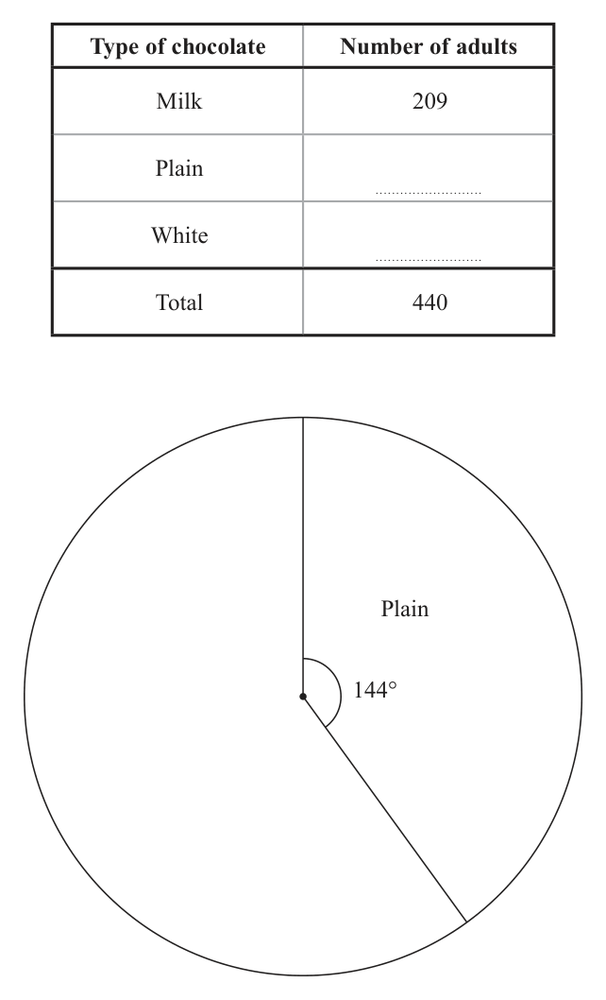
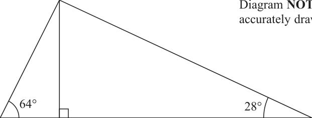
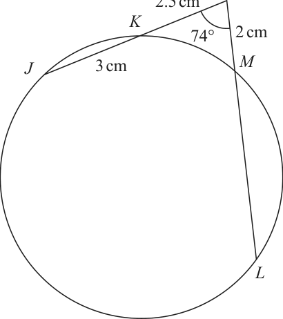
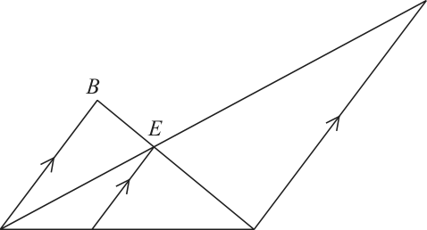
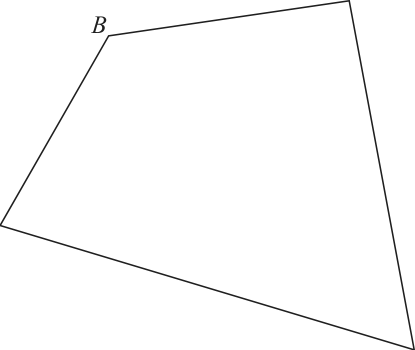
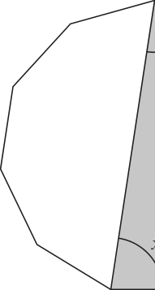
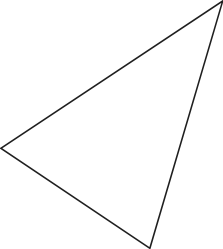

# 4MB1/01R — 2020-11 (official extraction)

> schema `syllabai.official-paper-questions/0.2` · paper_id `pearson-edexcel:international-gcse:mathematics-b:4mb1:2020-11:4MB1/01R` · qp sha256 `241f0c80702869d8…` · extraction is the disclosed baseline (ADR-039)

## Question 1 (2 marks)

Ali, Beth and Chari pay rent on a piece of woodland. The annual rent that they pay is such that the amount Ali pays : the amount Beth pays : the amount Chari pays = 13 : 8 : 11 The amount that Chari pays = $2563 Calculate how much more rent Ali pays than Beth pays. $ . . . . . . . . . . . . . . . . . . . . . . . . . . . . . . . . . . . . . . . . . . . . . . . . . . .. . .

### 1 [2]

Ali, Beth and Chari pay rent on a piece of woodland. The annual rent that they pay is such that the amount Ali pays : the amount Beth pays : the amount Chari pays = 13 : 8 : 11 The amount that Chari pays = \$2563 Calculate how much more rent Ali pays than Beth pays. \$

**Mark scheme answer**

> 2563 2563 2563 M1
> ×13 and × 8 or ×5
> 11 11
> 1165 A1
> Total 2 marks

- **(2)** 2563 2563 2563 M1

## Question 2 (2 marks)

Simplify fully 8 x + 12

### 2 [2]

Simplify fully 8 x + 12

**Mark scheme answer**

> 2
> 8(2 x + 3) 2(2 x + 3) 2 M1 Factorising the denominator or dividing by 4 or cancelling a
> or or 8(2 x + 3) bracket. Implied by a correct answer
> 4(2 x + 3) (2 x + 3)
> 4x + 6 A1 or equivalent, for example 2(2x + 3)
> Total 2 marks

- **(2)** 2

## Question 3 (3 marks)

Without using a calculator and showing all your working, evaluate 1 3 5 ÷2 3 5 Give your answer as a mixed number in its simplest form.

### 3 [3]

Without using a calculator and showing all your working, evaluate 1 3 5 ÷2 3 5 Give your answer as a mixed number in its simplest form.

**Mark scheme answer**

> 16
> or 16 and 5 oe
> M1
> and
> 16 5 80 M1 16
> × = or e.g. 80 ÷ 39 = 80 Must multiply both correctly. Or for × ... = ... , ... × = ...
> 16 13 80 16 5
> Allow ÷ = Note that × =2 is M1M1A0
> 2 A1 Must be given as a mixed number
> Total 3 marks

- **(3)** 16

## Question 4 (3 marks)

Ashley takes 3 hours and 36 minutes to walk around a lake. The distance she walks is 11 520 m. Calculate Ashley’s average speed. Give your answer in kilometres per hour. . . . . . . . . . . . . . . . . . . . . . . . . . . . . . . . . . . . . . . . . . . . . . . . . . . .. . . kilometres per hour

### 4 [3]

Ashley takes 3 hours and 36 minutes to walk around a lake. The distance she walks is 11 520 m. Calculate Ashley’s average speed. Give your answer in kilometres per hour kilometres per hour

**Mark scheme answer**

> 36
> or 3.6 or 3 36
> M1
> 60
> or 3 × 60 + 36 [=216]
> 11.52
> or 11.52 × 60
> M1 For using distance ÷ time. Allow 11520 instead of 11.52, e.g.
> "3.6" "216" 11520
> ÷ 1000
> "3.6"
> 3.2 A1
> Total 3 marks

- **(3)** 36

## Question 5 (3 marks)

Liam started a new job on a salary of $45 500 At the end of 1 year he is given a pay increase of 5.5% At the end of each subsequent year he is given a pay increase of 1.25% Calculate, to the nearest $, Liam’s salary at the end of 3 years after he started the job. $ . . . . . . . . . . . . . . . . . . . . . . . . . . . . . . . . . . . . . . . . . . . . . . . . . . .. . .

### 5 [3]

Liam started a new job on a salary of \$45 500 At the end of 1 year he is given a pay increase of 5.5% At the end of each subsequent year he is given a pay increase of 1.25% Calculate, to the nearest \$, Liam’s salary at the end of 3 years after he started the job. \$

**Mark scheme answer**

> 45500 ×1.055[ = 48002.5] M1
> "48002.5"×1.01252 M1 M2 only if after 49210 working out a third year e.g. 49825.1…
> 49 210 A1 Awrt (For reference: 49210.06289…)
> Total 3 marks

- **(3)** 45500 ×1.055[ = 48002.5] M1

## Question 6 (3 marks)

The straight line L has equation 2y – 5 = 3x

### 6(a) [2]

Find the gradient of L

**Mark scheme answer**

> 3x + 5 M1 Attempt to re-arrange to make y the subject – allow sign errors
> y=
> 2 only
> 3 A1
> Or equivalent (e.g. 1.5) – M1A0 for 3 x
> 2
> Condone for full marks those that have the correct gradient but
> ⎛ 3x − 5 3⎞
> incorrect constant term ⎜ e.g. y = ⇒m= 2 2⎠

- **(2)** 3x + 5 M1 Attempt to re-arrange to make y the subject – allow sign errors

### 6(b) [1]

Find the coordinates of the point where L meets the y-axis. ( …………… , …………… )

**Mark scheme answer**

> ⎛ 5⎞ B1
> ⎜ 0, 2⎠

- **(1)** ⎛ 5⎞ B1

## Question 7 (3 marks)

Arthur has 10 cards. Each card has a letter on it and the letters spell the word PICCADILLY P I C C A D I L L Y Arthur selects at random 3 of these cards. Calculate the probability that he selects P A L in that order.

### 7 [3]

Arthur has 10 cards. Each card has a letter on it and the letters spell the word PICCADILLY P I C C A D I L L Y Arthur selects at random 3 of these cards. Calculate the probability that he selects P A L in that order.

**Mark scheme answer**

> 1 1 2 M1 Condone if other terms seen (e.g. from considering other
> × ×
> 10 a b possible orders of the letters P, A and L) but not if divided by 6
> where a = 9 or 10 and b = 8 or 10
> 1 1 2 A1 Only (so no other terms seen)
> × ×10⁹ 8
> 1 A1 Accept awrt 0.00278
> 360

- **(3)** 1 1 2 M1 Condone if other terms seen (e.g. from considering other

## Question 8 (3 marks)

Without using a calculator and showing all your working, solve the inequality 6x2 – x – 12 > 0

### 8 [3]

Without using a calculator and showing all your working, solve the inequality 6x2 – x – 12 > 0

**Mark scheme answer**

> 3x 4 2 x 3 ( 0) M1 For solving given quadratic. When factorising must give at
> least 2 correct terms when multiplied out
> 4 3 M1 Selecting outside regions for their critical values. Condone
> x " ", x " "
> 3 2 non-strict inequalities or ‘incorrect’ notation
> 4
> (e.g. x )
> 3
> 4 3 A1 4
> x ,x Must be 2 separate inequalities. Do not accept x but
> 3 2 3
> condone ‘and’ separating the 2 inequalities. Mark final answer.
> Total 3 marks

- **(3)** 3x 4 2 x 3 ( 0) M1 For solving given quadratic. When factorising must give at

## Question 9 (3 marks)

The function f is defined by 3x f :xα x ≠ −2 2( x + 2) Express the inverse function f –1 in the form f –1 : x ↦ ... f –1 : x ↦ . . . . . . . . . . . . . . . . . . . . .. . . . . . . . . . . . . . . . . . . . . . . . . . . . .. . . .

### 9 [3]

The function f is defined by 3x f :xα x ≠ −2 2( x + 2) Express the inverse function f –1 in the form f –1 : x ↦ ... f –1 : x ↦

**Mark scheme answer**

> 3x M1
> y and an attempt to clear
> 2 x 2
> the fraction 2 y x 2 3x
> x 2y 3 4y M1 Expand, rearranging and factorise out x (allow sign errors only)
> 4x A1
> 2x 3
> or 4 x
> 3 2x
> Total 3 marks

- **(3)** 3x M1

## Question 10 (3 marks)

Without using a calculator and showing all your working, express 2+ 8 in the form a + b where a and b are integers.

### 10 [3]

Without using a calculator and showing all your working, express 2+ 8 in the form a + b where a and b are integers.

**Mark scheme answer**

> 6− 8 2− 8 3 − 2 1− 2 M1 6 − 8 −2 + 8
> × or × Or equivalent, for example, ×
> 2+ 8 2− 8 1+ 2 1− 2 2 + 8 −2 + 8
> 20 − 8 8 M1dep For multiplying out correctly and simplifying
> or −5 + 2 8 or −5 + 4 2
> −4
> −5 + 32 A1 If −5 + 4 2 with no working, then no marks
> If −5 + 32 seen, then SC B1 only
> Total 3 marks

- **(3)** 6− 8 2− 8 3 − 2 1− 2 M1 6 − 8 −2 + 8

## Question 11 (3 marks)

Given that –3x2 + 6x + 2 can be written in the form a(x + b)2 + c where a, b and c are integers, find the value of a, the value of b and the value of c. a = . . . . . . . . . . . . . . . . . . . . .. . . . . . . . . . . . . . . . . . . . . . . . . . . . . .. . . b = . . . . . . . . . . . . . . . . . . . . . . . . . . . . . . . . . . . . . . . . . . . . . . . . . . .. . . c = . . . . . . . . . . . . . . . . . . . . .. . . . . . . . . . . . . . . . . . . . . . . . . . . . . .. . .

### 11 [3]

Given that –3x2 + 6x + 2 can be written in the form a(x + b)² + c where a, b and c are integers, find the value of a, the value of b and the value of c. a = b = c =

**Mark scheme answer**

> −3( x − ...) 2 − ... M1 Or a = −3
> −3 ( x − 1) − ...
> 2 M1 Or b = −1
> a = −3 A1
> Allow −3 ( x − 1) + 5. For those that consider 3x2 − 6 x − 2 and
> b = −1
> conclude 3 ( x − 1) − 5 then M0M1A0 but allow full marks if
> c=5
> then followed by correct answer
> Total 3 marks

- **(3)** −3( x − ...) 2 − ... M1 Or a = −3

## Question 12 (4 marks)

The incomplete table and pie chart below show information about the favourite type of chocolate of 440 adults. Type of chocolate Number of adults Milk 209 Plain White Total 440 Plain 144° Complete the table and the pie chart.

### 12 [4]

The incomplete table and pie chart below show information about the favourite type of chocolate of 440 adults. Type of chocolate Number of adults Milk 209 Plain White Total 440 Plain 144° Complete the table and the pie chart.

**Mark scheme answer**

> n 144 M1 Or equivalent
> =
> 440 360
> 176, 55 A1
> 209 M1 Implied by 45 or 171
> × 360[= 171]
> 440
> or 55 × 360[= 45] oe
> 440
> Milk 171 or A1 Drawn accurately ± 1° at least 1 labelled correctly (angle and
> White 45 type)
> Total 4 marks

- **(4)** n 144 M1 Or equivalent

## Question 13 (4 marks)

Here is information about the age, in years, of each of Jelina’s five children when written in order. b a b +a 2b + a + 3 2b + a + 5 It is given that a is the age of the youngest child a≠b two of the children have the same age the mean age of the five children is 10.6 years Calculate the value of a and the value of b Show clear algebraic working. a = . . . . . . . . . . . . . . . . . . . . .. . . . . . . . . . . . . . . . . . . . . . . . . . . . . .. . . b = . . . . . . . . . . . . . . . . . . . . . . . . . . . . . . . . . . . . . . . . . . . . . . . . . . .. . .

### 13 [4]

Here is information about the age, in years, of each of Jelina’s five children when written in order. b a b +a 2b + a + 3 2b + a + 5 It is given that a is the age of the youngest child a≠b two of the children have the same age the mean age of the five children is 10.6 years Calculate the value of a and the value of b Show clear algebraic working. a = b =

**Mark scheme answer**

> b M1
> b = + a or = a oe
> 2
> 4a + 5.5b + 8 M1 Forming an equation in a and b using the mean e.g.
> = 10.6 oe
> 5 a + b + 12 b + a + 2b + a + 3 + 2b + a + 5 = 10.6
> 7.5b = 45 or 15a = 45 M1dep Forming an equation in a or b only – dependent on both
> previous M marks
> a = 3, b = 6 A1 Correct answers from two correct equations with no working to
> solve these two equations scores 3 marks.
> SC B1 both correct answers with no working
> Total 4 marks

- **(4)** b M1

## Question 14 (4 marks)

B Diagram NOT accurately drawn 64° 28° A D C 2 cm The diagram shows a triangle ABC. The point D lies on AC so that BD is perpendicular to AC. ÐBAD = 64° ÐACB = 28° AD = 2 cm Calculate the length, in cm to one decimal place, of BC. . . . . . . . . . . . . . . . . . . . . . . . . . . . . . . . . . . . . . . . . . . . . . . . . . . .. . . cm

### 14 [4]

The diagram shows a triangle ABC. The point D lies on AC so that BD is perpendicular to AC. ∠BAD = 64° ∠ACB = 28° AD = 2 cm Calculate the length, in cm to one decimal place, of BC cm

> *Figure not shown in this reconstruction — the printed paper includes a diagram (not drawn accurately).*
> Labels in the original figure: B, A, D, C · Figure values: 64°, 28°, 2.

**Mark scheme answer**

> BD = 2tan64 [4.10…] M1 Accept any equivalent form (so BD does not need to be the
> 2 BD
> subject) e.g. BD = or =
> tan 26 sin 64 sin 26
> BD M1 This mark can be implied by a correct expression for BC
> sin 28 =
> BC BC BD
> Or equivalent e.g. =
> sin 90 sin 28
> "2 tan 64" M1dep Dependent on both previous M marks
> BC =
> "sin 28"
> BC = 8.7 A1 Accept AWRT to 8.7 (for reference: 8.7345177…)
> Total 4 marks

- **(4)** BD = 2tan64 [4.10…] M1 Accept any equivalent form (so BD does not need to be the

## Question 15 (4 marks)
### 15(a) [2]

A=⎜ B=⎜ 2 − 4 2 2 −2 Calculate 3A – 2B 5 −3⎞ ⎛ 0 1⎞

**Mark scheme answer**

> ⎛ 9 −3 ⎞ ⎛ 4 −1 ⎞ M1 Correct implied subtraction or three correct numbers in the
>  − - final answer in correct places.
> ⎝ −12 6 ⎠ ⎝ 4 −4 ⎠
> ⎛ 5 −2 ⎞ A1
>  −16 10 

- **(2)** ⎛ 9 −3 ⎞ ⎛ 4 −1 ⎞ M1 Correct implied subtraction or three correct numbers in the

### 15(b) [2]

P= QP −1 = −3 2 −10 −17 Find the matrix Q 

**Mark scheme answer**

> ⎛ 0 1 ⎞⎛ 5 −3 ⎞ M1 Or general Q and P inverse to form simultaneous equations,
> Q= a b ⎞ ⎛ a b ⎞⎛ 2 3 ⎞ ⎛ 0 1 ⎞
> ⎝ −10 −17 ⎠⎝ −3 2 ⎠ e.g. Q = ⇒ = c d ⎠ ⎝ c d ⎠⎝ 3 5 ⎠ ⎝ −10 −17 ⎠
> ⇒ 2a + 3b = 0, 3a + 5b = 1, 2c + 3d = −10, 3c + 5d = −17
> (must have correct inverse for this alternative method)
> ⎛ −3 2 ⎞ A1
>  1 −4 

- **(2)** ⎛ 0 1 ⎞⎛ 5 −3 ⎞ M1 Or general Q and P inverse to form simultaneous equations,

## Question 16 (4 marks)

P 2.5 cm K Diagram NOT 74° 2 cm accurately drawn J 3 cm M L The diagram shows a circle JKML. JKP and LMP are straight lines. JK = 3 cm, KP = 2.5 cm and PM = 2 cm. ÐJPL = 74° Calculate the area, in cm2 to 2 decimal places, of triangle LKP. . . . . . . . . . . . . . . . . . . . . . . . . . . . . . . . . . . . . . . . . . . . . . . . . . . .. . . cm2

### 16 [4]

The diagram shows a circle JKML. JKP and LMP are straight lines. JK = 3 cm, KP = 2.5 cm and PM = 2 cm. ∠JPL = 74° Calculate the area, in cm² to 2 decimal places, of triangle LKP cm²

> *Figure not shown in this reconstruction — the printed paper includes a diagram (not drawn accurately).*
> Labels in the original figure: P, K, J, M, L · Figure values: 2.5, 74°, 2, 3.

**Mark scheme answer**

> PK.PJ = PM.PL or 5.5 × 2.5 = 2 × PL M1
> 5.5 × 2.5 A1
> PL = 6.875 or
> Area = 1 × "6.875"× 2.5 × sin 74
> M1 Correct use of 0.5absinC for their PL
> 2 M0 if angle LKP assumed to be right-angled
> 8.26 A1 Accept AWRT to 8.26 (For reference: 8.260842…)
> Total 4 marks

- **(4)** PK.PJ = PM.PL or 5.5 × 2.5 = 2 × PL M1

## Question 17 (4 marks)
### 17(a) [1]

Write 0.0234 in standard form.

**Mark scheme answer**

> 2.34×10⁻² B1

- **(1)** 2.34×10⁻² B1

### 17(b) [1]

Write 2.40 × 10⁵ as an ordinary number.

**Mark scheme answer**

> 240 000 B1

- **(1)** 240 000 B1

### 17(c) [2]

Calculate, giving your answer in standard form

(2.5 × 10¹⁰¹) ÷ (5 × 10⁻⁹⁸)

Show your working clearly.

**Mark scheme answer**

> (2.5 × 10¹⁰¹) ÷ (5 × 10⁻⁹⁸) = 0.5 × 10¹⁰¹⁻⁽⁻⁹⁸⁾ = 0.5 × 10¹⁹⁹ = **5 × 10¹⁹⁸**
> 0.5×10¹⁹⁹ or 5×10ⁿ n = 198 or 200 M1
> 5×10¹⁹⁸ A1

- **(1)** (2.5 × 10¹⁰¹) ÷ (5 × 10⁻⁹⁸) = 0.5 × 10¹⁰¹⁻⁽⁻⁹⁸⁾ = 0.5 × 10¹⁹⁹ = **5 × 10¹⁹⁸**
- **(1)** 5 × 10¹⁹⁸

## Question 18 (4 marks)
### 18(a) [2]

Simplify 3w7y–3 × 4w2y3 4 2

**Mark scheme answer**

> 9
> 12w y 0 M1 Two of the three parts correct
> 12w9 A1

- **(2)** 9

### 18(b) [2]

Simplify (25x )

**Mark scheme answer**

> 125 or x 6 M1
> 125 x 6 A1
> Total 4 marks

- **(2)** 125 or x 6 M1

## Question 19 (5 marks)

D Diagram NOT accurately drawn B E A F C The diagram shows triangle ABC and triangle ADC. E is the point on BC and AD. F is the point on AC such that AB, FE and CD are parallel. Given that AB = 3 cm and that CD = 7 cm, calculate the length of FE. . . . . . . . . . . . . . . . . . . . . . . . . . . . . . . . . . . . . . . . . . . . . . . . . . . .. . . cm

### 19 [5]

The diagram shows triangle ABC and triangle ADC. E is the point on BC and AD. F is the point on AC such that AB, FE and CD are parallel. Given that AB = 3 cm and that CD = 7 cm, calculate the length of FE cm

> *Figure not shown in this reconstruction — the printed paper includes a diagram (not drawn accurately).*
> Labels in the original figure: D, B, E, A, F, C.

**Mark scheme answer**

> FE FC
> , FE = AF
> M1
> = M1
> 3 AC 7 AC
> FC = AF
> 7 ⎡ 10 ⎤ M1 Using AC = AF + FC
> AC = AF + " AF " ⎢ = AF ⎥
> 3 ⎣ 3 ⎦
> 7 AF M1
> FE = 3 × 3
> 10 AF
> 2.1 A1 Or equivalent
> ALT FE FC
> , FE = AF M1
> =
> 3 AC 7 AC M1
> FE AC AF AF M1 Using AC = AF + FC
> 3 AC AC
> FE AC FC FC
> or
> 7 AC AC
> FE FE M1
> 1 or FE
> FE
> 3 7 7
> 1
> or FE
> 3
> 2.1 A1

- **(5)** FE FC

## Question 20 (5 marks)

C B A D The diagram shows quadrilateral ABCD. The region R consists of all the points inside the quadrilateral that are

### 20 [5]

The diagram shows quadrilateral ABCD. The region R consists of all the points inside the quadrilateral that are

B A D The diagram shows quadrilateral ABCD. The region R consists of all the points inside the quadrilateral that are (i) closer to DA than to DC, (ii) less than 3 cm from the side DC, (iii) more than 4 cm from B. Using ruler and compasses only and showing all your construction lines, construct and show, by shading, the region R. Label the region R.

> *Figure not shown in this reconstruction — the printed paper includes a diagram.*
> Labels in the original figure: C, B, A, D.

**Mark scheme answer**

> M1 For either an arc of a circle with centre B, or the angle
> bisector of D or a line parallel to CD (some part of these
> constructions must be ‘inside’ the given bounds of the overlay)
> For the following three A marks the lines/arc must be of
> sufficient length to define the correct region
> A1 for circle centre B, A1 for the angle bisector of D and A1
> for the line parallel to CD
> A1 All construction lines correct and region correctly labelled
> (construction arcs for angle bisector of D must be evident)
> Total 5 marks

- **(5)** M1 For either an arc of a circle with centre B, or the angle

## Question 21 (5 marks)

G Diagram NOT F accurately drawn x° E D x° C A B The diagram shows a shaded 7-sided shape ABCDEFG. The points A, B, C, D, E, F and G are 7 vertices of a regular polygon with 11 sides. ÐGAB = ÐAGF = x° Calculate the value, to 3 significant figures, of x. Show your working clearly. x = . . . . . . . . . . . . . . . . . . . . .. . . . . . . . . . . . . . . . . . . . . . . . . . . . . .. . .

### 21 [5]

x° E D x° C A B The diagram shows a shaded 7-sided shape ABCDEFG. The points A, B, C, D, E, F and G are 7 vertices of a regular polygon with 11 sides. ∠GAB = ∠AGF = x° Calculate the value, to 3 significant figures, of x. Show your working clearly. x =

> *Figure not shown in this reconstruction — the printed paper includes a diagram (not drawn accurately).*
> Labels in the original figure: G, F.

**Mark scheme answer**

> 360 9 ×180 M1
> 180 − [ = 147.27...] or
> 11
> 5 ×180 [ = 900] M1 Could be seen in working
> "900"− 5 × "147.2..."= 163.6... or 1800 M1dep Oe e.g. 2 x + 5 ×147.2 = 900 - this mark is dependent on both
> 11 
> previous M marks
> 163.6 M1dep Dependent on all previous M marks
> x=
> 81.8 A1 ⎛ 900 ⎞
> Accept exact or awrt to 81.8 (81.81818…)
> ⎝ 11 ⎠
> ⎛ 360 ⎞ 1
> 180 − ×
> ⎝ 11 ⎠ 2
> Oe e.g.

- **(5)** 360 9 ×180 M1

## Question 22 (5 marks)

A B 4 cm 4 cm 76° Diagram NOT accurately drawn O C The diagram shows a sector OACB of a circle, centre O. OA = OB = 4 cm Angle AOB = 76°

### 22(a) [2]

A B 4 cm 4 cm 76° Diagram NOT accurately drawn O C The diagram shows a sector OACB of a circle, centre O. OA = OB = 4 cm Angle AOB = 76°

Calculate the area, in cm² to 3 significant figures, of the shaded sector OACB

…………… cm²

**Mark scheme answer**

> (360 − 76) M1
> × π ×16 or
> 360
> 16π − × π ×16
> 360
> 39.7 A1 568
> Awrt to 39.7 or 39.6 (For reference: 39.65388… or π)

- **(2)** (360 − 76) M1

### 22(b) [3]

Calculate the perimeter, in cm to 3 significant figures, of the shaded sector OACB cm

**Mark scheme answer**

> 360 − 76 M1
> × 2 × π × 4 [ = 19.8…] Or equivalent, e.g. 2π ( 4 ) − × 2π ( 4 ) (For reference if
> 360 360
> 284
> correct: 19.82694… or π )
> 19.8… + 4 + 4 M1dep
> 27.8 A1 Awrt to 27.8 (For reference: 27.826940…)
> Total 5 marks

- **(3)** 360 − 76 M1

## Question 23 (5 marks)

y is directly proportional to x3 x is inversely proportional to the square root of w. y = 729 when x = 4.5 x = 25 when w = 0.16 Find a formula for y in terms of w.

### 23 [5]

y is directly proportional to x³ x is inversely proportional to the square root of w. y = 729 when x = 4.5 x = 25 when w = 0.16 Find a formula for y in terms of w.

**Mark scheme answer**

> y = k1 x³ M1
> k2 M1 Condone if the same letter is used for the two constants of
> x= proportionality
> w
> k2 M1dep Dependent on one of the previous M marks – both equations
> 729 = k1 × 4.53 or 25 = imply the previous two marks
> 0.16
> 10 A1 Or equivalent
> y = 8 x 3 and x =
> w
> 3 A1
> y = 8000w
> −
> 2 ⎛ 10 ⎞
> Or equivalent e.g. y = 8 ⎜ 1 2 w ⎠

- **(5)** y = k1 x3 M1

## Question 24 (5 marks)

(2x + 1), (10x – 10) and (35x – 5) are the first three terms of a sequence. The first term of the sequence is (2x + 1) where (2x + 1) ≠ 0 After the first term, all other terms of the sequence are found by using the rule ‘multiply the previous term by d’ Given that x is an integer, find the value of d. d = . . . . . . . . . . . . . . . . . . . . .. . . . . . . . . . . . . . . . . . . . . . . . . . . . . .. . .

### 24 [5]

(2x + 1), (10x – 10) and (35x – 5) are the first three terms of a sequence. The first term of the sequence is (2x + 1) where (2x + 1) ≠ 0 After the first term, all other terms of the sequence are found by using the rule ‘multiply the previous term by d’ Given that x is an integer, find the value of d. d =

**Mark scheme answer**

> 10 x − 10 35 x − 5
> or
> M1 Forming a correct equation any form
> =
> 2x +1 10 x − 10
> 10 x − 10 7 x − 1
> =
> 2x +1 2x − 2
> 100 x 2 − 200 x + 100 = 70 x 2 + 25 x − 5 M1dep Removing the fractions and one side multiplied out correctly
> or 20 x² − 40 x + 20 = 14 x 2 + 5x − 1
> 30 x 2 − 225 x + 105 = 0 or A1 A correct three term quadratic in x (any equivalent form) = 0
> 6 x 2 − 45x + 21 = 0 or 2 x 2 − 15x + 7 = 0
> = ( 2 x − 1)( x − 7 ) M1 Correct method for solving their three-term quadratic in x,
> implied by x = 1 or 7
> Dependent on both previous M marks
> 4 A1 Only (A0 if given as the answer −2.5 too)

- **(5)** 10 x − 10 35 x − 5

## Question 25 (5 marks)

C Diagram NOT accurately drawn A B ABC is a triangle. → ⎛ 3⎞ → ⎛ x⎞ → AB = ⎜ ⎟ BC = ⎜ ⎟ where x > 0 and |AC| = 5 ⎝ −2⎠ ⎝ 5 x⎠ → Find AC as a column vector. Show clear algebraic working. ⎛ ⎞ ⎜ ⎟ ⎜ ⎟ ⎜ ⎟ ⎜⎝ ⎟⎠

### 25 [5]

ABC is a triangle. → ⎛ 3⎞ → ⎛ x⎞ → AB = BC = where x > 0 and |AC| = 5 ⎝ −2⎠ ⎝ 5 x⎠ → Find AC as a column vector. Show clear algebraic working.

> *Figure not shown in this reconstruction — the printed paper includes a diagram (not drawn accurately).*
> Labels in the original figure: C, A, B.

**Mark scheme answer**

> ⎛ 3+ x ⎞ B1
> AC = −2 + 5 x 
> M1 Correct method for finding the modulus of AC (must contain
> ( 3 + x ) + ( −2 + 5 x ) = 25
> 2
> ⎛ 3x ⎞
> x) and = 5 to form an equation – not from AC = −7 x 
> 13x 2 − 7 x − 6 = 0 M1dep For correct method for multiplying out the brackets and
> simplifying to make a quadratic equation = 0
> ( x −1)(13x + 6) = 0 M1 Correct method for solving 3-term quadratic and substituting
> their positive value of x into AC
> ⎛ 3 + '1' ⎞
> ⇒ AC = −2 + 5('1') 
> ⎛ 4⎞ A1 Answer with no working gains no marks
> AC = 3

- **(5)** ⎛ 3+ x ⎞ B1

## Question 26 (6 marks)

A small ball is thrown into the air from a point that is 1 m above horizontal ground. The ball moves vertically upwards so that at time t seconds after the ball was thrown, the height, h metres, of the ball above the ground is given by h = 1 + kt – 5t2 where k is a constant. At time t seconds after the ball was thrown, the velocity of the ball is v m/s.

### 26(a) [1]

A small ball is thrown into the air from a point that is 1 m above horizontal ground. The ball moves vertically upwards so that at time t seconds after the ball was thrown, the height, h metres, of the ball above the ground is given by h = 1 + kt – 5t2 where k is a constant. At time t seconds after the ball was thrown, the velocity of the ball is v m/s.

Find an expression for v in terms of k and t. Given that the total distance travelled by the ball between the instant when the ball is thrown and when it hits the ground for the first time is 161 m …………… , ……………

**Mark scheme answer**

> v = k − 10t B1 Allow mark if seen in part (b) – give bod if just right-hand side
> stated

- **(1)** v = k − 10t B1 Allow mark if seen in part (b) – give bod if just right-hand side

### 26(b) [5]

calculate the value of k. k =

**Mark scheme answer**

> " k − 10t " = 0 leading to M1 Calculating the time from projection to maximum height (or
> equivalent) from their (a)
> t = “ k ” or k = ‘10t’’
> Maximum height reached by the ball is B1 Correctly deriving the maximum height reached by the ball
> (h − 1) + h = 161 ⇒ h = 81 (possibly implied in later working)
> k 2 5k 2 M1 Eliminating either k or t using their k =10t to obtain an
> f (k ) = 1+ − or expression in a single variable only (bod if the +1 is absent)
> 10 100
> f ( t ) = 1 + 10t 2 − 5t 2
> k 2 5k 2 M1dep Setting up a correct equation in terms of k or t only with their k
> 81 = 1 + − or 81 = 1 + 10t 2 − 5t 2 = 10t (dependent on both previous M marks and B mark)
> 10 100
> 40 A1 A0 if final answer is ±40
> ⎛k ⎞ ⎛ k ⎞
> Note that 1 + k − 5 equal to either 161, 160, 80.5 or
> ⎝ 10 ⎠ ⎝ 10 ⎠
> 80 (or equivalent) will score M1B0M1M0A0 or possibly
> M1B1M1M0A0 (if max. height found but subsequently not
> used)

- **(5)** " k − 10t " = 0 leading to M1 Calculating the time from projection to maximum height (or

