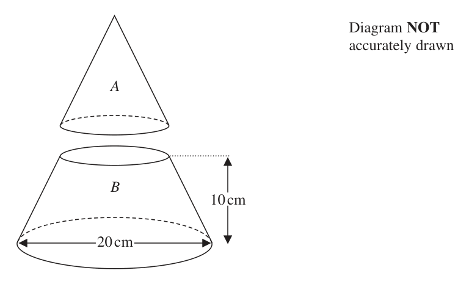
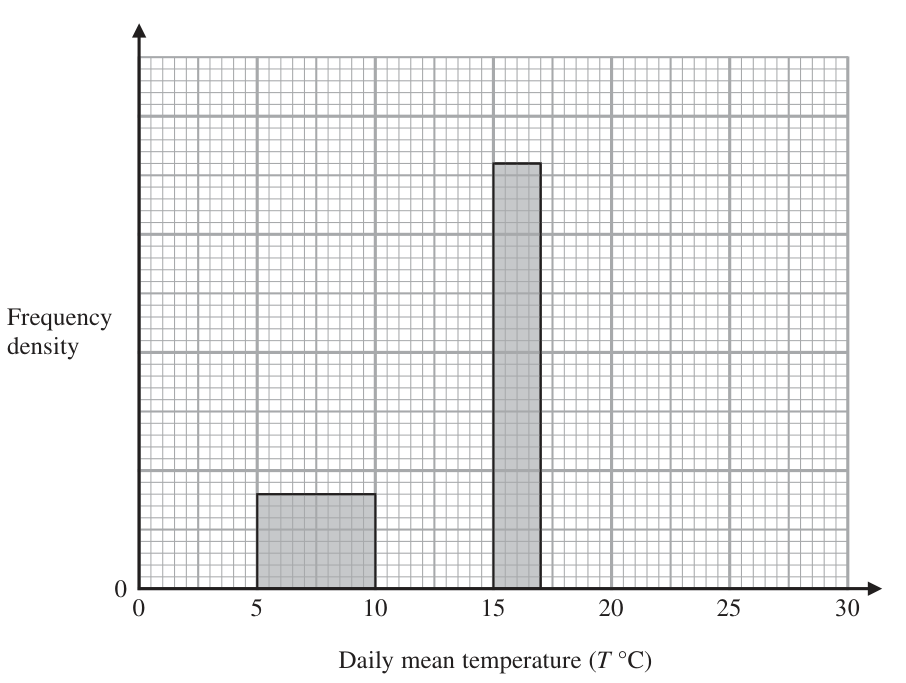

# 4MB1/01 — 2021-01 (official extraction)

> schema `syllabai.official-paper-questions/0.2` · paper_id `pearson-edexcel:international-gcse:mathematics-b:4mb1:2021-01:4MB1/01` · qp sha256 `2b3549c597d03af9…` · extraction is the disclosed baseline (ADR-039)

## Question 1 (2 marks)

Without using a calculator and showing all your working, work out 5 3 5 −3 8 4 Give your answer as a mixed number in its simplest form.

### 1 [2]

Without using a calculator and showing all your working, work out 5 3 5 −3 8 4 Give your answer as a mixed number in its simplest form.

**Mark scheme answer**

> 45 30 2 M1 – both terms with the same common
> − 45 15 15
> 8 8 denominator – allow − =
> 8 4 8
> 15 7 A1 must-see sufficient working and given as
> 1 a mixed number only (either their final
> 8
> answer in their working or on the answer
> line)
> Total 2 marks

- **(2)** 45 30 2 M1 – both terms with the same common

## Question 2 (2 marks)

Some students at a school are asked the following question “Did you walk to school today?” 52% of the students asked are in Year 7 and the rest of the students asked are in Year 8. 20% of the students asked are Year 8 students who walked to school. 42% of the students asked did not walk to school. Find as a percentage of all students asked, those who are in Year 7 and did not walk to school. .................................................................... %

### 2 [2]

Some students at a school are asked the following question “Did you walk to school today?” 52% of the students asked are in Year 7 and the rest of the students asked are in Year 8. 20% of the students asked are Year 8 students who walked to school. 42% of the students asked did not walk to school. Find as a percentage of all students asked, those who are in Year 7 and did not walk to school %

**Mark scheme answer**

> 100 – 52 – 20 (= 28) or 2 M1 allow (52 + 20 + 42) – 100
> 100 – 42 – 20 (= 38) oe correct method to either get the % of year
> 8 who did not walk or the % of year 7 who
> did, for example, in words would need to see
> ‘48% students are in year 8 and as 20%
> walked therefore 28% did not walk’
> 42 – (100 – 52 – 20) or 52 – (100 – 42 – 20) 14 A1
> Total 2 marks

- **(2)** 100 – 52 – 20 (= 28) or 2 M1 allow (52 + 20 + 42) – 100

## Question 3 (2 marks)

Each interior angle of a regular polygon is 176º Calculate the number of sides of the polygon.

### 3 [2]

Each interior angle of a regular polygon is 176º Calculate the number of sides of the polygon.

**Mark scheme answer**

> 360 2 M1
> or 180 ( n − 2 ) = 176n
> 180 − 176
> 90 A1
> Total 2 marks

- **(2)** 360 2 M1

## Question 4 (2 marks)

Q = 10 − At Work out the value of Q when A = −2 and t = 3 Q = ....................................................................

### 4 [2]

Q = 10 − At Work out the value of Q when A = −2 and t = 3 Q =

**Mark scheme answer**

> 10 – (–2 × 3) 2 M1
> 16 A1
> Total 2 marks
> Working Answer Mark Notes

- **(2)** 10 – (–2 × 3) 2 M1

## Question 5 (2 marks)

Given that ⎛ −4 x⎞ ⎛ 3 1⎞ ⎛ x 4⎞ ⎜⎝ y 1⎟⎠ + x ⎜⎝ 0 −1⎟⎠ = ⎜⎝ y −1⎟⎠ find the value of x. x = ....................................................................

### 5 [2]

Given that ⎛ −4 x⎞ ⎛ 3 1⎞ ⎛ x 4⎞ ⎜⎝ y 1⎟⎠ + x ⎜⎝ 0 −1⎟⎠ = ⎜⎝ y −1⎟⎠ find the value of x. x =

**Mark scheme answer**

> 1 − x = −1 or −4 + 3x = x or x + x = 4 2 M1 – setting up at least one linear equation
> in x with corresponding entries of the two
> matrices – allow 1 sign slip only
> 2 A1 – correct working only - so if seen must
> ⎛ −4 + 3x 2 x ⎞ ⎛ x 4 ⎞
> imply that ⎜ ⎟=⎜ ⎟ - any
> ⎝ y 1 − x ⎠ ⎝ y −1⎠
> incorrect entries even if answer correct
> scores M1 only
> Total 2 marks

- **(2)** 1 − x = −1 or −4 + 3x = x or x + x = 4 2 M1 – setting up at least one linear equation

## Question 6 (3 marks)

Here are four numbers written in order of size. 1.5 2 p 19.5 The mean of the four numbers is three times the median of the four numbers. Find the value of p. p = ....................................................................

### 6 [3]

Here are four numbers written in order of size. 1.5 2 p 19.5 The mean of the four numbers is three times the median of the four numbers. Find the value of p. p =

**Mark scheme answer**

> 2+p 1.5 + 2 + p + 19.5 3 M1 either mean or median stated correctly
> or
> 2
> 1.5 + 2 + p + 19.5 2+p M1dep setting up an equation in p using
> =3× both expressions for the median and mean
> 4
> (the 3 must be on the correct side of the
> equation)
> 2.2 A1
> Total 3 marks
> Question Working Answer Mark Notes

- **(3)** 2+p 1.5 + 2 + p + 19.5 3 M1 either mean or median stated correctly

## Question 7 (3 marks)

Here is hexagon ABCDEF. A 8 cm B Diagram NOT accurately drawn 9 cm 14 cm C 12 cm D F E All the corners of ABCDEF are right angles. AB = 8 cm AF = 14 cm BC = 9 cm CD = 12 cm Calculate the area, in cm2, of ABCDEF. .................................................................... cm2

### 7 [3]

Here is hexagon ABCDEF. A 8 cm B Diagram NOT accurately drawn 9 cm 14 cm C 12 cm D F E All the corners of ABCDEF are right angles. AB = 8 cm AF = 14 cm BC = 9 cm CD = 12 cm Calculate the area, in cm2, of ABCDEF cm2

> 🖼 crop required: diagram (qp.pdf p.None)

**Mark scheme answer**

> 14 × 20 or 12 × 5 or 20 × 5 3 M1 (possibly seen in working)
> 14 × 20 − 9 ×12 or 12 × 5 + 14 × 8 or M1dep – correct method for finding the
> 20 × 5 + 8 × 9 area of the hexagon
> 172 A1
> Total 3 marks

- **(3)** 14 × 20 or 12 × 5 or 20 × 5 3 M1 (possibly seen in working)

## Question 8 (3 marks)

Paul is carrying out an investigation into people’s wages in the United Kingdom. Paul asks two of his friends, Abdul and Sue, about the pay rise each received in the last year. Abdul says that he has had a 5% pay rise in the last year. Sue says that she has had a 7% pay rise in the last year. Paul says that, in the last year, Sue’s wages have risen by more than Abdul’s wages.

### 8(a) [1]

Explain why Paul might not be correct. Paul has also read an article about the National Minimum Wage in the United Kingdom. The article says that, from April 2017 to April 2018, the national minimum hourly wage increased by 4.4% to £7.83

**Mark scheme answer**

> If Abdul earned more 1 B1 Any correct explanation, for example,
> than Sue it is possible ‘Abdul has a bigger salary.’
> his wage increased by Or by giving an example using any values,
> more. however, ignore example if correct
> comment given first.
> Not sufficient just to say that ‘wages are
> unknown’

- **(1)** If Abdul earned more 1 B1 Any correct explanation, for example,

### 8(b) [2]

Find the value of the National Minimum Wage before this increase. £

**Mark scheme answer**

> £7.83 ÷ 1.044 2 M1
> £7.50 A1
> Total 3 marks
> Question Working Answer Mark Notes
> 3 M1 Complete correct method for CD or
> ( CD = ) 42 − 32 ( = 2.65)
> BC e.g. cos(CAD) = ⇒ CAD = 41.409...
> and CD = 4sin(41.409...) or
> BC 2 = 42 + 82 − 2(4)(8) cos(CAD)
> "2.65" M1 Correct method to find angle ABC (e.g.
> tan ABC =
> ( 7 ) (= 32) and
> 5 BC 2 = 52 +
> 82 + 32 − 42
> cos ( ABC ) = ) or e.g.
> 2(8) ( 32 )
> BC
> cos ( ABC ) =
> 27.9 A1 awrt 27.9 (For ref: 27.88556…)
> Total 3 marks
> 10 ( 2n + 1)( n + 1) or 2 ( n + 1) 3 M1 Factorise the numerator or
> denominator correctly
> 2n + 1 1 A1 Fully correct fully simplified
> or n + expression
> 2
> 2n + 1 is odd. A1 Fully correct reasoning e.g. 2n + 1 is
> Dividing by 2 means odd, (2n + 1) / 2 is not an integer (oe
> not an integer comment, for example, ‘gives a decimal’)
> or
> No marks if numerical examples
> considered only
> Question Working Answer Mark Notes
> n is an integer so n +
> is not
> Total 3 marks

- **(2)** £7.83 ÷ 1.044 2 M1

## Question 9 (3 marks)

C Diagram NOT accurately drawn 4 cm A 3 cm D 5 cm B The diagram shows triangle ABC. The point D lies on AB such that ∠ADC = 90° AC = 4 cm AD = 3 cm BD = 5 cm Calculate the size, in degrees to one decimal place, of ∠ABC. °

### 9 [3]

C Diagram NOT accurately drawn 4 cm A 3 cm D 5 cm B The diagram shows triangle ABC. The point D lies on AB such that ∠ADC = 90° AC = 4 cm AD = 3 cm BD = 5 cm Calculate the size, in degrees to one decimal place, of ∠ABC. °

> 🖼 crop required: diagram (qp.pdf p.None)

## Question 10 (3 marks)

The nth term of a sequence is an where an = 2n + 2 By simplifying the expression for an or otherwise, explain why no term in the sequence is an integer. Show algebraic working and clearly explain your reasoning.

### 10 [3]

The nth term of a sequence is an where an = 2n + 2 By simplifying the expression for an or otherwise, explain why no term in the sequence is an integer. Show algebraic working and clearly explain your reasoning.

## Question 11 (3 marks)
### 11(a) [1]

Factorise x2 − 1 p and q are integers greater than 260 000 and p < q

**Mark scheme answer**

> ( x + 1)( x −1) 1 B1

- **(1)** ( x + 1)( x −1) 1 B1

### 11(b) [2]

Find the value of p and the value of q such that pq = 236 − 1 p = q =

**Mark scheme answer**

> ( 2 + 1)( 2 − 1) p = 218 – 1 or q = 218 + 1
> 18 18 2 M1 ft (a) substituting 218 as x in either
> factor or one value correctly stated, or p
> and q correctly stated the wrong way round
> p = 262 143 A1 (allow in terms of powers of 2)
> q = 262 145
> Total 3 marks

- **(2)** ( 2 + 1)( 2 − 1) p = 218 – 1 or q = 218 + 1

## Question 12 (3 marks)

The density, d grams/cm3, of an object of mass m grams and volume V cm3 is given by the formula m d = V m = 2800 to the nearest 10 V = 1600 to 3 significant figures. Calculate the lower bound, to 3 significant figures, of d. Show your working clearly.

### 12 [3]

The density, d grams/cm3, of an object of mass m grams and volume V cm3 is given by the formula m d = V m = 2800 to the nearest 10 V = 1600 to 3 significant figures. Calculate the lower bound, to 3 significant figures, of d. Show your working clearly.

**Mark scheme answer**

> 2795, 2805, 1595 or 1605 3 M1 at least 1 of the listed values seen
> 2795 M1 must be 2795 ≤ LB < 2800 and
> 1605 1600 < UB ≤ 1605
> 1.74 A1 must-see correct calculation.
> awrt 1.74 (1.74143302…) but not left as an
> exact value
> Total 3 marks

- **(3)** 2795, 2805, 1595 or 1605 3 M1 at least 1 of the listed values seen

## Question 13 (3 marks)

Without using your calculator and showing all your working, express 13 + 11 13 − 11 in the form a + b where a and b are integers.

### 13 [3]

Without using your calculator and showing all your working, express 13 + 11 13 − 11 in the form a + b where a and b are integers.

**Mark scheme answer**

> 13 + 11 13 + 11 3 M1 multiplying numerator and
> × denominator by 13 + 11
> condone a maximum of one error –
> ( 13 + 11 ) = 24 + 2 143
> condone
> ( 13 ) − ( 11 )
> 2
> Question Working Answer Mark Notes
> 24 + 2 143 12 + 143 A1 cao sufficient working must be seen.
> Correct answer with no working scores no
> marks
> Total 3 marks

- **(3)** 13 + 11 13 + 11 3 M1 multiplying numerator and

## Question 14 (3 marks)

Jill travels to work either by car or by train. Each day that Jill travels to work, the probability that she travels to work by train is 0.1 On a day that Jill travels to work by train, the probability that she will be late for work is 0.05 On a day that Jill travels to work by car, the probability that she will be late for work is 0.01 On a randomly chosen day that Jill travels to work, she is late for work. Find the probability that Jill travelled to work by train on that day.

### 14 [3]

Jill travels to work either by car or by train. Each day that Jill travels to work, the probability that she travels to work by train is 0.1 On a day that Jill travels to work by train, the probability that she will be late for work is 0.05 On a day that Jill travels to work by car, the probability that she will be late for work is 0.01 On a randomly chosen day that Jill travels to work, she is late for work. Find the probability that Jill travelled to work by train on that day.

**Mark scheme answer**

> 0.1× 0.05(= 0.005) 3 M1
> "0.005"+ 0.9 × 0.01(= 0.014) M1
> "0.005" 5 A1 allow awrt 0.357
> "0.014"
> Total 3 marks

- **(3)** 0.1× 0.05(= 0.005) 3 M1

## Question 15 (4 marks)
### 15(a) [2]

Simplify 4x − 3y + x + 5y

**Mark scheme answer**

> 5x + 2 y 2 B1, B1

- **(2)** 5x + 2 y 2 B1, B1

### 15(b) [2]

Simplify 2a3 × 4a3

**Mark scheme answer**

> 8a 6 2 B2 or B1 8an or ka6
> Total 4 marks

- **(2)** 8a 6 2 B2 or B1 8an or ka6

## Question 16 (4 marks)
### 16(a) [2]

Factorise fully 10ab − 24a2

**Mark scheme answer**

> 2a ( xb ± ya ) or 2a ( 5b − *) or 2a (* − 12a ) 2 M1 where x and y are integers and * is any
> single term.
> or a(10b – 24a)
> 2a ( 5b − 12a ) A1

- **(2)** 2a ( xb ± ya ) or 2a ( 5b − *) or 2a (* − 12a ) 2 M1 where x and y are integers and * is any

### 16(b) [2]

Factorise p2 + 10p − 24

**Mark scheme answer**

> ( p + 12)( p − 2) 2 M1 Expands to give 2 correct terms
> A1
> Total 4 marks

- **(2)** ( p + 12)( p − 2) 2 M1 Expands to give 2 correct terms

## Question 17 (4 marks)

Given that a = 2.1 × 1056 and b = 8 × 1054

### 17(a) [2]

calculate ab Give your answer in standard form. n Given that a + b = k × 10 where k and n are integers,

**Mark scheme answer**

> 1.68×10111 2 q
> M1 for p ×10 or 1.68 ×10 or
> 111
> 16.8 ×10110
> A1 cao

- **(2)** 1.68×10111 2 q

### 17(b) [2]

find the smallest value of k and the corresponding value of n k = n =

**Mark scheme answer**

> 2.18 ×1056 or 210 ×1054 2 M1
> k = 218 A1 Allow 218 ×1054 if given as a final
> n = 54 answer in working only. Do not isw if
> Question Working Answer Mark Notes
> 218 ×1054 seen in working then followed by
> 2.18 ×1056 either in working or on the answer
> line
> Total 4 marks
> Question Working Answer Mark Notes

- **(2)** 2.18 ×1056 or 210 ×1054 2 M1

## Question 18 (4 marks)

Solve the simultaneous equations 5x + 3y = 2 3x − 8y = 4 Show clear algebraic working. x = .................................................................... y = ....................................................................

### 18 [4]

Solve the simultaneous equations 5x + 3y = 2 3x − 8y = 4 Show clear algebraic working. x = y =

**Mark scheme answer**

> 40𝑥 + 24𝑦 = 16 OR 15x + 9 y = 6 4 M1 – allow one arithmetic or sign slip only
> 9 x − 24 y = 12 15x − 40 y = 20
> (+) 49 x = 28 (–) 49 y = −14 Correct answer with no working scores
> no marks
> OR
> 2 − 3y ⎛ 2 − 3y ⎞
> x= and 3⎜ ⎟ − 8y = 4
> 5 ⎝ 5 ⎠
> OR
> 8y + 4 ⎛ 8y + 4 ⎞
> x= and 5⎜ ⎟ + 3y = 2
> 3 ⎝ 3 ⎠
> OR
> 2 − 5x ⎛ 2 − 5x ⎞
> y= and 3x − 8 ⎜ ⎟=4
> 3 ⎝ 3 ⎠
> OR
> 3x − 4 ⎛ 3x − 4 ⎞
> y= and 5x + 3 ⎜ ⎟=2
> 8 ⎝ 8 ⎠
> 4 2 A1 (oe – awrt x = 0.57(1428…) or y = –
> x= or y = − 0.28(57142…) to at least two decimal
> 7
> places)
> 4 4 M1dep on M1
> 5 × " "+ 3 y = 2 or 3 × " "− 8 y = 4 or Substituting their value into one of the
> 7
> 2 2 correct equations (give bod if sign slip when
> 5 x + 3 × "− " = 2 or 3x − 8 × "− " = 4 substituting value) or correct use of
> 7 7 elimination or substitution for other variable.
> 4 2 A1 – must see exact values at some point
> x= and y = −
> 7
> Total 4 marks
> Question Working Answer Mark Notes

- **(4)** 40𝑥 + 24𝑦 = 16 OR 15x + 9 y = 6 4 M1 – allow one arithmetic or sign slip only

## Question 19 (4 marks)

f (x) = x3 + ax − 3 where a is an integer. (x − 3) is a factor of f (x)

### 19(a) [2]

Use the factor theorem to show that a = −8 Given that f (x) = (x − 3)Q(x) where Q(x) is a quadratic expression in x

**Mark scheme answer**

> 33 + 3a – 3 = 0 2 M1 for 33 + 3a – 3 (oe) must be equal to
> zero (or implied by later working)
> a = –8 shown A1 – must see one line of working from
> 27 + 3a − 3 = 0 to given answer.
> OR M1 for 33 + 3 ( −8) − 3 then
> = 27 – 24 – 3 = 0 and comment (e.g. shown)
> for A1

- **(2)** 33 + 3a – 3 = 0 2 M1 for 33 + 3a – 3 (oe) must be equal to

### 19(b) [2]

find Q(x) Q(x) =

**Mark scheme answer**

> x2 + 3x + 1 2 M1 Correct method used to find 2 correct
> coefficients or
> x 2 ( x − 3) + 3x ( x − 3) + 1( x − 3)
> A1 cao
> Total 4 marks

- **(2)** x2 + 3x + 1 2 M1 Correct method used to find 2 correct

## Question 20 (5 marks)

A C B The diagram shows triangle ABC. Showing all your construction lines, construct

### 20(a) [2]

the perpendicular bisector of AB,

**Mark scheme answer**

> 2 M1 for bisector of AB within lines of
> overlay
> Accurate bisector A1 correct bisector + construction lines

- **(2)** 2 M1 for bisector of AB within lines of

### 20(b) [2]

the bisector of ∠ACB. The region R consists of all the points inside the triangle that are closer to A than to B and closer to BC than to AC.

**Mark scheme answer**

> 2 M1 for bisector of angle ACB within lines of
> overlay
> Accurate bisector A1 correct bisector + construction lines

- **(2)** 2 M1 for bisector of angle ACB within lines of

### 20(c) [1]

Show, by shading, the region R. Label the region R.

**Mark scheme answer**

> Correct region 1 B1 dep on both M1 scored in (a) and (b)
> labelled R (either labelled or R or correctly shaded)
> Total 5 marks
> Question Working Answer Mark Notes

- **(1)** Correct region 1 B1 dep on both M1 scored in (a) and (b)

## Question 21 (5 marks)

B Diagram NOT accurately drawn C 80° D 120° O A E The diagram shows the circle ABCDE with centre O. AC is the diameter of the circle. AB is parallel to ED. ∠ACD = 80° ∠CDE = 120° Giving your reasons, find the size, in degrees, of ∠ACB. ° ∠ACB = . . . . . . . . . . . . . . . . . . . . . . . . . . . . . . . . . . . . . . . . . . . . . . . . . . . . . . . . . . . . . . . . . . . .

### 21 [5]

B Diagram NOT accurately drawn C 80° D 120° O A E The diagram shows the circle ABCDE with centre O. AC is the diameter of the circle. AB is parallel to ED. ∠ACD = 80° ∠CDE = 120° Giving your reasons, find the size, in degrees, of ∠ACB. ° ∠ACB =

> 🖼 crop required: diagram (qp.pdf p.None)

**Mark scheme answer**

> ∠ABC = 90 5 B1 ∠ABC = 90 may be seen on diagram
> ∠BAE + ∠AED = 180 M1 stating that ∠BAE + ∠AED = 180 or
> or ∠BAC + ∠CAE + ∠AED = 180 their values for ∠BAE + ∠AED (even if
> incorrect) add to 180
> ∠ACB + 90 + 80 + 120 + 180 = 540 M1 dependent on both previous marks -
> or ∠BAC = 20 and ∠ACB + 90 + ∠BAC = 180 fully correct method to find ∠ACB
> B1 any correct unknown angle stated
> together with correct corresponding reason
> 70 with reason A1 correct answer of 70 together with all
> correct reasons for their method – see below
> Total 5 marks
> Method 1
> • ∠ABC = 90 (angles in a semi-circle or right-angled triangle in a semi-circle)
> • ∠BAE + ∠AED = 180 (co-interior angles or allied angles)
> • 180 + 90 + 80 +120 + ∠ACB = 540 (angles in a pentagon) leading to 70
> Method 2
> • ∠ABC = 90 (angles in a semi-circle or right-angled triangle in a semi-circle)
> • ∠AED = 100 (opposite angles in a cyclic quadrilateral) then ∠CAE = 60 (either opposite angles in a cyclic quadrilateral or angles in a
> quadrilateral ) or vice-versa (e.g. find ∠CAE then ∠AED)
> • ∠BAC + ∠CAE + ∠AED = 180 (co-interior angles or allied angles) leading to ∠BAC = 20
> • ∠ACB + 90 + 20 = 180 (angles in a triangle) or ∠ACB + 90 + 80 + 120 + (20 + 60 + 100) = 540 (angles in a pentagon) leading to 70
> Candidate might extend line AE to a point F (to the right of E) and say, ‘∠AED = 100 so ∠DEF = 80 (angles on a straight line)’ and then ‘∠DEF =
> ∠BAE = 80’ (corresponding angles) (so may not use co-interior/allied angles)
> Also note that the correct answer can come from assuming that both ∠DEA and ∠BAE = 90 – this can score a maximum of B1M1M0B1A0
> Symbols may be used instead of words (e.g. ∠ for angle, Δ for triangle, etc.)
> Question Working Answer Mark Notes

- **(5)** ∠ABC = 90 5 B1 ∠ABC = 90 may be seen on diagram

## Question 22 (5 marks)

Diagram NOT accurately drawn 20 cm S 20 cm The diagram above shows a right circular solid cone S with base diameter 20 cm and height 20 cm.

### 22(a) [2]

Calculate the volume, in cm3 to 3 significant figures, of S cm3 Diagram NOT accurately drawn A B 10 cm 20 cm The shape B is formed from cone S by cutting S parallel to its base and removing cone A, as shown in the diagram above. The height of B is 10 cm.

**Mark scheme answer**

> 1 2 M1
> (V = ) × π ×102 × 20
> 2090 2000
> A1 – allow exact value π or 2090 or
> better - allow both 2093 (2093.333… from
> using 3.14) and 2094 (2094.395… using π )

- **(2)** 1 2 M1

### 22(b) [3]

Calculate the volume, in cm3 to 3 significant figures, of B cm3

**Mark scheme answer**

> 3
> ⎛1⎞ ⎛ 1⎞ 1 3
> M1 may be seen as a ratio
> ⎜ ⎟ ⎜ = ⎟ or × π × 5 ×10
> 2
> ⎝ 2⎠ ⎝ 8⎠
> ⎛ 1 ⎞ 1
> "2090"× ⎜1 − " " ⎟ or "2090"− × π × 52 ×10 M1dep allow for "2090"− × π × 52 ×10
> ⎝ 8 ⎠ 3
> 1830 1750
> A1 – allow exact value π (=
> 1832.595715…) or awrt 1830 (most likely
> to be from 1828 to 1833 to 4 sf)
> Total 5 marks

- **(3)** 3

## Question 23 (5 marks)

The incomplete histogram and the incomplete table give information about the daily mean temperature for 184 days measured at Heathrow. None of the daily mean temperatures were less than 5°C and all the daily mean temperatures were less than 25°C. Frequency density 0 5 10 15 20 25 30 Daily mean temperature (T °C) Daily mean temperature (T °C) Number of days 5 ≤ t < 10 20 10 ≤ t < 15 80 15 ≤ t < 17 17 ≤ t < 25 Complete the histogram and the table.

### 23 [5]

The incomplete histogram and the incomplete table give information about the daily mean temperature for 184 days measured at Heathrow. None of the daily mean temperatures were less than 5°C and all the daily mean temperatures were less than 25°C. Frequency density 0 5 10 15 20 25 30 Daily mean temperature (T °C) Daily mean temperature (T °C) Number of days 5 ≤ t < 10 20 10 ≤ t < 15 80 15 ≤ t < 17 17 ≤ t < 25 Complete the histogram and the table.

**Mark scheme answer**

> Bar from 10 to 15 height 6.4 cm drawn Bar from 10 to 15 5 B1
> height 6.4 cm drawn
> 4 × 36 7.2 × 0.8 2 × 36 M1 fully correct method to find the
> e.g. 20 × or 20 × or 20 × frequency of 15-17 bar.
> 10 × 8 1.6 × 2 5×8
> 36 A1 (correct answer implies previous mark)
> 184 – 20 – 80 – “36” ( = 48) M1dep on previous M mark
> 48 in table and A1 including frequency density axis labelled
> Bar from 17 to 25 (1 cm square is 2.5)
> height 2.4 cm drawn
> Total 5 marks
> Question Working Answer Mark Notes

- **(5)** Bar from 10 to 15 height 6.4 cm drawn Bar from 10 to 15 5 B1

## Question 24 (8 marks)

The functions f and g are defined as f:xα x−3 g : x ↦ x2 − 2

### 24(a) [2]

Find fg(6) The function h is defined as h(x) = gf (x)

**Mark scheme answer**

> ( 62 − 2 ) − 3 2 M1
> 31 A1

- **(2)** ( 62 − 2 ) − 3 2 M1

### 24(b) [2]

Show that h(x) = x2 − 6x + 7 The domain of h is {x : x ≥ n} The inverse of h is h−1

**Mark scheme answer**

> h ( x ) = ( x − 3) − 2
> 2 M1
> h ( x ) = x2 − 6x + 7 A1 - Answer given, must see no incorrect
> working. As a minimum
> ( x − 3) − 2 = x 2 − 6 x + 9 − 2 = x 2 − 6 x + 7 for
> full marks

- **(2)** h ( x ) = ( x − 3) − 2

### 24(c) [1]

State the least value of n for which h−1 is a function. n =

**Mark scheme answer**

> 3 1 B1

- **(1)** 3 1 B1

### 24(d) [3]

For this value of n, find h−1(x) h−1(x) =

**Mark scheme answer**

> y = ( x − 3) − 2 leading to ( x − 3) = y + 2
> 2 2 3 M1 using y = ( x − 3) − 2 (oe notation e.g.
> interchanging x and y or using h and h-1) and
> one-step towards making x the subject e.g.
> ( x − 3) = y ± 2
> or h −1 ( x ) = f −1g −1 ( x ) and attempt at both
> inverses
> M1 dep ( x − 3) = y ± 2 leading to
> –1
> h (x) = √x + 2 + 3
> x = ±3 ± y ± 2 (so sign errors only)
> or h −1 ( x ) = f −1 ( x ± 2 ) = ±3 ± x ± 2
> A1 fully correct and must be in terms of x
> Total 8 marks
> Question Working Answer Mark Notes

- **(3)** y = ( x − 3) − 2 leading to ( x − 3) = y + 2

## Question 25 (8 marks)

E Diagram NOT accurately drawn 32.3 m M D C N 34 m A B The diagram shows a solid right pyramid ABCDE with a square base ABCD on a horizontal plane. The vertex E of the pyramid is vertically above the centre of the base. BC = 34 m EA = EB = EC = ED = 32.3 m The point M is the midpoint of CE and the point N is the midpoint of BE. Given that AN + NM = x metres

### 25(a) [6]

calculate the value, to 2 significant figures, of x. x =

**Mark scheme answer**

> 17 342 +32.32 –32.32 6 M1 where θ is one of the base angles of the isosceles
> cos θ = or cos θ = triangles.
> 32.3 2×34×32.3
> (θ = 58.24313614…)
> or
> ⎛ 1 ⎞ 17 32.32 + 32.32 − 342
> sin ⎜ α ⎟ = or cos α =
> ⎝ 2 ⎠ 32.3 2 ( 32.3)( 32.3) Where α is the angle at the vertex of the isosceles
> (α = 63.51372772...) triangles
> AN 2 = 342 + 16.152 − 2 × 34 ×16.15 × cos"58.2" M1dep on previous M mark
> or
> AN 2 = 32.32 + 16.152 − 2 × 32.3 ×16.15 × cos"63.5"
> AN = 29 A1 (for reference: 28.96243256… if exact values)
> 28.817854… if using 63, 29.09921… if using 64,
> 28.958570… if using 63.5,
> 28.950296… if using 58.2, 28.894033… if using 58 so
> check carefully that value of AN is accurate with angle
> used
> MN = 17 B1 although exact allow awrt 17 e.g. may come from
> MN 2 = 16.152 + 16.152 − 2 ×16.15 ×16.15 × cos ( 63.51...)
> “29”+“17” M1 dep on both previous M1 marks
> 46 A1 (correct working only) awrt 46 (for reference:
> 45.96243256…)

- **(6)** 17 342 +32.32 –32.32 6 M1 where θ is one of the base angles of the isosceles

### 25(b) [2]

Calculate the size, to the nearest degree, of angle BAN. °

**Mark scheme answer**

> sin ( ∠BAN ) sin"58.2..." 2 M1 correct complete method to find angle BAN
> =
> 16.15 "28.9..."
> Allow this mark for those that consider
> sin ( ∠BNA ) sin"58.2..."
> 342 + "28.9..."2 − 16.152 = which leads to either
> or cos ( ∠BAN ) = 34 "28.9..."
> 2 ( 34 )("28.9...") ∠BNA = 86.546... or 93.453… and considers
> ∠BAN = 180 − "58.2..."− ∠BNA (if using incorrect
> value then most likely to see the angle given as
> 35.21… which scores M1 only)
> 28 A1 (correct working only) – must be using a correct
> AN and angles from part (a) – awrt 28.
> (For reference: 28.303196…)
> Total 8 marks
> Question Working Answer Mark Notes

- **(2)** sin ( ∠BAN ) sin"58.2..." 2 M1 correct complete method to find angle BAN

## Question 26 (7 marks)

A particle P is moving along a straight line. At time t seconds, the displacement, s metres, of P from a fixed point O on the line is given by s = 5t 2 − t 3 0 ≤ t ≤ 5 At time T seconds, where T > 0 , P comes to instantaneous rest.

### 26(a) [4]

Find the exact value of T. T =

**Mark scheme answer**

> ds
> ( =) 10t − 3t 2 4 M1 one term correctly differentiated.
> dt
> "10t − 3t 2 " = 0 M1 dep – setting their derivative equal to
> zero
> 10 − 3t = 0 M1 dep on both previous M marks – reduces
> their two-term quadratic to a linear equation
> in t (equal to zero) – possibly implied by
> correct answer
> 10 A1 must be given exact at some stage

- **(4)** ds

### 26(b) [3]

Find the total distance travelled by the particle between t = 0 and t = 5 m

**Mark scheme answer**

> s ( 0 ) = 0 and s ( 5) = 0 3 B1 seen or implied from working
> ⎛ ⎛ 10 ⎞ ⎞ 10 2 10 3 ⎛ 500 ⎞ M1
> ⎜ s ⎜ " "⎟ = ⎟ = 5 × " " − " " ⎜ = ⎟
> ⎝ ⎝ 3 ⎠ ⎠ 3 3 ⎝ 27 ⎠
> 1000 A1 cso (so must have scored both previous
> oe marks)
> Allow awrt 37
> Total 7 marks

- **(3)** s ( 0 ) = 0 and s ( 5) = 0 3 B1 seen or implied from working

