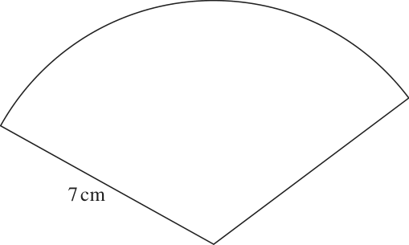
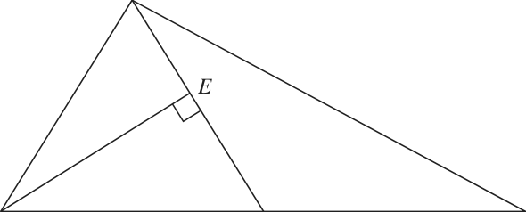
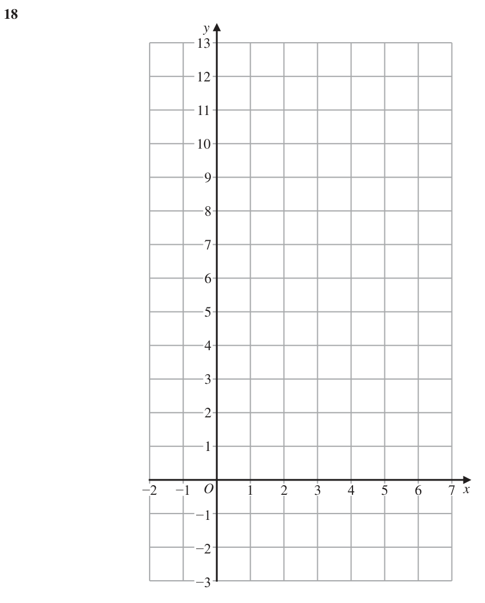
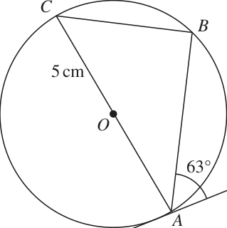
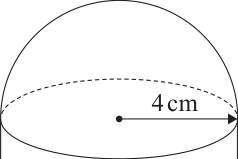
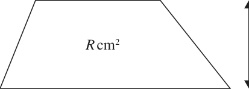
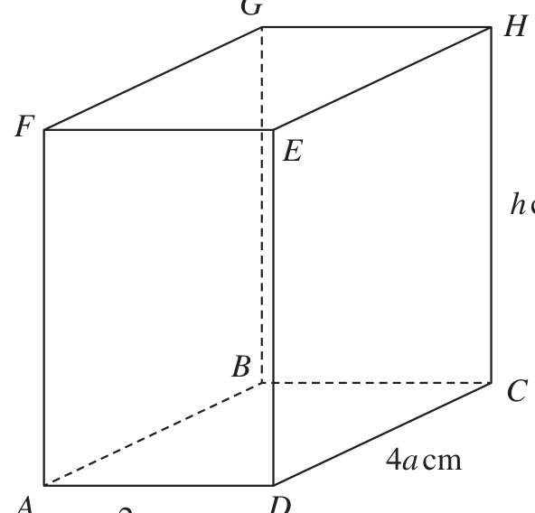
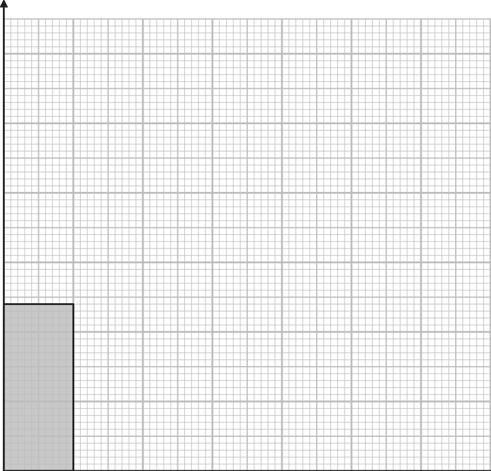
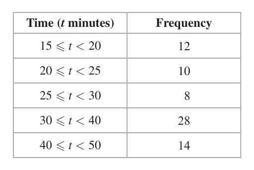

# 4MB1/01R — 2021-01 (official extraction)

> schema `syllabai.official-paper-questions/0.2` · paper_id `pearson-edexcel:international-gcse:mathematics-b:4mb1:2021-01:4MB1/01R` · qp sha256 `9a6abe74d2156361…` · extraction is the disclosed baseline (ADR-039)

## Question 1 (2 marks)

The nth term of a sequence is given by 9 − 4n Find the first 3 terms of this sequence. ............................ , ............................ , ............................

### 1 [2]

The nth term of a sequence is given by 9 − 4n Find the first 3 terms of this sequence …………… , …………… , ……………

**Mark scheme answer**

> 5, 1, -3 2 -1 for every error or omission
> Total 2 marks

- **(2)** 5, 1, -3 2 -1 for every error or omission

## Question 2 (2 marks)

Find the highest common factor (HCF) of 60, 126 and 648 Show your working clearly.

### 2 [2]

Find the highest common factor (HCF) of 60, 126 and 648 Show your working clearly.

**Mark scheme answer**

> 60 = 22 × 3 × 5 M1 for prime factors of two of 60, 126, 648 (or
> 126 = 2 × 32 × 7 equivalent e.g. factor ladder/trees
> 648 = 23 × 34
> 60 126 648
> 2: 30 63 324
> 3: 10 21 108
> or listing at least 6 factors of each of the 3 numbers
> HCF(60,126,648) = 2 × 3 6 2 A1
> Total 2 marks

- **(2)** 60 = 22 × 3 × 5 M1 for prime factors of two of 60, 126, 648 (or

## Question 3 (2 marks)

Express 325 millilitres as a fraction of 3.7 litres. Give your answer in its simplest form.

### 3 [2]

Express 325 millilitres as a fraction of 3.7 litres. Give your answer in its simplest form.

**Mark scheme answer**

> 325 0.325 M1 (any fraction that uses compatible units is
> or oe
> 3700 3.7 3.25
> acceptable) oe but not fully simplified eg or
> 0.0878…. or 8.78…%
> 13 2 A1
> 148
> Total 2 marks

- **(2)** 325 0.325 M1 (any fraction that uses compatible units is

## Question 4 (2 marks)

Without using a calculator and showing all your working, work out 1 2 3 ×2 4 3 Give your answer as a mixed number in its simplest form.

### 4 [2]

Without using a calculator and showing all your working, work out 1 2 3 ×2 4 3 Give your answer as a mixed number in its simplest form.

**Mark scheme answer**

> 13 8 M1 or equivalent method for the intention of
> 3 14 × 2 23 =
> ×
> 104 26 2 13 26 2 2 2 A1 Dependent on all working seen
> = = 8 or 2 × = =8
> 12 3 3 3 3 3
> Total 2 marks

- **(2)** 13 8 M1 or equivalent method for the intention of

## Question 5 (2 marks)

N = 254 × 583 Evaluate N, giving your answer

### 5(a) [1]

N = 254 × 583 Evaluate N, giving your answer

to 3 significant figures …………… , ……………

**Mark scheme answer**

> 0.0129 1 B1

- **(1)** 0.0129 1 B1

### 5(b) [1]

to 6 decimal places.

**Mark scheme answer**

> 0.01288 1 B1 (If B0B0 then SC B1 for 0.0128852…)
> Total 2 marks

- **(1)** 0.01288 1 B1 (If B0B0 then SC B1 for 0.0128852…)

## Question 6 (2 marks)

Find the size of each interior angle of a regular 18-sided polygon. °

### 6 [2]

Find the size of each interior angle of a regular 18-sided polygon.

…………… °

**Mark scheme answer**

> 360 180 (18 − 2 )
> 180 − M1 (oe e.g. )
> 18
> 160 2 A1
> s

- **(2)** 360 180 (18 − 2 )

## Question 7 (2 marks)

A straight line passes through the points with coordinates (12, −4) and (−2, 3) Calculate the gradient of the line.

### 7 [2]

A straight line passes through the points with coordinates (12, −4) and (−2, 3) Calculate the gradient of the line.

**Mark scheme answer**

> −4 − 3 M1
> oe
> 12 − (−2)
> 1 2 A1 oe
> −
> Total 2 marks

- **(2)** −4 − 3 M1

## Question 8 (2 marks)

Diagram NOT accurately drawn B A 7 cm O The diagram shows a sector OAB of a circle centre O and radius 7 cm. Given that the area of the sector OAB is 52 cm2 calculate the size, to the nearest degree, of ∠AOB. °

### 8 [2]

The diagram shows a sector OAB of a circle centre O and radius 7 cm. Given that the area of the sector OAB is 52 cm² calculate the size, to the nearest degree, of ∠AOB. °

> *Figure not shown in this reconstruction — the printed paper includes a diagram (not drawn accurately).*
> Labels in the original figure: B, A, O · Figure values: 7.

**Mark scheme answer**

> θ M1 correct use of formula for the area of a sector
> × π ( 7 ) = 52 oe
> 360
> 122 A1 or better (121.6073688…)
> Total 2 marks

- **(2)** θ M1 correct use of formula for the area of a sector

## Question 9 (3 marks)
### 9(a) [1]

Factorise completely 6xy − 3x

**Mark scheme answer**

> 3x ( 2 y − 1) 1 B1 oe

- **(1)** 3x ( 2 y − 1) 1 B1 oe

### 9(b) [2]

Factorise completely 6ab − 2bc + 3ad − cd

**Mark scheme answer**

> M1 for either 2b ( 3a − c ) + d ( 3a − c ) or
> 3a ( 2b + d ) − c ( 2b + d ) oe
> (3a − c )( 2b + d ) 2 A1
> Total 3 marks

- **(2)** M1 for either 2b ( 3a − c ) + d ( 3a − c ) or

## Question 10 (3 marks)

Solve = 3 2 Show clear algebraic working. x = . . . . . . . . . . . . . . . . . . . . . .. . . . . . . . . . . . . . . . . . . . . . . . . . . . . . . . .

### 10 [3]

Solve = 3 2 Show clear algebraic working. x = ……………Solve = 3 2 Show clear algebraic working. x =

**Mark scheme answer**

> 2 ( 9 − 5x ) = 3 ( 5x + 1) M1 remove fractions and expand brackets
> 5 5
> 18 − 10 x = 15 x + 3 or 3 − x = x +
> 3 2
> eg –10x – 15x = 3 –18 or 25 x = 15 or M1ft collect terms in x one side and number terms on the
> 5 5 1 other side dep on equation in form ax + b = cx + d
> x + x = − 3 oe
> 2 3
> x = 0.6 3 A1 oe dep on M1
> Total 3 marks

- **(3)** 2 ( 9 − 5x ) = 3 ( 5x + 1) M1 remove fractions and expand brackets

## Question 11 (3 marks)

A company makes two sizes of containers, small and large. Each small container is similar to each large container. The volume of each small container is 225 cm3 The volume of each large container is 650 cm3 Given that the height of each large container is 18 cm, calculate the height, in cm to 3 significant figures, of each small container. ....................................................... cm

### 11 [3]

A company makes two sizes of containers, small and large. Each small container is similar to each large container. The volume of each small container is 225 cm³ The volume of each large container is 650 cm³ Given that the height of each large container is 18 cm, calculate the height, in cm to 3 significant figures, of each small container cm

**Mark scheme answer**

> 650 1 1 225 M1 for a correct statement for ratio of lengths (may
> eg lengths 3 (=1.424...) or 26 3 : 9 3 or 3 (= 0.702.. )
> 225 650 x 225 3
> 1 1 be seen as part of an equation eg = )
> or 9 3 : 26 3 18
> 650 3
> 1 M1dep for a fully correct method to find the height
> ⎛ 9 ⎞3
> eg 18 26 
> 12.6 3 A1 awrt 12.6

- **(3)** 650 1 1 225 M1 for a correct statement for ratio of lengths (may

## Question 12 (3 marks)

x is an integer such that 2(1 − 3x) > 25 − 2x Find the greatest possible value of x.

### 12 [3]

x is an integer such that 2(1 − 3x) > 25 − 2x Find the greatest possible value of x.

**Mark scheme answer**

> −6 x + 2 x > 25 − 2 or 2 − 25 > − 2 x + 6 x or 6 x − 2 x < 2 − 25 M1 for expanding and collecting like terms – could
> be in an equation
> oe eg −4 x > 23 or − 23 > 4 x or 4 x < − 23
> x < −5.75 oe A1 for obtaining the critical value of –5.75 oe (may
> or may not be in a correct inequality)
> −6 3 A1
> Total 3 marks

- **(3)** −6 x + 2 x > 25 − 2 or 2 − 25 > − 2 x + 6 x or 6 x − 2 x < 2 − 25 M1 for expanding and collecting like terms – could

## Question 13 (3 marks)

A and B are two matrices such that the determinant of A is equal to the determinant of B. ⎛ 3 2⎞ ⎛ 5 3⎞ Given that A = ⎜ ⎟ and B = ⎜⎝ 1 4⎟⎠ where a is a positive integer, ⎝ −1 a⎠ find the value of a. a = . . . . . . . . . . . . . . . . . . . . . .. . . . . . . . . . . . . . . . . . . . . . . . . . . . . . . . .

### 13 [3]

A and B are two matrices such that the determinant of A is equal to the determinant of B. ⎛ 3 2⎞ ⎛ 5 3⎞ Given that A = and B = 1 4 where a is a positive integer, ⎝ −1 a⎠ find the value of a. a =

**Mark scheme answer**

> det A = 3 a + 2 M1 for correct determinant of either A or B
> det B = 20 − 3(= 17)
> eg 3 a + 2 = 17 or a = 5 oe M1dep for a fully correct equation
> a = 25 3 A1
> Total 3 marks

- **(3)** det A = 3 a + 2 M1 for correct determinant of either A or B

## Question 14 (3 marks)

The equation of the curve C is y = x3 − x2 The point A lies on C such that the x coordinate of A is −1 Use differentiation to find the gradient of C at the point A.

### 14 [3]

The equation of the curve C is y = x³ − x² The point A lies on C such that the x coordinate of A is −1 Use differentiation to find the gradient of C at the point A.

**Mark scheme answer**

> dy 6 M1 for one term differentiated correctly
> = 3x 2 + 3
> dx x
> dy 6 M1dep for substituting x = −1 into their derivative -
> = 3 ( −1) +
> dx x =−1 ( −1)
> 3 - must be at least 2 terms
> −3 3 A1 dep on 1st M1
> Total 3 marks

- **(3)** dy 6 M1 for one term differentiated correctly

## Question 15 (3 marks)

B Diagram NOT accurately drawn E A C M F D The diagram shows △ABC and the straight line BMD such that M is the midpoint of AC. The points E and F lie on BMD such that AE and CF are each perpendicular to BMD. Prove that △AEM is congruent to △CFM.

### 15 [3]

The diagram shows △ABC and the straight line BMD such that M is the midpoint of AC. The points E and F lie on BMD such that AE and CF are each perpendicular to BMD. Prove that △AEM is congruent to △CFM.

> *Figure not shown in this reconstruction — the printed paper includes a diagram (not drawn accurately).*
> Labels in the original figure: B, E, A, C, M, F, D.

**Mark scheme answer**

> In AEM and CFM M2 for two correct reasons
> AM = CM (as M is the midpoint of AC oe) (M1 for one correct reason)
> EMA FMC oe (as vertically opposite angles or
> vertically opposite angles)
> ∠EAM = ∠FCM oe (alternate angles)
> AEM CFM 90 oe (or as AE and CF are each
> perpendicular to BEMFD)
> ASA 3 A1 for proof of a side and 2 angles being equal and
> ASA or AAS
> Total 3 marks

- **(3)** In AEM and CFM M2 for two correct reasons

## Question 16 (4 marks)

A= B = 4 3 4 1 Find

### 16(a) [2]

A= B = 4 3 4 1 Find

A − B 

**Mark scheme answer**

> ⎛ 5 −7 ⎞ 2 B2 (-1 for eeoo)
>  0 −2 

- **(2)** ⎛ 5 −7 ⎞ 2 B2 (-1 for eeoo)

### 16(b) [2]

3A + 2B 

**Mark scheme answer**

> ⎛ 5 4⎞ 2 B2 (-1 for eeoo)
>  20 9 

- **(2)** ⎛ 5 4⎞ 2 B2 (-1 for eeoo)

## Question 17 (4 marks)

Show that ÷ 2 is equal to an integer. x + x − 12 3 x − 48 Show clear algebraic working.

### 17 [4]

Show that ÷ 2 is equal to an integer. x + x − 12 3 x − 48 Show clear algebraic working.

**Mark scheme answer**

> 5 x − 15 3 x 2 − 48 M1
> × oe
> x 2 + x − 12 x−4
> 5 ( x − 3) 3 ( x + 4 )( x − 4 ) M1 for factorising either 5 x − 15 or x² + x − 12
> × M1 for factorising fully 3x² ˗ 48
> ( x − 3)( x + 4 ) x−4
> 15 4 A1 dep on M3
> ALT
> 15 x 3 − 45 x 2 − 240 x + 720 M3 for all terms correct
> x 3 − 3x 2 − 16 x + 48 (M2 with 1 or 2 incorrect terms)
> (M1 with 3 incorrect terms)
> 15 4 A1 dep on M3

- **(4)** 5 x − 15 3 x 2 − 48 M1

## Question 18 (4 marks)

y −2 −1 O 1 2 3 4 5 6 7 x −1 −2 −3

**(a)** On the grid, draw and label the straight line with equation

### 18(a)(i) [?]

x = 4

### 18(a)(ii) [?]

2x + y = 8

### 18(a)(iii) [3]

y = 3x − 1

**Mark scheme answer**

> *The official mark scheme line for this part was not captured by the digitised extraction — treat the worked values above the line with care and check against the paper's own mark scheme.*

### 18(b) [1]

On the grid, show by shading, the region R defined by the inequalities x ≤ 4 and 2x + y ≥ 8 and y ≤ 3x – 1 Label the region R.

**Mark scheme answer**

> 1 B1 correct region dep on correct lines in (a)
> Total 4 marks

- **(1)** 1 B1 correct region dep on correct lines in (a)

## Question 19 (4 marks)

C B Diagram NOT accurately drawn 5 cm O Q 63° A P In the diagram, A, B and C are points on a circle with centre O and radius 5 cm. AOC is a diameter of the circle and PAQ is the tangent to the circle at A. ∠BAQ = 63° Calculate the length, in cm to 3 significant figures, of AB. AB = . . . . . . . . . . . . . . . . . . . . . . . . . . . . . . . . . . . . . . . . . . . . . . . . . . . . . . . cm

### 19 [4]

In the diagram, A, B and C are points on a circle with centre O and radius 5 cm. AOC is a diameter of the circle and PAQ is the tangent to the circle at A. ∠BAQ = 63° Calculate the length, in cm to 3 significant figures, of AB. AB = cm

> *Figure not shown in this reconstruction — the printed paper includes a diagram (not drawn accurately).*
> Labels in the original figure: C, B, O, Q, A, P · Figure values: 5, 63°.

**Mark scheme answer**

> ∠ACB = 63 or ∠CAB = 27 B1 could be seen on diagram or implied by later
> working
> ∠ABC = 90 or ∠BOA = 126 B1 could be seen on diagram or implied by later
> working
> AB AB AB
> sin 63 = or cos 27 = oe M1 allow cos 27 = oe if student multiplies AB
> 10 10
> [AB²=] 5² + 5² ˗ 2 × 5 × cos126 by 2
> 8.91 4 A1 awrt 8.91
> Total 4 marks

- **(4)** ∠ACB = 63 or ∠CAB = 27 B1 could be seen on diagram or implied by later

## Question 20 (4 marks)

2− 2 (1 + 2 ) 20 2 can be written in the form a + b 2 where a and b are integers. Find the value of a and the value of b. Show your working clearly. a = ....................................................... b = .......................................................

### 20 [4]

2− 2 (1 + 2 ) 20 2 can be written in the form a + b 2 where a and b are integers. Find the value of a and the value of b. Show your working clearly. a = b =

**Mark scheme answer**

> 2− 2 2− 2 M1 for expanding denominator correctly (2, 3 or 4
> = terms)
> (1 + 2 )
> 1+ 2 2 + 2
> ⎛ 2 − 2 ⎞⎛ 3 − 2 2 ⎞ M1ft for a correct method to rationalise their
>  denominator (dep on a surd in the form a ± b c )
> ⎝ 3 + 2 2 ⎠⎝ 3 − 2 2 ⎠
> 6−4 2 −3 2 + 4 M1 (dependent on previous M mark) for expanding
> numerator (3 or 4 terms) allow one error with a
> 9 −8 denominator of 1 or an implied 1
> a = 10 4 A1 (dependent on M3)
> b = −7

- **(4)** 2− 2 2− 2 M1 for expanding denominator correctly (2, 3 or 4

## Question 21 (4 marks)

y varies inversely as the cube of x and y = 3a when x = 2a Find an expression for y in terms of a when x = 4a2 Give your answer in its simplest form. y = . . . . . . . . . . . . . . . . . . . . . .. . . . . . . . . . . . . . . . . . . . . . . . . . . . . . . . .

### 21 [4]

y varies inversely as the cube of x and y = 3a when x = 2a Find an expression for y in terms of a when x = 4a2 Give your answer in its simplest form. y =

**Mark scheme answer**

> k M1
> y=
> x³
> k = 3a ( 2a )
> ( = 24a )
> 4 A1
> '24a 4 ' M1dep
> y=
> ( 4a )
> 2 3
> 3 4 3 −2
> A1 a or 0.375a −2 must come from correct
> 8a 2
> working

- **(4)** k M1

## Question 22 (4 marks)

Diagram NOT 4 cm accurately drawn The diagram shows a solid made by fixing a solid hemisphere of radius 4 cm on the flat circular top face of a solid cylinder of radius 4 cm. The centre of the hemisphere coincides with the centre of the flat circular top face of the cylinder. 920 The total volume of the solid is π cm3 Find the total height, in cm, of the solid. ....................................................... cm

### 22 [4]

The diagram shows a solid made by fixing a solid hemisphere of radius 4 cm on the flat circular top face of a solid cylinder of radius 4 cm. The centre of the hemisphere coincides with the centre of the flat circular top face of the cylinder. 920 The total volume of the solid is π cm³ Find the total height, in cm, of the solid cm

> *Figure not shown in this reconstruction — the printed paper includes a diagram (not drawn accurately).*
> Figure values: 4.

**Mark scheme answer**

> Volume of cylinder π ( 4 ) h oe
> 2 B1
> Volume of hemisphere is 2 π ( 4 )³ oe B1
> 128 920 M1ft (dep on the sum of 2 volumes and at least B1
> π + 16π h = π (h = 16.5) oe previously awarded) for setting up an equation in h
> 3
> 20.5 4 A1

- **(4)** Volume of cylinder π ( 4 ) h oe

## Question 23 (4 marks)

a cm Diagram NOT accurately drawn R cm2 h cm b cm The diagram shows a trapezium in which the parallel sides are of length a cm and b cm The height of the trapezium is h cm The area of the trapezium is R cm2 Given that b = 14.5 to the nearest 0.5 h = 4.0 to the nearest 0.1 R = 50 to the nearest whole number calculate the lower bound, to 3 significant figures, of a

### 23 [4]

a cm Diagram NOT accurately drawn R cm² h cm b cm The diagram shows a trapezium in which the parallel sides are of length a cm and b cm The height of the trapezium is h cm The area of the trapezium is R cm² Given that b = 14.5 to the nearest 0.5 h = 4.0 to the nearest 0.1 R = 50 to the nearest whole number calculate the lower bound, to 3 significant figures, of a

> *Figure not shown in this reconstruction — the printed paper includes a diagram (not drawn accurately). Use the text description to work through it.*

**Mark scheme answer**

> bLB = 14.25, bUB = 14.75 B1 for one correct LB or UB stated
> hLB = 3.95, hUB = 4.05
> RLB = 49.5, RUB = 50.5
> ⎛ a + 14.75 ⎞ M1 for use of correct formula for the area of a
> eg 49.5 = 4.05 or 2(49.5 ÷ 4.05) – 14.75 oe trapezium with b, h and R substituted (may be used
> ⎝ 2 ⎠
> with given figures or incorrect bounds)
> ⎛R ⎞ ⎛ 49.5 ⎞ M1 for rearranging for a and using RLB where
> aLB = 2 ⎜ LB ⎟ − bUB eg aLB = 2 − 14.75
> ⎝ hUB ⎠ ⎝ 4.05 ⎠ 49.5 ≤ RLB < 50 , hUB where 4 < hUB ≤ 4.05 and bUB
> where 14.5 < bUB ≤ 14.75
> 9.69 4 A1 awrt 9.69 (for reference: 9.6944444…)

- **(4)** bLB = 14.25, bUB = 14.75 B1 for one correct LB or UB stated

## Question 24 (4 marks)

q = The vectors p and q are such that | p | = | p − 2q | Find the value of x. Show clear algebraic working. x = .......................................................

### 24 [4]

q = The vectors p and q are such that | p | = | p − 2q | Find the value of x. Show clear algebraic working. x =

**Mark scheme answer**

> ⎡ p 2 ⎤ = 4 + ( 3 − 2x )² B1 for either correct p or p
> ⎣ ⎦
> p − 2q = 64 + (1 − 2x )
> 2
> B1 for either correct p − 2q or p − 2q
> eg 4 + 9 − 12 x + 4 x 2 = 64 + 1 − 4 x + 4 x 2 or M1 for equating and multiplying out brackets
> correctly
> 13 − 12 x = 65 − 4 x oe eg 8 x = − 52
> x = −6.5 4 A1 dep on correct working seen

- **(4)** ⎡ p 2 ⎤ = 4 + ( 3 − 2x )2 B1 for either correct p or p

## Question 25 (5 marks)

There are 12 marbles in bag A and 15 marbles in bag B. In bag A, there are 7 yellow marbles and 5 red marbles. In bag B, there are 10 yellow marbles and 5 red marbles. Eugene takes at random one marble from bag A and without looking at the marble puts the marble into bag B. Eugene then takes at random one marble from bag A and takes at random two marbles from bag B. He places the three marbles on a table. Calculate the probability that the three marbles on the table all have the same colour. ( )

### 25 [5]

There are 12 marbles in bag A and 15 marbles in bag B. In bag A, there are 7 yellow marbles and 5 red marbles. In bag B, there are 10 yellow marbles and 5 red marbles. Eugene takes at random one marble from bag A and without looking at the marble puts the marble into bag B. Eugene then takes at random one marble from bag A and takes at random two marbles from bag B. He places the three marbles on a table. Calculate the probability that the three marbles on the table all have the same colour. ( )

**Mark scheme answer**

> ⎛ 5 ⎞ ⎛ 7 ⎞ ⎛ 10 ⎞ ⎛ 9 ⎞ M3 for three correct expressions, M2 for two correct
>  × × × oe (red moved from A to expressions and M1 for one correct expression
> ⎝ 12 ⎠ ⎝ 11 ⎠ ⎝ 16 ⎠ ⎝ 15 ⎠
> B then choosing 3 yellow)
> ⎛5⎞ ⎛4⎞ ⎛6⎞ ⎛5 × × × oe (red moved from A to B
> ⎝ 12 ⎠ ⎝ 11 ⎠ ⎝ 16 ⎠ ⎝ 15 ⎠
> then choosing 3 red)
> ⎛ 7 ⎞ ⎛ 6 ⎞ ⎛ 11 ⎞ ⎛ 10 × × × oe (yellow moved from A
> ⎝ 12 ⎠ ⎝ 11 ⎠ ⎝ 16 ⎠ ⎝ 15 ⎠
> to B then choosing 3 yellow)
> ⎛7⎞ ⎛5⎞ ⎛5⎞ ⎛4 × × × oe (yellow moved from A to
> ⎝ 12 ⎠ ⎝ 11 ⎠ ⎝ 16 ⎠ ⎝ 15 ⎠
> B then choosing 3 red)
> M1dep – attempt a correct calculation by summing four
> terms (oe)
> 907 5 A1 (oe) accept awrt 0.286
> 3168
> See next page for SC Total 5 marks
> Special cases ⎛ 7 ⎞ ⎛ 10 ⎞ ⎛ 9 ⎞ ⎛4⎞ ⎛ 6⎞ ⎛5 × × , × × 11 ⎠ ⎝ 16 ⎠ ⎝ 15 ⎠ ⎝ 11 ⎠ ⎝ 16 ⎠ ⎝ 15 ⎠
> ⎛ 6 ⎞ ⎛ 11 ⎞ ⎛ 10 ⎞ ⎛5⎞ ⎛ 5⎞ ⎛ 4 × × , × × 11 ⎠ ⎝ 16 ⎠ ⎝ 15 ⎠ ⎝ 11 ⎠ ⎝ 16 ⎠ ⎝ 15 ⎠
> (SCB1 for 2 of these expressions))
> OR
> (SCB2 for 3 or 4 of
> ⎛ 5 ⎞ ⎛ 10 ⎞ ⎛ 9 ⎞ ⎛ 5⎞ ⎛ 6⎞ ⎛5 × × , × × 12 ⎠ ⎝ 16 ⎠ ⎝ 15 ⎠ ⎝ 12 ⎠ ⎝ 16 ⎠ ⎝ 15 ⎠
> ⎛ 7 ⎞ ⎛ 11 ⎞ ⎛ 10 ⎞ ⎛7⎞ ⎛ 5⎞ ⎛ 4 × × , × × 12 ⎠ ⎝ 16 ⎠ ⎝ 15 ⎠ ⎝ 12 ⎠ ⎝ 16 ⎠ ⎝ 15 ⎠
> (SCB1 for 2 of these expressions))
> OR
> (SCB2 for 3 or 4 of
> ⎛ 5 ⎞ ⎛ 7 ⎞ ⎛ 10 ⎞ ⎛ 10 ⎞ ⎛ 5⎞ ⎛4⎞ ⎛ 6⎞ ⎛ 6 × × × , × × × 12 ⎠ ⎝ 11 ⎠ ⎝ 16 ⎠ ⎝ 16 ⎠ ⎝ 12 ⎠ ⎝ 11 ⎠ ⎝ 16 ⎠ ⎝ 16 ⎠
> ⎛ 7 ⎞ ⎛ 6 ⎞ ⎛ 11 ⎞ ⎛ 11 ⎞ ⎛7⎞ ⎛5⎞ ⎛ 5⎞ ⎛ 5 × × × , × × × 12 ⎠ ⎝ 11 ⎠ ⎝ 16 ⎠ ⎝ 16 ⎠ ⎝ 12 ⎠ ⎝ 11 ⎠ ⎝ 16 ⎠ ⎝ 16 ⎠
> (SCB1 for 2 of these expressions))

- **(5)** ⎛ 5 ⎞ ⎛ 7 ⎞ ⎛ 10 ⎞ ⎛ 9 ⎞ M3 for three correct expressions, M2 for two correct

## Question 26 (6 marks)

G H Diagram NOT accurately drawn F E h cm B C 4a cm A 2a cm D The diagram shows a cuboid ABCDEFGH in which AD = 2a cm DC = 4a cm CH = h cm ( ) Given that AC = 2 a BH and that ∠HAC = 45° find the value of a. ( ) a = .......................................................

### 26 [6]

h cm B C 4a cm A 2a cm D The diagram shows a cuboid ABCDEFGH in which AD = 2a cm DC = 4a cm CH = h cm ( ) Given that AC = 2 a BH and that ∠HAC = 45° find the value of a. ( ) a =

> *Figure not shown in this reconstruction — the printed paper includes a diagram (not drawn accurately).*
> Labels in the original figure: G, H, F, E.

**Mark scheme answer**

> B1 for stating or working out that h = AC
> or AC = HC (may be seen in later working) [eg h = √(20a²)]
> [(AC)²] = (2a)² + (4a)² oe or
> (AC) = √(20a²) (= 2a√5) oe M1 for a correct statement for AC² or AC in terms of a
> [(BH)²] = (2a)² + h² oe or [BH] = √(4a² + h²) or M1 for a correct statement for BH² or BH in terms of a
> [BH] = (√(20a²)) ÷ (2√a) (= √5a) and/or h (ft their value for h) - may be seen in later working [must have correct brackets or correct expansions eg (2a)² or 4a²]
> [BH] = √(24a²) oe
> eg (2√a)(√(h² + 4a²)) = √(20a²) or M1dep for a correct equation equating two expressions for AC using a correct expression for BH eg
> √(24a²) × (2√a) = 2a√5 oe (2√a)(√(h² + 4a²)) = √(20a²) or 4h² + 16a² = 20a or
> 5a = 4a² + h² oe
> or Or a correct equation equating two expressions for BH eg
> √(24a²) = √5a
> eg 96a² = 20a or 5a = 24a² oe or M1 for a correct two-term quadratic or linear equation in a
> 24a = 5 oe
> a = 5/24 A1 (0.208…)

- **(6)** B1 for stating or working out that h = AC

## Question 27 (8 marks)

Amrit recorded the time, in minutes, that he took to complete each of his homework tasks last term. The table shows information about these times. Time (t minutes) Frequency 15 ≤ t < 20 12 20 ≤ t < 25 10 25 ≤ t < 30 8 30 ≤ t < 40 28 40 ≤ t < 50 14

### 27(a) [1]

Find the class interval that contains the median of these times.

**Mark scheme answer**

> 30 ≤ t < 40 1 B1

- **(1)** 30 ≤ t < 40 1 B1

### 27(b) [4]

Calculate an estimate, to 3 significant figures, of the mean time it took Amrit to complete his homework tasks last term minutes ( ) The diagram below is an incomplete histogram for the information in the table. Frequency density 15 20 25 30 35 40 45 50 Time (minutes)

> *Figure not shown in this reconstruction — the printed paper includes a diagram (not drawn accurately). Use the text description to work through it.*

**Mark scheme answer**

> (17.5 ×12) + ( 22.5 ×10) + ( 27.5 × 8) M2 (condone one error only) if not M2 then award M1 for
> multiplication of all midpoints by frequencies (without
> + ( 35 × 28) + ( 45 ×14 ) (=2265) addition) or multiplication of frequencies by a consistent
> value in interval (condone one error only) and addition
> ‘2265’÷ (12 + 10 + 8 + 28 + 14) M1dep on M1
> [2265 ÷ 72]
> 31.5 4 A1 awrt 31.5

- **(4)** (17.5 ×12) + ( 22.5 ×10) + ( 27.5 × 8) M2 (condone one error only) if not M2 then award M1 for

### 27(c) [3]

Use the information in the table to complete the histogram.

**Mark scheme answer**

> Remaining frequency densities are M2 for all correct bars in histogram (M1 for 3 bars correct
> 2.0, 1.6, 2.8, 1.4 (where 2 cm = FD of 1) or stating a value on FD scale)
> Correctly 3 A1 correct histogram including numbering frequency
> completed density axis correctly (at least one number not
> histogram contradicted)
> Total 8 marks

- **(3)** Remaining frequency densities are M2 for all correct bars in histogram (M1 for 3 bars correct

## Question 28 (8 marks)

y Diagram NOT y = 4x + 8 accurately drawn B y = 2x2 + 3x − 2 A O x The diagram shows a sketch of part of the curve with equation y = 2x2 + 3x − 2 and part of the straight line with equation y = 4x + 8 The points of intersection of the line with the curve are A and B.

### 28(a) [6]

Find the length of AB, giving your answer in the form k 17 , where k is a rational number to be determined. Show your working clearly. ( ) The point C has coordinates (−5, 0)

**Mark scheme answer**

> A(–2, 0) or x = –2 B1 (either from quadratic or solving 4 x + 8 = 0) for x
> coordinate of, A may be implied by further working
> eg 2x² + 3x – 2 = 4x + 8 oe or M1 for substituting the equation of the line into the equation
> 2x² - x – 10 = 0 oe of the curve
> (2x – 5)(x + 2) = 0 M1dep for attempting to solve their 3-term quadratic (if
> factorising, factors that give 2 of 3 terms correct, if using
> formula, allow one sign error and some simplification – eg
> −1 ± 1 + 80
> allow as far as ) May be implied by x = 2.5
> 4 × “2.5” + 8 (=18) M1indep for their value for 4 × “2.5” + 8 oe
> 1377 M1 indep for a correct calculation for AB² or AB using their
> eg AB 2 = ( 2.5 + 2 ) + 182 or AB 2 =
> or
> 4 coordinates for A and B
> 1377
> AB = oe
> 9 6 9 9
> 17 A1 or k = (accept if 17 seen)
> 2 2 2
> dep on M4

- **(6)** A(–2, 0) or x = –2 B1 (either from quadratic or solving 4 x + 8 = 0) for x

### 28(b) [2]

Calculate the size, to the nearest degree, of ∠CAB.

…………… °

**Mark scheme answer**

> ⎛ '4.5' ⎞ M1 for complete method to find required angle (oe using their
> ⎛ '18' ⎞ −1 A and B)
>  or 180 − cos
> −1
> 180 − tan '4.5' ' 9 17 ' 39 
> ⎝ 2 ⎠
> ( )
> 9
> ⎜ 2 17 + 3 − ⎜ " " '18' ⎞ −1 2 oe
> or 180 − sin −1 cos
>  ' 9 17 ' 2 × 9 17 × 3 2 2 
> or complete method using cosine rule
> 104 2 A1 awrt 104

- **(2)** ⎛ '4.5' ⎞ M1 for complete method to find required angle (oe using their

