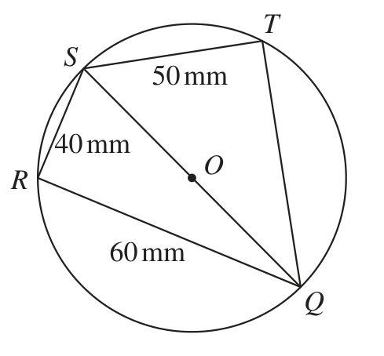
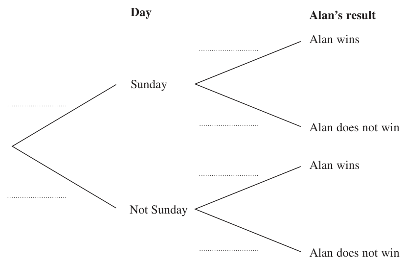
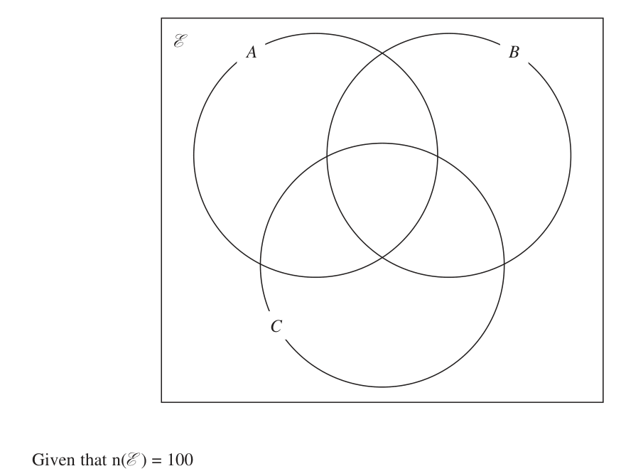
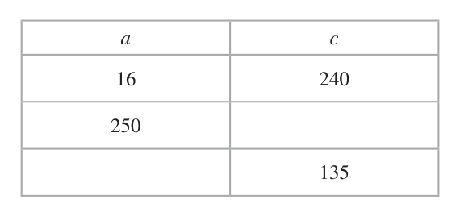
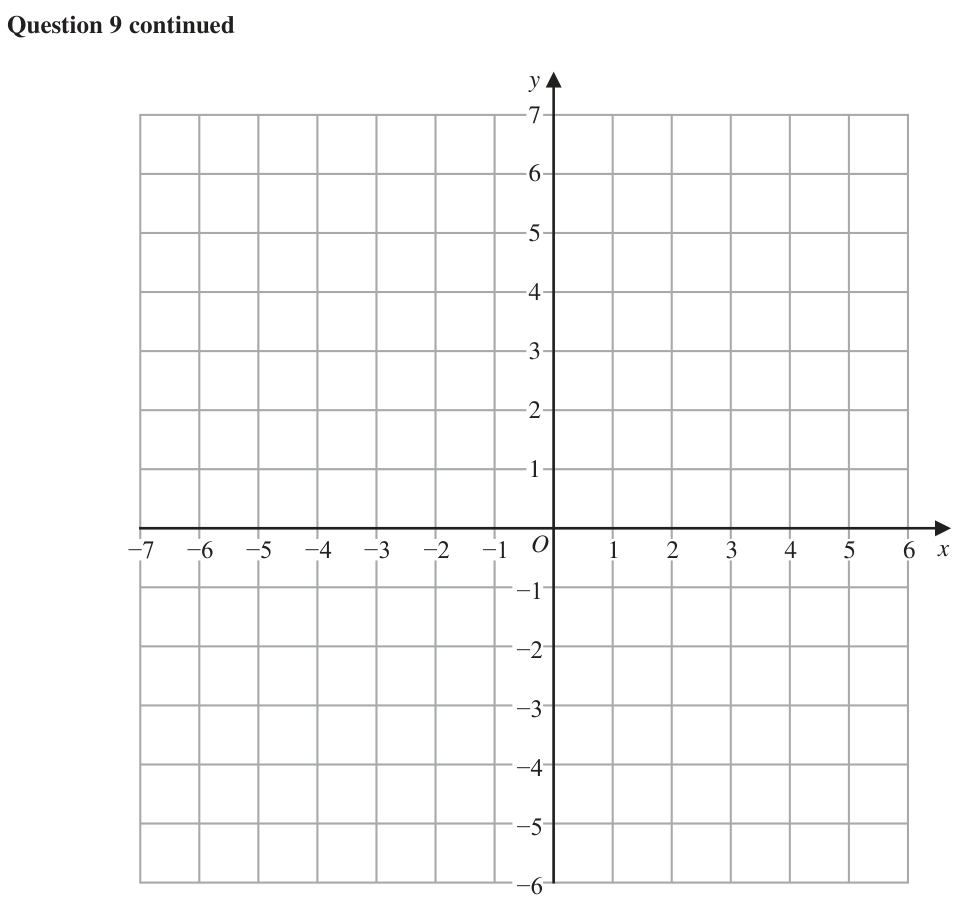
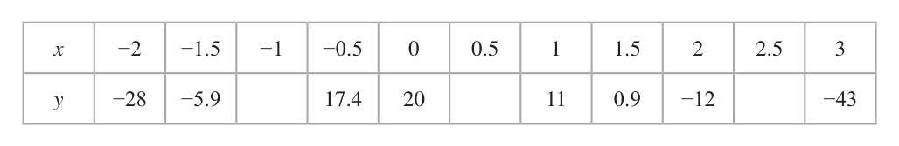
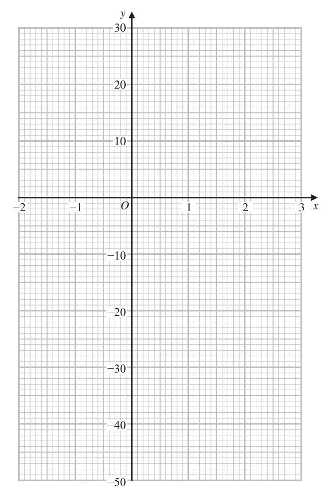

# 4MB1/02 — 2021-01 (official extraction)

> schema `syllabai.official-paper-questions/0.2` · paper_id `pearson-edexcel:international-gcse:mathematics-b:4mb1:2021-01:4MB1/02` · qp sha256 `23913a24ad102904…` · extraction is the disclosed baseline (ADR-039)

## Question 1 (5 marks)

The following formula can be used to change a temperature f degrees Fahrenheit to a temperature c degrees Celsius. 5 ( f − 32) c= 5 ( f − 32)

### 1(a) [3]

The following formula can be used to change a temperature f degrees Fahrenheit to a temperature c degrees Celsius. 5 ( f − 32) c= 5 ( f − 32)

Make f the subject of c = Sean and Kate measure the temperature of a heated iron bar. Sean measures the temperature of the iron bar as x degrees Fahrenheit. Kate measures the temperature of the iron bar as y degrees Celsius. Given that x = 2y …………… , ……………

**Mark scheme answer**

> 9 c f 32 3
> c = f − 32 or 9c = 5 f − 160 or = − oe M1 Multiplying by or × by 9 and multiplying out
> 5 5 9 9
> brackets or ÷5 and separating
> 9 f c 32 M1 indep Isolating the term in f. Allow one error in
> c + 32 = f or 5 f = 9c + 160 or = + oe the resulting equation eg condone 5f = 9c+ 32
> 5 9 5 9
> 9 A1 correct formula. Allow equivalent form
> f = c + 32 9c + 160
> 5 eg f =
> Alternative
> 5 160 M1 for isolating term in f first.
> f =c+ 5
> 9 9 Condone f = c +
> 9
> f c 160 9 160
> 5 f = 9c + 160 or = + or f = c + M1 Multiplying by or by 9 or ÷5
> 9 5 45 5 5
> oe
> 9 A1 correct formula could be in equivalent form
> f = c + 32 9c + 160
> 5 eg f =

- **(3)** 9 c f 32 3

### 1(b) [2]

find the temperature, in degrees Fahrenheit, of the iron bar.

**Mark scheme answer**

> 5 ( x − 32 ) 5 ( 2 y − 32 ) 2 M1 Form a correct equation in terms of x(allow f) or
> x = 2× or y = or y (allow c) but not both.
> 9
> Follow through their answer to part (a) if needed
> 9⎛ x⎞ ⎛9 ⎞ must be a linear equation in terms of c
> x = + 32 or 2 y = ⎜ y + 32 ⎟ oe
> 5⎝ 2⎠ ⎝5 ⎠
> 320 A1 cao

- **(2)** 5 ( x − 32 ) 5 ( 2 y − 32 ) 2 M1 Form a correct equation in terms of x(allow f) or

## Question 2 (4 marks)

The Earth is assumed to move around the Sun in a circular orbit of radius 1.5 × 108 km. Assuming that the Earth takes 365 days to complete one orbit of the Sun, calculate the average speed, in m/s to 3 significant figures, of the Earth as it orbits the Sun. (4)

### 2 [4]

The Earth is assumed to move around the Sun in a circular orbit of radius 1.5 × 108 km. Assuming that the Earth takes 365 days to complete one orbit of the Sun, calculate the average speed, in m/s to 3 significant figures, of the Earth as it orbits the Sun.

**Mark scheme answer**

> 365 × 24 × 60 × 60 [=31536000] or 4 M1 Convert days to seconds or km to m, may be
> 1.5 ×108 ×1000 ⎡⎣ = 1.5 ×1011 ⎤⎦ seen within a calculation eg [ 2 × π ×]1.5 ×108 ×1000
> a circle. May be seen within a calculation.
> 365 × 24 × 60 × 60 is incorrect we need to see on the numerator 1.5 ×108
> or 1.5 ×1011 or a number clearly derived from these
> and see on the denominator 365 or a number clearly
> derived from 365
> 29 900 A1 awrt 29 900 from correct working

- **(4)** 365 × 24 × 60 × 60 [=31536000] or 4 M1 Convert days to seconds or km to m, may be

## Question 3 (5 marks)

T Diagram NOT S 50 mm accurately drawn 40 mm O R 60 mm Q Figure 1 Figure 1 shows circle QRST with centre O. SQ is a diameter of the circle. QR = 60 mm RS = 40 mm ST = 50 mm Without using a calculator, find the exact length, in mm, of QT. Give your answer in the form a b where a is an integer and b is a prime number. Show your working clearly. (5)

### 3 [5]

Figure 1 Figure 1 shows circle QRST with centre O. SQ is a diameter of the circle. QR = 60 mm RS = 40 mm ST = 50 mm Without using a calculator, find the exact length, in mm, of QT. Give your answer in the form a b where a is an integer and b is a prime number. Show your working clearly.

> *Figure not shown in this reconstruction — the printed paper includes a diagram (not drawn accurately).*
> Labels in the original figure: T, S, O, R, Q · Figure values: 50, 40, 60.

**Mark scheme answer**

> States or uses ∠SRQ or ∠STQ = 90º 5 B1 may be implied by a correct use of Pythagoras.
> May be marked on diagram
> ⎡⎣ $SQ^2$ = ⎤⎦ $40^2$ + $60^2$ (= 5200) M1 correct method to find $SQ^2$ or SQ
> ⎡⎣$QT^2$ = ⎤⎦ "5200"− $50^2$ (= 2700) M1 correct method using their $SQ^2$ to find $QT^2$ or QT
> QT = 900 × 3 M1 indep factorise out a square number from their
> $QT^2$ Allow for factorising out a square number from
> one of their SQ or their QT correctly. Implied by
> 30 3
> 30 3 A1 cao All previous marks must be awarded
> Condone a = 30 and b = 3

- **(5)** States or uses ∠SRQ or ∠STQ = 90º 5 B1 may be implied by a correct use of Pythagoras.

## Question 4 (5 marks)

Over the course of a week of seven days, Alan plays a series of games. He plays exactly one game each day. On Sunday, the probability that Alan wins his game is On a day other than Sunday, the probability that Alan wins his game is The incomplete probability tree diagram below is to give information about Alan’s result on a randomly chosen day in a week of seven days.

### 4(a) [3]

Complete the probability tree diagram below. Day Alan’s result Alan wins Sunday Alan does not win Alan wins Not Sunday Alan does not win

**Mark scheme answer**

> 3 1
> Win B1 and correctly placed
> 7
> 1
> Sun B1 and correctly placed
> 2
> Lose
> 1
> B1 and correctly placed
> Win 3
> Other
> Lose

- **(3)** 3 1

### 4(b) [2]

Find the expected number of games Alan will win in a week of seven days.

**Mark scheme answer**

> 1 1 2 M1 correct method to find the expected score. Allow
> ×1 + × 6 or ft from their tree diagram if they are probabilities
> 2
> such that 0 < p <1
> ⎛ 1 1 6 1 " "× " "+ " "× " " ⎟ × 7
> ⎝ 7 2 7 3 ⎠
> 2.5 A1 must be from correct working. Ignore subsequent
> rounding

- **(2)** 1 1 2 M1 correct method to find the expected score. Allow

## Question 5 (10 marks)

E is the universal set and A, B and C are three sets. Here is information about these sets. n ( A ) = 45 n ( B ) = 48 n ( C ) = 55 n ( A ∩ B ) = 24 n ( A ∩ C ) = 25 n ( B ∩ C ) = 27 n (A ∩ B ∩ C) = x n (Aʹ ∩ Bʹ ∩ Cʹ) = y

### 5(a) [3]

Show all this information on the Venn diagram, giving the number of elements in each appropriate subset, in terms of x or y. E A B C Given that n(E ) = 100

**Mark scheme answer**

> 3 B1 x and y correctly placed
> A B B1 24 – x, 25 – x and 27 – x correctly placed oe
> B1 x – 4, x – 3 and x + 3 correctly placed oe
> 24 – x Allow un-simplified expressions
> x–3
> x–4
> x
> 25 – x 27 – x
> C x+3
> y

- **(3)** 3 B1 x and y correctly placed

### 5(b) [2]

find an expression for y in terms of x. Give your answer in its simplest form.

**Mark scheme answer**

> " x − 4"+ "24 − x "+ " x − 3"+ "25 − x "+ " x " 2 M1ft their diagram. For the sum of all regions = 100
> + "27 − x "+ " x + 3"+ " y " = 100 as long as no regions are blank and the Venn diagram
> contains x and y
> y = 28 – x A1 Allow x + y = 28 x = 28 – y

- **(2)** " x − 4"+ "24 − x "+ " x − 3"+ "25 − x "+ " x " 2 M1ft their diagram. For the sum of all regions = 100

### 5(c) [3]

Using your Venn diagram and your answer to part (b), find the greatest possible value of x. Give reasons for your answer. An element is selected at random from the 100 elements in the universal set.

**Mark scheme answer**

> Considering one of 3 M1 (allow > 0 or = 0 for this mark only) or M1 for
> "28 – x", "27 – x", "25– x" or "24 – x" ≥ 0 24 stated with no reasons. Ft Venn diagram for any
> region which is in the form a – x where a is a positive
> value. Allow the use of their answer to part (b)
> (providing linear equation in x and y) where y = 0
> Consider one of M1 must be considering an
> "28 – x", "27 – x", "25– x" or "24 – x" ≥ 0 inequality ≥ 0 or stating their expression must be
> greater than 0 or stating it can't be negative
> 24 A1

- **(3)** Considering one of 3 M1 (allow > 0 or = 0 for this mark only) or M1 for

### 5(d) [2]

Find the probability that this element is in the set ( B ∩ C ʹ ) ∪ ( B ʹ ∩ C ).

**Mark scheme answer**

> 48 − 27 55 − 27 2 "24 − x "+ " x − 3"+ "25 − x "+ " x + 3"
> + M1 Allow Allow
> 100 100 100
> with an x value from (c) if clear working shown
> 49 A1 oe
> 100

- **(2)** 48 − 27 55 − 27 2 "24 − x "+ " x − 3"+ "25 − x "+ " x + 3"

## Question 6 (9 marks)
**(a)** (ii) −7 −6 −5 −4 −3 −2 −1 0 1 2 3 4 5 6 7 x

**(b)** (ii) −7 −6 −5 −4 −3 −2 −1 0 1 2 3 4 5 6 7 x Only use this line if you need to redraw your solution. −7 −6 −5 −4 −3 −2 −1 0 1 2 3 4 5 6 7 x

### 6(a)(i) [2]

Solve the inequality 3x + 5 > 7x − 9

**Mark scheme answer**

> 3x − 7 x > −9 − 5 oe 2 M1 For collecting like terms together on opposite sides
> Allow one sign error and Allow = > <
> 1 A1 oe eg. (3.5,∞)
> x<3

- **(2)** 3x − 7 x > −9 − 5 oe 2 M1 For collecting like terms together on opposite sides

### 6(a)(ii) [1]

Represent your solution on the number line on the next page.

**Mark scheme answer**

> 1 1 B1 ft but only if (i) is an inequality. Line should go to
> Open circle at 3 and –7 or if it is shorter have an arrow on the end. Allow if
> 1 circle between 3 and 4
> line to left of 3

- **(1)** 1 1 B1 ft but only if (i) is an inequality. Line should go to

### 6(b)(i) [3]

Solve the inequality x² + 5x − 6 ≥ 0

**Mark scheme answer**

> ( x + 6)( x −1) [≥ 0] 3 M1 for a method to solve the correct quadratic
> equation.
> By factorisation brackets must expand to give 2 out of
> 3 terms correct or fully correct substitution into fully
> correct formula. Implied by correct critical values
> ( x = ) − 6 , ( x = )1 A1 correct critical values seen in this part of the
> question.
> x − 6, x 1 A1 oe eg ( −∞, −6] ∪ 1, ∞ ) NB A0 for 1 x − 6

- **(3)** ( x + 6)( x −1) [≥ 0] 3 M1 for a method to solve the correct quadratic

### 6(b)(ii) [1]

Represent your solution on the number line on the next page.

**Mark scheme answer**

> Closed circle at 1 B1 If incorrect we can ft an inequality of the form
> –6 and 1 and lines to x a, x b where −7 a < b 7
> left of –6 and right Line should go to –7 and 7 or if it is shorter have an
> of 1 arrow on the end

- **(1)** Closed circle at 1 B1 If incorrect we can ft an inequality of the form

### 6(c) [2]

Write down the set of values for which both 3x + 5 > 7x − 9 and x² + 5x − 6 ≥ 0

**Mark scheme answer**

> x − 6 and 2 B2ft For both parts with correct inequality signs.
> 1
> 1 x<3 B1 for x "− 6" or "1" x < "3 "
> 2
> 1
> NB Do not allow "1" x and x < "3 " for "1" x < "3 "
> 2
> SC for B1Follow through their CV's but the inequality
> in (a)(i) must be of the form x < c and the inequality
> in (b)(i) must be of the form x a, x b

- **(2)** x − 6 and 2 B2ft For both parts with correct inequality signs.

## Question 7 (6 marks)

Given that a is inversely proportional to b and b is inversely proportional to c3 complete the following table. a c 16 240 250 135 (6)

### 7 [6]

Given that a is inversely proportional to b and b is inversely proportional to c3 complete the following table. a c 16 240 250 135

**Mark scheme answer**

> ⎛ p 1 ⎞ 6 p22
> ⎜a = or ap = ⎟ or M1 Allow equivalent statements eg a =
> b
> or
> ⎝ b b⎠
> ⎛ q 1⎞ p
> a2 =
> ⎜ b = 3 or bq = 3 ⎟ oe b
> ⎝ c c ⎠
> Allow any letter for p or q
> Allow with a = 16 and/or c = 240 substituted
> p M1 Combine correct proportionality statements.
> ka 2 = c3 or a 2 = lc3 or a = oe k
> q Allow any letters. Condone a = oe
> c3 k 3
> c
> Allow with a = 16 and/or c = 240 substituted
> k162 = 2403 [⇒ k = 54000] or M1dep on previous M mark. Substituting of 240 and
> 16 into their combined proportionality statement.
> ⎡ 1 ⎤
> 162 = l 2403 ⇒ l = or
> ⎣ 54 000 ⎥⎦ ⎡ ⎤
> k k
> ⎡ Condone 16 = ⎢⇒ = ⎥ oe
> p p 16 k k 2403 
> 16 = ⎢⇒ = ⎥ oe 3 ⎣
> q q 240
> ⎢⎣ 2403 ⎥⎦
> 2403
> 1353 M1 dep on previous M mark. Substituting their
> c = 3 "54 000"× 2502 or a = constant into the combined proportionality statement
> "54 000"
> with either a = 250 or c = 135
> c = 1500 A1 does not need to be in the table.
> a = 6.75 A1 does not need to be in the table. Allow ±
> NB Correct answers gains full marks.

- **(6)** ⎛ p 1 ⎞ 6 p22

## Question 8 (9 marks)

cm accurately drawn 6 cm A C E D Figure 2 Figure 2 shows a kite ABCD in which AB = 6 cm BC = 8 cm ∠ABC = 90° AEC and BED are straight lines.

### 8(a) [2]

Calculate the length, in cm, of AC.

**Mark scheme answer**

> (x² =) 82 + 62 2 M1 Correct use of Pythagoras’ theorem within ABC
> 10 A1

- **(2)** (x2 =) 82 + 62 2 M1 Correct use of Pythagoras’ theorem within ABC

### 8(b) [2]

Calculate the area, in cm², of ABCD.

**Mark scheme answer**

> 1 2 M1for a fully correct formula for the area.
> 2× × 6×8
> 48 ( cm² ) A1

- **(2)** 1 2 M1for a fully correct formula for the area.

### 8(c) [2]

Show that BE = 4.8 cm

**Mark scheme answer**

> 1 2 M1 A correct method to find BE. If a different
> × BE × "10" = 24 oe correct method is used and they give an awrt 4.8 due
> to rounding values ignore the awrt 4.8 value if they
> then put 4.8
> BE = 4.8 A1 answer given we must see sufficient working to
> gain M mark. At least one line of working between
> first and last line eg BE = or 5BE = 24
> Part(d) on following page

- **(2)** 1 2 M1 A correct method to find BE. If a different

### 8(d) [3]

Prove that triangle ABE is similar to triangle BCE.

**Mark scheme answer**

> Method 1 - Show 2 of
> ∠ACB = ∠ABE oe or M2 Show either by argument or calculation that 2
> ∠BAC = ∠CBD oe or pairs of angles are equal or 1 pair of angles are equal
> ∠AEB = ∠BEC = 90° oe and stating ∠AEB = ∠BEC = 90
> If using lengths AE or EC the calculation must be
> seen for one of them. Calculation for one angle must
> be seen. These may be seen in part(c)
> M1 for showing 1 pair of angles are equal or stating
> ∠AEB = ∠BEC = 90
> Method 2
> BE 4 BC 4 CE 4 M2 Show either by argument or calculation that at all
> = and = and = oe 3 pairs of corresponding sides are in the same ratio.
> AE 3 AB 3 BE 3
> 4
> Need or (must be exact) If using lengths AE or
> 3
> EC the calculation must be seen for one of them.
> M1 for showing 2 pairs of corresponding sides are in
> the same ratio
> Method 3
> Show two of these M2 Show either by argument or calculation that 2
> BE 4 BC 4 CE 4 pairs of corresponding sides are equal and the angle
> = and = and = oe between is the same If using lengths AE or EC the
> AE 3 AB 3 BE 3
> calculation must be seen for one of them.
> and the angle between them is the same M1 for showing 2 pairs of corresponding sides are in
> the same ratio
> NB If angles shown equal by calculation the
> calculation must be given as an exact value eg.
> tan∠ACB =
> Both triangles are A1 dep on M2 being awarded. A written conclusion
> similar as 2 angles are with their reason.
> equal or sides pair in
> same ratio or SAS

- **(3)** Method 1 - Show 2 of

## Question 9 (10 marks)

The points with coordinates (1, 2), (1, 5) and (3, 2) are the vertices of triangle A.

### 9(a) [1]

On the grid, draw and label triangle A. Triangle B is the image of triangle A under a reflection in the line with equation y = −x

**Mark scheme answer**

> Points plotted joined 1 B1 throughout only penalise lack of labelling if there is any ambiguity
> and labelled then penalise with first B mark gained and then interpret as generously
> as possible.

- **(1)** Points plotted joined 1 B1 throughout only penalise lack of labelling if there is any ambiguity

### 9(b) [2]

On the grid, draw and label triangle B. Triangle C is the image of triangle A under the transformation with the matrix M where ⎛ 0 −1⎞ M= 1 0 1 1 3⎞

**Mark scheme answer**

> (–2, –1), (–5, –1) and 2 B2ft fully correct ft their triangle A
> (–2, –3) drawn, B1ft for 2 correct points or a reflection in either axis or the line y = x
> joined and labelled or the line y = –x drawn.

- **(2)** (–2, –1), (–5, –1) and 2 B2ft fully correct ft their triangle A

### 9(c) [2]

Find the matrix product M 2 5 2 

**Mark scheme answer**

> ⎛ −2 −5 −2 ⎞ 2 M1 Correct dimensions and at least 2 correct elements
>  A1 Correct matrix
> ⎝1 1 3⎠

- **(2)** ⎛ −2 −5 −2 ⎞ 2 M1 Correct dimensions and at least 2 correct elements

### 9(d) [1]

Hence, on the grid, draw and label triangle C.

**Mark scheme answer**

> (–2,1), (–5,1) and 1 B1 ft their answer to (c) if not plotted correctly
> (–2,3) drawn, joined
> and labelled

- **(1)** (–2,1), (–5,1) and 1 B1 ft their answer to (c) if not plotted correctly

### 9(e) [2]

Describe fully the single transformation that maps triangle B onto triangle C. The single transformation that maps triangle B onto triangle C is represented by the matrix N

**Mark scheme answer**

> Reflection in x-axis 2 Mark this part independently of their graph
> M1 The word Reflection and a line of reflection given (line may be
> incorrect) No other information pertaining to other transformations
> should be seen.
> A1 x-axis or y = 0

- **(2)** Reflection in x-axis 2 Mark this part independently of their graph

### 9(f) [2]

State, giving a reason, the matrix N².

**Mark scheme answer**

> ⎛1 0⎞ 2 B1 Matrix
>  1 0 ⎞ ⎛ 1 0 ⎞⎛ 1 0 ⎞
> ⎝0 1⎠ B1 Reason allow for N = only so N = 
> As reflection ⎝ 0 −1⎠ ⎝ 0 −1⎠⎝ 0 −1⎠
> repeated returns any
> point to its original
> position.

- **(2)** ⎛1 0⎞ 2 B1 Matrix

## Question 10 (10 marks)

B Diagram NOT accurately drawn N P O A M Figure 3 → → Figure 3 shows the triangle OAB where OA = 12a and OB = 6b M is the midpoint of OA and N is the midpoint of AB. The point P on BM is such that BP : BM = 2 : 3

**(a)** Simplifying your answer, find, in terms of a and b → →

### 10(a)(i) [3]

BM (ii) OP

**Mark scheme answer**

> 6a – 6b 3 B1

- **(3)** 6a – 6b 3 B1

### 10(b) [4]

Hence show that O, P and N are collinear. Given that | a | = | b | = 1 cm and that ∠AOB = 70°

**Mark scheme answer**

> 1 4 M1 Correct method to find ON or PN
> ON = 12a+ ( 6b − 12a ) [ = 6a + 3b] oe or
> 2
> 2 1 Eg ON = 6b + (12a − 6b)
> PN = − ("6a − 6b") + ( −6b + 12a ) [ = 2a + b ] oe
> 3
> ON = 6a + 3b or PN = 2a + b A1 Correct simplified vector ON or PN
> 3 1 M1 showing 2 of ON , OP, PN are multiples of
> ON = OP or PN = OP oe
> 2 2 each other. If ON and PN found allow for
> Other ways of showing multiples include
> Relevant vectors may be factorised, ON = 3PN
> The correct scalar may be given for the two vectors
> used.
> May give a correct numerical ratio between the sides.
> ∴ O, P and N A1dep all previous marks awarded. Statement
> are collinear must be seen oe

- **(4)** 1 4 M1 Correct method to find ON or PN

### 10(c) [3]

find the length, in cm to 3 significant figures, of OP. [ Cosine rule: $a^2$ = $b^2$ + $c^2$ − 2bc cos A ]

**Mark scheme answer**

> 2 2
> OP = 2 + 4 − 2 × 2 × 4 × cos110 or 3 M1 follow through their vector OP or a correct
> method to find PM or BP eg
> ⎛ $BM^2$ = $6^2$ + $6^2$ − 2 × 6 × 6 × cos 70 [ = 47.37...] and ⎞ Allow $BM^2$ = $6^2$ + $6^2$ − 2 × 6 × 6 × cos 70 and
>  2 ⎛ 2 ⎞
> 2 1 
> 2 OP 2 = 62 + ⎜ BM ⎟ − 2 × 6 × BM × cos 55
> ⎜ OP = 6 + ⎜ BM ⎟ − 2 × 6 × BM × cos 55 3 ⎠
> ⎝ ⎝3 ⎠ 3 ⎠
> OP = $2^2$ + $4^2$ + 5.47 or OP = $6^2$ + $4.58...^2$ − 31.58... M1 (NB must demonstrate correct order of
> operation) Allow OP = $6^2$ + $2.29...^2$ − 15.79...
> 5.05 A1 awrt 5.05

- **(3)** 2 2

## Question 11 (13 marks)

The equation of a curve is y = f (x) where f (x) = x 3 − 10x 2 + 20

### 11(a) [3]

Complete the table of values for y = x 3 − 10x 2 + 20 Give your values of y to one decimal place where necessary. x −2 −1.5 −1 −0.5 0 0.5 1 1.5 2 2.5 3 y −28 −5.9 17.4 20 11 0.9 −12 −43

**Mark scheme answer**

> 9, 17.6, –26.9 3 B3 Penalise values incorrectly rounded or truncated only
> once. (unrounded correct values are 9, 17.625, –26.875)

- **(3)** 9, 17.6, –26.9 3 B3 Penalise values incorrectly rounded or truncated only

### 11(b) [3]

On the grid opposite, plot the points from your completed table and join them to form a smooth curve. dB A curve C has equation y = g (x) where B = g (x) and = f (x) dx The curve C has two turning points in −2 ≤ x ≤ 3

**Mark scheme answer**

> Correct curve 3 M1 Attempts to plot the 11 points with at least 6 correct ±1
> small square. (Allow if curve goes through the points)
> M1 drawing a smooth curve through at least 9 of their
> points. Do not allow if they use straight lines. Allow ±1
> square from their point.
> A1 A fully correct curve. All Points plotted correctly (Allow
> if they have lost a mark for truncation in (a)) with a smooth
> curve through all the points.

- **(3)** Correct curve 3 M1 Attempts to plot the 11 points with at least 6 correct ±1

### 11(c) [3]

Using your graph, find the x coordinates of these two turning points on the curve C.

**Mark scheme answer**

> f(x) = 0 seen or used 3 M1
> –1.3, 1.5 A2ft Allow value either side of where their graph crosses
> zero or a value in between. If used calculator only allow
> values that correspond with their graph.

- **(3)** f(x) = 0 seen or used 3 M1

### 11(d) [4]

Referring to your graph, determine which of these two turning points is a maximum and which is a minimum. You should explain your reasoning clearly.

**Mark scheme answer**

> At x = –1.3 f(x) is 4 M1 Reference to gradient of f(x) change of sign of f(x) or 2nd
> increasing so derivative of g(x).
> represents a A1 Correct reasoning and choice for "their -1.3" Allow ft of
> minimum for g(x) part(c) if the method mark is awarded in (c)
> At x = 1.5 f(x) is M1 Reference to gradient of f(x) change of sign of f(x) or 2nd
> decreasing so derivative of g(x).
> represents a A1 Correct reasoning and choice for "their 1.5". Allow ft of
> maximum for g(x) part(c) if the method mark is awarded in (c)
> SC If no marks awarded allow B1 for stating both
> "their –1.3" is a minimum and "their 1.5" is a maximum
> provided the method mark is awarded in part (c)

- **(4)** At x = –1.3 f(x) is 4 M1 Reference to gradient of f(x) change of sign of f(x) or 2nd

## Question 12 (14 marks)

Indre buys 1000 Hungarian dolls in Budapest to sell in Austria. She pays in Hungarian forints. Indre pays 1900 forints for each small doll she buys. She pays 10 300 forints for each large doll she buys. The number of small dolls that Indre buys is 4 times the number of large dolls that she buys.

### 12(a) [3]

Calculate the total cost, in forints, of the 1000 dolls that Indre buys. Indre has to pay 100 euros to transport the dolls from Hungary so that she can sell them in Austria. Initially the price of each small doll that Indre sells is 8 euros and the price of each large doll that Indre sells is 40 euros. She sells 80% of the small dolls and of the large dolls at these prices. Indre then reduces the price of each of her remaining dolls by 40% She sells all of the remaining dolls. When Indre bought the dolls, the exchange rate was 1 euro = 327.6 forints.

**Mark scheme answer**

> 4 1 3 M1 Method to find the correct number of either size of doll.
> ×1000 ( = 800 ) or ×1000 ( = 200 ) oe
> 5
> "800"×1900 + "200"×10300 M1 Method to find total cost. Ft their number of dolls.
> 3 580 000 A1

- **(3)** 4 1 3 M1 Method to find the correct number of either size of doll.

### 12(b) [8]

Calculate the total profit, in euros to 2 decimal places, that Indre made by selling all 1000 dolls.

**Mark scheme answer**

> Working must be seen in part (b) May work in forints
> We will follow through their number of dolls in part(a)
> and their answer to part (a)
> Cost in Euros = 8 M1 for conversion to € or forints. May be as part of Total
> "3 580 000" ÷ 327.6 ( = 10927.96) cost. Allow 10927.96… or awrt 10928 seen.(Forints award
> when change to euros)
> (Total cost =) "3 580 000" ÷ 327.6 + 100 M1 correct method to find total cost. The 100 must be used
> correctly somewhere.
> ( = 11027.96) Allow 11027.96… or awrt 11028 seen (Forints 3612760)
> 0.8 × "800" ( = 640 ) M1 Correct method to find 80% of the number of small dolls
> bought. ft the number from part(a) Allow for 640 seen.
> Implied by 5120 or 768 or 5888 or 13488 (Forints 1677312
> or 241596.8 or 1918908.8 or 4418669)
> 7
> × "200" ( = 175 ) M1 Correct method to find of the number of large dolls
> 8
> bought. ft the number from part(a) Allow for 175 seen.
> Implied by selling price of 7000 or 600 or 1300 or 13488
> (Forints 2293200 or 196560 or 2489760 or 4418669)
> 0.6 × 8 ( = 4.80 ) or 8 − 0.4 × 8 ( = 4.80 ) M1 A correct method to reduce at least one selling price by
> 40%
> 0.6 × 40 ( = 24 ) or 6 − 0.4 × 40 ( = 24 ) Allow for 4.8 or 4.80 seen or 24 seen
> Implied by 768 or 600 as selling prices or 13488
> (Forints 251596.8 or 196560 or 4418669)
> (Total income =) "640"×8+ M1 dep (on 3rd, 4th and 5th M marks)
> ("800" − "640")×"4.80"+ "175"× 40 + 5120 + 768 + 7000 + 600 or 13488 seen
> (Forints 1677312 + 251596.8 + 2293200 + 196560 or
> ("200" − "175") × "24"( = 13 488) 4418669)
> "13 488"− "11027.96" M1dep on all previous M marks awarded
> (Forints 4418669 – 3612760)
> 2 460.04 A1 Award full marks for awrt 2460 must be in Euros

- **(8)** Working must be seen in part (b) May work in forints

### 12(c)(i) [2]

Calculate the percentage profit, to 3 significant figures, that Indre made.

**Mark scheme answer**

> "2 460.04" "13488" 2 M1 Ft values from part (b) Allow "their
> ×100 or ×100
> "11027.96" "11027.96" 10927.96…" or " 11027.96" for their
> denominator
> 22.3(%) A1 awrt 22.3

- **(2)** "2 460.04" "13488" 2 M1 Ft values from part (b) Allow "their

### 12(c)(ii) [1]

State how the percentage profit in part (c) (i) would be affected if the total profit calculated in part (b) had been in forints.

**Mark scheme answer**

> The percentage profit would 1 B1 indep
> have been the same.
> y
> -2 -1 0 1 2 3 x
> -10
> -20
> -30
> -40
> -50

- **(1)** The percentage profit would 1 B1 indep

