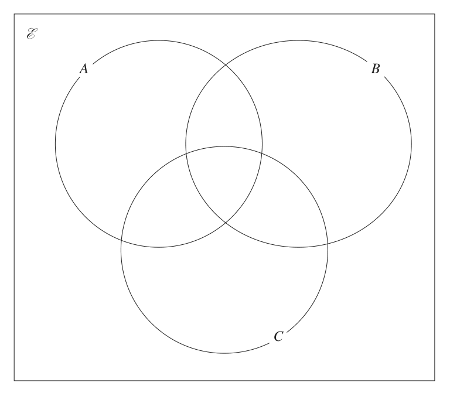
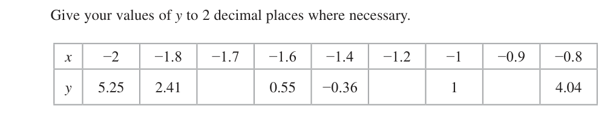
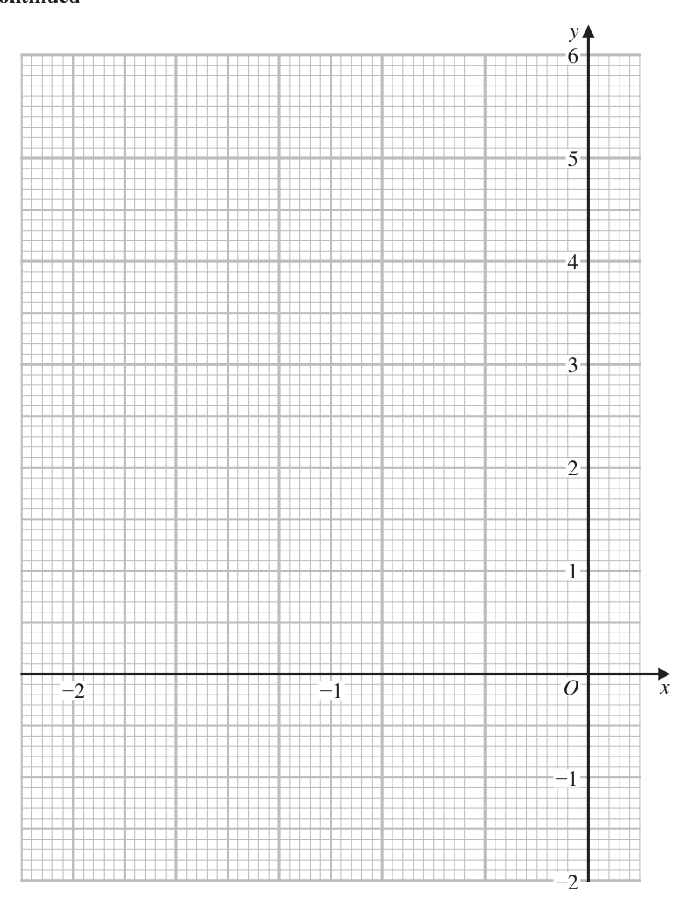
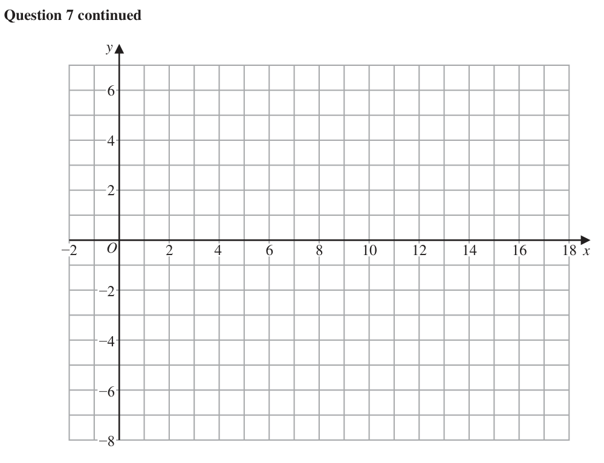
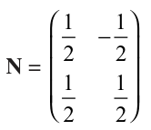
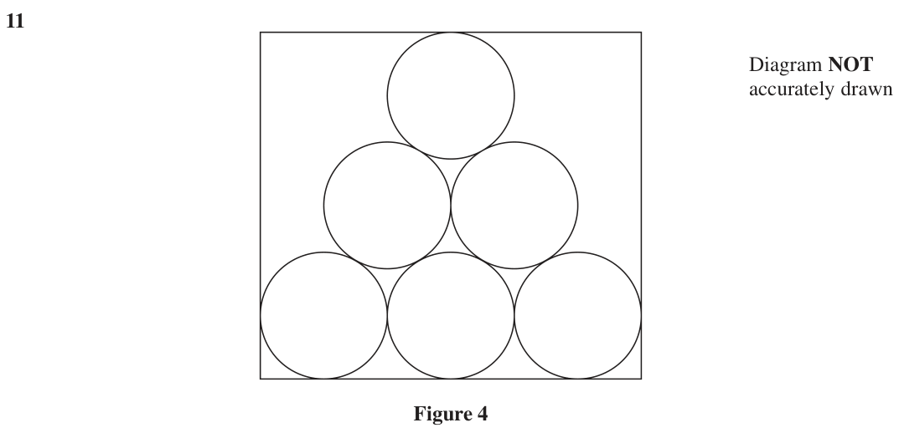

# 4MB1/02R — 2021-01 (official extraction)

> schema `syllabai.official-paper-questions/0.2` · paper_id `pearson-edexcel:international-gcse:mathematics-b:4mb1:2021-01:4MB1/02R` · qp sha256 `7a76434de17d2bf6…` · extraction is the disclosed baseline (ADR-039)

## Question 1 (9 marks)

E is the universal set and A, B and C are three sets such that E = {even numbers between 5 and 31} A = {factors of 24} B = {8, 16} C = {multiples of 6} The Venn diagram on the opposite page can be used to show these sets.

### 1(a) [3]

E is the universal set and A, B and C are three sets such that E = {even numbers between 5 and 31} A = {factors of 24} B = {8, 16} C = {multiples of 6} The Venn diagram on the opposite page can be used to show these sets.

Complete the Venn diagram for the sets ℰ, A, B and C List the elements of the set

> *Figure not shown in this reconstruction — the printed paper includes a diagram (not drawn accurately). Use the text description to work through it.*

**Mark scheme answer**

> Correct Venn 3 B3 all regions (including empty regions) correct
> diagram B2 for at least three (non-empty) regions correct,
> B1 for two (non-empty) regions correct
> Repeated values do not gain additional penalties
> (eg. if region A B C ' contains 8 and region
> A ' B C ' contains 8 and 16. The first would be
> considered correct and the second incorrect)

- **(3)** Correct Venn 3 B3 all regions (including empty regions) correct

### 1(b) [1]

A ∩ C

**Mark scheme answer**

> 6, 12, 24 1 B1 correct or ft their Venn diagram – accept in any
> brackets eg. {6,12,24}

- **(1)** 6, 12, 24 1 B1 correct or ft their Venn diagram – accept in any

### 1(c) [1]

(A ∪ B ∪ C)′ Find

**Mark scheme answer**

> 10, 14, 20, 22, 1 B1 correct or ft their Venn diagram – accept in any
> 26, 28 brackets eg, {10, 14, 20, 22, 26, 28}

- **(1)** 10, 14, 20, 22, 1 B1 correct or ft their Venn diagram – accept in any

### 1(d) [1]

n ([A ∪ B]′)

**Mark scheme answer**

> 8 1 B1 correct or ft SC
> their Venn diagram (d) 10,14,18,20,22,26,28,30

- **(1)** 8 1 B1 correct or ft SC

### 1(e) [1]

n ([A ∩ B] ∪ C) A number is selected at random from ℰ

**Mark scheme answer**

> 6 1 B1 correct or ft (e) 6,8,12,18,24,30
> their Venn diagram ft their Venn diagram scores B0B1

- **(1)** 6 1 B1 correct or ft (e) 6,8,12,18,24,30

### 1(f) [2]

Find the probability that the number is in set B E A B C for a spare copy of the Venn diagram. Only use this Venn diagram if you wish to replace your answer to part (a) E A B C

> *Figure not shown in this reconstruction — the printed paper includes a diagram (not drawn accurately). Use the text description to work through it.*

**Mark scheme answer**

> 2 M1 where n is 13 or the number of elements in their ℰ,
> their n may be seen in working
> 2 2 A1 oe cao
> Total 9 marks

- **(2)** 2 M1 where n is 13 or the number of elements in their ℰ,

## Question 2 (8 marks)

Each year the students at a college organise a music concert. In 2017, the total cost of organising the concert was $675 In 2018, the total cost of organising the concert was 20% more than the total cost in 2017

### 2(a) [2]

Each year the students at a college organise a music concert. In 2017, the total cost of organising the concert was \$675 In 2018, the total cost of organising the concert was 20% more than the total cost in 2017

Calculate the total cost of organising the concert in 2018 The tickets sold each year were either adult tickets or student tickets. In 2019, the total number of tickets sold was 385 In 2019, the number of adult tickets sold and the number of student tickets sold were in the ratio number of adult tickets : number of student tickets = 19 : 16

**Mark scheme answer**

> 675 ×1.2 or 675 + 0.2 × 675 M1 complete method to increase by 20%
> (\$)810 2 A1

- **(2)** 675 ×1.2 or 675 + 0.2 × 675 M1 complete method to increase by 20%

### 2(b) [2]

Calculate the number of adult tickets sold in 2019 In 2019, the price of each adult ticket sold was \$8.50 and the price of each student ticket sold was \$4.50

**Mark scheme answer**

> 19 385
> 385 M1 oe e.g. ×19
> 19 16 19 + 16
> 209 2 A1

- **(2)** 19 385

### 2(c) [2]

Calculate the total amount of money, in \$, received for all the tickets sold in 2019 In 2019, the total cost of organising the concert was double the total cost in 2017

**Mark scheme answer**

> "209"× 8.50 + (385 − "209") × 4.50 M1
> (\$)2568.50 2 A1 allow (\$)2568.5

- **(2)** "209"× 8.50 + (385 − "209") × 4.50 M1

### 2(d) [2]

Calculate the percentage profit made in 2019 Give your answer to 1 decimal place.

**Mark scheme answer**

> "2568.50"− 2 × "675" M1 complete method to find % profit.
> ×100 or
> "2568.50"
> ×100 − 100
> 90.3(%) 2 A1 allow awrt 90.3
> Total 8 marks

- **(2)** "2568.50"− 2 × "675" M1 complete method to find % profit.

## Question 3 (6 marks)

The equation of a curve is y = −2x3 + 6x + x2

### 3(a) [2]

The equation of a curve is y = −2x3 + 6x + x²

Complete the table of values for y = −2x3 + 6x + x² Give your values of y to 2 decimal places where necessary. x −2 −1.8 −1.7 −1.6 −1.4 −1.2 −1 −0.9 −0.8 y 5.25 2.41 0.55 −0.36 1 4.04

**Mark scheme answer**

> 1.36, −0.27, 2 B2 awrt. Penalise rounding to 1dp once only.
> 2.23 (−1eeoo)

- **(2)** 1.36, −0.27, 2 B2 awrt. Penalise rounding to 1dp once only.

### 3(b) [3]

On the grid opposite, plot the points from your completed table and join them to form a smooth curve.

**Mark scheme answer**

> Plots 9 points with at least 6 correct ± 1 3 M1 Attempts to plot the 9 points with at least 6 correct
> small square ±1 small square. (Allow if curve goes through the points)
> Draws a smooth curve through at least 6 M1 drawing a smooth curve through at least 6 of their
> points points. Do not allow if they use straight lines. Allow ±1
> small square from their point.
> Fully correct A1 A fully correct curve. All Points plotted correctly with
> curve a smooth curve through all the points.

- **(3)** Plots 9 points with at least 6 correct ± 1 3 M1 Attempts to plot the 9 points with at least 6 correct

### 3(c) [1]

Use your graph to find an estimate, to 2 decimal places, for the minimum value of −2x3 + 6x + 2 for values of x in −2 ≤ x ≤ −0.8

**Mark scheme answer**

> −0.36 to − 0.55 1 B1ft (answer must be consistent with their graph)
> Condone value given as a coordinate with an x ordinate of
> –1.4 ≤ x < –1.2
> Total 6 marks

- **(1)** −0.36 to − 0.55 1 B1ft (answer must be consistent with their graph)

## Question 4 (9 marks)

Ramesh, Maya, Kalil, Chen and Andreia each have a bag containing an identical set of six cards. There is a number on each of the six cards. Here are the cards in each of the bags. 2 4 4 7 9 10 Ramesh takes at random one of the six cards in his bag.

### 4(a) [1]

Write down the probability that the number on the card Ramesh takes is a prime number. Maya takes at random from her bag two of the six cards in her bag.

**Mark scheme answer**

> 1 1
> B1 (oe e.g. ) Accept 0.33 or better
> 3

- **(1)** 1 1

### 4(b) [2]

Find the probability that neither of the two cards has a number 4 on it. Kalil takes at random from his bag two of the six cards in his bag.

**Mark scheme answer**

> 4 3 2 M1
> ×
> 6 5
> 2 A1 (oe)

- **(2)** 4 3 2 M1

### 4(c) [2]

Find the probability that the total of the two numbers on the cards is 11 Chen takes at random one card at a time, without replacement, from her bag until she gets a card with a number 4 on it. She then stops taking cards from her bag.

**Mark scheme answer**

> ⎛1 1⎞ ⎛2 1⎞ 2 M1
> 2⎜ × ⎟ + 2⎜ × 6 5⎠ ⎝ 6 5⎠
> 1 A1 (oe)
> ⎛1 1⎞ ⎛2 1⎞ ⎛ 6 ⎞ B1
> SC 2 ⎜ × ⎟ + 2 ⎜ × = 6 6⎠ ⎝6 6⎠ ⎝ 36 ⎠

- **(2)** ⎛1 1⎞ ⎛2 1⎞ 2 M1

### 4(d) [2]

Find the probability that Chen stops taking cards from her bag before she takes the fourth card. Andreia puts another card with a number on it into her bag so that she has seven cards in her bag. The mean of the numbers on the seven cards in Andreia’s bag is 8

**Mark scheme answer**

> 2 ⎛4 2⎞ ⎛4 3 2⎞ 2 2 4 1 2 1
> +⎜ × ⎟+⎜ × × ⎟ M1 Allow + + or 1 − − or 1 − for this mark
> 6 ⎝6 5⎠ ⎝6 5 4⎠ 6 15 5 15 15
> ⎛ 4 3 2 2⎞ ⎛4 3 2 1⎞
> or 1 − ⎜ × × × ⎟ − ⎜ × × × 6 5 4 3⎠ ⎝ 6 5 4 3⎠
> or 1 − × ×
> 6 5 4
> 4 A1 (oe)

- **(2)** 2 ⎛4 2⎞ ⎛4 3 2⎞ 2 2 4 1 2 1

### 4(e) [2]

Find the value of the number on the card that Andreia put into her bag.

**Mark scheme answer**

> 2 + 4 + 4 + 7 + 9 + 10 + x 2 M1 (oe)
> =8
> 20 A1
> Total 9 marks

- **(2)** 2 + 4 + 4 + 7 + 9 + 10 + x 2 M1 (oe)

## Question 5 (9 marks)

D Diagram NOT accurately drawn 10.6 cm C E 34° 65° B A 9.2 cm Figure 1 In Figure 1, ABCDE is a circle. AB = 9.2 cm AD = 10.6 cm ∠BAD = 65° ∠CBD = 34°

### 5(a) [2]

Calculate the length, in cm to 3 significant figures, of BD.

**Mark scheme answer**

> $BD^2$ = $10.6^2$ + $9.2^2$ − 2 (10.6 )(9.2 ) cos 65 M1 Any correct method to find BD or $BD^2$ allow once a
> correct equation in BD is formed
> 10.7 (cm) 2 A1 awrt 10.7

- **(2)** $BD^2$ = $10.6^2$ + $9.2^2$ − 2 (10.6 )(9.2 ) cos 65 M1 Any correct method to find BD or $BD^2$ allow once a

### 5(b) [1]

Explain why ∠BCD = 115°

**Mark scheme answer**

> Opposite 1 B1 (minimum reasoning shown in bold)
> angles in a
> cyclic
> quadrilateral
> sum to 180

- **(1)** Opposite 1 B1 (minimum reasoning shown in bold)

### 5(c) [2]

Calculate the length, in cm to 3 significant figures, of BC. The point E is such that ΔBDE is isosceles, with DE = BE.

**Mark scheme answer**

> BC "10.7" M1 Any correct method to find BC allow once a correct
> = equation in BC is formed
> sin 31 sin115
> 6.08 (cm) 2 A1 awrt 6.08

- **(2)** BC "10.7" M1 Any correct method to find BC allow once a correct

### 5(d) [4]

Calculate the area, in cm² to 3 significant figures, of the quadrilateral BCDE. ⎡ ⎤ ⎢Cosine rule a = b + c − 2bc cos A⎥ 2 2 2 ⎢ a b c ⎥ ⎢ Sine rule = = ⎥ ⎢ sin A sin B sin C ⎥ ⎢ 1 ⎥ ⎢ Area of triangle = ab sin C ⎥ ⎣⎢ 2 ⎦⎥

**Mark scheme answer**

> Area of M1 Any correct method to find area of ΔBDC
> ΔBDC = × "10.7"× "6.08"sin 34(= 18.2)
> 0.5 × "10.7" M1 Any correct method to find the height of ΔBDE or
> Height of ΔBDE , h = (= 8.40) BE or DE (BE = DE = 9.96)
> tan 32.5
> "10.7" BE
> or =
> sin 65 sin 57.5
> Or
> "10.7" BE 2 BE 2 2 BE BE cos65
> 1 M1dep (dependent on previous M mark) using their h and
> Area of ΔBDE = × "10.7"× "8.40" or
> 2 BD or their BE or DE (for reference: = 44.960…)
> Area of ΔBDE = × ("9.96") × sin 65
> 63.2 (cm²) 4 A1 awrt 63.1 or 63.2

- **(4)** Area of M1 Any correct method to find area of ΔBDC

## Question 6 (13 marks)

The two functions, f and g, are defined for all values of x as f : x ↦ 3x + 1 g : x ↦ x2 − 2

### 6(a) [2]

The two functions, f and g, are defined for all values of x as f : x ↦ 3x + 1 g : x ↦ x² − 2

Find (i) g (−3) (ii) fg (1)

**Mark scheme answer**

> *The official mark scheme line for this part was not captured by the digitised extraction — treat the worked values above the line with care and check against the paper's own mark scheme.*

### 6(b) [1]

Write down the range of g

**Mark scheme answer**

> g ( x ) ≥ −2 1 B1 Accept y ≥ –2, g ≥ –2, [–2,∞) or [–2,∞[

- **(1)** g ( x ) ≥ −2 1 B1 Accept y ≥ –2, g ≥ –2, [–2,∞) or [–2,∞[

### 6(c) [1]

Express the composite function gf in the form gf : x ↦ … The function h is defined as 2x − 1 h:xα where x ≠ −3 x+3

**Mark scheme answer**

> ( 3x + 1) − 2
> 2 1 B1 oe ISW if expanded

- **(1)** ( 3x + 1) − 2

### 6(d) [2]

Solve the equation h (x) = 1

**Mark scheme answer**

> 2x −1 = x + 3 M1 Correct equation with fraction removed
> x=4 2 A1

- **(2)** 2x −1 = x + 3 M1 Correct equation with fraction removed

### 6(e)(i) [?]

Express the inverse function h−1 in the form h−1 : x ↦ …

**Mark scheme answer**

> y ( x + 3) = 2 x − 1 or x ( y + 3) = 2 y − 1 or M1 for removing fraction (oe)
> 7
> y = 2− or x = 2 −
> x+3 y+3
> x ( 2 − y ) = 1 + 3 y or y ( 2 − x ) = 1 + 3x or M1dep for collecting terms in x and factorising
> allow one slip
> 7
> x+3= or y + 3 =
> 2− y 2− x
> ( h : x ) 12+−3xx
> −1
> A1 oe (must be in terms of x) Accept
> 2− x
> −3

### 6(e)(ii) [4]

Write down the value of x that must be excluded from the domain of h−1

**Mark scheme answer**

> 2 4 B1ft – follow through their inverse provided of
> ax + b b
> the form or a +
> cx + d cx + d
> for non-zero a, b, c and d

- **(4)** 2 4 B1ft – follow through their inverse provided of

### 6(f) [3]

Find the exact values of p for which 4gf ( p) = fh−1 (1) Show your working clearly. a± b Give your values in the form where a, b and c are integers. c ⎡ −b ± b 2 − 4ac ⎤ ⎢Solutions of ax 2 + bx + c = 0 are x = ⎥ ⎣ 2a ⎦

**Mark scheme answer**

> fh −1 (1) = f ( 4 )( = 13) M1 for correct order of operations to find their
> fh −1 (1) may be embedded within working
> 21 M1dep – correct order of operations to find p
> 3 p +1 = ± or or correct formations of quadratic trinomial
> ( 36 p 2 + 24 p − 17(= 0) ) and substitution into a
> −24 ± 242 − 4 × 36 × −17 correct formula
> ( p =)
> 2 × 36 ft their gf as long as this is a quadratic
> trinomial (eg. Do not ft gf(x) = 9x2 – 1)
> −2 ± 21 3 A1 (oe exact)
> p=
> Total 13 marks

- **(3)** fh −1 (1) = f ( 4 )( = 13) M1 for correct order of operations to find their

## Question 7 (9 marks)

The points with coordinates (2, 2), (5, 2) and (4, −1) are the vertices of triangle A.

### 7(a) [1]

The points with coordinates (2, 2), (5, 2) and (4, −1) are the vertices of triangle A.

On the grid, draw and label triangle A. Triangle A is transformed to triangle B under the transformation with matrix M where ⎛ 1 2⎟ M= −1 − 1 2⎠

**Mark scheme answer**

> Triangle A drawn 1 B1 Don’t penalise missing labels in any part of
> correctly this question.

- **(1)** Triangle A drawn 1 B1 Don’t penalise missing labels in any part of

### 7(b) [2]

On the grid, draw and label triangle B. Triangle B is transformed to triangle C under the transformation with matrix N where ⎛1 1⎞ − ⎜2 2⎟ N= 1 1 2 2⎠

**Mark scheme answer**

> ⎛3 2 ⎞⎛ 2
> 5 4 M1 for correct matrix multiplication with at
>  least one correct coordinate or two correct
> ⎝ −1 − 2 ⎠ ⎝ 2 2 −1⎠
> coordinates found or one correct coordinate
> plotted.
> Triangle B drawn 2 A1 For reference coordinates are
> correctly ( 7, −3) , (16, −6) , (11.5, −3.5)

- **(2)** ⎛3 2 ⎞⎛ 2

### 7(c) [2]

On the grid, draw and label triangle C. Triangle B is the image of triangle C under the transformation with matrix P

**Mark scheme answer**

> ⎛ 12 − 12 ⎞⎛ 7 16 11.5 ⎞ M1 ft for correct matrix multiplication with at
> 1 1 least one correct coordinate or two correct
> ⎝2 2 ⎠ ⎝ −3 −6 −3.5 ⎠
> coordinates found or one correct coordinate
> plotted. (following through their answer to (b))
> Triangle C drawn 2 A1 cao For reference coordinates are
> correctly (5, 2) , (11,5) , ( 7.5, 4)

- **(2)** ⎛ 12 − 12 ⎞⎛ 7 16 11.5 ⎞ M1 ft for correct matrix multiplication with at

### 7(d) [2]

Find the matrix P Triangle A is transformed to triangle C under the transformation with matrix Q

**Mark scheme answer**

> 1 ⎛ 12 12 ⎞ M1 for attempt at N −1 with either correct
> or
> ( 12 )( 12 ) − ( 12 )( − 12 ) − 12 12 determinant or correct elements in 2 by 2
> matrix or sufficient linear equations to find the
> 2 equations from each set of 3 terms of the matrix N −1 seen.
> 5a + 2b = 7, 11a + 5b = 16 , 7.5a + 4b = 11.5
> 5c + 2d = –3, 11c + 5d = –6 , 7.5c + 4d = –3.5
> ⎛ 1 1⎞ 2 A1 oe do not ISW
>  −1 1 

- **(2)** 1 ⎛ 12 12 ⎞ M1 for attempt at N −1 with either correct

### 7(e) [2]

Find the matrix Q.

[The inverse of matrix $\begin{pmatrix} a & b \\ c & d \end{pmatrix}$ is $\frac{1}{ad-bc}\begin{pmatrix} d & -b \\ -c & a \end{pmatrix}$]

**Mark scheme answer**

> ⎛ 1 − 1 ⎞⎛ 3
> 2 
> M1 Matrix multiplication seen, must be in the
> Q = NM = ⎜ 12 1 2 1⎟
> or correct order or sufficient linear equations to
> ⎝ 2 2 ⎠⎝ − 1 − 2⎠
> find the terms of the matrix Q seen.
> 2 equations from each set of 3
> 2a + 2b = 5, 5a + 2b =11, 4a – b = 7.5
> 2c + 2d =2, 5c +2d = 5, 4c – d =4
> ⎛ 2 12 ⎞ 2 A1 oe
>  1 0
> C
> A
> B

- **(2)** ⎛ 1 − 1 ⎞⎛ 3

## Question 8 (10 marks)

E B x cm F D A C 3x cm G K H J (x − 2) cm 2x cm Figure 2 Figure 2 shows a solid right pentagonal prism ABCDEFGHJK which is made by fixing a solid right triangular prism ABCDEF onto a solid cuboid ACDFGHJK. The triangle ABC is isosceles with BA = BC and the height of the triangle is x cm. AH = FG = CJ = DK = 3x cm AC = HJ = FD = GK = 2x cm HG = JK = AF = CD = (x − 2) cm The volume of the pentagonal prism is 1008 cm3

### 8(a) [4]

E B x cm F D A C 3x cm G K H J (x − 2) cm 2x cm Figure 2 Figure 2 shows a solid right pentagonal prism ABCDEFGHJK which is made by fixing a solid right triangular prism ABCDEF onto a solid cuboid ACDFGHJK. The triangle ABC is isosceles with BA = BC and the height of the triangle is x cm. AH = FG = CJ = DK = 3x cm AC = HJ = FD = GK = 2x cm HG = JK = AF = CD = (x − 2) cm The volume of the pentagonal prism is 1008 cm³

Show that x³ − 2x2 − 144 = 0 Given that f (x) = x³ − 2x2 − 144

**Mark scheme answer**

> [Volume of ACDFGHJK = ] M1 correct expression for the volume of
> 3x × 2 x × ( x − 2 ) ⎡⎣ = 6 x³ − 12 x 2 ⎤⎦ or ACDFGHJK or the area of ABC or half the
> area of ABCJH
> [Area of ABC =] × x × 2 x ⎡⎣ = x 2 ⎤⎦ or
> 1 7 2
> [Half Area of ABCJH =] 3x 4 x x x
> 2
> [Volume of ABCDEF = ] M1 correct expression for the volume of
> 1 ABCDEF or the area of ABCJH
> x × 2 x × ( x − 2 ) ⎡⎣ = x³ − 2 x 2 ⎤⎦ or
> [Area of ABCJH =] × x × 2 x + 2 x × 3x ⎡⎣ = 7 x 2 ⎤⎦ or
> [Area of ABCJH =] 2 3x 4 x x 7 x 2
> 1 M1 dep on both previous M marks
> 3x ( 2 x )( x − 2 ) + x ( 2 x )( x − 2 ) = 1008 or
> ⎛1 × x × 2 x + 2 x × 3x ⎟ × ( x − 2 ) = 1008 or
> ⎝2 ⎠
> 2 3x 4 x x x 2 1008
> 6 x 2 ( x − 2 ) + x 2 ( x − 2 ) = 1008 x³ − 2 x² − 144 = 0 4 A1 – note that AG so sufficient working must
> be shown
> ⇒ 6 x³ − 12 x 2 + x³ − 2 x 2 = 1008 Must see all M marks and at least additional
> ⇒ 7 x³ − 14 x 2 − 1008 = 0 stage towards the final answer.

- **(4)** [Volume of ACDFGHJK = ] M1 correct expression for the volume of

### 8(b) [2]

use the factor theorem to show that (x − 6) is a factor of f (x)

**Mark scheme answer**

> 63 − 2 ( 6 ) − 144
> 2 M1 (M0 if long division used)
> 63 − 2 ( 6 ) − 144 = 0
> 2 A1 – must have = 0

- **(2)** 63 − 2 ( 6 ) − 144

### 8(c)(i) [?]

Find the value of p, the value of q and the value of r so that f (x) = (x − 6)( px2 + qx + r)

**Mark scheme answer**

> ( x − 6 ) ( x 2 + 4 x + 24 ) 4 M1 Any two terms of the quadratic correct
> ( x − 6 ) ( x 2 + 4 x + 24 ) p = 1, q = 4, r = 24 A1 Accept correct quadratic factor given

### 8(c)(ii) [4]

Hence explain why the equation f (x) = 0 has only one solution. ⎡ −b ± b 2 − 4ac ⎤ ⎢Solutions of ax + bx + c = 0 are x = ⎥ ⎣ 2a ⎦

**Mark scheme answer**

> −4 ± 42 − 4 (1)( 24 ) M1 for correct first step for solving quadratic
> ( x + 2 ) + 20 = 0 or ( x = )
> or for x or considering discriminant.
> 2 FT their quadratic found in (i)
> ( Δ = ) 4 − 4 (1)( 24) [= −80]
> f ( x ) = 0 has only A1 – note that answer given so sufficient
> working must be shown
> one solution with a
> Must correctly evaluate discriminant ( –80) and
> reason why
> refer to sign or correctly show solving involves
> quadratic has no real
> square rooting a negative.
> roots
> Total 10 marks

- **(4)** −4 ± 42 − 4 (1)( 24 ) M1 for correct first step for solving quadratic

## Question 9 (7 marks)

The equation of a curve C is y = x (2x − 3)(x + 2) The point P lies on C The x coordinate of P is a Find the range of values of a for which the gradient of C at P is at least −2 Show clear algebraic working. (7)

### 9 [7]

The equation of a curve C is y = x (2x − 3)(x + 2) The point P lies on C The x coordinate of P is a Find the range of values of a for which the gradient of C at P is at least −2 Show clear algebraic working.

**Mark scheme answer**

> y = x ( 2 x 2 + x − 6 ) = 2 x³ + x 2 − 6 x M1 for attempt to expand (allow one error)
> Attempt to differentiate M1 for at least two terms of their y
> differentiated correctly
> dy A1
> = 6x2 + 2x − 6
> dx
> "6a 2 + 2a − 6" ≥ −2 M1 dep on first 2 M marks
> for setting up suitable inequality. Allow > sign
> rather than ≥
> May be implied by the final method mark.
> ( 3a − 2)( a + 1) ≥ 0 M1 indep. attempt to solve their three-term
> quadratic allow any trinomial inequality or
> ⇒ c.v. , −1 equation seen.
> 3 Factorising must expand to give two terms of
> their quadratic.
> Formula substitution into correct formula
> attempted (either correct expression seen or
> correct formula seen and an expression with a
> maximum of one error seen,)
> M1 for a ≥ b, a ≤ c with their critical values b,
> c where b > c (choosing the outside region)
> Allow > sign rather than ≥
> 2 7 A1 (oe) – condone x for a for full marks
> a≥ or a ≤ −1

- **(7)** y = x ( 2 x 2 + x − 6 ) = 2 x3 + x 2 − 6 x M1 for attempt to expand (allow one error)

## Question 10 (14 marks)

C F B Diagram NOT accurately drawn c X D O A a Figure 3 → → Figure 3 shows a rectangle OABC in which OA = a and OC = c F is the midpoint of CB and D is the point on AB such that AD : DB = 2 : 3

**(a)** Find → →

### 10(a)(i) [2]

C F B Diagram NOT accurately drawn c X D O A a Figure 3 → → Figure 3 shows a rectangle OABC in which OA = a and OC = c F is the midpoint of CB and D is the point on AB such that AD : DB = 2 : 3

CF in terms of a (ii) AD in terms of c The lines OD and AF intersect at the point X → → → → Given that OX = λOD and AX = μAF , where λ and μ are scalars …………… , ……………

**Mark scheme answer**

> 1 B1
> a

- **(2)** 1 B1

### 10(b) [7]

find the value of λ and the value of μ Given that OX : XD = n : 1

**Mark scheme answer**

> (OX = ) λ a + " 52 c " M1 ft their AD
> ( AX = ) μ c − 12 a 1 
> M1 ft their CF μ ⎜ c + a − " a " 2 ⎠
> M1
> (OX = ) a + μ c − 12 a or using OX − AX = OA
> to set up an equation with λ and µ
> ⎛ 2 ⎞ ⎛ 1 ⎞ M1 oe correct vector equations following
> " λ ⎜ a + c ⎟ " = "a + μ ⎜ c − a ⎟ " through their answers in (a)
> ⎝ 5 ⎠ ⎝ 2 ⎠
> 1 2 M1 dep on previous mark
> λ = 1 − μ and λ = μ for comparing components of a and c
> 2
> 2⎛ 1 ⎞ 1⎛2 ⎞ M1
> ⎜1 − μ ⎟ = μ or λ = 1 − ⎜ λ ⎟ oe for attempt to solve for µ or λ
> 5⎝ 2 ⎠ 2⎝5 ⎠
> Award for an equation in one variable that
> follows from their comparison of components.
> 1 5 7 A1
> μ = ,λ =
> 3

- **(7)** (OX = ) λ ⎛⎜⎝ a + " 52 c "⎞⎟⎠ M1 ft their AD

### 10(c) [1]

find the value of n Given also that | a | = 12 cm and | c | = 12.5 cm …………… , ……………

**Mark scheme answer**

> 5 5 1 B1ft using their value of λ
> OX = OD
> 6 Accept 5:1 for the final answer.

- **(1)** 5 5 1 B1ft using their value of λ

### 10(d) [4]

find the area, in cm², of quadrilateral XDBF

**Mark scheme answer**

> c = 12.5 ⇒ AD = 5 B1
> 1 M1 Correct method to find area of triangle
> Area of ΔOAD = ×12 × "5"[ = 30] or
> 2 OAD or ADX
> 1 ⎛1 ⎞
> Area of ΔADX = × "5"× ⎜ ×12 ⎟ [ = 5] or
> 2 ⎝6 ⎠
> 1 ⎛ ⎛ 6 ⎞⎞
> × sin tan −1 × "5"× " "× 6 + 12.5 [ = 5]
> 2
> 2 ⎝ ⎝ 12.5 ⎠ ⎠
> ⎛ 5 ⎞ M1 Correct method to find area of triangle
> Area of ΔADX = ⎜1 − " " ⎟ × "30"[ = 5] and ABF and ADX
> ⎝ 6 ⎠
> Area of ΔABF = ×12.5 × 6 [ = 37.5]
> 32.5 (cm²) 4 A1

- **(4)** c = 12.5 ⇒ AD = 5 B1

## Question 11 (6 marks)

Diagram NOT accurately drawn Figure 4 Figure 4 shows six identical circles inside a rectangle. The radius of each circle is 12 cm. The radius of the circles is the greatest possible radius so that the circles fit inside the rectangle. The six circles form the pattern shown in Figure 4 so that • each circle touches at least two other circles • the circle in the top row of the pattern and the circles in the bottom row of the pattern touch at least one side of the rectangle • the centres of the circles all lie on the perimeter of a single triangle Show that the total area of the six circles is almost 57.5% of the area of the rectangle. (6)

### 11 [6]

Diagram NOT accurately drawn Figure 4 Figure 4 shows six identical circles inside a rectangle. The radius of each circle is 12 cm. The radius of the circles is the greatest possible radius so that the circles fit inside the rectangle. The six circles form the pattern shown in Figure 4 so that • each circle touches at least two other circles • the circle in the top row of the pattern and the circles in the bottom row of the pattern touch at least one side of the rectangle • the centres of the circles all lie on the perimeter of a single triangle Show that the total area of the six circles is almost 57.5% of the area of the rectangle.

**Mark scheme answer**

> [Length of rectangle = ]72 6 B1 (May be seen within working)
> (
> [Area of circles = ] 6 π (12 )
> ) [= 2714(4sf )] B1 Accept 864π
> $24^2$ − $12^2$ [ = 20.8] or M1 for finding the vertical distance between
> the centres of two circles on adjacent rows or
> $48^2$ − $24^2$ [= 41.6] or between the top circle and the bottom row
> 2 × 12 × sin 60 or 4 × 12 × sin 60
> 2 ×12 + 2 × "20.8"[ = 65.6] M1dep for finding total height of the rectangle
> oe e.g. 2 (12 ) + "41.6" or 24 + 24 3
> "2714" M1 dep
> ×100 NB 72 × 65.6 = value between 4720 and 4724
> "72"× "65.6"
> 57.5% A1 AG must see sufficient working to award
> all method marks their expression must
> evaluate to awrt 57.5
> SC Misread diameter =12cm can gain B0B0M1M1M1A1
> [Length of rectangle = ]36 6 B0
> (
> [Area of circles = ] 6 π ( 6 )
> ) [= 678.6(4sf )] B0
> $12^2$ − $6^2$ [= 10.4] or M1 for finding the vertical distance between
> the centres of two circles on adjacent rows or
> $24^2$ − $12^2$ [ = 20.8] or between the top circle and the bottom row
> 2 × 6 × sin 60 or 4 × 6 × sin 60
> 2 × 6 + 2 × "10.4"[ = 32.8] M1dep for finding total height of the rectangle
> oe e.g. 2 ( 6 ) + "20.8" or 12 + 12 3
> "678.6" M1 dep
> ×100
> "36"× "32.8" NB 36 × 32.8 = value between 1180 and 1181
> 57.5% A1 AG must see sufficient working to award
> all method marks their expression must
> evaluate to awrt 57.5

- **(6)** [Length of rectangle = ]72 6 B1 (May be seen within working)

