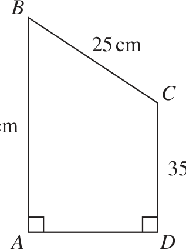
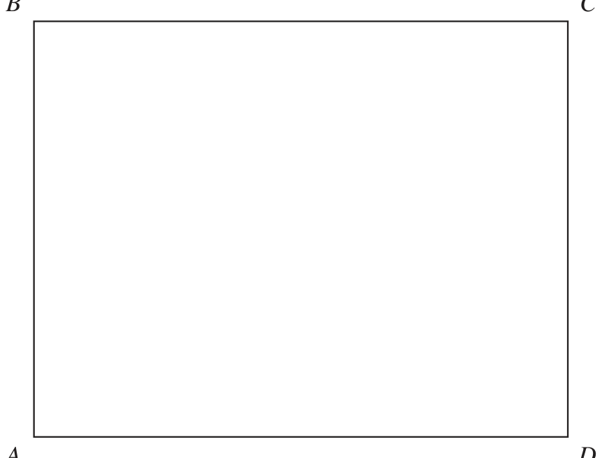
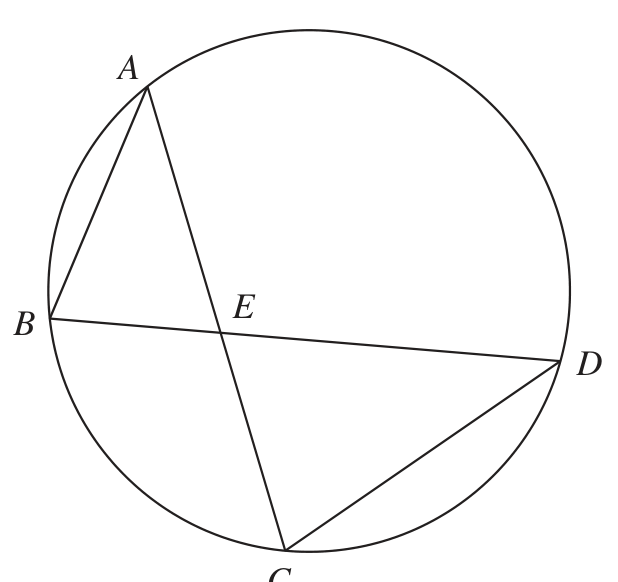
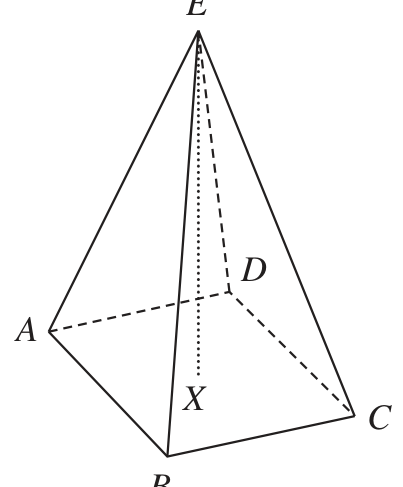
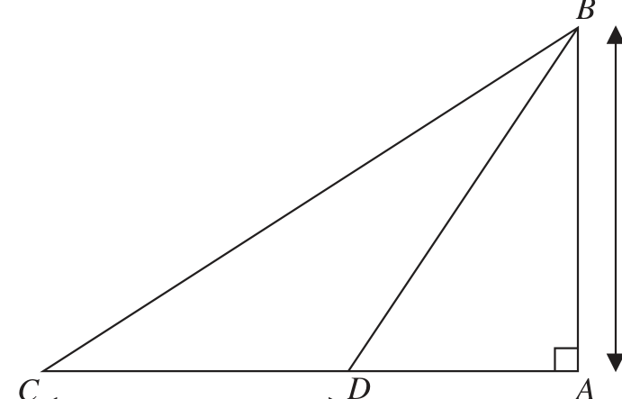
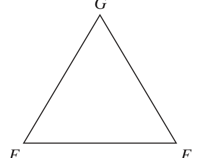
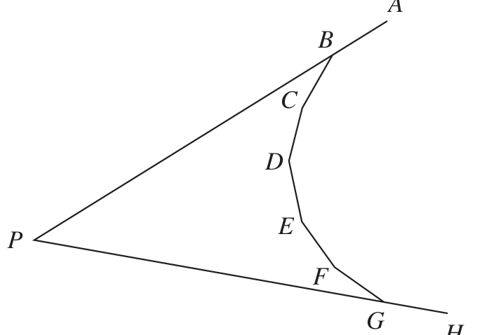

# 4MB1/01 — 2021-06 (official extraction)

> schema `syllabai.official-paper-questions/0.2` · paper_id `pearson-edexcel:international-gcse:mathematics-b:4mb1:2021-06:4MB1/01` · qp sha256 `2df233cbb53e1eb4…` · extraction is the disclosed baseline (ADR-039)

## Question 1 (2 marks)

Factorise fully 8 xy 2 − 18 xy

### 1 [2]

Factorise fully 8 xy 2 − 18 xy

**Mark scheme answer**

> 2 x(4 y 2 − 9 y) or 2 y(4 xy − 9 x) or M1 Correct partial factorisation by taking out a common factor
> consisting of at least 2 different terms. Implied by correct
> xy(8 y − 18) answer. Do Not ISW
> 2 xy(4 y − 9) 2 A1 Completely correct
> Total 2 marks

- **(2)** 2 x(4 y 2 − 9 y) or 2 y(4 xy − 9 x) or M1 Correct partial factorisation by taking out a common factor

## Question 2 (2 marks)

A pattern is made using a four by four grid with both grey squares and white squares.

### 2(a) [1]

Shade one more square to make a pattern with exactly one line of symmetry.

**Mark scheme answer**

> 1 B1 No other squares shaded

- **(1)** 1 B1 No other squares shaded

### 2(b) [1]

Shade two more squares to make a pattern that has rotational symmetry of order 2

**Mark scheme answer**

> 1 B1 No other squares shaded
> Total 2 marks

- **(1)** 1 B1 No other squares shaded

## Question 3 (2 marks)

Make x the subject of y = t x + 4 y 2

### 3 [2]

Make x the subject of y = t x + 4 y 2

**Mark scheme answer**

> y 4 y²
> y − 4 y 2 = tx or = x+ M1
> t t
> y 4 y² − y + 4 y²
> A1 oe eg x = − or x = Allow the other way
> t t −t
> y − 4 y²
> x= 2 y − 4 y²
> t round eg = x Working not required, so correct answer
> t
> scores full marks (unless from obvious incorrect working)

- **(2)** y 4 y²

## Question 4 (2 marks)

Each time Arhan plays a game of chess, the probability that he does not win is 0.64 Arhan plays 75 games of chess. Calculate an estimate for the number of games he wins.

### 4 [2]

Each time Arhan plays a game of chess, the probability that he does not win is 0.64 Arhan plays 75 games of chess. Calculate an estimate for the number of games he wins.

**Mark scheme answer**

> (1 − 0.64 ) × 75 or 0.64 × 75 or
> M1
> 75 − 0.64 × 75 oe
> A1 Working not required, so correct answer scores full marks (unless
> 27
> from obvious incorrect working)
> Total 2 marks

- **(2)** (1 − 0.64 ) × 75 or 0.64 × 75 or

## Question 5 (3 marks)

Solve the simultaneous equations 4 x + 4 y = 18 4 x + 6 y = 35 Show clear algebraic working. x = . . . . . . . . . . . . . . . . . . . . . .. . . . . . . . . . . . . . . . . . . . . . . . . . . . . . . . . y = . . . . . . . . . . . . . . . . . . . . . .. . . . . . . . . . . . . . . . . . . . . . . . . . . . . . . . .

### 5 [3]

Solve the simultaneous equations 4 x + 4 y = 18 4 x + 6 y = 35 Show clear algebraic working. x = y =

**Mark scheme answer**

> Method 1 Method 2
> 2 y = 17 oe 4 x = −16 oe M1 Eliminating either x or y to get a correct equation in one unknown
> M1 Subst their x or y value into either equation or start again. If
> 4 × ("− 4") + 6 y = 35 M1 has already been awarded this can be implied by a correct
> 4 x + 4 × "8.5" = 18
> value for x and y.
> or 4 x = −16 or 2 y = 17
> NB The Speech marks around the – 4 ("– 4") means this follows
> through from their value
> x= –4
> 3 A1 dep on 1st M1 being awarded
> y = 8.5
> M1 Correct calculation to find AD or[ AD =] 20

- **(3)** Method 1 Method 2

## Question 6 (3 marks)

B Diagram NOT accurately drawn 25 cm C 50 cm 35 cm A D The diagram shows a quadrilateral ABCD in which BC = 25 cm AB = 50 cm CD = 35 cm angle BAD = angle CDA = 90° Calculate the perimeter, in cm, of quadrilateral ABCD. ....................................................... cm

### 6 [3]

The diagram shows a quadrilateral ABCD in which BC = 25 cm AB = 50 cm CD = 35 cm angle BAD = angle CDA = 90° Calculate the perimeter, in cm, of quadrilateral ABCD cm

> *Figure not shown in this reconstruction — the printed paper includes a diagram (not drawn accurately).*
> Labels in the original figure: B, C, A, D · Figure values: 25, 50, 35.

**Mark scheme answer**

> [ AD =] 252 − ( 50 − 35) [ = 20]
> Allow using their h = ( 50 − 35 ) if marked on their diagram
> provided h is between 5 and 25. Must see the Pythagoras
> calculation eg 252 − 182
> NB Anything appearing in square brackets is not required
> [Perimeter =] 50 + 25 + 35 + "20" M1 dep on previous method mark being awarded. Follow through
> their "20".
> 130 3 A1 Working not required, so correct answer scores full marks (unless
> from obvious incorrect working)

- **(3)** [ AD =] 252 − ( 50 − 35) [ = 20]

## Question 7 (3 marks)

Michael’s age is n years. Navtej’s age is three times Michael’s age. Indre is 8 years younger than Navtej and 20 years older than Michael. Find the value of n. Show clear algebraic working. n = .......................................................

### 7 [3]

Michael’s age is n years. Navtej’s age is three times Michael’s age. Indre is 8 years younger than Navtej and 20 years older than Michael. Find the value of n. Show clear algebraic working. n =

**Mark scheme answer**

> Sight of 3n or 3n – 8 or n + 20 M1 One correct expression seen. May be seen as part of an equation
> n + 20 = 3n − 8 oe A1 Correct equation
> 14 3 A1 dep on previous A mark awarded
> Total 3 marks

- **(3)** Sight of 3n or 3n – 8 or n + 20 M1 One correct expression seen. May be seen as part of an equation

## Question 8 (3 marks)

B C A D The diagram shows the rectangle ABCD. The region R consists of all the points inside the rectangle that are

### 8 [3]

The diagram shows the rectangle ABCD. The region R consists of all the points inside the rectangle that are

A D The diagram shows the rectangle ABCD. The region R consists of all the points inside the rectangle that are (i) greater than 4 cm from B, (ii) closer to BA than to CD. Using ruler and compasses only and showing all your construction lines, show, by shading, the region R. Label the region R.

> *Figure not shown in this reconstruction — the printed paper includes a diagram.*
> Labels in the original figure: B, C, A, D.

**Mark scheme answer**

> M1 Ignore any parts outside of ABCD. Arc drawn should lie between
> Arc, centred B, radius 4 cm, drawn
> an arc radius 3.8 cm and arc radius 4.2 cm. It should intersect AB
> within ABCD
> and BC and be complete within ABCD
> 2 pairs of intersecting arcs of equal
> radius centred at A and D with line M1 Ignore any parts outside of ABCD. Construction lines must be
> drawn through intersection points shown. Line should lie between 4.3 cm and 4.7cm from AB.
> oe
> R identified
> A1 dep on both previous method marks awarded.
> by shading
> Allow just shading or just R if it is clear which the area is.
> and labelled
> Total 3 marks

- **(3)** M1 Ignore any parts outside of ABCD. Arc drawn should lie between

## Question 9 (3 marks)

A shopkeeper sells a radio for $27 For this selling price, the shopkeeper makes a profit of 8% Calculate the selling price of the radio so that the shopkeeper would make a profit of 35% $ .......................................................

### 9 [3]

A shopkeeper sells a radio for \$27 For this selling price, the shopkeeper makes a profit of 8% Calculate the selling price of the radio so that the shopkeeper would make a profit of 35% \$

**Mark scheme answer**

> 27 27 M1 For a correct method to find the original
> or ×100 [=25]
> 1.08 108 price.
> 27 135
> " "×1.35 or M1 dep on previous method mark being M2 for × 27 oe
> 1.08 108
> awarded. For a correct method to increase
> 27
> " ×100"+ × "25" oe their original price by 35%
> 108 100
> A1 oe Working not required, so correct answer scores full marks
> 33.75
> (unless from obvious incorrect working)

- **(3)** 27 27 M1 For a correct method to find the original

## Question 10 (3 marks)

The integer N is greater than 120 When N is divided by 28 the remainder is 3 When N is divided by 120 the remainder is 3 Find the least value of N. You must show your working.

### 10 [3]

The integer N is greater than 120 When N is divided by 28 the remainder is 3 When N is divided by 120 the remainder is 3 Find the least value of N. You must show your working.

**Mark scheme answer**

> 28 = 2 × 2 × 7 or 4 × 7
> 120 = 2 × 2 × 2 × 3 × 5 or 4 × 30 oe M1 For prime factorisation of 28 and 120 (may be at ends of a
> Or factor trees factor tree), must have 2 × 2… or 4 ×…
> 28 120 or for multiples of 120 up to at least 840
> or for multiples of 28 up to at least 840
> 2 14
> 2 7
> LCM (28, 120) = 840 A1 Allow 2 × 2 × 2 × 3 × 5 × 7
> A1ft For adding 3 to their LCM.
> 843 3 The M1 must be awarded. An answer with no working gains
> no marks
> Total 3 marks

- **(3)** 28 = 2 × 2 × 7 or 4 × 7

## Question 11 (3 marks)

Greg is organising a day out for his students. Each of his students has to choose to take part in at least one activity chosen from rock climbing (R) and canoeing (C ). The cost for rock climbing is $42 The cost for canoeing is $34 The total cost for all the activities chosen by the students is $3702 Given that n(R ∩ C ʹ ) = 32 and that n(R ∪ C ) = 68 find the number of Greg’s students who chose to take part in both rock climbing and canoeing.

### 11 [3]

Greg is organising a day out for his students. Each of his students has to choose to take part in at least one activity chosen from rock climbing (R) and canoeing (C ). The cost for rock climbing is \$42 The cost for canoeing is \$34 The total cost for all the activities chosen by the students is \$3702 Given that n(R ∩ C ʹ ) = 32 and that n(R ∪ C ) = 68 find the number of Greg’s students who chose to take part in both rock climbing and canoeing.

**Mark scheme answer**

> M1 Calculating the cost for either R or C. May be seen as part of a
> ( 68 − 32 ) × 34 or ( 32 + x ) × 42 oe calculation
> ( 68 − 32 ) × 34 + (32 + x) × 42 = 3702
> 3702 − 36 × 34 − 32 × 42 M1 Setting up a correct equation or expression.
> or oe
> A1 Working not required, so correct answer scores full marks
> 27
> (unless from obvious incorrect working)

- **(3)** M1 Calculating the cost for either R or C. May be seen as part of a

## Question 12 (3 marks)

Write as a single fraction in its simplest form x − 6 8x + 2 − 3 4 Show clear algebraic working.

### 12 [3]

Write as a single fraction in its simplest form x − 6 8x + 2 − 3 4 Show clear algebraic working.

**Mark scheme answer**

> 4( x − 6) − 3(8 x + 2) M1 Correct method to reduce to a single fraction. Condone
> oe invisible brackets if multiplied out correctly with one sign
> 12 error only. Implied by next M1
> 4 x − 24 − 24 x − 6 M1 Multiplying out correctly (allow one sign error if 4 terms
> oe given - if incorrect answer this line must be seen) If M1 has
> −10 x − 15 A1 oe with denominator of 6 or – 6 Dependent on both M marks
> 6 being awarded.
> Total 3 marks

- **(3)** 4( x − 6) − 3(8 x + 2) M1 Correct method to reduce to a single fraction. Condone

## Question 13 (3 marks)

Diagram NOT A accurately drawn B E D C In the diagram, A, B, C and D are points on a circle. BED and AEC are straight lines. Prove that triangle ABE is similar to triangle DCE.

### 13 [3]

In the diagram, A, B, C and D are points on a circle. BED and AEC are straight lines. Prove that triangle ABE is similar to triangle DCE.

> *Figure not shown in this reconstruction — the printed paper includes a diagram (not drawn accurately).*
> Labels in the original figure: A, B, E, D, C.

**Mark scheme answer**

> ∠BAE = ∠CDE
> angles in the same segment OR Allow BAC and CDB Do not accept other notations such as
> angles at the circumference subtend Aˆ and Dˆ
> from the same arc of the circle
> ∠ABE = ∠DCE Allow ABD and DCA Do not accept other notations such as
> angles in the same segment OR
> Bˆ and Cˆ
> angles at the circumference subtend
> from the same arc of the circle
> ∠BEA = ∠CED M2 For two correct corresponding pairs of angles with at least
> vertically opposite angle OR one correct reason. Words in bold needed. Allow ∠ for angles
> vertically opposite angle (Allow M1 for 2 correct corresponding pair of angles)
> Two/Three A1 A correct conclusion and 2 corresponding angles stated equal
> angles are equal with correct reason for both angles. Ignore a third angle given
> therefore ABE is even if incorrect.
> similar to DCE Allow Two/Three angles are equal therefore similar

- **(3)** ∠BAE = ∠CDE

## Question 14 (3 marks)

E Diagram NOT accurately drawn D A X C B The diagram shows a square based right pyramid ABCDE. The point X is the centre of the base so that the point E is vertically above X. EX = 15 cm AB = 8 cm Calculate the size, in degrees to 3 significant figures, of the acute angle between AE and AX. °

### 14 [3]

The diagram shows a square based right pyramid ABCDE. The point X is the centre of the base so that the point E is vertically above X. EX = 15 cm AB = 8 cm Calculate the size, in degrees to 3 significant figures, of the acute angle between AE and AX. °

> *Figure not shown in this reconstruction — the printed paper includes a diagram (not drawn accurately).*
> Labels in the original figure: E, D, A, X, C, B.

**Mark scheme answer**

> 1 2 2
> [ AX =] 42 + 42 ⎡⎣= 32 or 5.656.... ⎤⎦ oe M1 Allow [ AX =] 8 +8
> M1 dep on previous M mark being awarded. A correct method to
> 15 find ∠EAX eg using
> tan(∠EAX ) =
> 42 + 42 42 + 42
> tan ( ∠AEX ) = and ∠EAX = 90 − ∠AEX
> A1 awrt 69.3 Working not required, so correct answer scores full
> 69.3
> marks (unless from obvious incorrect working)
> Alternatives for the 2nd M1
> 15 15sin 90 " 32 "
> [ AE =] ( 4 + 4 ) + 15 ⎡⎣= 257 ⎤⎦ and sin EAX = "257"
> 2 2
> or sin EAX =
> "257"
> or cos EAX =
> " 257 "
> 2 " 32 " " 32 "sin 90
> [ AE =] ( 4 + 4 ) + 15 ⎡⎣= 257 ⎤⎦ and ∠EAX = 90 − ∠AEX and sin AEX = " 257 " or sin AEX =
> 2 2
> " 257 "
> or cos AEX =
> " 257 "
> 2 ⎛ "257"+ "32"− 152 ⎞
> [ AE =] ( 4 2
> + 4 2
> ) + 152
> 
> ⎣ = 257 ⎤
> 
> and cos ( ∠EAX ) = 2 × " 257 "× " 32 " 
> ( 4 + 4 ) + 15 ⎡⎣= 257 ⎤⎦ and cos ( ∠AEX ) = "257" + 15 − "32"
> [ AE =] 2 2
> and ∠EAX = 90 − ∠AEX
> 2 × " 257 "×15
> Alternative for M1M1 -Finding EA from triangle EAD
> M1 [ AE =] ( 4 + 15 ) + 4 ⎡⎣= 257 ⎤⎦
> 2 2
> 15 15sin 90
> M1dep sin EAX = or sin EAX = or another correct method to find EAX
> "257" "257"

- **(3)** 1 2 2

## Question 15 (3 marks)

Without using a calculator and showing all your working, express 4 − 12 4 + 12 in the form a − b where a and b are integers.

### 15 [3]

Without using a calculator and showing all your working, express 4 − 12 4 + 12 in the form a − b where a and b are integers.

**Mark scheme answer**

> 4 − 12 4 − 12 4 − 12 2− 3 2− 3 4 − 12 2 − 3
> × oe M1 multiplying by or × or × oe
> 4 + 12 4 − 12 4 − 12 2+ 3 2− 3 4 − 12 2 − 3
> M1 multiplies out correctly but need not be simplified. Allow

- **(3)** 4 − 12 4 − 12 4 − 12 2− 3 2− 3 4 − 12 2 − 3

## Question 16 (4 marks)
### 16(a) [2]

Simplify fully (5a²b³)²

**Mark scheme answer**

> 25a 4b6 M1 Any 2 terms correct 25a 4 ... or ...a 4b6 or 25...b6
> 25a 4b6 2 A1

- **(2)** 25a 4b6 M1 Any 2 terms correct 25a 4 ... or ...a 4b6 or 25...b6

### 16(b) [2]

Simplify fully (9 x 4 y 2 ) 2 3 x 2 y −4

**Mark scheme answer**

> 2 1
> 3x y y 1
> 2 −4
> or −4 M1 Allow y for y1
> 3x y y
> A1 Working not required, so correct answer scores full marks
> y⁵
> (unless from obvious incorrect working)

- **(2)** 2 1

## Question 17 (4 marks)
### 17(a) [3]

Find the set of values of x for which −2x + 4 ≤ 3x − 6 < 2x + 2

**Mark scheme answer**

> 10 5x or x < 8 oe M1 Condone 10 < 5x and x
> 10 5x and x < 8 oe M1 Correct inequality signs must be used.
> A1 oe ISW Working not required, so correct answer scores full
> 2 x<8 3 marks (unless from obvious incorrect working) Allow [2,8) or
> other notation eg { x : 2 x < 8}

- **(3)** 10 5x or x < 8 oe M1 Condone 10 < 5x and x

### 17(b) [1]

On the number line below, represent the set of values of x for which −2x + 4 ≤ 3x − 6 < 2x + 2 x 0 1 2 3 4 5 6 7 8 9 10

**Mark scheme answer**

> B1 ft their inequality if answer to (a) is in the form a x < b or
> 1 a < x b (one closed dot one open dot – do not accept
> alternative notation)

- **(1)** B1 ft their inequality if answer to (a) is in the form a x < b or

## Question 18 (4 marks)

B Diagram NOT accurately drawn 25 m C D A 20 m In the diagram, AB represents a vertical cliff of height 25 m. The points C and D are buoys on the surface of the sea so that CDA is a horizontal straight line. The angle of elevation of B from C is 33° and CD = 20 m. Calculate the size, in degrees to 3 significant figures, of the angle of depression of D from B. °

### 18 [4]

In the diagram, AB represents a vertical cliff of height 25 m. The points C and D are buoys on the surface of the sea so that CDA is a horizontal straight line. The angle of elevation of B from C is 33° and CD = 20 m. Calculate the size, in degrees to 3 significant figures, of the angle of depression of D from B. °

> *Figure not shown in this reconstruction — the printed paper includes a diagram (not drawn accurately).*
> Labels in the original figure: B, C, D, A · Figure values: 25, 20.

**Mark scheme answer**

> 25 M1 A correct method to find AD eg 25tan57 – 20
> [ AD =] − 20 [ = 18.496...]
> Must use correct angle.
> tan 33
> M1 dep on previous M mark awarded M2 for
> "18.496..."
> tan(∠DBA) = [∠DBA = 36.496] Allow use of their AD (maybe marked tan(∠BDA) = ⎛ 25 ⎞
> 25 
> on the diagram) ⎝ "18.496" ⎠
> Angle of depression = 90 – "36.49…" M1 dep on previous M mark awarded.
> A1 awrt 53.5 Working not required, so correct answer scores full
> 53.5 4 marks (unless from obvious incorrect working) Allow marked on
> diagram if clearly the angle of depression.
> Alt 1 25 M1 A correct method to find AD eg 25tan57 – 20
> [ AD =] − 20 [ = 18.496...]
> Must use correct angle
> tan 33
> [ BD =] $25^2$ + "18.496..."$^2$ [ = 31.098...] and M1 dep on previous M mark
> awarded Allow use of their M2 for
> 25 AD if clearly labelled or BD = $25^2$ + "18.496..."$^2$ [ = 31.098...]
> cos ∠DBA = or
> "31.098..." marked on the diagram for "18.496..."
> sin ∠DBA =
> "18.496..." AD. Also allow use of their and cos ∠BDA = "31.098..." or
> "31.098..." "31.098…"
> M1 M1 dep on previous M mark sin ∠BDA = oe
> Angle of depression = 90 – 36.49… "31.098..."
> awarded
> A1 awrt 53.5 Allow marked on diagram if clearly the angle of
> 53.5
> depression.
> Alt 2 25 M1 A correct method to find AD eg 25tan57 – 20
> [ AD =] − 20 [ = 18.496...]
> Must use correct angle
> tan 33
> cos ∠CBD =
> ( 25 + ( 20 + "18.496...) ) + ( 25 + 18.496... ) − 20
> 2 2 2 2
> M1 dep on previous M mark awarded. Allow use of their AD if their
> 2 × 252 + ( 20 + "18.496...) ×
> ( 252 + 18.496...2 ) value of AD is labelled or marked on the diagram for AD
> Angle of depression =
> M1 dep on previous M mark awarded
> 33 + "20.51…"
> A1 awrt 53.5 Allow marked on diagram if clearly the angle of
> 53.5
> depression.
> NB: Allow use of sine or cosine rule for calculations on triangle ABD or ACB but need to rearrange to get cos ∠BDA etc

- **(4)** 25 M1 A correct method to find AD eg 25tan57 – 20

## Question 19 (4 marks)

A D G Diagram NOT accurately drawn E F B C ABCD is a rectangle in which AB = x 3 cm and BC = x cm. EFG is an equilateral triangle with sides of length y cm. The area of rectangle ABCD is equal to the area of triangle EFG. Find the ratio the perimeter of the rectangle ABCD : the perimeter of the triangle EFG. Give your answer in the form (a + b ) : b where a and b are integers.

### 19 [4]

ABCD is a rectangle in which AB = x 3 cm and BC = x cm. EFG is an equilateral triangle with sides of length y cm. The area of rectangle ABCD is equal to the area of triangle EFG. Find the ratio the perimeter of the rectangle ABCD : the perimeter of the triangle EFG. Give your answer in the form (a + b ) : b where a and b are integers.

> *Figure not shown in this reconstruction — the printed paper includes a diagram (not drawn accurately).*
> Labels in the original figure: A, D, G, E, F, B, C.

**Mark scheme answer**

> M1 Correct method for finding the area of the triangle eg
> 1 ⎛1 ⎞ ⎡ 3 2⎤ 1 2 1 y² y²
> y y 2 − ⎜ y = y ⎥ y sin 60 or y 2 cos30 or tan 60 or oe or
> 2 ⎝2 ⎠ ⎣ 4 ⎦ 2 2 4 4 tan 30
> Heron's formula
> 2 M1 dep on previous M being awarded. Equating the area of the
> 1 ⎛1 ⎞
> 3x = y y 2 − ⎜ y ⎟
> [⇒ 2x = y ] oe
> rectangle to the area of the triangle eg 3$x^2$ = $y^2$ sin 60
> ⎝2 ⎠
> M1 A correct ratio un-simplified. Allow multiples. Allow
> 2 x + 2 3x : 3 × y where y is a function of x based on their
> 2 x + 2 3x : 3 × "2 x " or " y "+ " y " 3 : 3 y
> equation or 2 x(1 + 3) : 3 y where x is a function of y based
> on their equation.
> A1 cao Working not required, so correct answer scores full
> (1 + 3 ) : 3 4 marks (unless from obvious incorrect working) Allow a = 1
> and b = 3

- **(4)** M1 Correct method for finding the area of the triangle eg

## Question 20 (4 marks)

A solid right circular cone is made of brass. The mass of the cone is 5080 grams, to the nearest 10 grams. The radius of the base of the cone is 8.5 cm, to 2 significant figures. The density of the brass is 8.73 g / cm3, to 3 significant figures. Given that mass density = volume and taking the value of π as 3.142 calculate the upper bound of the height of the cone. Give your answer to one decimal place. ....................................................... cm

### 20 [4]

A solid right circular cone is made of brass. The mass of the cone is 5080 grams, to the nearest 10 grams. The radius of the base of the cone is 8.5 cm, to 2 significant figures. The density of the brass is 8.73 g / cm³, to 3 significant figures. Given that mass density = volume and taking the value of π as 3.142 calculate the upper bound of the height of the cone. Give your answer to one decimal place cm

**Mark scheme answer**

> [mLB =]5075, [mUB =]5085 [dLB =]8.725, [dUB =]8.735
> B1 For one correct LB or UB stated or used.
> [rLB =]8.45, [rUB =]8.55
> × 3.142 × ( r ) h where 8.45 ≤ r ≤ 8.55 or
> Volume =
> m M1 Correct method to find Volume. Allow π instead of 3.142
> Volume = where 5075 ≤ m ≤ 5085 and
> d
> 8.725 ≤ d ≤ 8.735
> M1 dep on previous M being awarded. Correct formula used for
> 5085 the height of cone, using mUB where 5080 < mUB ≤ 5085, rLB
> [ h =] 1
> × 3.142 × 8.452 × 8.725 where 8.45 ≤ rLB < 8.5, and d LB where 8.725 ≤ dLB < 8.73
> Allow if use π instead of 3.142
> A1 awrt 7.8 from correct working. Must be seen to use 5085,
> 7.8
> (Allow 5084.99…), 8.45, 8.725
> k

- **(4)** [mLB =]5075, [mUB =]5085 [dLB =]8.725, [dUB =]8.735

## Question 21 (5 marks)

A and B are two mathematically similar containers. Container A has surface area of 1550 mm2 and container B has surface area of 10 478 mm2 Given that volume of container B − volume of container A = 62 160 mm3 calculate the volume, in mm3, of container A. ....................................................... mm3

### 21 [5]

A and B are two mathematically similar containers. Container A has surface area of 1550 mm² and container B has surface area of 10 478 mm² Given that volume of container B − volume of container A = 62 160 mm³ calculate the volume, in mm³, of container A

…………… mm³

**Mark scheme answer**

> M2 The correct scale factor (17.576)
> 3
> ⎛ 10478 ⎞ ⎡ 2197 ⎤ ⎛ 10478 ⎞ 10478 ⎡ 13 = ⎥ oe
> Allow (M1) for or = or
> ⎝ 1550 ⎠ ⎣ 125 ⎦ ⎝ 1550 ⎠ 1550 ⎢⎣ 5 ⎥⎦
> 5 62 and 13 62 identified as the linear SF (Accept 5 and 13)
> 2197 M1 dep on at least one of the previous M being awarded. For
> VA × " "− VA = 62160 oe
> 125 equation with their SF. May be implied.
> 62160
> [VA =] 2197 M1 dep on previous M mark being awarded. For making VA the
> " "− 1 subject. Allow equivalent methods
> 125
> A1 cao Working not required, so correct answer scores full marks
> 3750
> (unless from obvious incorrect working)
> Alternative
> M2 The correct scale factor (0.0568957…)
> 3
> ⎛ 1550 ⎞ ⎡ 125 ⎤ ⎛ 1550 ⎞ 1550
>  = oe
> Allow (M1) for or or
> ⎝ 10478 ⎠ ⎣ 2197 ⎦ ⎝ 10478 ⎠ 10478
> 5 62 and 13 62 identified as the linear SF (Accept 5 and 13)
> 125 M1 dep on at least one of the previous M being awarded. For
> VB − VB × " " = 62160 oe
> 1297 equation with their SF. May be implied
> 62160
> [VB =] 125
> − 62160 M1 dep for making VB the subject and subtracting 62160. Allow
> 1− " " equivalent methods
> 2197
> A1 cao Working not required, so correct answer scores full marks
> 3750
> (unless from obvious incorrect working)

- **(5)** M2 The correct scale factor (17.576)

## Question 22 (5 marks)

A B C Diagram NOT accurately drawn D E P F G H In the diagram AB, BC, CD, DE, EF, FG and GH are seven sides of a regular n-sided polygon. ABP and HGP are straight lines. The size of each exterior angle of the polygon is x° The size of each interior angle of the polygon is 7 x° Calculate the size of ∠GPB Show your working clearly. °

### 22 [5]

In the diagram AB, BC, CD, DE, EF, FG and GH are seven sides of a regular n-sided polygon. ABP and HGP are straight lines. The size of each exterior angle of the polygon is x° The size of each interior angle of the polygon is 7 x° Calculate the size of ∠GPB Show your working clearly. °

> *Figure not shown in this reconstruction — the printed paper includes a diagram (not drawn accurately).*
> Labels in the original figure: A, B, C, D, E, P, F, G, H.

**Mark scheme answer**

> x + 7 x = 180 [⇒ x = 22.5] M1 Correct method to find the value of x or 7x Allow if 22.5 or
> 157.5 seen
> M1 Calculating the sum of interior angles of a relevant polygon
> [Sum of angles of BCDEFGP =] eg For GFEDCBA 180(6 − 2) [ = 720] For GFEDCBAH
> 180(7 − 2) [ = 900]
> 180(8 − 2) [ = 1080]
> M1 Correct method to calculate a second relevant angle(sum of
> Internal angle eg BCD angles)
> 180 + “22.5” [=202.5] oe eg 360 − "157.5" [=202.5] or for GFEDCBA 720 − 4 × "157.5"
> [=90] or for GFEDCBAH 1080 − 6 × "157.5" [=135]
> M1 Dep on all 3 previous method marks being awarded.
> [∠GPB =]"900"− 2 × "22.5"− 4 × "202.5" Complete correct method to find ∠BPG eg for PGB
> 180 − 90 − 22.5 × 2 or for PAH 180 − 135
> 45 5 A1 Previous method mark must be awarded
> Alternative – using kite BPGO or OAPH (where O is the centre of the n-sided polygon)
> x + 7 x = 180 [⇒ x = 22.5] M1 Correct method to find the value of x or 7x Allow if 22.5 or
> 157.5 seen
> 360
> [ n =] [ = 16] M1 finding the number of sides of the n-sided polygon
> "22.5"
> OGP = 4.5 x and OBP = 4.5 x BOG = 5 x
> or M1 Correct method to find the 3 angles of a kite
> OHP = 3.5 x and OAP = 3.5 x AOH = 7 x
> M1 dep on all 3 previous method marks being awarded. Complete
> 360 − 14 × "22.5"
> correct method to find ∠BPG
> 45 A1

- **(5)** x + 7 x = 180 [⇒ x = 22.5] M1 Correct method to find the value of x or 7x Allow if 22.5 or

## Question 23 (5 marks)

In a region of a country, two types of eagle, type A and type B, can be found. In 2003 the ratio of the number of type A eagles to the number of type B eagles was 2 : 5 In 2015 the ratio of the number of type A eagles to the number of type B eagles was 4 : 3 From 2003 to 2015, the number of type A eagles had increased by 16 From 2003 to 2015, the number of type B eagles had decreased by 107 Calculate the number of type B eagles in this region in 2015

### 23 [5]

In a region of a country, two types of eagle, type A and type B, can be found. In 2003 the ratio of the number of type A eagles to the number of type B eagles was 2 : 5 In 2015 the ratio of the number of type A eagles to the number of type B eagles was 4 : 3 From 2003 to 2015, the number of type A eagles had increased by 16 From 2003 to 2015, the number of type B eagles had decreased by 107 Calculate the number of type B eagles in this region in 2015

**Mark scheme answer**

> 2 x + 16 and 5 x − 107 M1 or X + 16 and Y − 107 and 5 X = 2Y
> X + 16 4
> 2 x + 16 5 x − 107 M1 dep Allow one sign error or = or
> = oe Y − 107 3
> 4 3 Allow 2 x + 16 = 4 y and 5x − 107 = 3 y
> M1 dep on both previous Method marks. Using a correct method
> [ x =] 34 to solve equation(s) leading to x = … or y = … or 5x = …or
> X = … or Y = …
> 5 × "34"− 107 M1 dep on previous mark. or 3 × "21"
> A1 Working not required, so correct answer scores full marks
> 63
> (unless from obvious incorrect working)
> Alternative
> T is the total number of eagles in 2003
> t is the total number of eagles in 2015
> 2
> T + 16 and T − 107 or
> 7
> M1 May be seen as part of a correct equation.
> 4
> t − 16 and t + 107
> 7
> 2 4 5
> T + 16 = t and T − 107 = t oe M1 dep for 2 correct equations
> 7 7 7
> M1 dep on both previous Method marks. Using a correct method
> t = 147 or T = 238
> to solve equation(s) leading to T = … or t = or 5T = … or 3t =
> 3
> × "147" or × "238"− 107 M1 dep on previous mark. Allow their 147 or their 238
> 7
> A1 Working not required, so correct answer scores full marks
> (unless from obvious incorrect working)

- **(5)** 2 x + 16 and 5 x − 107 M1 or X + 16 and Y − 107 and 5 X = 2Y

## Question 24 (5 marks)

One solution of the equation 6x3 + 17x2 − 5x − 6 = 0 is − Find the other 2 solutions of the equation. Show clear algebraic working.

### 24 [5]

One solution of the equation 6x3 + 17x2 − 5x − 6 = 0 is − Find the other 2 solutions of the equation. Show clear algebraic working.

**Mark scheme answer**

> Method 1 Method 2
> ⎛ 1⎞
> ( 2 x + 1) ⎜x+ ⎟ B1 Using the factor theorem to find a factor. Implied by the 1st M1
> ⎝ 2⎠
> 3x 2 ± nx − 6
> 6 x ± mx − 12 M1 Finding the quadratic factor. Accept synthetic division
> ( 3x 2 + 7 x − 6 ) ( 6 x² + 14 x −12) A1 A correct quadratic for their method
> M1 dep on previous M mark being awarded. Correct method for
> solving their 3 term quadratic = 0 by formula, completing the
> square or factorising. Method must be seen if the quadratic is
> incorrect.
> By factorisation brackets must expand to give 2 out of 3 terms
> ( 3x − 2 )( x + 3) 2 ( 3x − 2 )( x + 3) correct or correct substitution into fully correct formula (Allow 1
> sign error).
> Allow ( 6 x − 4 )( x + 3) or ( 3x − 2 )( 2 x + 6 ) Allow
> ( 3x − 2 )( x + 3) [ = 0] If the 1st M1A1 is awarded this may be
> implied by both solutions being correct.
> 2 A1 dep on 1st M1A1 Correct answers with no working scores no
> , −3
> 3 marks.

- **(5)** Method 1 Method 2

## Question 25 (5 marks)

A particle P is moving along a straight line. At time t seconds, t ≥ 0, the displacement, x metres, of P from a fixed point O on the line is given by x = k + 6t − 2kt2 where k is a constant. When t = 0, P is at the point A on the line. When P is at the point B on the line, P is instantaneously at rest. Given that AB = 0.9 m, calculate the value of k. Show your working clearly. k = . . . . . . . . . . . . . . . . . . . . . .. . . . . . . . . . . . . . . . . . . . . . . . . . . . . . . . .

### 25 [5]

A particle P is moving along a straight line. At time t seconds, t ≥ 0, the displacement, x metres, of P from a fixed point O on the line is given by x = k + 6t − 2kt2 where k is a constant. When t = 0, P is at the point A on the line. When P is at the point B on the line, P is instantaneously at rest. Given that AB = 0.9 m, calculate the value of k. Show your working clearly. k =

**Mark scheme answer**

> ⎡ dx ⎤
> ⎢⎣ dt = ⎥⎦ 6 − 4kt M1 Differentiating – at least one term correct
> dx
> 3 M1 dep on first M being awarded. For putting equal to 0 and
> "6 − 4kt " = 0 ∴ t = oe dt
> 2k
> rearranging leading to a value for t
> k + 0.9 = k + 6t − 2kt or M1 Allow k ± 0.9 as distance to form equation
> +0.9 = 6t − 2kt 2 oe Implied by 4th M1
> ⎛ 3 ⎞ ⎛ 3 ⎞ ⎡ 9 ⎤
> +0.9 = 6 × ⎜ " " ⎟ − 2k ⎜ " " = M1 Allow ±0.9 substituting in their value of t
> ⎝ 2k ⎠ ⎝ 2k ⎠ ⎣ 2k ⎥⎦
> A1 dep on all previous method marks being awarded. No incorrect
> 5 5 working seen. Do not accept –5 since t 0 ∴ k > 0
> 5 must be clearly identified as the final answer.

- **(5)** ⎡ dx ⎤

## Question 26 (7 marks)

There are 30 students in a class. All the students in the class take a test. Here are the marks in the test for the 12 girls in the class. 35 42 67 83 21 24 56 32 69 98 x 49 where x > 70

### 26(a) [2]

Find the median of the girls’ marks. The mean mark for the 12 girls is 54.5

**Mark scheme answer**

> M1 Ordering the numbers. x to be greater than 69 ie it could also
> 21,24, 32,35,42,49,56,67,69, x,83,98
> come after the 83 or the 98
> A1 Working not required, so correct answer scores full marks
> 52.5
> (unless from obvious incorrect working)

- **(2)** M1 Ordering the numbers. x to be greater than 69 ie it could also

### 26(b) [2]

Find the value of x. x = The mean mark for the boys is 56

**Mark scheme answer**

> M1 Forming an equation – need not be simplified
> 576 + x
> = 54.5 n+ x
> 12 Allow = 54.5 where 476 < n < 676
> A1 Working not required, so correct answer scores full marks
> 78
> (unless from obvious incorrect working)

- **(2)** M1 Forming an equation – need not be simplified

### 26(c) [3]

Calculate the mean mark for the 30 students in the class.

**Mark scheme answer**

> (30 − 12) × 56 [ = 1008] M1
> "1008"+ 12 × 54.5
> M1 ft their 576 + x from (b) if required
> "1008"+ ("576 + x ") ⎡ 1662 ⎤
> or ⎢⎣ = 30 ⎥⎦
> A1 Working not required, so correct answer scores full marks
> 55.4
> (unless from obvious incorrect working)

- **(3)** (30 − 12) × 56 [ = 1008] M1

## Question 27 (7 marks)

⎛ 3 −1⎞ A=⎜ ⎝ 2 −2⎟⎠ 1 ⎛ 2 −1⎞

### 27(a) [2]

⎛ 3 −1⎞ A= 2 −2 1 ⎛ 2 −1⎞

Given that the inverse of matrix A is a 2 −3 find the value of a. a = ⎛ 9 −11⎞

**Mark scheme answer**

> 1 ⎛ 3 −1 ⎞⎛ 2 −1 ⎞ 1 ⎛ 4 0 = M1 Allow for [det A =] ( 3 × −2 ) − ( 2 × −1) or –4
> a ⎝ 2 −2 ⎠⎝ 2 −3 ⎠ a ⎝ 0 4 ⎠
> A1 Working not required, so correct answer scores full marks
> 4
> (unless from obvious incorrect working)

- **(2)** 1 ⎛ 3 −1 ⎞⎛ 2 −1 ⎞ 1 ⎛ 4 0 ⎞

### 27(b) [5]

Hence find the matrix B such that ABA−1 = 8 −11 

**Mark scheme answer**

> (
> AB = ABA
> −1
> ) A or BA = A ( ABA )
> −1 −1 −1
> M1 May be implied by attempting to multiply matrices in the
> correct order
> −1
> ⎛ 9 −11⎞⎛ 3 −1 ⎞ M1 Allow use of their value of a for BA
> [ AB =] 2 1 
> ⎝ 8 −11⎠⎝ 2 −2 −
> ⎡⎣BA −1 = "4" "4" 9 −11⎞
> ⎛ "0.5" "− 0.25" ⎞⎛ 9 −11 
> or ⎣⎡BA −1 = 2 −3 8 −11⎠
> ⎝ "0.5" "− 0.75" ⎠⎝ 8 −11 "4" "4" ⎠
> ⎛ 5 13 ⎞ ⎛ 10 11 ⎞
> [ AB =] −
> ⎝ 2 14 ⎠ "4" "4" ⎟
> M1 Allow use of their value of a for ⎡⎣BA −1 = "2.5" "− 2.75" − 6 11 ⎟
> or ⎡⎣BA −1 = "− 1.5" "2.75" ⎠ ⎝ "4" "4" ⎠
> ⎛ "0.5" "− 0.25" ⎞⎛ 5 13 ⎞
> [B =] "0.5" "− 0.75" ⎠⎝ 2 14 ⎠
> M1 Allow use of their value of a
> ⎛ "2.5" "− 2.75" ⎞⎛ 3 −1 ⎞
> or [ B = ] "− 1.5" "2.75" ⎠⎝ 2 −2 ⎠
> ⎛2 3 ⎞ A1 cao Working not required, so correct answer scores full marks
>  1 −4 (unless from obvious incorrect working)
> ⎛ −2 −3 ⎞
> NB if answer is incorrect in part (a) ie if a = – 4 then the answer is and will get M1M1M1M1A0 in part(b)
> ⎝ −1 4 ⎠

- **(5)** (

