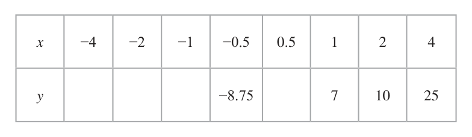
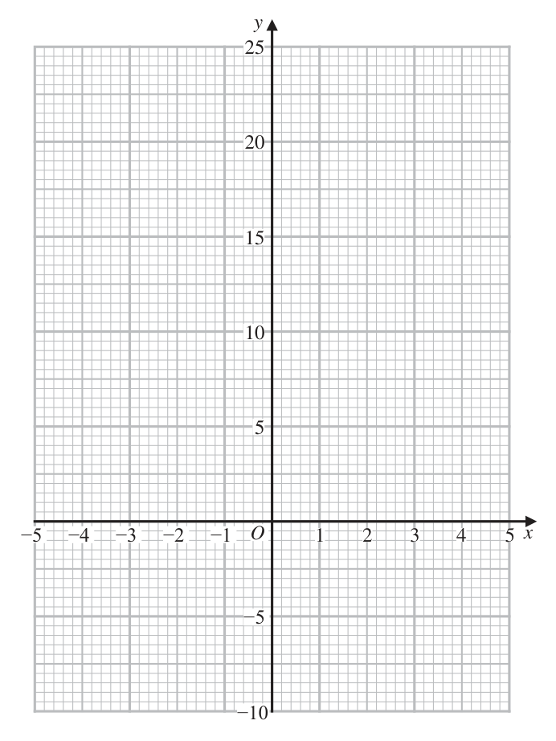
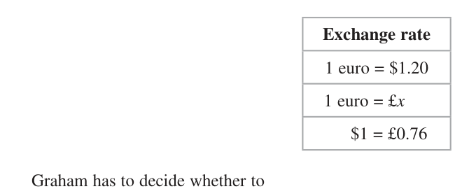
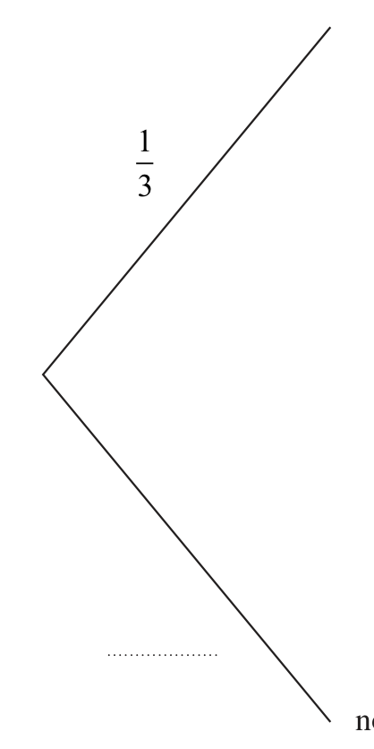
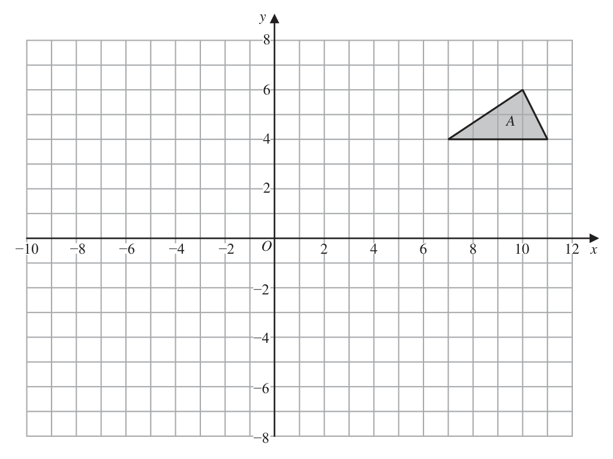
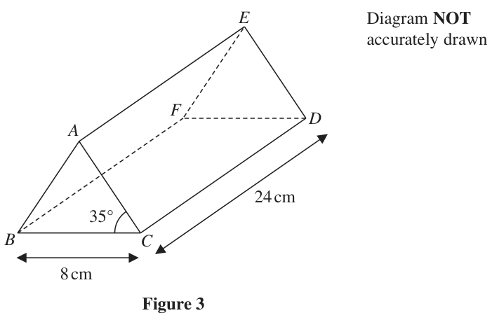

# 4MB1/02 — 2021-06 (official extraction)

> schema `syllabai.official-paper-questions/0.2` · paper_id `pearson-edexcel:international-gcse:mathematics-b:4mb1:2021-06:4MB1/02` · qp sha256 `4e0be36befa8b2ab…` · extraction is the disclosed baseline (ADR-039)

## Question 1 (5 marks)

The table gives the area, in km2, and the population of each of three countries in 2017 Country Area (km2) Population Greenland 2.166 × 106 5.617 × 104 Sri Lanka 6.561 × 104 2.144 × 107 China 9.597 × 106 1.368 × 109

### 1(a) [1]

The table gives the area, in km², and the population of each of three countries in 2017 Country Area (km²) Population Greenland 2.166 × 106 5.617 × 104 Sri Lanka 6.561 × 104 2.144 × 107 China 9.597 × 106 1.368 × 109

Write 5.617 × 104 as an ordinary number.

**Mark scheme answer**

> 56170 1 B1

- **(1)** 56170 1 B1

### 1(b) [2]

Calculate by how many people the population of China in 2017 was greater than the population of Sri Lanka in 2017 Give your answer in standard form.

**Mark scheme answer**

> 1.368 ×109 − 2.144 ×107 or M1 for evidence of the correct subtraction (so M0 for
> 1346560000 2.144 ×107 − 1.368 ×109 unless recovered later) or for a correct
> answer (to at least 3 significant figures) in non-standard form (e.g.,
> 1346560000, 13.4656 ×108 , 1350000000, etc.). The correct answer
> implies this mark
> 1.34656 ×109 2 A1 allow answers which round to (awrt) 1.35 ×109

- **(2)** 1.368 ×109 − 2.144 ×107 or M1 for evidence of the correct subtraction (so M0 for

### 1(c) [2]

Work out the number of people per km² for Greenland in 2017 Give your answer, to 3 significant figures, in standard form.

**Mark scheme answer**

> 5.617 ×10⁴ M1 for evidence of division of the correct two values (condone for
> or 0.02593…
> 2.166 ×106 2.166 ×106
> M1 ) or a correct answer (to at least 3 significant
> 5.617 ×10⁴
> figures) in non-standard form (e.g., 0.0259, 0.259 ×10−1 ,
> 0.0259326, etc.) or for 2.59 ×10− n where n is a positive integer
> 2.59 ×10−2 2 A1 for awrt 2.59 ×10−2 (e.g., 2.593259464 ×10−2 scores both marks,
> but M1A0 for 2.6 ×10−2 if more accurate answer not seen)

- **(2)** 5.617 ×10⁴ M1 for evidence of division of the correct two values (condone for

## Question 2 (5 marks)

The curve C has equation y = x3 + ax2 + bx + 8 where a and b are constants. The gradient of C at the point (2, 6) is 9.8 Find the value of a and the value of b. Show clear algebraic working. (5)

### 2 [5]

The curve C has equation y = x³ + ax2 + bx + 8 where a and b are constants. The gradient of C at the point (2, 6) is 9.8 Find the value of a and the value of b. Show clear algebraic working.

**Mark scheme answer**

> 2
> M1 (dependent on both previous M marks) for complete method for
> finding the required area of triangle ABF.
> = 29.062148... A1 for 29 or better
> Alternative method for finding AB
> Like Method II Case 2 (finding AB)
> sin FAD sin (180 − 51)
> = M1 for setting up an

- **(5)** 2

## Question 3 (6 marks)

The principal of a college wishes to introduce three new evening classes. The classes are Cake decorating (C), Needlework (N ) and Photography (P). In a survey, 160 people who attend evening classes at the college were asked which of these new evening classes they would like to attend. Information about the results of the survey is shown in the Venn diagram. The expression in terms of x, where x is a positive integer, in each subset represents the number of people in that subset. E C N 5x +7 8x 2 x2 + 9 4x − 1 3x +8 2x2 + 4 x2 + 2x − 3 P

### 3(a)(i) [?]

The principal of a college wishes to introduce three new evening classes. The classes are Cake decorating (C), Needlework (N ) and Photography (P). In a survey, 160 people who attend evening classes at the college were asked which of these new evening classes they would like to attend. Information about the results of the survey is shown in the Venn diagram. The expression in terms of x, where x is a positive integer, in each subset represents the number of people in that subset. E C N 5x +7 8x 2 x² + 9 4x − 1 3x +8 2x2 + 4 x² + 2x − 3 P

Show that 2x2 + 9x − 68 = 0

### 3(a)(ii) [4]

Hence find the value of x. One of the people surveyed is selected at random. Given that this person would like to attend Photography …………… , ……………

**Mark scheme answer**

> *The official mark scheme line for this part was not captured by the digitised extraction — treat the worked values above the line with care and check against the paper's own mark scheme.*

### 3(b) [2]

calculate the exact value of the probability that this person would also like to attend Cake decorating but not Needlework.

**Mark scheme answer**

> *The official mark scheme line for this part was not captured by the digitised extraction — treat the worked values above the line with care and check against the paper's own mark scheme.*

## Question 4 (6 marks)

C Diagram NOT accurately drawn B P 5b O 2a A Figure 1 → → In Figure 1, OACB is a quadrilateral in which OA = 2a and OB = 5b →

### 4(a) [1]

Find AB in terms of a and b P is the point on OC such that OP : PC = 1 : 4 → Given that BC = 6a + 5b

**Mark scheme answer**

> x 2 + 18 x + 24 = 160 oe
> For reference (if fully un-simplified):
> 8 x + ( 52 x + 7 ) + ( x 2 + 9 ) + ( 4 x − 1) + ( 23 x + 8 ) + ( 2 x 2 + 4 )
> + ( x 2 + 2 x − 3) = 160
> A1 simplifying to the given 3 term quadratic (at least one intermediate line from
> 2 x + 9 x − 68 = 0 initial line of working to given answer) – must include = 0
> (allow 0 = 2 x 2 + 9 x − 68 ) so all terms on one side equal to zero
> −2a + 5b 1 B1 oe (e.g., 5b − 2a ) allow vectors not underlined throughout the question
> OC = 5b + 6a + 5b or M1 for finding either OC , possibly seen as part of another vector e.g., OP where

- **(1)** x 2 + 18 x + 24 = 160 oe

### 4(b)(i) [?]

prove that A, P and B are collinear …………… , ……………

**Mark scheme answer**

> for reference: OP = ( 5b + 6a + 5b ) or for AC = −2a + 5b + 6a + 5b ( = 4a + 10b )
> M1 for finding either AP or PB (need not be simplified) oe (e.g., PA or BP )
> 1 ⎛6 ⎞⎡ 4 ⎤
> AP = −2a + ("6a + 10b") e.g., AP = AC + CP = −2a + 5b + 6a + 5b − 4 ⎜ a + 2b = − a + 2b ⎥

### 4(b)(ii) [5]

find a value of m and a value of n such that AP : PB = m : n

**Mark scheme answer**

> *The official mark scheme line for this part was not captured by the digitised extraction — treat the worked values above the line with care and check against the paper's own mark scheme.*

## Question 5 (6 marks)

Solve the simultaneous equations 2x2 = 11 − 3y 2 4x − y = 5 Show clear algebraic working. (6)

### 5 [6]

Solve the simultaneous equations 2x2 = 11 − 3y 2 4x − y = 5 Show clear algebraic working.

**Mark scheme answer**

> ⎝5 ⎠⎣ 5 ⎦
> or
> ⎛6 ⎞
> 1 PB = PO + OA + AC + CB = − ⎜ a + 2b ⎟ + 2a + 4a + 10b − 6a − 5b
> PB = − ("6a + 10b") + 5b ⎝5 ⎠
> oe ⎡ 6 ⎤ ⎛1 4 ⎞ 1
> ⎢⎣ = − 5 a + 3b ⎦⎥ or for AP = 5 AC + 5 AO = 5 ("4a + 10b ") + 5 ( −2a )
> 4 2 A1cso showing multiple using any two of AP, BP, AB (or PA, PB, BA or a
> AP = − a + 2b = AB or

- **(6)** ⎝5 ⎠⎣ 5 ⎦

## Question 6 (8 marks)

The curve C has equation y = x2 + 2x + x≠0 x

### 6(a) [2]

The curve C has equation y = x² + 2x + x≠0 x

Complete the table of values for C x −4 −2 −1 −0.5 0.5 1 2 4 y −8.75 7 10 25

**Mark scheme answer**

> 7, −2, −5, 9.25 2 B2 −1 each error or omission (to a maximum of 2 marks)

- **(2)** 7, −2, −5, 9.25 2 B2 −1 each error or omission (to a maximum of 2 marks)

### 6(b) [1]

On the grid opposite, plot the points from your completed table. The curve has one turning point and this has coordinates (1, 7)

**Mark scheme answer**

> 3 5 2 5
> PB = − a + 3b = AB or oe, e.g., AB = AP or AP = PB or AB = BP or AB = − PB or
> 5 5 2 3 3
> 4 2 2
> AP = − a + 2b = PB oe AP = − BP or AB = − PA etc.
> 5 3 3
> AP and AB are parallel A1 for a comment that one is a multiple of the other (oe e.g. that they are
> with the point A in parallel) and that there is a common point on each of the two lines (so if AB, AP
> common on each line∴ used then must mention that A is the common point, if PB, AB used then must
> collinear mention that B is the common point, etc. )
> 2:3
> 1 accuracy in plotting on the given axes in the answer book)

- **(1)** 3 5 2 5

### 6(c) [1]

Use your points to draw the graph of y = x² + 2x + x≠0 x

**Mark scheme answer**

> Points joined with smooth B1 for joining their eight points (4 points on the positive side of the x-axis joined
> curve except for x = −0.5 and and the other 4 points on the negative side of the x-axis joined) with a smooth
> 0.5 with minimum at (1,7) curve (B0 if line segments between points)
> B0 if points at 0.5 and −0.5 connected
> Condone no curve between −0.5 and 0.5 – if curve drawn in this interval, then as
> 1 x → 0+ , y → +∞ and x → 0− , y → −∞

- **(1)** Points joined with smooth B1 for joining their eight points (4 points on the positive side of the x-axis joined

### 6(d) [1]

Using your graph, find an estimate, to one decimal place, for the solution of the equation x² + 2x + =0 x

**Mark scheme answer**

> −2.6 1 B1 ft where their graph crosses the x-axis, but their value of x must be to at least
> one decimal place and, in the interval, −4 ≤ x ≤ −2 (For reference:
> x = −2.594313... - if value of x clearly comes from solving on a calculator then
> B0).
> If curve crosses the x-axis more than once, then B0

- **(1)** −2.6 1 B1 ft where their graph crosses the x-axis, but their value of x must be to at least

### 6(e) [3]

By drawing a suitable line on the grid estimate, to one decimal place, the solutions of the equation 4 3 x² + 2x + = 5x + x 2

**Mark scheme answer**

> Line drawn through (0, 1.5) M1 for straight line passing through (0, 1.5) with positive gradient – line need not
> with positive gradient intersect their curve (and allow this mark if curve not attempted)
> −1.2, 1.1 and 3.1 A2, −1 for each error/omission (up to a maximum of 2 marks). Must have a
> drawn a line and curve. The values given to at least one decimal place and must
> lie in the intervals
> −1.4 ≤ x ≤ −1, 1 ≤ x ≤ 1.4 and 2.8 ≤ x ≤ 3.2 and must follow from their
> graph.
> (For reference: x = −1.174833..., 1.111418..., 3.063415... - if values of x clearly
> come from solving on calculator, then A0)
> Total 8 marks

- **(3)** Line drawn through (0, 1.5) M1 for straight line passing through (0, 1.5) with positive gradient – line need not

## Question 7 (9 marks)

Lillian and Graham are co-owners of a small company. Lillian has invested $55 000 in the company. Graham has invested $25 000 in the company. This year Lillian receives 20% of the profit made by the company in 2020 The rest of the profit made by the company in 2020 is shared between Lillian and Graham in the same proportions as the amounts of money they invested in the company.

**(b)** Calculate the interest she receives in one year. (2) Graham goes to a travel agent to change his share of the profit from dollars ($) into pounds (£). The table gives information about the exchange rates that are available. Exchange rate 1 euro = $1.20 1 euro = £x $1 = £0.76 Graham has to decide whether to

### 7(a) [2]

Lillian and Graham are co-owners of a small company. Lillian has invested \$55 000 in the company. Graham has invested \$25 000 in the company. This year Lillian receives 20% of the profit made by the company in 2020 The rest of the profit made by the company in 2020 is shared between Lillian and Graham in the same proportions as the amounts of money they invested in the company.

Show that this year Lillian receives, in total, 75% of the profit made by the company in 2020 In 2020, the company made a profit of \$2000 Lillian puts all the money that she receives from the profit made by the company in 2020 in an account that pays interest at a fixed rate of 4.8% per year.

**Mark scheme answer**

> 0.2 P + 0.8P × ... or
> 25 M1 P may be any value e.g., 20 [ %] + 80 [ %] × ...
> × 80% [ = 25%]
> ⎛ 55000 ⎞
> A1cso allow ⎜ 20 [ % ] + 80 [ % ] × ⎟ = 75[%]
> ⎛ 55000 ⎞ ⎝ 80000 0.2 P + 0.8 P × ⎟ ×100 = 75%
> ⎝ 80000 ⎠ ⎛ 55000 ⎞
> oe e.g., ⎜ 0.2 + 0.8 × ⎟ = 0.75 which is equivalent to 75% (if working in
> or 2 ⎝ 80000 ⎠
> 25 decimals/fractions then must relate to equivalent percentage). Allow equivalent
> 100 − × 80% = 75%
> 80 11 55000
> fractions e.g., for .
> 16 80000
> 0.048 × 2000 [×0.75] M1 no need for the 0.75

- **(2)** 0.2 P + 0.8P × ... or

### 7(b) [2]

Calculate the interest she receives in one year. Graham goes to a travel agent to change his share of the profit from dollars (\$) into pounds (£). The table gives information about the exchange rates that are available. Exchange rate 1 euro = \$1.20 1 euro = £x \$1 = £0.76 Graham has to decide whether to change his dollars into euros and then change the euros into pounds or change his dollars straight into pounds. He calculates that if he chooses to do (i) he will receive £20 more than if he chooses to do (ii)

**Mark scheme answer**

> For M1 allow 1.048 × 2000
> \$72 2 A1 (\$ sign not required)
> 0.25 × 2000 [ = 500] M1 for calculating Graham’s share in dollars (implied by use of 500 in an

- **(2)** For M1 allow 1.048 × 2000

### 7(c) [5]

Calculate the value of x.

**Mark scheme answer**

> equation to find x)
> "500"× 0.76 [ = 380] M1 for converting Graham’s share in dollars into pounds or for 2000 × 0.76
> (converting the \$2000 into pounds)
> M1 for converting Graham’s share in dollars into euros or for converting the
> "500" ⎡ 1250 ⎤
> x = x 2000 ⎡ 5000 ⎤
> 1.2 ⎢⎣ 3 ⎥⎦ \$2000 into euros y = y for some value y
> 1.2 ⎢⎣ 3 ⎥⎦
> M1 for a complete, correct method for calculating x (in any equivalent form, e.g.,
> 1.2
> x = ("380"+ 20 ) × "500"
> "500" x = "380"+ 20 ) – the correct answer can imply this mark
> 1.2
> 0.96 5 A1

- **(5)** equation to find x)

## Question 8 (9 marks)

There are 45 young people in a youth club. The table below gives information about the heights of these young people. Height (h cm) Frequency 140 < h ≤ 150 5 150 < h ≤ 155 8 155 < h ≤ 160 11 160 < h ≤ 165 6 165 < h ≤ 170 12 170 < h ≤ 190 3

### 8(a) [1]

Find the class interval that contains the median.

**Mark scheme answer**

> 155 < h ≤ 160 B1 (allow intention of this interval e.g. give benefit of doubt if interval is given
> as 155 < h < 160)

- **(1)** 155 < h ≤ 160 B1 (allow intention of this interval e.g. give benefit of doubt if interval is given

### 8(b) [4]

Calculate an estimate of the mean height, in cm to one decimal place, of these young people. One of the young people is selected at random. The incomplete probability tree diagram on the opposite page gives information about the eye colour and the hair colour of this young person.

**Mark scheme answer**

> (145 × 5) + (152.5 × 8 ) + M2 for at least 5 (of the 6) correct products added together
> (157.5 ×11) + (162.5 × 6 ) + or M1 for the use of any value in interval (including end points) for at least 4 (of
> (167.5 ×12 ) + (180 × 3) the 6) products added together
> "7202.5"
> M1dep on at least 1 of the previous M marks for dividing by 45
> 2881
> 160.1 4 A1 awrt 160.1 (for reference: 160.055555…) allow exact e.g.,

- **(4)** (145 × 5) + (152.5 × 8 ) + M2 for at least 5 (of the 6) correct products added together

### 8(c) [1]

Complete the probability tree diagram. Given that, for these young people, hair colour is independent of height

**Mark scheme answer**

> 4
> B1 all 3 correct (must be using fractions but allow exact equivalents, e.g., for
> 2 5 2
> , ,
> 3 9 5
> on first branch)

- **(1)** 4

### 8(d) [3]

calculate the probability that the young person selected has fair hair and a height of more than 160 cm. Eye colour Hair colour 4 fair blue not fair 3 fair not blue not fair

**Mark scheme answer**

> 21 1 4 21 2 3 M1 for calculating the probability that a person has a height of more than 160 cm
> × × or × " "×
> 45 3 9 45 3 5 and fair hair with either eye colour
> M1 for completely correct method (with their probability (between 0 and 1) for
> ⎛ 21 1 4 ⎞ ⎛ 21 2 3 ⎞ not blue eye colour from part (c))
> ⎜ × × ⎟ + ⎜ × " "× ⎟ 21 ⎛ ⎛ 1 5 ⎞ ⎛ 2 2 ⎞ ⎞
> ⎝ 45 3 9 ⎠ ⎝ 45 3 5 ⎠ or M2 for using the complement e.g. × 1 − ⎜ × " "⎟ − ⎜ × " "⎟
> 45 3 9 ⎠ ⎝ 3 5 
> 518
> A1 0.26 or better (0.255802...) or exact (e.g., )
> 2025
> ⎛ 1 4 ⎞ ⎛ 2 3 ⎞ 74 ⎛ 1 5 ⎞ ⎛ 2 2 ⎞ 74
> 0.2558…. 3 SC for 1 mark only for ⎜ × ⎟ + ⎜ × ⎟ = or for 1 − ⎜ × ⎟ − ⎜ × ⎟ =
> ⎝ 3 9 ⎠ ⎝ 3 5 ⎠ 135 ⎝ 3 9 ⎠ ⎝ 3 5 ⎠ 135
> or 0.55 or better (0.548148…) for not including the height of more than 160 cm –
> ⎛ 74 ⎞
> also allow this SC mark for k where 0 < k ≤ 1
> ⎝ 135 ⎠

- **(3)** 21 1 4 21 2 3 M1 for calculating the probability that a person has a height of more than 160 cm

## Question 9 (10 marks)

The grid opposite shows triangle A. Triangle A is transformed to triangle B by a reflection in the line with equation x = 1

### 9(a) [2]

On the grid, draw and label triangle B. Triangle B is transformed to triangle C under the translation

**Mark scheme answer**

> x = 1 drawn M1 this mark can be implied by correct triangle B or for a completely correct
> reflection in the line y = 1, or for two of the three vertices correct
> Triangle B 2 A1 (vertices at ( −9, 4 ) , ( −5, 4 ) , ( −8, 6 ) )

- **(2)** x = 1 drawn M1 this mark can be implied by correct triangle B or for a completely correct

### 9(b) [2]

On the grid, draw and label triangle C. Triangle C is transformed to triangle D under the transformation with matrix M where 2 0 M= 0 2

**Mark scheme answer**

> ( −2,1) , ( −1,3) , ( 2,1) B1ft moving their triangle B 7 units to the right.
> Triangle C B1ft moving their triangle B 3 units down (if correct vertices of triangle C are at
> ( −2,1) , ( 2,1) , ( −1,3) )

- **(2)** ( −2,1) , ( −1,3) , ( 2,1) B1ft moving their triangle B 7 units to the right.

### 9(c) [3]

On the grid, draw and label triangle D.

**Mark scheme answer**

> ⎛ 2 0 ⎞ ⎛ −2 2 −1⎞ M1 coordinates in second matrix may be in any order. Follow through the
>  " " coordinates of their triangle C
> ⎝ 0 −2 ⎠ ⎝ 1 1 3 ⎠
> ⎛ −4 4 −2 ⎞ ⎛ 2 0 ⎞ ⎛ −2 2 −1 A1 ft for correct working out product of their " "
> ⎝ −2 −2 −6 ⎠ ⎝ 0 −2 ⎠ ⎝ 1 1 3 ⎠
> Triangle D A1 cao (vertices at ( −4, −2 ) , ( −2, −6 ) , ( 4, −2 ) ) – award full marks if drawn
> correctly

- **(3)** ⎛ 2 0 ⎞ ⎛ −2 2 −1⎞ M1 coordinates in second matrix may be in any order. Follow through the

### 9(d) [3]

Describe fully the single transformation that maps triangle A onto triangle D.

**Mark scheme answer**

> Enlargement M1 (following marks cannot be awarded without ‘enlargement’) condone
> SF – 2 ‘enlarge/enlarged’ – if not a single transformation then M0
> Centre (6, 2) A1 (must see either ‘SF’, ‘scale factor’ or ‘factor’)
> A1 (word ‘centre’ not required e.g. ‘about (6, 2)’ is sufficient)
> ∠DAB = 180 − 108 = 72° Angles throughout part (a) may be shown on Figure 2.
> Opposite angles of a cyclic Reasoning only counts towards the final B mark (so therefore are
> 10(a) quadrilateral are supplementary (or sum to
> independent of the first four marks in this part)
> 180°) M1 for calculating angle DAB
> ∠AOB = 102° angle at the centre is twice
> (oe) the angle at the circumference M1 for calculating angle AOB
> 180 − "102"
> ∠OBA (or ∠OAB) = [ = 39°]
> Angle sum of a triangle is 180° and base M1 dep for correct method for calculating either angle OBA or OAB – dependent
> angles of an isosceles triangle are equal (OA on previous M mark
> = OB)
> ∠OBD = 180 − 51 − 72 − 39 = 18°
> Angle sum of a triangle is 180°
> A1 (degree symbol not required) – dependent on all previous M marks (note that
> or ∠OBD = 360 − 51 − 33 − 258 = 18° shown
> answer is given so sufficient working must be shown)
> Angle sum of a quadrilateral and angles at a
> point are 360 °
> B1 for 3 (of the 5 or possibly 6) correct reasons – must include underlined (or the
> 5 exact mathematical equivalent) words. Allow angles for angle, etc. and allow
> equivalent symbols, e.g., for angle, Δ for triangle, etc.
> Angles throughout part (a) may be shown on Figure 2.
> Reasons only count towards the final B mark (so are
> Alternative 1 for 10(a)
> independent of the first four marks in this part)
> ∠DAB = 180 − 108 = 72°
> Opposite angles of a cyclic
> quadrilateral are supplementary (or sum M1 for calculating angle DAB
> to 180°)
> ∠DOB = "72"× 2 [ = 144°] angle at the
> centre is twice (oe) the angle at the M1 dep for correct method for finding ∠DOB - dependent on
> circumference previous M mark
> 180 − "144"
> ∠OBD =
> Angle sum of a triangle is 180° and base M1 for correct method for finding ∠OBD - dependent on both
> angles of an isosceles triangle are equal previous M marks
> (OB = OD)
> 180 − 144 A1 (degree symbol not required) – dependent on all previous M
> Or ∠OBD = = 18° shown marks (note that answer is given so sufficient working must be
> 2 shown)
> B1 for 3 (of the 4) correct reasons – must include underlined (or the
> exact mathematical equivalent) words. Allow angles for angle, etc.
> and allow equivalent symbols, e.g., for angle, Δ for triangle, etc.
> Angles throughout part (a) may be shown on Figure 2.
> Alternative 2 for 10(a) Reasons only count towards the final B mark (so are
> independent of the first four marks in this part)
> ∠AOB = 102° angle at the centre is twice
> (oe) the angle at the circumference M1 for calculating angle AOB
> 180 − "102"
> ∠OBA (or ∠OAB) = [ = 39°]
> Angle sum of a triangle is 180° and base M1 dep for correct method for calculating either angle OBA or OAB
> angles of an isosceles triangle are equal – dependent on previous M mark
> (OA = OB)
> ∠ACB = 51 (angles in the same segment
> are equal) ⇒ ∠ACD = 57
> and therefore ∠DBA = 57 (angles in the M1 for calculating angle DBA
> same segment are equal)
> ⎛ 180 − 102 ⎞ A1 (degree symbol not required) – dependent on all previous M
> ∠OBD = 57 − = 57 − 39 = 18 shown marks (note that answer is given so sufficient working must be
> ⎝ 2 ⎠ shown)
> B1 for 3 (of the 5) correct reasons – must include underlined (or the
> exact mathematical equivalent) words. Allow angles for angle, etc.
> and allow equivalent symbols, e.g., for angle, Δ for triangle, etc.
> Note that lengths given in the question are not exact and so
> therefore there are a number of valid areas for triangle ABF
> There are many ways of finding the required area – in essence
> for Method I the first two marks are for calculating the length
> of either FB or BD, the third mark is for setting up a correct
> equation for either AB or AD and the final two marks are for a
> Method I: Using intersecting secants to find FB or BD complete, correct method for calculating the area of triangle
> ABF
> NB an answer which rounds to 23 or 24 with no obvious
> incorrect working scores full marks. Note that using 1 × 8.4 × AB
> (therefore assuming angle FAB is 90 ) which for reference
> gives 23.3375… can score M1A1M1M0A0 maximum
> Case 1: Finding length AB
> FE × FA = FD × FB oe M1 correct method for finding FB or BD e.g.

- **(3)** Enlargement M1 (following marks cannot be awarded without ‘enlargement’) condone

## Question 10 (10 marks)

F Diagram NOT accurately drawn D C E 51° 108° O A B Figure 2 Figure 2 shows the circle ABCDE with centre O. The chords AE and BD intersect outside the circle at the point F. Ð BCD = 108° Ð ADB = 51°

### 10(a) [5]

F Diagram NOT accurately drawn D C E 51° 108° O A B Figure 2 Figure 2 shows the circle ABCDE with centre O. The chords AE and BD intersect outside the circle at the point F. ∠ BCD = 108° ∠ ADB = 51°

Giving your reasons, show that ∠ OBD = 18° Given that AE = 4.9 cm, EF = 3.5 cm and DF = 3.0 cm …………… , ……………

**Mark scheme answer**

> ∠BAD = 180° − 108° = 72°  (opposite angles of cyclic quadrilateral ABCD)
> 
> ∠ABD = 180° − 72° − 51° = 57°  (angles in △ABD)
> 
> ∠AOB = 2 × 51° = 102°  (angle at centre = 2 × angle at circumference on arc AB)
> 
> ∠OBA = (180° − 102°) ÷ 2 = 39°  (△OAB isosceles, OA = OB)
> 
> ∠OBD = 57° − 39° = **18°**

- **(1)** ∠BAD = 72° with cyclic-quad reason oe
- **(1)** ∠ABD = 57° oe
- **(1)** ∠AOB = 102° with angle-at-centre reason oe
- **(1)** ∠OBA = 39° oe
- **(1)** 18° with full supporting reasons

### 10(b) [5]

calculate the area, in cm² to 3 significant figures, of △ ABF. a b c Sine Rule sin A sin B sin C Area of triangle = 1 ab sin C

**Mark scheme answer**

> Method I: Using intersecting secants to find FB or BD
> Note that lengths given in the question are not exact and so therefore there are a number of valid areas for triangle ABF
> There are many ways of finding the required area – in essence for Method I the first two marks are for calculating the length of either FB or BD, the third mark is for setting up a correct equation for either AB or AD and the final two marks are for a complete, correct method for calculating the area of triangle ABF
> NB an answer which rounds to 23 or 24 with no obvious incorrect working scores full marks. Note that using $\frac{1}{2} \times 8.4 \times AB$ (therefore assuming angle FAB is 90°) which for reference gives 23.3375… can score M1A1M1M0A0 maximum
> Case 1: Finding length AB
> FE × FA = FD × FB oe
> or 3.5 × 8.4 = 3.0 × FB oe
> M1 correct method for finding FB or BD e.g. 3.5 × 8.4 = 3.0 × (3 + BD)
> FB = 9.8 A1 or for BD = 6.8
> AB "9.8"− 3 M1 setting up correct sine rule formula to find length AB (For
> = (or AB = awrt 5.56)
> sin 51 sin 72 reference: AB = 5.556549424…)
> Area = 1 × "5.56"× "9.8"× sin(18 + "39") M1 dep (on both previous M marks) for the correct method for
> 2 finding area of triangle ABF
> A1 (allow 23 or better from correct working) – For reference:
> 22.83456086…
> Note for last the two marks if using Heron’s formula then M1 for
> 23 5
> Area = s( s − 8.4)( s − 9.8)( s − AB) where s = ( 8.4 + 9.8 + AB ) then
> A1 for the Area = awrt 23. For reference: 23.29849718…
> Case 2: Finding length AD using a quadratic in AD First two marks as in Case 1
> M1 setting up a quadratic equation in AD from the cosine rule (For
> $AD^2$ − (6cos129) AD − 61.56 = 0 reference: AD = 6.182007686…)
> Area = Area of ΔABD + Area of ΔADF
> M1 dep (on both M marks) for the correct method for finding the
> 1
> = × AD × "6.8"× sin(51) + × AD × 3 × sin(180 − 51) area of triangle ABF
> 2
> A1 (allow 23 or 24 or better) – For reference for the method above
> the area is 23.5411793…
> Note for the last two marks that there are a number of ways of
> calculating the area of triangle ABD e.g. Area ABD
> = × AD × AB × sin 72 with AB from either (i)
> AB AD or
> =
> 2 sin 51 sin 57
> 23 or (ii) AB
> =
> BD or (iii) AB = AD + BD − 2( AD)( BD) cos51
> 2 2
> sin 51 sin 72
> With Areas for reference
> (i) 24.046658… (ii) 23.541179… (iii) 23.7178995…
> or Area ABD = 1 × AB × BD × sin(57) with AB as above giving for
> reference (i) 23.5411793… (ii) 23.0508726… (iii) 23.2222883…
> Case 3: Finding length AD using sine rule First two marks as in Case 2
> AD
> =
> 6.8 M1 setting up an equation in AD from the sine rule (For reference:
> sin 57 sin 72 AD = 5.996446861…)
> Area = Area of ΔABD + Area of ΔADF
> M1 dep (on both M marks) for the correct method for finding area
> 1
> = × AD × "6.8"× sin(51) + × AD × 3 × sin(180 − 51) of triangle ABF
> 2
> A1 (allow 23 or better) – For reference: 22.8345608…
> Note for the last two marks that there are a number of ways of
> calculating the area of triangle ABD e.g. Area ABD
> = × AD × AB × sin 72 with AB from either (i)
> AB AD or
> =
> 2 sin 51 sin 57
> (ii) AB
> =
> BD or (iii) AB = AD + BD − 2( AD)( BD) cos51
> 2 2
> 23 sin 51 sin 72
> With all three areas being 22.8345608…
> or Area ABD = 1 × AB × BD × sin(57) with AB as above giving
> with all areas again being 22.8345608…
> In essence for Method II the first mark is for setting up a
> quadratic equation in AD, the second and third marks are for
> Method II: Finding BD or AB using trigonometry finding either the length BD or AB and the final two marks are
> for a complete, correct method for calculating the area of
> triangle ABF
> Case 1: Finding BD
> $8.4^2$ = $3^2$ + $AD^2$ − 2 ( 3)( AD ) cos (180 − 51) M1 for setting up a quadratic equation in AD (For reference: AD =
> ⇒ AD − (6cos129) AD − 61.56 = 0 6.182007686…)
> BD AD M1 dep (on previous M mark) for setting up an equation for BD
> = using sine rule
> sin 72 sin 57
> BD = 7.01 A1 (7.01 or better) For reference: 7.010426881…
> Area = Area of ΔABD + Area of ΔADF
> M1 dep (on both previous M marks) for the correct method for
> 1
> = × AD × "7.01"× sin(51) + × AD × 3 × sin(129) finding the area of triangle ABF
> 2
> A1 (allow 24 or better from correct working) – For reference:
> 24.0466585…
> Case 2: Finding AB
> $8.4^2$ = $3^2$ + $AD^2$ − 2 ( 3)( AD ) cos (180 − 51) M1 for setting up a quadratic equation in AD (For reference: AD =
> ⇒ AD − (6cos129) AD − 61.56 = 0 6.182007686…)
> AB AD M1 dep (on previous M mark) for setting up an equation for AB
> = using sine rule
> sin 51 sin 57
> AB = 5.73 A1 (5.73 or better) For reference: 5.728497566…
> Area = Area of ΔABD + Area of ΔADF
> M1 dep (on both previous M marks) for the correct method for
> 1
> = × AD × "5.73"× sin(72) + × AD × 3 × sin(129) finding the area of triangle ABF
> 2
> A1 (allow 24 or better from correct working) – For reference:
> 24.0466585…
> Case 3: Finding BD and AB
> $8.4^2$ = $3^2$ + $AD^2$ − 2 ( 3)( AD ) cos (180 − 51) M1 for setting up a quadratic equation in AD (For reference: AD =
> ⇒ AD − (6cos129) AD − 61.56 = 0 6.182007686…)
> BD AD AB AD M1 dep (on previous M mark) for setting up an equation for either
> = or = AB or BD using sine rule
> sin 72 sin 57 sin 51 sin 57
> A1 (AB = 5.73 or better or BD = 7.01 or better) For reference:
> BD = 7.01 or AB = 5.73
> AB = 5.728497566… or BD = 7.010426881…
> M1 for correct, complete method for finding the area of triangle
> 1 ABF (or as two separate triangles, e.g.,
> Area = ( AB )(3 + BD ) sin("39"+ 18) 1
> 2 (3)( AD)sin(180 − 51) + ( BD )( AB ) sin ("39"+ 18 ) )
> 2
> A1 (allow 24 or better from correct working) – For reference:
> 24.0466585…

## Question 11 (11 marks)

E Diagram NOT accurately drawn F D A 24 cm 35° B C 8 cm Figure 3 Figure 3 shows a solid right triangular prism ABCDEF. A cross section ABC of the prism is an isosceles triangle in which AB = AC. Ð ACB = 35° CB = 8 cm CD = 24 cm

### 11(a) [5]

E Diagram NOT accurately drawn F D A 24 cm 35° B C 8 cm Figure 3 Figure 3 shows a solid right triangular prism ABCDEF. A cross section ABC of the prism is an isosceles triangle in which AB = AC. ∠ ACB = 35° CB = 8 cm CD = 24 cm

Calculate the total surface area, in cm² to 3 significant figures, of the prism. Diagram NOT accurately drawn h cm r cm Figure 4 Figure 4 shows a solid right circular cylinder with radius r cm and length h cm. The total surface area of the cylinder is (224 + 60 3 ) π cm² Given that r = 3 3 + 2

**Mark scheme answer**

> M1 for calculating AC or AB - note that use of cosine rule
> 4 $AB^2$ = $AC^2$ + $8^2$ − 2 ( 8)( AC ) cos 35 with AB = AC must simplify to
> AC = ( AB = )
> cos35 AC cos35 = 4 or AB cos35 = 4 before awarding this mark – for
> reference: AC (or AB) = 4.883098355…
> ⊥ height h = 4 tan 35 M1 implied by 3rd method mark. For reference: perpendicular height
> of triangle ABC is 2.800830153…
> M1 for correct method for finding the area of cross section ABC –
> AB(or AC )
> may find AB or AC from the sine rule e.g., = and
> sin 35 sin110
> Area Cross Section ABC then Area =
> 1 1 1 1 1 ⎛ 8sin 35 ⎞
> ( BC ) h = (8)( 4 tan 35) ( AC )( BC )sin 35 = ( AB )( BC ) sin 35 = 
> 2 2 (8 ) sin 35
> 2 2 2 ⎝ sin110 ⎠
> 1 1⎛ 4 ⎞
> Or ( AC )( BC )sin 35 = ( 8 ) sin 35
> or Area = ( AB)( AC )sin110 = 
> 1 ⎛ 8sin 35 ⎞⎛ 8sin 35 ⎞
> 2 2 cos 35 sin110
> 2 2 ⎝ sin110 ⎠⎝ sin110 ⎠
> For reference: Area ABC = 11.203322061…
> 1 1⎛ 4 ⎞
> Or ( AB)( BC )sin 35 = ( 8 ) sin 35 Allow use of Heron’s formula with AC = AB =
> and BC = 8
> 2 2 ⎝ cos 35 ⎠ cos 35
> 1⎛ ⎛ 4 ⎞⎞
> giving s = 8 + 2 = 8.883098...
> 2⎝ ⎝ cos 35 ⎠ ⎠
> ⎛ 4 ⎞⎛ 4 ⎞
> and Area ABC = s ( s − 8) ⎜ s − s − cos35 ⎠⎝ cos35 ⎠
> Surface area =
> 8(24) + 2(Area ABC ) + 2 ( Area AEDC ) M1 dep on all previous M marks – complete, correct method for
> finding the surface area of the prism e.g.,
> ⎛ 4 ⎞ 8(24) + 2 (11.20...) + 2(24)(4.88...)
> = 8(24) + 2 (16 tan 35 ) + 2 ( 24 ) cos 35 
> 449 5 A1 (449 or better) For reference: 448.7953623…

- **(5)** M1 for calculating AC or AB - note that use of cosine rule

### 11(b) [6]

find the exact value of h. Show your working clearly and give your answer in the form a 27 where a is an integer. ⎡ 1 ⎤ ⎢ Area of triangle = 2 ab sin C ⎥ ⎢ ⎥ ⎣Curved surface area of cylinder = 2πrh ⎦

**Mark scheme answer**

> ( ) ( )
> 2π 3 3 + 2 + 2π 3 3 + 2 h = M1 setting up a correct equation. Allow with no π or
> ( 224 + 60 3 ) π oe (
> 2π ( r ) + 2π ( r ) h = 224 + 60 3 π oe
> )
> M1dep multiplying out brackets correctly with 3 × 3 being
> ( ) (
> 2 9 × 3 + 12 3 + 4 + 2 3 3 + 2 h = ) replaced by 3 (allow with π in each term)
> ( 224 + 60 3 ) oe ( ) (
> Or 2 9 × 3 + 12 3 + 4 + 2 ( r ) h = 224 + 60 3 oe )
> ( )
> Allow 62 + 24 3 + 6 3 + 4 h = 224 + 60 3 oe for this mark
> A1 rearranging to get a correct expression for h e.g.,
> h=
> 81 + 18 3
> h=
> (
> 9 9+2 3 ) , h = (81 + 18 3 ) π , h = (162 + 36 3 ) π , etc.
> 3 3+2
> 3 3+2 (3 3 + 2)π ( 6 3 + 4) π
> k (3 3 − 2)
> M1 dep (on both previous M marks) multiplying by with
> h=
> (81 + 18 3 ) × (3 3 − 2 ) oe k (3 3 − 2)
> (3 3 + 2) (3 3 − 2) ( −3 3 + 2) , ( 4 − 6 3 ) , etc.
> any real value of k e.g.
> or h =
> 9 3(3 3 + 2) ( −3 3 + 2) ( 4 − 6 3 )
> 3 3+2
> or 9 3(a + b) with at least one of a or b correct
> 243 3 + 162 − 162 − 36 3 M1 dep on all previous M marks - multiplying out brackets (with at
> =
> 27 − 4
> 9 3(3 3 + 2) most one slip) e.g.,
> ( )
> 9 18 − 23 3 − 18 648 − 828 3 − 648
> , , etc.
> or h = or 9 3 4 − 27 16 − 108
> 3 3+2
> 3 27 6 A1 – if first three marks earned and then followed by 9 3 or 3 27
> with no working seen then award 3 out of 6

- **(6)** ( ) ( )

## Question 12 (15 marks)

The function f is defined by f ( x) 4 x

### 12(a) [1]

Write down the value of x that must be excluded from any domain of function f

**Mark scheme answer**

> –3 1 B1 allow x = −3 or x ≠ −3

- **(1)** –3 1 B1 allow x = −3 or x ≠ −3

### 12(b) [1]

Find f (−1) The function g is defined as g : x ↦ 2x2 + 4x − 1 where x ≥ −1 Given that fg–1(x) = 1.2

**Mark scheme answer**

> 1
> 1 B1 oe (e.g. 0.5)

- **(1)** 1

### 12(c) [7]

find the value of x The function h is defined as h : x ↦ x + 2 for all values of x ≥ −3 Given that the function m is such that m(x) = gh(x) + 3

**Mark scheme answer**

> M1 attempting to complete the square.
> g(x) = 2( x + 1)² ± ...
> ( 2x + 2 ) ±
> Allow g( x) =
> M1 getting an equation in completed square form.
> y = "2"( x + "1")² − "3"
> ( 2x + 2 ) − 3
> Or for g( x) =
> M1dep on at least one method mark being awarded. Allow use of
> y + "3" their completed square form. Rearranging to get ( x + "1")² on its
> = ( x + "1")²
> "2"
> ( 2x + 2 ) = y + 3
> own. Or for
> x+3 A1 need RHS – allow any letter for x and ignore LHS but must take
> ⎡⎣g −1 ( x ) = ⎤⎦ − 1 oe
> 2 the positive square root (but may recover later).
> M1dep on previous M being awarded for substituting their g −1 ( x)
> 4 1.2 oe x+3 x+3
> x "3" into f(x) or for f −1 (1.2 ) = −1 + ⇒ −1 + = − 3 (so
> "1" 3 2 2 4 − 1.2
> "2"
> −1 −1
> for putting g ( x) = f (1.2) with an attempt at the inverse of f)
> 7 x "3"
> 2.8 "2"
> M1 dep on previous M being awarded for rearranging and squaring
> 2 to get x.
> "2" 2 "3" x
> 2.8 x+3 ⎛ 7 ⎞ ⎛ 1 ⎞
> Or for =⎜ − 3 ⎟ + 1 ⇒ x = 2 ⎜ − + 1⎟ − 3
> 2 ⎝ 4 − 1.2 ⎠ ⎝ 2 ⎠
> A1 (dependent on all previous M marks) – correct answer with no
> – 2.5
> working scores full marks
> Alternative
> M1 for correctly re-arranging to make x the subject in terms of g
> and f −1
> y = 4− M1 putting y = (or any other letter) and attempt to remove fraction
> x+3
> by multiplying all terms by (x + 3)
> xy + 3 y = 4 x + 12 − 7
> M1 for re-arranging to get all x’s on one side and factorising x out
> (condone sign errors)
> x ( 6 y − 4) = 5 − 3 y 7 7
> or y = 4 − ⇒ = 4− y ⇒ x+3= implies this and the
> x+3 x+3 4− y
> previous M mark
> A1 need RHS only – can be equal to any letter (or just the
> 5 − 3x expression) and can use any letter for x oe e.g.,
> ⎡⎣f −1 ( x ) = ⎤⎦
> x−4 7 3x − 5
> − 3, , −3− , etc.
> 4− x 4− x x−4
> 5 − 3 ×1.2
> ⎡⎣f −1 (1.2 ) ⎤⎦ =
> 1.2 − 4 M1 dep (dependent on 2nd and 3rd M marks) substitute 1.2 into f −1
> [= −0.5 ]
> ⎡⎣g ("− 0.5") ⎤⎦
> −1
> M1 dep on previous M mark - substitute their f (1.2) into g(x)
> = 2 × ( −0.5) + 4 × ( −0.5) − 1
> –2.5 7 A1

- **(7)** M1 attempting to complete the square.

### 12(d) [4]

express m(x) in the form a (x + b)² where a and b are integers.

**Mark scheme answer**

> M1 substitute x + 2 for x into 2 x 2 + 4 x − 1 or for working with h(x)
> ( 2x + α ) ± β
> and g(x) with g(x) in the form 2 ( x + α ) ± β or
> gh( x) 2 x 2 4 x 2
> where α and β are positive real numbers
> M1 dep multiplying out brackets correctly
> m( x) = 2 ( x 2 + 4 x + 4 ) + 4 x + 8 − 1 + 3 oe or for substituting h into g(x) where g(x) is in completed square
> ( 2 ( x + 2) + 2 ) − 3 + 3
> form e.g., m( x) = 2 ( x + 2 + 1) − 3 + 3 or
> M1 dep (on previous M mark) simplify to perfect square form
> 2 ( x ± n ) or n ( x + 3)
> 2
> where n is an integer.
> A1 (dependent on all previous M marks) – allow those that state
> 2 ( x + 3)
> 4 a = 2 and b = 3. The correct answer with no working (or with no
> obvious incorrect working) scores full marks.

- **(4)** M1 substitute x + 2 for x into 2 x 2 + 4 x − 1 or for working with h(x)

### 12(e) [2]

Find the domain of m−1

**Mark scheme answer**

> M1 allow 0 or any inequality with any letter with 0 (e.g., m < 0) for
> x
> domain of m−1 = range of m this mark. Or for correctly re-arranging to ⎡⎣ m −1 ( x) = ⎤⎦ − b ±
> a
> (accept either + or –).
> x 0 2 A1 – must be x and correct inequality sign
> Total 15 marks

- **(2)** M1 allow 0 or any inequality with any letter with 0 (e.g., m < 0) for

