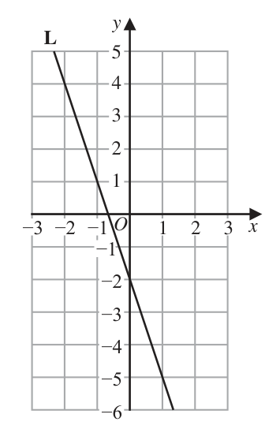
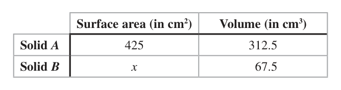
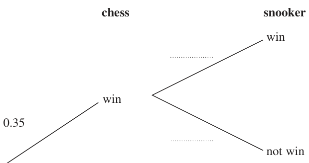

# 4MB1/01 — 2021-11 (official extraction)

> schema `syllabai.official-paper-questions/0.2` · paper_id `pearson-edexcel:international-gcse:mathematics-b:4mb1:2021-11:4MB1/01` · qp sha256 `64f6f85f23ffd9eb…` · extraction is the disclosed baseline (ADR-039)

## Question 1 (2 marks)

Please check the examination details below before entering your candidate information Candidate surname Other names Centre Number Candidate Number Pearson Edexcel International GCSE Time 1 hour 30 minutes Paper reference 4MB1/01 Mathematics B PAPER 1 You must have: Ruler graduated in centimetres and millimetres, Total Marks protractor, pair of compasses, pen, HB pencil, eraser, calculator. Tracing paper may be used. Instructions • Use black ink or ball-point pen. • centre Fill in the boxes at the top of this page with your name, number and candidate number. • Answer all questions. • – there may Answer the questions in the spaces provided be more space than you need. • Calculators may be used. Information • The total mark for this paper is 100. • The marks for each question are shown in brackets – use this as a guide as to how much time to spend on each question. Advice • Read each question carefully before you start to answer it. • Withoutyoursufficient Check answers if you have time at the end. • Good luck with yourworking, correct answers may be awarded no marks. • examination. P66021RA ©2021 Pearson Education Ltd. 1/1/1/1/1 Answer ALL TWENTY NINE questions. Write your answers in the spaces provided. You must write down all the stages in your working. Write down all the letters of the above word that have

### 1(a) [1]

exactly one line of symmetry,

**Mark scheme answer**

> A, E 1 B1 for both of these and no extras

- **(1)** A, E 1 B1 for both of these and no extras

### 1(b) [1]

rotational symmetry of order 2

**Mark scheme answer**

> N, S 1 B1 for both of these and no extras

- **(1)** N, S 1 B1 for both of these and no extras

## Question 2 (2 marks)

Show that 1 2 1 1 2 3 5 5 Show your working clearly.

### 2 [2]

Show that 1 2 1 1 2 3 5 5 Show your working clearly.

**Mark scheme answer**

> 4 12 2 1 1 2 2 M1 must see correct fractions for multiplying or
> × or [1×] 2 + [ −1] + × 2 + ×

- **(2)** 4 12 2 1 1 2 2 M1 must see correct fractions for multiplying or

## Question 3 (2 marks)

The nth term of a sequence is 3n2 + 2 Calculate the sum of the 4th term and the 5th term of the sequence.

### 3 [2]

The nth term of a sequence is 3n2 + 2 Calculate the sum of the 4th term and the 5th term of the sequence.

**Mark scheme answer**

> 5 5 3 3 5 four terms added including at least two products
> NB for this questions we will not accept any
> misreads
> 48 1 4 12 4 16 1 shown A1 dep on M1
> = 3 or × = = 3 or
> 15 5 3 5 5 5 No incorrect working seen.
> 6 10 2 3 1 Minimum working required shown.
> 2+ + + = 3 = 3
> 15 15 15 15 5 Must end with 3
> 3(4² +52) + 4 oe.
> 127 A1

- **(2)** 5 5 3 3 5 four terms added including at least two products

## Question 4 (2 marks)

Using ruler and compasses only and showing all your construction lines, construct the bisector of angle PQR. P Q R

### 4 [2]

Using ruler and compasses only and showing all your construction lines, construct the bisector of angle PQR. P Q R

**Mark scheme answer**

> 2 M1 correct arcs on QP and QR and arcs from
> these points to join to form bisector
> A1 dep completely correct bisector with all arcs
> shown
> SCB1 for a correct bisector without full
> construction seen.

- **(2)** 2 M1 correct arcs on QP and QR and arcs from

## Question 5 (2 marks)

Find the Highest Common Factor (HCF) of 216 and 540 You must show all your working.

### 5 [2]

Find the Highest Common Factor (HCF) of 216 and 540 You must show all your working.

**Mark scheme answer**

> 216 = 2 × 2 × 2 ×3 × 3 × 3 M1 for correct prime factors of 216 and 540
> 540 = 2 × 2 × 3 × 3 × 3 × 5 (may be on a factor tree)
> OR
> 4 216 540 Correct factorisation of 216 and 540 that include
> eg
> 9 54 135 paired numbers (ie the same numbers but
> 3 6 15 possible in a different order) whose product is
> 2 5 108 and 2 and 5 respectively. Eg 27 × 4 × 2 and
> 5 × 4 × 27 the 4s and 27s are paired.
> OR
> or a list of factors including 108 for both
> numbers
> OR
> Use of table method, but may have different
> numbers down the side that have a product of
> 108.
> 108 A1 dep on M1 being awarded

- **(2)** 216 = 2 × 2 × 2 ×3 × 3 × 3 M1 for correct prime factors of 216 and 540

## Question 6 (2 marks)

Given that y = 3x6 − x3 dy find dx dy = . . . . . . . . . . . . . . . . . . . . . .. . . . . . . . . . . . . . . . . . . . . . . . . . . . . . . . . dx

### 6 [2]

Given that y = 3x6 − x3 dy find dx dy = dx

**Mark scheme answer**

> 18 x5 + 12 x −4 2 B2 oe fully correct (B1 for one correct term)

- **(2)** 18 x5 + 12 x −4 2 B2 oe fully correct (B1 for one correct term)

## Question 7 (2 marks)

A Diagram NOT accurately drawn 107° D E B C 58° F The diagram shows △ABC. DBCE and ACF are straight lines such that ∠ABD = 107° and ∠ECF = 58° Calculate the size, in degrees, of ∠BAC. ∠BAC = . . . . . . . . . . . . . . . . . . . . . . . . . . . . . . . . . . . . . . . . . . . . . . . . . . . . . . . °

### 7 [2]

A Diagram NOT accurately drawn 107° D E B C 58° F The diagram shows △ABC. DBCE and ACF are straight lines such that ∠ABD = 107° and ∠ECF = 58° Calculate the size, in degrees, of ∠BAC. ∠BAC = °

> 🖼 crop required: diagram (qp.pdf p.None)

**Mark scheme answer**

> [BAC = ]107 – 58 or 2 M1 complete method to find BAC or 49 marked
> 180 – 107 = 73 and 180 – (“73” + 58) on the diagram
> 49 A1 allow on diagram if no answer given on
> answer line.
> 49 with no incorrect working gains full marks

- **(2)** [BAC = ]107 – 58 or 2 M1 complete method to find BAC or 49 marked

## Question 8 (3 marks)

p, q, 17 and r are four integers such that p < q < 17 < r and r = p + 18 The median of p, q, 17 and r is 13 The mean of p, q, 17 and r is 15 Find the value of p, the value of q and the value of r. p = . . . . . . . . . . . . . . . . . . . . . .. . . . . . . . . . . . . . . . . . . . . . . . . . . . . . . . . q = . . . . . . . . . . . . . . . . . . . . . .. . . . . . . . . . . . . . . . . . . . . . . . . . . . . . . . . r = . . . . . . . . . . . . . . . . . . . . . .. . . . . . . . . . . . . . . . . . . . . . . . . . . . . . . . .

### 8 [3]

p, q, 17 and r are four integers such that p < q < 17 < r and r = p + 18 The median of p, q, 17 and r is 13 The mean of p, q, 17 and r is 15 Find the value of p, the value of q and the value of r. p = q = r =

**Mark scheme answer**

> q + 17 3 M1 Use either median = 13 or mean = 15 to form
> = 13 oe (q = 9) or
> 2 an equation
> p + q + r + 17 = 4 × 15 [=60] oe Accept p + q + 17 + p + 18 = 4 × 15 oe or
> r – 18 + q + r +17 = 4 × 15 oe
> p + r = “60” – “9” – 17 [=34] or M1 Find an expression for p + r or an equation in
> p + “9” + p + 18 + 17 = 4 × 15 [=60] or just p or r (allow p = 8 or r = 26)
> r – 18 + “9” + r + 17 = 4 × 15 [=60] oe
> p = 8, q = 9, A1
> r = 26

- **(3)** q + 17 3 M1 Use either median = 13 or mean = 15 to form

## Question 9 (3 marks)

The straight line L is drawn on the grid. y L −3 −2 −1 O 1 2 3 x −1 −2 −3 −4 −5 −6 Find an equation for L.

### 9 [3]

The straight line L is drawn on the grid. y L −3 −2 −1 O 1 2 3 x −1 −2 −3 −4 −5 −6 Find an equation for L.

**Mark scheme answer**

> Gradient = −3 ÷ 1 oe 3 M1 for a correct method to work out the gradient,
> accept −3 ÷ 1, −6 ÷ 2 oe or “m” = −3
> Allow any expression that evaluates to –3 or –3x
> y = mx – 2 or y = “−3”x + c or M1 for one of the expressions seen in the scheme
> L = “−3”x – 2 or “−3”x – 2 oe ft their gradient if the first method mark is
> gained.
> y = −3x − 2 A1 oe eg y – 4 = –3(x + 2)
> We will only ISW –3x – 2 on the answer line.

- **(3)** Gradient = −3 ÷ 1 oe 3 M1 for a correct method to work out the gradient,

## Question 10 (3 marks)
### 10(a) [1]

Write 1.2 × 10−4 as an ordinary number. 6 10144 5 10142

**Mark scheme answer**

> 0.00012 1 B1
> 142 144

- **(1)** 0.00012 1 B1

### 10(b) [2]

Calculate 5 105 Give your answer in standard form.

**Mark scheme answer**

> 605 × 10 or 6.05 × 10 or 2 M1
> 1.2 × 10139 + [1 ×] 10137 or
> 121 × 10137 or 1.21 × 10n
> 1.21 × 10139 A1

- **(2)** 605 × 10 or 6.05 × 10 or 2 M1

## Question 11 (3 marks)

A triangle has sides of length 8 cm, 10 cm and 15 cm. Calculate the size, in degrees to one decimal place, of the smallest angle of the triangle. °

### 11 [3]

A triangle has sides of length 8 cm, 10 cm and 15 cm. Calculate the size, in degrees to one decimal place, of the smallest angle of the triangle. °

**Mark scheme answer**

> 8² = 10² + 15² − 2 × 10 × 15 × cos A or 3 M1 for a correct start to a method to find any
> 10² = 8² + 15² − 2 × 8 × 15 × cos A or angle in the triangle or 112.4° or 38.047...° (ie
> 15² = 8² + 10² − 2 × 8 × 10 × cos A oe another angle found correctly)
> ⎛ 102 + 152 − 82 ⎞ ⎡ 261 ⎤ M1 dep for a fully correct method to find
> cos A = ⎜ ⎟ ⎢= ⎥ smallest angle e.g.
> ⎝ 2 ×10 ×15 ⎠ ⎣ 300 ⎦
> ⎛ 102 + 82 − 152 ⎞ −1 ⎛ 8 + 15 − 10 ⎞
> 2 2
> 180 − cos −1 ⎜ ⎟ − cos ⎜ ⎟
> ⎝ 2 ×10 × 8 ⎠ ⎝ 2 × 8 ×15 ⎠
> 10sin“112.4” ⎞
> or 180 − “112.4” − sin −1 ⎛⎜ ⎟
> ⎝ 15 ⎠
> An indirect method must lead to the angle
> opposite 8 being the smallest.
> 29.5° A1 awrt 29.5

- **(3)** 8² = 10² + 15² − 2 × 10 × 15 × cos A or 3 M1 for a correct start to a method to find any

## Question 12 (3 marks)

B Diagram NOT accurately drawn x cm A 7.5 cm C E 8 cm 6 cm D A, B, C and D are points on a circle. EAB and EDC are straight lines. ED = 6 cm DC = 8 cm EA = 7.5 cm AB = x cm Calculate the value of x. x = . . . . . . . . . . . . . . . . . . . . . .. . . . . . . . . . . . . . . . . . . . . . . . . . . . . . . . .

### 12 [3]

B Diagram NOT accurately drawn x cm A 7.5 cm C E 8 cm 6 cm D A, B, C and D are points on a circle. EAB and EDC are straight lines. ED = 6 cm DC = 8 cm EA = 7.5 cm AB = x cm Calculate the value of x. x =

> 🖼 crop required: diagram (qp.pdf p.None)

**Mark scheme answer**

> 7.5(7.5 + x) or 6 × 14 3 M1 for a start to using intersecting secant theorem
> eg 7.5(7.5 + x) = 6 × 14 oe M1 for a correct equation in x
> 3.7 A1

- **(3)** 7.5(7.5 + x) or 6 × 14 3 M1 for a start to using intersecting secant theorem

## Question 13 (3 marks)

Without using a calculator, and showing all your working, express 75 + 243 in the form a where a is a positive integer. Show your working clearly.

### 13 [3]

Without using a calculator, and showing all your working, express 75 + 243 in the form a where a is a positive integer. Show your working clearly.

**Mark scheme answer**

> 75 = 5 3 or 3 M1 working must be shown
> 243 = 9 3 or
> ... × or

- **(3)** 75 = 5 3 or 3 M1 working must be shown

## Question 14 (3 marks)

For all values of x, 15 − 28x − 7x 2 = a + b(x + c)2 where a, b and c are integers. Find the value of a, the value of b and the value of c. a = ........................... b = ........................... c = ...........................

### 14 [3]

For all values of x, 15 − 28x − 7x 2 = a + b(x + c)2 where a, b and c are integers. Find the value of a, the value of b and the value of c. a = b = c =

**Mark scheme answer**

> 3 2 × 7 × 3
> = =2 7× 3
> 7
> 75 = 5 3 and M1 working must be show
> 243 = 9 3 and Allow 525 = 25 × 21 = 5 21 and
> 1701 = 81× 21 = 9 21 and
> ( ... × or
> 7 ... ×
> = =2 7× 3)
> 7
> 84 A1dep on both method marks allow a = 84
> ⎛ 15 ⎞
> −7 ⎜ x 2 + 4 x − ⎟ oe
> ⎝ 7⎠
> – 7((x + 2)² − 4) + 15 or M1 indep or for 2 of a = 43, b = −7, c = 2 correct
> ⎛ 15 ⎞ allow these seen in an expression of the form
> −7 ⎜ ( x + 2 ) − − 4 ⎟ oe
> ⎝ 7 ⎠ a + b (x + c)2
> a = 43, b = −7, A1 or for 43 − 7(x + 2)² clearly stated and not
> c=2 contradicted on answer line.

- **(3)** 3 2 × 7 × 3

## Question 15 (3 marks)

Solve the inequality 6x2 + 5x – 25 > 0 Show clear algebraic working.

### 15 [3]

Solve the inequality 6x2 + 5x – 25 > 0 Show clear algebraic working.

**Mark scheme answer**

> (3x – 5)(2x + 5) 3 M1 expands to give 2 terms correctly or correct
> substitution into correct formula (no errors) or
> completed square form, allow one sign error.
> 5 5 A1 correct critical values fully evaluated. Method
> x= ,−
> 3 2 must be clear dependent on the method mark
> being awarded. Allow 1.67 or better for
> Critical values with no method score A0
> 5 5 A1ft correct inequalities (follow through their
> x<− ,x>
> 2 3 critical values for selecting the outer region)
> dep on M mark being awarded.
> ⎛ 5⎞ ⎛5 ⎞ ⎤ 5⎡ ⎤5 ⎡
> Allow ⎜ ∞, − ⎟ ⎜ , ∞ ⎟ or ⎥ ∞, − ⎢ ⎥ , ∞ ⎢
> ⎝ 2⎠ ⎝3 ⎠ ⎦ 2⎣ ⎦3 ⎣
> Do not allow − 5 > x > 5 or 5 < x < − 5
> 2 3 3

- **(3)** (3x – 5)(2x + 5) 3 M1 expands to give 2 terms correctly or correct

## Question 16 (4 marks)
### 16(a) [2]

Simplify fully 6x4 y

**Mark scheme answer**

> 2x8 y 2 2 B2 fully correct (B1 for 2 correct terms in a
> product) allow 2 ( x 4 y )
> Do not award marks if addition or subtraction or
> division seen.

- **(2)** 2x8 y 2 2 B2 fully correct (B1 for 2 correct terms in a

### 16(b) [2]

Simplify fully (2a5 b3)4

**Mark scheme answer**

> 16a 20b12 2 B2 fully correct
> (B1 for 2 correct terms in a product)
> Do not award marks if more than one term seen.

- **(2)** 16a 20b12 2 B2 fully correct

## Question 17 (4 marks)

C Diagram NOT B accurately drawn 8.5 cm 12.6 cm A 8.0 cm E 3.2 cm D In the diagram, ACD is a triangle with point B on AC and point E on AD such that EB is parallel to DC. AB = 8.5 cm AE = 8.0 cm ED = 3.2 cm DC = 12.6 cm

### 17(a) [2]

Calculate the length of EB cm

**Mark scheme answer**

> BE 8 ⎡ 8 ⎤ 2 M1 a correct statement involving BE or correct
> eg = = oe
> 12.6 8 + 3.2 ⎢⎣ 11.2 ⎥⎦ SF
> 5
> or oe
> 7
> 9 A1

- **(2)** BE 8 ⎡ 8 ⎤ 2 M1 a correct statement involving BE or correct

### 17(b) [2]

Calculate the length of AC cm

**Mark scheme answer**

> AC 8 + 3.2 12.6 AC 2 M1 Allow ft if M1 gained in part (a). For a
> eg = or = oe or
> 8.5 8 "9" 8.5 method that will lead to AC or BC
> BC 8.5 Allow 8.5 + BC or 8.5 + x or x for AC
> = Award for [BC =] 3.4 seen.
> 3.2
> 11.9 A1

- **(2)** AC 8 + 3.2 12.6 AC 2 M1 Allow ft if M1 gained in part (a). For a

## Question 18 (4 marks)

A B p 2 2q 3 17 4 Given that 3A 2B 7 0 find the value of p and the value of q. p = ........................... q = ...........................

### 18 [4]

A B p 2 2q 3 17 4 Given that 3A 2B 7 0 find the value of p and the value of q. p = q =

**Mark scheme answer**

> 12 + 4p = 4 4 M1 An equation in p
> Must be seen as an equation outside of a matrix
> p = −2 −2 A1 If the answer on the answer line and in the
> working are 2 and –2 give benefit of the doubt
> and award the mark.
> 3 × “−2” + 4q = −7 M1 dep on M1 An equation in just q
> Must be seen as an equation outside of a matrix
> q = −0.25 oe −0.25 A1 If the answer on the answer line and in the
> working are 0.25 and –0.25 give benefit of the
> doubt and award the mark.

- **(4)** 12 + 4p = 4 4 M1 An equation in p

## Question 19 (4 marks)

Solve the simultaneous equations 3x + 2y = −1 4x − 3y = −5.3 Show clear algebraic working. x = . . . . . . . . . . . . . . . . . . . . . .. . . . . . . . . . . . . . . . . . . . . . . . . . . . . . . . . y = . . . . . . . . . . . . . . . . . . . . . .. . . . . . . . . . . . . . . . . . . . . . . . . . . . . . . . .

### 19 [4]

Solve the simultaneous equations 3x + 2y = −1 4x − 3y = −5.3 Show clear algebraic working. x = y =

**Mark scheme answer**

> 9x + 6y = −3 12x + 8y = −4 4 M1 for coefficient of x or y the same in both
> 8x – 6y = −10.6 12x – 9y = −15.9 equations and correct operation to eliminate
> 17x = −13.6 17y = 11.9 selected variable (condone one arithmetic or sign
> or error) or for correct rearrangement of one
> ⎛ −1 − 2 y ⎞ equation followed by correct substitution into the
> 4⎜ ⎟ − 3 y = −5.3 or other (condone one arithmetic error).
> ⎝ 3 ⎠
> ⎛ 3 y − 5.3 ⎞
> 3⎜ ⎟ + 2 y = −1 or
> ⎝ 4 ⎠
> ⎛ −1 − 3 x ⎞
> 4x − 3⎜ ⎟ = −5.3 or
> ⎝ 2 ⎠
> ⎛ 4 x + 5.3 ⎞
> 3x + 2 ⎜ ⎟ = −1 oe
> ⎝ 3 ⎠
> x = −0.8 or 4
> A1 dep on M1 being awarded x = − or y =
> y = 0.7 5
> 3 × “−0.8” + 2y = −1 or M1 dep on first M1 for substituting their found
> 4 × “–0.8” – 3y = –5.3 or value correctly into one of the correct equations
> 3x + 2 × “0.7” = –1 or or correct use of elimination or substitution
> 4x – 3 × “0.7” = –5.3 oe again, if starting again mark in line with the first
> method mark.
> If the first M1 is awarded this may be implied by
> both correct values being achieved.
> x = −0.8 and A1 dep only on the first M1 being awarded
> y = 0.7 4
> x = − and y =
> 5

- **(4)** 9x + 6y = −3 12x + 8y = −4 4 M1 for coefficient of x or y the same in both

## Question 20 (4 marks)

A Diagram NOT accurately drawn 9 cm D 3 cm 23° B C The diagram shows the right angled triangle ABC where ∠ABC is 90° and AC = 9 cm. The point D lies on AB such that BD = 3 cm and ∠BCD = 23° Calculate the size, in degrees to one decimal place, of ∠ACD. °

### 20 [4]

A Diagram NOT accurately drawn 9 cm D 3 cm 23° B C The diagram shows the right angled triangle ABC where ∠ABC is 90° and AC = 9 cm. The point D lies on AB such that BD = 3 cm and ∠BCD = 23° Calculate the size, in degrees to one decimal place, of ∠ACD. °

> 🖼 crop required: diagram (qp.pdf p.None)

**Mark scheme answer**

> 3 BC 4 M1 Form an equation that allows BC to be found.
> tan 23 = or = tan 67 oe
> BC 3 BC
> Other methods may be seen eg. =
> sin 67 sin 23
> 3 M1 dep Form an expression to calculate BC
> [ BC =] or 3tan 67 [ = 7.07] oe
> tan 23
> “7.07” M1 dep Fully correct method to find either ACB
> [cos ACB =] or ACD or a trig ratio of either.
> ( ACB = 38.2 or 38.3) Other methods may be seen eg.
> AB 2 = 92 − “7.07” 2 ⇒ AB = 5.57 and
> 92 + “7.07” 2 − “5.57” 2
> cos ACB = or
> 2 × 9 × “7.07”
> CD = = 7.68 and AD = “5.57” – 3 and
> sin 23
> 92 + “7.68” 2 − “2.57” 2
> cos ACD =
> 2 × 9 × “7.68”
> 15.3 A1 Allow awrt 15.2 or awrt 15.3

- **(4)** 3 BC 4 M1 Form an equation that allows BC to be found.

## Question 21 (4 marks)

Given that a = −5 2 2a

### 21(a) [2]

find the value of 2a 2 c

**Mark scheme answer**

> 2 − 2 × −5 2 M1 Give benefit of the doubt if –52 used.
> + 2 × (−5)2 oe
> 3 Do not allow use of –25 or –50 unless mark
> eg 4 + 50 already awarded.
> 54 A1

- **(2)** 2 − 2 × −5 2 M1 Give benefit of the doubt if –52 used.

### 21(b) [2]

Write 2 in the form c x where x is a rational number. c

**Mark scheme answer**

> 1
> 2 M1
> c =c
> or
> −2 or
> ⎛ 1 ⎞3
> ⎜ 5⎟ or
> ⎝c ⎠
> c −5
> 5
> − −1
> c
> A1 accept c
> or x = − accept c −1.67 or better

- **(2)** 1

## Question 22 (4 marks)

Solid A and solid B are similar. The table gives information about the surface areas and the volumes of A and B. Surface area (in cm2) Volume (in cm3) Solid A 425 312.5 Solid B x 67.5 Calculate the value of x. x = . . . . . . . . . . . . . . . . . . . . . .. . . . . . . . . . . . . . . . . . . . . . . . . . . . . . . . .

### 22 [4]

Solid A and solid B are similar. The table gives information about the surface areas and the volumes of A and B. Surface area (in cm2) Volume (in cm3) Solid A 425 312.5 Solid B x 67.5 Calculate the value of x. x =

**Mark scheme answer**

> 3
> 312.5 ⎡ 5 ⎤
> 67.5 ⎡ 3 ⎤ 4 M1 Considering linear scale factor. Allow this
> ⎢ = ⎥ or = oe seen as a ratios eg 5:3
> 67.5 ⎣ 3 ⎦
> 312.5 ⎢⎣ 5 ⎥⎦
> x3 67.52 x3 312.52
> = or = oe gains this
> 4253 312.52 4253 67.52
> mark
> ⎛ 3 312.5 ⎞ ⎡ 25 ⎤ M1 dep Consider area scale factor. Allow this
> ⎜⎜ 3 ⎟⎟ ⎢ = ⎥ or seen as a ratio eg 25:9
> ⎝ 67.5 ⎠ ⎣ 9⎦ x3 67.52
> 2 = oe gains this mark
> ⎛ 3 67.5 ⎞ ⎡ 9 ⎤ 4253 312.52
> ⎜⎜ 3 ⎟⎟ ⎢ = ⎥
> ⎝ 312.5 ⎠ ⎣ 25 ⎦
> 9 M1 dep fully correct method to find x
> [x = ] 425 × “ ” oe
> 153 A1 153 with no incorrect working seen gains full
> marks

- **(4)** 3

## Question 23 (4 marks)

Ameer drove from his home to a business meeting. The distance that Ameer drove was 210 km, to the nearest 10 km. The time that he took was 3 hours 25 minutes, to the nearest 5 minutes. Calculate the upper bound, in km / h to one decimal place, of Ameer’s average speed as he drove from his home to the business meeting. . . . . . . . . . . . . . . . . . . . . . . . . . . . . . . . . . . . . .. . . . . . . . . . . . . . . . . . km / h

### 23 [4]

Ameer drove from his home to a business meeting. The distance that Ameer drove was 210 km, to the nearest 10 km. The time that he took was 3 hours 25 minutes, to the nearest 5 minutes. Calculate the upper bound, in km / h to one decimal place, of Ameer’s average speed as he drove from his home to the business meeting km / h

**Mark scheme answer**

> 3 hours 22.5 mins, 3.375 hours, 202.5 mins, 4 3 27 11
> M1 allow 3 , ,3 or
> 3 hours 27.5 mins, 3.4583 hours or 207.5 mins 8 8 24
> 215 215 M1 allow for a calculation of speed in km/hr
> 3.375
> or [×60] or km/min
> 202.5
> For 215 allow 200 to 220 inclusive
> For 3.375 allow 3.33 to 3.5 inclusive
> For 202.5 allow 200 to 210 inclusive
> 215 215 UB
> 3.375
> or [×60] M1 dep for with 210 < UB ≤ 215 and
> 202.5 LB
> 3.375 ≤ LB < 3.417 (202.5 ≤ LB < 205)
> 63.7 A1 awrt 63.7 answer must come from use of
> the correct values for the bounds

- **(4)** 3 hours 22.5 mins, 3.375 hours, 202.5 mins, 4 3 27 11

## Question 24 (4 marks)

Express 2 as a single fraction in its simplest form. 2 x 4 x 2 6 x 4 x 16 Show clear algebraic working.

### 24 [4]

Express 2 as a single fraction in its simplest form. 2 x 4 x 2 6 x 4 x 16 Show clear algebraic working.

**Mark scheme answer**

> 3( x + 2) − 4(2 x − 4) 4 M1 Express difference as single
> oe fraction allow maximum of one sign
> (2 x − 4)( x + 2)
> error in the numerator.
> The denominator may be expanded
> eg (2x2 – 8)
> This may be awarded if both terms
> are multiplied and then the
> subtraction takes place.
> 6 x2 − 4 x − 16 ⇒ 2(3x + 4)( x − 2) M1 indep Factorise denominator of
> divisor, must factorise to at least 2
> brackets and must expand to give 2
> out of 3 term correct.
> Allow (3x + 4)( x − 2) only if
> 3x 2 − 2 x − 8 is seen on an earlier line
> of working.
> 22 − 5 x 2(3x + 4)( x − 2) M1 indep Attempt to invert divisor
> “ ”× and multiply.
> 2( x − 2)( x + 2) 3(22 − 5 x)
> These method marks can be awarded
> in any order.
> 3x + 4 3x + 4
> A1 or
> 3( x + 2) 3x + 6

- **(4)** 3( x + 2) − 4(2 x − 4) 4 M1 Express difference as single

## Question 25 (5 marks)

Garcia makes bags from fabric. Garcia buys a length of fabric that is 40 metres long. The cost of the fabric is $5 per metre and he uses all the fabric to make bags. Each bag that he makes uses a length of 80 cm of the fabric. Garcia sells of the bags he made for $14 each bag. He then reduces the selling price of each bag by 15% and sells the rest of the bags he made. Calculate the percentage profit that Garcia makes by selling all the bags he made. ....................................................... %

### 25 [5]

Garcia makes bags from fabric. Garcia buys a length of fabric that is 40 metres long. The cost of the fabric is $5 per metre and he uses all the fabric to make bags. Each bag that he makes uses a length of 80 cm of the fabric. Garcia sells of the bags he made for $14 each bag. He then reduces the selling price of each bag by 15% and sells the rest of the bags he made. Calculate the percentage profit that Garcia makes by selling all the bags he made %

**Mark scheme answer**

> 40 ÷ 0.8 or 4000 ÷ 80 [=50] 5 M1 Number of bags made. For this mark accept
> × 40 ÷ 0.8 [=30] (number of bags at full price)
> or × 40 ÷ 0.8 [=20] (number of bags at
> reduced price) in working
> 3 M1 Income from bags at full price. For this mark
> × "50"×14 [ = 420] oe
> 5 3
> accept × "50"×14 − × 40 × 5 [ = 300] (profit on
> 5
> 30 bags), 458 (overall profit) or 658 (overall
> income) in working. This mark also implies the
> first M1
> 2 M1 Income from bags at reduced price. For this
> 0.85 ×14 × × "50"[ = 238] oe
> 5 mark accept
> 2
> 0.85 ×14 × × "50"− × 40 × 5 [ = 158] (profit on
> 5
> 20 bags), 458 (overall profit) or 658 (overall
> income) in working. This mark also implies the
> first M1
> "420"+ "238"− 40 × 5 M1 Expressing profit as a ratio of the income.
> [×100] dep on all previous method marks
> 40 × 5
> 229 A1

- **(5)** 40 ÷ 0.8 or 4000 ÷ 80 [=50] 5 M1 Number of bags made. For this mark accept

## Question 26 (5 marks)

Neeta is going to play one game of chess and one game of snooker. The probability that she will win the game of chess is 0.35 The probability that she will win the game of snooker is 0.48 The two events are independent.

### 26(a) [2]

Complete the probability tree diagram. chess snooker win win 0.35 not win win not win not win

**Mark scheme answer**

> 2 B2 (B1 for at least 3 probabilities correct,
> correctly placed)
> 0.48 Accept equivalent fractions on diagram
> ⎛ 13 12 13 ⎞
> ⎜ , and ⎟
> ⎝ 20 25 25 ⎠
> 0.52
> 0.48
> 0.65
> 0.52

- **(2)** 2 B2 (B1 for at least 3 probabilities correct,

### 26(b) [3]

Find the probability that Neeta will win only one of the games.

**Mark scheme answer**

> 0.35 × 0.52 [= 0.182] or 3 M1 ft
> 0.65 × 0.48 [= 0.312] or If tree is incorrect allow correct values or ft their
> 0.35 × 0.48 + 0.65 × 0.52 [= 0.506] tree diagram. NB any value used > 1 gives M0
> 0.35 × 0.52 + 0.65 × 0.48 M1 ft
> 1 – (0.35 × 0.48 + 0.65 × 0.52) If tree is incorrect allow correct values or ft their
> tree diagram. Do not award if extra terms seen.
> NB any value used > 1 gives M0
> 0.494 247
> A1 oe
> 500

- **(3)** 0.35 × 0.52 [= 0.182] or 3 M1 ft

## Question 27 (5 marks)

S Diagram NOT accurately drawn 8 cm O The diagram shows a shaded region, S, formed by removing a regular hexagon from a circle. The centre of the circle is the point O. The hexagon has centre O and sides of length 8 cm. Given that area of the hexagon = area of S calculate the radius, in cm to one decimal place, of the circle. ....................................................... cm

### 27 [5]

S Diagram NOT accurately drawn 8 cm O The diagram shows a shaded region, S, formed by removing a regular hexagon from a circle. The centre of the circle is the point O. The hexagon has centre O and sides of length 8 cm. Given that area of the hexagon = area of S calculate the radius, in cm to one decimal place, of the circle cm

> 🖼 crop required: diagram (qp.pdf p.None)

**Mark scheme answer**

> 0.5 × 8 × 8 × sin60° [= 16 3 ] or 5 M1 correct method to find area of one triangle,
> trapezium, parallelogram or rectangle within
> 0.5 × 8 × 4 3 [= 16 3 ] or
> hexagon.
> 0.5 × 8 × 8 × sin120° [= 16 3 ] or Award for sight of 8 3 , awrt 13.9, 16 3 ,
> 0.5 × 4 × 8 3 [= 16 3 ] or awrt 27.7, 32 3 , awrt 55.4, 48 3 , awrt 83.1,
> 0.5 × (8+16) × 4 3 [= 48 3 ] or
> 64 3 and awrt 111.
> 8×8 3 [= 64 3 ] or This may be implied by the award of the second
> 8×4 3 [= 32 3 ] or method mark.
> 0.5 × 4 × 8 × sin60° [= 8 3 ] or
> 0.5 × 4 × 4 3 [= 8 3 ] or
> 0.5 × 8 3 ×8 3 × sin 60° [= 48 3 ]
> oe
> 6 × 0.5 × 8 × 8 × sin60° or M1 fully correct method to find area of hexagon
> 2 × 0.5 × 8 × 8 × sin120° + 8 × 8 3 Award for sight of 96 3 or awrt 166
> or 2 × 0.5 × (8+16) × 4 3 or
> 2 × 0.5 × 8 3 ×8 3 × sin 60° oe
> π r 2 − “96 3” = “96 3” or M1 indep equation involving the area of the
> circle with their result for the area of the
> π r 2 = 2 × “96 3” oe
> hexagon.
> 192 3 M1 dep on 3rd M mark solve their equation to
> r= find r
> π
> 10.3 A1 awrt 10.3 gains all 5 marks.

- **(5)** 0.5 × 8 × 8 × sin60° [= 16 3 ] or 5 M1 correct method to find area of one triangle,

## Question 28 (6 marks)

A bag contains n beads. There are 4 orange beads in the bag. The rest of the beads are purple. Donald is going to take at random 2 beads from the bag. The probability that both beads will be the same colour is Find the value of n. Show clear algebraic working. n = .......................................................

### 28 [6]

A bag contains n beads. There are 4 orange beads in the bag. The rest of the beads are purple. Donald is going to take at random 2 beads from the bag. The probability that both beads will be the same colour is Find the value of n. Show clear algebraic working. n =

**Mark scheme answer**

> 4 3 n−4 n−5 6 M1 one correct product for 2 beads the same colour or
> × or × or
> n n −1 n n −1 correct method to find probability of 2 beads with
> 4 n−4 different colours
> 2× × oe
> n n −1
> 4 3 n−4 n−5 M1 dep correct probability sum of 2 beads of the same
> × + × or
> n n −1 n n −1 colour
> 4 n−4
> 1− 2× ×
> n n −1
> 4 3 n − 4 n − 5 51 n 2 − 9n + 32 51
> × + × = or M1 dep a correct equation allow = or
> n n −1 n n − 1 91 n(n − 1)
> 4 n − 4 51 8n − 32 40
> 1− 2× × = oe =
> n n − 1 91 n(n − 1) 91
> 40n 2 − 768n + 2912 = 0 oe A1 a correct three term quadratic equation
> eg 5n 2 − 96n = −364
> eg (5n – 26)(n – 14)[=0] or M1 indep for a correct method to solve their quadratic
> trinomial equation. Factorisation must expand to 2 of
> 96 + (−96) 2 − 4 × 5 × 364 their 3 terms or correct substitution into correct
> quadratic formula (no errors) or complete square form,
> 2×5 allow 1 sign error or 14 [and 5.2] seen.
> 14
> A1 do not allow in addition to 14 Must gain at least
> the 1st 3 method and the 1st accuracy mark.
> SC 2
> ⎛ 4 ⎞ ⎛ n − 4 ⎞ 51 B1 Equation seen (or equivalent) for selection with
> ⎜ ⎟ +⎜ ⎟ = replacement scores B1 and may also gain the 4th method
> ⎝ n ⎠ ⎝ n ⎠ 91 mark

- **(6)** 4 3 n−4 n−5 6 M1 one correct product for 2 beads the same colour or

## Question 29 (5 marks)

A curve has equation y = x3 − 4x2 + 5x + 3 P and Q are two points on the curve. P is the point with coordinates (2, 5) The gradient of the tangent to the curve at P is equal to the gradient of the tangent to the curve at Q. Find the exact coordinates of Q. (. . . . . . . . . . . . . . . . . . . . . . . . . . . . , . . . . . . . . . . . . . . . . . . . . . . . . . . . . )

### 29 [5]

A curve has equation y = x3 − 4x2 + 5x + 3 P and Q are two points on the curve. P is the point with coordinates (2, 5) The gradient of the tangent to the curve at P is equal to the gradient of the tangent to the curve at Q. Find the exact coordinates of Q. ( , )

**Mark scheme answer**

> ⎡ dy ⎤ 2 5 M1 1 non-zero term correct
> ⎢⎣ dx = ⎥⎦ 3 x − 8 x + 5
> Gradient = 3 × 2² − 8 × 2 + 5 (=1) M1 dep substituting 2 into their derivative.
> 3x² − 8x + 5 = “1” or 3x² − 8x + 4 = 0 M1 dep equating their derivative to their
> gradient.
> (3x – 2)(x – 2) (=0) M1 indep method to solve their quadratic
> trinomial. Brackets must expand to give two
> terms correct or correct substitution into correct
> quadratic formula or correct completed square
> form allow 1 sign error or correct solution of
> correct equation.
> ⎛ 2 131 ⎞ A1 oe accept other alternative exact forms eg
> ⎜ , ⎟ ⎛ 2 23 ⎞
> ⎝ 3 27 ⎠ ( )
> 0.6, 4.851 , ⎜ , 4 ⎟
> ⎝ 3 27 ⎠
> Pearson Education Limited. Registered company number 872828
> with its registered office at 80 Strand, London, WC2R 0RL, United Kingdom

- **(5)** ⎡ dy ⎤ 2 5 M1 1 non-zero term correct

