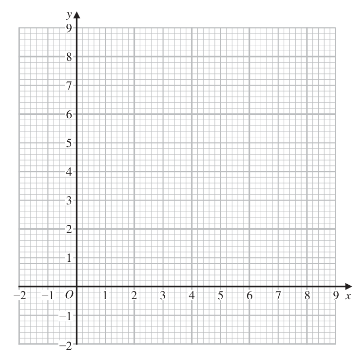
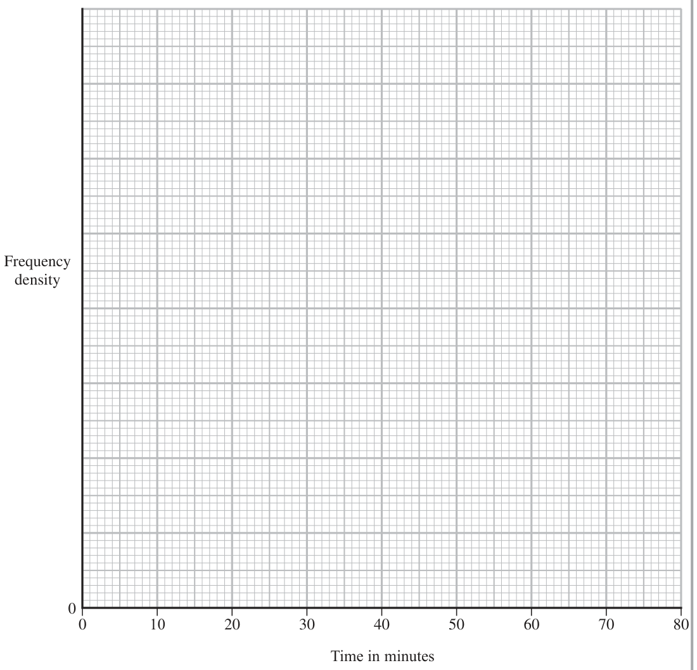
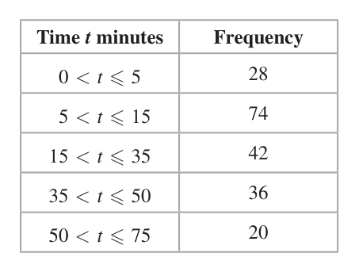
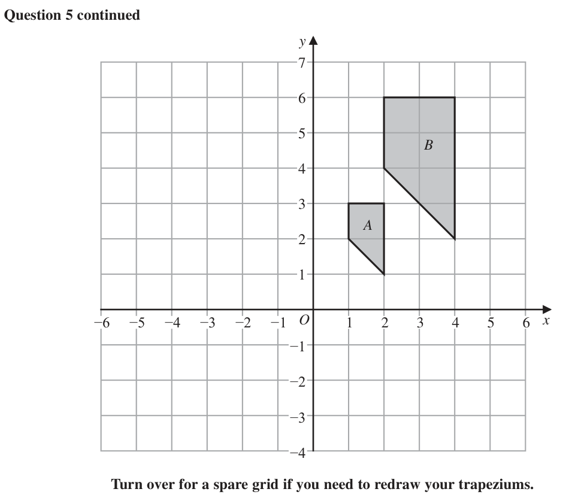
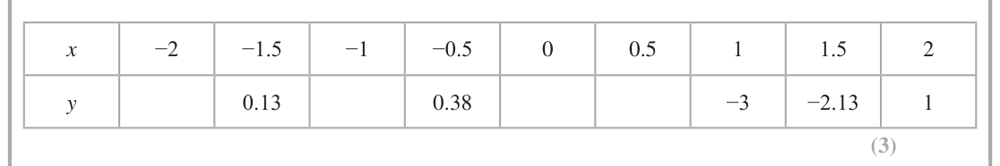
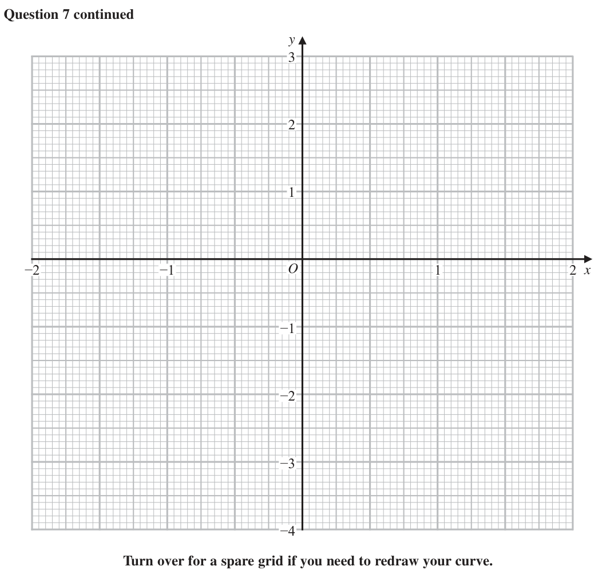

# 4MB1/02 — 2021-11 (official extraction)

> schema `syllabai.official-paper-questions/0.2` · paper_id `pearson-edexcel:international-gcse:mathematics-b:4mb1:2021-11:4MB1/02` · qp sha256 `9d50d32d83e1122c…` · extraction is the disclosed baseline (ADR-039)

## Question 1 (5 marks)
### 1(a) [3]

By drawing suitable straight lines on the grid below, show, by shading, the region R defined by all of the inequalities y ≤ x x + y ≤ 8 y ≥ 2 Label the region R. y −2 −1 O 1 2 3 4 5 6 7 8 9 x −1 −2 The point P with coordinates (x, y) is a point of the region R. Given that x and y are integers and that P lies on the straight line with equation x − 2y + 2 = 0

**Mark scheme answer**

> 3 M1 for line x + y = 8 correct (between x = 4 and x = 6 at least)
> Condone dashed line
> M1 for lines x = y (between x = 2 and x = 4 at least) and y = 2
> (between x = 2 and x = 6 at least) drawn correctly. Condone
> dashed line
> Correct region A1 both method marks must be awarded. Mark the area labelled R.
> indicated If no area is labelled allow if the area required is shaded in or
> out.

- **(3)** 3 M1 for line x + y = 8 correct (between x = 4 and x = 6 at least)

### 1(b) [2]

write down the coordinates of all possible points P.

**Mark scheme answer**

> 2 M1 for line 2y – x = 2 drawn (between x = 2 and x = 4 at least) or
> for one correct pair of coordinates if all the given co-ordinates
> x+2
> are on the line y = eg (3, 2.5) or (5, 3.5) or (6, 4) or
> ⎛ 14 10 ⎞
> ⎜ , ⎟
> ⎝ 3 3⎠
> (2, 2), (4, 3) A1 both coordinates and no extras. Condone missing brackets
> Allow written as x = 2, y = 2 and x = 4, y = 3 if pairing is clear.
> Total 5 marks
> Ques Working Answer Mark Notes

- **(2)** 2 M1 for line 2y – x = 2 drawn (between x = 2 and x = 4 at least) or

## Question 2 (8 marks)

E Diagram NOT accurately drawn 12 cm D C M 10 cm A 8 cm B Figure 1 Figure 1 shows a right pyramid ABCDE with horizontal rectangular base ABCD and vertex E. AB =8 cm BC =10 cm EA = EB = EC = ED = 12 cm M is the midpoint of the base.

### 2(a) [4]

Calculate the total surface area, in cm2 to 3 significant figures, of the pyramid. The point P is the midpoint of AB and the point Q is the midpoint of BC.

**Mark scheme answer**

> 2
> 12 − 5 [= 119 =10.9] or 4 M1 for correct method to find height of a triangular side or angle
> BEC or angle AEB or angle ECB or angle EBC or angle EBA or
> 122 − 42 [= 128 = 8 2 = 11.3] or angle EAB oe This may be implied by a correct expression or
> ⎛ 122 + 122 − 82 ⎞ area for triangle AEB or ECB.
> [ ∠ AEB=] cos −1 ⎜ ⎟ [= 38.9 ] or ALT
> ⎝ 2 ×12 ×12 ⎠
> ⎛ 122 + 102 − 122 ⎞
> 4⎞ [ ∠ ECB = ∠ EBC =] cos −1 ⎜ ⎟ [= 65.4... ]
> [ ∠AEB =] 2 × sin −1 ⎛⎜ ⎟ or ⎝ 2 ×12 ×10 ⎠
> ⎝ 12 ⎠
> ⎛ 122 + 122 − 102 ⎞ ⎛ 122 + 82 − 122 ⎞
> −1
> [ ∠ EBA = ∠ EAB =] cos ⎜ ⎟ [= 70.5... ]
> [∠BEC =] cos ⎜ −1
> ⎟ [49.2 ] or ⎝ 2 ×12 × 8 ⎠
> ⎝ 2 ×12 ×12 ⎠
> 5 ⎛ 122 + 102 − 122 ⎞
> [ ∠BEC =] 2 × sin −1 ⎛⎜ ⎞⎟ Allow all written in form cos … = eg cos... = ⎜
> ⎝ 2 × 12 × 10 ⎠
> ⎟
> ⎝ 12 ⎠
> 0.5 × 10 ×"10.9" or M1 ft their height of the triangles.
> 0.5 × 12 × 12 × sin"49.2"°or For area of triangle AEB [= 45.2…] NB 12sin"65.4..." = 10.9
> 0.5 × 8 × "11.3" or or triangle BEC [= 54.5…] NB 12sin"70.5..." = 11.3... This may
> 0.5 × 12 × 12 × sin"38.9"° be embedded in an expression for total area
> M1 for 8 × 10 + 2 × "54.5" + 2 × "45.2" M1 indep For 8 × 10 + 2 × z + 2 × y where z ≠ y
> 280 (cm²) A1 279 – 280 (inclusive)

- **(4)** 2

### 2(b) [4]

Calculate the size, in degrees to one decimal place, of ∠PEQ. Cosine rule: a 2 b 2 c 2 2bc cos A

**Mark scheme answer**

> [PQ = ] 42 + 52 [= 41 ] 4 M1 a correct method to find PQ Allow 41 or awrt 6.40 seen -
> ignore labelling
> (" 41") = "10.9" + "11.3" − 2 × "10.9"× "11.3"× cos E
> 2 2 M1 a correct equation to find ∠PEQ . Allow use of their values for
> oe EP and EQ either from part (a) or from this part . ft their PQ.
> M1 dep on previous method mark being awarded. A correct method
> cos ∠PEQ = ⎜⎜
> (
> ⎛ "10.9"2 + "11.3"2 − 41 2 ⎞
> ⎟ ) to find ∠PEQ . Allow use of their values for EP and EQ either
> 2 × "10.9"× "11.3" ⎟
> ⎜
> ⎝
> ⎟
> ⎠
> from part (a) or from this part if they are clearly labelled. Allow
> other letters for P and Q if clear on diagram
> Allow cos −1 ⎜⎜
> ( )
> ⎛ "10.9"2 + "11.3"2 − " 41" 2 ⎞
> ⎟
> 2 × "10.9"× "11.3" ⎟
> ⎜ ⎟
> ⎝ ⎠
> 33.4 A1 33.4 – 33.5 Total 8 marks

- **(4)** [PQ = ] 42 + 52 [= 41 ] 4 M1 a correct method to find PQ Allow 41 or awrt 6.40 seen -

## Question 3 (9 marks)

The table below gives information about the lengths of time, in minutes, that 200 people waited for a train. Time t minutes Frequency 0<t≤5 28 5 < t ≤ 15 74 15 < t ≤ 35 42 35 < t ≤ 50 36 50 < t ≤ 75 20

### 3(a) [2]

Find the class interval that contains the median time.

**Mark scheme answer**

> (200 + 1) ÷ 2 (=100.5) or 100th 2 M1 Allow 101 May be implied by correct answer
> 5<t 15 A1 Condone ≤ for < and vice versa

- **(2)** (200 + 1) ÷ 2 (=100.5) or 100th 2 M1 Allow 101 May be implied by correct answer

### 3(b) [4]

Calculate an estimate for the mean time, in minutes, that these 200 people waited for the train.

**Mark scheme answer**

> 2.5×28 + 10×74 + 25×42 + 42.5×36 4 M2 for at least 3 correct products added (need not be evaluated)
> + 62.5×20 (M1 for consistent use of a value within interval (incl end
> (= 70 + 740 + 1050 + 1530 + 1250 points) for at least 3 products which must be added
> = 4640) OR correct mid-points used for at least 3 products but not
> added)
> "4640" ÷ 200 M1 dep on at least M1 previously scored. For dividing their sum by
> 200
> 23.2 116
> A1 (allow 23 from correct working) Allow oe

- **(4)** 2.5×28 + 10×74 + 25×42 + 42.5×36 4 M2 for at least 3 correct products added (need not be evaluated)

### 3(c) [3]

On the grid opposite, draw a histogram for the information in the table. Frequency density 0 10 20 30 40 50 60 70 80 Time in minutes

**Mark scheme answer**

> FDs: 28÷5 (=5.6), 74÷10 (=7.4), 3 M2 for correct methods to find at least 4 of the FD which may be
> 42÷20 (=2.1), 36÷15 (=2.4), on graph (M1 for at least 2 FDs which may be on graph)
> 20÷25 (=0.8) If there is not a scale on the y-axis we will allow if the bars are
> drawn at the correct height, in relation to the bar for
> 5 < t ≤15
> A1 completely correct histogram. A correct scale with at least one
> correct value on the y-axis
> Total 9 marks

- **(3)** FDs: 28÷5 (=5.6), 74÷10 (=7.4), 3 M2 for correct methods to find at least 4 of the FD which may be

## Question 4 (12 marks)

Ella sells jars of jam, jars of honey and jars of chutney from her market stall. On Thursday, the total number of jars she sold was 320 55% of the jars were jars of jam. The ratio of the number of jars of honey to the number of jars of chutney that Ella sold on Thursday was 5 : 3

### 4(a) [4]

Calculate the number of jars of chutney that Ella sold on Thursday. On Friday, Ella sold 99 jars of strawberry jam. This was of the total number of jars of jam that she sold on Friday. The number of jars of jam that Ella sold increased from Thursday to Friday. Given that this increase = × the number of jars of jam that Ella sold on Thursday, n

**Mark scheme answer**

> 0.55 × 320 (=176) or 0.45 × 320 (=144) 4 M1 Correct method to find the number of jars of jam or (honey +
> oe chutney) sold. Allow 176 or 144 seen
> (320 – "176") ÷ (5 + 3) [=18] oe or M1 ft "their 176" or "their 144" rather
> M2 for × (320 − "176")
> (320 – "176") × 3 [ = 432]oe than 320 – "176"
> "432" M1 ft "their 18" or "their 432"
> "18" × 3 or or × ("144")
> 8
> 54 A1

- **(4)** 0.55 × 320 (=176) or 0.45 × 320 (=144) 4 M1 Correct method to find the number of jars of jam or (honey +

### 4(b) [3]

find the value of n. Ella increases the price of a jar of jam from 3.20 euros to 3.50 euros.

**Mark scheme answer**

> 20 3 M1 A correct method to find the total number of jars of jam sold on
> 99 × (= 220) oe Friday
> ("220" – "176") ÷ "176" M1 ft "their 176" or "220" – (320 – "their 144") from part(a)
> Allow "176"÷ ("220"− "176") or "220"− "176" = × "176"
> n
> 4 A1

- **(3)** 20 3 M1 A correct method to find the total number of jars of jam sold on

### 4(c) [2]

Calculate the percentage increase in the price of a jar of jam. Ella increases the price of a jar of honey by 6.25% The price of a jar of honey after the price increase is 5.10 euros.

**Mark scheme answer**

> 3.50 − 3.20 2 3.50 3.50
> ×100 oe M1 allow [=1.09… ] or ×100 allow 9.4% Allow awrt
> 3.20 3.20 3.20
> 0.094
> 9.375 A1 Allow 9.38 ISW

- **(2)** 3.50 − 3.20 2 3.50 3.50

### 4(d) [3]

Calculate the price of a jar of honey before the price increase.

**Mark scheme answer**

> 5.10 ÷ 1.0625 3 M2 for 5.10 ÷ 1.0625 oe Allow x + 0.0625 x = 5.10
> (M1 for 106.25% = 5.10 oe Allow x + 6.25% x = 5.10 )
> 4.8(0) A1 Must not come from incorrect working.
> (euros)
> Total 12 marks
> 2 v

- **(3)** 5.10 ÷ 1.0625 3 M2 for 5.10 ÷ 1.0625 oe Allow x + 0.0625 x = 5.10

## Question 5 (11 marks)

On the grid opposite, trapezium B is the image of trapezium A under a single transformation.

### 5(a) [3]

Describe fully the single transformation. Trapezium C is the image of trapezium A under a reflection in the line with equation x = −1

**Mark scheme answer**

> Enlargement 3 B1 Allow enlarge(d)
> Scale factor 2 B1 allow alternatives eg Allow 2 times larger but not 2 times smaller
> Centre (0, 0) B1 Allow around the origin. oe

- **(3)** Enlargement 3 B1 Allow enlarge(d)

### 5(b) [2]

On the grid opposite, draw and label trapezium C. Trapezium A is transformed to trapezium D under the transformation with matrix M where 2 0 M

**Mark scheme answer**

> Correct 2 B2 for a fully correct reflection. (B1 for a reflection in any vertical
> reflection line)

- **(2)** Correct 2 B2 for a fully correct reflection. (B1 for a reflection in any vertical

### 5(c) [3]

On the grid opposite, draw and label trapezium D. Trapezium D is transformed to trapezium B under the transformation with matrix N.

**Mark scheme answer**

> ⎛ −2 0 ⎞⎛ 1 1 2 2 ⎞ 3 M1 for setting up correct matrix and for intention to multiply matrices
> ⎜ ⎟⎜ ⎟ oe in the correct order with at least 2 correct entries in answer.
> ⎝ 0 −1 ⎠⎝ 2 3 3 1 ⎠
> Implied by trapezium D drawn correctly. Implied by 2 correct
> points plotted
> ⎛ −2 −2 −4 −4 ⎞ A1 correct matrix. Pairs can be in any order. Implied by trapezium D
> ⎜ ⎟ drawn correctly
> ⎝ −2 −3 −3 −1 ⎠
> trapezium D A1 trapezium D drawn correctly

- **(3)** ⎛ −2 0 ⎞⎛ 1 1 2 2 ⎞ 3 M1 for setting up correct matrix and for intention to multiply matrices

### 5(d) [3]

Find matrix N. a b 1 d b The inverse of matrix is c d ad bc c a y B A −6 −5 −4 −3 −2 −1 O 1 2 3 4 5 6 x −1 −2 −3 −4 for a spare grid if you need to redraw your trapeziums. Only use this grid if you need to redraw your trapeziums. y B A −6 −5 −4 −3 −2 −1 O 1 2 3 4 5 6 x −1 −2 −3 −4

**Mark scheme answer**

> 1 ⎛ −1 0 ⎞ 3 M1 for the inverse of matrix M or for one correct row or column in
> ⎜ ⎟ or the answer
> 2 ⎝ 0 −2 ⎠
> ⎛ a b ⎞⎛ −2 −2 −4 −4 ⎞ ⎛ 2 2 4 4 ⎞
> ⎜ ⎟⎜ ⎟=⎜ ⎟
> ⎝ c d ⎠⎝ −2 −3 −3 −1 ⎠ ⎝ 4 6 6 2 ⎠
> ⎛ 2 0 ⎞ ⎡ 1 ⎛ −1 0 ⎞ ⎤ M1 for fully correct calculations shown or for 3 correct entries in
> ⎜ ⎟⎢ ⎜ ⎟⎥ or ⎡ 1 ⎛ −1 0 ⎞⎛ 2 0 ⎞ ⎤
> ⎝ 0 2 ⎠ ⎣ 2 ⎝ 0 −2 ⎠ ⎦ the answer or Allow ⎢ ⎜ ⎟⎜ ⎟ ⎥ or
> −2a − 2b = 2 −2c − 2d = 4 ⎣ 2 ⎝ 0 −2 ⎠⎝ 0 2 ⎠ ⎦
> −2a − 3b = 2 −2c − 3d = 6 Different letters may be used
> 2 of and 2 of
> −4a − 3b = 4 −4c − 3d = 6
> −4a − b = 4 −4c − d = 2
> ⎛ −1 0 ⎞ A1 fully correct
> ⎜ ⎟
> ⎝ 0 −2 ⎠
> Total 11 marks

- **(3)** 1 ⎛ −1 0 ⎞ 3 M1 for the inverse of matrix M or for one correct row or column in

## Question 6 (7 marks)

The point A has coordinates (5, 4) and the point B has coordinates (−7, −1) → 3 The point C is such that BC =

### 6(a) [2]

Find the coordinates of the point C. The point D is such that ABCD is a parallelogram with diagonals AC and BD. The length of BC is 5 cm.

**Mark scheme answer**

> (−4, 3) 2 ⎛ −4 ⎞
> B2 (B1 for one correct coordinate or for (3, −4)or for ⎜ ⎟ )
> ⎝ 3⎠
> Allow x = −4 y = 3

- **(2)** (−4, 3) 2 ⎛ −4 ⎞

### 6(b) [5]

Find the area, in cm2, of the parallelogram ABCD. Cosine rule : a 2 b 2 c 2 2bc cos A Area of triangle 1 ab sin C

**Mark scheme answer**

> [AB/CD =] 5 M2 for 2 of these oe Correct method seen (ft through their
> 2 2 2
> (5 − −7) + (4 − −1) / ("8"− "− 4") + ("8"− "3") (= 13) coordinates of C and D ("−4" + 12, "3"+ 5 ))or correct answer.
> Ignore working if they have [AB/CD =]13
> [AC =] ("− 4"− 5)2 + ("3"− 4) 2 = ( 82 = 9.05...)
> [BD=] (M1 for correct method to find one side) Condone if not
> labelled
> ("8"− −7)2 + ("8"− −1) 2 (= 306 = 3 34 = 17.49...)
> Alternative:
> N.B. Alt using coordinate geometry
> M2 for 2 of: rectangle = 12 × 5 ( = 60), 0.5 × 9 × 1 (=4.5),
> 0.5 × (5 + 1) × 3(=9), 0.5 × 12 × 5(=30)
> ( Allow M1 for finding one of the areas)
> ⎛ "82"+ 52 − "132 " ⎞ ⎡ −62 ⎤ M1 For a correct statement, ft their lengths if clearly labelled
> Eg cos ∠BCA = ⎜ ⎟ ⎢= ⎥ oe or (allow on a diagram), to enable either angle BCA or angle
> ⎝ 2 × " 82 "× 5 ⎠ ⎣ 10 82 ⎦ ABC or angle BAC to be found or area of all 4 shapes needed
> ⎛ "13"2 + 52 − "82" ⎞ ⎡ 112 ⎤ to find area of shaded shape.
> cos ∠ABC = ⎜ ⎟ ⎢= ⎥ oe or ∠BCA = 133.2 ∠ABC = 30.5 ∠BAC = 16.27
> ⎝ 2 × "13"× 5 ⎠ ⎣ 130 ⎦
> Allow use of right angled triangles eg
> ⎛ "82"+ "13"2 − 52 ⎞ ⎡ 226 ⎤ 12
> cos ∠BAC = ⎜ ⎟ ⎢= ⎥ oe A = 90 − tan −1 − tan −1 [=16.27…]
> ⎝ 2 × "13"× 82 ⎠ ⎣ 26 82 ⎦ 5
> Area of half parallelogram = M1 correct area formula for half parallelogram, ft their angle
> 0.5 × 5 × "13" × sin("30.5") and sides if clearly labelled(allow on a diagram), or
> or 0.5 × 5 × "13" × sin("149.5") (=16.5) "60" – "30" – "9" – "4.5" (=16.5)
> 33 (cm²) A1 32.9 – 33
> NB: A correct answer within the given range with no obvious
> incorrect working gains full marks.
> Total 7 marks
> part (b) There are other ways see next page for most common
> Alt 1 [AB/CD =] (5 − −7)2 + (4 − −1) 2 (= 13) M1 Condone not labelled
> 4 − −1 5 23 M1 Correct method to find the equation of the line. Allow
> [Line AB] y − 4 = ( x − 5) oe ⎡⎢⇒ y = x + ⎤⎥ use of point B
> 5 − −7 ⎣ 12 12 ⎦
> 12 ⎡ 12 33 ⎤ M1 Correct method to find the equation of the line.
> [Line CE] y − "3" = − " " ( x − "− 4") oe ⎢⇒ y = − x − ⎥
> 5 ⎣ 5 5⎦
> 511 111 M1 Correct method to find the length of CE using their
> Solving gives x = − y=
> 169 169 values for x and y which must be stated. If x and y are
> incorrect working must be seen
> ("3"− "111169") + ("− 4"− "− 511169")
> 2
> CE =
> [=2.538…]
> Area = 13 × 2.538... 33 (cm²) A1
> 3 − −1 4 25 M1 Correct method to find the equation of the line. Allow
> ( x − −7 ) oe ⎡⎢⇒ y = x + ⎤⎥
> Alt 2
> −4 − −7 ⎣ 3 3⎦
> 3 ⎡ 3 31 ⎤ M2 Correct method to find the equation of the line.
> [Line AF] y − 4 = − " " ( x − "5") oe ⎢⇒ y = − x + ⎥ Allow use of point D ("−4" + 12, "3"+ 5 ))
> 4 ⎣ 4 4⎦
> ⎡⇒ y = − 3 x + 14⎤
> ⎣ 4 ⎦
> 7 199 M1 Correct method to find the length of AF using their
> Solving gives x = − y=
> 25 25 values for x and y which must be stated. If x and y are
> incorrect working must be seen
> (5 − − " 7 25") + ( 4 − "199 25") [= 6.6 …]
> 2
> AF = Use of D gives x = 68/25 and y = 299/25
> (8 − "68 / 25")2 + (8 − "299 / 25") 2
> Area = 5 × 6.6 33 (cm²) A1
> Alt 3 [ 2 × 0.5] × ( 5(−1 − "3") − "4"(−7 + 4) − (−7 × "3"− 4) ) M4 ft their coordinates from part(a)
> ± [ −5 − 15 + 28 − 16 − 21 − 4]
> (M1 2 correct values, M2 3 correct values, M3 4 correct values)
> Alt 3 0.5 (5 × −1 + −7 × "3"+ "− 4"× "8"+ "8"× 4) − M4 ft their coordinates from part(a) and D ("−4" + 12, "3"+ 5 )
> ± [ (−5 − 21 − 32 + 32) − (−28 + 4 + 24 + 40)]
> (4 × −7 + −1× "− 4"+ "3"× "8"+ "8"× 5)
> (M1 2 correct values, M2 3 correct values, M3 4 correct values)
> 33 A1

- **(5)** [AB/CD =] 5 M2 for 2 of these oe Correct method seen (ft through their

## Question 7 (10 marks)

Here is the equation of a curve y = x3 − 3x − 1

### 7(a) [3]

Complete the table of values for y = x3 − 3x − 1, giving your values of y to 2 decimal places where necessary. x −2 −1.5 −1 −0.5 0 0.5 1 1.5 2 y 0.13 0.38 −3 −2.13 1

**Mark scheme answer**

> −3, 1, −1, −2.38 (allow −2.375) 3 B3 for all 4 correct values, B2 for 3 correct, B1 for 2 correct

- **(3)** −3, 1, −1, −2.38 (allow −2.375) 3 B3 for all 4 correct values, B2 for 3 correct, B1 for 2 correct

### 7(b) [3]

On the grid opposite, plot the points from your completed table and join them to form a smooth curve.

**Mark scheme answer**

> Correct curve 3 M1 Attempts to plot at least 7 of their points with at least 5
> drawn correct ±1 small square. (Allow if curve goes through the points)
> M1 drawing a smooth curve through at least 5of the plotted points.
> Do not allow if they use straight lines. Allow ±1 square from their
> point.
> A1 A fully correct curve. All Points plotted correctly, ± 1square,
> (allow their point (0.5, a)) provided −2 < a < −2.5 with a smooth
> curve through all the points.

- **(3)** Correct curve 3 M1 Attempts to plot at least 7 of their points with at least 5

### 7(c) [2]

Use your graph to estimate, to one decimal place, the solutions in the interval −2 ≤ x ≤ 2 of the equation x3 − 3x − 1 = 0.5

**Mark scheme answer**

> 2 M1 for drawing line or showing marks on graph only at y = 0.5
> −1.4, −0.6, 1.9 A1cao dep on M1 no incorrect extras given.

- **(2)** 2 M1 for drawing line or showing marks on graph only at y = 0.5

### 7(d) [2]

By drawing a suitable straight line on the grid, find an estimate, to one significant figure, of the gradient of the curve at the point where x = 0.5 y −2 −1 O 1 2 x −1 −2 −3 −4 for a spare grid if you need to redraw your curve. Only use this grid if you need to redraw your curve. y −2 −1 O 1 2 x −1 −2 −3 −4

**Mark scheme answer**

> 2 M1 for a tangent drawn at x = 0.5
> −2 A1 dep on M1
> Total 10 marks

- **(2)** 2 M1 for a tangent drawn at x = 0.5

## Question 8 (10 marks)

Some college students were each asked which of the subjects Mathematics (M), Physics (P) and Chemistry (C) they were studying. Here is some information about their answers. n(M ∩ P) = 21 n(M ∩ C ) = 24 n(P ∩ C ) = 25 n(M ) = 43 n(P) = 50 n([M ∪ P ∪ C ]ʹ) = 25 n([M ∪ P]ʹ ∩ C ) = 8 n(M ∩ P ∩ C ) = x , where x is a positive integer.

### 8(a) [4]

Use all the given information to complete the Venn diagram on the opposite page, giving the number of elements in each appropriate subset, in terms of x where necessary. Given that n(C ) = 40

> 🖼 crop required: diagram (qp.pdf p.20)

**Mark scheme answer**

> 4 B4 fully correct for all 7 correct.
> (NB: x given in middle overlap so is not included as a correct
> region) Allow as numbers (ft their x–value)
> B3 for 5 or 6 regions correct.
> B2 for 3 or 4 regions correct.
> B1 for 2 correct regions.
> NB Allow correct un-simplified expressions
> SC If using x =" their 17" the
> max they can get is B3
> B3 for 5 or 6 regions correct.
> B2 for 3 or 4 regions correct.
> B1 for 2 correct regions.

- **(4)** 4 B4 fully correct for all 7 correct.

### 8(b) [4]

find the total number of college students that were asked. One of these college students is to be chosen at random. Given that the college student studies Chemistry,

**Mark scheme answer**

> 24 − x + x + 25 – x + 8 = 40 oe 4 M1 a correct equation for number of elements in set C
> ft their Venn diagram, if there are no blanks, providing working
> is shown and the equation contains x
> x = 17 17 A1
> ("17" – 2) +( 21 – "17") +( 4 + "17") + M1 dep on M1 a correct equation using their value of x
> ( 24 – "17") +( "17" )+ ( 25 – "17") + 8 + 25 ft their Venn diagram if working is shown
> oe eg 15 + 4 + 21 + 40 + 25 or 15+ 4 + 21 + 7 + 17 +8 +8 +25
> 105 A1 answer of 105 gets full marks
> SC M1M1 for adding all the areas in their Venn diagram providing the x's cancel out.
> Eg (x – 2) + (21 – x) + (4 + x) + (25 – x) + (24 – x) + 8 + 25 oe eg – 2+ 21 + 4 + 25 + 24 + 8 + 25
> A2 for 105

- **(4)** 24 − x + x + 25 – x + 8 = 40 oe 4 M1 a correct equation for number of elements in set C

### 8(c) [2]

find the probability that this student also studies Physics. E M P x C

**Mark scheme answer**

> 25 2 B2 oe Allow 0.625
> 40 n
> (B1 for where n < 40 or where m > 25)
> 40 m
> Total 10 marks

- **(2)** 25 2 B2 oe Allow 0.625

## Question 9 (6 marks)

B C Diagram NOT accurately drawn O 18° 120° A D E Figure 2 Figure 2 shows a circle ABCDE with centre O. ∠BAO = 18° ∠AOD = 120° The area of segment BCD, shown shaded in Figure 2, is T cm2 Given that the perimeter of the sector AODE is 5(3 + π) cm, calculate the value, to one decimal place, of T. (6) Area of triangle 2 ab sin C

### 9 [6]

B C Diagram NOT accurately drawn O 18° 120° A D E Figure 2 Figure 2 shows a circle ABCDE with centre O. ∠BAO = 18° ∠AOD = 120° The area of segment BCD, shown shaded in Figure 2, is T cm2 Given that the perimeter of the sector AODE is 5(3 + π) cm, calculate the value, to one decimal place, of T. Area of triangle 2 ab sin C

> 🖼 crop required: diagram (qp.pdf p.None)

**Mark scheme answer**

> 120 6 M1 correct equation for perimeter of sector AOD Allow 30.7 or
> 2r + × 2π r = 5(3 + π ) better for 5(3 + π )
> 360
> 5 (3 + π ) A1 correct value for r – need not be simplified. Allow 30.7 or
> r= [= 7.5] better for 5(3 + π )
> 2 + 23 π
> ∠BOD = 180 − 2(60 − 18) (=96) M1 a correct method to find angle BOD
> eg 360 – 120 – (180 – 2 × 18) NB radians π
> "96" M1 a correct method to find Area of sector OBCD. Ft their value
> Area of sector OBCD = × π × "7.5"2
> 360 ⎛ 360 − 96 ⎞
> of r and their ∠BOD eg π "7.5"2 − ⎜ ⎟ × π "7.5"
> ( = 15π = 47.12...) ⎝ 360 ⎠
> 1
> NB radians "7.5"2 × π
> 2
> Area of triangle OBD = 0.5 × 7.5² × sin"96" M1 a correct method to find the area of the triangle OBD Ft their
> ( = 27.97...) value of r and their ∠BOD . May use trig to find lengths
> and use area = 0.5bh
> 19.2 (cm²) A1 19.1 – 19.2
> Total 6 marks

- **(6)** 120 6 M1 correct equation for perimeter of sector AOD Allow 30.7 or

## Question 10 (7 marks)

P A O Diagram NOT accurately drawn C Q B T Figure 3 → → Figure 3 shows the triangle OAB in which OA = 4a and OB = 6b C is the point on AB such that AC : CB = 3 : 1 →

### 10(a) [3]

Find and simplify an expression for OC in terms of a and b. The point T is such that ABT is a straight line and AC = CT. → 3→ The point P is such that OP = OA Q is the point on OB such that the points P, Q and T are collinear. Given that OQ : QB = n : 1

**Mark scheme answer**

> AB = 6b − 4a oe or 3 M1 correct vector for AB or BA May be embedded in an
> BA = 4a − 6b oe expression for OC
> 3 3
> OC = 4a + ("6b − 4a") or M1 Allow OC = 4a + ("their AB") or OC = 6b + ("their BA")
> 4 4
> 1 if AB / BA is clearly labelled.
> OC = 6b + ("4a − 6b")
> a + 4.5b A1 oe

- **(3)** AB = 6b − 4a oe or 3 M1 correct vector for AB or BA May be embedded in an

### 10(b) [4]

find the value of n.

**Mark scheme answer**

> 3 4 9 −5
> PT = a + ("6b − 4a")(= −5a + 9b) M1 Implied by =ft their AB
> 2 λ −3
> 6n
> M1 One correct vector. Allow or 6λ for λ
> PQ = −3a + λb or n +1
> OQ = λb oe 9 −5
> Implied by =
> λ −3
> 3 M1 A 2 correct vector for PQ or a 2nd correct vector for OQ ft
> nd
> PQ = ("− 5a + 9b")(= 5.4b − 3a) or
> 5 their PT
> OQ = 3a + δ ("− 5a + 9b ")
> 9 −5
> or 5.4 : 0.6 or = oe λ =
> λ −3
> 9 A1 Allow 9 : 1
> Total 7 marks

- **(4)** 3 4 9 −5

## Question 11 (15 marks)

The three functions, f, g and h, are defined as f : x ↦ 4x3 + 4x2 − 5x − 3 x−7 g:xα 3 − 2x h : x ↦ 2x + 1

### 11(a) [1]

Write down the value of x that must be excluded from any domain of g

**Mark scheme answer**

> 1.5 1 B1 oe

- **(1)** 1.5 1 B1 oe

### 11(b) [1]

Find g(2)

**Mark scheme answer**

> 5 1 B1

- **(1)** 5 1 B1

### 11(c) [3]

Express the inverse function g−1 in the form g−1(x) = …

**Mark scheme answer**

> x−7 y−7 3 3x + 7 3 y + 7
> y= and x= and M1 implied by or oe
> 3 − 2x 3− 2y 1 + 2x 1 + 2 y
> y(3 – 2x) = x − 7 x(3 – 2y) = y − 7
> 3y + 7 = x + 2xy 3x + 7 = y + 2xy M1 grouping together terms in x or terms in y implied by
> 3x + 7 3y + 7
> or oe Allow 1 sign error
> 1 + 2x 1+ 2 y
> 3x + 7 A1 oe Do not ISW allow g −1 : x … Do not allow y = …
> g −1 ( x) =
> 1 + 2x

- **(3)** x−7 y−7 3 3x + 7 3 y + 7

### 11(d) [4]

Solve the equation g(x) = h(x)

**Mark scheme answer**

> x – 7 = (3 – 2x)(2x + 1) oe 4 M1 for equating functions and removing denominator
> 4x² − 3x – 10 (= 0) oe M1 correct 3 term quadratic equation
> (4x + 5)(x – 2) (=0) M1 correct method to solve their 3 term quadratic equation.
> By factorisation brackets must expand to give 2 out of 3 terms
> correct or fully correct substitution into fully correct formula.
> −1.25, 2 A1 oe A correct answer with no incorrect working gains 4/4

- **(4)** x – 7 = (3 – 2x)(2x + 1) oe 4 M1 for equating functions and removing denominator

### 11(e)(i) [2]

Use the factor theorem to show that (2x + 3) is a factor of f (x)

**Mark scheme answer**

> 3
> 4 × (−1.5) + 4 × (−1.5) − 5 × −1.5 − 3 oe 2 M1
> 4 × (−1.5)3 + 4 × (−1.5)2 − 5 × −1.5 − 3 = 0 oe A1 must show that substitution of −1.5 gives solution of zero

- **(2)** 3

### 11(e)(ii) [4]

Hence solve the equation f (x) = 0 Show clear algebraic working.

**Mark scheme answer**

> The first 3 marks may be awarded for working seen in part(i)
> Division by (2x + 3) giving a first term of 2x² 4 M1 for (2x + 3)(2x².......) or synthetic division
> 2 x 2 ...................... 4 4 −5 −3
> (2 x + 3) 4 x3 + 4 x 2 − 5 x − 3 -3/2 −6 3
> 4 −2 … …
> Quotient 2x² − x − 1 M1 Allow 4x² − 2x − 2
> (2x + 1)(x – 1)(=0) oe M1 Correct factorisation of their quotient. For synthetic
> division allow ( 4 x + 2 )( x − 1) (= 0) or ( 2 x + 1)( 2 x − 2 ) (= 0)
> or 2 ( 2x + 1)( x − 1) (= 0) but we will condone missing 2
> Allow correct use of quadratic formula for their quadratic
> but working must be seen. Condone 22 for (−2)2
> −1.5, −0.5, 1 A1 All previous method marks must be awarded
> Total 15 marks
> Q6
> Q5
> Q7
> Pearson Education Limited. Registered company number 872828
> with its registered office at 80 Strand, London, WC2R 0RL, United Kingdom

- **(4)** The first 3 marks may be awarded for working seen in part(i)

