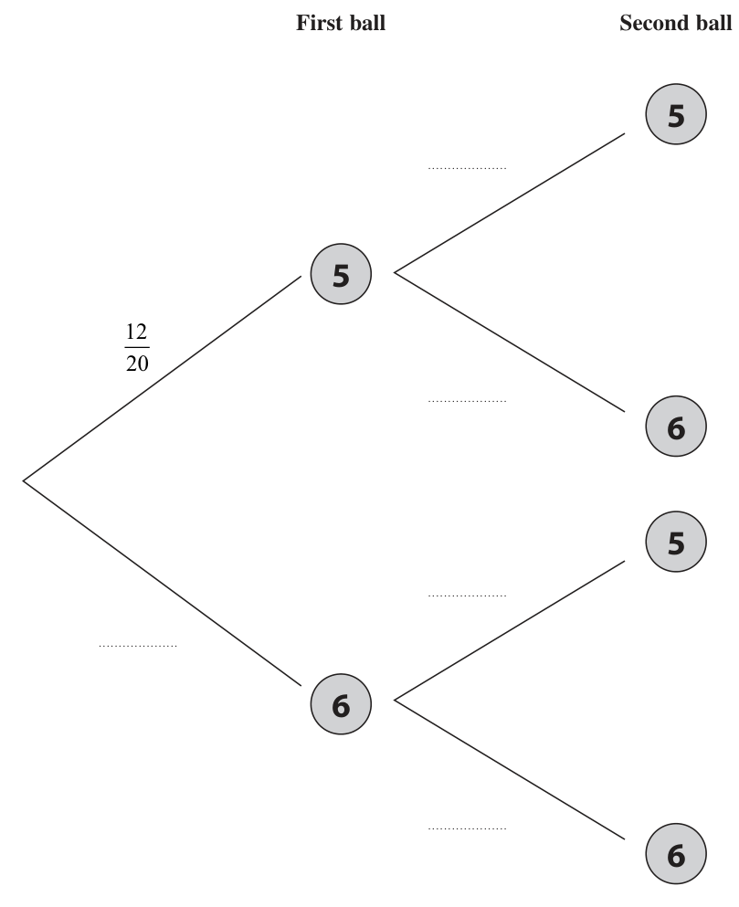

# 4MB1/01 — 2022-01 (official extraction)

> schema `syllabai.official-paper-questions/0.2` · paper_id `pearson-edexcel:international-gcse:mathematics-b:4mb1:2022-01:4MB1/01` · qp sha256 `a071699b3f49ed30…` · extraction is the disclosed baseline (ADR-039)

## Question 1 (2 marks)

Find the Lowest Common Multiple (LCM) of 180 and 198 Show your working clearly.

### 1 [2]

Find the Lowest Common Multiple (LCM) of 180 and 198 Show your working clearly.

**Mark scheme answer**

> 180 = 2 × 2 × 3 × 3 × 5 2 M1 A correct method to enable the LCM to be found.
> 198 = 2 × 3 × 3 ×11 Correct factorisation of 180 and 198 allow on factor
> or trees.

- **(2)** 180 = 2 × 2 × 3 × 3 × 5 2 M1 A correct method to enable the LCM to be found.

## Question 2 (2 marks)

Factorise fully 6 p 3 q 5 r − 15 pq 3

### 2 [2]

Factorise fully 6 p 3 q 5 r − 15 pq 3

**Mark scheme answer**

> 180 198 For the table they must divide both numbers by

- **(2)** 180 198 For the table they must divide both numbers by

## Question 3 (2 marks)

Find the value of when a = − 2 and b = −3 b

### 3 [2]

Find the value of when a = − 2 and b = −3 b

**Mark scheme answer**

> 90 99 those shaded (or other combination with a product
> 2 10 11 optional but must be correct if seen (2 and 5 could
> 5 5 11 be combined to give 10).
> 11 1 11 Division could be in a different order.
> 1 1 Allow list of multiples – at least 5 correct for each
> number, excluding 180 and 198 eg.
> 360,540,720,900,1080 and 396, 594, 792, 990,1188
> 1980 A1 Allow 22 × 32 × 5 ×11
> Total 2 marks
> 2 3 p ( 2 p 2 q 5 r − 5q 3 ) or 3q 3 ( 2 p 3 q 2 r − 5 p ) or 2 M1
> pq 3 ( 6 p 2 q 2 r − 15 ) or 3 pq ( 2 p 2 q 4 r − 5q 2 )
> or 3 pq 2 ( 2 p 2 q 3 r − 5q ) or
> 3 pq 3 ( 2 p 2 q 2 r − 5 ) A1 cao
> Total 2 marks
> 11 − 2 × 4 11 − 2( −2) 2
> oe Allow or or
> −3 −3 −3 −3
> –1 A1 cao
> Total 2 marks
> Question Working Answer Mark Notes

- **(2)** 90 99 those shaded (or other combination with a product

## Question 4 (2 marks)

A Diagram NOT accurately drawn 15 cm C 8 cm B The diagram shows the right-angled triangle in which AB = 15 cm BC = 8 cm ∠ ACB = 90° Calculate the size, in degrees to 3 significant figures, of ∠ ABC ° ∠ ABC = . . . . . . . . . . . . . . . . . . . . . . . . . . . . . . . . . . . . . . . . . . . . . . . . . . . . . . .

### 4 [2]

A Diagram NOT accurately drawn 15 cm C 8 cm B The diagram shows the right-angled triangle in which AB = 15 cm BC = 8 cm ∠ ACB = 90° Calculate the size, in degrees to 3 significant figures, of ∠ ABC ° ∠ ABC =

> 🖼 crop required: diagram (qp.pdf p.None)

**Mark scheme answer**

> 8 2 M1 Correct expression for trigonometric ratio of ∠ABC
> cos ∠ABC =
> 15 Allow use of Pythagoras with tan or sine.
> Allow use of sine rule or cosine rule. Eg.
> [ AC =] 152 − 82 [ = 12.7] and sin ∠ABC = sin 90
> "12.7"
> 57.8 A1 awrt 57.8
> Total 2 marks

- **(2)** 8 2 M1 Correct expression for trigonometric ratio of ∠ABC

## Question 5 (2 marks)

B = Calculate 4A − 3B ⎛ ⎞ ⎜ ⎟ ⎜ ⎟ ⎜ ⎟ ⎜⎝ ⎟⎠

### 5 [2]

B = Calculate 4A − 3B ⎛ ⎞ ⎜ ⎟ ⎜ ⎟ ⎜ ⎟ ⎜⎝ ⎟⎠

**Mark scheme answer**

> ⎛ 20 −16 ⎞ ⎛ 9 −6 ⎞ 2 M1 Multiplying by scalar. Allow 1 numerical or sign
> ⎜ ⎟ [ −] ⎜ ⎟ error. There is no need to show an intention to
> ⎝ 8 −8 ⎠ ⎝ − 6 15 ⎠
> subtract.
> ⎛ 11 −10 ⎞ A1 cao
> ⎜ ⎟
> ⎝14 − 23 ⎠
> Total 2 marks

- **(2)** ⎛ 20 −16 ⎞ ⎛ 9 −6 ⎞ 2 M1 Multiplying by scalar. Allow 1 numerical or sign

## Question 6 (3 marks)

The nth term of a sequence is given by 3n − 5

### 6(a) [1]

Write down the first two terms of this sequence , The mth term of this sequence is 103

**Mark scheme answer**

> − 2, 1 1 B1 cao

- **(1)** − 2, 1 1 B1 cao

### 6(b) [2]

Find the value of m m =

**Mark scheme answer**

> 3m − 5 = 103 oe M1 Forms an equation or a method to find m eg.
> (103 − ( −2) ) + 1 allow use of alternative
> [ m =]
> letters
> 36 2 A1 cao
> Total 3 marks
> Question Working Answer Mark Notes

- **(2)** 3m − 5 = 103 oe M1 Forms an equation or a method to find m eg.

## Question 7 (3 marks)

A straight line L passes through the points with coordinates (4, 8) and (0, −6) Find an equation of L Give your answer in the form y = mx + c

### 7 [3]

A straight line L passes through the points with coordinates (4, 8) and (0, −6) Find an equation of L Give your answer in the form y = mx + c

**Mark scheme answer**

> 8 − ( −6 ) 3 M1 An expression to find m or equation involving m
> Gradient = [ = 3.5] oe only eg. 8 = 4m – 6
> 4−0
> y = "3.5" x... or y = ...x − 6 M1 Accept an equation with a gradient of "3.5" or
> y-intercept of –6 in any form
> eg. y – 8 = "3.5" (x – 4)
> If ft gradient previous M mark must be scored.
> y = 3.5 x − 6 A1 oe accept any simplified form with a unitary
> coefficient of y eg y + 6 = 3.5 x Allow any
> equivalent fraction for 3.5.
> Allow 2 y = 7 x − 12 if y = 3.5 x − 6 or y + 6 = 3.5 x
> seen in working, otherwise do not isw
> Total 3 marks

- **(3)** 8 − ( −6 ) 3 M1 An expression to find m or equation involving m

## Question 8 (3 marks)

A Diagram NOT 6.5 cm accurately drawn 55° O B OAB is a sector of a circle, centre O and radius 6.5 cm ∠ AOB = 55° Calculate the perimeter, in cm to 3 significant figures, of the sector OAB ....................................................... cm

### 8 [3]

A Diagram NOT 6.5 cm accurately drawn 55° O B OAB is a sector of a circle, centre O and radius 6.5 cm ∠ AOB = 55° Calculate the perimeter, in cm to 3 significant figures, of the sector OAB cm

> 🖼 crop required: diagram (qp.pdf p.None)

**Mark scheme answer**

> 55 ⎡ 143π ⎤ 3 M1 Correct method to find the length of arc AB
> × 2 × π × 6.5 ⎢ = = 6.239...⎥
> 360 ⎣ 72 ⎦
> "6.239..."+ 2 × 6.5 M1 dep add on the 2 straight edges
> 19.2 A1 143π
> awrt 19.2 accept + 13
> Total 3 marks
> Question Working Answer Mark Notes

- **(3)** 55 ⎡ 143π ⎤ 3 M1 Correct method to find the length of arc AB

## Question 9 (3 marks)

Simplify (25 x 4 y 2 ) 2 25 x 3

### 9 [3]

Simplify (25 x 4 y 2 ) 2 25 x 3

**Mark scheme answer**

> 125x6 y3 3 M1 Two terms correct as part of a product. Expect to
> see as the numerator of a fraction but allow
> separately. Allow 53 for 125
> kx a y b M1 dep
> Must gain the previous M mark if not fully correct.
> Must be seen as a single expression involving a
> product of 3 terms.
> 2 of k = 5, a = "6"− 3 and b = 3 correct, seen k may
> be a fraction
> 5x3 y3 A1
> Total 3 marks

- **(3)** 125x6 y3 3 M1 Two terms correct as part of a product. Expect to

## Question 10 (3 marks)

A B Diagram NOT accurately drawn D C In the diagram, triangles ABC and ABD are such that AD = BC and ∠ BAD = ∠ ABC Prove that AC = BD

### 10 [3]

A B Diagram NOT accurately drawn D C In the diagram, triangles ABC and ABD are such that AD = BC and ∠ BAD = ∠ ABC Prove that AC = BD

> 🖼 crop required: diagram (qp.pdf p.None)

**Mark scheme answer**

> AD = BC and ∠BAD = ∠ABC are given 3 B1 Accept AD = BC and ∠ BAD = ∠ ABC stated just
> marking on the diagram is not sufficient
> AB is a common side M1 Accept AB = AB
> [ABC and BAD A1 Correct conclusion with no incorrect statements.
> are congruent] Allow a fully correct statement of the cosine rule
> by SAS for each triangle and a conclusion as equivalent to
> AC = BD SAS. To award the mark in this instance both
> previous marks need to be awarded.
> Total 3 marks

- **(3)** AD = BC and ∠BAD = ∠ABC are given 3 B1 Accept AD = BC and ∠ BAD = ∠ ABC stated just

## Question 11 (3 marks)

Diagram NOT accurately drawn 24 cm 18 cm A solid is made by joining a hemisphere, of diameter 18 cm, to a right circular cone whose base has a diameter of 18 cm. The height of the cone is 24 cm. The plane face of the cone coincides with the plane face of the hemisphere. Calculate the volume, in cm3, of the solid. Give your answer in terms of π ....................................................... cm3

### 11 [3]

Diagram NOT accurately drawn 24 cm 18 cm A solid is made by joining a hemisphere, of diameter 18 cm, to a right circular cone whose base has a diameter of 18 cm. The height of the cone is 24 cm. The plane face of the cone coincides with the plane face of the hemisphere. Calculate the volume, in cm3, of the solid. Give your answer in terms of π cm3

> 🖼 crop required: diagram (qp.pdf p.None)

**Mark scheme answer**

> 1 3 M1 Volume of cone or hemisphere accept value correct
> π × 92 × 24 [ = 648π = 2036] or
> 3 to 3sf.
> π × 93 [ = 486π = 1527]
> 1 2 M1 dep Sum of correct volumes (accept awrt 3560 to
> π × 92 × 24 + π × 93
> 3 3 3sf.)
> 1134π A1 cao
> Total 3 marks
> Question Working Answer Mark Notes

- **(3)** 1 3 M1 Volume of cone or hemisphere accept value correct

## Question 12 (3 marks)

Given that y = where x ≠ 0 x dy find dx dy = . . . . . . . . . . . . . . . . . . . . . .. . . . . . . . . . . . . . . . . . . . . . . . . . . . . . . . . dx

### 12 [3]

Given that y = where x ≠ 0 x dy find dx dy = dx

**Mark scheme answer**

> y = x + 1 + x−1 3 M1 Rewriting as a 3 term expression in a form that can
> be differentiated. At least 2 terms correct.
> Allow product or quotient rule with a maximum of
> 1 error:
> ⎡ dy ⎤
> ⎢⎣ dx = ⎥⎦ ( 2 x + 1) x − ( x + x + 1) x or
> −1 2 −2
> ⎡ dy ⎤ ( 2 x + 1) x − ( x + x + 1) [1]
> =
> ⎢⎣ dx ⎥⎦ x2
> ⎡ d( x) ⎤ ⎡ d( x −1 ) ⎤ −2 M1 indep For one term in x correctly differentiated (ft
> =
> ⎢⎣ dx ⎥⎦ 1 or ⎢ dx = ⎥ − x their simplified 3 term expression) or one correct
> ⎣ ⎦
> derivative in a product or quotient rule ( 2 x + 1) , 1
> or − x −2 , must have the correct structure for the
> rule
> 1 − x −2 A1 oe Allow an unsimplified answer, do not isw
> SC if no other marks awarded if top and bottom are
> differentiated independently giving an answer of
> 2 x + 1 award B1
> Total 3 marks

- **(3)** y = x + 1 + x−1 3 M1 Rewriting as a 3 term expression in a form that can

## Question 13 (3 marks)

Without using a calculator and showing your working clearly, express 432 − 147 in the form n where n is an integer.

### 13 [3]

Without using a calculator and showing your working clearly, express 432 − 147 in the form n where n is an integer.

**Mark scheme answer**

> 144 × 3 – 49 × 3 3 M1 Must see 432 and 147 decomposed into at least
> 144 × 3 and 49 × 3
> 5 3 A1 Must gain the method mark to award this
> allow for 75 gained without 5 3 stated
> 75 A1 dep on M mark gained allow n = 75
> Total 3 marks
> Question Working Answer Mark Notes

- **(3)** 144 × 3 – 49 × 3 3 M1 Must see 432 and 147 decomposed into at least

## Question 14 (3 marks)

A and B are two similar solids. The volume of A is 500 cm3 The volume of B is 32 cm3 The total surface area of A is 250 cm2 Calculate the total surface area, in cm2, of B. ....................................................... cm2

### 14 [3]

A and B are two similar solids. The volume of A is 500 cm3 The volume of B is 32 cm3 The total surface area of A is 250 cm2 Calculate the total surface area, in cm2, of B cm2

**Mark scheme answer**

> 32 ⎡ 8 ⎤ ⎡ 2⎤ 3 M1 An expression to find a linear scale factor or a
> 3 = = 0.064 ⎥⎦ ⎢⎣ = 5 ⎥⎦ or correct equation in x 3 .
> 500 ⎢⎣ 125 3
> ⎛ x ⎞ ⎛ 500 ⎞
> 500 ⎡ 125
> =
> ⎤ ⎡ 5⎤
> = 15.625⎥ ⎢ = ⎥ or
> Also accept ⎜ ⎟ =⎜ ⎟ for this mark only.
> ⎢ ⎝ 250 ⎠ ⎝ 32 ⎠
> 32 ⎣ 8 ⎦ ⎣ 2⎦
> 3
> ⎛ 250 ⎞ ⎛ 500 ⎞
> ⎜ ⎟ =⎜ ⎟ oe
> ⎝ x ⎠ ⎝ 32 ⎠
> 250 × "0.4"2 or 250 ÷ "2.5"2 or M1 dep
> 2 A fully correct expression for the surface area
> ⎛ 32 ⎞
> [ x =] 3
> 250 × ⎜ ⎟ oe
> ⎝ 500 ⎠
> 40 A1 cao
> Total 3 marks

- **(3)** 32 ⎡ 8 ⎤ ⎡ 2⎤ 3 M1 An expression to find a linear scale factor or a

## Question 15 (4 marks)

The table gives information about the weights, in grams, of 40 adult mice. Weight (w grams) Frequency 17 ≤ w < 19 8 19 ≤ w < 21 3 21 ≤ w < 22 15 22 ≤ w < 23 8 23 ≤ w < 25 6

### 15(a) [3]

Calculate an estimate for the mean weight, in grams to 3 significant figures, of these adult mice grams One of these adult mice is selected at random.

**Mark scheme answer**

> 18 × 8 + 20 × 3 + 21.5 ×15 + 22.5 × 8 + 24 × 6 3 M1 for fx calculated for at least 4 class intervals where x
> [ = 144 + 60 + 322.5 + 180 + 144 = 850.5] is a number in the range including the upper bound
> and an attempt to sum.
> "850.5" M1 dep dividing their total for fx by their total for f
> [8 + 3 + 15 + 8 + 6 =] 40
> 21.3 A1 awrt 21.3

- **(3)** 18 × 8 + 20 × 3 + 21.5 ×15 + 22.5 × 8 + 24 × 6 3 M1 for fx calculated for at least 4 class intervals where x

### 15(b) [1]

Find the probability that this mouse weighs less than 22 grams.

**Mark scheme answer**

> 26 1 B1 ⎛ 13 ⎞
> oe ⎜ and 0.65 often seen ⎟ ft their 40 if it comes
> 40 ⎝ 20 ⎠
> from 8 + 3 + 15 + 8 + 6
> Total 4 marks
> Question Working Answer Mark Notes

- **(1)** 26 1 B1 ⎛ 13 ⎞

## Question 16 (4 marks)

Andrew borrowed some money from Sarah. He borrowed $21 250 on 1st January 2018 On 31st December each year, starting on 31st December 2018, Sarah charged Andrew interest of 4% on the amount of money that he owed her. This interest was added to the amount of money that Andrew owed Sarah. On 1st January each year, starting on 1st January 2019, Andrew repaid $4000 to Sarah.

### 16(a) [1]

Show that before Andrew had repaid $4000 to Sarah on 1st January 2019, he owed Sarah $22 100 After Andrew had repaid $4000 to Sarah on 1st January 2020,

**Mark scheme answer**

> 21 250 ×1.04 oe 22 100 shown 1 B1 increasing 21 250 by 4%.

- **(1)** 21 250 ×1.04 oe 22 100 shown 1 B1 increasing 21 250 by 4%.

### 16(b) [3]

calculate how much money Andrew now owed Sarah. $

**Mark scheme answer**

> Accept 22 100 − 8000 [ = 14 100] for this mark only.
> 22 100 − 4000 [ = 18100] 3 M1 Need to see subtraction of 4000 before an attempt at
> adding interest
> ( 22 100 − 4000 ) ×1.04 − 4000 M1 dep full method to find final amount
> 14 824 A1 Do not isw
> Total 4 marks

- **(3)** Accept 22 100 − 8000 [ = 14 100] for this mark only.

## Question 17 (4 marks)

A B fountain D C Scale: 1 cm represents 1 m The diagram shows a scale drawing of a garden in the shape of the rectangle ABCD. The position of a fountain in the garden is marked by a cross. Tarik is going to plant a tree in the garden. The tree must be less than 2 metres from AB, greater than 3 metres from the fountain, closer to AB than to AC. Using ruler and compasses only and showing all your construction lines, construct and show by shading the region in which Tarik can plant the tree. Label the region R.

### 17 [4]

A B fountain D C Scale: 1 cm represents 1 m The diagram shows a scale drawing of a garden in the shape of the rectangle ABCD. The position of a fountain in the garden is marked by a cross. Tarik is going to plant a tree in the garden. The tree must be less than 2 metres from AB, greater than 3 metres from the fountain, closer to AB than to AC. Using ruler and compasses only and showing all your construction lines, construct and show by shading the region in which Tarik can plant the tree. Label the region R.

> 🖼 crop required: diagram (qp.pdf p.None)

**Mark scheme answer**

> 4
> A line parallel to AB drawn 2cm from AB M1
> Circle radius 3cm centre the fountain M1 Allow gaps in circle as long they are below any line
> drawn parallel to AB
> AC drawn and arc on AB and AC equal M1 Allow if AC not complete as long as sufficient is
> distance from A plus two intersecting drawn to allow the required construction use
> arcs drawn from these plus line drawn professional judgement on the accuracy of AC
> Correct region A1 dep All previous method marks must be awarded.
> identified Condone if the region is not labelled R as long as it
> is clearly shaded.
> Total 4 marks
> Question Working Answer Mark Notes
> 1 for correct formula for area of the trapezium. Allow
> [29.4 = ] ( 9 + 5) × BC oe 4 M1 for a correct equation in BC. Allow h or x for BC.
> 2 Do not allow AD.
> 29.4 × 2 M1 dep a correct expression for BC
> [ BC =] [ = 4.2]
> AD2 = "4.2"2 + (9 − 5)2 oe M1 indep A correct formula involving AD ft their BC
> 5.8 A1 cao
> Total 4 marks
> 19 180 ( n − 2 ) = 8280 oe 4 M1 Forming a correct equation.
> 8280 M1 dep Rearranging correctly to find n (number of
> n= + 2 [ = 48]
> 180 sides).
> 360 8280 M1 indep Correct method to find exterior angle from
> or 180 − their n. For the award of this mark n must be a
> "48" "48"
> positive integer.
> 7.5 A1 cao
> Total 4 marks
> 20 k 4 M1 For using inversely M2 correct equation in
> p= k
> q proportional e.g. p = or q eg 28 q = 420 × 9
> k = p ×…
> k = 420 × 9 [ = 1260 ] M1 dep Substitute numbers
> into their equation to find
> a correct expression for k.
> ⎛ "1260" ⎞
> 2 M1 dep Rearranging correctly to get a value for q.
> q=⎜ ⎟
> ⎝ 28 ⎠
> 2025 A1 cao
> Total 4 marks
> Question Working Answer Mark Notes
> 21 12.5 ≤ Area < 13.5 4 M1 One bound from each line seen e.g. 12.5 , 5.15 and
> 8.45 seen
> 5.15 ≤ a < 5.25
> 8.35 ≤ b < 8.45
> 2 × Area M1 Expression to find sin C with values substituted
> [sin C =] or
> in. If values of Area, a and b not clearly defined in
> a×b
> 1 response allow 10 ≤ Area ≤ 20, 5 ≤ a ≤ 6 and
> Area = × a × b × sin C 8≤b≤9
> sin C = is not required but penalise incorrect
> formula used.
> 2 ×12.5 M1 Dep on previous M mark.
> = or
> 5.25 × 8.45 Must show 1 LB for Area and 2 UB for a and b if
> 1 these are not clearly stated allow use of
> 12.5 = × 5.25 × 8.45 × sin C 12.5 Area < 13 , 5.2 < a 5.25 8.4 < b 8.45
> 34.3 A1 Awrt 34.3 must see all correct values (12.5, 5.25
> and 8.45) used
> Total 4 marks
> Question Working Answer Mark Notes
> 22 8 − 7x 4 M1 denominator factorised, must expand to give at least
> ( 6 x − 5)( x + 2 ) 2 term correct
> 3 ( x + 2 ) − 2 ( 5 x − 1) M1 indep 2 fractions subtracted, allow 1 sign error eg.
> or 3x + 6 − 10 x − 2
> ( x + 2 )( 5 x − 1)
> 5 x 2 + 10 x − x − 2
> ( x + 2 )( 5 x − 1)
> oe
> 3 ( x + 2 ) − 2 ( 5 x − 1)
> ⎡ 8 − 7x ⎤ ( x + 2 )( 5 x − 1) M1 indep this is not dependent on the previous marks
> ⎢ ⎥× but the candidate must achieve a single fraction
> ⎣ ( 6 x − 5 )( x + 2 ) ⎦ 8 − 7x
> from their subtraction to be awarded this mark for
> inverting their divisor.
> 5x − 1 A1 dep on all M marks awarded correct answer gained
> 6x − 5 with no incorrect working seen.
> Total 4 marks
> Question Working Answer Mark Notes

- **(4)** 4

## Question 18 (4 marks)

5 cm A B Diagram NOT accurately drawn D C 9 cm The diagram shows a trapezium ABCD. ∠ ABC = ∠ BCD = 90° AB = 5 cm DC = 9 cm The area of the trapezium ABCD is 29.4 cm2 Calculate the length, in cm, of AD. ....................................................... cm

### 18 [4]

5 cm A B Diagram NOT accurately drawn D C 9 cm The diagram shows a trapezium ABCD. ∠ ABC = ∠ BCD = 90° AB = 5 cm DC = 9 cm The area of the trapezium ABCD is 29.4 cm2 Calculate the length, in cm, of AD cm

> 🖼 crop required: diagram (qp.pdf p.None)

## Question 19 (4 marks)

The sum of the interior angles of a regular polygon is 8280° Calculate the size, in degrees, of each exterior angle of the regular polygon. °

### 19 [4]

The sum of the interior angles of a regular polygon is 8280° Calculate the size, in degrees, of each exterior angle of the regular polygon. °

## Question 20 (4 marks)

The numbers p and q are positive such that p is inversely proportional to q p = 420 when q = 9 Calculate the value of q when p = 28 q = .......................................................

### 20 [4]

The numbers p and q are positive such that p is inversely proportional to q p = 420 when q = 9 Calculate the value of q when p = 28 q =

## Question 21 (4 marks)

Diagram NOT accurately drawn a cm A cm2 C° b cm The diagram shows a triangle of area A cm2 in which a = 5.2 to 1 decimal place b = 8.4 to 1 decimal place A = 13 to 2 significant figures. Given that the angle marked C ° is an acute angle, calculate the lower bound, to 3 significant figures, of C.

### 21 [4]

Diagram NOT accurately drawn a cm A cm2 C° b cm The diagram shows a triangle of area A cm2 in which a = 5.2 to 1 decimal place b = 8.4 to 1 decimal place A = 13 to 2 significant figures. Given that the angle marked C ° is an acute angle, calculate the lower bound, to 3 significant figures, of C.

> 🖼 crop required: diagram (qp.pdf p.None)

## Question 22 (4 marks)

Express ÷⎜ − ⎟ as a single fraction in its simplest form. 6 x + 7 x − 10 ⎝ 5 x − 1 x + 2 ⎠ Show clear algebraic working.

### 22 [4]

Express ÷⎜ − ⎟ as a single fraction in its simplest form. 6 x + 7 x − 10 ⎝ 5 x − 1 x + 2 ⎠ Show clear algebraic working.

## Question 23 (6 marks)

A bag contains 20 balls. Each ball has either the number 5 on it or the number 6 on it. 5 6 There are 12 balls with the number 5 There are 8 balls with the number 6 Ben takes at random 2 balls from the bag.

### 23(a) [3]

Complete the probability tree diagram. First ball Second ball

**Mark scheme answer**

> 3 B1 8/20 oe
> B1 11/19 and 8/19
> B1 12/19 and 7/19

- **(3)** 3 B1 8/20 oe

### 23(b) [3]

Calculate the probability that the sum of the numbers on the two balls is greater than 10 Give your answer as a fraction.

**Mark scheme answer**

> 12 8 8 12 8 7 3 M1 ft their (a) (Do not ft values M2 for
> × " " or × " " or × " " oe
> 20 19 20 19 20 19 greater than 1) 12 11
> 1− ×" "
> One correct probability. 20 19
> 12 8 8 12 8 7 M1 ft their (a) (Do not ft values
> × " "+ × " "+ × " " oe
> 20 19 20 19 20 19 greater than 1)
> Recognising the 3
> combinations and adding
> 12 8
> them oe eg × " "+ " "
> 20 19
> 62 A1 oe allow awrt 0.653
> Total 6 marks
> Question Working Answer Mark Notes

- **(3)** 12 8 8 12 8 7 3 M1 ft their (a) (Do not ft values M2 for

## Question 24 (5 marks)

The two digit number M has tens digit p and units digit q The two digit number N has tens digit q and units digit p Given that N − M = 9 and that p + q = 13 find the value of M Show clear algebraic working. M = . . . . . . . . . . . . . . . . . . . . . .. . . . . . . . . . . . . . . . . . . . . . . . . . . . . . . . .

### 24 [5]

The two digit number M has tens digit p and units digit q The two digit number N has tens digit q and units digit p Given that N − M = 9 and that p + q = 13 find the value of M Show clear algebraic working. M =

**Mark scheme answer**

> [ M =]10 p + q or [ N =]10q + p stated or 5 M1 Allow M and N interchanged as long as one is
> used 10p + q and one is 10q + p or
> M + N = 10 p + 10q + p + q oe
> "10q + p "− ("10 p + q ") = 9 or q − p = 1 M1 dep or M + N = 11× 13
> oe
> p = 6 or q = 7 A1 M + N = 143
> e.g. q − 6 = 1 M1 dep on first two M marks.
> Method to find second unknown or M eg.
> 2M = 143 + 9
> If p or q is not an integer between 0 and 9 inclusive
> do not award this mark if used to find the other
> digit.
> Can be implied by a correct answer if all other
> marks awarded
> 67 A1 dep on all marks gained
> Total 5 marks
> Question Working Answer Mark Notes

- **(5)** [ M =]10 p + q or [ N =]10q + p stated or 5 M1 Allow M and N interchanged as long as one is

## Question 25 (6 marks)

By writing 8x 2 − 56x + 17 in the form p (x + q) 2 + r find the exact solutions of the equation 8x 2 − 56x + 17 = 0 a±b 2 Give your answer in the form where a, b and c are integers. c Show your working clearly. x = .......................................................

### 25 [6]

By writing 8x 2 − 56x + 17 in the form p (x + q) 2 + r find the exact solutions of the equation 8x 2 − 56x + 17 = 0 a±b 2 Give your answer in the form where a, b and c are integers. c Show your working clearly. x =

**Mark scheme answer**

> 8( x 2 − 7 x) + 17 [ = 0] or
> Factorising out 8 allow one numeric or sign error.
> ⎛ 17 ⎞ M1
> 8 ⎜ x 2 − 7 x + ⎟ [ = 0] Allow p = 8
> ⎝ 8⎠
> ⎛⎛ 7 ⎞ 49 ⎞
> 8 ⎜ ⎜ x − ⎟ − ⎟ + 17 [ = 0] or dep Correct method for completing the square .
> ⎜⎝ 2⎠ 4 ⎟⎠
> ⎝ allow a maximum of one numeric or sign error in
> M1
> ⎛⎛ 7 ⎞ 49 17 ⎞
> 2 total. Coefficient of x must be halved.
> 8 ⎜ ⎜ x − ⎟ − + ⎟ [ = 0] Allow p = 8 and q = –3.5 oe
> ⎜⎝ 2⎠ 4 8 ⎟⎠
> ⎝
> dep Obtain expression in the required form, allow a
> 2 maximum of one numeric or sign error in total.
> ⎛ 7⎞
> 8 ⎜ x − ⎟ − 81[ = 0] M1 Allow p = 8, q = –3.5 and r = 81 oe
> ⎝ 2⎠ For candidates using the quadratic formula use
> the alternative scheme for subsequent marks.
> indep Must follow from an equation in the form
> a ( bx + c ) + d = 0 for rearranging and squarerooting
> 7
> x − = [±] M1
> 2 8 May be implied by a correct answer.
> Condone just one root given
> dep on previous M mark. Must have 2 roots
> Rationalising the denominator require an expression
> for x in the form
> 7 9 8
> x= ± M1 a ± b 2 or a ± b 8 where a and b are rational or
> 2
> a±b 2 a±b 8
> or where a, b and c are integers
> c c
> May be implied by a correct answer.
> 14 ± 9 2 oe dep on first three M marks awarded. Allow
> x= A1
> 4 answer given as decimal if correct answer seen.
> Question Working Answer Mark Notes
> square should be awarded the first three marks
> in line with the main scheme.
> M1 A fully correct substitution into a fully correct
> − ( −56 ) ± ( −56 ) − 4 × 8 ×17
> [ x =] quadratic equation formula.
> 2×8 Allow if an incorrect quadratic equation is used
> following an attempt to complete the square as long
> as the expanded quadratic is clearly stated.
> 14 ± 9 2 A1 Correct answer only (or equivalent in the required
> x=
> 4 form), must gain the previous mark to gain this. A
> correct solution with no working seen gains no
> marks. Isw if the answer is given as a decimal after
> correct answer seen.
> A candidate who completes the square then uses
> the quadratic equation formula can score a
> maximum of 5 marks.
> A candidate who does not attempt to complete
> the square and who only uses the quadratic
> formula can score a maximum of 2 marks.
> Total 6 marks
> Question Working Answer Mark Notes
> 7 M1 Method to find AM allow trigonometric methods eg
> [ AM =] (8 3 ) − ( 4 3 ) [ = 12]

- **(6)** 8( x 2 − 7 x) + 17 [ = 0] or

## Question 26 (7 marks)

V Diagram NOT accurately drawn A O B M C The diagram shows a solid pyramid with a triangular base ABC, which is an equilateral triangle of side 8 3 cm. The base of the pyramid is on a horizontal surface and the vertex V of the pyramid is vertically above the point O of the base. The edges AV, BV and CV of the pyramid are the same length and O lies on AM, where M is the midpoint of CB and AO : OM = 2 : 1 Given that the total surface area of the pyramid is 150 3 cm2, find the length, in cm, of VO. ....................................................... cm

### 26 [7]

V Diagram NOT accurately drawn A O B M C The diagram shows a solid pyramid with a triangular base ABC, which is an equilateral triangle of side 8 3 cm. The base of the pyramid is on a horizontal surface and the vertex V of the pyramid is vertically above the point O of the base. The edges AV, BV and CV of the pyramid are the same length and O lies on AM, where M is the midpoint of CB and AO : OM = 2 : 1 Given that the total surface area of the pyramid is 150 3 cm2, find the length, in cm, of VO cm

> 🖼 crop required: diagram (qp.pdf p.None)

**Mark scheme answer**

> 2
> 4 3
> AM = award this mark also if OM or OA
> tan 30
> calculated without using AM.
> 1 M1 dep on previous mark. Find OM oe or OA oe
> OM = × "12"[ = 4]
> 3 4 3
> Allow OM = 4 3 tan 30 [ = 4] or OA = [ = 8]
> sin 60
> 1 M1 Method to find area of ABC allow awrt 83.1
> [Area ABC = ] × 8 3 × "12" ⎡= 48 3 ⎤
> 2 ⎣ ⎦
> or [ Area ABC =] × 8 3 × 8 3 sin 60
> 48 3 + 3 × Area BCV = 150 3 M1 dep on previous method mark Use of total area to
> find area of BCV oe allow awrt 58.9
> ⎡ Area BCV = 34 3 ⎤
> ⎣ ⎦
> "34 3 " M1 dep on previous mark. Use area to find VM Allow
> VM =
> [ = 8.5] for method to find VB from area eg
> ×8 3
> 2 (VB + 4 3 ) × 4 3 × 4 3 × (VB − 4 3 ) = 34 3
> ⎡⇒ VB = 120.25 = 11.0⎤
> ⎣ ⎦
> OV = "8.5"2 − "4"2 M1 dep on all previous marks OV = "120.25"− "8"2
> 7.5 A1 cao
> Total 7 marks
> Candidates may use different length or areas from those listed, any that are equivalent should gains marks as per the scheme. For reference:
> Taking X as mid-point of AB and Y as the mid-point of AC
> AM = CX = BY = 12, AO = BO = CO = 8, OM = OX = OY = 4, Area of ABC = 48 3 = 83.1 ,
> Question Working Answer Mark Notes
> Area of BCV = Area of ABV = Area of ACV = 34 3 = 58.9 , VM = VX = VY = 8.5, VB = VA = VC = 120.25 = 11.0 , VO = 7.5
> Question Working Answer Mark Notes
> AM = CX = BY = 12
> AO = BO = CO = 8
> OM = OX = OY = 4
> Area of base = 48√3
> Area of other face = 34√3
> Area of ABC = 48 3 = 83.1 (3sf)
> Area of BCV = Area of ABV = Area of ACV
> = 34 3 = 58.9
> √481
> 2 VM = VX = VY = 8.5
> X 481
> VB = VA = VC = = 11.0 (3sf)
> VO = 7.5
> Y √481
> 4√3
> 4√3
> Question Working Answer Mark Notes

- **(7)** 2

## Question 27 (7 marks)

Egan cycled 168 km at an average speed of x km/h, Rohan cycled the 168 km at an average speed that was 2 km/h less than Egan’s average speed. Given that it took Rohan 12 minutes longer than Egan to cycle the 168 km, calculate the value of x x = . . . . . . . . . . . . . . . . . . . . . .. . . . . . . . . . . . . . . . . . . . . . . . . . . . . . . . .

### 27 [7]

Egan cycled 168 km at an average speed of x km/h, Rohan cycled the 168 km at an average speed that was 2 km/h less than Egan’s average speed. Given that it took Rohan 12 minutes longer than Egan to cycle the 168 km, calculate the value of x x =

**Mark scheme answer**

> 168 7 168
> [t =] M1 Allow [ x =]
> x t
> 168
> Allow [ x =] +2
> 168 1 t + 0.2
> [t =] − oe M1
> 168 168
> x−2 5 do not accept − 12 or + 2 for this mark
> x−2 t + 12
> 168 168
> Allow +2=
> 168 1 168 t + 0.2 t
> − = oe M1 For this mark we will accept use of 12 rather than 0.2
> x−2 5 x 168 168 168 168
> accept − 12 = oe or +2= oe
> x−2 x t + 12 t
> dep on previous mark. Multiplying by a multiple of x( x − 2) or a
> multiple of t (t + 0.2) to form an equation with no algebraic fractions.
> 840 x − x( x − 2) = 840( x − 2) M1 168 168
> (If previous mark awarded for +2= allow for multiplying
> t + 12 t
> by a multiple of t (t + 12) )
> Allow 2t + 0.4t − 33.6 = 0 oe
> x 2 − 2 x − 1680 = 0 oe A1 NB 12 x 2 − 24 x − 336 = 0 oe or 2t 2 + 24t − 2016 = 0 oe (from use of
> 12 rather than 0.2 do not gain this mark.)
> indep Correct method for solving their 3 term quadratic. For
> factorising 2 terms correct when multiplied out. If the formula or
> ( x + 40 )( x − 42 ) = 0 M1
> completing the square used, allow one sign/numerical error.
> Implied by answer of x = – 40 or 42 or t = 4 or – 4.2
> Answer of 42 only for this mark.
> 42 A1
> Do not accept –40 or 42
> Total 7 marks

- **(7)** 168 7 168

