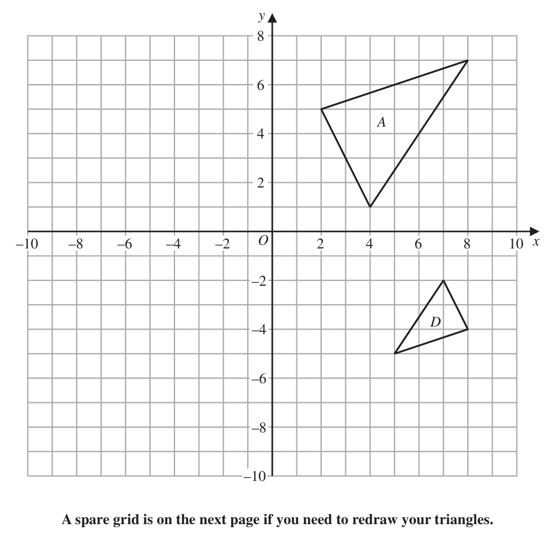
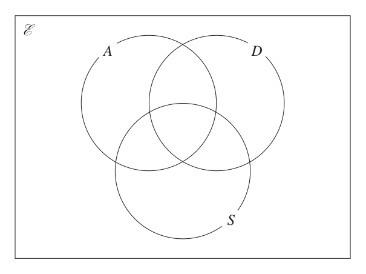
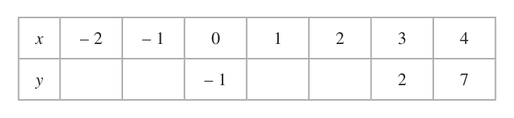

# 4MB1/02 — 2022-01 (official extraction)

> schema `syllabai.official-paper-questions/0.2` · paper_id `pearson-edexcel:international-gcse:mathematics-b:4mb1:2022-01:4MB1/02` · qp sha256 `269eb4a09a335c92…` · extraction is the disclosed baseline (ADR-039)

## Question 1 (5 marks)
### 1(a) [1]

Write 248 000 000 in standard form.

**Mark scheme answer**

> 2.48 ×108 1 B1 cao

- **(1)** 2.48 ×108 1 B1 cao

### 1(b) [1]

Write 2.56 × 10–4 as an ordinary number.

**Mark scheme answer**

> 0.000256 1 B1 cao

- **(1)** 0.000256 1 B1 cao

### 1(c) [3]

Calculate, giving your answer in standard form 2.5 × 1060 − 1.3 × 1059 1.5 × 10 − 48

**Mark scheme answer**

> Numerator of 2.37 ×10 or 23.7 ×10 oe
> 60 107
> 3 M1 Allow eg 23.7 ×1059 or ( 25 − 1.3) ×1059
> or an answer in the form 1.58 ×10n or m×10108 Implied by a correct single value in any form
> 15.8 ×10 107 106
> or 158 ×10 oe A1 A correct single value seen in their working but
> need not be in standard form.
> 1.58 ×10108 A1
> Total 5 marks
> Question Working Answer Mark Notes

- **(3)** Numerator of 2.37 ×10 or 23.7 ×10 oe

## Question 2 (7 marks)

The ages, in years, of 7 friends are 9 8 7 6 10 a 7 The mean age of the 7 friends is 8 years.

### 2(a) [2]

Work out the value of a

**Mark scheme answer**

> 9 + 8 + 7 + 6 + 10 + a + 7 a + 47 2 M1 Correct method to find the mean no errors.
> = 8 or =8
> 7
> 9 A1

- **(2)** 9 + 8 + 7 + 6 + 10 + a + 7 a + 47 2 M1 Correct method to find the mean no errors.

### 2(b) [2]

Find the median age of the 7 friends. There are 34 passengers on a bus. The mean age of these passengers is 49 years. 11 of these passengers are pensioners. The mean age of these pensioners is 72 years.

**Mark scheme answer**

> 6, 7, 7, 8, 9, “9”, 10 2 M1 For ordering allow correct ordering using their
> value for a. This is often seen in the text of the
> question
> 8 A1ft Answer must follow their value for part (a)
> If a 8 the median is 8
> If a 7 the median is 7
> If there is no value of a found in part(a) the
> median is 7.5
> Check that a median of 8 does not come from
> calculating the mean

- **(2)** 6, 7, 7, 8, 9, “9”, 10 2 M1 For ordering allow correct ordering using their

### 2(c) [3]

Calculate the mean age, in years, of the passengers on the bus who are not pensioners.

**Mark scheme answer**

> 34 × 49 − 11× 72 [ = 1666 − 792 = 874] 3 M1 A correct method to find the total age of the
> passengers who are not pensioners.
> "874" "874" M1dep Dep on previous M being awarded. A correct
> or
> 34 − 11 23 method to find the mean age of the passengers
> who are not pensioners.
> 38 A1
> Total 7 marks
> Question Working Answer Mark Notes

- **(3)** 34 × 49 − 11× 72 [ = 1666 − 792 = 874] 3 M1 A correct method to find the total age of the

## Question 3 (7 marks)

Triangles A and D are drawn on the grid below. Triangle B is the image of triangle A under a reflection in the line with equation y = –x

### 3(a) [2]

On the grid below, draw and label triangle B. ⎛ −9⎞ Triangle A is transformed to triangle C under the translation ⎜ ⎟ ⎝ −2⎠

**Mark scheme answer**

> y = − x drawn or 2 points correct 2 M1
> Correct triangle A1 (–1, –4) (–5, –2) (–7, –8)

- **(2)** y = − x drawn or 2 points correct 2 M1

### 3(b) [2]

On the grid, draw and label triangle C.

**Mark scheme answer**

> 2 points correct or 3 x coordinates correct or 2 M1
> Correct triangle A1 (–7, 3) (–5, –1) (–1, 5)

- **(2)** 2 points correct or 3 x coordinates correct or 2 M1

### 3(c) [3]

Describe fully the single transformation that maps triangle A onto triangle D. y A –10 –8 –6 –4 –2 O 2 4 6 8 10 x –2 D –4 –6 –8 –10 A spare grid is on the next page if you need to redraw your triangles. Only use this grid if you need to redraw your triangles. y A –10 –8 –6 –4 –2 O 2 4 6 8 10 x –2 D –4 –6 –8 –10

**Mark scheme answer**

> enlargement 3 B1
> SF – 0.5 B1
> Centre (6, –1) B1
> Total 7 marks
> C
> B
> Que Working Ans Mark Notes

- **(3)** enlargement 3 B1

## Question 4 (6 marks)

A curve C has equation x 2 + y 2 = 64 A straight line l has equation 4y + 3x = 40 Show that the line l intersects the curve C only once. Show clear algebraic working. (6)

### 4 [6]

A curve C has equation x 2 + y 2 = 64 A straight line l has equation 4y + 3x = 40 Show that the line l intersects the curve C only once. Show clear algebraic working.

**Mark scheme answer**

> ⎛ 40 − 3 x ⎞
> ⎛ 40 − 4 y ⎞
> 6 M1 For substituting a correct expression for x or y into the
> x2 + ⎜ ⎟ = 64 or ⎜ ⎟ + y = 64 oe
> quadratic equation to form an (un-simplified) quadratic
> ⎝ 4 ⎠ ⎝ 3 ⎠
> equation in either x or y. Implied by the 2nd M1
> ⎛ 40 − 3x ⎞ ⎛ 40 − 4 y ⎞
> ⎜ ⎟ = 64 − x
> or ⎜ ⎟ = 64 − y
> ⎝ 4 ⎠ ⎝ 3 ⎠
> ⎛ 1600 240 9 ⎞ M1
> ⎛ 40 − 3 x ⎞ ⎛ 40 − 4 y ⎞
> x2 + ⎜ − x + x 2 ⎟ = 64 or For a correct method to expand ⎜ ⎟ or ⎜ ⎟
> ⎝ 16 16 16 ⎠ ⎝ 4 ⎠ ⎝ 3 ⎠
> ⎛ 1600 320 16 ⎞ resulting with 3 or 4 terms. Condone 1 error in total
> ⎜ − y + y 2 ⎟ + y 2 = 64 oe
> ⎝ 9 9 9 ⎠ (numerical or sign). NB −3x2 and −4y2 will count as 1
> error. This must then be subst into the correct equation.
> 25 x 2 − 15 x + 36 = 0 or 25 x 2 − 240 x + 576 = 0 or M1 For correct 3 term quadratic dep on M1 (one of the 2
> 16 above) being awarded.
> 25 y 2 − 320 y + 1024 = 0 or 25 y 2 − 320 y + 1024 = 0 oe
> 9 9
> ⎛5 ⎞⎛ 5 ⎞ M1 Solving their 3 term quadratic equation using any
> ⎜ x − 6 ⎟⎜ x − 6 ⎟ or ( 5 x − 24 )( 5 x − 24 ) or correct method - if factorising, allow brackets which
> ⎝4 ⎠⎝ 4 ⎠
> expanded give 2 out of 3 terms correct. If using formula
> or completing the square allow one sign error. Working
> ( 5 3 y − 32 3 )( 5 3 y − 32 3 ) or ( 5 y − 32 )(5 y − 32 ) or must be seen. By completing the square must see eg
> 25 ⎛ 24 ⎞
> (−320)2 − 4(25 × 1024) or (−240) 2 − 4(25 × 576) ⎜ x − ⎟ [ ±...] = 0
> 16 ⎝ 5 ⎠
> Allow calculation of the discriminant for their quadratic
> x = 4.8 or y = 6.4 A1 correct single value for x or y. Award A0 if more than
> or using discriminant one value of x or more than one value of y is given
> For discriminant the calculation must be correct and = 0
> 9)(− 4 ( 25 × 1024 ) = 0
> (−320)2 − 4(25 × 1024) = 0 or − 320
> 9
> (−240) − 4(25 × 576) = 0 or (−15) − 4 (
> 2 25 2
> × 36 ) = 0
> Only one solution. [therefore line A1dep Dep on all previous method marks awarded and only 1
> intersects the C only once.] value of x and/or y given. For a correct conclusion
> stating only one solution
> Total 6 marks
> Question Working Answer Mark Notes
> For this question Marks for part(b) may be awarded if seen in part(a)

- **(6)** ⎛ 40 − 3 x ⎞

## Question 5 (7 marks)

A B E Diagram NOT accurately drawn C D O Figure 1 Figure 1 shows triangle OAB → → Given that OA = a and OB = b →

### 5(a) [1]

find AB in terms of a and b The point C lies on OA such that OC : OA = 1 : 3 → 2→ The point D lies on OB such that OD = OB Given that the point E is such that ABE and CDE are straight lines, →

**Mark scheme answer**

> –a + b 1 B1

- **(1)** –a + b 1 B1

### 5(b) [6]

find and simplify an expression, in terms of a and b, for AE

**Mark scheme answer**

> ⎡ → ⎤ 6 M1 →
> ⎢ AE = ⎥ ± k ("− a + b ") correct vector for AE or This may be seen
> ⎣ ⎦ embedded in an equation
> ⎡ → ⎤ 1 2 ⎡ → ⎤1 2 M1 →
> ⎢ CD = ⎥ − a + b or ⎢ DC = ⎥ a − b A correct vector for CD seen. This may be seen
> ⎣ ⎦ 3 5 ⎣ ⎦3 5 →
> embedded in AE or in an equation
> ⎡ → ⎤ 2 ⎛ 1 2 ⎞ M1 →
> ⎢ AE = ⎥ − a ± m ⎜ "− a + b " ⎟ or A second correct vector for AE
> ⎣ ⎦ 3 ⎝ 3 5 ⎠ These may be seen embedded in an equation
> 2 ⎛ 1 2 ⎞
> − a ± m ⎜ "− a + b " ⎟ = ± k ("− a + b ") or or 2 different vectors for another side. They should
> 3 ⎝ 3 5 ⎠ → →
> ⎡ → ⎤ 2 ⎛ 1 2 ⎞ include ±α AE and ± β CD somewhere but these
> ⎢ AE = ⎥ − a + b ± t ⎜ "− a + b " ⎟ or may be embedded (see next page)
> ⎣ ⎦ 5 ⎝ 3 5 ⎠
> 2 ⎛ 1 2 ⎞
> −a + b ± t ⎜ "− a + b " ⎟ = ± k ("− a + b ")
> 2 1 1 M1dep Dep on the 1st and 3rd method marks being
> k= + m or k = 1 + t or
> 3 3 3 awarded. Equating the coefficients of a or the
> 2 2 2 coefficient of b to form a linear equation in two
> k= m or k = + t unknowns
> 2 1 3 1 M1dep Dep on the previous method mark being
> 0= − m or 0 = − t
> 3 15 5 15 awarded. Eliminating either m or k or implied by
> m = 10 or k = 4 or t = 9
> 4 ( −a + b ) A1 oe
> Correct answer gets 6/6
> Total 7 marks
> There may be other combinations used. If there is another method use that merits marks send to review
> → 2 → ⎛ 1 2 ⎞
> AC = − a and AC = ± k ("− a + b ") ± m ⎜ "− a + b " ⎟
> 3 ⎝ 3 5 ⎠
> 2 ⎛ 1 2 ⎞
> or − a = ± k ("− a + b ") ± m ⎜ "− a + b "⎟
> 3 ⎝ 3 5 ⎠
> → → 1 ⎛ 1 2 ⎞
> OE = a ± k ("− a + b ") and OE = a ± m ⎜ "− a + b " ⎟
> 3 ⎝ 3 5 ⎠
> 1 ⎛ 1 2 ⎞
> or a ± k ("− a + b ") = a ± m ⎜ "− a + b "⎟
> 3 ⎝ 3 5 ⎠
> → 2 → ⎛ 1 2 ⎞
> CE = a ± k ("− a + b ") and CE = m ⎜ "− a + b " ⎟
> 3 ⎝ 3 5 ⎠
> 2 ⎛ 1 2 ⎞
> or a ± k ("− a + b ") = m ⎜ "− a + b " ⎟
> 3 ⎝ 3 5 ⎠
> → → ⎛ 1 2 ⎞ 2
> AO = −a and AO = ± k ("− a + b ") ± q ⎜ − a + b ⎟ − b
> ⎝ 3 5 ⎠ 5
> ⎛ 1 2 ⎞ 2
> or a = ± k ("− a + b ") ± m ⎜ " a − b "⎟ − b
> ⎝ 3 5 ⎠ 5
> Question Working Answer Mark Notes

- **(6)** ⎡ → ⎤ 6 M1 →

## Question 6 (7 marks)

6 ⎛ −2 −3⎞ ⎛ 4 x −14⎞ A= ⎜ ⎝ 2 4 ⎟⎠ BA = ⎜ ⎝ x −1⎟⎠ Given that the determinant of B is 10 find B Show your working clearly. (7) ⎡ ⎛ a b⎞ ⎤ ⎢ Determinant of matrix ⎜ ⎟ = ad − bc ⎥ ⎢ ⎝ c d⎠ ⎥ ⎢ ⎛ a b⎞ 1 ⎛ d − b⎞ ⎥ ⎢Inverse of matrix ⎜⎝ c d ⎟⎠ ad − bc ⎜⎝ −c a ⎟⎠ ⎥ = ⎢⎣ ⎥⎦

### 6 [7]

6 ⎛ −2 −3⎞ ⎛ 4 x −14⎞ A= ⎜ ⎝ 2 4 ⎟⎠ BA = ⎜ ⎝ x −1⎟⎠ Given that the determinant of B is 10 find B Show your working clearly. ⎡ ⎛ a b⎞ ⎤ ⎢ Determinant of matrix ⎜ ⎟ = ad − bc ⎥ ⎢ ⎝ c d⎠ ⎥ ⎢ ⎛ a b⎞ 1 ⎛ d − b⎞ ⎥ ⎢Inverse of matrix ⎜⎝ c d ⎟⎠ ad − bc ⎜⎝ −c a ⎟⎠ ⎥ = ⎢⎣ ⎥⎦

**Mark scheme answer**

> 1 ⎛ 4 3⎞ ⎡ 1⎛ 4 3 ⎞⎤ 7 M1 oe allow correct un-simplified
> [A–1 =] − ⎟ ⎢= − ⎜
> ( 4 × −2 ) − ( 3 × −2 ) ⎝ −2 −2 ⎠ ⎣ 2 ⎝ −2 −2 ⎟⎠ ⎥⎦
> ⎜
> ⎛ 4 x −14 ⎞ ⎡ 1 ⎛ 4 3⎞ ⎤ M1 For writing or using B AA–1 ft their inverse of A
> [B =] B AA or [ B = ] ⎜
> –1
> ⎟ ⎢"− ⎜ ⎟ "⎥
> ⎝ x − 1 ⎠ ⎣ 2 ⎝ −2 −2 ⎠ ⎦
> ⎛ − 8 x − 14 − 6 x − 14 ⎞ M1dep Dep on previous M mark being awarded. Correct method
> 1 ⎛ 16 x + 28 12 x + 28 ⎞ ⎜ ⎟ for multiplying out B AA–1 to find a single matrix for B in
> [B =] − ⎜ 4 x + 2 ⎟ or
> 3 x + 2 ⎠ ⎜⎜ −2 x − 1
> 2⎝ − x − 1 ⎟⎟ terms of x (determinant and 2 terms correct)
> ⎝ 2 ⎠
> 1 M1 Correct method for finding the determinant in terms of x
> 10 = " " ( ("16 x + 28")("3 x + 2") − ("4 x + 2")("12 x + 28") ) and equating to 10. If full working shown then ft their
> matrix for B if it is in terms of x
> ( )
> or 10 = ("− 8 x − 14") "− 3 x − 1" − ("− 2 x − 1")("− 6 x − 14")
> 2 Allow (12 x 2 + 29 x + 14 ) − (12 x 2 + 34 x + 14 )
> 10 = – 5x oe or 10 x = 10 × −2 M1dep Dep on all previous M marks being awarded. Obtaining a
> correct linear equation which need not be fully simplified.
> x=–2 A1 Correct value for x
> ⎛ 2 −2 ⎞
> B=⎜ ⎟
> ⎝3 2⎠ A1
> ALT ⎡⎛ a b ⎞⎛ −2 −3 ⎞ ⎤ ⎛ −2a + 2b −3a + 4b ⎞ M1 Correct matrix – letters may be different.
> ⎢⎜ ⎟⎜ ⎟ =⎥ ⎜ ⎟
> ⎣⎝ c d ⎠⎝ 2 4 ⎠ ⎦ ⎝ −2c + 2d −3c + 4d ⎠
> "− 2a + 2b " = 4 x "− 3a + 4b " = −14 M1 Forming the 4 equations ft their matrix
> "− 2c + 2d " = x "− 3c + 4d " = −1
> a = −8 x − 14 and b = −6 x − 14 M1dep Dep on previous M mark being awarded. Solving to get a,
> c = −2 x − 1 and d = − 3 2 x − 1 b, c and d in terms of x (2 correct)
> ( )
> 10 = ("− 8 x − 14") "− 3 x − 1" − ("− 2 x − 1")("− 6 x − 14")
> M1 Correct method for finding the determinant in terms of x
> and equating to 10. Ft their matrix only if working seen
> 10 = – 5x oe or 10 x = 10 × −2 M1dep Dep on all previous M marks being awarded. Obtaining a
> correct linear equation which need not be fully simplified
> x=–2 A1 Correct value for x
> ⎛ 2 −2 ⎞
> B=⎜ ⎟ A1
> ⎝3 2⎠
> Total 7 marks
> Question Working Answer Mark Notes

- **(7)** 1 ⎛ 4 3⎞ ⎡ 1⎛ 4 3 ⎞⎤ 7 M1 oe allow correct un-simplified

## Question 7 (8 marks)

B C F 86° Diagram NOT accurately drawn O 38° D A G E Figure 2 In Figure 2, ABCDG is a circle, centre O EDF is the tangent to the circle at the point D ∠ABC = 86° ∠CDF = 38° The length of the arc AGD is 0.8π cm.

### 7(a) [6]

Giving reasons, show that the radius of the circle is 1.5 cm.

**Mark scheme answer**

> ∠ODC = 90 – 38 [= 52] 6 M1 Correct method to find ∠ODC or correct angle
> Or ∠CAD = 38 or ∠DBC = 38 for ∠CAD May be seen on diagram. If it is not
> Or ∠ADE = 180 − (180 − 86 + 38) [ = 48] on the diagram it must be clearly labelled
> ∠ODA or ∠OAD = 180 – 86 – "52" [= 42] or 90 – 48 [= 42] M1 Correct method to find ∠ODA , ∠OAD or
> or ∠COD = 76 ∠COD May be seen on diagram,
> or ∠ABD = 86 − 38 [ = 48] If it is not on the diagram it must be clearly
> labelled
> ∠AOD = 180 − 2 × "42" [= 96] M1 Correct method to find ∠AOD May be seen on
> or ∠AOD = 86 × 2 − "76" [= 96] diagram
> or ∠AOD = 48 × 2 [= 96] If it is not on the diagram it must be clearly
> labelled Allow ∠O for ∠AOD
> "96" "96" M1 Allow without π
> × 2π r = 0.8π oe or × 2 × π ×1.5 Must use "their ∠AOD "from diagram or clearly
> 360 360
> labelled
> 0.8π × 360 "96" M1 Allow without π in.
> r= oe or × 2 × π ×1.5 = 0.8π
> "96"× 2π 360 Must use "their ∠AOD "from diagram or clearly
> labelled
> Angle between tangent and radius (diameter) is 90° 1.5 A1 Need all of the previous method marks and a
> Alternate segment theorem shown fully correct solution with at least two relevant
> Opposite angles of a cyclic quadrilateral reasons for their working. Minimum needed is
> Angle at the centre is 2 × (double) angle at circumference / the words underlined (allow abbreviations if
> angle at circumference is ½ angle at centre clear). If verifying then must state the radius is
> Base angles in an isosceles triangle therefore 1.5 e.g. r = 1.5 rather than just 1.5
> Angles in a triangle add to 180°
> Angles on a straight line add to 180°

- **(6)** ∠ODC = 90 – 38 [= 52] 6 M1 Correct method to find ∠ODC or correct angle

### 7(b) [2]

Calculate the area, in cm2 to 2 decimal places, of the circle ABCDG

**Mark scheme answer**

> [Area =] π ×1.52 2 M1
> 7.07 A1 Awrt 7.07
> Total 8 marks
> Question Working Answer Mark Notes

- **(2)** [Area =] π ×1.52 2 M1

## Question 8 (9 marks)

All 66 students in a drama group take part in at least one of the four activities given below. acting (A) dancing (D) singing (S) stage management (M) Of these 66 students 11 take part in acting, dancing and singing 17 take part in acting and singing 14 take part in dancing and singing 16 take part in acting and dancing 33 take part in singing 37 take part in acting 29 take part in dancing Any student who takes part in stage management does not take part in acting, dancing or singing.

**(b)** Find (i) n(M)

**(c)** find the probability that this student also takes part in

### 8(a) [3]

Show all this information on the Venn diagram, giving the number of students in each subset. E A D S

**Mark scheme answer**

> 3 3 B3 All 8 correct
> B2 6 or 7 correct
> B1 4 or 5 correct
> 15 5
> 6
> We do not ft if they have blanks for a region needed for that part of the question but correct answers gain the marks

- **(3)** 3 3 B3 All 8 correct

### 8(b)(ii) [?]

n([A ∩ D¢] ∪ S)

**Mark scheme answer**

> "15" + "6" + "11" + "3" + "13" or 33 + "15" 48 B1 Correct answer or Ft their Venn diagram.

### 8(b)(iii) [3]

n([A ∩ D ∩ S¢]¢) One of the students in the drama group is selected at random. Given that this student takes part in dancing,

**Mark scheme answer**

> 66 – "5" or "3"+"3"+"13"+"11"+"6"+"15"+"10" 61 B1 Correct answer or Ft their Venn diagram.

- **(3)** 66 – "5" or "3"+"3"+"13"+"11"+"6"+"15"+"10" 61 B1 Correct answer or Ft their Venn diagram.

### 8(c)(i) [1]

stage management,

**Mark scheme answer**

> 0 1 B1 Mark the final answer, ignore working. We will
> allow 0 or as the final answer

- **(1)** 0 1 B1 Mark the final answer, ignore working. We will

### 8(c)(ii) [2]

singing.

**Mark scheme answer**

> "11"+ "3" "11"+ "3" 2 M1 Correct answer or Ft their Venn diagram but the
> or
> 29 "10"+ "11"+ "3"+ "5" numerator must be less than the denominator
> 14 A1
> Total 9 marks
> Quest Working Ans Mark Notes

- **(2)** "11"+ "3" "11"+ "3" 2 M1 Correct answer or Ft their Venn diagram but the

## Question 9 (8 marks)

T Diagram NOT accurately drawn 30 m C B A Figure 3 Figure 3 shows three points A, B and C on horizontal ground. A vertical mast BT of height 30 m is at point B. The angle of elevation of T from A is 32° The angle of elevation of T from C is 25° The bearing of A from B is 195° The bearing of C from B is 280° Calculate the bearing, in degrees to the nearest degree, of C from A. (8) ⎛ Sine rule: a b c ⎞ = = ⎜ sin A sin B sin C ⎟ ⎜ ⎟ ⎝ Cosine rule: a 2 = b 2 + c 2 − 2bc cos A ⎠

### 9 [8]

T Diagram NOT accurately drawn 30 m C B A Figure 3 Figure 3 shows three points A, B and C on horizontal ground. A vertical mast BT of height 30 m is at point B. The angle of elevation of T from A is 32° The angle of elevation of T from C is 25° The bearing of A from B is 195° The bearing of C from B is 280° Calculate the bearing, in degrees to the nearest degree, of C from A. ⎛ Sine rule: a b c ⎞ = = ⎜ sin A sin B sin C ⎟ ⎜ ⎟ ⎝ Cosine rule: a 2 = b 2 + c 2 − 2bc cos A ⎠

> 🖼 crop required: diagram (qp.pdf p.None)

**Mark scheme answer**

> 30 30 ⎞
> 2 8 M1 A correct method to find the length AB. Allow awrt 48
> [ AB =] [ = 48.01] or [ AB =] ⎛⎜ ⎟ − 30 [ = 48.01] oe
> May be seen on diagram
> tan 32 ⎝ sin 32 ⎠
> 30 30 ⎞
> 2 M1 A correct method to find the length CB. Allow awrt 64.3
> [CB =] [ = 64.3...] or [CB =] ⎛⎜ ⎟ − 30 [ = 64.3...] oe
> May be seen on diagram
> tan 25 ⎝ sin 25 ⎠
> [ ∠CBA = ]280 – 195 [=85] M1 A correct method to find ∠CBA May be seen on diagram
> The next 3 method marks can only be awarded if using their ∠CBA or a correct value
> ⎡⎣ AC 2 = ⎤⎦ "48.01"2 + "64.335"2 − 2 × "48.01"× "64.335"cos"85" M1 A correct method to find the length AC
> Allow awrt 5910 or 76.8
> [=5905] May be seen on diagram
> or Ft through their AB, AC and ∠CBA if they are labelled
> [ AC =] "48.01"2 + "64.335"2 − 2 × "48.01"× "64.335"cos"85" clearly(allow on diagram) or it must come from correct
> [= 76.8…] working
> sin ∠CAB sin"85" sin ∠ACB sin"85" M1 A fully correct method to find ∠CAB or ∠ACB . Ft
> = or = or
> "64.335" "76.85" "48.01" "76.85" through their CB(or AB), AC and ∠CBA if they are
> "64.3" 2 = "48.01" 2 + "76.8" 2 − 2 × "48.01"× "76.8"cos ∠CAB or labelled clearly (allow on diagram) or come from correct
> working.
> "48.01" 2 = "64.3" 2 + "76.8" 2 − 2 × "64.3"× "76.8"cos ∠ACB
> May use cosine rule.
> sin"85" M1 Rearranging and using inverse sine leading to an angle for
> sin ∠CAB = × "64.335" → ∠CAB =56.5… or ∠CAB or ∠ACB does not need to be correct)
> "76.85"
> "48.01" 2 + "76.8" 2 − "64.3" 2 This implies the 5th M1
> cos ∠CAB = → ∠CAB = 56.5…
> 2 × "48.01"× "76.8"
> sin"85"
> sin ∠ACB = × "48.01" → ∠ACB = 38.487.. or
> "76.85"
> "64.3" 2 + "76.8" 2 − "48.01" 2
> cos ∠ACB = → ∠ACB = 38.487…
> 2 × "64.3"× "76.8"
> 360 + 15 − "56.5..." or 360 – (180 – (100 + "38.487…")) oe M1 A correct method to find required bearing.
> eg 180 + 100 + "38.487…"
> 318 A1 awrt 318 or awrt 319 Condone degree sign.
> Total 8 marks
> Question Working Answer Mark Notes

- **(8)** 30 30 ⎞

## Question 10 (10 marks)

The production costs of building a Kimo boat are $L for labour $M for materials $H for overheads In 2020, the total of the production costs for a Kimo boat was $120 000 where L:M:H = 5:3:2

### 10(a) [2]

Calculate the value of H in 2020 The production costs were different in 2021 from what they were in 2020 The labour costs had increased by 10% The cost of materials had increased by 5% The overheads had decreased by 4%

**Mark scheme answer**

> 2 2 M1
> ×120 000
> 5+3+ 2
> 24 000 A1 Ignore any units eg condone $24 000

- **(2)** 2 2 M1

### 10(b) [3]

Calculate the percentage increase, from 2020 to 2021, in the total of the production costs of building a Kimo boat. Gordon bought a Kimo boat and sold it a year later for $360 000, making a loss of 25% on the price for which he bought the boat.

**Mark scheme answer**

> 5 ×1.1 + 3 ×1.05 + 2 × 0.96 [ = 5.5 + 3.15 + 1.92 = 10.57 ] or 3 M1 Allow any multiple.
> 60 000 1.1 36 000 1.05 "24 000" 0.96 [= 66000
> + 37800 + 23040 = 126840]
> "10.57" M1 Ft their total from the step before.
> [ = 1.057] or "10.57"
> "5 + 3 + 2" Allow multiples eg is a multiply of
> "126840" 120000 "6840" "126840" "5 + 3 + 2"
> 100 or oe
> 120 000 120 000 120000
> 5.7[%] A1
> y = 3.4 their two lines cross. If lines don't cross or none drawn B0

- **(3)** 5 ×1.1 + 3 ×1.05 + 2 × 0.96 [ = 5.5 + 3.15 + 1.92 = 10.57 ] or 3 M1 Allow any multiple.

### 10(c) [2]

Calculate the price for which Gordon bought the boat. Gordon sold the boat to a friend living in Hungary. Gordon’s friend paid Gordon the $360 000 in Hungarian forints. Using exchange rates of £1 = $1.35 £1 = 388.50 Hungarian forints

**Mark scheme answer**

> 360 000 360 000 2 M1
> or ×4
> 0.75
> [$]480 000 A1
> ft their "2.5" value .Allow x < (awrt 2.5)
> 42
> or x <
> 17
> allow 3 ≤ x < or (−∞,"2.5") or [−∞,"2.5") or
> [−3,"2.5") ] − ∞,"2.5") ] − ∞,"2.5"[

- **(2)** 360 000 360 000 2 M1

### 10(d) [3]

change $360 000 to Hungarian forints.

**Mark scheme answer**

> 360 000 3 M1 A correct first step for example
> [ = 266 666.6.] 360 000 × 388.5 =[139 860 000]
> 1.35
> 1.35 388.5
> or [ = 0.00347...] or [ = 287.7...]
> 388.5 1.35
> 360 000 M1 A fully correct method.
> × 388.5
> 1.35
> 103 600 000 A1 oe awrt 103600000
> Total 10 marks
> Quest Working Answer Mark Notes
> 11(a) (i) A correct straight line drawn between at least 2 M1 Allow ± 1 small square for all points.
> 2 integer values of x
> Correct line A1 A straight line through (−2, 0) and (2, 3) Allow ± 1 small
> square for all points. Must cover at least –2 to 3
> B1 for 3 correct.
> y 7 2 −1 –2 –1 2

- **(3)** 360 000 3 M1 A correct first step for example

## Question 11 (13 marks)
**(a)** On the grid on the opposite page, draw the straight line with equation

### 11(a)(i) [?]

4y – 3x = 6 –3 ≤ x ≤ 4

### 11(a)(ii) [4]

3y + 2x = 15 –3 ≤ x ≤ 4

### 11(b) [1]

Using your straight lines, find an estimate, to one decimal place, of the solution of the simultaneous equations 4y – 3x = 6 3y + 2x = 15 6 + 3 x 15 − 2 x

### 11(c) [1]

Hence, or otherwise, solve the inequality < 4 3

### 11(d) [2]

Complete the table of values for y = x 2 – 2x – 1 x –2 –1 0 1 2 3 4 y –1 2 7

### 11(e) [2]

On the same grid on the opposite page, plot the points from your completed table and join them to form a smooth curve.

### 11(f) [3]

Using part (a) and part (e), find an estimate, to one decimal place, for the range of values of x for which 11 5 x2 − x− <0 4 2 Show your working clearly. y –3 –2 –1 O 1 2 3 4 x –1 –2 for a spare grid if you need to redraw your graph. Only use this grid if you need to redraw your graph. y –3 –2 –1 O 1 2 3 4 x –1 –2

## Question 12 (13 marks)

The function g is defined for all values of x by g : x ↦ 5 – x2

### 12(a) [1]

Find g(–4)

**Mark scheme answer**

> – 11 1 B1

- **(1)** – 11 1 B1

### 12(b) [1]

Write down the range of the function g The function f is defined as 4 11 f:x ↦ x≠ 2 x − 11 2

**Mark scheme answer**

> g(x) 5 1 B1 Allow g or y. Allow (−∞,5] or [−∞,5] or
> ]−∞,5] DO NOT allow x 5

- **(1)** g(x) 5 1 B1 Allow g or y. Allow (−∞,5] or [−∞,5] or

### 12(c) [2]

Find fg(2)

**Mark scheme answer**

> 4 2 M1
> g(2) = 1 or f(1) or fg(x) = oe
> 2(5 − x 2 ) − 11
> 4 A1 Allow equivalent exact answer
> −

- **(2)** 4 2 M1

### 12(d) [3]

Express the inverse function f –1 in the form f –1 : x ↦ ...

**Mark scheme answer**

> 2 xy − 11y = 4 or y ( 2 x − 11) = 4 3 M1 Different letters may be used.
> 4 4 11 M1 Isolating term in x. Allow 1 sign error
> 2 xy = 4 + 11y or 2 x = + 11 or x = + oe
> y 2y 2
> 4 + 11x A1 oe Must be in terms of x.
> ⎡⎣f −1 : x ⎤⎦
> 2x

- **(3)** 2 xy − 11y = 4 or y ( 2 x − 11) = 4 3 M1 Different letters may be used.

### 12(e) [1]

State the value of x that must be excluded from any domain of f –1

**Mark scheme answer**

> 0 1 B1 Allow x ≠ 0 but DO NOT allow x > 0 or x < 0

- **(1)** 0 1 B1 Allow x ≠ 0 but DO NOT allow x > 0 or x < 0

### 12(f) [3]

Express ff(x) in terms of x giving your answer as a single fraction in its simplest form. The function h is defined for all values of x by h : x ↦ x(x + 1) The function m is defined for all values of x by m : x ↦ ax + b where a and b are constants such that a > 0 and b > 0 Given that hm(x) = 3(x + 1)(3x + 2) for all values of x

**Mark scheme answer**

> 4 3 M1
> oe
> ⎛ 4 ⎞
> 2⎜ ⎟ − 11
> ⎝ 2 x − 11 ⎠
> 4 M1 Reducing the denominator to a single fraction.
> 8 − 11( 2 x − 11) 5 ( 2 x − 11) − 16
> Allow
> 2 x − 11 2 x − 11
> 8 x − 44 A1 Must be in simplest form
> 129 − 22 x

- **(3)** 4 3 M1

### 12(g) [2]

find the value of a and the value of b

**Mark scheme answer**

> hm( x) = ( 3x + 3)( 3x + 2 ) or ( ax + b )( ax + b + 1) 2 M1 Rewriting hm(x) in the form y ( y + 1) where y is
> or a2 x2 + 2abx + b2 + ax + b a function of x. ISW
> a=3 b=2 A1 Allow 3 x + 2
> Total 13 marks

- **(2)** hm( x) = ( 3x + 3)( 3x + 2 ) or ( ax + b )( ax + b + 1) 2 M1 Rewriting hm(x) in the form y ( y + 1) where y is

