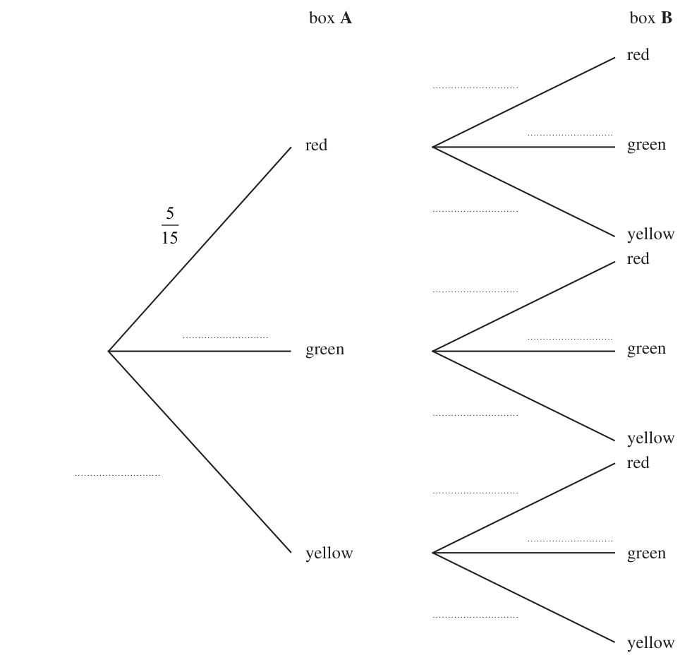
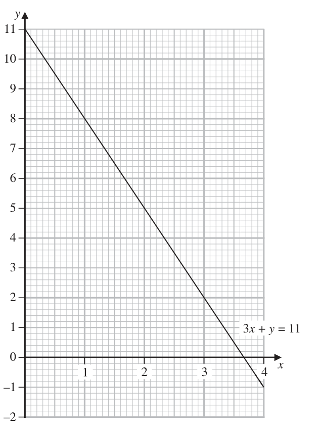
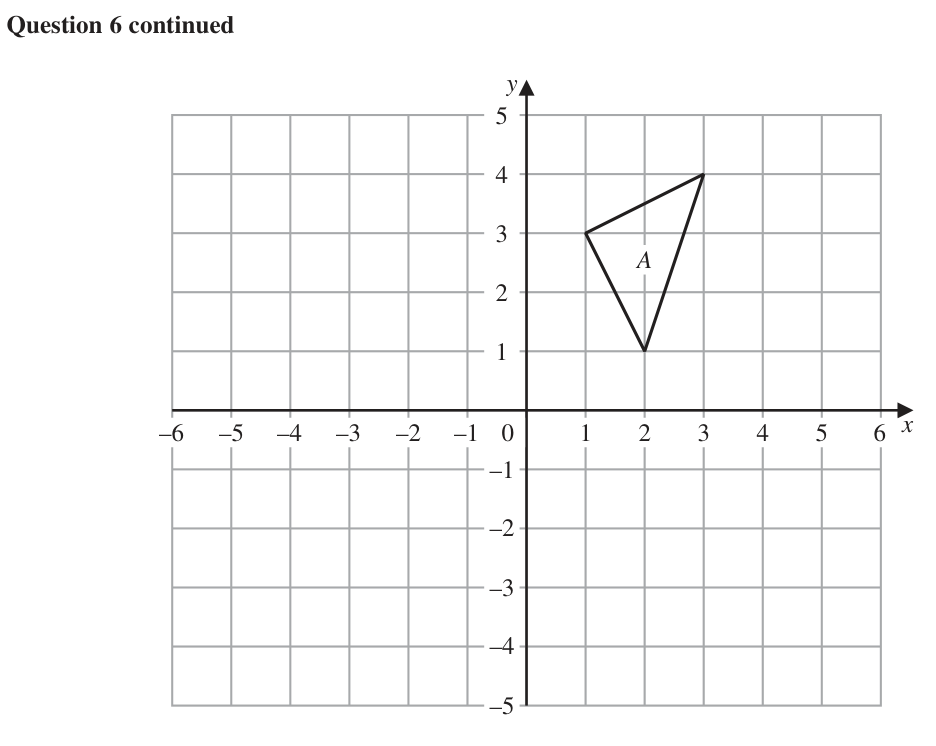
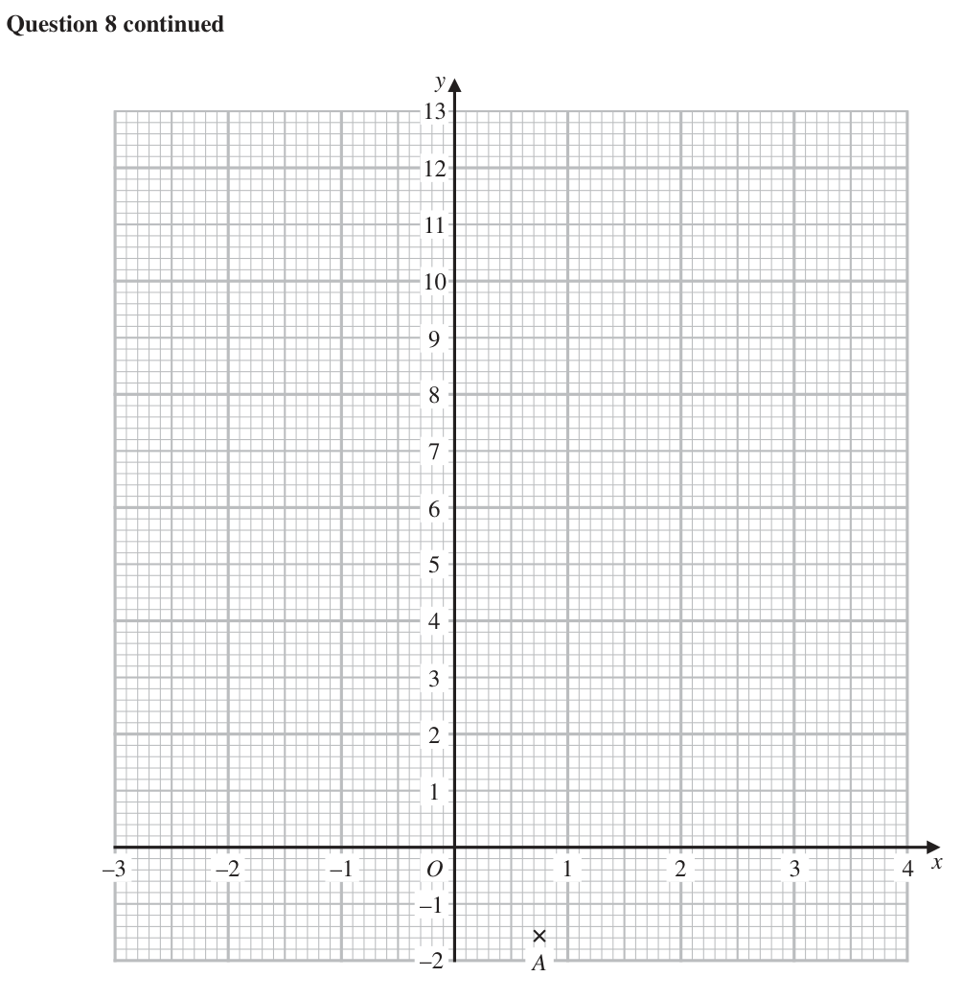
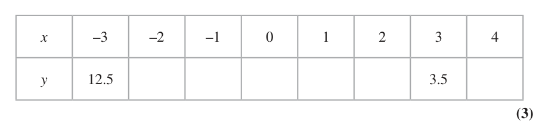
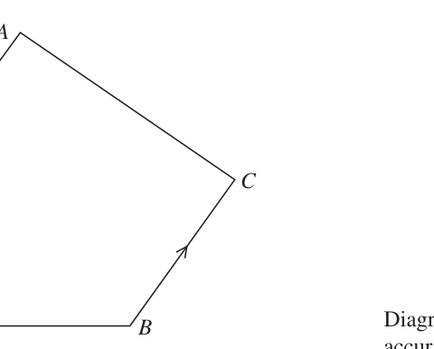
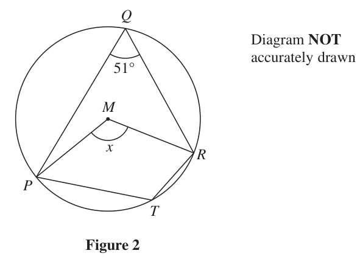
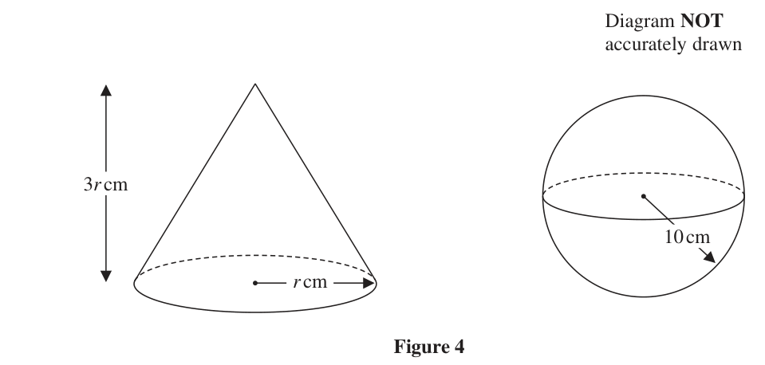

# 4MB1/02R — 2022-01 (official extraction)

> schema `syllabai.official-paper-questions/0.2` · paper_id `pearson-edexcel:international-gcse:mathematics-b:4mb1:2022-01:4MB1/02R` · qp sha256 `08426fc2f2e80e34…` · extraction is the disclosed baseline (ADR-039)

## Question 1 (4 marks)

The functions f and g are defined as f(x) = 3x g(x) = 2x − 3

### 1(a) [1]

Write down the value of x for which f(x) = 81

**Mark scheme answer**

> 4 1 B1

- **(1)** 4 1 B1

### 1(b) [1]

Write down the value of x that must be excluded from any domain of g

**Mark scheme answer**

> 1.5 1 B1 oe

- **(1)** 1.5 1 B1 oe

### 1(c) [2]

Find fg(4)

**Mark scheme answer**

> g(4) = 3 2 M1
> 27 A1
> Total 4 marks

- **(2)** g(4) = 3 2 M1

## Question 2 (8 marks)
### 2(a) [3]

Find the set of values of x for which –2x – 4 < 3x + 6 ≤ 21 – 2x

**Mark scheme answer**

> −4 − 6 < 3x + 2x or 3x + 2x ≤ 21 – 6 oe 3 M1 oe
> one of −2 < x or x ≤ 3 oe M1 oe
> −2 < x ≤ 3 A1 oe

- **(3)** −4 − 6 < 3x + 2x or 3x + 2x ≤ 21 – 6 oe 3 M1 oe

### 2(b) [3]

Solve the inequality 4x2 – 8x < 21

**Mark scheme answer**

> 4x² − 8x −21(= 0) 3 M1 oe rearranged and attempt to solve quadratic
> (2x – 7)(2x + 3)(= 0)
> (critical values) 3.5 and −1.5 M1 NB working not required
> −1.5 < x < 3.5 A1

- **(3)** 4x² − 8x −21(= 0) 3 M1 oe rearranged and attempt to solve quadratic

### 2(c) [2]

Hence represent on the number line on the opposite page, the set of values of x for which –2x – 4 < 3x + 6 ≤ 21 – 2x and 4x2 – 8x < 21 x –5 –4 –3 –2 –1 0 1 2 3 4 5

**Mark scheme answer**

> 2 B2 completely correct (ft their values from (a) and (b) so
> long as possible on the number line)
> (B1 for a line between −1.5 and 3 with incorrect shading of
> dots or one end shaded correctly)
> Total 8 marks

- **(2)** 2 B2 completely correct (ft their values from (a) and (b) so

## Question 3 (9 marks)

Peter has two boxes of bricks, box A and box B. Each box contains only red bricks, green bricks and yellow bricks. In box A there are 15 bricks of which 5 are red, 7 are green, and 3 are yellow. In box B there are 20 bricks of which 8 are red, 9 are green, and 3 are yellow. Ami is going to take a brick at random from box A and a brick at random from box B. She is going to put these two bricks on a table.

### 3(a) [3]

Complete the probability tree diagram. box A box B red red green 15 yellow red green green yellow red yellow green yellow

**Mark scheme answer**

> 3 7
> B1 for LH branches (0.46...), oe(0.2)
> 15
> B2 for all remaining branches (B1 for 5, 6, 7, 8 branches)
> 8 9
> oe (0.4), (0.45), (0.15) repeated 3 times
> 20 20

- **(3)** 3 7

### 3(b) [3]

Calculate the probability that the two bricks on the table are different colours. Peter has a third box of bricks, box C. This box also contains only red bricks, green bricks and yellow bricks. After taking a brick from box A and a brick from box B, Ami then takes at random a brick from box C. Ami then puts this brick with the other two bricks on the table. The probability that there are three yellow bricks on the table is 1000

**Mark scheme answer**

> 3 M1ft their tree diagram for any two correct products for
> method used
> 5 8 7 9 3 3 M1ft their tree diagram for a fully correct method
> 1 − ( × + × + × ) oe or
> 15 20 15 20 15 20
> 5 9 3 7 8 3 3 8 9
> × ( + ) + × ( + ) + × ( + ) oe
> 15 20 20 15 20 20 15 20 20
> 47 A1 oe (0.626...)

- **(3)** 3 M1ft their tree diagram for any two correct products for

### 3(c) [3]

Find the least number of bricks that were in box C before Ami took a brick from box C.

**Mark scheme answer**

> 3 3 19 3 M1ft their tree diagram
> × ×x = oe eg 0.2 × 0.15 × x = 0.019
> 15 20 1000
> 19 300 19 M1ft their tree diagram
> x= ×" "(= ) oe x = 0.019 ÷ 0.03 (0.633...)
> 1000 9
> 30 A1
> Total 9 marks

- **(3)** 3 3 19 3 M1ft their tree diagram

## Question 4 (9 marks)

A= B= C = 7 2 7 5 10 5 4 1

### 4(a) [3]

Find D such that 2A – B = 3D

**Mark scheme answer**

> ⎛ 8 6 ⎞ ⎛ 11 −3 ⎞ 3 M1
>  − oe
> ⎝ −14 10 ⎠ ⎝10 −5 ⎠
> ⎛ −3 9⎞ A1
>  −24 15 
> ⎛ −1 3 ⎞ A1 (award 2 marks for 3 out of 4 terms of this matrix correct)
>  −8 5 

- **(3)** ⎛ 8 6 ⎞ ⎛ 11 −3 ⎞ 3 M1

### 4(b) [2]

Find A2

**Mark scheme answer**

> ⎛ − 5 27 ⎞ 2 B2 correct (B1 for 3 correct values in a matrix of correct order)
>  −63 4 

- **(2)** ⎛ − 5 27 ⎞ 2 B2 correct (B1 for 3 correct values in a matrix of correct order)

### 4(c) [2]

Find B–1

**Mark scheme answer**

> 1 ⎛ −5 3⎞ 2 B2 correct (B1 for a correct method to find the determinant and 2
> − oe other values correct or 4 correct values in matrix and one mistake
> 25 ⎝ −10 11⎠
> in determinant)

- **(2)** 1 ⎛ −5 3⎞ 2 B2 correct (B1 for a correct method to find the determinant and 2

### 4(d) [2]

Find CA a b 1 d b Inverse of matrix c d ad bc c a

**Mark scheme answer**

> ⎛ −22 45 ⎞ 2 B2 correct (B1 for 3, 4 or 5 correct values in a matrix of correct
>  order)
>  −42 −11 23 7 

- **(2)** ⎛ −22 45 ⎞ 2 B2 correct (B1 for 3, 4 or 5 correct values in a matrix of correct

## Question 5 (10 marks)

The graph of the straight line with equation 3x + y = 11 is drawn on the grid opposite for 0 ≤ x ≤ 4

### 5(a)(i) [3]

On the grid, draw the graph of the straight line with equation 4x = 3 + 2y for 0 ≤ x ≤ 4

**Mark scheme answer**

> *The official mark scheme line for this part was not captured by the digitised extraction — treat the worked values above the line with care and check against the paper's own mark scheme.*

### 5(a)(ii) [1]

Use your graphs to find estimates, to one decimal place, of the value of x and the value of y that satisfy the simultaneous equations 3x + y = 11 4x = 3 + 2y

**Mark scheme answer**

> *The official mark scheme line for this part was not captured by the digitised extraction — treat the worked values above the line with care and check against the paper's own mark scheme.*

### 5(b) [6]

Solve the simultaneous equations 4x + xy – x² = –10 3y + x = 7 Show clear algebraic working. y 1 3x + y = 11 x 1 2 3 4 –1 –2

**Mark scheme answer**

> eg 4(7 – 3y) + y(7 – 3y) – (7 – 3y)² or 6 M1 for any correct substitution
> ⎛7−x⎞ 2
> 4x + x − x
> ⎝ 3 ⎠
> 28 – 12y + 7y – 3y² − 49 + 42y – 9y² = − 10 M1 for expansion of brackets after substitution (at least 4
> 12x + 7x − x² − 3x² = −30 oe terms correct)
> eg 12y² − 37y + 11 = 0 or M1
> 4x² − 19x −30 = 0 oe
> For a correct method to solve their quadratic M1 (for factorising, factors that give 2 out of 3 terms correct
> eg (3y – 1)(4y – 11) = 0 or when expanded or for formula (allow one sign error) can be
> (x – 6)(4x + 5) 37 ± 841 19 ± 841
> simplified as far as or or fully correct
> 24
> substitution into the formula with just one sign error)
> A1 dep on M2 for both y values or both x values
> 1 A1 dep on M2 for all values, paired appropriately
> x = 6, y =
> 5
> x=− ,y=
> 4

- **(6)** eg 4(7 – 3y) + y(7 – 3y) – (7 – 3y)² or 6 M1 for any correct substitution

## Question 6 (11 marks)

Triangle A is drawn on the grid opposite. Triangle A is reflected in the line with equation x = –1 to give triangle B.

### 6(a) [2]

On the grid, draw and label triangle B. Triangle A is transformed to triangle C under a rotation of 90° clockwise about the point with coordinates (1, 0)

**Mark scheme answer**

> (−3, 3), (−4, 1), (−5, 4) 2 B2 for a fully correct triangle drawn (B1 for 2 correct points, or
> all correct points plotted but not joined or a ‘correct’ reflection in
> a vertical line)

- **(2)** (−3, 3), (−4, 1), (−5, 4) 2 B2 for a fully correct triangle drawn (B1 for 2 correct points, or

### 6(b) [2]

On the grid, draw and label triangle C. Triangle B is transformed to triangle D under the translation

**Mark scheme answer**

> (2, −1), (4, 0), (5, −2) 2 B2 for a fully correct triangle drawn (B1 for 2 correct points, or
> all correct points plotted but not joined)

- **(2)** (2, −1), (4, 0), (5, −2) 2 B2 for a fully correct triangle drawn (B1 for 2 correct points, or

### 6(c) [2]

On the grid, draw and label triangle D. Triangle A is transformed to triangle E under the transformation with matrix M where 1 0 M

**Mark scheme answer**

> (−1, −2), (−2, −4), (−3, −1) 2 B2 for a fully correct triangle drawn (B1 for 2 correct points, or
> all correct points plotted but not joined)

- **(2)** (−1, −2), (−2, −4), (−3, −1) 2 B2 for a fully correct triangle drawn (B1 for 2 correct points, or

### 6(d) [2]

On the grid, draw and label triangle E. Triangle E is the image of triangle C under a single transformation.

**Mark scheme answer**

> ⎛ 1 0 ⎞⎛1 2 3 ⎞ ⎛ 1 2 3⎞ 2 M1 for at least 4 out of 6 correct entries in matrix for
>  = transformed shape
> ⎝ 0 −1⎠⎝ 3 1 4 ⎠ ⎝ −3 −1 −4 ⎠
> A1 correctly plotted and joined shape

- **(2)** ⎛ 1 0 ⎞⎛1 2 3 ⎞ ⎛ 1 2 3⎞ 2 M1 for at least 4 out of 6 correct entries in matrix for

### 6(e) [3]

Describe fully this transformation.

**Mark scheme answer**

> reflection 3 B1
> x+y=1 B2 for correct line (B1 for a line stated in the form
> y = −x + c (x + y = c) or y = mx + 1(nx + y = 1))
> Total 11 marks

- **(3)** reflection 3 B1

## Question 7 (12 marks)

There are 480 people in an airport departure lounge. 30% of these people are catching a plane to Dubai.

### 7(a) [2]

Show that 336 of these people are not catching a plane to Dubai. The people in the airport lounge who are not catching a plane to Dubai are catching a plane to Sweden or a plane to Greece or a plane to Brazil. Of these 336 people the number catching a plane to Sweden is s the number catching a plane to Greece is g the number catching a plane to Brazil is b where s:g:b=6:7:8

**Mark scheme answer**

> 0.3 × 480 (=144) oe or 1 – 0.3 = 0.7 2 M1 allow M1 for 70% of 480
> 336
> or ×100 = 70 oe
> 480
> 480 – 144 = 336 or 0.7 × 480 =336 336 shown A1 dep on M1
> or 100 – 70 = 30 or clearly showing that 336 is 70(%) and 100 – 70 = 30(%)

- **(2)** 0.3 × 480 (=144) oe or 1 – 0.3 = 0.7 2 M1 allow M1 for 70% of 480

### 7(b) [3]

Calculate the value of s Pablo went by plane from Canada to Brazil in February 2020 and in February 2021 In February 2020, the cost of his ticket was \$680 In February 2021, the cost of his ticket was \$730

**Mark scheme answer**

> 336 ÷ (6 + 7 + 8) (=16) 3 M1
> M2 for × 336 oe
> 6 × “16” M1
> 96 A1

- **(3)** 336 ÷ (6 + 7 + 8) (=16) 3 M1

### 7(c) [2]

Calculate the percentage increase, to one decimal place, in the cost of the ticket from February 2020 to February 2021 Pablo bought a ticket to go by plane to Sweden in June 2021 The cost of his ticket was \$468 The cost of this ticket was 4% greater than the cost of his ticket the last time he went by plane to Sweden, which was in December 2020

**Mark scheme answer**

> 730 − 680 2 M1 fully correct method
> ×100
> 680
> 7.4(%) A1 awrt 7.4

- **(2)** 730 − 680 2 M1 fully correct method

### 7(d) [2]

Calculate the cost of Pablo’s ticket to Sweden in December 2020 At the end of his trip, Pablo had 320 Swedish krona left. He changed the 320 Swedish krona into Canadian dollars. Using the following exchange rates, 1 Canadian dollar = 0.57 euros 1 Swedish krona = 0.094 euros

**Mark scheme answer**

> 468 ÷ 1.04 2 M1
> (\$)450 A1

- **(2)** 468 ÷ 1.04 2 M1

### 7(e) [3]

calculate the number, to 2 decimal places, of Canadian dollars that Pablo should have received.

**Mark scheme answer**

> 320 × 0.094 (= 30.08) or 3 M1
> 0.57 0.094
> (= 6.0638...) or (= 0.1649...)
> 0.094 0.57
> “30.08” ÷ 0.57 or 320 ÷“6.06..” or M1
> 320 × “0.1649...”
> 52.77 A1
> Total 12 marks

- **(3)** 320 × 0.094 (= 30.08) or 3 M1

## Question 8 (15 marks)

The equation of a curve C is y x x The curve C has a minimum at the point A

### 8(a) [4]

Show that the coordinates of A are (0.75, –1.5625)

**Mark scheme answer**

> 3 4 M1
> 2x − =0
> 2x = 1.5, x = 0.75 x = 0.75 A1 dep on M1
> 3 M1
> y = 0.752 − × 0.75 − 1
> y = −1.5625 y = −1.5625 A1 dep on M1
> Alternative method for 8 (a)
> 3 M1
> ( x − )²
> 3 9 M1
> ( x − )² − − 1
> 4
> x = 0.75 A1 dep on first M1
> − − 1 = −1.5625 y = −1.5625 A1 dep on second M1
> 12.5, 6, 1.5, −1, −1.5, 0, 3.5, 9 3 B3 all correct (B2 for 4 or 5 correct, B1 for 2 or 3

- **(4)** 3 4 M1

### 8(b) [3]

Complete the table of values for y x x x –3 –2 –1 0 1 2 3 4 y 12.5 3.5 The point A has been plotted on the grid opposite.

**Mark scheme answer**

> correct)
> Curve −1 for: A correct curve 3 B3 ft (−1 eeoo)

- **(3)** correct)

### 8(c) [3]

On the grid opposite, draw the curve with equation y x 2 x 1 for values of x from –3 to 4 2

**Mark scheme answer**

> Straight line segments, Each point missed, NB: accuracy for both plotting and drawing is
> Each missed segment, Very poor curve ±0.5 ss
> Each point incorrectly plotted, Tramlines,

- **(3)** Straight line segments, Each point missed, NB: accuracy for both plotting and drawing is

### 8(d) [2]

Using your curve, find an estimate, to one decimal place, for the range of values of x for which x − x − 1 ≤ 3 Show your working clearly.

**Mark scheme answer**

> Line drawn or points marked on graph at y = 3 2 M1
> −1.4 ≤ x ≤ 2.9 A1 dep on M1

- **(2)** Line drawn or points marked on graph at y = 3 2 M1

### 8(e) [3]

By drawing a suitable straight line on the grid, find estimates, to one decimal place, 7 1 of the solutions of the equation x 2 x 2 2 Show your working clearly.

**Mark scheme answer**

> 3 3 M1 rearranging equation
> x 2 − x − 1 = 2 x − 0.5 oe
> draw the line y = 2x – 0.5 M1
> −0.1, 3.6 A1 ft from correct graph (2 marks only if written
> as coordinates)
> Ques Working Answer Mark Notes

- **(3)** 3 3 M1 rearranging equation

## Question 9 (6 marks)

A C O B Diagram NOT accurately drawn Figure 1 Figure 1 shows a trapezium OACB in which OA is parallel to BC and OA : BC = 2 : 1 The point P lies on AC such that AP : PC = 3 : 1 → ® The point D is such that OD = λ OP where λ > 1 and such that BCD is a straight line. → → Given that OA = 6a and that OB = 8b ® use a vector method to find and simplify an expression, in terms of a and b only, for AD Show your working clearly. (6)

### 9 [6]

Figure 1 Figure 1 shows a trapezium OACB in which OA is parallel to BC and OA : BC = 2 : 1 The point P lies on AC such that AP : PC = 3 : 1 → ® The point D is such that OD = λ OP where λ > 1 and such that BCD is a straight line. → → Given that OA = 6a and that OB = 8b ® use a vector method to find and simplify an expression, in terms of a and b only, for AD Show your working clearly.

> *Figure not shown in this reconstruction — the printed paper includes a diagram (not drawn accurately).*
> Labels in the original figure: A, C, O, B.

**Mark scheme answer**

> AC = −6a + 8b + 3a(= 8b − 3a) or 6 M1 oe
> CA = −3a − 8b + 6a(= 3a − 8b)
> 3 1 M1 oe
> AP = (8b − 3a) or CP = (3a − 8b)
> 4
> 1 M1 oe
> OP = 8b + 3a − (8b − 3a) or
> 3
> OP = 6a + (8b − 3a) (= 6b + a)
> 4
> 15 M1 oe
> OD = λ (6b + a) or 8b + μa
> 4 ⎛ 15 ⎞ M1 oe
> OD = 8b + 5a oe eg ⎜ a + 6b ⎟
> 3⎝ 4 ⎠
> 8b − a A1 oe dep on a clear vector method as required
> Total 6 marks

- **(6)** AC = −6a + 8b + 3a(= 8b − 3a) or 6 M1 oe

## Question 10 (7 marks)

Q Diagram NOT accurately drawn 51° M x R P T Figure 2 In Figure 2, P, Q, R and T are points on a circle with centre M such that Ð PQR = 51°

### 10(a) [1]

Q Diagram NOT accurately drawn 51° M x R P T Figure 2 In Figure 2, P, Q, R and T are points on a circle with centre M such that ∠ PQR = 51°

Find the size, in degrees, of the angle marked x in Figure 2

**Mark scheme answer**

> 102°

- **(1)** 102°

### 10(b) [1]

Find the size, in degrees, of the obtuse angle PTR. B Diagram NOT accurately drawn S O 118° A C Figure 3 In Figure 3, A, B and C are points on a circle with centre O such that ∠ AOC = 118° and BA = BC. The area of the region S, shown shaded in Figure 3, is 70 cm²

**Mark scheme answer**

> 129°

- **(1)** 129°

### 10(c) [5]

Calculate the total area, in cm² to 3 significant figures, of the unshaded region inside the circle. Area of triangle ab sin C

**Mark scheme answer**

> (360 – 118) ÷ 2 (=121) 5 M1 for use of correct angle
> "121" 1 M1 for a correct equation
> × π × r 2 − × r 2 × sin("121") = 70 oe (1.055..r² − 0.428...r²)
> 360
> 70 M1 a correct rearrangement to find r² or r
> r2 = (= 111.582...)
> "121" 1
> × π − × sin("121") (r = or r = 111.582... )
> 360 2 0.627...
> r= (= 10.563...) oe
> "121"
> × π − × sin("121")
> 360
> π × "10.563..." − 70 oe
> M1 a correct method to find the unshaded area
> 281 A1 (allow 280 – 283)
> Total 7 marks

- **(5)** (360 – 118) ÷ 2 (=121) 5 M1 for use of correct angle

## Question 11 (9 marks)

Diagram NOT accurately drawn 3r cm 10 cm r cm Figure 4 Figure 4 shows a solid right circular cone of radius r cm and height 3r cm and a sphere of radius 10 cm. The total surface area of the cone is equal to the surface area of the sphere.

### 11(a) [4]

Diagram NOT accurately drawn 3r cm 10 cm r cm Figure 4 Figure 4 shows a solid right circular cone of radius r cm and height 3r cm and a sphere of radius 10 cm. The total surface area of the cone is equal to the surface area of the sphere.

Calculate the value, to one decimal place, of r Curved surface area of cone rl Surface area of sphere = 4 r 2 V Diagram NOT accurately drawn 15 cm B C A D F E Figure 5 Figure 5 shows a right pyramid. The base ABCDEF of the pyramid is a regular hexagon and the vertex V of the pyramid is such that AV = BV = CV = DV = EV = FV = 15 cm and ∠AVD = 40°

**Mark scheme answer**

> (l =) (3r )² + r 2 (= r 10) 4 M1 a correct expression for l
> π × r × r 10 + π r 2 = 4π ×102 oe eg M1 a correct equation involving r
> r 2 10 + r 2 = 400
> 400π 400 M1 a correct rearrangement for r² or r
> eg r 2 = or r = oe
> π 10 + π 10 + 1
> 9.8 A1

- **(4)** (l =) (3r )2 + r 2 (= r 10) 4 M1 a correct expression for l

### 11(b) [5]

Calculate the volume, in cm³ to 3 significant figures, of the pyramid. Area of triangle ab sin C Volume of pyramid 1 base area height

**Mark scheme answer**

> (height =)15cos20 (= 14.095...) oe 5 M1
> (side of base =)15sin20 (= 5.13...)oe eg M1
> 152 − "14.095"2 (= 5.13)
> 0.5 × 152 + 152 − 2 ×15 ×15 × cos 40 (=5.13)
> Or AD = 152 + 152 − 2 ×15 ×15 × cos 40(= 10.26...)
> 1 M1
> (area of base =) 6 × × ("5.13...") 2 ×sin(60) oe
> (=68.38...)
> 1 1 M1
> (volume =) × 6 × ("5.13...") 2 × sin(60) × "14.095..." oe
> 3
> 321(cm³) A1 awrt 321
> Total 9 marks

- **(5)** (height =)15cos20 (= 14.095...) oe 5 M1

