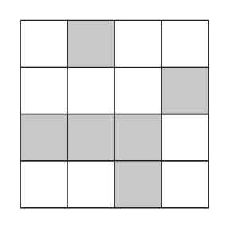
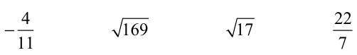
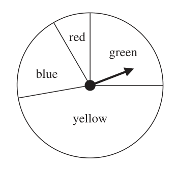
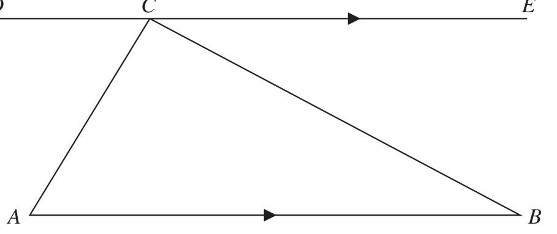
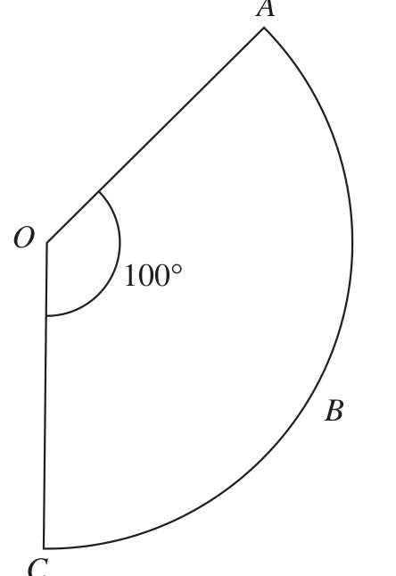
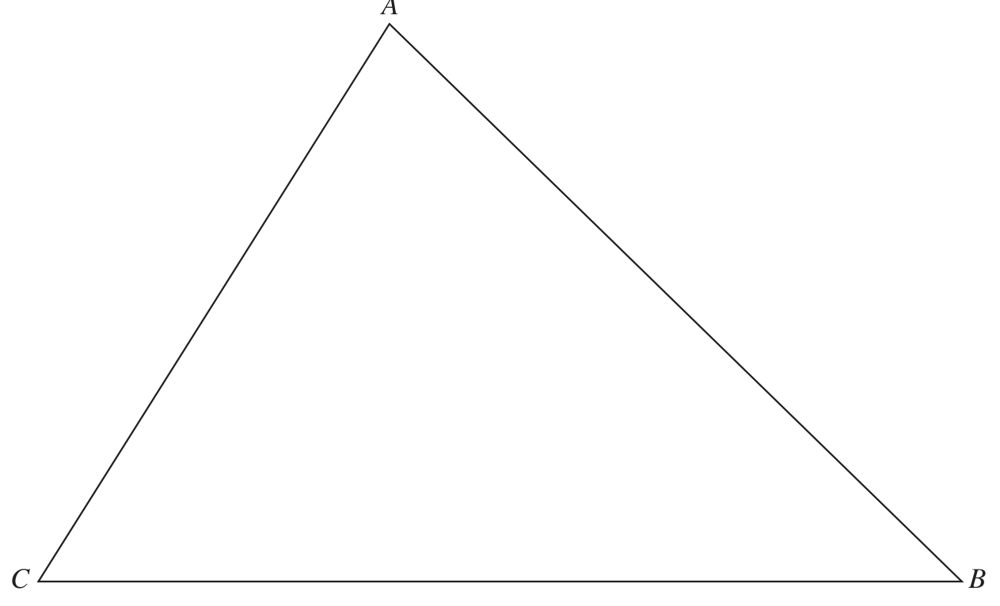
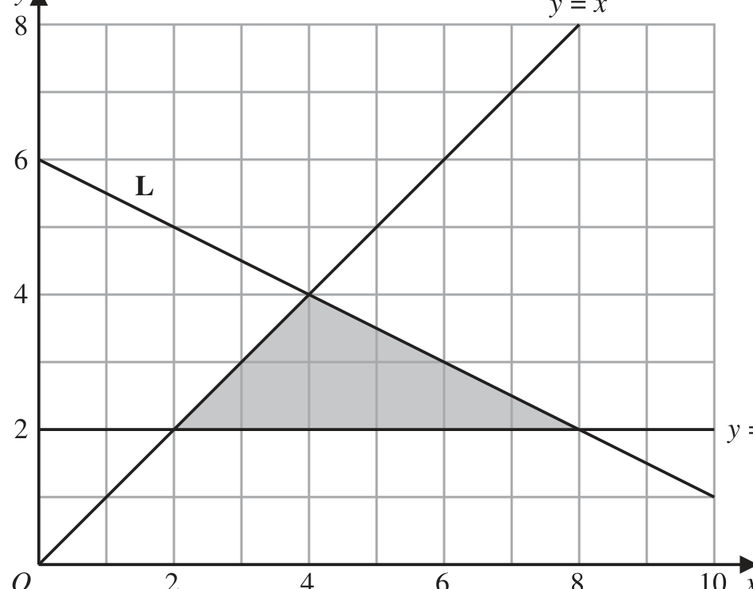
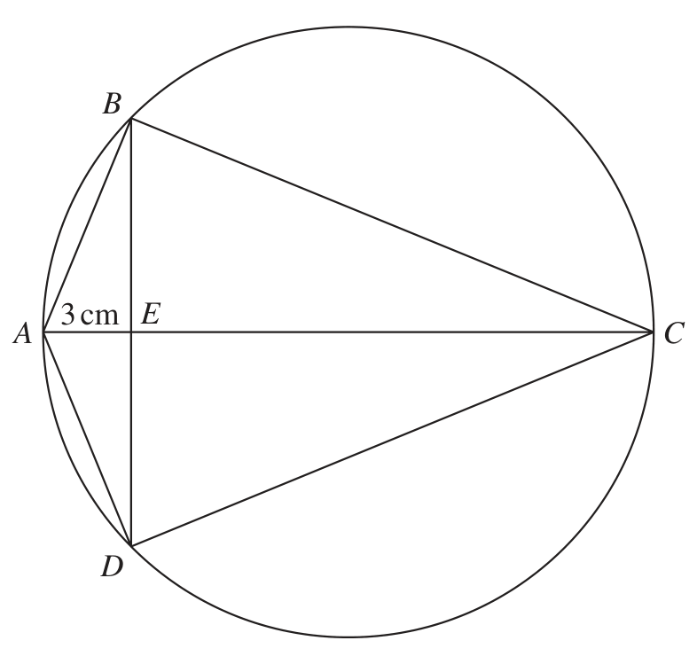

# 4MB1/01 — 2022-06 (official extraction)

> schema `syllabai.official-paper-questions/0.2` · paper_id `pearson-edexcel:international-gcse:mathematics-b:4mb1:2022-06:4MB1/01` · qp sha256 `fcfb4dc8d374b901…` · extraction is the disclosed baseline (ADR-039)

## Question 1 (2 marks)

The nth term of a sequence is given by 4n – 12 Write down the first 2 terms of the sequence. 1st term . . . . . . . . . . . . . . . . . . . . . .. . . . . . . . . . . . . . . . . . . . . . . . . . . . . . . . . 2nd term . . . . . . . . . . . . . . . . . . . . . .. . . . . . . . . . . . . . . . . . . . . . . . . . . . . . . . .

### 1 [2]

The nth term of a sequence is given by 4n – 12 Write down the first 2 terms of the sequence. 1st term 2nd term

**Mark scheme answer**

> –8 2 B1
> –4 B1
> Total 2 marks

- **(2)** –8 2 B1

## Question 2 (2 marks)

Bronze is made from copper and tin in the ratio of 22 : 3 by weight. Calculate the weight of copper, in kg, needed to make 12.5 kg of bronze. ....................................................... kg

### 2 [2]

Bronze is made from copper and tin in the ratio of 22 : 3 by weight. Calculate the weight of copper, in kg, needed to make 12.5 kg of bronze kg

**Mark scheme answer**

> 12.5 ⎛ 12.5 ⎞ 2 M1 a fully correct method that leads to the correct answer
> × 22 oe eg 12.5 − ×3
> 22 + 3 ⎝ 22 + 3 ⎠
> 11 A1
> (SCB1 for an answer of 11 000)

- **(2)** 12.5 ⎛ 12.5 ⎞ 2 M1 a fully correct method that leads to the correct answer

## Question 3 (2 marks)

A pattern on a white grid is made from 6 shaded squares. Shade exactly 2 more squares so that the 8 shaded squares will make a pattern with rotational symmetry of order 4

### 3 [2]

A pattern on a white grid is made from 6 shaded squares. Shade exactly 2 more squares so that the 8 shaded squares will make a pattern with rotational symmetry of order 4

**Mark scheme answer**

> 2 B2 Both correct squares and no incorrect squares shaded.
> (B1 one correct square and no more than one incorrect
> or
> both correct squares and at most one incorrect square
> shaded)
> Total 2 marks

- **(2)** 2 B2 Both correct squares and no incorrect squares shaded.

## Question 4 (2 marks)

Make u the subject of 1 2 s = ut + at

### 4 [2]

Make u the subject of 1 2 s = ut + at

**Mark scheme answer**

> 1 1 2 2 M1 for isolating ut or ‒ut or 2ut or ‒2ut or dividing
> s – at2 = ut or −ut = at − s oe
> 2 2 each term by t
> 2
> 2s − at = 2ut or −2ut = −2s + at oe
> s
> = u + at oe
> t
> s − at 2
> s 1 2s − at 2
> u= – at A1 oe eg u =
> 2t
> or u =
> t
> oe (we must
> t
> see u = ….either in the working or on the answer
> line)
> Total 2 marks

- **(2)** 1 1 2 2 M1 for isolating ut or ‒ut or 2ut or ‒2ut or dividing

## Question 5 (2 marks)

Without using a calculator and showing all your working, evaluate 1 4 3 ×2 8 5 Give your answer as a mixed number in its simplest form.

### 5 [2]

Without using a calculator and showing all your working, evaluate 1 4 3 ×2 8 5 Give your answer as a mixed number in its simplest form.

**Mark scheme answer**

> 25 14 2 M1 correct improper fractions or clear alternative method – this
> × oe or
> 8 5 stage must be shown to award any marks
> 1 4 1 4
> 3 × 2 + × 2 + 3 × + × oe
> 8 5 8 5
> 3 A1 dep on M1 A fractional method is required unless you see the
> 4 full working for 3.125 × 2.8
> Total 2 marks

- **(2)** 25 14 2 M1 correct improper fractions or clear alternative method – this

## Question 6 (2 marks)

Factorise completely 2mc 2 + 6p2c 4

### 6 [2]

Factorise completely 2mc 2 + 6p2c 4

**Mark scheme answer**

> 2c2 (m + 3p2c2) 2 B2
> (B1 for a correct partial factorisation ie 2(mc2 + 3p2c4) or
> 2 3
> c2(2m + 6p2c2) or 2c(cm + 3 p c ) or
> 2 3
> c(2mc + 6 p c ) or the correct common factor of 2c2 outside
> a bracket with just one error in the bracket)
> Total 2 marks

- **(2)** 2c2 (m + 3p2c2) 2 B2

## Question 7 (2 marks)

Inzamam cycles 6.4 km from his home to school. He leaves home at 07 40 and arrives at school at 08 20 Calculate his average speed, in km/h, for the journey. ....................................................... km/h

### 7 [2]

Inzamam cycles 6.4 km from his home to school. He leaves home at 07 40 and arrives at school at 08 20 Calculate his average speed, in km/h, for the journey km/h

**Mark scheme answer**

> 6.4 6.4 2
> oe eg × 60 M1 (allow 0.66 or better for in working)
> 40 40
> 9.6
> A1 oe eg
> Total 2 marks

- **(2)** 6.4 6.4 2

## Question 8 (3 marks)

Rohan asked each of the students in his school what colour paper they would prefer him to use for their worksheets. There are 150 students in Rohan’s school. Using his results, Rohan drew the following accurate pie chart. red orange blue green yellow Find how many of the 150 students preferred blue paper.

### 8 [3]

Rohan asked each of the students in his school what colour paper they would prefer him to use for their worksheets. There are 150 students in Rohan’s school. Using his results, Rohan drew the following accurate pie chart. red orange blue green yellow Find how many of the 150 students preferred blue paper.

**Mark scheme answer**

> 48 (±2) seen 3 B1 may be seen in a calculation
> "48" M1 a correct calculation for the number of students who preferred
> ×150
> 360 blue paper - allow use of their angle (even if outside range) for blue
> (but must be a value and not x)
> 20 A1 Accept 19, 20 or 21 - must be a whole number and their
> answer can be truncated or rounded
> Total 3 marks

- **(3)** 48 (±2) seen 3 B1 may be seen in a calculation

## Question 9 (3 marks)

Solve 2(x + 7) = 5x – 6 x = . . . . . . . . . . . . . . . . . . . . . .. . . . . . . . . . . . . . . . . . . . . . . . . . . . . . . . .

### 9 [3]

Solve 2(x + 7) = 5x – 6 x = ……………Solve 2(x + 7) = 5x – 6 x =

**Mark scheme answer**

> 2x + 14 = 5x – 6 or 3 M1 for correctly multiplying out bracket (need not be in an
> 5x 6 equation) or for dividing each term by 2 in an equation.
> x+7 = − oe
> 2 2
> 14 + 6 = 5x – 2x oe eg 3x = 20 M1ft for isolating terms in x on one side and number terms the
> or other side
> −5 x + 2 x = −6 − 14 oe eg ‒3x = ‒20 ft their equation dep on an x term and a number term on both sides
> 20 20 −20
> A1 oe isw for 6.6 if or seen
> 3 3 −3
> Allow 6.7, 6.66, 6.67, etc
> Total 3 marks

- **(3)** 2x + 14 = 5x – 6 or 3 M1 for correctly multiplying out bracket (need not be in an

## Question 10 (3 marks)

E ℚ ℕ ℤ Above is a Venn diagram showing the sets ℕ, ℤ, ℚ and E ∞ is the set of natural numbers, is the set of integers, ℚ is the set of rational numbers E is the universal set. Place each of the following four numbers in the correct place in the above diagram. 4 22 − 169 17 11 7

### 10 [3]

E ℚ ℕ ℤ Above is a Venn diagram showing the sets ℕ, ℤ, ℚ and E ∞ is the set of natural numbers, is the set of integers, ℚ is the set of rational numbers E is the universal set. Place each of the following four numbers in the correct place in the above diagram. 4 22 − 169 17 11 7

**Mark scheme answer**

> ℰ 3 B3 All 4 in correct positions no repetition
> ξ17 B2 3 in correct positions no repetition
> B1 2 in correct positions no repetition
> – Allow 13 for 169
> ℚ 11 ℕ ξ169 ℤ
> Total 3 marks

- **(3)** ℰ 3 B3 All 4 in correct positions no repetition

## Question 11 (3 marks)

The diagram shows a biased spinner with four colours blue, red, green and yellow. When the spinner is spun once • the probability it lands on blue is twice the probability it lands on red • the probability it lands on yellow is three times the probability it lands on blue • the probability it lands on green is 0.25 Find the probability the spinner lands on yellow. red green Diagram NOT accurately drawn blue yellow

### 11 [3]

The diagram shows a biased spinner with four colours blue, red, green and yellow. When the spinner is spun once • the probability it lands on blue is twice the probability it lands on red • the probability it lands on yellow is three times the probability it lands on blue • the probability it lands on green is 0.25 Find the probability the spinner lands on yellow. red green Diagram NOT accurately drawn blue yellow

**Mark scheme answer**

> 1 – 0.25 (= 0.75) oe or 3 M1 showing understanding that probabilities add to 1
> (could be embedded – allow even if not correct
> algebraic values for r or b or y)
> eg r + 2r + 6r = “0.75” oe [r = red] M1 a correct equation for the probability of red or blue
> 1 or yellow or a correct calculation for the probability of
> or “0.75” ÷ 9 (= = 0.083…) oe
> 12 red or blue counter or yellow. Allow fractions,
> decimals or percentages.
> or b + b + 3b = "0.75" oe [b = blue] (award M2 (both M marks for any of the following
> or “0.75” ÷ 4.5 (= = 0.16...) oe r + 2r + 6r + 0.25 = 1
> 1 1 b + b + 3b + 0.25 = 1
> or y + y + y = "0.75" oe [y = yellow]
> 6
> 1
> or “0.75” ÷ 1.5 oe y + y + y + 0.25 = 1 )
> 6
> 1 A1 oe 0.5, 50%
> Total 3 marks

- **(3)** 1 – 0.25 (= 0.75) oe or 3 M1 showing understanding that probabilities add to 1

## Question 12 (3 marks)

Here is a list of four numbers. 1.1 × 1015 2.1 × 1013 3.2 × 1014 3.7 × 1016 Find the median of these four numbers. Give your answer in standard form.

### 12 [3]

Here is a list of four numbers. 1.1 × 1015 2.1 × 1013 3.2 × 1014 3.7 × 1016 Find the median of these four numbers. Give your answer in standard form.

**Mark scheme answer**

> 2.1 × 1013, 3.2 × 1014, 1.1 × 1015, 3.7 × 1016 3 M1 for correctly ordering the numbers
> (ascending or descending order) or for
> or 3.2 × 1014 and 1.1 × 1015 identified identifying the 2 middle numbers from a
> correctly ordered list (list need not be seen if
> correct values chosen)
> (3.2 × 1014 + 1.1 × 1015) ÷ 2 M1 oe
> A1
> 7.1 × 10 (if no marks awarded SCB1 for 1.705 ×1014
> or if their list is in the wrong order - the correct
> value for their median)
> Total 3 marks

- **(3)** 2.1 × 1013, 3.2 × 1014, 1.1 × 1015, 3.7 × 1016 3 M1 for correctly ordering the numbers

## Question 13 (3 marks)

Given that x ≠ –4 x2 + 4 x simplify 2x + 8

### 13 [3]

Given that x ≠ –4 x² + 4 x simplify 2x + 8

**Mark scheme answer**

> x(x + 4) 3 M1 need not be seen as part of the fraction
> 2(x + 4) M1 need not be seen as part of the fraction
> A1 oe eg x or 0.5x
> x
> 2 (watch out for correct answer from incorrect working)
> Total 3 marks

- **(3)** x(x + 4) 3 M1 need not be seen as part of the fraction

## Question 14 (3 marks)

D C E Diagram NOT accurately drawn A B Using the diagram above, prove that the sum of the angles of triangle ABC is the same as the sum of the angles on the straight line DCE Give a reason for each stage of your proof.

### 14 [3]

Using the diagram above, prove that the sum of the angles of triangle ABC is the same as the sum of the angles on the straight line DCE Give a reason for each stage of your proof.

> *Figure not shown in this reconstruction — the printed paper includes a diagram (not drawn accurately).*
> Labels in the original figure: D, C, E, A, B.

**Mark scheme answer**

> angle CAB = ACD 3 B1 identifying the 2 pairs of alternate angles
> and or
> angle ABC = BCE identifying one pair of alternate angles with ‘alternate angles’
> stated.
> alternate angles B1 for stating alternate (or alternating) for the 2 sets of alternate
> angles
> angle ACB is common oe eg ‘the B1 oe eg ACB is in the triangle and on the straight line DCE or ACB
> same’ is common
> [NB: not use of 180º ]
> Total 3 marks

- **(3)** angle CAB = ACD 3 B1 identifying the 2 pairs of alternate angles

## Question 15 (4 marks)

The numbers A, B, and C are given as products of their prime factors. A = 35 × 74 × 1039 B = 316 × 79 × 114 C = 38 × 74 × 2692

### 15(a) [2]

Find the Highest Common Factor (HCF) of A, B and C Exactly one of the three numbers is the square of an integer N

**Mark scheme answer**

> 35 × 7a or 3b × 74 or 35 × 74 × n 2 M1
> (where n = 1039, 11, 112, 113, 114, 269, 2692 )
> 583 443 A1 allow 35 × 74

- **(2)** 35 × 7a or 3b × 74 or 35 × 74 × n 2 M1

### 15(b) [2]

Calculate the value of N N =

**Mark scheme answer**

> 38 × 7 4 × 2692 oe eg 1.139900011×1012 or 2 M1
> 6561× 2401× 72361 oe
> 1 067 661 A1 allow 34 × 72 × 269
> Total 4 marks

- **(2)** 38 × 7 4 × 2692 oe eg 1.139900011×1012 or 2 M1

## Question 16 (4 marks)

A= ⎜ ⎝ −6 −1⎟⎠

### 16(a) [2]

A= −6 −1 

Calculate A + 2B 

**Mark scheme answer**

> ⎛1 0⎞ 2 B2 ( B1 for a 2 × 2 matrix with 2 or 3 correct entries)
>  0 1

- **(2)** ⎛1 0⎞ 2 B2 ( B1 for a 2 × 2 matrix with 2 or 3 correct entries)

### 16(b) [2]

Calculate AB 

**Mark scheme answer**

> ⎛ −9 1 ⎞ 2 B2 (B1 for a 2 × 2 matrix with 2 or 3 correct entries)
>  3 −7 

- **(2)** ⎛ −9 1 ⎞ 2 B2 (B1 for a 2 × 2 matrix with 2 or 3 correct entries)

## Question 17 (4 marks)

A Diagram NOT accurately drawn O 100° B C OABC is a sector of a circle, centre O, with ∠AOC = 100° The area of the sector is 27 cm2 Calculate the perimeter, in cm to 3 significant figures, of the sector. . . . . . . . . . . . . . . . . . . . . . . . . . . . . . .. . . . . . . . . . . . . . . . . . . . . . . . . cm

### 17 [4]

OABC is a sector of a circle, centre O, with ∠AOC = 100° The area of the sector is 27 cm² Calculate the perimeter, in cm to 3 significant figures, of the sector cm

> *Figure not shown in this reconstruction — the printed paper includes a diagram (not drawn accurately).*
> Labels in the original figure: A, O, B, C · Figure values: 100°.

**Mark scheme answer**

> 100 2 4 M1 a correct equation for the area of the sector
> × π r = 27 oe
> 360
> 27 × 360 M1 a correct expression for the radius of the sector (or the correct
> ( r =) (= 5.5(6...)) oe radius) or a completely correct process to find the radius
> π ×100
> 100 M1ft a correct calculation for the perimeter of the sector (if r is
> × 2 × π × "5.56" + 2 × "5.56" oe
> 360 incorrect, then their value can be used if clearly labelled/implied)
> 20.8 A1 awrt 20.8
> Total 4 marks

- **(4)** 100 2 4 M1 a correct equation for the area of the sector

## Question 18 (3 marks)

Given that p = show that =p–1 p Show your working clearly.

### 18 [3]

Given that p = show that =p–1 p Show your working clearly.

**Mark scheme answer**

> 5 −1 −1 + 5 3 Numerical approaches (use of p = 1.618)are not
> p −1 = or acceptable
> 2
> B1 showing p ‒ 1 correctly
> 2 1− 5
> × M1 a correct method to rationalise
> 1+ 5 1− 5 p
> 2 1 − 5 2(1 − 5) 5 −1 A1 dep on M1 for a correct result from
> × = = oe and showing p −1 (gaining B1) rationalisation and showing p ‒ 1 in working.
> 1+ 5 1− 5 −4
> Alt p −1 = or 2 =
>  = working out p2 correctly
> 2 ⎝ 2 ⎠⎝ ⎠ 4
>  1 = p − 1 ⇒ 1 = p( p − 1) for a correct rearrangement of = p −1
> ⎣⎝ p ⎠⎦ M1 p
> 1+ 5 5 −1 5 −1 A1 dep on M1 for a correct result for multiplying
> × = = 1 or p(p ‒1) and showing 1 = p(p – 1) in working oe
> 2 2
> ⎛ 1+ 5 ⎞ ⎛ 1+ 5 ⎞ 1+ 2 5 + 5 ⎛ 1+ 5 ⎞ 3 + 5 1+ 5
>  − = − = − =1
> ⎝ 2 ⎠ ⎝ 2 ⎠ 4 ⎝ 2 ⎠ 2
> 3 B1 working out p ‒ 1 correctly or showing a
> = oe correct equation for (2p ‒1)²
> 2 1 + 5 
> Alt
> ( 5 − 1)(1 + 5 ) = 2 × 2 oe 4 p 2 − 4 p + 1 = 5 and p 2 − p − 1 = 0 oe M1 oe rearranging a correct equation or forming
> a correct quadratic and simplifying
> 5 + 5 −1 − 5 = 4 ⇒ 4 = 4 1 1 A1 correctly showing that LHS = RHS or
> p −1 − = 0 so = p − 1 or
> p p
> showing that = p − 1 by factorising for p or
> 1 p
> p ( p − 1) = 1 so = p − 1 dividing throughout by p
> p

- **(3)** 5 −1 −1 + 5 3 Numerical approaches (use of p = 1.618)are not

## Question 19 (4 marks)

There are 1000 cm3 of orange juice in a carton. The total surface area of this carton is 700 cm2 For a special offer, a new carton is designed. The volume of orange juice in the new carton is 33.1% more than the volume of orange juice in the original carton. The new carton is mathematically similar to the original carton. Calculate the total surface area of the new carton. ....................................................... cm2

### 19 [4]

There are 1000 cm³ of orange juice in a carton. The total surface area of this carton is 700 cm² For a special offer, a new carton is designed. The volume of orange juice in the new carton is 33.1% more than the volume of orange juice in the original carton. The new carton is mathematically similar to the original carton. Calculate the total surface area of the new carton

…………… cm²

**Mark scheme answer**

> 133.1 4 B1 for a correct SF for the volume of the new
> Volume scale factor 1.331 oe eg oe
> 100 carton
> or or
> 100 for a correct fraction or ratio for volume SF
> 133.1 : 100 oe or oe or 100 : 133.1 oe or
> 133.1
> the new volume
> or
> 33.1
> Volume of new carton = 1000 + (1000 × ) (=1331)
> 100
> 3 100 ⎛ 10 ⎞ 1000 ⎛ 10 ⎞ M1 for a correct linear SF (may be seen as part
> ξ"1.331" (= 1.1) oe or 3 ⎜ = ⎟ oe or 3 ⎜ = = 0.90 ⎟ of another sum)
> 133.1 ⎝ 11 ⎠ 1331 ⎝ 11 ⎠
> ( ) M1 dep for a correct calculation to find the
> 1.331 × 700 oe
> total surface area of the new carton
> eg 700 × "1.1"2 or
> 2
> ⎛ 100 ⎞ ⎛ 10 ⎞ 100
> 700 ÷ 3 oe eg 700 ÷ or 700 ÷ or
> ⎝ 133.1 ⎠ ⎝ 11 ⎠ 121
>  11× 700 oe
> ⎝ 10 ⎠
> 847 A1

- **(4)** 133.1 4 B1 for a correct SF for the volume of the new

## Question 20 (4 marks)

Given that a = ⎜ ⎟ where ½ a½ = 5 ⎝ 2x ⎠ find the exact value of x x = .......................................................

### 20 [4]

Given that a = where ½ a½ = 5 ⎝ 2x ⎠ find the exact value of x x =

**Mark scheme answer**

> ( x − 2)² + ( 2 x ) 2 = 5 oe or 4 M1 a correct equation for the modulus of the vector (condone lack of
> brackets if meaning is clear)
> (x – 2)² + 2x = 5 oe
> x − 4 x + 4 + 2 x = 5 oe or M1 expand brackets correctly and equate to 5
> eg x² – 2x – 1 (= 0)
> − − 2 ± (−2)² − 4 ×1× −1 M1 for a correct method to solve their 3 term quadratic equation dep on
> ( x =) or 1st M1 (must see substitution if using the wrong equation) (allow some
> 2 ×1 simplification and one sign error). Allow as far as
> 2+ 4+4
> ( x − 1) − 1 − 1 = 0 oe
> or for the 2 answers of 1 + 2 and 1 – 2
> A1 oe (but must be in exact form) as the only answer
> 1+ 2 2+ 8
> eg accept

- **(4)** ( x − 2)2 + ( 2 x ) 2 = 5 oe or 4 M1 a correct equation for the modulus of the vector (condone lack of

## Question 21 (3 marks)

The diagram shows triangle ABC A C B The region R consists of all the points inside the triangle that are closer to C than to B and also closer to AB than to AC Using ruler and compasses only and showing all your construction lines, construct and show by shading the region R Label the region R

### 21 [3]

The diagram shows triangle ABC A C B The region R consists of all the points inside the triangle that are closer to C than to B and also closer to AB than to AC Using ruler and compasses only and showing all your construction lines, construct and show by shading the region R Label the region R

> *Figure not shown in this reconstruction — the printed paper includes a diagram (not drawn accurately). Use the text description to work through it.*

**Mark scheme answer**

> Construction lines and perpendicular bisector of BC 3 M1 (use overlay & make sure you can see all
> the construction lines)
> Construction lines and bisector of BAC M1
> Region R A1 dep on a correct bisector of the line and the
> correctly angle (region may not be labelled R but award if
> identified clearly indicated eg shaded)
> SCB1 for the correct area R identified but
> missing all correct construction lines (but having
> a bisector of the line and the angle)
> Total 3 marks

- **(3)** Construction lines and perpendicular bisector of BC 3 M1 (use overlay & make sure you can see all

## Question 22 (5 marks)

y y=x L 2 y=2 O 2 4 6 8 10 x The diagram above shows the line L, the line with equation y = 2 and the line with equation y = x drawn on a grid.

### 22(a) [2]

Find an equation of the line L

**Mark scheme answer**

> 2
> B2 for a correct equation for line L eg y = − x + 6 or 2y + x = 12 oe or
> eg y − 5 = −0.5( x − 2) oe (ie use of any pair of coordinates with correct
> gradient)
> 1 (B1 for an equation of a line with the correct gradient or the correct y
> y = − x+6
> 2 1
> intercept eg y = − x + c where c ≠ 6 or y = mx + 6 where m ≠ − but
> 2
> there is a term in x oe
> or for − x + 6 )

- **(2)** 2

### 22(b) [3]

Write down the three inequalities that define the region shaded in the diagram.

> *Figure not shown in this reconstruction — the printed paper includes a diagram (not drawn accurately). Use the text description to work through it.*

**Mark scheme answer**

> NB: inequalities can be in any order y≥2 3 B1 condone strict inequalities eg. y > 2
> for this part
> y≤x B1
> B1ft ft their equation from (a) provided gradient is negative
> y − x+6
> 2 SC B1 for y ≤ 2, y ≥ x and y − x + 6 (condone <, >)
> Total 5 marks

- **(3)** NB: inequalities can be in any order y≥2 3 B1 condone strict inequalities eg. y > 2

## Question 23 (5 marks)

B Diagram NOT accurately drawn 3 cm E A C D ABCD is a kite so that the points A, B, C and D lie on a circle with radius 7.5 cm. The diagonals, AC and BD, of the kite intersect at point E, so that AE = 3 cm. The line AEC is a diameter of the circle. Find the area of the kite ABCD ....................................................... cm2

### 23 [5]

ABCD is a kite so that the points A, B, C and D lie on a circle with radius 7.5 cm. The diagonals, AC and BD, of the kite intersect at point E, so that AE = 3 cm. The line AEC is a diameter of the circle. Find the area of the kite ABCD cm²

> *Figure not shown in this reconstruction — the printed paper includes a diagram (not drawn accurately).*
> Labels in the original figure: B, E, A, C, D · Figure values: 3.

**Mark scheme answer**

> (CE =) 12 or (OE =) 4.5 (O is centre) 5 B1 shown on diagram, stated or clearly used
> eg BE2 = "12" × 3 or 2BE2 + "12"2 + 32 = 152 or 7.52 = 4.52 + BE 2 M1 for a correct calculation to find BE/ED
> “12” must come from correct working
> eg (2 × 7.5) ‒ 2
> BE = 6 or ED = 6 or BD = 12 A1 may be shown on diagram
> "12"× 3 "12"× "12" M1
> 0.5 × 15 × "12" or + or
> 2
> 2 ( 0.5 × 3 × "6") + 2 ( 0.5 × "6"× "12") oe or
> ( )
> 2 × 0.5 × ( 62 + 32 × (152 − (3 5) 2 ) oe eg 2 × (0.5 × 6 5 × 3 5)
> 90 A1
> Total 5 marks

- **(5)** (CE =) 12 or (OE =) 4.5 (O is centre) 5 B1 shown on diagram, stated or clearly used

## Question 24 (6 marks)

In a triangle ABC AC = 6.5 cm BC = 12 cm ∠ABC = 30° Calculate, in cm2 to 3 significant figures, the smaller of the areas of the two possible triangles ABC ....................................................... cm2

### 24 [6]

In a triangle ABC AC = 6.5 cm BC = 12 cm ∠ABC = 30° Calculate, in cm² to 3 significant figures, the smaller of the areas of the two possible triangles ABC

…………… cm²

**Mark scheme answer**

> sin A sin 30 CN = 12sin 30 (= 6) where CN is 6 M1
> = oe
> 12 6.5 perpendicular to AB
> 12sin 30 BN = $12^2$ − "6"$^2$ (6 3 = 10.39...) M1 dep assumes previous mark unless
> sin A =
> 6.5 they use BN = 12cos30
> 12sin 30
> BN = or BN=12cos 30
> tan 30
> ⎛ 12sin 30 ⎞ AN = $6.5^2$ − (12sin 30)² (=2.5) M1
> A = sin$^{-1}$ (= 67.3(8...))
> ⎝ 6.5 ⎠
> 180 ‒ 30 ‒ (180 ‒ "67.38..")(= 37.38) or Smallest AB = “10.39…” ‒ “2.5” (= 7.89) M1 method to find correct angle or
> 1 or correct side for smallest area.
> ×12 × 6.5 × sin"82.619..." (= 38.6(7…))
> 2 1 or
> × ("10.39"... + "2.5") × 6(= 38.6(7..))
> (where 180 – 30 ‒ "67.38.."(= 82.619…) 2 Correct method to find largest area
> 1 1 M1 use of correct angle or correct lengths
> ×12 × 6.5 × sin"37.38..." or × (10.39... − "2.5") × 6
> 2 2 for smaller triangle area in a correct
> 1 6.5sin"37.3(8..)" formula
> × ×12 × sin 30 or
> 2 sin 30
> 1 6.5 × sin 37.3(8..)
> × × 6.5 × sin"112.6"
> 2 sin 30
> 2 2
> Alt $6.5^2$ = $AB^2$ + $12^2$ – 2 × AB × 12 × cos 30 6 M1 AB may be labelled in any way – eg c
> $AB^2$ – 12ξ3AB + 101.75 (= 0) M1
> M1 ft their quadratic dep on 1st M1
> (12 3 ) − 4 ×1×101.75 (allow as far as 12 3 ± 432 − 407 )
> 12 3 ± allow some simplification and 1 sign
> ( AB = ) error (gives 7.89, 12.89) (could complete
> 2 ×1
> the square)
> 1 M1 for selecting the correct value or
> For selecting AB = 7.89 or × ("12.89...") × 6(= 38.6(7..)) (continued below)
> 2 using the correct formula for the larger
> triangle
> 1 M1
> × 12 × "7.89" × sin 30
> 2
> 23.7 A1(allow awrt 23.5 to 23.7)

- **(6)** sin A sin 30 CN = 12sin 30 (= 6) where CN is 6 M1

## Question 25 (7 marks)

There are 25 sweets in a bag. n of the sweets are orange. The rest of the sweets are yellow. Chana takes a sweet at random from the bag. She eats the sweet. Chana takes at random another sweet from the bag. She eats the sweet. The probability that Chana eats one orange sweet and one yellow sweet is

### 25(a) [1]

Write down the probability that both sweets taken by Chana are the same colour.

**Mark scheme answer**

> 2 1 B1 oe 0.667 or 66.7% or better

- **(1)** 2 1 B1 oe 0.667 or 66.7% or better

### 25(b) [6]

Find the possible values of n Show clear algebraic working.

**Mark scheme answer**

> n 25 – n
> 25 − n n 6 M1 may be seen as part of a sum (allow in sum even if with other
> × or × or incorrect products)
> n n −1 25 − n 24 − n
> × or ×
> n 25 – n 1 M1 for a correct equation using the probability
> 2× × = oe or
> n n − 1 25 − n 24 − n 2
> × + × =
> 2 × 3 × n(25 – n) = 24 × 25 oe M1 for a correct equation without fractions
> eg 150n − 6n2 = 600 oe or
> 3n2 − 75n + 900 = 600 oe
> 3n2 − 75n = −300 oe or A1 correct quadratic equation with 3 terms
> n – 25n + 100 (= 0) oe
> (n – 20)(n – 5) M1 ft for a complete method to solve their 3-term quadratic equation –
> could be by factorisation (allow factorisation that gives 2 out of 3 terms
> − − 25 ± (−25) 2 − 4 ×1×100
> or (n =) correct) or use of formula or completing the square
> 2 ×1
> or If using formula must see substitution of values, allow one sign error and
> 2
> ⎛ 25 ⎞ ⎛ 25 ⎞ 25 ± 625 − 400
> ⎜ n − ⎟ − + 100 = 0 oe some simplification – allow as far as and if
> ⎝ 2 ⎠ ⎝ 2 ⎠
> completing the square allow as far as shown.
> A correct answer will score full marks A1 dep on M2
> 5 and 20
> as long as the student has gained at
> least 2 method marks

- **(6)** n 25 – n

## Question 26 (7 marks)

f(x) = 2x 3 + 9x 2 – 14x – 9

### 26(a) [2]

Using the factor theorem, show that (2x – 1) is not a factor of f(x) f ( x)

**Mark scheme answer**

> 2 × 0.53 + 9 × 0.52 − 14 × 0.5 − 9 2 M1
> oe
> A1 oe allow ‘does not equal 0 so (2x ‒1) is not a factor oe
> ‒13.5
> NB: not long division as use of factor theorem stated

- **(2)** 2 × 0.53 + 9 × 0.52 − 14 × 0.5 − 9 2 M1

### 26(b) [3]

Express in the form (x + a)² + b 2x + 1 where a and b are integers to be found.

**Mark scheme answer**

> 2 terms of x + 4 x − 9 correct (out of no
> 3 B1 for correctly getting 2 terms out of x², +4x, –9 (out of
> more than 3 terms) no more than 3 terms) or
> or if equating coefficients, for two of: the x² or the terms in x
> 2 x³ + 4ax 2 + 2a 2 x + 2 xb + x 2 + 2ax + a 2 + b or the constant terms correct
> (x + 2)² [+ b] M1ft a method to start to complete the square with correct
> Or coefficient for a ft their quadratic eg (x + 2)²
> 4a + 1 = 9 and 2a2 + 2b + 2a = ‒14 or two correct equations from equating coefficients
> A1 (could state that a = 2 and b = ‒13)
> (x + 2)² – 13

- **(3)** 2 terms of x + 4 x − 9 correct (out of no

### 26(c) [2]

Hence find the exact solutions of f(x) = 0

**Mark scheme answer**

> 2
> B1 (x =) −
> B1 (x =) −2 ± 13 oe (if decimals given only - award no
> 1 marks, but if decimals follow a correct exact form then
> − , − 2 ± 13 isw)
> ft for the 2nd B mark from their answer for (b) as long as in
> the form (x ± a)² ‒ b
> Total 7 marks

- **(2)** 2

## Question 27 (9 marks)

A particle P is moving along a straight line. At time t seconds, the displacement, s metres, of P from a fixed point O on the line is given by s = t 3 – 18t 2 + 81t 0≤t≤9 At time T seconds, where T < 9, P is at the point A on the line. At A, particle P instantaneously reverses its direction of motion and moves back towards O

### 27(a) [5]

Find the value of T T = As P moves from A back towards O, the greatest speed of P is V m/s

**Mark scheme answer**

> 3t2 or – 36t or + 81 5 M1 2 terms correct
> 3t2 – 36t + 81 A1 all correct.
> 3t2 – 36t + 81= 0 M1ft dep on M1
> (t – 3)(t – 9) M1ft a correct method to solve their quadratic – if factorising will
> give 2 out of 3 terms correct and if using formula allow one sign
> error
> A1 (award 4 marks if both 9 and 3 are given for the answer)

- **(5)** 3t2 or – 36t or + 81 5 M1 2 terms correct

### 27(b) [4]

Find the value of V V =

**Mark scheme answer**

> 6t – 36 (= 0) 4 M1 (or suitable sketch that shows t = 6 or showing a method to find
> correct values for at least t = 5 , t = 6 and t = 7 )
> t =6 A1 calculating or selecting the correct value
> 3 × 62 – 36 × 6 + 81 M1ft for substituting their value of t into the correct expression
> dependent on the first M1
> or for an answer of –27
> 27 A1 do not accept –27
> Total 9 marks

- **(4)** 6t – 36 (= 0) 4 M1 (or suitable sketch that shows t = 6 or showing a method to find

