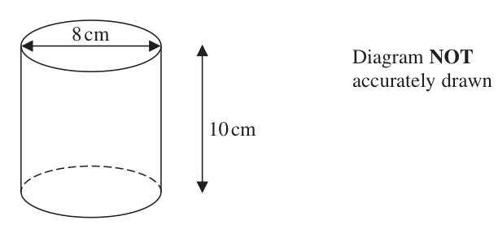
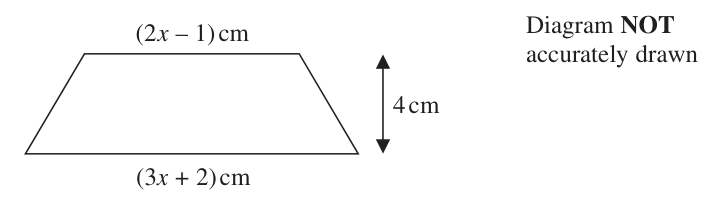
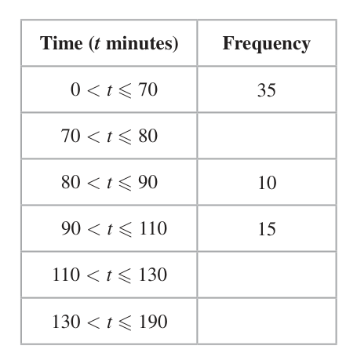
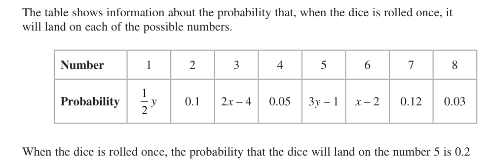

# 4MB1/01R — 2022-06 (official extraction)

> schema `syllabai.official-paper-questions/0.2` · paper_id `pearson-edexcel:international-gcse:mathematics-b:4mb1:2022-06:4MB1/01R` · qp sha256 `3fc91d5e1aa2e714…` · extraction is the disclosed baseline (ADR-039)

## Question 1 (1 marks)

Calculate the value of 12.3 − 9.91 Give your answer as a decimal to 5 significant figures.

### 1 [1]

Calculate the value of 12.3 − 9.91 Give your answer as a decimal to 5 significant figures.

**Mark scheme answer**

> 1.2092 1 B0 for 1.20920 or 1.20921
> Total 1 mark

- **(1)** 1.2092 1 B0 for 1.20920 or 1.20921

## Question 2 (2 marks)

The nth term of a sequence is given by 7 – 4n Determine whether –123 is a term of this sequence. Show your working clearly.

### 2 [2]

The nth term of a sequence is given by 7 – 4n Determine whether –123 is a term of this sequence. Show your working clearly.

**Mark scheme answer**

> 7 − 4n = −123 or 4n = 130 M1 for setting the given expression equal to −123
> or getting 4n = 130. This mark can also be achieved
> for getting the 33rd term as −125 or the 32nd term
> as −121
> 130 No + valid reason 2 A1 dependent on previous M mark. For ‘No’ plus
> n= = 32.5 valid reason eg 32.5 is not an integer, is a decimal,
> is not a whole number, is a fraction (oe) or 130 is
> not a multiple of 4 etc. or stating that the 32nd term
> is −121 and the 33rd term is −125
> Finding n = 32.5 and saying no without a reason is
> A0
> Total 2 marks

- **(2)** 7 − 4n = −123 or 4n = 130 M1 for setting the given expression equal to −123

## Question 3 (2 marks)

N Diagram NOT accurately drawn 133° A N x° C B The diagram shows the position of two ports, A and B, and the position of a ship C The bearing of port B from port A is 133° Given that C is due west of B calculate the value of x x = .......................................................

### 3 [2]

N Diagram NOT accurately drawn 133° A N x° C B The diagram shows the position of two ports, A and B, and the position of a ship C The bearing of port B from port A is 133° Given that C is due west of B calculate the value of x x =

> 🖼 crop required: diagram (qp.pdf p.None)

**Mark scheme answer**

> 133 – 90 M1 oe eg 90 – (180 – 133) or for 90 – 47 (with the
> 47 possibly seen on the diagram)
> 43 2 A1 allow 043
> Total 2 marks

- **(2)** 133 – 90 M1 oe eg 90 – (180 – 133) or for 90 – 47 (with the

## Question 4 (2 marks)

Without using a calculator and showing all your working, calculate 7 5 2 ×3 10 9 Give your answer as a mixed number in its simplest form. ………………………

### 4 [2]

Without using a calculator and showing all your working, calculate 7 5 2 ×3 10 9 Give your answer as a mixed number in its simplest form. ………………………

**Mark scheme answer**

> 7 5 27 32 M1 correct improper fractions or clear alternative
> 2 ×3 = × oe or method – this stage must be shown to award any
> 10 9 10 9
> marks
> 7 5 7 5
> 2×3 + ×3 + × 2 + ×
> 10 9 10 9
> 864 48 3 32 16 48 3 3 2 A1 dependent on M1 – must see at least one
> = = 9 or 3 × = 3 × = =9
> 90 5 5 10 5 5 5 5 27 32
> intermediate step between × and final
> 10 9
> answer – all stages of simplification if shown need
> to be correct. No equivalent answers allowed
> Total 2 marks

- **(2)** 7 5 27 32 M1 correct improper fractions or clear alternative

## Question 5 (2 marks)

Make h the subject of 2(h – 6) = 4g + 2

### 5 [2]

Make h the subject of 2(h – 6) = 4g + 2

**Mark scheme answer**

> 4g + 2 M1 for either dividing both sides by 2 or expanding
> h − 6 = 2 g + 1 or 2h = 4 g + 2 + 12 or h − 6 = brackets correctly and adding 12 to both sides
> h = 2g + 7 2 4 g + 14
> A1 allow (h =) or 2g + 7 or 7 + 2g on
> 4g + 2
> answer line but A0 for (h =) +6
> SC B1 for correctly making g the subject e.g.
> h−7 2h − 14 h
> ( g =) or ( g =) or ( g =) − 3.5
> 2 4
> Total 2 marks

- **(2)** 4g + 2 M1 for either dividing both sides by 2 or expanding

## Question 6 (2 marks)

Solve the inequality 3 – 2x < 5 + 6x

### 6 [2]

Solve the inequality 3 – 2x < 5 + 6x

**Mark scheme answer**

> eg 8 x > −2 or −2 < 8x M1 oe (eg –8x < 2) for collecting like terms
> correctly and getting to one term in x and one
> constant term only
> 1 2
> x>− A1 (oe eg x > – 0.25, x > − , –0.25 < x, etc.)
> 4
> Total 2 marks

- **(2)** eg 8 x > −2 or −2 < 8x M1 oe (eg –8x < 2) for collecting like terms

## Question 7 (2 marks)

Here is a list of six numbers. 20 4π 24 5 18 −3 5 9π 42 2 3 Write down the two numbers in the list that are natural numbers. ........................... , ...........................

### 7 [2]

Here is a list of six numbers. 20 4π 24 5 18 −3 5 9π 42 2 3 Write down the two numbers in the list that are natural numbers ,

**Mark scheme answer**

> 20 2 4 2 B2 for both correct
> and 2 B1 for one correct (no marks if more than 2
> 5 4 answers given) – allow equivalent answers eg 2 (for
> 20
> ) and 1 (for 2 )
> 5
> Total 2 marks

- **(2)** 20 2 4 2 B2 for both correct

## Question 8 (2 marks)

cm Diagram NOT accurately drawn 10 cm The diagram shows a right circular solid cylinder of diameter 8 cm and height 10 cm. Calculate, to the nearest cm3, the volume of the cylinder. ....................................................... cm3

### 8 [2]

cm Diagram NOT accurately drawn 10 cm The diagram shows a right circular solid cylinder of diameter 8 cm and height 10 cm. Calculate, to the nearest cm3, the volume of the cylinder cm3

**Mark scheme answer**

> π ( 4 ) (10 )
> 2 M1 for complete correct method to find volume
> with r = 4 or 8. An answer of 160 π with no
> working scores M1 but look out for this coming
> from an incorrect method
> 503 2 A1 cao (for reference: 502.6548246…) – allow 502
> from using 3.14 as π (more accurate values of π
> should give 503). Allow 160 π = 502 for 2 marks
> Total 2 marks

- **(2)** π ( 4 ) (10 )

## Question 9 (2 marks)

9 1 second = 106 microseconds. Change 4.5 × 1014 microseconds into hours. Give your answer in standard form. ....................................................... hours

### 9 [2]

9 1 second = 106 microseconds. Change 4.5 × 1014 microseconds into hours. Give your answer in standard form hours

**Mark scheme answer**

> 4.5 ×1014 4.5 ×1014 4.5 ×1014
> M1 oe e.g. , or for
> 60 × 60 ×106 3600 ×106 3.6 ×109
> a ×105 (where a is non-zero real number) or
> 1.25 ×10n (where n is a non-zero integer) or
> 125000 or 12.5 ×104 (oe correct answer which
> is not in standard form)
> 1.25 ×105 2 A1
> Total 2 marks

- **(2)** 4.5 ×1014 4.5 ×1014 4.5 ×1014

## Question 10 (2 marks)

Patrick sells a painting for 557.75 euros. He makes a profit of 15% on the price he paid for the painting. Calculate the price Patrick paid for the painting. ....................................................... euros

### 10 [2]

Patrick sells a painting for 557.75 euros. He makes a profit of 15% on the price he paid for the painting. Calculate the price Patrick paid for the painting euros

**Mark scheme answer**

> 557.75 100
> M1 oe correct method eg 557.75 × or
> 1.15 115
> 15 557.75 − x
> 557.75 − 557.75 × or ×100 = 15
> 115 x
> 485 A1
> Total 2 marks

- **(2)** 557.75 100

## Question 11 (3 marks)

Here are the marks that Srinjoy scored in each of 7 tests. 21 24 25 18 28 25 20

### 11(a) [1]

Write down the mode of these 7 marks. After taking an 8th test, Srinjoy’s mean mark for all 8 tests is 22.5

**Mark scheme answer**

> 25 1 B1
> No marks if more than one answer given

- **(1)** 25 1 B1

### 11(b) [2]

Calculate his mark for the 8th test.

**Mark scheme answer**

> 161 + x M1 for setting up a correct equation in x or
> = 22.5 implying a fully correct method for finding the 8th
> test score
> eg 8(22.5) − (21 + 24 + 25 + 18 + 28 + 25 + 20) or
> 180 – 161 or 8(22.5) − 161
> x = 22.5(8) − 161 19 2 A1 – a trial and improvement approach scores 2
> marks if correct otherwise no marks
> Total 3 marks

- **(2)** 161 + x M1 for setting up a correct equation in x or

## Question 12 (3 marks)
### 12(a) [1]

Find the value of 12xy – 15y when x = 2 and y = –3

**Mark scheme answer**

> −27 1 B1

- **(1)** −27 1 B1

### 12(b) [2]

Factorise completely 12xy – 15y

**Mark scheme answer**

> 3 y ( 4 x − 5) 2 B2
> B1 for a correct partial factorisation ie
> 3 ( 4 xy − 5 y ) or y (12 x − 15 ) or the common factor
> of 3y outside a bracket with just one error in the
> bracket
> Total 3 marks

- **(2)** 3 y ( 4 x − 5) 2 B2

## Question 13 (3 marks)

The diagram shows a trapezium. (2x – 1) cm Diagram NOT accurately drawn 4 cm (3x + 2) cm The lengths of the parallel sides of the trapezium are (3x + 2) cm and (2x – 1) cm. The height of the trapezium is 4 cm. Given that the area of the trapezium is 28 cm2 find the value of x x = . . . . . . . . . . . . . . . . . . . . . .. . . . . . . . . . . . . . . . . . . . . . . . . . . . . . . . .

### 13 [3]

The diagram shows a trapezium. (2x – 1) cm Diagram NOT accurately drawn 4 cm (3x + 2) cm The lengths of the parallel sides of the trapezium are (3x + 2) cm and (2x – 1) cm. The height of the trapezium is 4 cm. Given that the area of the trapezium is 28 cm2 find the value of x x =

**Mark scheme answer**

> 1 M1 for setting up a correct equation in x
> ( 4 ) ⎡⎣( 2 x − 1) + ( 3x + 2 )⎤⎦ = 28
> 2 eg 4 ( 2 x − 1) + ( 4 )( x + 3) = 28
> Condone missing brackets provided recovered
> correctly later
> 10 x + 2 = 28 ⇒ 10 x = 26 (oe) depM1 for collecting like terms – must be the
> correct order of operations to get to ax = b but allow
> one error only when rearranging. Condone missing
> brackets provided recovered correctly later
> 2.6 3 A1 (oe)
> Total 3 marks

- **(3)** 1 M1 for setting up a correct equation in x

## Question 14 (3 marks)

B A C The diagram shows a farmer’s field that is in the shape of a ΔABC The farmer is going to grow carrots in the region of the field which is • nearer to A than to B and • nearer to AB than to AC Using ruler and compasses only and showing all your construction lines, construct the region T inside the field in which the farmer is going to grow his carrots. Shade the region and label it T

### 14 [3]

B A C The diagram shows a farmer’s field that is in the shape of a ΔABC The farmer is going to grow carrots in the region of the field which is • nearer to A than to B and • nearer to AB than to AC Using ruler and compasses only and showing all your construction lines, construct the region T inside the field in which the farmer is going to grow his carrots. Shade the region and label it T

> 🖼 crop required: diagram (qp.pdf p.None)

**Mark scheme answer**

> M1 for construction lines and perpendicular
> bisector of AB
> M1 for construction lines and angle bisector of
> BAC
> A1 dep on a correct bisector of line AB and the
> T Region T correct bisector of angle BAC and must have scored
> correctly at least one M mark – so must have the construction
> identified lines for at least one of the two bisectors for T
> correctly identified. Shading required but condone
> T not being labelled
> If M0 M0 then SC B1 for the correct region but
> missing all correct construction lines (but must have
> the bisector of line AB and the bisector of angle
> BAC)
> Total 3 marks

- **(3)** M1 for construction lines and perpendicular

## Question 15 (3 marks)

y y–x=2 Diagram NOT accurately drawn R O x 3x + y = 15 The diagram shows part of the shaded infinite region R which has three straight boundary lines. Write down the three inequalities that define the shaded region R

### 15 [3]

y y–x=2 Diagram NOT accurately drawn R O x 3x + y = 15 The diagram shows part of the shaded infinite region R which has three straight boundary lines. Write down the three inequalities that define the shaded region R

> 🖼 crop required: diagram (qp.pdf p.None)

**Mark scheme answer**

> y−x 2 B1 condone strict inequalities eg y – x < 2 for all
> three marks. Allow any re-arrangement provided
> correct eg x − y + 2 0
> 3x + y 15 B1 oe eg − y + 15 3x
> y 0 3 B1
> Total 3 marks

- **(3)** y−x 2 B1 condone strict inequalities eg y – x < 2 for all

## Question 16 (3 marks)

B Diagram NOT accurately drawn A C D F E The diagram shows the square ACEF and the equilateral triangles ABC and CDE Prove that ΔECB is congruent to ΔACD

### 16 [3]

B Diagram NOT accurately drawn A C D F E The diagram shows the square ACEF and the equilateral triangles ABC and CDE Prove that ΔECB is congruent to ΔACD

> 🖼 crop required: diagram (qp.pdf p.None)

**Mark scheme answer**

> In ECB and ACD
> AC = CE - sides of the square ACEF are equal
> M1 M1 (1 mark for each with correct reason) –
> BC = CD - sides of equilateral triangles are equal must have underlined words – allow singular/plural
> because the ‘base’ of each triangle is a side of the square confusion (eg ‘side’ for ‘sides’)
> ∠ECB = ∠ACD ( = 150 ) because both obtuse angles
> Allow Σ or ‘60 + 90’ (but not just ‘150’) for ‘sum’
> are the sum of the right-angle (or ACE or 90°) and the – not sufficient just to say angle C in this case
> angle at the base of an equilateral triangle
> SC B1 if M0 M0 scored but all three of AC = CE,
> BC = CD and ∠ECB = ∠ACD stated together
> (Hence ECB and ACD are congruent) with SAS
> SAS 3 A1 for all three (with correct reasons) + SAS
> (ignore incorrect or additional reasons)
> Total 3 marks

- **(3)** In ECB and ACD

## Question 17 (3 marks)

Without using a calculator and showing all your working, express 4−2 3 3 +1 in the form a 3 + b where a and b are integers.

### 17 [3]

Without using a calculator and showing all your working, express 4−2 3 3 +1 in the form a 3 + b where a and b are integers.

**Mark scheme answer**

> 4 − 2 3 ⎛ 4 − 2 3 ⎞⎛ 3 − 1 ⎞ M1 for multiplying numerator and denominator
> =⎜ ⎟⎜ ⎟⎟ by 3 − 1 or 1 − 3
> 3 + 1 ⎜⎝ 3 + 1 ⎟⎜
> ⎠⎝ 3 − 1 ⎠
> 4 3 −4−6+2 3 4 3 −4−6+2 3 M1dep for expanding numerator (2, 3 or 4
> or terms) and denominator (2 or 4 terms) –
> 3 −1 ( 3) 2 − 12
> condone one error only when multiplying out
> both numerator and denominator
> 3 3 −5 3 A1 final answer (dependent on both M marks)
> Total 3 marks
> 4−2 3
> No marks for = 3 3 −5
> 3 +1
> M1 only for
> ⎛ 4 − 2 3 ⎞⎛ 3 − 1 ⎞
> ⎜⎜ ⎟⎜
> ⎟⎜ ⎟⎟ = −5 + 3 3
> ⎝ 3 + 1 ⎠⎝ 3 − 1 ⎠
> M1 only for
> ⎛ 4 − 2 3 ⎞ ⎛ 3 − 1 ⎞ −10 + 6 3
> ⎜⎜ ⎟⎟ ⎜⎜ ⎟⎟ = (= −5 + 3 3)
> ⎝ 3 + 1 ⎠ ⎝ 3 −1 ⎠
> SC B2 for
> ⎛ 4 − 2 3 ⎞ ⎛ 3 −1 ⎞ 4 3 − 4 − 6 + 2 3
> ⎜⎜ ⎟⎟ ⎜⎜ ⎟⎟ =
> ⎝ 3 + 1 ⎠ ⎝ 3 −1 ⎠
> regardless of subsequent working

- **(3)** 4 − 2 3 ⎛ 4 − 2 3 ⎞⎛ 3 − 1 ⎞ M1 for multiplying numerator and denominator

## Question 18 (4 marks)

Diagram NOT accurately drawn O S R 118° P Q In the diagram, P, Q and R are points on a circle with centre O PRS is a straight line and ∠QRS = 118° Calculate, in degrees, the size of ∠OQP Give reasons for each stage of your working. ∠OQP = . . . . . . . . . . . . . . . . . . . . . . . . . . . . . . . . . . . . . . . . . . . . . . . . . . . . . . . °

### 18 [4]

Diagram NOT accurately drawn O S R 118° P Q In the diagram, P, Q and R are points on a circle with centre O PRS is a straight line and ∠QRS = 118° Calculate, in degrees, the size of ∠OQP Give reasons for each stage of your working. ∠OQP = °

> 🖼 crop required: diagram (qp.pdf p.None)

**Mark scheme answer**

> ∠POQ = 2 ( ∠PRQ ) M1 for a correct use of angle at centre theorem
> ∠PRQ = 180 − 118 M1 for complete method to find ∠OQP
> 180 − ∠POQ
> ∠OQP =
> 28 A1 – correct value implies both previous marks
> Reason 1 4 B1 for Reason 2 and one of Reasons 1 or 3
> stated correctly (must include underlined
> Angles on a straight line sum to 180° words) dependent on a correct method for
> finding ∠OQP (or having stated the angle
> Reason 2 correctly)
> Angle at the centre is 2 × (or double or twice) angle
> at circumference / angle at circumference is ½ angle Allow Δ for triangle
> at centre (so angle needs only be mentioned once in Allow or for angle
> this reason) Allow plural/singular confusion (for example,
> ‘angle’ rather than ‘angles’)
> Reason 3 Do not allow ‘origin’ for ‘centre’ but allow
> ‘central’. Allow ‘inscribed’ for ‘circumference’
> Angles in a triangle add to 180° and base angles in
> an isosceles triangle (are equal) Reason 3 may be given as two separate reasons
> Total 4 marks

- **(4)** ∠POQ = 2 ( ∠PRQ ) M1 for a correct use of angle at centre theorem

## Question 19 (4 marks)

C Diagram NOT accurately drawn 6m B 24° O D A In the diagram A, B and C are points on a circle with centre O and radius 6 m. AD and CD are tangents to the circle. OBD is a straight line such that ∠ODC = 24° Calculate the perimeter, in m to 3 significant figures, of the shaded region. ....................................................... m

### 19 [4]

C Diagram NOT accurately drawn 6m B 24° O D A In the diagram A, B and C are points on a circle with centre O and radius 6 m. AD and CD are tangents to the circle. OBD is a straight line such that ∠ODC = 24° Calculate the perimeter, in m to 3 significant figures, of the shaded region m

> 🖼 crop required: diagram (qp.pdf p.None)

**Mark scheme answer**

> 6 CD or AD
> tan 24 = M1 oe eg = or any other
> CD or AD sin 66 sin 24
> 6 complete correct method for CD or AD (eg by
> or CD or AD = or CD or AD = 6 tan 66
> tan 24
> Pythagoras eg AD/ CD 62 ) (For
> sin 24
> reference: CD (= AD) = 13.4762…)
> ⎛ 132 ⎞ ⎛ 22 ⎞ ⎛ 66 ⎞
> Arc ABC = ⎜ ⎟ × 2π ( 6 ) ⎜ = π ⎟ M1 or for arc AB or BC = ⎜ ⎟ × 2π ( 6 ) (For
> ⎝ 360 ⎠ ⎝ 5 ⎠ ⎝ 360 ⎠
> reference: Arc ABC = 13.823…)
> ⎛ 6 ⎞ 11 M1dep (on both previous M marks)
> 2⎜ ⎟ + (12π )
> ⎝ tan 24 ⎠ 30
> 40.8 4 A1 for awrt 40.8 (for reference: 40.775448…)
> Total 4 marks

- **(4)** 6 CD or AD

## Question 20 (4 marks)

The incomplete table and incomplete histogram give information about the length of time, in minutes, that each of 105 runners took to complete a half marathon. Time (t minutes) Frequency 0 < t ≤ 70 35 70 < t ≤ 80 80 < t ≤ 90 10 90 < t ≤ 110 15 110 < t ≤ 130 130 < t ≤ 190 None of the 105 runners took longer than 190 minutes to complete the half marathon.

### 20(a) [2]

Use this information and the information in the histogram to complete the table.

**Mark scheme answer**

> 25, 5, 15 2 B2 all correct
> B1 for one correct

- **(2)** 25, 5, 15 2 B2 all correct

### 20(b) [2]

Use the information in the table to complete the histogram. Frequency density 0 20 40 60 80 100 120 140 160 180 200 Time (minutes)

**Mark scheme answer**

> Remaining frequency densities are 1, 0.75, 0.25 M1 for one correct bar or correctly stating all
> Missing bars are 4, 3 and 1 square high three required frequency densities
> Correctly 2 A1 correct histogram including frequency
> completed density axis correctly labelled (one value
> histogram correctly labelled on the vertical axis is
> including sufficient). Heights of the missing bars are 4 sq.
> labelling on 3 sq. and 1 sq. Check intervals carefully, these
> frequency density should be 80 – 90, 90 – 110 and 130 – 190
> axis (check carefully for those that continue to 200)
> Total 4 marks

- **(2)** Remaining frequency densities are 1, 0.75, 0.25 M1 for one correct bar or correctly stating all

## Question 21 (5 marks)

The points A and B are such that the coordinates of A are (3, –2) and BA = ⎜ ⎟ ⎝ 4⎠

### 21(a) [2]

Find the coordinates of point B ( , ) The point C has coordinates (m, n) where m > 3 → Given that ½ AC ½ = 5

**Mark scheme answer**

> ⎛ 3⎞ ⎛1⎞ M1 (oe) or for one correct coordinate or for
> OB = ⎜ ⎟ + ⎜ ⎟
> ⎝ −2 ⎠ ⎝ −4 ⎠ ( −4, 6 )
> ( 4, −6 ) 2 A1

- **(2)** ⎛ 3⎞ ⎛1⎞ M1 (oe) or for one correct coordinate or for

### 21(b) [3]

find an expression for m in terms of n m =

**Mark scheme answer**

> ⎛ m − 3⎞ 2 M1 for obtaining a correct expression for AC
> ⎟ ⇒ AC = ( m − 3) + ( n + 2 )
> 2
> AC = ⎜
> ⎝n+2⎠ or AC condone finding CA for AC for all
> ( m − 3) + ( n + 2 )
> 2
> or AC =
> marks eg AC = ( 3 − m ) + ( −2 − n ) scores M1
> 2
> M1dep setting equal to 25 (oe) and correct
> ( m − 3) = 25 − ( n + 2 ) ⇒ m = 3 ± 25 − ( n + 2 )
> 2 2
> order of operations to make m the subject –
> allow sign errors only when rearranging, or if
> or
> expanding ( n + 2 ) or ( −2 − n ) . Taking only
> 2
> m2 6m n2 4n 12 0 the positive square root is fine.
> Or for expanding which leads to a 3-term
> ( 6) ( 6)2 4(1)(n 2 4n 12) quadratic in m with a quadratic constant term in
> m
> 2 n (so five terms in total) and then correct use of
> the quadratic formula by substituting values in
> correctly. Allow one slip (but condone 62 for
> ( 6) 2 ) and allow use of + rather than
> m = 3 + 25 − ( n + 2 ) 3 A1 ISW once correct answer seen with positive
> m = 3 ± 25 − ( n + 2 )
> 2
> square root only (so check working for correct
> answer). Allow equivalent answers
> eg m = 3 + 21 − 4n − n2
> If using quadratic formula, then most likely to
> 6 84 16n 4n 2
> see m ISW once seen
> Total 5 marks

- **(3)** ⎛ m − 3⎞ 2 M1 for obtaining a correct expression for AC

## Question 22 (7 marks)

G H Diagram NOT accurately drawn F E cm 3 − 8x B C 18 x cm A 3 cm D 1 − 2x The diagram shows cuboid ABCDEFGH in which 18 x 6 AD = 3 cm DC = cm AH = cm 1 − 2x 3 − 8x where 0 < x < k Given that the length of CH is L cm, where L = and k is a positive integer, (3 − 8 x)(1 − 2 x)

### 22(a) [5]

find the value of k Show your working clearly. k = Given that x = 0.3

**Mark scheme answer**

> 18 x M1 for a correct use of Pythagoras involving AC oe
> AD 2 + CD 2 = AC 2 ⇒ AC 2 = 9 + 9
> 1 − 2x eg may see AC 2 or AC etc. –
> ⎛ 18 x ⎞
> 2 1 2x 1 2x
> oe eg AC 2 = 32 + ⎜⎜ ⎟⎟ need not be simplified
> ⎝ 1− 2x ⎠
> 18 x 36 9 36 M1 for obtaining an expression/equation for
> eg L2 + 9 + = or L2 + = or
> 1 − 2 x 3 − 8x 1 − 2 x 3 − 8x L (CH) or L2 from a correct second application of
> 36 18 x 36 9 Pythagoras (dependent on first M mark)
> ( L2 =) −9− or ( L2 =) −
> 3 − 8x 1− 2x 3 − 8x 1 − 2 x
> eg M1 for the correct method of obtaining a single
> ( L2 = ) 3 −368 x − 1 −92 x = (( 3 − 8 x))(1 −( 2 x ) )
> 36 1 − 2 x − 9 3 − 8 x (unsimplified) fraction for L / CH or L2
> (dependent on first two M marks) oe eg
> ( L = ) 3 −368x − 9 − 118
> 2 x
> − 2x
> 36 (1 − 2 x ) − 9 ( 3 − 8 x )(1 − 2 x ) − 18 x ( 3 − 8 x )
> =
> ( 3 − 8 x )(1 − 2 x )
> 2 2 M1 for expanding all terms in their numerator –
> ( L = ) 36 − 72 x − 27 (+3126
> 2 x − 144 x − 54 x + 144 x
> − 8 x )(1 − 2 x )
> allow one slip (dependent on all previous M marks)
> – this mark can be implied by a correct final answer
> 36 − 72 x − 27 + 72 x
> Or ( L2 = )
> ( 3 − 8 x )(1 − 2 x ) (
> or for getting to L2 = ) ( 3 − 8x )(9 1 − 2 x ) or
> ( L =) provided previous M
> ( 3 − 8 x )(1 − 2 x )
> mark awarded
> 3 3 5 A1 (dependent on all previous M marks) – allow
> ( L = ) ( 3 − 8x )(9 1 − 2 x ) so L =
> ( 3 − 8x )(1 − 2 x ) without explicitly stating k = 3
> ( 3 − 8x )(1 − 2 x )
> ALTERNATIVE
> 18 x M1 for a correct use of Pythagoras involving AC
> AD 2 + CD 2 = AC 2 ⇒ AC 2 = 9 + (possibly implied by next M mark) or equivalent
> 1 − 2x
> eg AC 2
> 1 2x
> AH 2 AD 2 DC 2 L2 M1 for a correct second application of Pythagoras -
> obtaining an expression/equation for k or k 2
> 36 18 x k2
> 9 (dependent on first M mark)
> 3 8x 1 2x 3 8x 1 2 x
> 36 9 k2
> Or
> 3 8x 1 2x 3 8x 1 2 x
> 36 1 2 x 9 3 8x 1 2 x 18 x 3 8 x k2 M1 for correctly removing all fractions (dependent
> on first two M marks)
> or 36 1 2 x 9 3 8x k2
> k2 36 72 x 27 126 x 144 x 2 (54 x 144 x 2 ) 9 M1 for expanding and attempt to simplify
> (dependent on all previous M marks) – allow one
> or k 36 72 x 27 72 x slip
> 3 5 A1 (dependent on all previous M marks) – not for
> k 3 unless followed by k = 3 only

- **(5)** 18 x M1 for a correct use of Pythagoras involving AC oe

### 22(b) [2]

calculate the volume, in cm3, of the cuboid cm3

**Mark scheme answer**

> ⎛ 18 x ⎞ ⎛ ⎞ M1 for a correct expression for the volume (allow
> k
> Volume = ( 3) ⎜⎜ ⎟⎟ ⎜ ⎟ with or without x = 0.3 substituted). Allow if the
> ⎝ 1 − 2 x ⎠ ⎜⎝ ( 3 − 8 x )(1 − 2 x ) ⎟⎠ expression for CH is still in terms of k or their
> incorrect k
> 67.5 2 135
> A1 final answer of 67.5 only (oe eg )
> Total 7 marks

- **(2)** ⎛ 18 x ⎞ ⎛ ⎞ M1 for a correct expression for the volume (allow

## Question 23 (6 marks)

A dice has eight faces numbered 1, 2, 3, 4, 5, 6, 7 and 8 The table shows information about the probability that, when the dice is rolled once, it will land on each of the possible numbers. Number 1 2 3 4 5 6 7 8 Probability y 0.1 2x – 4 0.05 3y – 1 x–2 0.12 0.03 When the dice is rolled once, the probability that the dice will land on the number 5 is 0.2 The dice is rolled 250 times. Calculate an estimate for the number of times the dice will land on an odd number.

### 23 [6]

A dice has eight faces numbered 1, 2, 3, 4, 5, 6, 7 and 8 The table shows information about the probability that, when the dice is rolled once, it will land on each of the possible numbers. Number 1 2 3 4 5 6 7 8 Probability y 0.1 2x – 4 0.05 3y – 1 x–2 0.12 0.03 When the dice is rolled once, the probability that the dice will land on the number 5 is 0.2 The dice is rolled 250 times. Calculate an estimate for the number of times the dice will land on an odd number.

**Mark scheme answer**

> 3 y − 1 = 0.2 M1 can be implied by a correct value of y seen
> y = 0.4 A1
> 1 M1 (setting up an equation in terms of x (and y
> y + 0.1 + ( 2 x − 4 ) + 0.05 + ( 3 y − 1) or their value of y)) – must be equivalent to 8
> terms equal to 1. This mark can be implied if
> + ( x − 2 ) + 0.12 + 0.03 = 1
> an equation in terms of x only (with their y
> substituted) is seen
> 1 M1 Setting up an equation in terms of x only
> ( 0.4 ) + 0.1 + ( 2 x − 4 ) + 0.05 + (3(0.4) − 1) and solving for x (dep on both previous M
> + ( x − 2 ) + 0.12 + 0.03 = 1 marks)
> If correct: −5.3 + 3x = 1 or 1.4 + 3x = 7.7 are
> Leading to x = (2.1) common
> ⎛1 ⎞ M1dep (on all previous M marks) – using their
> 250 ⎜ y + ( 2 x − 4 ) + ( 3 y − 1) + 0.12 ⎟ values of x and y (oe eg 250 – even). Finding 70
> ⎝2 ⎠
> (evens) correctly (without ever finding odds) scores
> 4 marks only
> Look out for 250(‘0.2’ + ‘0.2’ + ‘0.2’ + 0.12)
> 180 6 A1
> 180 as final answer. Do not ISW if 250 – 180
> considered
> Total 6 marks

- **(6)** 3 y − 1 = 0.2 M1 can be implied by a correct value of y seen

## Question 24 (8 marks)

A=⎜ B=⎜ ⎝ −3 4⎟⎠ ⎝ 2 2⎟⎠ Find

### 24(a) [2]

A – B ⎛ ⎞ ⎜ ⎟ ⎜ ⎟ ⎜ ⎟ ⎜⎝ ⎟⎠

**Mark scheme answer**

> ⎛ −5 −1⎞ 2 B2
> ⎜ ⎟ or B1 for a 2 × 2 matrix with 2 or 3 correct
> ⎝ −5 2 ⎠ entries. Check carefully for transcription errors
> but do not condone misreading operators

- **(2)** ⎛ −5 −1⎞ 2 B2

### 24(b) [2]

3A + 2B ⎛ ⎞ ⎜ ⎟ ⎜ ⎟ ⎜ ⎟ ⎜⎝ ⎟⎠ The matrix C is such that A = BC

**Mark scheme answer**

> ⎛0 7⎞ 2 B2
> ⎜ ⎟ or B1 for a 2 × 2 matrix with 2 or 3 correct
> ⎝ −5 16 ⎠ entries. Check carefully for transcription errors
> but do not condone misreading operators

- **(2)** ⎛0 7⎞ 2 B2

### 24(c) [4]

Find C ⎛ ⎞ ⎜ ⎟ C= ⎜ ⎟ ⎜ ⎟ ⎜⎝ ⎟⎠

**Mark scheme answer**

> 1 ⎛ 2 −2 ⎞ B2
> B −1 = ⎜ ⎟ or B1 for correct determinant or B1 for
> 6 − 4 ⎝ −2 3 ⎠
> ⎛ 2 −2 ⎞
> k⎜ ⎟ where k is non-zero
> ⎝ −2 3 ⎠
> 1 ⎛ 2 −2 ⎞⎛ −2 1 ⎞ M1 for the correct intention of matrix multiplication
> C = B −1A = ⎜ ⎟⎜ ⎟ of their inverse of B with A in the correct order (but
> 2 ⎝ −2 3 ⎠⎝ −3 4 ⎠ they do not need to attempt the multiplication)
> ⎛ 1 −3 ⎞ 4 1 ⎛ 2 −6 ⎞
> ⎜ ⎟ A1 (oe) eg ⎜ ⎟ - a correct answer with
> ⎝ −2.5 5 ⎠ 2 ⎝ −5 10 ⎠
> no working scores all 4 marks
> ⎛ −2 1 ⎞ ⎛ 3 2 ⎞⎛ a b ⎞
> ⎜ ⎟=⎜ ⎟⎜ ⎟
> ⎝ −3 4 ⎠ ⎝ 2 2 ⎠⎝ c d ⎠
> 3a 2c 2 2 a 2c 3 B2
> 3b 2d 1 2b 2d 4 or B1 for 2 or 3 correct equations
> M1 for one correct column of matrix C
> ⎛ 1 −3 ⎞ 1 ⎛ 2 −6 ⎞
> ⎜ ⎟ A1 (oe) e.g. ⎜ ⎟
> ⎝ −2.5 5 ⎠ 2 ⎝ −5 10 ⎠
> Total 8 marks

- **(4)** 1 ⎛ 2 −2 ⎞ B2

## Question 25 (8 marks)

A Diagram NOT accurately drawn 5 cm B E x cm 15 cm 120° y cm D 7x cm C A, B, C and D are four points on a circle. The chord AC intersects the chord BD at E AE = 5 cm EC = y cm DE = 15 cm EB = x cm DC = 7x cm ∠DEC = 120°

### 25(a) [6]

Find the value of x and the value of y Show your working clearly. x = y = Given that area of ΔABE : area of ΔCDE = 1 : n

**Mark scheme answer**

> 5 y = 15 x ( ⇒ y = 3x ) M1 for correct application of intersecting chord
> theorem
> ( 7 x ) = 152 + y 2 − 2 (15)( y ) cos120
> 2 M1 for correct application of cosine rule (either in
> terms of x and y or using their result from
> intersecting chords to get an equation in x or y)
> Condone a single error in cosine rule
> eg 7 x = 15 + y − 2 (15 )( y ) cos120
> 2 2
> ( 7 x ) = 152 + y 2 + 2 (15)( y ) cos120
> ( 7 x ) = 152 + y − 2 (15)( y ) cos120
> 49 x 2 = 225 + 9 x 2 + 45 x M1dep (on both previous M marks) – substituting
> to obtain an equation in x (or y) only eg
> ⎛ y⎞
> 49 ⎜ ⎟ = 225 + y 2 + 15 y
> ⎝3⎠
> 40 x 2 − 45 x − 225 = 0 A1 (oe – correct 3-term quadratic in x or in y eg
> 8 y 2 − 27 y − 405 = 0 )
> eg ( 8 x + 15 )( x − 3) = 0 M1 for attempting to solve their 3-term
> quadratic in x or in y e.g. ( 8 y + 45 )( y − 9 ) = 0 -
> or if no working shown then a correct answer for
> either x or y from a correct quadratic can imply
> ( 9) ( 9) 2 4(8)( 45) this mark (otherwise they must show a method
> eg x for solving their incorrect quadratic). For
> 2(8) factorising when expanded, the result must give at
> least 2 of the 3 terms of their quadratic. Or for
> correct use of the formula by substituting values in
> correctly but allow one slip and allow 92 for
> ( 9) 2 underneath the square root.
> x = 3, y = 9 6 A1 dep on all previous M marks
> 5 y = 15 x ( ⇒ y = 3x ) M1 for correct application of intersecting chord
> theorem
> sin CDE sin120 sin DCE sin120 M1 for a correct application of the sine rule
> or
> y 7x 15 7x
> 3 M1dep (on both previous M marks) – finding angle
> sin CDE sin120 CDE ... CDE (for reference: 21.7867893…)
> DCE 180 120 21.78... 38.2 A1 for angle DCE (for reference: 38.2132107…)
> 7x 15 y 15 M1 for applying the sine rule a second time
> or (dependent on all previous M marks)
> sin120 sin('38.2 ') sin('21.8') sin('38.2 ')
> x = 3, y = 9 6 A1 condone if non-exact values seen provided final
> answers are integers - dependent on all previous M
> marks

- **(6)** 5 y = 15 x ( ⇒ y = 3x ) M1 for correct application of intersecting chord

### 25(b) [2]

find the value of n n =

**Mark scheme answer**

> AE 1 ED 5 M1 (oe e.g. EB : EC = x : y or their y (possibly in
> AE : ED = 5 : 15 or or 3 or or terms of x from (a)) or consider
> ED 3 AE
> 15 area of ABE
> 2 5 x sin120
> or 32 but not just 3 (unless clear where this area of CDE
> 15 y sin120
> 5
> value has come from) x 3
> 3y 27
> ( n 9)
> n=9 2 A1 correct answer with no working scores both
> marks – do not award this A mark for 32
> Total 8 marks

- **(2)** AE 1 ED 5 M1 (oe e.g. EB : EC = x : y or their y (possibly in

## Question 26 (10 marks)

The equation of a curve C is y = (kx 2 – 2)(x + 3), where k is a constant. The point A on C has x coordinate equal to –1 The tangent to C at A has gradient equal to –8

### 26(a) [5]

Show that the x coordinates of the stationary points on C satisfy the equation 3x2 + 6x – 1 = 0

**Mark scheme answer**

> dy M1 for expanding to obtain a cubic in x with four
> y = kx3 + 3kx 2 − 2 x − 6 ⇒ = ... terms and attempting to differentiate (with at least
> dx
> one term correct)
> dy A1ft for correctly differentiating their expanded
> = 3kx 2 + 6kx − 2 expression
> dx
> dy M1 for substituting x = −1 into their three term
> x = −1, = −8 ⇒ 3k ( −1) + 6k ( −1) − 2 = −8
> dx dy dy
> quadratic expression for and setting = −8
> dx dx
> to obtain an equation in k only (for reference if
> correct when solved k = 2)
> dy M1dep (dep on both previous M marks) for setting
> 3kx 2 + 6kx − 2 = 0 or = 3 ( 2 ) x 2 + 6(2) x − 2 their first derivative equal to zero or substituting
> dx
> their value for k into their first derivative
> 3x 2 + 6 x − 1 = 0 5 A1 (answer given so sufficient working must be
> shown eg must see the derivative set equal to zero
> before simplifying to 3x 2 + 6 x − 1 = 0 ) - must see
> 3x 2 + 6 x − 1 = 0 all on the same line (including
> the = 0) and clearly stated as their final answer

- **(5)** dy M1 for expanding to obtain a cubic in x with four

### 26(b) [3]

Write 3x 2 + 6x – 1 in the form a(x + b)2 + c where a, b and c are integers.

**Mark scheme answer**

> 3 ( x + 1) − 4
> 3 B1 for a = 3, B1 for b = 1 and B1 for c = −4
> Award SC B2 for 3 ( x + 1) − 4

- **(3)** 3 ( x + 1) − 4

### 26(c) [2]

Hence find the exact x coordinate of each of the stationary points on C Show your working clearly.

**Mark scheme answer**

> 3 ( x + 1) = 4 ⇒ x = ...
> 2 M1 for correct order of operations to find x from
> their a( x b)2 c with a, b, and c non-zero and
> or
> leading to real value(s) of x. Or for correct use of
> 6 62 4(3)( 1) the quadratic formula on 3x 2 + 6 x − 1 = 0 by
> x
> 2(3) substituting values in correctly - allow one slip
> −3 ± 12 2
> x= A1 oe eg x = −1 ± as a final answer (so do
> 3
> not ISW if replaced with non-exact values)
> Total 10 marks

- **(2)** 3 ( x + 1) = 4 ⇒ x = ...

## Question 27 (4 marks)

x is directly proportional to w 3 y is inversely proportional to w y = 2 when x = Find the value of p and the value of q such that xy p = q p = . . . . . . . . . . . . . . . . . . . . . .. . . . . . . . . . . . . . . . . . . . . . . . . . . . . . . . . q = . . . . . . . . . . . . . . . . . . . . . .. . . . . . . . . . . . . . . . . . . . . . . . . . . . . . . . .

### 27 [4]

x is directly proportional to w 3 y is inversely proportional to w y = 2 when x = Find the value of p and the value of q such that xy p = q p = q =

**Mark scheme answer**

> x = k1w3 M1 – the first two M marks can be awarded if
> using the same letter for the constant of
> proportionality in both equations
> Note the x = w3 is M0
> k2 M1
> y=
> w Note that y = is M0
> w
> 1 6 M1 (dependent on both previous M marks) for
> ⇒ k = xy 6 and k =
> (2 ) eliminating w and then using y = 2 and x = 14
> Or if using k for both constants then e.g. xy 6 = k1k26 with k1 = 2 and k 2 = 6
> ⇒ k 7 = xy 6 and k 7 = ( 26 )
> p = 6, q = 16 4 A1 (accept xy 6 = 16 )
> Total 4 marks

- **(4)** x = k1w3 M1 – the first two M marks can be awarded if

