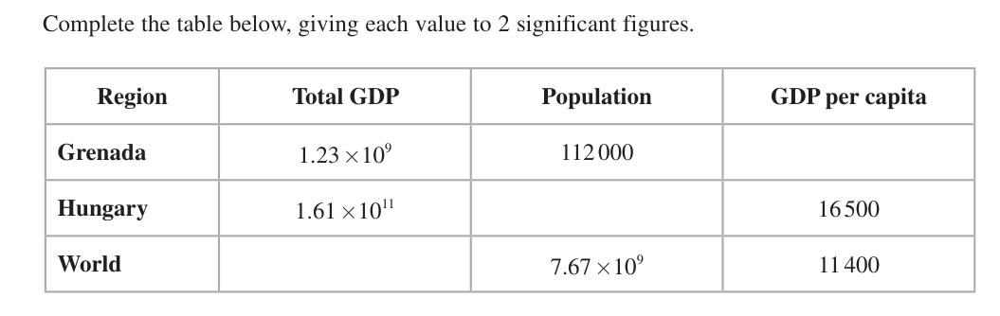
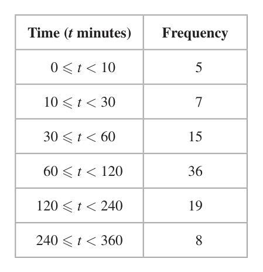
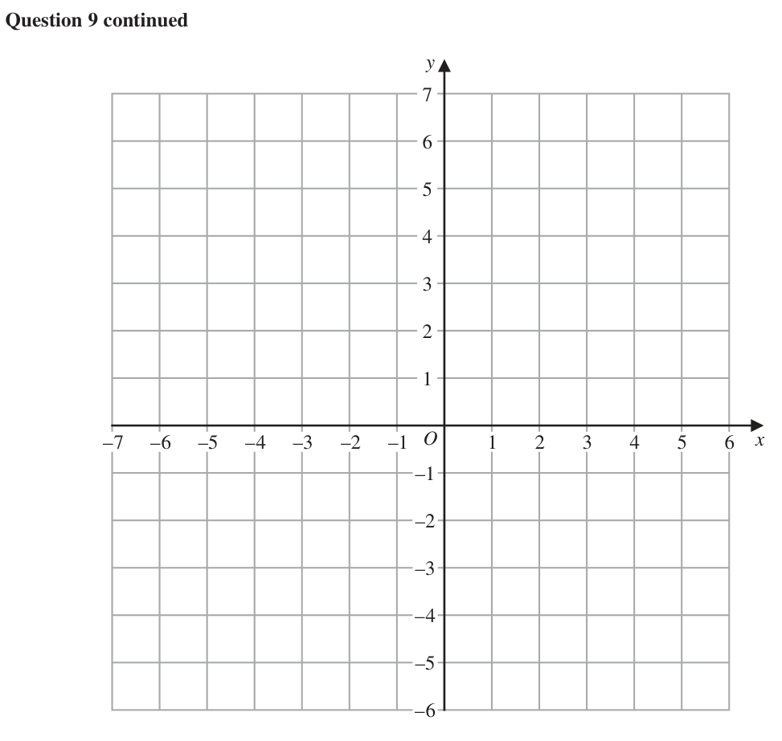
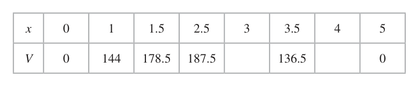
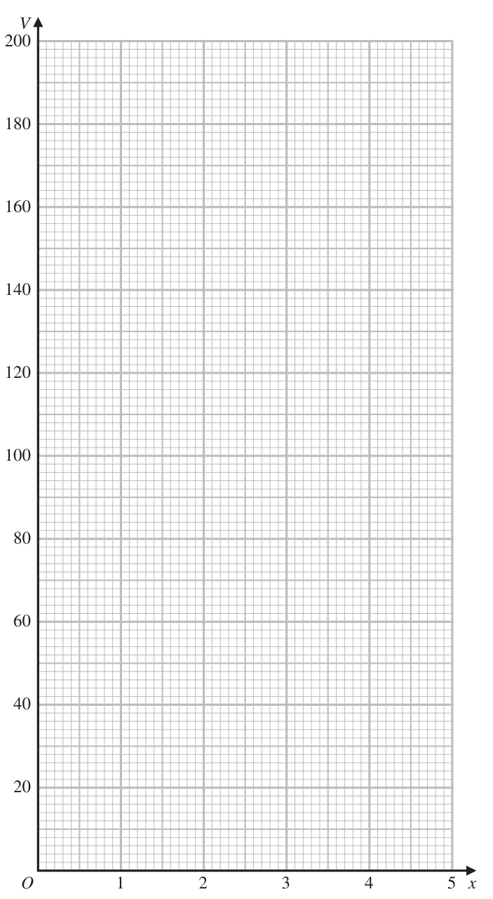

# 4MB1/02 — 2022-06 (official extraction)

> schema `syllabai.official-paper-questions/0.2` · paper_id `pearson-edexcel:international-gcse:mathematics-b:4mb1:2022-06:4MB1/02` · qp sha256 `0f34c6d69edd9716…` · extraction is the disclosed baseline (ADR-039)

## Question 1 (6 marks)

The GDP per capita for a region is defined as follows total GDP GDP per capita = population Complete the table below, giving each value to 2 significant figures. Region Total GDP Population GDP per capita Grenada 1.23 ×109 112 000 Hungary 1.61 ×1011 16 500 World 7.67 ×109 11 400 (6)

### 1 [6]

The GDP per capita for a region is defined as follows total GDP GDP per capita = population Complete the table below, giving each value to 2 significant figures. Region Total GDP Population GDP per capita Grenada 1.23 ×109 112 000 Hungary 1.61 ×1011 16 500 World 7.67 ×109 11 400

**Mark scheme answer**

> For this question we will allow the correct answer in any form( Allow incorrect standard form) in the table or in their
> working. ISW ie ignore any incorrect rounding if a correct more accurate value is seen.
> 1.23 ×109 6 M1
> 112 000
> 11 000 A1 oe allow 10982. 14… written to at least 2 sf ISW
> 1.61×10 11 1.61 × 1011
> M1 Do NOT allow for 16500 =
> 16500 population
> 9 800 000 A1 oe allow 9757575.758 written to at least 2 sf ISW
> 7.67 ×10 ×11400 total GDP
> M1 Do NOT allow for 11400 =
> 7.67 × 109
> 8.7 ×1013 A1 oe allow 8.7 ×1013 written to at least 2 sf ISW
> Total 6 marks
> Question Working Answer Mark Notes

- **(6)** For this question we will allow the correct answer in any form( Allow incorrect standard form) in the table or in their

## Question 2 (7 marks)

E is the universal set and A, B and C are three sets. E = { p, q, r, s, t } A = { q, r, s } B = { p, q, t }

**(a)** List the members of

### 2(a)(i) [?]

A ∩ B

**Mark scheme answer**

> q 3 B1

### 2(a)(ii) [?]

A ∪ B

**Mark scheme answer**

> p, q, r, s, t B1 condone a letter appearing more than once

### 2(a)(iii) [3]

A¢ ∩ B Given that A ∩ C = {r}

**Mark scheme answer**

> p, t B1 condone a letter appearing more than once

- **(3)** p, t B1 condone a letter appearing more than once

### 2(b) [2]

write down all the possibilities for set C One of the possibilities for set C is selected at random.

**Mark scheme answer**

> {r},{p, r}, 2 B2 for the 4 correct sets and no incorrect extra.
> {r, t},{p, r, t} B1 for (2 correct sets and no incorrect sets) or
> (3 or 4 correct sets and no more than 1 incorrect set)
> Condone missing or incorrect set brackets as long as sets are clearly
> distinguishable. Allow a letter appearing more than once

- **(2)** {r},{p, r}, 2 B2 for the 4 correct sets and no incorrect extra.

### 2(c) [2]

Find the probability that this set C is such that B ∩ C = ∅

**Mark scheme answer**

> Indicate only {r} gives desired 2 M1ft either indicates just {r} or ft their list from (b) ie lists their sets
> outcome without p, q and t but do not ft if their answer for (b)
> intersection B is the empty set.
> 1 A1ft their list from (b)
> 4 number of their sets in (b) without p, q and t
> number of sets they have in (b)
> NB correct probability ¼ gains 2/2
> SC B1 for a probability of 0 or which follows from their part (b)
> Total 7 marks
> Question Working Answer Mark Notes

- **(2)** Indicate only {r} gives desired 2 M1ft either indicates just {r} or ft their list from (b) ie lists their sets

## Question 3 (8 marks)

Given that 2 x × 4 y = 128

### 3(a) [3]

show that x + 2y = 7 8x Given that = 32 4y

**Mark scheme answer**

> 2 x × ( 2 ) = 27
> 2 y 3 M1 for writing both 4 and 128 as powers of 2 with at least one
> correct. Implied by 2x × 22 y = 27
> 2x × 22 y = 27 M1 for 22y or 2x + 2y seen
> 2x+2 y = 27 x + 2y = 7 A1 We must see 2x +2 y = 27 .
> SC Verification can get M1M1 A0
> × ( 22 ) = 27 implied by 27−2 y × 22 y = 27
> 7−2 y y
> M1 for 2
> M1 for 27−2 y × 22 y = 27

- **(3)** 2 x × ( 2 ) = 27

### 3(b) [2]

show that 3x – 2y = 5

**Mark scheme answer**

> 23 x ÷ 22 y = 25 2 M1 express as powers of 2 eg 23 x × 2−2 y = 25 or 23 x = 22 y × 25
> 23 x−2 y = 25 3x – 2y = 5 A1 We must see 23 x−2 y = 25 oe eg 23 x = 22 y+5
> SC Verification can get M1A0 for 25+2 y ÷ 22 y = 25

- **(2)** 23 x ÷ 22 y = 25 2 M1 express as powers of 2 eg 23 x × 2−2 y = 25 or 23 x = 22 y × 25

### 3(c) [3]

Hence, or otherwise, solve the simultaneous equations 2 x × 4 y = 128 8x = 32 4y

**Mark scheme answer**

> 4x = 12 or 8y = 16 or 3 M1 Forming any correct un-simplified equation in one variable eg
> x x
> 2 × 8 = 128 × 32 oe 8x ⎛ 128 ⎞
> 2x × = 128 or ⎜ y ⎟ = 32 × 44 y or 3 ( 7 − 2 y ) − 2 y = 5
> 32 ⎝ 4 ⎠
> Maybe implied by either correct answer. Allow oe
> x=3 A1
> y=2 A1
> Total 8 marks
> Question Working Answer Mark Notes

- **(3)** 4x = 12 or 8y = 16 or 3 M1 Forming any correct un-simplified equation in one variable eg

## Question 4 (8 marks)

Sophie conducted a survey on the time spent on the internet per day. There were 90 people in her survey. The results are shown in the table below. Time (t minutes) Frequency 0 ≤ t < 10 5 10 ≤ t < 30 7 30 ≤ t < 60 15 60 ≤ t < 120 36 120 ≤ t < 240 19 240 ≤ t < 360 8

### 4(a) [1]

Write down the class interval that contains the median time spent on the internet per day.

**Mark scheme answer**

> 60 t < 120 1 B1

- **(1)** 60 t < 120 1 B1

### 4(b) [4]

Calculate an estimate for the mean time spent on the internet per day. Sophie drew a histogram for the information in the table. In her histogram, the bar for the class interval 30 ≤ t < 60 is a square with sides of length 3 cm. Given that the bar for the class interval 10 ≤ t < 30 is a rectangle of width w cm and of height h cm,

**Mark scheme answer**

> 5 × "5"+ 7 × "20"+ 15 × "45"+ 4 M2 for correct calculation (need not be evaluated)
> 36 × "90"+ 19 × "180"+ 8 × "300" If no working shown then figures must be correct
> Give bod if values in a list and a total given.
> ⎡ = 25 + 140 + 675 + 3240 + 3420 + 2400 ⎤
> ⎢ = 9900 ⎥
> ⎣ ⎦ (M1 for xf calculated and added for at least 3 class
> intervals where x is a number in the range (incl end
> points) OR correct mid-points used for at least 3
> products but not added)
> "9900" M1 dep on at least M1 previously scored. For dividing
> 90 their sum by 90
> 110 A1 cao

- **(4)** 5 × "5"+ 7 × "20"+ 15 × "45"+ 4 M2 for correct calculation (need not be evaluated)

### 4(c) [3]

find the value of w and the value of h

**Mark scheme answer**

> w=2 3 B1
> Area of bar for 10 t < 30 =
> × 7 oe or
> M1
> Freq. densities = 15/30 and 7/20
> h = 2.1 A1
> Total 8 marks
> Question Working Answer Mark Notes

- **(3)** w=2 3 B1

## Question 5 (8 marks)

A closed box is in the shape of a hollow cuboid. The dimensions of the cuboid are 12 cm by 4.0 cm by 3.0 cm. Each length is given to 2 significant figures. A tin of paint contains enough paint to cover exactly 200 cm2

### 5(a) [4]

Determine if this tin of paint is definitely enough to cover the 6 outside faces of the closed box.

**Mark scheme answer**

> 12.5 × 4.05 [ = 50.625] 4 M2 Any 2 valid areas l × w or l × h or w × h calculated
> using
> 12.5 × 3.05 [ = 38.125] 12 < l 12.5 and 4 < w 4.05 and 3 < h 3.05
> 4.05 × 3.05 [ = 12.3525] (M1 Any 2 valid areas calculated using 11.5 l 12.5
> and 3.5 w 4.5 and 2.5 h 3.5 )
> (12.5 × 4.05 + 12.5 × 3.05 + 4.05 × 3.05) × 2 M1 Correct expression for total surface area
> l × w + l × h + w × h using
> 11.5 l 12.5 and 3.5 w 4.5 and 2.5 h 3.5
> = 202 .205 No A1 correct area calculated (awrt 202)
> AND conclusion must be seen
> Calculation must be seen and use the correct bounds.
> Allow 12.49…, 3.049…, 4.049…

- **(4)** 12.5 × 4.05 [ = 50.625] 4 M2 Any 2 valid areas l × w or l × h or w × h calculated

### 5(b) [4]

Calculate the length of the longest straight rod that can definitely fit inside the box. Give your answer to 3 significant figures. Show your working clearly.

**Mark scheme answer**

> 11.5, 12.5, 3.95, 4.05, 2.95, 3.05 4 M1 Any 3 of these values seen in the question (parts (a)
> and (b)) Allow 12.49…, 3.049…, 4.049…
> M2 use of 3-D Pythagoras using LB 11.5 l <12 and
> 11.52 + 3.952 + 2.952
> 3.95 w < 4.0 and 2.95 h < 3
> (M1 correct use of 3-D Pythagoras using
> 11.5 l 12.5 and 3.5 w 4.5 and 2.5 h 3.5 )
> 12.5 A1awrt 12.5 Calculation must be seen and use the correct
> (cm) bounds
> NB if they are not using bounds at all ie use 12, 4 and 3
> In (a) they get 192 and in (b) they get 13
> Total 8 marks
> Question Working Answer Mark Notes

- **(4)** 11.5, 12.5, 3.95, 4.05, 2.95, 3.05 4 M1 Any 3 of these values seen in the question (parts (a)

## Question 6 (7 marks)

A, P and B are three points on horizontal ground. A is 1 km due south of P PQ is a vertical tower. The angle of elevation of Q from A is 16.9°

### 6(a) [2]

Show that the height of the tower, in metres to 3 significant figures, is 304 m. B is 2 km due east of P BC is a vertical radio mast. The angle of elevation of Q from C, the top of the radio mast, is 8.2°

**Mark scheme answer**

> QP 2 M1 suitable equation for height, eg tan16.9 = QP or
> tan16.9 = or oe
> 1000 QP 1
> = or cos16.9 =
> sin16.9 sin 73.1 QP 2 + 1
> QP
> Allow with 1 instead of 1000 eg tan16.9 = Allow any letter
> for QP Allow other correct methods
> 1000 × tan16.9 or awrt 303.8 304 A1 answer given so M1 must be awarded. Must be using 1000 or
> multiplying by 1000 at some point. For rearranging to find a correct
> 1000sin16.9
> expression followed by 304 or an awrt 304 eg = 304 or
> sin 73.1
> ⎛ 1 ⎞
> ⎜ ⎟ − 1 × 1000 = 303.8... oe
> ⎝ cos16.9 ⎠
> NB Could get answer from incorrect working so need to award the
> M1 to gain the A mark ie You must see a correct trigonometric.
> equation

- **(2)** QP 2 M1 suitable equation for height, eg tan16.9 = QP or

### 6(b) [5]

Calculate the size, in degrees to one decimal place, of the angle of elevation of C from A

**Mark scheme answer**

> 2000 × tan 8.2 [ = 288.20...] or 5 M1 Allow awrt 288 or 0.288
> 2 × tan 8.2 [ = 0.28820...] ⎛ 2000 ⎞ 2000sin 8.2
> Allow other correct methods eg ⎜ ⎟ − 2000 or
> ⎝ cos8.2 ⎠ sin 81.8
> [CB =] 304 – "288"[ = 15.79...] or M1 dep on 1st M1 being awarded. Allow awrt 16 or 0.016
> 0.304 – "0.288"[ = 0.01579...]
> M1 For using Pythagoras to find AB Allow awrt 2240 or 2.24
> [AB=] 10002 + 20002 [ = 2236.06...]
> or 1 + 2 [ = 2.236...]
> "15.79..." M1 dep on 2nd and 3rd M1 being awarded
> tan θ = oe
> "2236.06..."
> 0.4 A1 awrt 0.4
> Total 7 marks
> Question Working Answer Mark Notes

- **(5)** 2000 × tan 8.2 [ = 288.20...] or 5 M1 Allow awrt 288 or 0.288

## Question 7 (7 marks)

B Diagram NOT C accurately drawn A E D Figure 1 → → Figure 1 shows quadrilateral ABCD such that AB = a and AD = b E is the point such that ADE and BCE are straight lines. → 1 Given that BC = b – a

### 7(a) [2]

show that AB is parallel to DC → Given also that λ is a scalar such that BE = λb – a

**Mark scheme answer**

> → 1 2 → →
> DC = −b + a + b − a M1 Correct method to find DC or CD
> ⎡→ ⎤
> ⎢CD = ⎥ − b + 3 a − a + b
> ⎣ ⎦
> 2
> a [∴ parallel to DC] A1 M1 must be awarded Allow − a
> 3

- **(2)** → 1 2 → →

### 7(b) [2]

find the value of λ The area of triangle ABE is x square units. Given that the area of quadrilateral ABCD is P square units,

**Mark scheme answer**

> → → 2 M1 allow
> AB 3
> = oe
> BE = k BC or DC 2
> ⎛ 1 ⎞ → → → → →
> BE = k ⎜ b − a ⎟ Allow other methods eg CE = n BE and CE = CB + BE
> ⎝ 3 ⎠
> ⎛ 1 ⎞
> λb − a = k ⎜ b − a ⎟ or
> ⎝ 3 ⎠
> AB : DC = 1 : 2/3 oe
> λ=3 A1 Correct answer implies M1

- **(2)** → → 2 M1 allow

### 7(c) [3]

find an expression for P in terms of x

**Mark scheme answer**

> 2
> ⎛ "2" ⎞ ⎛ "2" ⎞
> 2 3 ⎛ "their λ "− 1 ⎞
> ⎛ "their λ " ⎞
> ⎜ ⎟ or ⎜ ⎟ x oe M1ft for ⎜ ⎟ Allow ⎜ ⎟ for the SF
> ⎝ "3" ⎠ ⎝ "3" ⎠ ⎝ "their λ " ⎠ ⎝ "their λ "− 1 ⎠
> 2 2
> ⎛ "2" ⎞ ⎛ "2" ⎞ ⎛ "their λ "− 1 ⎞
> 1− ⎜ ⎟ or x − ⎜ ⎟ x M1ft for 1 − ⎜ ⎟ or x − ( n) x
> where 0 < n < 1
> ⎝ "3" ⎠ ⎝ "3" ⎠ ⎝ "their λ " ⎠
> x − P ⎛ "2" ⎞
> or =⎜ ⎟ oe
> x ⎝ "3" ⎠
> ⎛ "2" ⎞ ⎡ 5 ⎤ A1ft (If ft both M marks must be awarded)
> x −⎜ ⎟ x = x
> ⎝ "3" ⎠ ⎢⎣ 9 ⎥⎦ ⎛2⎞
> Allow a correct un-simplified expression eg x − ⎜ ⎟ x ISW
> ⎝3⎠
> Total 7 marks
> Question Working Answer Mark Notes

- **(3)** 2

## Question 8 (11 marks)

Diagram NOT accurately drawn 0.9 m 1.2 m 2.1 m Figure 2 Figure 2 shows the design for a garden feature. In the middle of the feature is a circular pond. The pond is surrounded by 6 identical flower beds. Each flower bed is in the shape of an isosceles trapezium.

### 8(a) [3]

Calculate the area, in m2 to 3 significant figures, of one of the flower beds. Each flower bed needs to be filled with compost to a depth of 10 cm. The compost is sold in bags containing 50 litres of compost.

**Mark scheme answer**

> 2
> 2.1 − 1.2 ⎞ 3 M1 correct method to find h awrt 0.78Allow other
> [ h =] 0.92 − ⎛⎜ ⎟ = 0.9 − 0.45 [= 0.7794…]
> 2
> method eg h = 0.9sin 60 h = 0.9cos30
> ⎝ 2 ⎠
> 1 M1 dep on 1st M1 being awarded ft their value of h ≠ 0.9
> × ( 2.1 + 1.2 ) × "0.78"
> 2 Correct method to find the area eg
> 1.2 × "0.78"+ 2 × 0.5 × 0.45 × "0.78"
> 1.29 A1 awrt 1.29 (condone 1.28 from correct working)
> actual 1.286..
> There may be other correct methods (for part(b))

- **(3)** 2

### 8(b) [4]

Show that 16 bags of compost will be needed to fill all six flower beds to a depth of 10 cm. Show your working clearly.

**Mark scheme answer**

> Volume of 1 bed = "1.29"× 0.1 or "1.29"×10 4 M1 for multiplying by 10 or 0.1 Allow if (a) × by 10n if
> not part of a unit conversion
> "1.29 × 0.1"× 6 "1.29 ×10"× 6 M1 for multiplying by 6 and dividing by 50. Allow if
> or
> 50 50 multiplied by a power of 10
> 1.29 × 0.1× 6 12900 ×10 × 6 A1 condone use of 1.28 or12800
> or
> 50
> 1.29 × 0.1× 6 12900 ×10 × 6 1 15.4 A1 awrt 15.4/15.5 and the statement 16 needed
> Eg ×1000 or × or
> 50 50 10000 ∴ 16
> 0.774 0.774
> ×1000 or
> 50 0.05
> ALT 1 Volume of 1 bed = "1.29"× 0.1 or "1.29"×10 M1 for multiplying by 10 or 0.1
> "1.29 × 0.1"× 6 ×1000 M1 correct method to find the total compost in litres
> awrt 770 litres A1 awrt 770
> 16 × 50 = 800 and 15 × 50 = 750 litres ∴ 16 A1 must have awrt 770, 800 and 750 plus conclusion
> Sight of 770, 800 and 750 implies M1M1A1
> ALT 2 Volume of 1 bed = "1.29"× 0.1 or "1.29"×10 M1 for multiplying their answer to (a) by 10 or 0.1
> "1.29 ×10"×10000 × 6 M1 correct method to find the total compost in cm3
> awrt 770000 cm3 A1 awrt 770000
> 16 × 50 ×1000[ = 800000] and ∴ 16 A1 must have awrt 770000, 800000 and 750000 plus
> 15 × 50 ×1000[ = 750000] conclusion.
> Sight of 770000, 800000 and 750000 implies M1M1A1
> ALT 3 Volume of 1 bed = "1.29"× 0.1 or "1.29"×10 M1 for multiplying by 10 or 0.1
> "1.29 × 0.1"× 6 [=0.77...] and
> 50 × 1000
> [=0.05] M1 multiply by 6 to find the total compost in m3and
> 1003 correct method to find the compost in 1 bag in m3
> 0.77 16… and 0.05 A1 awrt 0.77
> 16 × 0.05[ = 0.8] and 15 × 0.05 ⎡⎣ = 0.75 m3 per bag ⎤⎦ ∴ 16 A1 must have 0.77, 0.8 and 0.75 plus conclusion
> Sight of 0.77, 0.8 and 0.75 implies M1M1A1
> ALT 4 16 15 M1 dividing number of bags by their answer to (a) Allow
> or
> "1.29" "1.29" if (a) × by 10n
> 16 × 50 15 × 50 M1 for multiplying by 50 and dividing by 6. Allow if
> or
> 6 × "1.29" 6 × "1.29" multiplied by a power of 10
> 10.335… or 9.689… A1 awrt 10.3/10.4 or awrt 9.7
> 10.3… and 9.689… ∴ 16 A1 awrt 10.3/10.4 and awrt 9.7 plus conclusion

- **(4)** Volume of 1 bed = "1.29"× 0.1 or "1.29"×10 4 M1 for multiplying by 10 or 0.1 Allow if (a) × by 10n if

### 8(c) [4]

Find the area of the circular pond. Give your answer in m2 to 3 significant figures. Area of trapezium = (a + b)h

**Mark scheme answer**

> 60º or 30º or 120 º used or 1.2 used as 4 M1 Implied by a correct value of r or correct method to
> hypotenuse or these may be seen in correct place find r
> on diagram
> 0.6 M1 oe allow other correct methods eg
> [r =] 0.6 × tan 60 or 1.22 − 0.62 or or
> tan 30 0.62 + 0.62 + 2 × 0.62 cos120 or 1.05 tan 60 − "0.9974" or
> 3 3 1.2 × sin120
> 1.2sin 60 [= = 1.039…] Awrt 1.04 if no working shown do not ISW
> 5 2sin 30
> π × "1.039.."2 M1 using the correct formula for area of a circle ( π × " r "2 )
> where 0 < r < 2.1
> 3.39 A1 awrt condone 3.4 or 3.40
> Total 11 marks
> Question Working Answer Mark Notes

- **(4)** 60º or 30º or 120 º used or 1.2 used as 4 M1 Implied by a correct value of r or correct method to

## Question 9 (9 marks)

9 [In this question the coordinates of the points are given in centimetres] The points with coordinates (1, 1), (2, 4), (4, 6) and (3, 3) are the vertices of quadrilateral A

### 9(a) [1]

On the grid opposite, draw and label quadrilateral A Quadrilateral A is transformed to quadrilateral B by a rotation of 90° anticlockwise about the origin, O

**Mark scheme answer**

> A correctly 1 B1
> drawn

- **(1)** A correctly 1 B1

### 9(b) [2]

On the grid opposite, draw and label quadrilateral B Quadrilateral B is transformed to quadrilateral C under the transformation with matrix M where ⎛1 3⎞ M= ⎜ ⎝1 1⎟⎠

**Mark scheme answer**

> B correctly 2 B2ft follow through their shape
> drawn B1ft for 3 points correct. (or a shape the correct size and shape
> (–1, 1), (–4, 2), with the correct orientation or
> (–6, 4) and shape A rotated 90° clockwise about (0,0) ie coordinates
> (–3, 3) (1, −1), (4, – 2), (6, – 4) and (3, – 3) )

- **(2)** B correctly 2 B2ft follow through their shape

### 9(c) [3]

On the grid opposite, draw and label quadrilateral C

**Mark scheme answer**

> ⎛1 3 ⎞⎛ −1 −4 −6 −3 ⎞ 3 M1ft their B. For intention to multiply matrices the right way
> ⎜ ⎟⎜ ⎟ round. At least one co-ordinate pair the right way round in the
> ⎝1 1 ⎠⎝ 1 2 4 3 ⎠ 2nd matrix. Implied by trapezium C correctly drawn. Allow
> ⎛1 3 ⎞⎛ −1⎞
> for ⎜ ⎟⎜ ⎟ using any point
> ⎝1 1 ⎠⎝ 1 ⎠
> ⎛ 2 2 6 6⎞ M1ft dep on M1. An attempt to find all 4 points with at least 2
> ⎜ ⎟ correct coordinates (x, y) gained. ft their points. Implied by 2
> ⎝ 0 −2 −2 0 ⎠ correct points plotted. Pairs can be in any order. Implied by
> trapezium C drawn correctly.
> C correctly A1
> drawn
> (2,0), (2, –2),
> (6, –2) and
> (6, 0)
> ⎛ 4 −14 22 6 ⎞
> SC for MA allow ⎜ ⎟ all 4 points with at least
> ⎝ 2 6 10 0 ⎠
> 2 correct coordinates gained M0M1A0

- **(3)** ⎛1 3 ⎞⎛ −1 −4 −6 −3 ⎞ 3 M1ft their B. For intention to multiply matrices the right way

### 9(d) [1]

Calculate the determinant of M

**Mark scheme answer**

> –2 1 B1

- **(1)** –2 1 B1

### 9(e) [2]

Calculate the area of quadrilateral A ⎡ ⎛ a b⎞ ⎤ ⎢ Determinant of matrix ⎜ ⎟ = ad − bc ⎥ ⎣ ⎝ c d⎠ ⎦ y –7 –6 –5 –4 –3 –2 –1 O 1 2 3 4 5 6 x –1 –2 –3 –4 –5 –6 for a spare grid if you need to redraw your shapes. Only use this grid if you need to redraw your shapes. y –7 –6 –5 –4 –3 –2 –1 O 1 2 3 4 5 6 x –1 –2 –3 –4 –5 –6

**Mark scheme answer**

> Area of A = 5 × 3 − 2 × ( 2 + 2 + 1.5) 2 M1 finding “area of their C “÷”2” or
> or "2 × 4"÷ 2 oe finding the area of their A eg 0.5 22 + 22 × 12 + 12
> 11 2 4 3 1 1
> = ⎡( 4 + 12 + 12 + 3) − ( 2 + 16 + 18 + 3 )⎤⎦
> 21 4 6 3 1 2⎣
> 4 (cm2) A1 –4 scores M1A0 condone lack of units. NB answer of 4
> gains 2/2
> Total 9 marks
> y
> A
> B
> -6 -4 -2 O 2 4 6 x
> C
> -2
> -4
> Question Working Answer Mark Notes

- **(2)** Area of A = 5 × 3 − 2 × ( 2 + 2 + 1.5) 2 M1 finding “area of their C “÷”2” or

## Question 10 (15 marks)

cm x cm Figure 3 Figure 4 Figure 3 shows a rectangle with dimensions 20 cm by 10 cm from which a square with sides of length x cm is removed from each of the corners. The shape in Figure 3 is then folded along the dotted lines to form a box, without a lid, in the shape of a cuboid, shown in Figure 4 The volume of the box is V cm3

### 10(a) [2]

Show that V = 4x 3 – 60x 2 + 200x dV

**Mark scheme answer**

> V = x (10 – 2 x )( 20 − 2 x ) 2 M1 Condone x (10 – x )( 20 − x )
> x ( 200 − 40 x − 20 x + 4 x 2 ) or V = 4 x3 − 60 x 2 + 200 x A1 must see one of the 2 given lines of working followed by the
> correct answer.
> ( 200 x − 40 x − 20 x + 4 x )
> 2 2

- **(2)** V = x (10 – 2 x )( 20 − 2 x ) 2 M1 Condone x (10 – x )( 20 − x )

### 10(b) [4]

Find, to 3 significant figures, the value of x such that =0 dx 2a Question 10 parts (c), (d), (e) and (f) continue on page 26

**Mark scheme answer**

> ⎡ dV ⎤ 2 4 M1 Attempt to differentiate at least 1 term correct
> ⎢⎣ dx = ⎥⎦ 12 x − 120 x + 200
> 12 x − 120 x + 200 = 0 oe M1 At least 2 terms correct and equated to zero
> 120 ± 1202 − 4 ×12 × 200 M1 A correct method to solve their 3 term quadratic equation.
> x= 15 ± 5 3
> 2 ×12 Implied by awrt 2.11 or awrt 7.89 or
> 2.11 15 − 5 3
> A1 awrt 2.11 Allow do not accept 7.89 given. If correct
> answer seen ignore subsequent rounding.

- **(4)** ⎡ dV ⎤ 2 4 M1 Attempt to differentiate at least 1 term correct

### 10(c) [2]

Complete the following table of values for V = 4x 3 – 60x 2 + 200x x 0 1 1.5 2.5 3 3.5 4 5 V 0 144 178.5 187.5 136.5 0

**Mark scheme answer**

> 168, 96 2 B2

- **(2)** 168, 96 2 B2

### 10(d) [2]

On the grid opposite, plot the points from your completed table and, using your answer to part (b), join them to form a smooth curve.

**Mark scheme answer**

> 2 B2 Fully correct graph. Allow max at 1.5 < x 2.5 (Allow if
> curve goes through points even if you can't see the point
> plotted
> (B1 All points plotted correctly or 4 points plotted correctly with
> curve joining all their plotted points )

- **(2)** 2 B2 Fully correct graph. Allow max at 1.5 < x 2.5 (Allow if

### 10(e) [2]

By drawing on the grid a tangent to the curve, find an estimate of the gradient of the curve at the point where x = 1.5 Starting with a square of side 15 cm and removing a square with sides of length x cm from each corner, a second box without a lid is formed by folding as in part (a). The volume of this box is B cm3 where B = 4x 3 – 60x 2 + 225x Given that B = 200

**Mark scheme answer**

> Tangent drawn at 1.5 2 M1 attempt to draw tangent at 1.5
> 40 – 55 A1 must see tangent drawn.

- **(2)** Tangent drawn at 1.5 2 M1 attempt to draw tangent at 1.5

### 10(f) [3]

find, by drawing a suitable straight line on the grid, estimates, to one decimal place, of the possible values of x V 200 180 160 140 120 100 O 1 2 3 4 5 x for a spare grid if you need to redraw your curve. Only use this grid if you need to redraw your curve. V 200 180 160 140 120 100 O 1 2 3 4 5 x

**Mark scheme answer**

> y = 200 − 25 x 3 M1 for indicating that 200 – 25x is the line. Implied by correct
> line drawn
> line y = 200 − 25 x drawn A1 line through (1, 175) and (4 ,100)
> 1.3, 3.9 A1 correct line must be drawn allow ± 0.1
> Total 15 marks
> VV
> 200
> 200
> 180
> 180
> 160
> 160
> 140
> 140
> 120
> 120
> 100
> 100
> 80
> 60
> 40
> 2020
> O
> 0 1 22 3 4 5 x
> Question Working Answer Mark Notes

- **(3)** y = 200 − 25 x 3 M1 for indicating that 200 – 25x is the line. Implied by correct

## Question 11 (14 marks)

The function f is defined as 3x + 1 f:x ↦ x −1

### 11(a) [2]

Find f(3)

**Mark scheme answer**

> 3× 3 +1 2 M1 implied by correct value
> 3 −1
> 5 A1

- **(2)** 3× 3 +1 2 M1 implied by correct value

### 11(b) [1]

State the value of x that must be excluded from any domain of the function f

**Mark scheme answer**

> 1 1 B1

- **(1)** 1 1 B1

### 11(c) [4]

Find the inverse of the function f Give your answer in its simplest form. The function g is such that x −1 fg( x) = 3x + 1

**Mark scheme answer**

> xy – y = 3x + 1 xy – y = 3x + 1 4 M1 For a correct expression. May use 2 other letters eg yx − x = 3 y + 1
> xy − 3x = y + 1 − y − 1 = 3x − xy M1 Collect all of their x terms on one side. (must be more than
> one) Allow 1 sign error. Condone both sides being over x or y eg
> − y − 1 3x − xy
> = May use other letters eg yx − 3 y = x + 1
> x x
> x ( y − 3) = y + 1 − y −1 = x (3 − y ) M1 Isolating term in x ie taking x out as common factor so
> it only appears once in the equation
> x +1 −x −1 x +1 − x −1
> A1 oe eg Must be in terms of x
> x−3 3− x x−3 3− x

- **(4)** xy – y = 3x + 1 xy – y = 3x + 1 4 M1 For a correct expression. May use 2 other letters eg yx − x = 3 y + 1

### 11(d) [7]

Find the value of a such that gf(a) = fg(a)

**Mark scheme answer**

> a −1 7 M1 ft Their part (c) using g(a) = f-1(fg(a)) ie substituting
> a −1
> +1
> 3 + 1 3 g ( x) + 1 x − 1 3a + 1
> [g( a) =] a or =
> a −1 g ( x) − 1 3 x + 1 into their answer to (c) Allow any letter or substituting g(x)
> −3
> 3a + 1 into f(x) and equating to fg(x) [Allow g or any letter for g(x) but must
> be different to the letter used in the inverse of f(x) ]
> a − 1 + 3a + 1 ⎡ 4a −a ⎤ M1 dep on 1st M1 and the answer to (c) being of the form
> [g(a) =] = = oe
> a − 1 − 9a − 3 ⎣ −8a − 4 2a + 1 ⎥⎦
> ⎢ ax ± b
> for removing nested fractions. or removing fractions and
> cx ± d
> or 8g( x) x + 4g( x) = −4 x collecting the g(x) terms on one side and the x terms on the other side
> Allow any letter and 1 sign/numerical error
> 3a + 1 3a + 1
> − M1ft follow through their g(a) For substituting into
> [gf (a)] = a −1 a −1
> ⎛ +1⎞
> 3a their g(a) Allow any letter
> 2⎜ ⎟ +1
> ⎝ a −1 ⎠
> −3a − 1 ⎡ −3a − 1 ⎤ A1 A correct expression for gf(a) without nested fractions.
> [gf (a)] = =
> 6a + 2 + a − 1 ⎢⎣ 7a + 1 ⎥⎦ Allow any letter
> a − 1 −3a − 1 M1 dep on 3rd M1 being awarded. Forming an equation by equating
> =
> 3a + 1 7a + 1 their gf(a) to fg(a). Allow any letter
> ( a − 1)( 7a + 1) = ( −3a − 1)(3a + 1) A1 removing the fractions to gain a correct equation. Allow any
> letter. If this line is not seen it may implied by the final A1
> [a =] 0 A1 from correct working.
> Total 14 marks

- **(7)** a −1 7 M1 ft Their part (c) using g(a) = f-1(fg(a)) ie substituting

