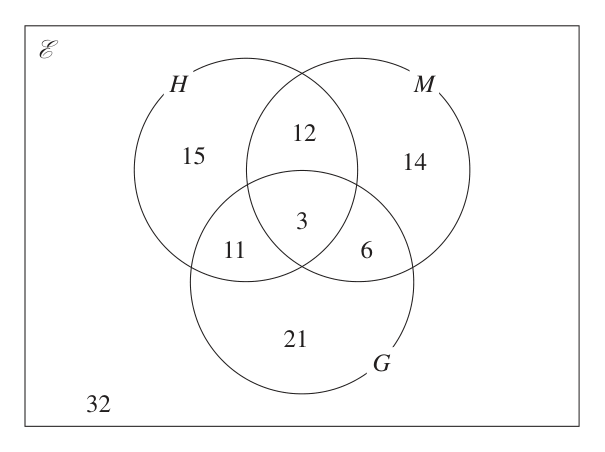
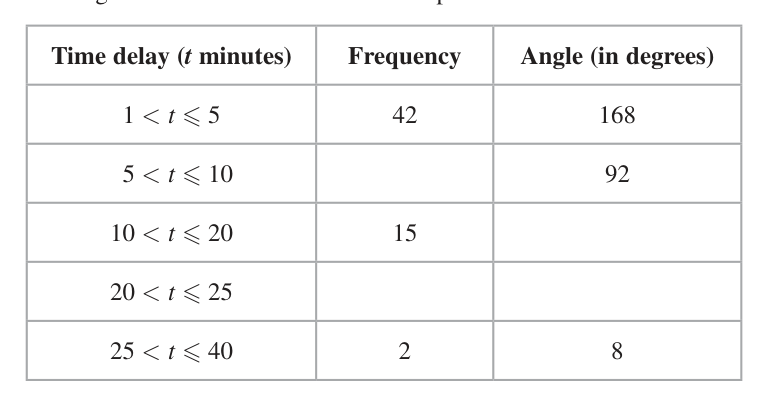
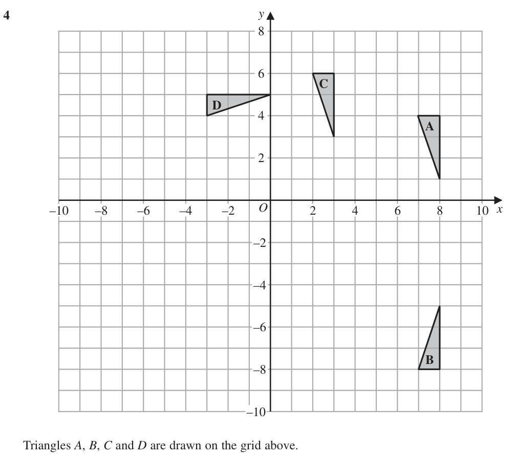
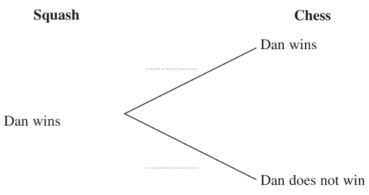
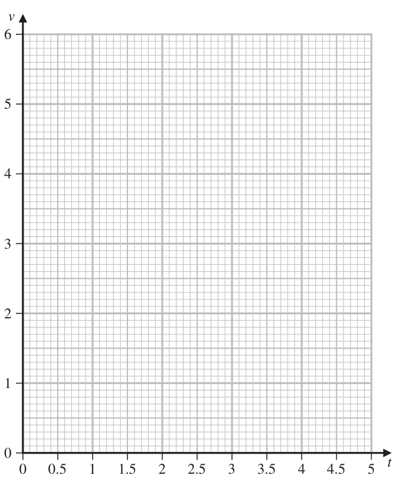

# 4MB1/02R — 2022-06 (official extraction)

> schema `syllabai.official-paper-questions/0.2` · paper_id `pearson-edexcel:international-gcse:mathematics-b:4mb1:2022-06:4MB1/02R` · qp sha256 `c53a6bb274613b75…` · extraction is the disclosed baseline (ADR-039)

## Question 1 (7 marks)

The Venn diagram shows information about the numbers of students in a school who study History (H ), Music (M ) and Geography (G). E H M 15 14 11 6 G

### 1(a) [1]

Find the number of students who study Geography.

**Mark scheme answer**

> 41 1 B1

- **(1)** 41 1 B1

### 1(b) [1]

Find the number of students who study exactly two of the subjects History, Music and Geography.

**Mark scheme answer**

> 29 1 B1

- **(1)** 29 1 B1

### 1(c) [1]

On the Venn diagram above, shade the region that represents the set H ∩ G¢ E is the universal set and A and B are two sets such that E = {1, 2, 3, 4, 5, 6, 7, 8, 9, 10} A ∩ B = {multiples of 3} A ∩ B¢ = {2, 4, 8, 10} (A ∪ B)¢ = {1, 7}

**Mark scheme answer**

> Correct region 1 B1 The region containing the 15 and 12 only
> shaded

- **(1)** Correct region 1 B1 The region containing the 15 and 12 only

### 1(d) [3]

Use the information about the sets E, A and B to complete the Venn diagram below. E A B

**Mark scheme answer**

> Correct Venn 3 B3 all correct with no extra values
> diagram B2 for three regions correct or 9 items placed
> correctly with one value in the wrong section
> or all values correctly placed with some extra
> 3, value(s) seen
> 2, 4, 6, 5 B1 for one or two regions correct or
> 8, 10 9 for values correctly placed in three regions
> with extra value(s) (not from 1-10) seen
> SC B1 for either of:
> 1,7
> 4 3 1 2 24 18 5

- **(3)** Correct Venn 3 B3 all correct with no extra values

### 1(e) [1]

Find n(B)

**Mark scheme answer**

> 4 1 B1 or ft their Venn diagram
> NB do not ft n(B) = 0
> Total 7 marks

- **(1)** 4 1 B1 or ft their Venn diagram

## Question 2 (4 marks)

Diagram NOT 16‑sided accurately drawn polygon B 5 cm 5 cm P A C Figure 1 Figure 1 shows part of a regular 16‑sided polygon in which PA and AB are two sides. Figure 1 also shows the isosceles triangle ABC in which AB = CB = 5 cm. PAC is a straight line. Calculate the length, in cm to 3 significant figures, of AC. (4) ⎡Sum of interior angles of polygon ⎤ ⎢(2n − 4) right angles ⎥ ⎣ ⎦

### 2 [4]

Diagram NOT 16‑sided accurately drawn polygon B 5 cm 5 cm P A C Figure 1 Figure 1 shows part of a regular 16‑sided polygon in which PA and AB are two sides. Figure 1 also shows the isosceles triangle ABC in which AB = CB = 5 cm. PAC is a straight line. Calculate the length, in cm to 3 significant figures, of AC. ⎡Sum of interior angles of polygon ⎤ ⎢(2n − 4) right angles ⎥ ⎣ ⎦

> 🖼 crop required: diagram (qp.pdf p.None)

**Mark scheme answer**

> 360 M1 for calculating the exterior angle of 16-sided
> [= 22.5] or
> 16 regular polygon accept 22.5 seen on diagram.
> (16 − 2) ×180
> 180 − [ = 180 − 157.5]
> 1
> AC M1 for obtaining an eq containing AC or AC
> cos'22.5' = 2 or
> 5 give bod if labelled as other variable eg. x
> AC 2 = 52 + 52 − 2 ( 5 )( 5 ) cos (180 − 2 × '22.5' ) or ft their exterior angle, must be < 90 (correct
> angle ∠ABC = 135°
> sin'22.5' sin(180 − 2 × '22.5')
> = NB allow if the final answer rounds to 9.2 (2sf),
> 5 AC with no incorrect working seen.
> AC = 2(5cos'22.5') or M1 dep for an expression for AC
> NB allow if the final answer rounds to 9.2 (2sf),
> AC = 52 + 52 − 2 ( 5 )( 5 ) cos (180 − 2 × '22.5' ) or with no incorrect working seen.
> 5sin'135'
> AC =
> sin 22.5
> 9.24 4 A1 accept awrt 9.23 or 9.24 accept answer
> shown on diagram
> Total 4 marks

- **(4)** 360 M1 for calculating the exterior angle of 16-sided

## Question 3 (6 marks)

Arup collects information about the time delay, in minutes, of some trains. He is going to draw a pie chart for his results. The incomplete table below gives some information about his results together with the size, in degrees, of the angle of each of three sectors in his pie chart. Time delay (t minutes) Frequency Angle (in degrees) 1<t≤5 42 168 5 < t ≤ 10 92 10 < t ≤ 20 15 20 < t ≤ 25 25 < t ≤ 40 2 8

### 3(a) [2]

Complete the table.

**Mark scheme answer**

> Time delay Freq Angle 2 B2 for all four correct entries
> 1<t≤5 168 B1 for any two or three correct entries
> 5 < t ≤ 10 23
> 10 < t ≤ 20 15
> 20 < t ≤ 25 8
> 25 < t ≤ 40 2

- **(2)** Time delay Freq Angle 2 B2 for all four correct entries

### 3(b) [4]

Calculate an estimate, in minutes to 3 significant figures, for the mean time delay of these trains.

**Mark scheme answer**

> ( 3 × 42 ) + ( 7.5 × '23') + (15 ×15 ) + ( 22.5 × '8' ) + M2 for at least 3 correct products added (may ft their
> frequencies and need not be evaluated) if ft
> ( 32.5 × 2 ) [ = 126 + 172.5 + 225 + 180 + 65 = 768.5] frequencies must be positive integers
> M1 for use of a value within interval (include
> end points) for at least 4 products which must be
> added OR correct mid-points used for at least 3
> products but not added
> If the correct total is not seen and no indication of
> addition seen then if a total between 510 and 1200
> inclusive is seen or used implies addition of their
> products, products must be seen and still need to use
> appropriate values with the ranges.
> ‘768.5’ ÷ (42+'23'+15+'8'+2) M1dep on at least M1 gained for their total fm
> divided by their total f
> 8.54 4 A1 awrt 8.54
> Total 6 marks

- **(4)** ( 3 × 42 ) + ( 7.5 × '23') + (15 ×15 ) + ( 22.5 × '8' ) + M2 for at least 3 correct products added (may ft their

## Question 4 (9 marks)

y C D A –10 –8 –6 –4 –2 O 2 4 6 8 10 x –2 –4 –6 B –8 –10 Triangles A, B, C and D are drawn on the grid above. Describe fully the single transformation that maps

### 4(a) [2]

triangle A onto triangle B

**Mark scheme answer**

> reflection B1 Accept reflect do not accept mirror.
> NB do not award any marks in this part if 2
> transformations listed
> y = −2 2 B1 for equation of correct line

- **(2)** reflection B1 Accept reflect do not accept mirror.

### 4(b) [2]

triangle A onto triangle C

**Mark scheme answer**

> translation B1 Accept translate do not accept move or
> transformation.
> NB do not award any marks in this part if 2
> transformations listed
> ⎛ −5 ⎞ 2 B1 do not accept anything other than a vector for
> ⎜ ⎟ this mark.
> ⎝2⎠

- **(2)** translation B1 Accept translate do not accept move or

### 4(c) [3]

triangle A onto triangle D Triangle E is the image of triangle A under an enlargement with scale factor –2 and centre of enlargement (4, 0)

**Mark scheme answer**

> rotation B1 Accept rotate do not accept turn
> Give bod if rotation and another transformation
> listed
> 90 B1 oe (e.g. 270 clockwise or −270 )
> [anticlockwise] Do not allow 90 clockwise, −90 or
> −90 anticlockwise.
> Give bod if rotation and another transformation
> listed
> [about] ( 2, −1) 3 B1 for centre ( 2, −1) NB do not award this mark
> if 2 transformations listed

- **(3)** rotation B1 Accept rotate do not accept turn

### 4(d) [2]

On the grid, draw and label triangle E

**Mark scheme answer**

> Triangle with vertices at ( −4, −2 ) , ( −4, −8 ) Triangle E 2 B2 for correct triangle E
> B1 for two correct vertices plotted or
> and ( −2, −8 ) triangle enlarged about (4, 0) with any scale
> factor (allow the points (12,2), (12,8) and
> (10,8) if grid extended or points labelled) or
> triangle enlarged with correct scale factor
> about any point or if three correct coordinate
> stated either as coordinates, position vectors
> or a 3 × 2 matrix.
> Total 9 marks
> E

- **(2)** Triangle with vertices at ( −4, −2 ) , ( −4, −8 ) Triangle E 2 B2 for correct triangle E

## Question 5 (6 marks)

Dan is going to play one game of squash and one game of chess against his friend. The probability that Dan will win the game of squash is The probability that Dan will win the game of chess is

### 5(a) [2]

Complete the probability tree diagram. Squash Chess Dan wins Dan wins Dan does not win Dan wins Dan does not win Dan does not win

**Mark scheme answer**

> B1 for correct first set of branches (squash)
> 1 B1 for correct second set of branches (Chess)
> 2

- **(2)** B1 for correct first set of branches (squash)

### 5(b) [2]

Find the probability that Dan will win exactly one game. Given that Dan won exactly one game,

**Mark scheme answer**

> ⎛ 3 2 ⎞ ⎛ 2 1 ⎞ M1 Correct expression for the probability of
> ⎜ ' '× ' ' ⎟ + ⎜ ' '× ' ' ⎟ or winning once. Allow correct values or ft their
> ⎝ 5 3 ⎠ ⎝ 5 3 ⎠
> tree diagram.
> ⎛ 3 1 ⎞ ⎛ 2 2 ⎞
> 1 − ⎜ ' '× ' ' ⎟ − ⎜ ' '× ' ' ⎟ oe Do not ft any probability which is >1 or
> ⎝ 5 3 ⎠ ⎝ 5 3 ⎠ negative.
> 8 2 A1 (oe) accept awrt 0.533
> 15 NB if candidates probabilities incorrectly
> ordered on their tree this mark may still be
> awarded. Otherwise correct answer from
> 3 1 1 8
> incorrect working (eg × + = ) gains
> 5 3 3 15
> M0A0

- **(2)** ⎛ 3 2 ⎞ ⎛ 2 1 ⎞ M1 Correct expression for the probability of

### 5(c) [2]

calculate the probability that he won his game of squash.

**Mark scheme answer**

> ⎛ 3 2 ⎞ M1 for correct product (correct or ft their tree
> ⎜ ' '× ' ' ⎟ diagram) divided by their answer to part (b)
> ⎝ 5 3 ⎠
> 8 Do not ft any probability which is >1 or
> ' ' negative.
> 3 2 A1 (oe)
> Total 6 marks

- **(2)** ⎛ 3 2 ⎞ M1 for correct product (correct or ft their tree

## Question 6 (11 marks)

In 2018, a badminton club had 460 members. Of these members, A were younger than 30 B were aged between 30 and 60 inclusive C were older than 60 Given that A : B : C = 2 : 5 : 3

### 6(a) [2]

find the total number of members who were aged 30 or older in 2018 In 2018, the annual membership fee for each member who was older than 60 was $65 The annual membership fee for each other member was $135

**Mark scheme answer**

> 460 M1 complete method to find the required
> × ( 5 + 3) oe
> 2+5+3 number of members.
> 368 2 A1

- **(2)** 460 M1 complete method to find the required

### 6(b) [2]

Calculate the total amount, in $, that the 460 members paid in annual membership fees in 2018 The annual membership fee for each member who was older than 60 in 2019 was 4% greater than the annual membership fee for each member who was older than 60 in 2018

**Mark scheme answer**

> ⎛ 3 ⎞ ⎛ 7 ⎞ M1 complete method to find the fees. Give bod
> ⎜ × 460 ⎟ × 65 + ⎜ × 460 ⎟ ×135 or for addition of values if a list of values seen with
> ⎝ 10 ⎠ ⎝ 10 ⎠
> “total” oe seen with a larger value.
> 92 × 135 + 230 × 135 + 138 × 65 or
> Correct values which you may see:
> 12 420 + 31 050 + 8970 oe
> Members Fees
> <30 92 12 420
> 30-60 230 31 050
> >60 138 8 970
> >30 368 40 020
> <60 322 43 470
> ($)52 440 2 A1 allow ($) 52 400

- **(2)** ⎛ 3 ⎞ ⎛ 7 ⎞ M1 complete method to find the fees. Give bod

### 6(c) [2]

Calculate the annual membership fee for each member who was older than 60 in 2019 The badminton club buys 12 shuttlecocks for a total cost of $5.10 The club then sells the shuttlecocks to members for $0.50 each.

**Mark scheme answer**

> 65 ×1.04 or 65 + 2.6 oe M1 complete method to increase by 4% if 67.6 is
> seen embedded with work award this mark or a
> final answer of 9328.8[0], 9329 (total fees after
> increase)
> ($)67.60 2 A1 allow ($)67.6

- **(2)** 65 ×1.04 or 65 + 2.6 oe M1 complete method to increase by 4% if 67.6 is

### 6(d) [2]

Calculate the percentage profit, to 3 significant figures, made by the club on each shuttlecock that was sold. 610 cm A B 155 cm D C 76 cm Figure 2 Figure 2 shows a badminton net ABCD and two supports for the net. The badminton net is shaded in the diagram. Figure 2 gives information about the dimensions of the badminton net. Each measurement is given to the nearest cm.

> 🖼 crop required: diagram (qp.pdf p.10)

**Mark scheme answer**

> ⎛ 12 ( 0.5 ) − 5.10 ⎞ 12 × 0.5 M1 Correct method to find percentage profit
> ⎜ ⎟ ×100 or ×100 − 100 or Correct values which you may see:
> ⎝ 5.10 ⎠ 5.1
> ⎛ 5.10 ⎞ Shuttles Sold Cost Profit
> ⎜ 0.5 − 12 ⎟ 0.075 1 50c 0.425c 0.075c
> ⎜ 5.10 ⎟ × 100 or 100 oe
> ⎜ ⎟ 0.425 12 $6 $5.10 $0.90
> ⎝ 12 ⎠
> 17.6(%) 2 A1 awrt 17.6
> (for reference: 17.647058… so also allow 17.65)

- **(2)** ⎛ 12 ( 0.5 ) − 5.10 ⎞ 12 × 0.5 M1 Correct method to find percentage profit

### 6(e) [3]

Calculate the upper bound, in cm2, of the area of the net ABCD

**Mark scheme answer**

> 155 → LB = 154.5,UB = 155.5 B1 for any one correct LB or UB seen allow
> 76 → LB = 75.5, UB = 76.5 155.49[9…] or 610.49[9…]
> 610 → LB = 609.5,UB = 610.5
> (155.5 − 75.5) × 610.5 M1 for using (UB1 – LB) × UB2 if not stated as
> such accept values in the intervals
> 155 < UB1 155.5, 75.5 LB < 76 and
> 610 < UB2 610.5
> 48 840 3 A1 allow awrt 48 800 must use 155.5 or
> 155.49[9…], 75.5 and 610.5 or 610.49[9…] only
> Total 11 marks

- **(3)** 155 → LB = 154.5,UB = 155.5 B1 for any one correct LB or UB seen allow

## Question 7 (11 marks)

A particle P is moving along a straight line through the fixed point O The speed, v m/s, of P at time t seconds is given by t2 3 v= +2+ 2 for 1 ≤ t ≤ 5 27 t t2 3

### 7(a) [2]

Complete the table of values for v = +2+ 2 27 t Give your values of v to 2 decimal places. t 1 1.5 2 2.5 3 3.5 4 4.5 5 v 5.04 2.90 2.71 2.70 2.78 2.90

> 🖼 crop required: table (qp.pdf p.None)

**Mark scheme answer**

> 3.42, 2.67, 3.05 2 B2 All values correct to 2 dp.
> B1 At least 2 values correct to at least 1dp.
> Allow awrt 3.4, 2.7 and 3.0 or 3.1

- **(2)** 3.42, 2.67, 3.05 2 B2 All values correct to 2 dp.

### 7(b) [3]

On the grid opposite, plot the points from your completed table and join them to form a smooth curve.

> 🖼 crop required: table (qp.pdf p.14)

**Mark scheme answer**

> Curve drawn 3 M1 Attempts to plot at least 7 of their points with at
> least 5 correct ±1 small square. (Allow if curve goes
> through the points) ft their values from (a)
> M1 drawing a smooth curve through at least 5 of
> their plotted points. Do not allow if straight lines
> used. Allow ±1 small square from their point.
> A1ft A fully correct curve ft their values from (a). All
> Points plotted correctly, ± 1 small square, with a
> smooth curve through all the points ±1 small square.

- **(3)** Curve drawn 3 M1 Attempts to plot at least 7 of their points with at

### 7(c) [1]

Using your curve, find an estimate, to one decimal place, for the speed of P when t = 1.75 The acceleration of P at time t seconds where 1 ≤ t ≤ 5 is a m/s2

**Mark scheme answer**

> 3.1 ± 0.1 1 B1ft their graph (answer must be consistent with
> their graph ±1 small square) penalise answers
> given to more than 2 dp

- **(1)** 3.1 ± 0.1 1 B1ft their graph (answer must be consistent with

### 7(d) [2]

Find an expression for a in terms of t

**Mark scheme answer**

> 2t M1 for attempt to differentiate with one term in t
> or – 6t −3
> 27 correct
> 2t 2 A1 oe penalise if extra terms seen
> [ a =] − 6t −3 2t
> 27 (eg. a = + 2 − 6t −3 )

- **(2)** 2t M1 for attempt to differentiate with one term in t

### 7(e) [3]

Using your answer to part (d), find the value of t when P has its minimum speed in the time interval 1 ≤ t ≤ 5 Show clear algebraic working. v 0 0.5 1 1.5 2 2.5 3 3.5 4 4.5 5 t for a spare grid if you need to redraw your curve. Only use this grid if you need to redraw your curve. v 0 0.5 1 1.5 2 2.5 3 3.5 4 4.5 5 t

**Mark scheme answer**

> 2t 6 M1 for setting their a equal to 0
> − =0
> 27 t 3
> 2t 4 = 162 ⇒ t 4 = 81 M1 dep for obtaining an equation in form t a = b
> where a > 0
> 3 3 A1 both method marks must be awarded an
> answer of 3 with no clear algebraic working seen
> gains no marks, condone ±3
> Total 11 marks

- **(3)** 2t 6 M1 for setting their a equal to 0

## Question 8 (13 marks)

The equation of the straight line L is y = 2 – 3x

### 8(a) [2]

Find the exact coordinates of the points where L crosses the coordinate axes. The functions f and g are defined as f : x ↦ 2 – 3x 3+ x 1 g:x ↦ x≠ 1 − 2x 2

**Mark scheme answer**

> ( 0, 2 ) B1 allow unambiguous equivalent
> eg. y = 2 or cross y axis at 2
> ⎛2 ⎞ 2 B1 allow unambiguous equivalent
> ⎜ ,0⎟ 2
> ⎝3 ⎠ eg. x = or cross x axis at must be exact but
> 3
> isw if a decimal is given after an exact answer.
> Allow 0.6 oe

- **(2)** ( 0, 2 ) B1 allow unambiguous equivalent

### 8(b) [1]

Find g(–2)

**Mark scheme answer**

> 1 1 B1 (oe)

- **(1)** 1 1 B1 (oe)

### 8(c) [5]

Find the values of x for which ff(x) + g(x) = 0 Show your working clearly and give your answer in the form a± b c where a, b and c are integers.

**Mark scheme answer**

> ff ( x ) = f ( 2 − 3x ) = 2 − 3 ( 2 − 3x )( = 9 x − 4 ) B1 for correct (unsimplified) expression for ff(x)
> or ff (y) may be seen embedded within working
> 3+ x M1 for setting their ff(x) + g(x) = 0
> '9 x − 4 '+ =0
> 1 − 2x ff(x) must be algebraic
> 18 x 2 − 18 x + 1 = 0 oe A1 for obtaining a correct 3-term quadratic in x.
> M1 for solving their 3-term quadratic using
> ( '− 18') − 4 ( '18') ⎡⎣( '1')⎤⎦
> − '− 18'±
> x= either the formula or completing the square only
> 2 ( '18') (so not factorising) allow one sign error.
> 3± 7 5 A1 must have awarded the first A mark allow
> x=
> 6 a± b
> equivalent expressions in the form x =
> c
> 18 ± 252
> where a, b and c are integers eg. x =

- **(5)** ff ( x ) = f ( 2 − 3x ) = 2 − 3 ( 2 − 3x )( = 9 x − 4 ) B1 for correct (unsimplified) expression for ff(x)

### 8(d) [5]

Express the inverse of the composite function fg in the form (fg)–1 : x ↦ ... ⎡ −b ± b 2 − 4ac ⎤ ⎢Solutions of ax + bx + c = 0 are x = ⎥ ⎢⎣ 2a ⎥⎦

**Mark scheme answer**

> ⎡ ⎛ 3+ x ⎞ ⎤ ⎛ 3 + x ⎞ ⎡ 7x + 7 ⎤ M1 for correct order of operations for the
> ⎢fg ( x ) = f ⎜ 1 − 2 x ⎟ = ⎥ 2 − 3 ⎜ 1 − 2 x ⎟ ⎢ = 2 x − 1 ⎥ composite function fg(x)
> ⎣ ⎝ ⎠ ⎦ ⎝ ⎠⎣ ⎦
> y ( 2 x − 1) = 7 x + 7 or M1 for removing fraction from their y = fg (x) or
> their x = fg (y)
> ( y – 2)(1 – 2x) = –3(3 + x) oe
> 2 xy − 7 x = 7 + y oe M1dep on previous M mark for collecting terms
> in x or y as appropriate allow one sign or
> arithmetic error.
> x ( 2 y − 7 ) = 7 + y oe M1 for factorising allow one sign or arithmetic
> error.
> 1 7 x 5 x 7
> fg :x A1 (must be in terms of x) oe e.g.
> 2x 7 7 2x
> ALT y – 3 = x + 2xy ⇒ y – 3 = x(1 + 2y) M1dep for collecting terms in x and factorising
> using x −3 M1 oe correct expression for g–1(x)
> g–1f–1 ⎡⎣g −1 ( x ) = ⎤⎦
> 1 + 2x
> ⎛ 2− x⎞ M1oe for correct order of operations for the
> ⎜ ⎟−3 composite function g–1f–1(x) using their
> ⎝ 3 ⎠
> ⎡⎣g f ( x) = ⎤⎦
> −1 −1
> g–1(x) f–1(x)
> ⎛ 2− x⎞
> 1+ 2⎜ ⎟
> ⎝ 3 ⎠
> 1 7 x (5) x
> fg :x A1 (must be in terms of x) oe e.g.
> 2x 7 7 2x
> Total 13 marks

- **(5)** ⎡ ⎛ 3+ x ⎞ ⎤ ⎛ 3 + x ⎞ ⎡ 7x + 7 ⎤ M1 for correct order of operations for the

## Question 9 (13 marks)

C Diagram NOT D accurately drawn E A O B Figure 3 Figure 3 shows three points A, B and C on a circle with centre O where AOB is a diameter of the circle. D is the point on AC such that AD : DC = 3 : 2 → → Given that OA = a and AD = b

**(a)** find, in terms of a or b or a and b where appropriate, a simplified expression for → → →

### 9(a)(i) [4]

AC (ii) CO (iii) DB E is the point such that CEO and DEB are straight lines. → → → → By considering both AD + DE and AC + CE →

**Mark scheme answer**

> 5 2
> b B1 oe accept 1 b do not accept b + b
> 3 3

- **(4)** 5 2

### 9(b) [5]

find a simplified expression for AE in terms of a and b Given that ½ a½ = 7 cm and ½ b½ = 6 cm,

**Mark scheme answer**

> AE = AD + DE = b + μ ( '− b − 2a ' ) M1 with AD and their vector DB must include
> an unknown parameter.
> 5 ⎛ 5 ⎞ M1 with their vector CO and their vector AC
> AE = AC + CE = ' b '+ λ ⎜ '− b − a ' ⎟
> 3 ⎝ 3 ⎠ must include an unknown parameter.
> 5 ⎛ 5 ⎞ M1 dep both previous M marks, for setting
> ' b + λ ⎜ − b − a ⎟ ' = ' b + μ ( −b − 2a ) ' expressions equal (to each other) and forming
> 3 ⎝ 3 ⎠
> two equations in their parameters allow a
> 5 5
> ⇒ ' '− ' ' λ = '1'− '1' μ and ' − 1' λ = '− 2 ' μ maximum of one sign error or missing term
> 3 3
> 2 4 A1 for either parameter correct, is implied by a
> μ = ,λ =
> 7 7 correct final vector.
> 2 4 5 5 5b − 4a
> e.g. AE = b + ( −b − 2a ) − a+ b A1oe eg.
> 7 7 7

- **(5)** AE = AD + DE = b + μ ( '− b − 2a ' ) M1 with AD and their vector DB must include

### 9(c) [4]

calculate the exact area, in cm2, of ΔABC

**Mark scheme answer**

> 5 M1 Values 14 and 10 stated or used ft their AC
> AB = 14, AC = ' '× 6 [ = 10]
> BC = '14'2 − '10'2 ⎡⎣= 4 6 ⎤⎦ or M1 for correct use of Pythagoras with their AC
> and AB or a correct method to find a trig ratio of
> '10' ∠BAC
> cos BAC = [⇒ BAC = 44.4]
> 1 M1 for correct formula for the area of ABC allow
> [Area = ]
> ( )
> ( '10') '4 6 ' or even if the method will not give an exact answer
> 1 (allow for awrt 49.0 with no incorrect working
> ( '10') ('14')sin ( '44.4') seen) allow alternative methods not covered by
> '10 '+ '14 '+ ' 4 6 '
> the specification such as S =
> and
> (
> Area = S ( S − '10')( S − '14') S − '4 6 ' )
> 20 6 4 A1 oe (provided exact) eg 2400 isw if an
> exact answer in form a b or a is given
> followed by a decimal answer.
> Total 13 marks

- **(4)** 5 M1 Values 14 and 10 stated or used ft their AC

## Question 10 (12 marks)

A=⎜ B=⎜ ⎝ −3k k + 1⎟⎠ ⎝ 3 k ⎟⎠ The determinant of matrix A is equal to the determinant of matrix B

### 10(a) [3]

Show that k is a root of the equation 2k 3 + 5k 2 – 28k – 15 = 0 Given that f(k) = 2k 3 + 5k 2 – 28k – 15

**Mark scheme answer**

> [det A =] 2k 2 ( k + 1) − ( −3k )( k − 9 ) M1 for at least one correct (may be unsimplified)
> determinant of A or B
> ⎡⎣ = 2k 3 + 5k 2 − 27k ⎤⎦
> [det B =] k − 3 ( −5) [ = k + 15]
> '2k 3 + 5k 2 − 27k ' = ' k + 15' M1 dep for equating their (may be unsimplified)
> determinants (both correct).
> 2k 3 + 5k 2 − 28k − 15 3 A1 cao no incorrect working seen and both M
> =0 marks awarded.
> NB we must see the full equation including = 0

- **(3)** [det A =] 2k 2 ( k + 1) − ( −3k )( k − 9 ) M1 for at least one correct (may be unsimplified)

### 10(b) [2]

use the factor theorem to show that (k + 5) is a factor of f(k)

**Mark scheme answer**

> 2 ( −5) + 5 ( −5) − 28 ( −5) − 15
> 3 2 M1 Attempt to find f (±5)
> (M0 if long division used)
> 2 ( −5) + 5 ( −5) − 28 ( −5) − 15 = 0
> 3 2 ⸫ (x + 5) is a factor 2 A1 Find f(–5) must see working (at least as
> shown here) and have “ = 0”

- **(2)** 2 ( −5) + 5 ( −5) − 28 ( −5) − 15

### 10(c) [4]

Hence, factorise completely f(k) The transformation with matrix C, where C is a 2 × 2 matrix, is equivalent to the transformation with matrix A followed by the transformation with matrix B Given that k is positive,

**Mark scheme answer**

> ⎡⎣( k + 5) ⎤⎦ ( 2k 2 − 5k − 3) or M1 (Gain any two terms of the quadratic factor.)
> May be seen as part of long division or synthetic
> –5 2 5 –28 –15 long division (in which case look for two correct
> –10 25 15 non zero terms on the bottom row) May be
> 2 –5 –3 0 awarded from part (b).
> ⎡⎣( k + 5)⎤⎦ ( 2k 2 − 5k − 3) A1 fully correct quadratic factor, may be
> awarded from part (b).
> ( 2k − 5k − 3) = ( 2k + 1)( k − 3)
> 2 M1 dep on previous M mark for their
> ( 2k 2 − 5k − 3) factorised, their factorised form must
> expand to give 2 terms of their quadratic
> ( k + 5)( 2k + 1)( k − 3) 4 A1 Fully correct solution with no incorrect
> working seen gains full marks. isw if cubic is
> solved but must see 3 factors to gain this mark.
> ⎛ 1⎞
> Allow 2 ( k + 5 ) ⎜ k + ⎟ ( k − 3)
> ⎝ 2⎠
> ⎛ 1⎞
> Do not allow ( k + 5 ) ⎜ k + ⎟ ( k − 3)
> ⎝ 2⎠

- **(4)** ⎡⎣( k + 5) ⎤⎦ ( 2k 2 − 5k − 3) or M1 (Gain any two terms of the quadratic factor.)

### 10(d) [3]

find matrix C ⎡ ⎛ a b⎞ ⎤ ⎢ Determinant of matrix ⎜ ⎟ = ad − bc ⎥ ⎣ ⎝ c d⎠ ⎦

**Mark scheme answer**

> ⎛ 2 × '3'2 '3'− 9 ⎞ ⎡ ⎛ 18 −6 ⎞ ⎤ M1 for substituting their positive k to obtain A
> A=⎜ ⎟ ⎢= ⎜ ⎟⎥ and B
> ⎝ −3 × '3' '3'+ 1 ⎠ ⎣ ⎝ −9 4 ⎠ ⎦
> ⎛ 1 −5 ⎞
> B=⎜ ⎟
> ⎝ 3 '3' ⎠
> ⎛ 1 −5 ⎞ ⎛ 18 −6 ⎞ M1 for correct order of operations for C (allow if
> C = BA = ' ⎜ ⎟ '' ⎜ ⎟'
> ⎝ 3 3 ⎠ ⎝ −9 4 ⎠ ⎛ 2k 2 + 15k −4k − 14 ⎞
> in terms of k, ⎜ 2 ⎟)
> ⎝ 3k k 2 + 4k − 27 ⎠
> ⎛ 63 −26 ⎞ 3 A1
> ⎜ ⎟
> ⎝ 27 −6 ⎠
> Total 12 marks

- **(3)** ⎛ 2 × '3'2 '3'− 9 ⎞ ⎡ ⎛ 18 −6 ⎞ ⎤ M1 for substituting their positive k to obtain A

## Question 11 (8 marks)

G Diagram NOT D C accurately drawn (4x – 8) cm A B θ° (2x + 3) cm E F (4x + 2) cm Figure 4 Figure 4 shows a rectangle ABCD and an isosceles triangle EFG with EG = FG AB = (2x + 3) cm BC = (4x – 8) cm EF = (4x + 2) cm ∠FEG = θ° where tan θ° = The perimeter of the rectangle is P cm and the area of the triangle is T cm2 Given that P ≥ T find the range of possible values of x Show your working clearly. (8)

### 11 [8]

G Diagram NOT D C accurately drawn (4x – 8) cm A B θ° (2x + 3) cm E F (4x + 2) cm Figure 4 Figure 4 shows a rectangle ABCD and an isosceles triangle EFG with EG = FG AB = (2x + 3) cm BC = (4x – 8) cm EF = (4x + 2) cm ∠FEG = θ° where tan θ° = The perimeter of the rectangle is P cm and the area of the triangle is T cm2 Given that P ≥ T find the range of possible values of x Show your working clearly.

> 🖼 crop required: diagram (qp.pdf p.None)

**Mark scheme answer**

> [ P =] 2 ( 2 x + 3) + 2 ( 4 x − 8) [ = 12 x − 10] B1 Expression for P may be unsimpified
> h ⎛ 1 ⎞ M1 for equation/expression for the height of the
> tan θ = ⎜ ⇒ h = ( 2 x + 1) ⎟ triangle or method to find EG or FG
> 1
> ( 4x + 2) ⎝ ⎠
> e.g. θ = tan–1 0,5 [= awrt 26.6] and
> EGF = 180 – 2 × 26.6 [= awrt 127] and
> EG ( 4 x + 2 ) EG = awrt 0.56(4 x + 2)
> = [ ]
> sin'26.6 ' sin'127 '
> 1⎛ 1 ⎞ M1 fully correct method to find area of triangle
> T= ⎜ ' ( 2 x + 1) ' ⎟ ( 4 x + 2 ) or EFG following from their height, EG or FG. If
> 2⎝ 2 ⎠
> these are not correct they must be
> T = (4 x + 2) × '0.56(4 x + 2) 'sin'26.6' unambiguously labelled (may be seen on
> 2 diagram)

- **(8)** [ P =] 2 ( 2 x + 3) + 2 ( 4 x − 8) [ = 12 x − 10] B1 Expression for P may be unsimpified

