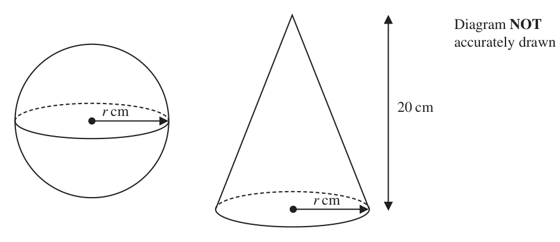
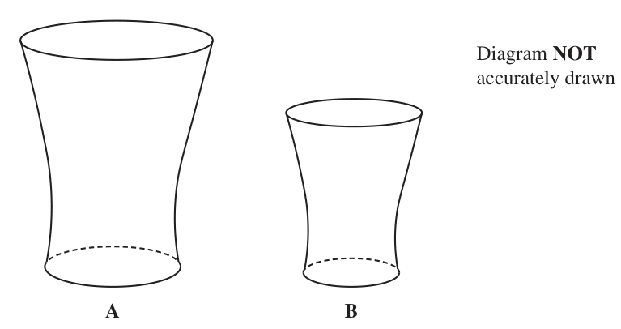

# 4MB1/01 — 2023-01 (official extraction)

> schema `syllabai.official-paper-questions/0.2` · paper_id `pearson-edexcel:international-gcse:mathematics-b:4mb1:2023-01:4MB1/01` · qp sha256 `affb161c8077358b…` · extraction is the disclosed baseline (ADR-039)

## Question 1 (2 marks)

The nth term of a sequence is given by 6n 2 − 5 Find the difference between the 2nd term and the 4th term of the sequence.

### 1 [2]

The nth term of a sequence is given by 6n 2 − 5 Find the difference between the 2nd term and the 4th term of the sequence.

**Mark scheme answer**

> 6 × 2 − 5 and 6 × 4 − 5 or

- **(2)** 6 × 2 − 5 and 6 × 4 − 5 or

## Question 2 (2 marks)

Find the Highest Common Factor (HCF) of 60 and 165 Show your working clearly.

### 2 [2]

Find the Highest Common Factor (HCF) of 60 and 165 Show your working clearly.

**Mark scheme answer**

> 2
> 2 M1 Implied by an answer of 72 and/or –72
> 6 × 22 and 6 × 42 or
> 19 and 91 or
> 24 and 96
> Correct answer scores full marks (unless from obvious ± 72 A1 Allow 72 or –72
> incorrect working)
> Total 2 marks
> Question Working Answer Mark Notes
> primes ( Allow 4 × 3 × 5 )
> Factors (165) 1, 3, 5, 11, 15, 33, 55, 165 and or factors given up to 15 for both numbers
> Factors( 60) 1, 2, 3, 4, 5, 6, 10, 12, 15, 20, 30, 60 or
> 5 60 165 or 60 and 165
> or a correct table or 2 correct trees

- **(2)** 2

## Question 3 (2 marks)

Factorise fully 6af + 30 f 2

### 3 [2]

Factorise fully 6af + 30 f 2

**Mark scheme answer**

> 12 33 2 30 5

- **(2)** 12 33 2 30 5

## Question 4 (2 marks)

4Without using a calculator and showing all your working, calculate 1 1 4 ÷ 2 3 2 Give your answer as a mixed number in its simplest form.

### 4 [2]

4Without using a calculator and showing all your working, calculate 1 1 4 ÷ 2 3 2 Give your answer as a mixed number in its simplest form.

**Mark scheme answer**

> 11 5 6 3 11
> 2 3
> Working required 15 A1 Dependent on M1 awarded
> SC answer of 15 only with none of the above
> working is B1
> Total 2 marks
> Question Working Answer Mark Notes
> 3 6 ( af + 5 f 2 ) or f ( 6a + 30 f ) or 2 f ( 3a + 15 f ) or
> 2 M1 Allow 6f(a + nf) where n is an integer
> 3 f ( 2a + 10 f ) or 2 ( 3af + 15 f 2 ) or 3 ( 2af + 10 f 2 )
> 6f(a + 5f) A1 6f(5f + a )
> Total 2 marks
> Question Working Answer Mark Notes
> 13 2
> × or
> 26 15
> ÷ or 3 = 24 + 2 2 M1 Or equivalent method for dividing 2 fractions
> 3 5 6 6 2+ 1 12 + 3
> 26 Dependent on M1 being awarded for working seen. Need
> and Working required 1 15
> A1
> to see 26/15 leading to correct answer
> Total 2 marks
> Question Working Answer Mark Notes

- **(2)** 11 5 6 3 11

## Question 5 (2 marks)

Solve the inequality 5 x ≤ 3 x + 15

### 5 [2]

Solve the inequality 5 x ≤ 3 x + 15

**Mark scheme answer**

> 5 x − 3x 15 2 M1 For correctly collecting terms in x on one side and
> numerical terms on the other side. Allow equation or
> incorrect inequality sign. Allow for x = 7.5 or just 7.5 or
> x 7.5
> Correct answer scores full marks (unless x 7.5
> ISW Accept 7.5 x and instead of 7.5 allow if
> from obvious incorrect working)
> A1
> you see the correct answer in the working but incorrect
> on the answer line
> Total 2 marks
> Question Working Answer Mark Notes

- **(2)** 5 x − 3x 15 2 M1 For correctly collecting terms in x on one side and

## Question 6 (2 marks)

Calculate 4.2 1072 5.5 1075 Give your answer in standard form.

### 6 [2]

Calculate 4.2 1072 5.5 1075 Give your answer in standard form.

**Mark scheme answer**

> eg 23.1×10147 or 231×10146 or
> For a correct answer not in standard form or for one
> 2.31×10n where n ≠ 148 or M1
> part correct
> a ×10148 where 1 a < 10
> Correct answer scores full marks (unless 2.31×10148 A1
> from obvious incorrect working)
> Total 2 marks
> Question Working Answer Mark Notes

- **(2)** eg 23.1×10147 or 231×10146 or

## Question 7 (3 marks)

The price of a holiday is reduced by 4% in a sale. Haniya pays $600 of the sale price when she books the holiday. She pays the remainder of the sale price in 4 equal monthly payments of $180 Calculate the price of the holiday before the sale. $........................................................ . . . . . . . . . . . . . . . . . . . . . . . . . . . . . . . . . . . . .

### 7 [3]

The price of a holiday is reduced by 4% in a sale. Haniya pays $600 of the sale price when she books the holiday. She pays the remainder of the sale price in 4 equal monthly payments of $180 Calculate the price of the holiday before the sale. $

**Mark scheme answer**

> Sale price = 600 + 4 ×180 [=1320] 3 M1 Correct method to find total sale price. May be implied by
> 1320 or 600 + 720
> "1320" 4 M1 n n
> Presale price = or x − x = "1320" oe For dividing by 0.96 Allow or ×100 where n is
> 0.96 100 0.96
> positive
> Correct answer scores full marks (unless from 1375 A1
> obvious incorrect working)
> NB × by 1.04 gives an answer of 1372.8(0) and is M1M0A0
> unless the method marks can be awarded in the working.
> Total 3 marks
> Question Working Answer Mark Notes

- **(3)** Sale price = 600 + 4 ×180 [=1320] 3 M1 Correct method to find total sale price. May be implied by

## Question 8 (3 marks)

The straight line L1 has equation y + 4x = 5 The straight line L2 is parallel to L1 and passes through the point (2, ‒6) Find the equation for L2 in the form y = mx + c

### 8 [3]

The straight line L1 has equation y + 4x = 5 The straight line L2 is parallel to L1 and passes through the point (2, ‒6) Find the equation for L2 in the form y = mx + c

**Mark scheme answer**

> y = −4 x ± c where c ≠ 5 or y = −4 x or 3 M1 For a correct gradient in the final equation
> y − a = −4 ( x − b ) oe
> −6 = m × 2 + C or Subst x = 2 and y = −6 into an equation of the
> y − −6 = m ( x − 2 ) where m is their gradient M1 line with the gradient of the final equation
> Allow y + 4 x = 5 + ( −6 − ( −3) )
> Correct answer scores full marks (unless from y = −4 x + 2 Do not ISW. Allow y = 2 − 4 x
> A1
> obvious incorrect working)
> Total 3 marks
> Question Working Answer Mark Notes

- **(3)** y = −4 x ± c where c ≠ 5 or y = −4 x or 3 M1 For a correct gradient in the final equation

## Question 9 (3 marks)

y B A 4 −7 −6 −5 −4 −3 −2 −1 O 1 2 3 4 5 6 x Quadrilateral A and quadrilateral B are drawn on a grid. Quadrilateral B is the image of quadrilateral A under a single transformation. Describe fully this single transformation.

### 9 [3]

y B A 4 −7 −6 −5 −4 −3 −2 −1 O 1 2 3 4 5 6 x Quadrilateral A and quadrilateral B are drawn on a grid. Quadrilateral B is the image of quadrilateral A under a single transformation. Describe fully this single transformation.

> 🖼 crop required: grid (qp.pdf p.None)

**Mark scheme answer**

> Must be as a single transformation
> enlargement 3 B1 Condone words that clearly mean enlargement
> eg enlarged / enlarge/ enlarging.
> SF − 0.5 B1
> Centre (1, 5) B1 condone (1, 5) on its own
> SC B2 for rotation of 180 degrees about (1, 5)
> and enlargement with scale factor 0.5
> All information required.
> Total 3 marks
> Question Working Answer Mark Notes

- **(3)** Must be as a single transformation

## Question 10 (3 marks)

Without using a calculator and showing your working clearly, find the value of the integer a so that 2 300 108 a a = ........................................................ . . . . . . . . . . . . . . . . . . . . . . . . . . . . . . . . . . . . .

### 10 [3]

Without using a calculator and showing your working clearly, find the value of the integer a so that 2 300 108 a a =

**Mark scheme answer**

> ⎡ 2 300 = ⎤ 2 3 × 100 or 2 3 ×102 or 2 22 × 3 × 52 3 M1 for one root/part expressed correctly
> ⎣ ⎦
> Allow if split eg 3 × 100
> or 100 × 12 or 102 ×12 or 22 × 52 ×12 or a correct decomposition consisting of at least 2 surds,
> one of which is a square number.
> ⎡ 300 = ⎤
> ⎣ ⎦ 3 ×100 or 3 ×102 or 3 × 22 × 52 or
> 25 × 12 or 52 ×12
> ⎡ 108 = ⎤
> ⎣ ⎦ 3 × 36 or 3 × 62 or 9 × 12 or 3 ×12
> or 3 × 22 × 32
> 20 3 − 6 3 [= 14 3 ] or 10 12 − 3 12 ⎡⎣ = 7 12 ⎤⎦ M1 Dep on 1st M1 awarded. Allow for a correct answer of
> 14 3 or 7 12
> 588 A1
> ( )
> Working required
> Dep on 2nd M1 awarded. Condone 588 or 14 3
> SC if no marks awarded award B1 for 588 condone 588
> Total 3 marks
> Question Working Answer Mark Notes

- **(3)** ⎡ 2 300 = ⎤ 2 3 × 100 or 2 3 ×102 or 2 22 × 3 × 52 3 M1 for one root/part expressed correctly

## Question 11 (4 marks)
### 11(a) [1]

Write down the value of a0 where a > 0

**Mark scheme answer**

> a
> allow 1 > 0, or 0 < 1 or or a 0 = 1
> 1 1 B1 a
> do not allow a1 or a1 = 0 or 1 < 0 or 0 > 1

- **(1)** a

### 11(b) [1]

Simplify fully 2 w2 × 11w5

**Mark scheme answer**

> 22w7 1 B1 allow w7 22

- **(1)** 22w7 1 B1 allow w7 22

### 11(c) [2]

Simplify fully 4 y 8

**Mark scheme answer**

> 8 y12 2 B2 B1 for a product with 1 part correct and 2 parts in total
> Total 4 marks
> Question Working Answer Mark Notes

- **(2)** 8 y12 2 B2 B1 for a product with 1 part correct and 2 parts in total

## Question 12 (3 marks)

A Diagram NOT B accurately drawn 75° C E D F A, B, C and D are points on a circle. EDF is the tangent to the circle at the point D Angle BDF = 75° Calculate, giving your reasons, the size, in degrees, of ∠BCD ............................................................. . . . . . . . . . . . . . . . . . . . . . . . . . . . . . . . . °

### 12 [3]

A Diagram NOT B accurately drawn 75° C E D F A, B, C and D are points on a circle. EDF is the tangent to the circle at the point D Angle BDF = 75° Calculate, giving your reasons, the size, in degrees, of ∠BCD °

> 🖼 crop required: diagram (qp.pdf p.None)

**Mark scheme answer**

> ∠DAB = 75 or ∠BDE = 180 − 75 [ = 105] or 3 M1 A correct first step – may be on diagram if not
> seen on diagram needs to be labelled Allow
> reflex ∠DOB = 210
> equivalent labelling eg ∠BAD or ∠A = 75 and
> ∠BCD or ∠C = 105 but do not accept
> ∠B or ∠D (accept if their ∠BDA + ∠ADE =
> 105 on diagram)
> Correct answer scores both marks but see notes 105 A1 If this is not on the answer line it must be
> clearly labelled or clearly identified as ∠BCD
> in the working
> ∠DAB = 75 B1 All correct reasons given for their method
> alternate segment theorem or tangent-chord theorem which should lead to the correct answer if no
> opposites angles of a cyclic quadrilateral sum to 180° numerical errors made. Need words
> underlined.
> ∠BDE = 180 − 75 They may use different methods of reasoning
> angles on a straight line add to 180° which may also include
> alternate segment theorem Angles in a quadrilateral add up to 360.
> Accept “4-sided shape”
> reflex ∠DOB = 210 We will allow for ‘triangle’ and ∠ for angle
> Angle between tangent and radius (diameter) is 90° and Σ for sum and shortened words eg Alt
> Base angles in an isosceles triangle (are equal) for Alternate, opp for opposite
> Angles in a triangle add to 180°
> Angles around a point add up to 360°
> Angle at the centre is 2 × (double) angle at
> circumference or angle at circumference is ½ angle at
> centre
> Total 3 marks
> Question Working Answer Mark Notes

- **(3)** ∠DAB = 75 or ∠BDE = 180 − 75 [ = 105] or 3 M1 A correct first step – may be on diagram if not

## Question 13 (3 marks)

a t v = 8.91 to 3 significant figures. u = 5.82 to 3 significant figures. t = 9 to 1 significant figure. Calculate the lower bound, to 3 significant figures, of a Show your working clearly.

### 13 [3]

a t v = 8.91 to 3 significant figures. u = 5.82 to 3 significant figures. t = 9 to 1 significant figure. Calculate the lower bound, to 3 significant figures, of a Show your working clearly.

**Mark scheme answer**

> 8.915, 8.905, 5.815, 5.825, 9.5, 8.5 3 B1 for one correct bound seen Allow equivalent eg
> 8.91 ± 0.005
> 8.905 − 5.825 M1 LB − UBu
> a= a= v where 8.905 LBv < 8.91,
> 9.5 UBt
> 5.82 < UBu 5.825 and 9 < UBt 9.5
> Allow equivalent eg
> 8.91 − 0.005 − (5.82 + 0.005)
> a=
> 9 + 0.5
> Working required 0.324 154
> A1 allow 475 awrt 0.324 from fully correct
> working - Allow use of 5.82499... and/or
> 9.499…
> Total 3 marks
> Question Working Answer Mark Notes

- **(3)** 8.915, 8.905, 5.815, 5.825, 9.5, 8.5 3 B1 for one correct bound seen Allow equivalent eg

## Question 14 (4 marks)

F D Diagram NOT 69° accurately drawn E C G A B H The diagram shows a regular pentagon ABCDE and three sides, FE, EG and GH, of a regular n-sided polygon. AB is horizontal. EG is vertical. DEF 69 Calculate the value of n n = ........................................................ . . . . . . . . . . . . . . . . . . . . . . . . . . . . . . . . . . . . .

### 14 [4]

F D Diagram NOT 69° accurately drawn E C G A B H The diagram shows a regular pentagon ABCDE and three sides, FE, EG and GH, of a regular n-sided polygon. AB is horizontal. EG is vertical. DEF 69 Calculate the value of n n =

> 🖼 crop required: diagram (qp.pdf p.None)

**Mark scheme answer**

> 360 ⎡ 540 ⎤
> 180 − = = 108⎥ or M1 Correct method to find the interior angle or exterior angle
> ⎢
> 5 ⎣ 5 ⎦ of the pentagon. May be marked on the diagram. Allow if
> exterior angle = 72° 108 or 72 seen
> ⎛ 180 − 108 ⎞ ⎡ 108 ⎤ M1
> 69 − ⎜ 90 − ⎟ ⎢ = 69 − = 15⎥ or
> ⎝ 2 ⎠⎣ 2 ⎦ A correct expression to find the exterior or interior angle
> of the n-sided polygon
> [∠GEF =] 360 − (108 − 90 ) − 69 − 108 [ = 165] or eg
> (180 − 69 ) + 72 − 18 = 165 or [∠GEF =] 360 − ("180 − 90 − (180 − 108) ") − 69 − 108 [ = 165]
> ⎛ 108 ⎞ There may be other correct methods.
> 360 − ⎜ 69 + + 90 ⎟
> ⎝ 3 ⎠
> M1 dep on the previous M1. A correct method to find the
> 360 ( n − 2 ) ×180 = "165" value of n
> n= or oe
> "15" n
> Correct answer scores full marks (unless from A1
> obvious incorrect working)
> Total 4 marks
> Question Working Answer Mark Notes

- **(4)** 360 ⎡ 540 ⎤

## Question 15 (4 marks)

The diagram shows a sphere of radius r cm and a right circular cone with base radius r cm and vertical height 20 cm. Diagram NOT accurately drawn r cm 20 cm r cm The volume of the sphere is 1.5 times the volume of the cone. Find the value of r r = ........................................................ . . . . . . . . . . . . . . . . . . . . . . . . . . . . . . . . . . . . .

### 15 [4]

The diagram shows a sphere of radius r cm and a right circular cone with base radius r cm and vertical height 20 cm. Diagram NOT accurately drawn r cm 20 cm r cm The volume of the sphere is 1.5 times the volume of the cone. Find the value of r r =

**Mark scheme answer**

> 4 M1 For both volumes correct.
> 4
> Implied by πr 3 = 1.5 × × πr 2 × 20 or
> 4 3 1 3
> πr and × πr 2 × 20 oe 4 3 1
> 3 3 1.5 × πr = × πr 2 × 20
> 3
> Allow or 3.14[159…] for π
> 4 3
> πr = 1.5 × × πr 2 × 20 oe M1 For forming a correct equation
> 3
> M1 dependent on 1st M1 and use of 1.5 on either
> side. For isolating the term in r correctly. eg
> 4r = 1.5 × 20 oe (this may involve π ) 4π r = 1.5 × 20π may be implied by 7.5,
> condone 6r = 20 r = or 3.33...
> Correct answer scores full marks (unless from A1 ISW if seen in working as r = 7.5 oe .
> 7.5
> obvious incorrect working) Condone awrt 7.5 or 7.49
> Total 4 marks
> Question Working Answer Mark Notes

- **(4)** 4 M1 For both volumes correct.

## Question 16 (4 marks)

P is inversely proportional to the square root of W P = 1600 when W = 1.96 Find the value of W when P = 800 W = ........................................................ . . . . . . . . . . . . . . . . . . . . . . . . . . . . . . . . . . . . .

### 16 [4]

P is inversely proportional to the square root of W P = 1600 when W = 1.96 Find the value of W when P = 800 W =

**Mark scheme answer**

> Method 1 Method 2
> k j 4 M1 oe for k 1 M2 for
> [ P =] P2 = or or
> W W W h W 1600 1.96 = 800 W
> 2 j or
> P W = k or P = or
> W 16002 ×1.96 = 8002W
> P2 = or WP2 = j
> gW
> Condone use of another
> symbol rather than equals.
> Implied by a correct equation
> in a single letter
> k j M1 Use given values to form a
> 1600 = [⇒ k = 2240] 16002 = [⇒ j = 5017600] correct equation in k or j
> 1.96 1.96
> only ( allow any letter)
> h=
> 2240
> g= [ = 0.000000199...]
> 5017600
> ⎛ "2240" ⎞
> 2 "5017600" M1 dep on M1 A correct method to find W using their k
> W =⎜ W= or j If k is incorrect working must show the intention
> ⎟ 8002
> ⎝ 800 ⎠ to square
> Correct answer scores full marks (unless from obvious 7.84 A1 196
> do not ISW Allow
> incorrect working)
> SC award B1for answer of 0.49[00…] using of k W
> k
> or 2.77[185…] using
> W2
> Total 4 marks
> Question Working Answer Mark Notes

- **(4)** Method 1 Method 2

## Question 17 (4 marks)

Quadrilateral A is transformed to quadrilateral B under a reflection in the line y = − x 4 2 Quadrilateral B is transformed to quadrilateral C under the matrix 1 3 Quadrilateral C is the image of quadrilateral A under the matrix N Find the matrix N N

### 17 [4]

Quadrilateral A is transformed to quadrilateral B under a reflection in the line y = − x 4 2 Quadrilateral B is transformed to quadrilateral C under the matrix 1 3 Quadrilateral C is the image of quadrilateral A under the matrix N Find the matrix N N

**Mark scheme answer**

> ⎛ 0 −1 ⎞
> ⎜ ⎟ 4 M1 Matrix for reflection in y = − x
> ⎝ −1 0 ⎠
> M1 ⎛ 4 −2 ⎞⎛ a b ⎞
> Allow ⎜ ⎟⎜ ⎟
> ⎛ 4 −2 ⎞⎛ 0 −1 ⎞ ⎝ 1 3 ⎠⎝ c d ⎠
> ⎜ ⎟⎜ ⎟
> ⎝ 1 3 ⎠⎝ −1 0 ⎠
> where a, b, c and d are 0 or ±1
> ⎛ 2 − 4⎞ A2 dep on previous 2nd method mark being
> Correct answer scores full marks (unless from
> ⎜ ⎟ awarded. All values correct
> obvious incorrect working) ⎝ −3 −1 ⎠ (A1 for 2 terms correct)
> Total 4 marks
> Question Working Answer Mark Notes

- **(4)** ⎛ 0 −1 ⎞

## Question 18 (4 marks)

Diagram NOT accurately drawn A B The diagram shows two mathematically similar solids A and B The volume of solid A is 1125 cm3 The volume of solid B is 576 cm3 Given that surface area of solid A + surface area of solid B = 3198 cm2 calculate the surface area of solid B .................................................................... . . . . . . . . . . . . . . . . . . . . . . . . . cm2

### 18 [4]

Diagram NOT accurately drawn A B The diagram shows two mathematically similar solids A and B The volume of solid A is 1125 cm3 The volume of solid B is 576 cm3 Given that surface area of solid A + surface area of solid B = 3198 cm2 calculate the surface area of solid B cm2

**Mark scheme answer**

> 2 4 M2 For a correct SF or ratio
> ⎛ 1125 ⎞ ⎡ 25 ⎤
> ⎜ ⎟ ⎢= = 1.5625⎥ or 25 : 16 or
> ⎝ 576 ⎠ ⎣ 16 ⎦
> 1125 ⎡ 5 ⎤ ⎛ 1125 ⎞ 576 ⎡ 4 ⎤
> 2 M1 for 3 = or ⎜ ⎟ or 3 = or
> ⎛ 576 ⎞ ⎡ 16 ⎤ ⎢ ⎥
> 576 ⎣ 4 ⎦ ⎝ 576 ⎠ 1125 ⎢⎣ 5 ⎥⎦
> ⎜ ⎟ ⎢= = 0.64 ⎥ or 16 : 25
> ⎝ 1125 ⎠ ⎣ 25 ⎦ ⎛ 576 ⎞
> 2
> ⎟ or 1125 : 576 or 5 : 4 or 4 : 5 or 125 : 64
> 3
> ⎜
> ⎝ 1125 ⎠
> 10.4 5
> or 642: 1252 oe (useful number = )
> 8.32 4
> 2 M1 A correct equation or ratio
> ⎛ 1125 ⎞
> ⎜ ⎟ × SA of B + SA of B = 3198 or Allow
> ⎝ 576 ⎠ 16
> 25 × 3198 or × 3198 or SA of A =1950
> b + b = 3198 oe or 25 + 16 25 + 16
> ⎛ 576 ⎞
> ⎜ ⎟ × SA of A + SA of A = 3198 or
> ⎝ 1125 ⎠
> a + a = 3198 oe
> Correct answer scores full marks (unless 1248 A1 Allow awrt 1248 or 1249 from correct working
> from obvious incorrect working)
> Total 4 marks
> Question Working Answer Mark Notes

- **(4)** 2 4 M2 For a correct SF or ratio

## Question 19 (5 marks)

A X B Y D Scale: 1 cm represents 2 metres C The quadrilateral ABCD is a scale drawing of Simon’s garden. There is a tree at the point X and a tree at the point Y

### 19(a) [1]

Construct the locus of all points inside the quadrilateral that are 10 metres from C

**Mark scheme answer**

> for an arc of a circle inside the quadrilateral
> Correct arc 1 B1 that is 5 cm from C Allow a circle. Must cross
> AD and BC

- **(1)** for an arc of a circle inside the quadrilateral

### 19(b) [2]

Using ruler and compasses only and showing all your construction lines, construct the locus of all points inside the quadrilateral that are equidistant from X and Y

**Mark scheme answer**

> B2 correct perpendicular bisector of XY, with 2
> pairs of arcs the arcs in each pair must have the
> same radius and bisector drawn.
> Correct bisector
> B1 for 2 sets of arcs with no line drawn or for a
> bisector drawn without arcs.
> Must cross AB and CD

- **(2)** B2 correct perpendicular bisector of XY, with 2

### 19(c) [1]

Construct the locus of all points inside the quadrilateral that are 6 metres from AB Simon is going to place a light in the garden so that it is closer to X than to Y, more than 6 metres from AB and more than 10 metres from C

**Mark scheme answer**

> Line drawn parallel to AB at a Line drawn inside the quadrilateral that is 3 cm
> 1 B1
> distance of 3 cm from AB Must cross AD and BC

- **(1)** Line drawn parallel to AB at a Line drawn inside the quadrilateral that is 3 cm

### 19(d) [1]

Show, by shading, the region where Simon can place the light. Label the region R

**Mark scheme answer**

> dep on the perpendicular bisector drawn
> within the permitted region shown; there must
> Correct region shaded or
> be an attempt of a line drawn parallel to AB;
> labelled 1 B1ft
> there must be an arc drawn from C
> The area indicated must be enclosed by the 3
> lines and AD
> Total 5 marks
> Question Working Answer Mark Notes

- **(1)** dep on the perpendicular bisector drawn

## Question 20 (5 marks)

Sarah records the number of visits to the cinema that each of the 19 students in her class made in June. The table below shows her results. Number of visits Frequency to the cinema 0 6 1 4 2 5 3 3 4 1

### 20(a) [1]

Write down the mode of the number of visits to the cinema.

**Mark scheme answer**

> 0 1 B1

- **(1)** 0 1 B1

### 20(b) [1]

Find the median number of visits to the cinema. Bhaskor joins Sarah’s class. The mean number of visits to the cinema, after Bhaskor joins the class, for the 20 students in June is 1.7

**Mark scheme answer**

> 1 1 B1

- **(1)** 1 1 B1

### 20(c) [3]

Calculate the number of visits to the cinema Bhaskor makes in June.

**Mark scheme answer**

> 3 M1 Correct method to find the total of the 19
> 1.7 × 20 [ = 34] or [ 0 × 6 + ]1× 4 + 2 × 5 + 3 × 3 + 4 ×1[ = 27 ] students (allow 1 error) may be seen on the table
> or the total of the 20 students or as part of
> another calculation. Allow for 27 or 34 seen
> M1 Correct method to find the number of times
> Bhaskor visits the cinema eg 34 − "27" or
> 1.7 × 20 − ([0 × 6 + ]1× 4 + 2 × 5 + 3 × 3 + 4 ×1) [ = 27 ] oe
> "27"+ x
> = 1.7 Allow their "27"
> Correct answer scores full marks (unless from obvious A1 NB watch for incorrect method of 27 – 20
> incorrect working see notes)
> Total 5 marks
> Question Working Answer Mark Notes

- **(3)** 3 M1 Correct method to find the total of the 19

## Question 21 (5 marks)

Diagram NOT accurately drawn Speed (m/s) u 0 4 6 8 Time (t seconds) The diagram shows a sketch of the speed-time graph of part of a cyclist’s journey along a straight horizontal road.

### 21(a) [2]

Calculate the deceleration, in m/s2, for the last 2 seconds of this part of the cyclist’s journey m/s2 At time t = 0 seconds, the speed of the cyclist is u m/s The cyclist travelled a total distance of 65 m in the 8 seconds.

**Mark scheme answer**

> 10 2 M1
> 8−6
> Correct answer scores full marks 5 A1 condone −5

- **(2)** 10 2 M1

### 21(b) [3]

Calculate the value of u u =

**Mark scheme answer**

> 3
> 4 1 M1 finding Area A or Area B in terms of u.
> [Area A =] (10 + u ) or 4u + × 4 × (10 − u ) oe Implied by a correct equation
> 2
> [Area B =] (10 − u ) oe
> 4 1 M1 for forming a correct equation
> (10 + u ) + 20 + 10 = 65 or 4u + × 4 × (10 − u ) +20+10 = 65
> 2
> 4 10
> (10 − u ) = (8 + 6 ) − 65 or (10 − u ) = 8 ×10 − 10 − 65 oe
> 2 2
> Correct answer scores full marks (unless from obvious 7.5 A1 oe
> incorrect working)
> Total 5 marks
> Question Working Answer Mark Notes

- **(3)** 3

## Question 22 (6 marks)

The bar chart gives information about the number of pieces of music downloaded last month for each of 30 students in a class. Number of students 4 0-2 3-5 6-8 9-11 12-14 15-17 Number of pieces of music downloaded

### 22(a) [2]

Calculate the percentage of students who downloaded more than 8 pieces of music last month %

**Mark scheme answer**

> 12 2 n
> ×100 M1 for ×100 where 2 < n < 17
> 30
> Correct answer scores full marks (unless from obvious 40 A1
> incorrect working)

- **(2)** 12 2 n

### 22(b) [4]

Calculate an estimate for the mean number of pieces of music each student downloaded last month.

**Mark scheme answer**

> ( 4 ×1) + ( 9 × 4 ) + ( 5 × 7 ) + ( 3 ×10 ) + ( 7 ×13) + ( 2 ×16 ) 4 M2 for correct calculation (need not be
> evaluated) If no working shown then
> [ 4 + 36 + 35 + 30 + 91 + 32 = 228] figures must be correct.
> Give bod if values in a list and a total
> given.
> (M1 for xf calculated and added for at least 3
> class intervals where x is a number in
> the range (incl end points) or correct
> mid-points used for at least 3 products
> but not added)
> 228 dep on at least M1 previously scored.
> Mean = M1
> 30 For dividing their sum by 30
> Correct answer scores full marks (unless from obvious 7.6 A1 oe ISW allow if seen in working
> incorrect working)
> Total 6 marks
> Question Working Answer Mark Notes

- **(4)** ( 4 ×1) + ( 9 × 4 ) + ( 5 × 7 ) + ( 3 ×10 ) + ( 7 ×13) + ( 2 ×16 ) 4 M2 for correct calculation (need not be

## Question 23 (5 marks)

Simplify x 3 x2 4 Show your working clearly.

### 23 [5]

Simplify x 3 x2 4 Show your working clearly.

**Mark scheme answer**

> x 2 − 5 x + 6 = ( x − 3)( x − 2 ) 5 M1 for factorising x 2 − 5 x + 6 . Allow a factorised
> expression that expands to give 2 of 3 terms correct
> x 2 − 4 = ( x − 2 )( x + 2 ) M1 for factorising x 2 − 4 correctly
> ⎛ 2 ⎞ M1 for dealing with the division correctly. Turning
> ( x − 3) × ⎜⎜
> ⎟⎟ upside down and multiplying – need not be
> ⎝ ( x − 3)( x − 2 ) ⎠ factorised. Must be done before the subtraction
> 2 ( x − 3) − 1 ( 2 x − 7 )( x + 2 ) M1 dependent on 3rd M for a single fraction with at
> eg or or most one incorrect term (when expanded). eg if
> ( x − 2) ( x + 2 )( x − 2 ) they had +5 rather than –7 that counts as one
> 2 x 2 − 7 x + 4 x − 14 2x − 7 error. ISW
> or or
> ( x + 2 )( x − 2 ) 2 ( x − 3) ( x 2 − 4 ) − ( x + 2 ) ( x 2 − 5 x + 6 )
> x−2
> Allow or
> 2 ( x − 3)( x − 2 ) − ( x − 2 ) ( x − 5x + 6 )( x − 4 )
> 2
> ( x − 2 )( x − 2 ) 3x 2 + 2 x − x3 − 6
> oe if fully correct
> x 4 + 2 x 2 − 5 x3 + 20 x − 24
> Working required 2x − 7 dependent on all 4 M marks awarded.
> x−2 A1
> Allow 2 −
> x−2
> Total 5 marks
> Question Working Answer Mark Notes

- **(5)** x 2 − 5 x + 6 = ( x − 3)( x − 2 ) 5 M1 for factorising x 2 − 5 x + 6 . Allow a factorised

## Question 24 (6 marks)
### 24(a) [2]

Use the factor theorem to show that x 1 is a factor of 18 x3 9 x 2 17 x

**Mark scheme answer**

> 18 × ( −1) − 9 × ( −1) − 17 × ( −1) + 10
> 3
> 2 M1 correct substitution of x = ± 1 into equation. Must be same
> value substituted. Allow 18 × ( ±1) − 9 ×1 − 17 × ( ±1) + 10 or
> −18 − 9 + 17 + 10 or 18 – 9 – 17 + 10
> Working required =0 A1 dep on M1 must have no errors and = 0

- **(2)** 18 × ( −1) − 9 × ( −1) − 17 × ( −1) + 10

### 24(b) [4]

Factorise fully 18 x3 9 x 2 17 x Show clear algebraic working.

**Mark scheme answer**

> 18 x 2 ... 4 M1 for a start to find the quadratic factor. This may be seen in
> part (a)
> 18 x 2 − 27 x + 10 M1 for a fully correct 3 term quadratic. This may be seen in
> part (a)
> ( 3x − 2 )( 6 x − 5) M1 correct method to factorise their 3TQ – Must multiply out
> to give 2 of their terms.
> Working required ( x + 1)( 3x − 2 )( 6 x − 5) A1 Dep on M2 (2 of the previous 3 method marks awarded)
> Only accept what is seen (any order). Don’t accept a list
> with commas. Condone = 0 but do not ISW if gone on to
> solve.
> Total 6 marks
> Question Working Answer Mark Notes
> Question Working Answer Mark Notes

- **(4)** 18 x 2 ... 4 M1 for a start to find the quadratic factor. This may be seen in

## Question 25 (6 marks)

A particle P is moving along a straight line that passes through the point O The displacement, x metres, of P from O at time t seconds (t ≥ 0) is given by x t 3 4t 2 3t At time t seconds, the velocity of P is v m/s

### 25(a) [2]

Find an expression for v in terms of t v = The particle P comes to instantaneous rest at the point A

**Mark scheme answer**

> Differentiating. 2 M1 2 non-zero terms correct
> Correct answer scores full marks (unless −3t 2 + 8t + 3 A1 accept 3t0 for 3
> from obvious incorrect working)

- **(2)** Differentiating. 2 M1 2 non-zero terms correct

### 25(b) [4]

Find, in metres, the distance OA m

**Mark scheme answer**

> −3t 2 + 8t + 3 = 0 or 3t 2 − 8t − 3 = 0 oe 4 M1 Equating their part (a) to 0 or solving
> their part (a) = 0. Allow for correct equation
> ( −3t − 1)( t − 3) = 0 or ( 3t + 1)( t − 3) = 0 or M1 correct method to solve their 3TQ – Must
> multiply out to give 2 of their terms. Allow use
> ( 3t + 1)( −t + 3) = 0 or ( −3t − 1)( −t + 3) = 0 oe of correct formula. Allow 1 sign error for both
> methods. Implied by t = 3 or t = –1/3
> If their 3TQ is incorrect we must see working.
> − ("3") + 4 ("3") + 3 × "3"+ 1
> 3 2 M1 Correctly substituting their positive value of t
> into the equation given for x. Condone (– 3)3
> Ignore substitution of negative values for t
> If t is incorrect we must see working.
> Correct answer scores full marks (unless 19 A1 Do not allow if more than one value is given.
> from obvious incorrect working)
> Total 6 marks

- **(4)** −3t 2 + 8t + 3 = 0 or 3t 2 − 8t − 3 = 0 oe 4 M1 Equating their part (a) to 0 or solving

## Question 26 (8 marks)

D Diagram NOT accurately drawn 60° 5 3 cm 5 15 cm A C 10 3 cm B The diagram shows a pyramid ABCD with a horizontal triangular base ABC DC = 5 3 cm DB = 10 3 cm AC = 5 15 cm ADB DCA DCB

### 26(a) [3]

Calculate the length, in cm to one decimal place, of AB cm

**Mark scheme answer**

> 3 M1 A correct method to find AD2 or AD = 15 2
> ( ) + (5 3 ) [= 450]
> 2
> ⎡⎣ AD = ⎤⎦ 5 15
> [ = 21.2132…] (need not be labelled). May be
> seen on diagram.
> ft their AD. A correct method to find AB2 or AB
> ( ) + ("15 2 ") − 2 ×10 3 × "15 2 "× cos 60
> 2
> ⎡⎣ AB 2 = ⎤⎦ 10 3 M1
> eg 300 + 450 − 2 × 10 3 × 15 2 × cos 60
> Correct answer scores full marks (unless from obvious awrt 19.6 (19.559… so condone 19.5
> 19.6 A1
> incorrect working) (truncation))

- **(3)** 3 M1 A correct method to find AD2 or AD = 15 2

### 26(b) [5]

Calculate the area, in cm2 to 3 significant figures, of triangle ABC cm2

**Mark scheme answer**

> 5 M1 A correct method to find BC2 or BC = 15 May
> ( ) ( )
> 2
> ⎡⎣ BC 2 = ⎤⎦ 10 3 − 5 3 [= 225]
> award if BC found in (a) or on diagram.
> M1 using the cosine rule to enable an angle to be
> eg found. Implied by the 3rd M1. Allow
> ( ) + "15" − 2 × 5 15 × "15"cos ∠ACB
> "19.5595..."2 = 5 15
> 5 15 + "19.559"+ "15"
> s= [ = 26.962...]
> (5 15 ) + "15" − "19.5595..." [= 0.37425...] M1 A correct method to find one of the angles in
> 2
> cos ∠ACB = triangle ABC allow cos (any angle) =… (it
> 2 × 5 15 × "15" does not need to be right one)
> 2 ∠ACB = 68.0... ∠CBA = 66.6... ∠CAB = 45.3...
> "19.559..."2 + "15"2 − 5 15
> cos ∠CBA =
> 2 × "19.559..."× "15"
> [ = 0.39635...]
> or (
> "26.962... × " "26.962..."− 5 15 )
> × ("26.962..."− "19.559") × ("26.962..."− "15")
> (5 15 ) + "19.559..". − "15" [= 0.703035...]
> 2
> cos ∠CAB =
> 2 × 5 15 × "19.559..."
> 1 M1 dep on 3rd Method mark being awarded. A
> using ∠ACB Area = × 5 15 × "15"sin"68.0216..."
> 2 correct method with sides compatible to the
> 1 angle found for 3rd M1
> using ∠CBA Area = × "19.559..."× "15"× sin"66.6494..."
> 2 (
> "26.962..."× "26.962..."− 5 15 × )
> using ∠CAB Area = × 5 15 × "19.559..."× sin"45.3289..." ("26.962..."− "19.559") × ("26.962..."− "15")
> Correct answer scores full marks (unless from obvious A1 134.68… so awrt 135
> 135
> incorrect working)
> Total 8 marks

- **(5)** 5 M1 A correct method to find BC2 or BC = 15 May

