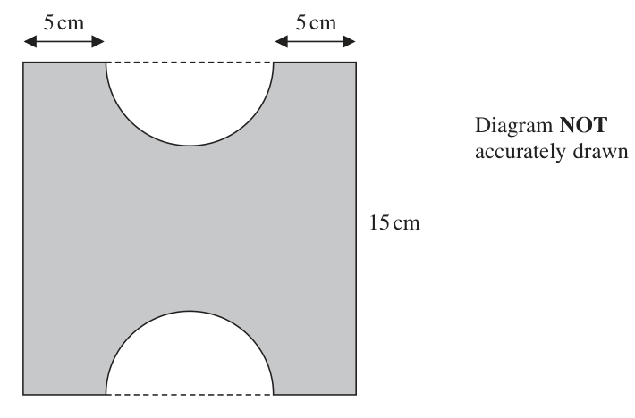
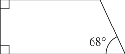
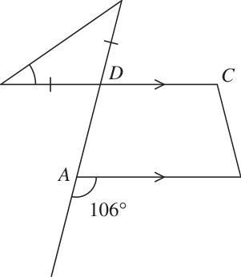
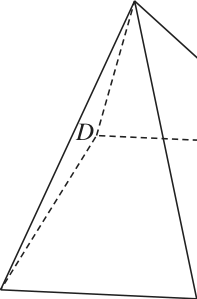
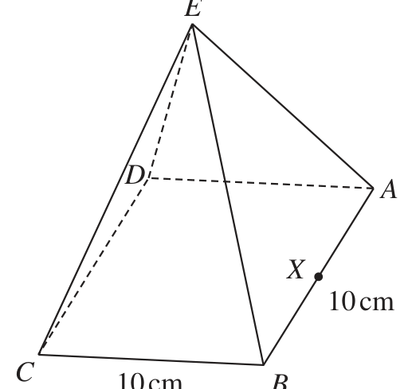
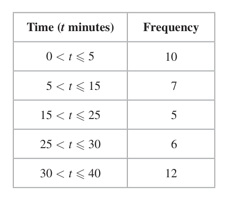

# 4MB1/01R — 2023-01 (official extraction)

> schema `syllabai.official-paper-questions/0.2` · paper_id `pearson-edexcel:international-gcse:mathematics-b:4mb1:2023-01:4MB1/01R` · qp sha256 `17b34550cf53432d…` · extraction is the disclosed baseline (ADR-039)

## Question 1 (2 marks)

Write 48 seconds as a fraction of 1 day. Give your answer in its simplest form.

### 1 [2]

Write 48 seconds as a fraction of 1 day. Give your answer in its simplest form.

**Mark scheme answer**

> [1 × ] 24 × 60 × 60 (=86400) 2
> M1 or a ‘correct’ but unsimplified fraction eg or this could
> 43200
> 24 × 2
> be written as products eg
> 24 × 60 × 60
> 1 A1 Accept exact equivalents eg 5.5 ×10−4
> 1800 ISW If correct fraction is seen then given as a decimal or in
> standard form.
> Correct answers scores full marks Total 2 marks
> (unless from obviously incorrect
> working)

- **(2)** [1 × ] 24 × 60 × 60 (=86400) 2

## Question 2 (2 marks)

Here are the numbers of items that the last 9 people who visited a shop bought. 6 1 13 20 2 4 14 11 20 Find the median of these numbers of items.

### 2 [2]

Here are the numbers of items that the last 9 people who visited a shop bought. 6 1 13 20 2 4 14 11 20 Find the median of these numbers of items.

**Mark scheme answer**

> 1, 2, 4, 6, 11, 13, 14, 20, 20 2 M1 for ordered list. Allow the first 5 terms or last 5 terms correct or
> a list with only one error (either one value omitted, one value added
> or one value either incorrect or incorrectly placed)
> 11 A1
> Correct answers scores full marks Total 2 marks
> (unless from obviously incorrect
> working)

- **(2)** 1, 2, 4, 6, 11, 13, 14, 20, 20 2 M1 for ordered list. Allow the first 5 terms or last 5 terms correct or

## Question 3 (2 marks)

Write down a formula for the nth term of the sequence. 7 11 15 19 23

### 3 [2]

Write down a formula for the nth term of the sequence. 7 11 15 19 23

**Mark scheme answer**

> 4n + 3 2 B2 for 4n + 3 oe eg 7+ 4(n – 1)
> (B1 for 4n + c where c ≠ 3 or xn + 3 where x ≠ 4)
> Correct answers scores full marks Total 2 marks
> (unless from obviously incorrect
> working)

- **(2)** 4n + 3 2 B2 for 4n + 3 oe eg 7+ 4(n – 1)

## Question 4 (2 marks)

Simplify fully (125a ) 9 3

### 4 [2]

Simplify fully (125a ) 9 3

**Mark scheme answer**

> 25a 6 2 B2
> (B1 for a product with 1 part correct and 2 parts in total)
> Correct answers scores full marks Total 2 marks
> (unless from obviously incorrect
> working)

- **(2)** 25a 6 2 B2

## Question 5 (2 marks)

Given that y = 21x 2 – x dy find dx dy = ...................................................... dx

### 5 [2]

Given that y = 21x 2 – x dy find dx dy = ……………dx

Given that y = 21x 2 – x dy find dx dy = dx

**Mark scheme answer**

> 8 2 B2 oe eg 42 x + 8 x −2
> 42x +
> x² (B1 for one term correct need not be simplified)
> Correct answers scores full marks Total 2 marks
> (unless from obviously incorrect
> working)

- **(2)** 8 2 B2 oe eg 42 x + 8 x −2

## Question 6 (2 marks)

A = 23 × 34 × 53 × 11 B = 22 × 33 × 54 Find the lowest common multiple (LCM) of 2A and 7B Give your answer as a product of prime factors.

### 6 [2]

A = 23 × 34 × 53 × 11 B = 22 × 33 × 54 Find the lowest common multiple (LCM) of 2A and 7B Give your answer as a product of prime factors.

**Mark scheme answer**

> 24 × 34 × 54 × 7 ×11 2 B2 oe (allow 62 370 000) isw if correct prime factors given
> (B1 for 4 455 000 or 23 × 34 × 54 ×11 or
> 2m × 3n × 5 p × 7 ×11 with 2 of m, n or p correct)
> Correct answers scores full Total 2 marks
> marks (unless from obviously
> incorrect working)

- **(2)** 24 × 34 × 54 × 7 ×11 2 B2 oe (allow 62 370 000) isw if correct prime factors given

## Question 7 (3 marks)

Without using a calculator, and showing all your working, evaluate 2 4 3 +2 3 5 Give your answer as a mixed number in its simplest form.

### 7 [3]

Without using a calculator, and showing all your working, evaluate 2 4 3 +2 3 5 Give your answer as a mixed number in its simplest form.

**Mark scheme answer**

> 11 14 ⎡ 2 4 ⎤ 10 12 3 M1 for writing the fractions as improper fractions or for writing the
> + or ⎢ + = ⎥ + fraction part of the values over a common denominator
> 3 5 ⎣ 3 5 ⎦ 15 15
> 11 14 55 42 97 M1 for writing improper fractions over a common denominator and
> + = + = or
> 3 5 15 15 15 showing they equal a correct improper fraction or for adding the
> 10 12 22 7 whole number parts and the fraction parts over a common
> [3 + 2 +] + = 5 15 or 5 + 1[ +] denominator. Accept sum with shared denominator eg.
> 15 15
> 5 ×11 + 3 ×14
> 97 7 22 7 Correctly A1 for completion to the correct answer with full working shown.
> eg =6 or 5 =6 or
> 15 15 15 15 showing
> 5 + 1[ + ] = 6
> 15 15 to 6
> Working required Total 3 marks

- **(3)** 11 14 ⎡ 2 4 ⎤ 10 12 3 M1 for writing the fractions as improper fractions or for writing the

## Question 8 (3 marks)

A farmer keeps cows, pigs and sheep. The ratio of the number of cows he keeps to the number of pigs he keeps is 2 : 3 The ratio of the number of pigs he keeps to the number of sheep he keeps is 7 : 11 The farmer keeps 42 cows. Work out the number of sheep the farmer keeps.

### 8 [3]

A farmer keeps cows, pigs and sheep. The ratio of the number of cows he keeps to the number of pigs he keeps is 2 : 3 The ratio of the number of pigs he keeps to the number of sheep he keeps is 7 : 11 The farmer keeps 42 cows. Work out the number of sheep the farmer keeps.

**Mark scheme answer**

> 14: 21 and 21 : 33 oe or 14 : 21 : 33 oe or 3 M1 for writing the ratios with a common figure for pigs
> 3 or for writing a correct 3 part ratio or for finding the
> [ number of pigs] = 42 × [ = 63] number of pigs Allow equivalent ratios
> eg 42:63 and 63: 99 or 42:63:99
> 33 11 M1 for a fully correct method to find the number of
> 42 × oe or "63"× oe or sheep
> 14
> 204 × oe or 204 − 42 − "63"
> 14 + 21 + 33
> 99 A1
> Correct answers scores full marks (unless Total 3 marks
> from obviously incorrect working)

- **(3)** 14: 21 and 21 : 33 oe or 14 : 21 : 33 oe or 3 M1 for writing the ratios with a common figure for pigs

## Question 9 (3 marks)

Solve 3(2 – x)2 – 75 = 0 Show clear algebraic working. x = ......................................................

### 9 [3]

Solve 3(2 – x)² – 75 = 0 Show clear algebraic working. x = ……………Solve 3(2 – x)² – 75 = 0 Show clear algebraic working. x =

**Mark scheme answer**

> 3x 2 − 12 x − 63 = 0 or 3 M1 For expanding and simplifying or for rearranging correctly to
> x 2 − 4 x − 21 = 0 or get an equation in standard quadratic form or as
> 75 bracket squared = numerical expression – allow one sign or
> ( 2 − x ) = [ = 25] oe
> arithmetic error
> eg (3x – 21)(x + 3) or (x – 7)(3x + 9) M1 For correct method to solve their quadratic equation
> or [3] (x – 7)(x + 3) If factorising, allow brackets which when expanded give 2 out of 3
> or terms correct
> 2 – x = ± "25" or 2 – x = ±5 or If using formula or completing the square allow one sign error
> x = 2 ± "25" or x = 2 ± 5 oe
> or
> ([ −]12) − 4 × 3 × ( −63)
> − ( −12 ) ±
> 2×3
> oe
> 7 and ‒3 A1 dep on M2
> Working required Total 3 marks

- **(3)** 3x 2 − 12 x − 63 = 0 or 3 M1 For expanding and simplifying or for rearranging correctly to

## Question 10 (3 marks)

Simplify + − 4 x 3x 5 x Give your answer in its simplest form.

### 10 [3]

Simplify + − 4 x 3x 5 x Give your answer in its simplest form.

**Mark scheme answer**

> 105 + 160 − 24 ⎡ 7 8 ⎤ 53 3 M1 for method to write all fractions as equivalent fractions over
> oe or ⎢ + ⎥ = or a correct common denominator with at least 2 correct (may be
> 60 ⎣ 4 3 ⎦ 12
> seen as a single fraction or as separate fractions with a common
> ⎡ 8 2 ⎤ 34 ⎡ 7 2 ⎤ 27 denominator or
> ⎢⎣ 3 − 5 ⎥⎦ = 15 or ⎢⎣ 4 − 5 ⎥⎦ = 20 oe
> for two fractions correctly combined
> In all cases just consider numerical values condone any or
> missing powers of x in numerator or denominator.
> 241 M1 dep on previous method mark
> oe
> 60 241
> Dealing with the numerical expression correctly to gain oe
> Condone any or missing powers of x in numerator or
> denominator.
> 241 A1 correct answer with no incorrect working gains full marks
> 60x 241 −1
> x or 241( 60x ) do not accept nested fractions
> −1
> accept
> Do not isw
> Correct answers scores full marks (unless from Total 3 marks
> obviously incorrect working)

- **(3)** 105 + 160 − 24 ⎡ 7 8 ⎤ 53 3 M1 for method to write all fractions as equivalent fractions over

## Question 11 (3 marks)

A = y w = 21.7 to one decimal place x = 12 to the nearest whole number y = 20 to the nearest ten Find the lower bound for the value of A Show your working clearly.

### 11 [3]

A = y w = 21.7 to one decimal place x = 12 to the nearest whole number y = 20 to the nearest ten Find the lower bound for the value of A Show your working clearly.

**Mark scheme answer**

> 21.65 or 21.75 or 11.5 or 12.5 or 15 or 25 3 B1 at least for one correct bound seen
> LBw − UBx ⎛ 21.65 − 12.5 ⎞ M1 where 21.65 ≤ LBw < 21.7, 12 < UBx ≤ 12.5, 20 < UBy ≤ 25
> ⎜= ⎟
> UBy ⎝ 25 ⎠
> 0.366 183
> A1oe allow awrt 0.366
> 500
> Must be from correct working
> allow use of 12.499… and/or 24.99…
> Working required Total 3 marks

- **(3)** 21.65 or 21.75 or 11.5 or 12.5 or 15 or 25 3 B1 at least for one correct bound seen

## Question 12 (3 marks)

M varies inversely as the cube of p M = 0.8 when p = 25 Find a formula for M in terms of p

### 12 [3]

M varies inversely as the cube of p M = 0.8 when p = 25 Find a formula for M in terms of p

**Mark scheme answer**

> k 3 M1 oe eg Mp 3 = k
> M=
> p3
> k M1 dep Use given values to form an equation in k
> 0.8 = 3 oe or k = 0.8 × 25³ [= 12 500]
> 25 only
> This also implies the first M1
> 12500 A1 oe (must include M = for this mark, allow
> M=
> p3 12500 12500
> only on answer line as long as M = is
> p p3
> seen in working)
> Correct answers scores full marks (unless Total 3 marks
> from obviously incorrect working)

- **(3)** k 3 M1 oe eg Mp 3 = k

## Question 13 (3 marks)

Solve x + 3 2x − 1 + =5 7 4 Show clear algebraic working. x = ......................................................

### 13 [3]

Solve x + 3 2x − 1 + =5 7 4 Show clear algebraic working. x =

**Mark scheme answer**

> x+3 2x −1 3 M1 for clear intention to multiply all terms by 28 (or 7 × 4) or a
> 28 × + 28 × = 28 × 5 or
> 7 4 multiple of 28 or
> 4( x + 3) + 7(2 x − 1) = 28 × 5 or express LHS as two fractions over 28 (or 7 × 4) or a multiple of 28
> 4( x + 3) 7(2 x − 1) if expanded numerator allow one sign or numerical error or
> + [ = 5] or express as a single fraction with a denominator of 28 (or 7 × 4) or a
> 28 28 multiple of 28 if expanded numerator allow one sign or numerical
> 4( x + 3) + 7(2 x − 1)
> [ = 5] or error or
> 28 separate out terms in x on one side of the equation allow one sign
> x x 3 1 error
> + = 5− +
> 7 2 7 4
> 4 x + 12 + 14 x − 7 = 28 × 5 oe or M1 expanding brackets and multiplying by denominator with no
> 18 x + 5 = 140 oe or more than one sign error or
> 9 x 135 achieve an equation of the form ax = b where a and b are rational.
> = oe This mark implies the previous M mark if not already awarded.

- **(3)** x+3 2x −1 3 M1 for clear intention to multiply all terms by 28 (or 7 × 4) or a

## Question 14 (4 marks)

The diagram shows a square piece of card from which two semicircles are cut out. 5 cm 5 cm Diagram NOT accurately drawn 15 cm The square has a side of length 15 cm. Calculate the area, in cm2 to 3 significant figures, of the piece of card left when the semicircles are cut out. ...................................................... cm2

### 14 [4]

The diagram shows a square piece of card from which two semicircles are cut out. 5 cm 5 cm Diagram NOT accurately drawn 15 cm The square has a side of length 15 cm. Calculate the area, in cm² to 3 significant figures, of the piece of card left when the semicircles are cut out cm²

**Mark scheme answer**

> 28
> 7.5 A1oe must have gained the previous M mark.
> Working required Total 3 marks
> [ r =] [ = 2.5] oe
> ⎡ 25 ⎤ M1 condone π × 52 [ = 25π = 78.54...] or
> π × 2.52 ⎢ = π = 19.63...⎥ or
> ⎣ 4 ⎦ 1 ⎡ 25 ⎤
> × π × 52 ⎢ = π = 39.27...⎥
> 1 ⎡ 25 ⎤ 2 ⎣ 2 ⎦
> × π × 2.52 ⎢ = π = 9.817...⎥ or
> 2 ⎣ 8 ⎦

- **(4)** 28

## Question 15 (4 marks)

Solve the simultaneous equations 9x + 7y = 3 5x – 4y = 6.4 Show clear algebraic working. x = ...................................................... y = ......................................................

### 15 [4]

Solve the simultaneous equations 9x + 7y = 3 5x – 4y = 6.4 Show clear algebraic working. x = y =

**Mark scheme answer**

> ×15 [ = 225]
> 205 A1 awrt 205
> Correct answers scores full marks (unless Total 4 marks
> from obviously incorrect working)
> 45x – 36y = 57.6 35x – 28y = 44.8 or y the same and correct operation to eliminate
> 71y = –42.6 71x = 56.8 selected variable (condone any one arithmetic error) or
> or writing x or y in terms of the other variable and
> ⎛ 3−7y ⎞ ⎛ 3 − 9x ⎞ correctly substituting must gain an equation in one
> 5 − 4 y = 6.4 or 5 x − 4 = 6.4 or variable
> ⎝ 9 ⎠ ⎝ 7 ⎠
> ⎛ 6.4 + 4 y ⎞ ⎛ 5 x − 6.4 ⎞
> 9 + 7 y = 3 or 9 x + 7 =3
> ⎝ 5 ⎠ ⎝ 4 ⎠
> x = 0.8 or A1oe one correct value dep on M1
> y = –0.6
> 9 x + 7 × "(−0.6)" = 3 or 9 × "0.8"+ 7 y = 3 or M1 (dep) correct method to find second variable –
> 5 x − 4 × " ( −0.6 ) " = 6.4 or 5 × "0.8"− 4 y = 6.4 oe could start process again or use substitution dep on M1
> x = 0.8 and A1oe for both correct values dep on both M marks
> y = –0.6
> Working required Total 4 marks

- **(4)** ×15 [ = 225]

## Question 16 (4 marks)

A 16 cm B Diagram NOT accurately drawn 68° D 20 cm C The diagram shows trapezium ABCD in which AB = 16 cm DC = 20 cm ∠BCD = 68° ∠BAD = ∠CDA = 90° Calculate the area, in cm2 to 3 significant figures, of trapezium ABCD ...................................................... cm2

### 16 [4]

The diagram shows trapezium ABCD in which AB = 16 cm DC = 20 cm ∠BCD = 68° ∠BAD = ∠CDA = 90° Calculate the area, in cm² to 3 significant figures, of trapezium ABCD cm²

> *Figure not shown in this reconstruction — the printed paper includes a diagram (not drawn accurately).*
> Labels in the original figure: A, B, D, C · Figure values: 16, 68°, 20.

**Mark scheme answer**

> AD 4 M1 correct expression containing AD, may be labelled as h or x
> tan 68 =
> 20 − 16 etc…
> AD = tan 68 × 4 [= 9.9…] M1 Correct method to find AD
> ⎛ 16 + 20 ⎞ M1 Correct method to find area, ft their AD
>  × "9.9" or
> ⎝ 2 ⎠
> 20 × “9.9” – 0.5 × (20 – 16) × “9.9” oe
> 178 A1 awrt 178
> Correct answers scores full marks (unless Total 4 marks
> from obviously incorrect working)

- **(4)** AD 4 M1 correct expression containing AD, may be labelled as h or x

## Question 17 (4 marks)

The Venn diagram shows the sets D, E and F where the numbers represent numbers of elements. E D E 7 1 3 2 F

### 17(a) [1]

Find n(D ∪ E)

**Mark scheme answer**

> 23 1 B1

- **(1)** 23 1 B1

### 17(b) [1]

Find n(D ∩ E′)

**Mark scheme answer**

> 10 1 B1

- **(1)** 10 1 B1

### 17(c) [1]

Find n(F′)

**Mark scheme answer**

> 22 1 B1

- **(1)** 22 1 B1

### 17(d) [1]

Find n([D ∪ F ] ∩ E′)

**Mark scheme answer**

> 19 1 B1
> SC award B1B1B0B0 for answers of (a) 6, (b) 2, (c) 4, (d) 3
> SC award B1B0B0B0 for three of (a) 6, (b) 2, (c) 4, (d) 3
> Total 4 marks

- **(1)** 19 1 B1

## Question 18 (4 marks)

Make b the subject of a = b−d

### 18 [4]

Make b the subject of a = b−d

**Mark scheme answer**

> 3b + 5 4 M1 for either squaring both sides to remove the square root or
> a2 = or a b − d = 3b + 5
> b−d removing the denominator of the expression
> a 2b − a 2 d = 3b + 5 M1 dep for squaring both sides to remove the square root and
> removing the denominator of the expression and expanding
> a 2b − 3b = 5 + a 2d or − a 2d − 5 = 3b − a 2b M1 for gathering terms in b on one side, and other terms the
> other side of a correct equation allow one sign error
> 5 + a2d −a 2 d − 5 5 + a2d
> b= A1 oe eg b = or b =
> a2 − 3 3 − a2 ( )(
> a+ 3 a− 3 )
> (NB: if the final answer is missing b =…but is otherwise
> correct , award full marks if b = a correct expression has been
> seen in the working otherwise do not ISW)
> Correct answers scores full marks (unless Total 4 marks
> from obviously incorrect working)

- **(4)** 3b + 5 4 M1 for either squaring both sides to remove the square root or

## Question 19 (5 marks)

F Diagram NOT D C accurately drawn E A B 106° G In the diagram, ABCD is a trapezium and EDF is an isosceles triangle with DE = DF EDC and GADF are straight lines. ∠GAB = 106° Calculate the size, in degrees, of ∠DEF Give reasons for each stage of your working. ° ∠DEF = . . . . . . . . . . . . . . . . . . . . . . . . . . . . . . . . . . . . . . . . . . . . . . . . . . . . . .

### 19 [5]

In the diagram, ABCD is a trapezium and EDF is an isosceles triangle with DE = DF EDC and GADF are straight lines. ∠GAB = 106° Calculate the size, in degrees, of ∠DEF Give reasons for each stage of your working. ° ∠DEF =

> *Figure not shown in this reconstruction — the printed paper includes a diagram (not drawn accurately).*
> Labels in the original figure: F, D, C, E, A, B, G · Figure values: 106°.

**Mark scheme answer**

> DAB = 180 – 106 [=74] or 5 M1 award for angles marked on the diagram. Angle labels
> ADC =106 or EDF = 106 or must be unambiguous (eg do not condone A = 74)
> EDA or FDC = 180 – 106 [=74]
> DEF + EFD = 180 – 106 [=74] or M1 Condone E + F = 180 – 106 [=74]
> 180 − 106 "74"
> DEF = or DEF = oe
> 2
> 37 A1 Correct answer without full working gains the method
> marks but prevents the gaining of the following B marks.
> co-interior / allied B2 for two correct reasons for their method used one
> angles add up to 180 or relating to parallel line and one to isosceles triangle
> corresponding angles dep on M2 gained independent of A1
> are equal or The reason must include at least the underlined words or
> alternate angles are an unambiguous abbreviation.
> equal Eg. Alt ∠ are equal is acceptable but
> And Interior angles add up to 180 is not acceptable as interior
> Base angles in an angles usually refers to polygons
> isosceles triangle are Any incorrect reasons given award only B1
> equal (B1 for one correct reason dep on M1 gained
> independent of A1)
> Correct answers scores at least Total 5 marks
> M1M1A1 (unless from obviously
> incorrect working)
> For B2 Working required

- **(5)** DAB = 180 – 106 [=74] or 5 M1 award for angles marked on the diagram. Angle labels

## Question 20 (5 marks)

A B D C The diagram shows a quadrilateral ABCD

### 20(a) [1]

Construct the locus of all points inside the quadrilateral that are 5 cm from D

**Mark scheme answer**

> Correct arc 1 B1 for an arc of a circle inside the trapezium that is 5 cm
> from D Must at least reach AD and CD, condone a full
> circle

- **(1)** Correct arc 1 B1 for an arc of a circle inside the trapezium that is 5 cm

### 20(b) [2]

Using ruler and compasses only and showing all your construction lines, construct the locus of all points inside the quadrilateral that are equidistant from AB and BC

**Mark scheme answer**

> Correct 2 B2 for a correct bisector of angle ABC with all
> bisector construction arcs shown
> Must at least reach CD
> (B1 for a correct bisector with no construction arcs or for
> the construction arcs shown with no bisector drawn)

- **(2)** Correct 2 B2 for a correct bisector of angle ABC with all

### 20(c) [1]

Construct the locus of all points inside the quadrilateral that are 3 cm from BC The region R consists of all the points inside the quadrilateral that are more than 5 cm from D, nearer to BC than to AB and more than 3 cm from BC

**Mark scheme answer**

> Correct line 1 B1 for a line inside the trapezium that is 3 cm from BC
> Must at least reach AB and CD

- **(1)** Correct line 1 B1 for a line inside the trapezium that is 3 cm from BC

### 20(d) [1]

Show, by shading, the region R Label the region R

**Mark scheme answer**

> Correct 1 B1 for correct region shown ft their diagram given
> region At least B1 awarded for drawing a bisector in part (b)
> shown awarded,
> There must be an arc drawn with a centre of D
> There must be a line drawn parallel to BC
> The area indicated must be enclosed by these 3 edges and
> CD
> Total 5 marks

- **(1)** Correct 1 B1 for correct region shown ft their diagram given

## Question 21 (5 marks)

(x + 2) is a factor of 6x 3 + 31x 2 + kx + 30

### 21(a) [2]

Use the factor theorem to show that k = 53

**Mark scheme answer**

> 6 × (±2)³ + 31× (±2)² ± 2 × 53 + 30 = ... or 2 M1 substitution of x = ± 2 and k = 53 into expression
> and attempt to evaluate or
> 6 × (±2)³ + 31× (±2)² ± 2k + 30 = 0
> substitution of x = ± 2 into expression and equating to 0
> to form an equation in k
> For both method allow with terms evaluated eg:
> ±48 + 124 ± 106 + 30 = ...
> k = 53 A1 Showing expression with x = –2 and k = 53 leads to
> 0 and a conclusion or
> Solving correct equation to gain k = 53 with no errors
> seen

- **(2)** 6 × (±2)3 + 31× (±2)2 ± 2 × 53 + 30 = ... or 2 M1 substitution of x = ± 2 and k = 53 into expression

### 21(b) [3]

Factorise fully 6x 3 + 31x 2 + 53x + 30

**Mark scheme answer**

> (6 x 2 ..............) 3 M1 for a start to find the quadratic factor
> (allow (2x + a)(3x + b))
> (6 x 2 + 19 x + 15) A1 for a fully correct quadratic factor
> (allow (2x + 3)(3x + 5))
> (x + 2)(2x + 3)(3x + 5) A1 fully correct allow
> ⎛ 3 ⎞⎛ 5⎞
> NB: ( x + 2 ) ⎜ x + x + ⎟ gains no marks
> ⎝ 2 ⎠⎝ 3⎠
> Do not isw answer if roots are found this is A0
> (unless from obviously incorrect
> working)

- **(3)** (6 x 2 ..............) 3 M1 for a start to find the quadratic factor

## Question 22 (6 marks)

⎛ 3 4⎞ ⎛ −2 3⎞ ⎛ 7 x⎞ B= ⎜ ⎝ 4 −1⎟⎠ A= ⎜ ⎝ 2 −3⎟⎠ C= ⎜ ⎝ 2 4⎟⎠

### 22(a) [2]

⎛ 3 4⎞ ⎛ −2 3⎞ ⎛ 7 x⎞ B= 4 −1 A= 2 −3 C= 2 4 

Find 4A – 2B Given the determinant of BC is 20

**Mark scheme answer**

> ⎛16 10 ⎞ 2 B2 for all correct values
>  B1 2 × 2 matrix with at least 2 correct values
> ⎝ 0 −10 ⎠

- **(2)** ⎛16 10 ⎞ 2 B2 for all correct values

### 22(b) [4]

find the value of x x =

**Mark scheme answer**

> ⎛ −14 + 6 −2 x + 12 ⎞ 4 M2 all correct in matrix BC, M1 for 2 or 3 elements
>  oe or correct give bod for missing brackets or
> ⎝ 28 − 2 4x − 4 ⎠
> M2 for (2 – 12)(28 – 2x) = 20 (M1 for this equation
> (2 – 12)(28 – 2x) = 20 with one error)
> −8(4 x − 4) − 26(12 − 2 x) = 20 or M1 for an equation for the determinant ft their matrix
> −32 x + 32 − 312 + 52 x = 20 or dep on M1 previously scored or
> M1 for correctly removing brackets from their
> 20 x = 300 oe
> “(2 – 12)(28 – 2x) = 20” dep on M1 previously scored
> or
> 28 – 2x = 20 ÷ (–10) or
> –280 + 20x = 20 or
> 20x = 300 oe
> 15 A1
> Correct answers scores full marks Total 6 marks
> (unless from obviously incorrect
> working)

- **(4)** ⎛ −14 + 6 −2 x + 12 ⎞ 4 M2 all correct in matrix BC, M1 for 2 or 3 elements

## Question 23 (6 marks)
### 23(a) [1]

Simplify 7y 0 where y > 0 22 × 152 x × 35 x ( x − 3) × 3x + 3 × 4 x −1

**Mark scheme answer**

> 7 1 B1

- **(1)** 7 1 B1

### 23(b) [5]

Solve 2x = 813 x =

**Mark scheme answer**

> 2x
> 15 = (3 × 5) 2x 2x
> or 3 × 5 2x 5 M2 for 3 or 4 of these – or cancelling out 2 or 3 of
> 2x 2x
> 10 = (2 × 5) or 22 x × 52 x
> 22 with 4−1
> 2x
> 4 x −1 = ( 22 )
> x −1
> or 22 x − 2 or 22 x × 2−2 or 52 x on numerator with 52 x on denominator
> 4x on the numerator with 22 x on denominator
> 813 = ( 34 ) or 312
> (M1 for 2 of the items on the LHS or cancelling out 1 of
> the above)
> 32 x × 35 x −15 x × 3x +3 = 312 or M1 equation with terms not as 3 to a power cancelled
> 2 with no more than one error or one term not as 3 to a
> 32 x+5 x −15 x+ x+3 = 312 power (must be 9 or 81 to a power)
> 5x 2 − 12 x − 9(= 0) oe A1 correct quadratic
> –0.6, 3 A1 oe cao
> Correct answers scores full marks (unless from Total 6 marks
> obviously incorrect working)

- **(5)** 2x

## Question 24 (5 marks)

E Diagram NOT accurately drawn D A X 10 cm C 10 cm B The diagram shows a solid right square‑based pyramid ABCDE The volume of the pyramid is 1000 cm3 The pyramid is standing with its square base, ABCD, on a horizontal table. The square base has side 10 cm. X is the midpoint of the side AB Calculate the size, in degrees to the nearest degree, of ∠CEX °

### 24 [5]

The diagram shows a solid right square‑based pyramid ABCDE The volume of the pyramid is 1000 cm³ The pyramid is standing with its square base, ABCD, on a horizontal table. The square base has side 10 cm. X is the midpoint of the side AB Calculate the size, in degrees to the nearest degree, of ∠CEX °

> Labels in the original figure: E, D, A, X, C, B · Figure values: 10, 10.

**Mark scheme answer**

> 3 ×1000 5 M1 for a correct calculation for the height of the
> eg h = [= 30]
> 10 ×10 pyramid or the correct height
> [CX =] 102 + 52 (= 125 = 5 5 = 11.18...) or M1 for a fully correct calculation for CX, EX or CM that
> would leads to a value correct to 3 significant figures
> [ EX =] "30"2 + 52 (= 925 = 5 37 = 30.41...) or follow through their h
> [CM =] 102 + 102 (= 50 = 5 2 = 7.07...) (where
> M is midpoint of base)
> For 2 of: M1 for a correct calculation of 2 from CX, EX and CE
> [CX =] 10 + 5 (= 125 = 5 5 = 11.18...) or
> 2 2 that would leads to a value correct to 3 significant
> figures follow through their h and CM
> [ EX =] "30"2 + 52 (= 925 = 5 37 = 30.41...) or
> [CE =] "30"2 + ("5 2 ")² (= 950 = 5 38 = 30.82...)
> ⎛ ("5 38 ") 2 + ("5 37 ") 2 − ("5 5 ") 2 ⎞ M1 dep on all previous M marks correct method to find
> cos −1 ∠CEX that would lead to a correct value follow
> ⎝ 2 × "5 38 "× "5 37 " ⎠ through their CE, EX and CX
> 21 A1 awrt 21
> Correct answers scores full marks (unless from Total 5 marks
> obviously incorrect working)

- **(5)** 3 ×1000 5 M1 for a correct calculation for the height of the

## Question 25 (7 marks)

B P Diagram NOT M accurately drawn 3a A a O c C The diagram shows a quadrilateral OABC in which → → → OA = a OC = c CB = 3a The point M lies on OB such that OM : MB = 7 : 3 The point P lies on AB such that CMP is a straight line. →

### 25(a) [3]

Find, in terms of a and c, simplifying your answer, the vector CM → CM =

**Mark scheme answer**

> OB = c + 3a or BO = −3a − c 3 M1
> 7 3 M1 ft their OB or BO , must be a vector in terms of a
> OM = "(c + 3a)" or BM = "(−3a − c)"
> 10 10 and c
> 21 3
> a− c A1 oe but must be simplified (eg ( 7a − c ) )
> 10 10
> obviously incorrect working)

- **(3)** OB = c + 3a or BO = −3a − c 3 M1

### 25(b) [4]

Using a vector method, and showing your working clearly, find AP : PB in the form x : y where x and y are integers. Show your working clearly. AP : PB =

**Mark scheme answer**

> ⎛ 21 3 ⎞ 4 M2 for 2 correct expressions for AP , BP , OP , CP or MP
> AP = λ (2a + c) and AP = −a + c + μ " ⎜ a − c ⎟ " or
> ⎝ 10 10 ⎠ with different scalar variables.
> ⎛ 21 3 ⎞ One should use AB and one CM oe
> BP = α (−2a − c) and BP = −3a + β " ⎜ a − c ⎟ " or
> ⎝ 10 10 ⎠ Follow through their CM allow any multiple of CM
> ⎛ 21 3 ⎞ (eg 7a – c)
> OP = a + γ ( 2a + c ) and OP = c + δ " ⎜ a − c ⎟ " or x y λ
> ⎝ 10 10 ⎠ Treat any of , , or (1 + μ ) oe. as single scalar
> x + y x + y 1+ λ
> ⎛ 21 3 ⎞
> CP = a − c + ε (2a + c) and CP = ζ " ⎜ a − c ⎟ " or variables
> ⎝ 10 10 ⎠ Allow for two vector expressions equated in which case allow
> 9 3 ⎛ 21 3 ⎞ for example AB = λ AP given in terms of a and c
> MP = a + c + η (−2a − c) and MP = θ " ⎜ a − c ⎟ "
> 10 10 ⎝ 10 10 ⎠
> (M1 for one correct expression for AP , BP , OP , CP or MP )
> 2 equations from comparing coefficients M1 dependant on 2 expressions for AP BP , OP , CP or MP
> 21 3 with 2 variable scalar coefficients
> 2λ = −1 + μ and λ = 1 − μ or
> 10 10 Correct values from these equations:
> 21 3 2 10 1 10 2
> −2α = −3 + β and − α = − β or λ = , μ = , α = , β = , γ = ,δ = ,
> 10 10 3 9 3 9 3
> 21 3 2 10 1
> 1 + 2γ = δ and γ = 1 − δ or ε = , ζ = , η = ,θ =
> 10 10 3 9 3
> 21
> 1 + 2ε = ζ and − 1 + ε = − ζ
> 10
> 9 21 3
> − 2η = θ and −η = − θ
> 10 10 10
> 2:1 A1 dep on all method marks gained

- **(4)** ⎛ 21 3 ⎞ 4 M2 for 2 correct expressions for AP , BP , OP , CP or MP

## Question 26 (8 marks)

Jenny has a shop. One Monday, each of the 40 people who went in Jenny’s shop were asked how long they were in the shop. The table below shows information about the results. Time (t minutes) Frequency 0<t≤5 10 5 < t ≤ 15 7 15 < t ≤ 25 5 25 < t ≤ 30 6 30 < t ≤ 40 12

### 26(a) [4]

Calculate an estimate for the mean length of time, in minutes, that these people were in the shop minutes The incomplete table and the incomplete histogram give information about the number of kilometres each of the 40 people had travelled to get to the shop. Distance (k kilometres) Frequency 0 < k ≤ 10 4 10 < k ≤ 15 15 < k ≤ 30 30 < k ≤ 60 6 None of the people travelled more than 60 km. Frequency density 0 10 20 30 40 50 60 Distance (k kilometres)

**Mark scheme answer**

> 2.5 ×10 + 10 × 7 + 20 × 5 + 27.5 × 6 + 35 ×12 4 M2 for correct calculation (need not be evaluated) If no
> [ = 25 + 70 + 100 + 165 + 420 = 780] working shown then figures must be correct Give bod if
> values in a list and a total given.
> M1 xf calculated and added for at least 3 class intervals
> where x is a number in the range (including end points)
> or correct mid-points used for at least 3 products but not
> added
> “780” ÷ 40 M1 dep on M1
> 19.5 A1

- **(4)** 2.5 ×10 + 10 × 7 + 20 × 5 + 27.5 × 6 + 35 ×12 4 M2 for correct calculation (need not be evaluated) If no

### 26(b) [4]

Complete the histogram and the frequency table.

**Mark scheme answer**

> For a correct frequency density on the FD 4 M1 for use of area to work out frequency density,
> axis – one 2cm square height = FD of 0.5 or implied by any correct aspect of the table or graph seen
> height of 15 – 30 bar is 1.2 or 10 – 15 bar is
> 2.4, may be seen besides the table
> 12,18 and bars of A3 for all four correct
> height A2 for three correct
> 0.4 between A1 for two correct
> 0 and 10 The heights must be drawn on the histogram correct to 1
> and 0.2 between small square.
> 30 and 60
> Correct answers scores full marks (unless Total 8 marks
> from obviously incorrect working)

- **(4)** For a correct frequency density on the FD 4 M1 for use of area to work out frequency density,

