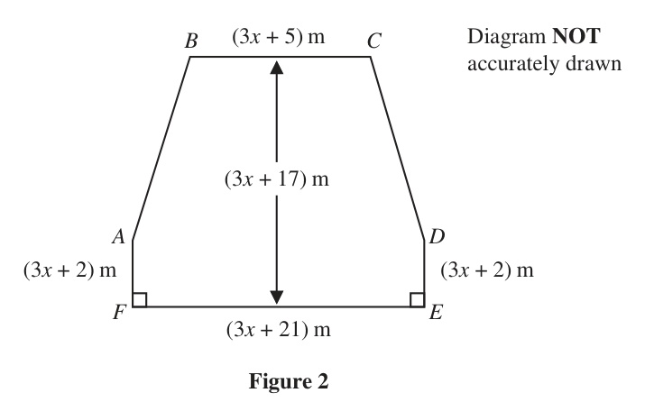
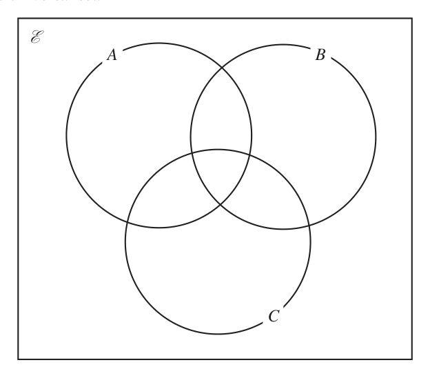
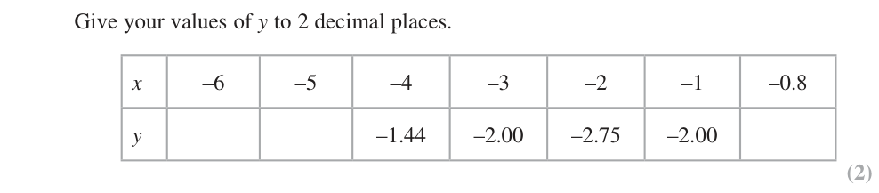
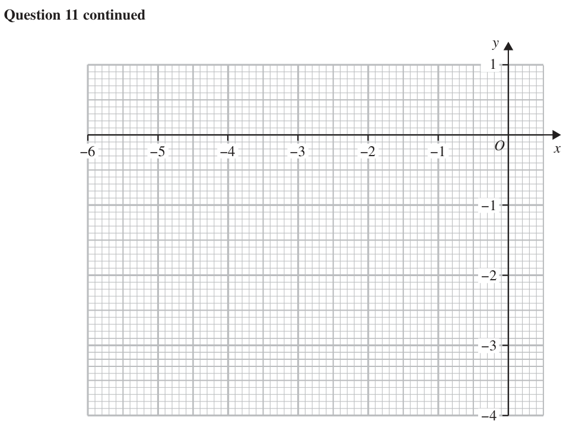

# 4MB1/02 — 2023-01 (official extraction)

> schema `syllabai.official-paper-questions/0.2` · paper_id `pearson-edexcel:international-gcse:mathematics-b:4mb1:2023-01:4MB1/02` · qp sha256 `a4644c4c95a4c967…` · extraction is the disclosed baseline (ADR-039)

## Question 1 (4 marks)

A car travels at an average speed of 60 km/h for 2 hours. It then travels at an average speed of x km/h for 3 hours. The car travels at an average speed of 64.2 km/h for the whole journey. Calculate the value of x (4)

### 1 [4]

A car travels at an average speed of 60 km/h for 2 hours. It then travels at an average speed of x km/h for 3 hours. The car travels at an average speed of 64.2 km/h for the whole journey. Calculate the value of x

**Mark scheme answer**

> Finding the correct total distance travelled as a linear
> 60 × 2 + 3x oe 4 M1 expression in x (possibly implied as part of an
> expression or equation)
> Equating their average speed to 64.2. Their average
> ax b
> speed must be equivalent to 64.2 where a
> 60 × 2 + 3x
> = 64.2 oe M1
> 5 and b are any non-zero constants (allow
> x b
> 64.2 where b is any non-zero constant)
> Dependent on second M mark. Isolating the term in
> x correctly ( ax 5(64.2) b ). The correct equation
> 3x = 5 × 64.2 − 60 × 2 oe M1dep 3x 321 120 (or equivalent or better e.g.
> 321 120
> x ) implies all three M marks
> Correct answer scores full marks (unless from
> 67 A1
> obvious incorrect working)
> Total 4 marks
> Qu Working Answer Mark Notes

- **(4)** Finding the correct total distance travelled as a linear

## Question 2 (5 marks)

B Diagram NOT accurately drawn D 8 cm 3 cm A E C Figure 1 Figure 1 shows triangle ABC The point D lies on AB and the point E lies on AC such that DE and BC are parallel. AD = 8 cm DE = 3cm AE : EC = 1 : 2 DEA BCA Calculate the area, in cm² to 2 significant figures, of the region BCED shown shaded in the diagram. (5) Area of trapezium = 2 a b h

### 2 [5]

B Diagram NOT accurately drawn D 8 cm 3 cm A E C Figure 1 Figure 1 shows triangle ABC The point D lies on AB and the point E lies on AC such that DE and BC are parallel. AD = 8 cm DE = 3cm AE : EC = 1 : 2 DEA BCA Calculate the area, in cm² to 2 significant figures, of the region BCED shown shaded in the diagram. Area of trapezium = 2 a b h

> 🖼 crop required: diagram (qp.pdf p.None)

**Mark scheme answer**

> M1 May be seen on diagram or for a completely correct method
> SEE ALTERNATIVE ON NEXT PAGE to find BC
> (eg AE 82 32 55 then finding DAE (e.g.
> 3 " 55 "
> 5 sin( DAE ) , cos( DAE ) , tan( DAE )
> )
> BC = 9 8 8 " 55 "
> and then BC (" 55 " 2" 55 ") tan( DAE ) (where if
> correct DAE 22.0243... )
> A correct method to find either AE or DB. If AE 73 from
> 2
> AE 8 3 then M0 but if AE 73 from a correct
> AE = 82 − 32 ⎡⎣= 55 ⎤⎦ or DB = 16 M1 application of Pythagoras e.g. from seeing AE 2 32 82
> then M1
> May be seen on diagram (for reference: AE = 7.41619…)
> EC = " 55"× 2 or EC = "16"2 − ("9"− 3) or
> A correct method to find EC or AC
> EC = "3 × 8"2 − "9"2 − " 55 " or EC = 2 55 M1
> (for reference: EC = 14.8323…, AC = 22.2485…)
> AC = 3 × " 55" or ( 3 × 8)2 − "9"2 or AC = 495
> Area = 1 2 × "2 55 "× ( 3 + "9") M1 Correct method to find the area of the correct trapezium.
> Sides must be clearly labelled to ft if incorrect. A common
> or 1 2 × " 495 "× "9"− 1 2 × " 55 "× 3 oe error is using BC = 6 which can score 3 marks maximum
> Correct answer scores full marks (unless from
> 89 A1 awrt 89 (accept 12 55 or exact equivalent)
> obvious incorrect working)
> Alt A correct method to find AE. If AE 73 from
> AE 82 32 then M0 but M1 can be scored for an
> AE = 82 − 32 ⎡⎣= 55 ⎤⎦ M1 incorrect expression for AE following from a correct
> application of Pythagoras e.g. from AE 2 32 82
> May be seen on diagram (for reference: AE = 7.41619…)
> Correct method to find area of triangle AED (e.g.
> 1 1
> Area of triangle AED = × 3 × " 55 " M1 8 " 55 " sin("22.02...") , 8 3 sin(90 "22.02...")
> 2 2
> (For reference: Area of triangle AED = 11.1242…)
> Correct method to find area of triangle ABC (e.g.
> 1 1
> Area of triangle ABC = 32 × × "3 55 " M1 3" 55 " "9"2 3" 55 " sin "22.02..."
> 2
> (For reference: Area of triangle ABC = 100.11867…)
> 1 1 Dependent on second and third M marks. Subtracting area of
> Area BCED = 32 × × " 55 " − × 3 × " 55 " M1dep
> 2 2 triangle AED from the area of triangle ABC
> Correct answer scores full marks (unless from
> 89 A1 awrt 89 (accept 12 55 or exact equivalent)
> obvious incorrect working)
> Total 5 marks
> Qu Working Answer Mark Notes

- **(5)** M1 May be seen on diagram or for a completely correct method

## Question 3 (5 marks)

B (3x + 5) m C Diagram NOT accurately drawn (3x + 17) m A D (3x + 2) m (3x + 2) m F E (3x + 21) m Figure 2 Figure 2 shows a hexagon ABCDEF in which BC = (3x + 5) metres AF = DE = (3x + 2) metres FE = (3x + 21) metres BC is parallel to FE and AB = DC The perpendicular distance between BC and FE is (3x + 17) metres. The perimeter of the hexagon ABCDEF is 172 metres. Calculate the value of x (5)

### 3 [5]

B (3x + 5) m C Diagram NOT accurately drawn (3x + 17) m A D (3x + 2) m (3x + 2) m F E (3x + 21) m Figure 2 Figure 2 shows a hexagon ABCDEF in which BC = (3x + 5) metres AF = DE = (3x + 2) metres FE = (3x + 21) metres BC is parallel to FE and AB = DC The perpendicular distance between BC and FE is (3x + 17) metres. The perimeter of the hexagon ABCDEF is 172 metres. Calculate the value of x

**Mark scheme answer**

> 5 M1 For an attempt to find the length of CD2 or AB2 .
> ( ( 3x + 17 ) − ( 3x + 2 ) ) + ... ⎡⎣= 15 + ... ⎤⎦ or
> 2 2 2
> Condone lack of brackets (so allow
> 2 (3x 17 3x 2)2 ...2 [ 192 ...2 ] or
> 2 ⎛ ( 3x + 21) − ( 3 x + 5 ) ⎞
> ⎟ ⎡⎣ = ... + 8 ⎤⎦
> 2
> ... + ⎜
> ⎛ 3x + 21 − 3 x + 5 ⎞
> ⎝ 2 ⎠
> ... + ⎜ ⎟ ⎡⎣ = ... + 13 ⎤⎦ )
> 2
> ⎝ 2 ⎠
> Correct method to find the length CD or AB
> CD / AB = "15"2 + "8"2 [ = 17 ] M1dep (including division by 2 for horizontal distance
> from AB/CD). Dependent on first M mark
> M1dep Dependent on first M mark. For a correct equation
> "17"+ (3x + 5) + "17"+ (3x + 2) + (3x + 21) + (3x + 2) = 172 for the perimeter with their AB and CD numerical
> and equal in value (so not involving x)
> M1dep Dependent on third M mark. Rearranging
> 12 x 142 2 "17" correctly (no slips/errors) to get x’s on one side
> and number(s) on the other
> Correct answer scores full marks (unless from obvious
> 9 A1
> incorrect working)
> Total 5 marks
> Notes:
> • Assuming/stating that AB (or CD) = 15 or x (or any other incorrectly stated value/expression without working) scores no marks.
> • Summing all given linear expressions and equating to 172 (so assuming the perimeter is only the expressions given in Figure 2) scores no
> marks.
> • If no attempt to find AB/CD by a correct method (e.g. Pythagoras) then no marks.
> • Including the height of the hexagon (3x + 17) in the perimeter equation implies M0 M0 for the third and fourth M marks.
> • If 17 seen on the diagram for either CD or AB then this implies the first two M marks.
> Qu Working Answer Mark Notes

- **(5)** 5 M1 For an attempt to find the length of CD2 or AB2 .

## Question 4 (6 marks)

Diagram NOT B accurately drawn 3.8 cm O 70° A C Figure 3 Figure 3 shows a circle centre O and radius 3.8 cm The points A and B lie on the circle. The point C is such that AC and BC are tangents to the circle and ∠ACB = 70° The region inside the quadrilateral OACB but outside the circle is shown shaded in Figure 3 Calculate the area, in cm² to 3 significant figures, of the shaded region. (6)

### 4 [6]

Diagram NOT B accurately drawn 3.8 cm O 70° A C Figure 3 Figure 3 shows a circle centre O and radius 3.8 cm The points A and B lie on the circle. The point C is such that AC and BC are tangents to the circle and ∠ACB = 70° The region inside the quadrilateral OACB but outside the circle is shown shaded in Figure 3 Calculate the area, in cm² to 3 significant figures, of the shaded region.

> 🖼 crop required: diagram (qp.pdf p.None)

**Mark scheme answer**

> 3.8 6 M1 A correct method to find AC /BC or OC eg
> [ AC =] [=5.426…] or
> [ AC =] 3.8 tan(90 − 0.5 × 70) or
> tan 35
> 3.8 3.8 3.8sin 55
> [OC =] [= 6.625…] [OC =] or [ AC =]
> sin 35 cos 55 sin 35
> 1 A correct method to find Area of OAC/OBC
> [Area of OAC =] × "5.42..."× 3.8 [= 10.31…]
> 2 or OACB. Dependent on first M mark
> 1 (For reference if correct: Area of OAC
> or [Area of OAC =] × "5.42..."× "6.62..."× sin 35
> 2 = 10.31… and Area of OACB = 20.62…).
> or [Area of OACB =] "5.42..."× 3.8 [= 20.62…] M1dep
> Another valid approach for OACB is OAB +
> or [Area of OACB =] "6.62..."× 3.8 × cos35
> ABC (possibly implied using the minor
> or [Area of OACB =] "5.42..."× "6.62..."× sin 35
> segment) which is
> 1
> × "5.426..."2 sin 70 + × (3.8) 2 × sin"110"
> 2
> May be seen on diagram or in calculating the
> ∠BOA = 110 or ∠AOC / BOC = 55 B1
> area of sector OAB (or half this sector)
> A correct method to find the area of a sector
> of a circle with radius 3.8, their angle can be
> "110" either acute or obtuse but not 90 or greater
> [Area of sector OAB =] × π × 3.82 M1
> 360 than or equal to 180 (For reference: area of
> 3971
> sector OAB = π or 13.8614…)
> 900
> "110"
> Shaded area = "20.62..."− × π × 3.82 or A correct method to find the shaded area with
> 360
> M1dep 90° < BOA < 180° .
> 1 ⎛ "110" 1 ⎞
> × "5.426..."2 × sin 70 − ⎜ × π × (3.8) 2 − × (3.8) 2 × sin"110" ⎟ Dependent on 2nd and 3rd M marks
> 2 ⎝ 360 2 ⎠
> Accept answers to two decimal places from
> Correct answer scores full marks (unless from obvious incorrect
> 6.76 A1 6.74 to 6.78 inclusive (with no incorrect
> working)
> working)
> Total 6 marks
> Qn Working Answer Mark Notes

- **(6)** 3.8 6 M1 A correct method to find AC /BC or OC eg

## Question 5 (6 marks)

Solve the simultaneous equations x 5y x 2 3 xy Show clear algebraic working. (6)

### 5 [6]

Solve the simultaneous equations x 5y x 2 3 xy Show clear algebraic working.

**Mark scheme answer**

> 6 M1 for substituting a correct linear equation into the
> ( 7 − 5 y ) + 3 y ( 7 − 5 y ) = 13 or
> correct quadratic equation (or a correct quadratic
> ⎛7−x⎞ 13 x 2 equation into the correct linear equation) or correct
> x 2 + 3x ⎜ ⎟ = 13 or x 5 7 start to eliminate one variable eg multiply first equation
> ⎝ 5 ⎠ 3x
> by 3x and the second equation by 5
> correct expansion of brackets, condone one sign error
> with no x terms in the denominator of any fractions
> 49 + 25 y 2 − 70 y + 21y − 15 y 2 = 13 or
> or a correct method to eliminate one variable (so an
> 21 3 M1 equation in one variable with no brackets). Independent
> x2 + x − x 2 = 13 or 3x 2 65 5 x 2 21x
> x 5 y 7 to x 5 y 7 )
> 10 y 2 − 49 y + 36[= 0] Dependent on both previous M marks – a correct three-
> A1
> or 2 x + 21x − 65[= 0] term quadratic equation or expression in either x or y
> eg (10 y − 9 )( y − 4 ) or ( 2 x − 5 )( x + 13) M1 M1 dependent on one of the two previous M marks.
> Method may be implied by 2 correct solutions to a
> ( −49 ) − 4 ×10 × 36
> 49 ± correct equation. Solving their 3 term quadratic
> or equation using any correct method - if factorising must
> 2 ×10
> multiply out to give 2 correct terms. If using formula
> −21 ± 21 − 4 × 2 × ( −65 )
> or completing the square allow one sign error.
> 2× 2 We will condone some simplification as their first step
> 49 ± 2401 − 1440
> but no further than Working must
> be shown if their quadratic is incorrect to gain this
> method mark
> y = 0.9 (oe) and y = 4 both x values correct or both y values correct or one pair
> A1
> or x = 2.5 (oe) and x = −13 of correct values (allow if stated as coordinates).
> x = 2.5, y = 0.9 dependent on 1st 2 method marks being awarded. It must
> Working required A1 be clear which value of x goes with which value of y
> x = −13 , y = 4
> (allow if stated as a pair of coordinates)
> Total 6 marks
> Qu Working Answer Mark Notes

- **(6)** 6 M1 for substituting a correct linear equation into the

## Question 6 (7 marks)

Diagram NOT accurately drawn D C B A 4a 5b O Figure 4 Figure 4 shows triangle OAB The point C lies on AB such that AC = AB → → Given that OA = 4a and OB = 5b →

### 6(a) [3]

find an expression for OC in terms of a and b Give your answer in its simplest form. The point D is such that OCD is a straight line. Given that BD is parallel to OA →

**Mark scheme answer**

> AB = 5b − 4a or BA = 4a − 5b 3 M1 A correct expression for AB or BA
> 3 2 A correct method to find OC where "5b − 4a" must
> OC = 4a + ("5b − 4a") or OC = 5b + ("4a − 5b") M1
> 5 5 include a and b
> Correct answer scores full marks (unless from 8 8a + 15b
> a + 3b A1 Must be two terms only (e.g. 1.6a + 3b, )
> obvious incorrect working) 5

- **(3)** AB = 5b − 4a or BA = 4a − 5b 3 M1 A correct expression for AB or BA

### 6(b) [4]

use a vector method to find an expression for OD in terms of a and b Give your answer in its simplest form.

**Mark scheme answer**

> 4 M2 2 correct (but different) ways to find OD or 2 correct
> ⎛ 8 ⎞ (but different) ways to find BD (e.g.
> OD = λ ⎜ " a + 3b" ⎟ or
> ⎝ 5 ⎠ 8 ⎛ 8 ⎞
> OD = " a + 3b" + λ ⎜ " a + 3b" ⎟ or OD = 5b + μ (4a) )
> OD = 5b + μa or 5 ⎝ 5 ⎠
> BD = λ a or BD = λ (4a) or (M1 one correct way to find OD or BD )
> ⎛ 8 ⎞ NB BD = λ a may be implied by realising coefficients of
> BD = −5b + δ ⎜ " a + 3b" ⎟ b = 0. Condone for both M marks if using the same
> ⎝ 5 ⎠
> scalar parameter in both ways of expressing OD / BD
> Equating like terms (dependent on both previous M
> 3λb = 5b oe M1dep marks). Must have used different scalar parameters to
> express the two different ways of expressing OD / BD
> 8a + 15b
> Correct answer scores full marks (unless from 8 Must be two terms only e.g. scores A1 (but
> a + 5b A1
> obvious incorrect working)
> 2.67a + 3b or equivalent non-exact answer is A0)
> ALT
> Dependent on previous M mark. M2 for 5b + (4a)
> 2
> OD = 5b + (4a) M2 dep
> 3
> (most likely by similar triangles). M1 for 5b + (4a).
> Correct answer scores full marks (unless from
> a + 5b A1 Must be two terms only (see above)
> obvious incorrect working)
> Total 7 marks
> Question Working Answer Mark Notes

- **(4)** 4 M2 2 correct (but different) ways to find OD or 2 correct

## Question 7 (9 marks)

7 ℰ = {odd numbers between 0 and 30} A = {multiples of 3} B = {prime numbers} C = {factors of 30}

**(b)** Find (i) n A C B

### 7(a) [3]

Complete the Venn diagram for this information showing the position of each of the numbers in the universal set. ℰ A B C

**Mark scheme answer**

> 3
> B3 All 8 regions correct
> ℰ B2 5 or 6 or 7 regions correct
> A B B1 3 or 4 regions correct
> 7 11 13
> 9 21 17 19
> 27 23 29 Do not condone 0 as representing an empty region
> 3 of the Venn diagram and do not condone repeated
> 5 values in part (a) (so if the same number appears
> in two regions (once in the correct region and
> therefore somewhere else incorrectly) then this
> 1 counts as two incorrect regions)
> C In part (b) if the answer(s) is incorrect then
> there is no follow through if a region is
> incorrectly empty
> the ‘empty’, ‘9, 21, 27’, ‘3’,’15’ regions (none of
> the three that should contain elements can be
> empty)). If P C | A 0 then M0
> Correct answer scores full marks (unless from obvious
> A1 cao oe
> incorrect working)
> Total 9 marks
> Question Working Answer Mark Notes

- **(3)** 3

### 7(b)(ii) [2]

n B C A A number is chosen at random from the universal set, ℰ

**Mark scheme answer**

> For the answer of 10 or ft their Venn diagram (the
> total number of values in the ‘1’,
> ‘5’,‘7,11,13,17,19,23,29’ and ‘25’ regions with
> B1ft
> 10 none of these regions being empty for the ft)
> SC B1 for stating {3, 5} and
> {1,5,7,11,13,17,19,23,25,29} as the two answers

- **(2)** For the answer of 10 or ft their Venn diagram (the

### 7(c) [2]

Write down the probability that the number is in the set C A Given that the number chosen from ℰ is a multiple of 3

**Mark scheme answer**

> 2 m
> M1 for either where n > 2 or where
> n
> 0 m 15 or follow through their Venn diagram
> if n > their numerator where their “2” is the ‘1’,
> "2" m ‘5’ regions (neither can be blank)) or follow
> or 2 M1 through their Venn diagram if m < their
> n "15"
> denominator but m > 0 where their “15” is their
> n(ε ) with no repeated values but allow missing
> or additional values.
> If P C A 0 then M0
> Correct answer scores full marks (unless from obvious
> A1 cao oe allow awrt 0.13
> incorrect working)

- **(2)** 2 m

### 7(d) [2]

find the probability that the number is also a factor of 30

**Mark scheme answer**

> 2 b
> M1 for either where a > 2 or where 0 < b <
> a
> 5 or follow through their Venn diagram if a >
> their numerator where their “2” is the ‘3’, ‘15’
> "2" b
> or 2 M1 regions (neither can be blank)) or b < their

- **(2)** 2 b

## Question 8 (10 marks)

Aanshi makes granola. She uses nuts, dried raspberries and oats in the ratios 2 : 3 : 7 by weight. Aanshi uses 80 grams of nuts.

### 8(a) [2]

Work out the weight, in grams, of oats she uses to make the granola. Nuts cost $26 for 500 grams.

**Mark scheme answer**

> 80
> ×7 2 M1 A correct method to find weight of oats
> Correct answer scores full marks
> (unless from obvious incorrect 280 A1
> working)

- **(2)** 80

### 8(b) [3]

Work out the cost of the nuts used to make 270 grams of the granola. Aanshi is going to buy 500 grams of dried raspberries from one of the following online supermarkets. US supermarket UK supermarket 125 g dried raspberries $30 50 g dried raspberries Special offer £3.70 plus Tax at 25% Buy 375 g get 125 g extra free Postage £20 Postage $5 Using an exchange rate of $1 = £0.71

**Mark scheme answer**

> 270
> × 2 [ = 45] 3 M1 A correct method to find the weight of nuts
> 2+3+ 7
> "45" A correct method to find cost of nuts. Follow through their
> × 26 M1dep weight of nuts but must have been a correct method to find
> 500 the weight of nuts
> Correct answer scores full marks
> (unless from obvious incorrect [$] 2.34 A1
> working)

- **(3)** 270

### 8(c) [5]

compare the cost, including postage, of 500 g of dried raspberries bought from the US supermarket with the cost of 500 g of dried raspberries bought from the UK supermarket. State which supermarket is the cheaper when buying 500 g of dried raspberries. Show your working clearly.

**Mark scheme answer**

> A correct method to increase the UK cost by 25%. Allow
> 3.7 ×1.25 [ = 4.625] or 10 ×1.25 [ = 12.5] condone
> 10 × 3.7 ×1.25 [ = 46.25] 5 M1
> 23.7 ×1.25 [ = 29.625] or 57 ×1.25 [ = 71.25] for this mark
> (note that 66.25 seen implies this and the next M mark)
> 10 × 3.7 ×1.25 + 20 [ = 66.25] M1 A correct method to calculate cost in £ for UK
> 3 × 30 + 5 [ = 95] M1 A correct method to calculate cost in $ for US
> "66.25" This mark can be awarded for multiplying or dividing any
> "95"× 0.71 or M1 number (but not 0, 1 or any negative value) by 0.71. This
> 0.71 mark is not dependent on any other M mark
> oe Both costs correct in the same unit and a correct
> £67.45 and £66.25 or conclusion (ignore calculation of difference between the two
> UK cheaper A1
> $95 and $93.31 countries even if incorrect).
> Allow awrt 67, awrt 66 and awrt 93
> Total 10 marks
> Qu Working Answer Mark Notes

- **(5)** A correct method to increase the UK cost by 25%. Allow

## Question 9 (9 marks)

J Diagram NOT G accurately drawn 13 cm 5 cm K I F 20 cm 12 cm H Figure 5 Figure 5 shows a solid right-angled triangular prism FGHIJK in which FG = 13 cm FH = 12 cm IJ = 5 cm HI = 20 cm The faces FHIK and GHIJ of the prism are rectangles.

### 9(a) [4]

Calculate the total surface area, in cm2, of the prism FGHIJK

**Mark scheme answer**

> Correct complete method to find the area of triangle
> 1
> FGH/IJK (e.g. 12 13 sin θ where cos θ (or
> 1 2
> Area of triangle FGH = ×12 × 5 [×2 = 60] 4 M1 equivalent) - for reference θ 22.619... ). Must be seen
> 2 as a separate area calculation and not embedded in
> another (possibly volume) calculation (apart from
> multiplying by 2)
> M2 Correct method for the areas of all 3 rectangular sides
> Area of FHIK = 12 × 20 [=240] M1for correct method to find at least 2 of the rectangular
> Area of GHIJ = 5 × 20[=100] sides (do not accept embedded as part of a possible
> Area of FGJK = 13 × 20[=260] volume calculation e.g. 2 × 12 × 20 unless clear that two
> separate rectangles are being considered)
> Correct answer scores full marks (unless from
> 660 A1 Must be exact (allow 659.997… followed by 660)
> obvious incorrect working)

- **(4)** Correct complete method to find the area of triangle

### 9(b) [3]

Calculate the size, in degrees to one decimal place, of ∠FJI A company makes door wedges the same size and shape as the triangular prism FGHIJK The company packs the door wedges into boxes that are in the shape of a cube of side 60 cm.

> 🖼 crop required: boxes (qp.pdf p.18)

**Mark scheme answer**

> FI = 122 + 202 3 544 or 4 34 or 23.32... or awrt 23.3
> M1
> 2 2
> or FJ = 12 + 20 + 5 (or = 13 + 20 ) 2 2 569 or 23.85... or awrt 23.9
> "23.32..." 5 A correct trigonometric ratio for FJI or equivalent (for
> Tan ∠FJI = or cos ∠FJI = or
> 5 "23.85..." "23.85..."2 52 "23.32..."2
> M1dep example, cos FJI
> "23.32..." 2 5 "23.85..."
> sin ∠FJI =
> "23.85..." Dependent on first M mark
> Awrt 78 provided no incorrect working (e.g.
> Correct answer scores full marks (unless from ⎛ 4 34 ⎞
> 77.9 A1 tan −1 ⎜⎜
> obvious incorrect working) ⎟⎟ = 77.5 is incorrect and scores A0)
> ⎝ 5 ⎠

- **(3)** FI = 122 + 202 3 544 or 4 34 or 23.32... or awrt 23.3

### 9(c) [2]

Calculate the maximum number of door wedges that can fit into the box.

**Mark scheme answer**

> Calculating how many along each side (condone missing
> [ 2 ×]12 × 3 × 5 or 603 and ⎡⎣0.5×⎤⎦12 × 5× 20 oe 2 M1 2) or calculate volume of wedge (condone missing half)
> and cube
> Correct answer scores full marks (unless from
> 360 A1
> obvious incorrect working)
> Total 9 marks
> Qu Working Answer Mark Notes

- **(2)** Calculating how many along each side (condone missing

## Question 10 (11 marks)

A box contains 8 green counters and 2 white counters only. Peter takes at random 2 counters from the box.

### 10(a) [3]

Calculate the probability that Peter will take 1 green counter and 1 white counter. A bag contains 28 blue beads and n red beads only. Naasir selects a bead from the bag at random.

**Mark scheme answer**

> 8 2 2 8 Correctly calculating the probability of green followed by white or
> × or × 3 M1
> 8 2 2 8 8 2 2 8 8 2
> × + × oe M1 Allow × × 2 or × × 2 but condone × × 2
> Correct answer scores full
> marks (unless from obvious A1 oe awrt 0.36 Allow 0.35(555…) from correct working
> incorrect working)

- **(3)** 8 2 2 8 Correctly calculating the probability of green followed by white or

### 10(b) [3]

Explain why the probability of the bead being red cannot be 11 Naasir keeps the first bead and selects a second bead at random from the bag. The probability of both beads being different colours is Given that there are fewer blue beads than red beads,

**Mark scheme answer**

> n
> = 3 M1 Setting up a correct equation
> n + 28 11
> Correct method to solve equation and collecting like terms in n on one
> 11n − 6n = 168 M1dep
> side
> 168
> n = 33.6 (oe e.g. ) and the idea that it is not an integer (oe) but not
> n = 33.6 which just for saying that 33.6 is not possible (accept ‘it is a fraction’, ‘it has
> A1
> is not an integer a remainder’, ‘it is a decimal’ etc. as valid reasons for why the
> probability stated is not correct)

- **(3)** n

### 10(c) [5]

calculate the probability that both beads are blue. Show clear algebraic working.

**Mark scheme answer**

> Setting up a correct equation e.g. 112n = n2 + 55n + 756
> 28 n
> × × 2 = oe 5 M1 n n 1 28 27
> 28 + n 28 + n − 1 2 or 1 (oe)
> 28 n 27 n n 28 n 27
> M1 Multiplying out and combining terms to form a 3 term quadratic from
> 28 n
> × [×2] = (so condone lack of 2)
> 28 + n 28 + n − 1
> Condone also n − 56n + 784 = 0 coming from replacement
> n 2 − 57n + 756 [ = 0]
> ⎛ 28 n 1 ⎛ n n 28 28 ⎞ 1 ⎞
> ⎜ 28 + n × 28 + n × 2 = 2 or 1 − ⎜ 28 + n × 28 + n + n + 28 × n + 28 ⎟ = 2 ⎟
> ⎝ ⎝ ⎠ ⎠
> Allow 1 sign error and 1 numerical error when simplifying to their 3
> term quadratic equation/expression
> M1 Solving their 3 term quadratic equation using any correct method - if
> factorising must multiply out to give 2 correct terms. If using formula
> or completing the square allow one sign error. We will condone some
> 57 ± 3249 − 3024
> ( n − 21)( n − 36 ) [= 0] simplification as their first step but no further than
> Working must be shown if their quadratic is incorrect to gain this
> method mark. Implied by n = 36 or n = 21. Note that this mark is not
> dependent on the first two M marks
> Correct method to work out probability of 2 blues using their value for
> 28 27 n >28. Dependent on third M mark only. Award this mark even if the
> × M1dep probability is calculated for their n = 21 too. This mark can be awarded
> 28 + "36" 28 + "36"− 1 if they use a rounded value of n from the solution to their 3 term
> quadratic (provided the value used is an integer > 28)
> 3 Dependent on 1st and 4th M1 Allow awrt 0.19 or 0.18 if from correct
> Working required A1 working. A0 if the probability for n = 21 is stated too and not
> 16 subsequently rejected
> Total 11 marks
> Qu Working Answer Mark Notes

- **(5)** Setting up a correct equation e.g. 112n = n2 + 55n + 756

## Question 11 (13 marks)

The equation of a curve C is y 1 where k is a constant. x x A minimum point on C occurs when x = –1.5

### 11(a) [4]

Show that the value of k is 12 12 9

**Mark scheme answer**

> Rewriting first two terms – one term correct. Allow with
> y = kx−1 + 9 x −2 + 1 4 M1 12 rather than k – this mark can be implied by the next
> M mark
> dy Attempting to differentiate – one term correct. Allow
> = −kx −2 − 18 x −3 M1
> dx with 12 rather than k
> −k (−1.5)−2 − 18(−1.5)−3 = 0 Equating their derivative to 0 and substitute x 1.5
> M1dep or for substituting x 1.5 and k 12 into their
> or −12(−1.5)−2 − 18(−1.5)−3 derivative. Dependent on 2nd M mark
> All previous method marks awarded. Either a correct
> 16 numerical expression for k required or a correct linear
> −
> 4
> Working required k = 3 [= 12] A1 equation of the form ak b (e.g. k ) then k = 12.
> 4 9
> −
> 9 If k = 12 is substituted, then must = 0 and conclude k =

- **(4)** Rewriting first two terms – one term correct. Allow with

### 11(b) [2]

Complete the table of values for y x x Give your values of y to 2 decimal places. x –6 –5 –4 –3 –2 –1 –0.8 y –1.44 –2.00 –2.75 –2.00

**Mark scheme answer**

> –0.75, –1.04, 0.06 2 B2 All 3 correct (Allow 0.063 or 0.0625 for 0.06)
> B1 for 2 correct

- **(2)** –0.75, –1.04, 0.06 2 B2 All 3 correct (Allow 0.063 or 0.0625 for 0.06)

### 11(c)(i) [?]

On the grid opposite, plot the minimum point and the points from your completed table.

### 11(c)(ii) [4]

Join all the points to form a smooth curve.

### 11(d) [3]

By drawing a suitable straight line on the grid, find the range of values, to one decimal place, of x in −6 ≤ x ≤ − 0.8 , for which 12 9 1 2 1≤ x x x 2 y −6 −5 −4 −3 −2 −1 O x −1 −2 −3 −4 for a spare grid if you need to redraw your graph. Only use this grid if you need to redraw your graph. y −6 −5 −4 −3 −2 −1 O x −1 −2 −3 −4 (Total Question 11 is 13 marks)

**Mark scheme answer**

> Line y = 0.5x – 2 drawn 3 M1 Line must be at least between (–2, –3) and (–1, –2.5)
> M1dep Dependent on previous M1. Ft their graph if only x-
> CV −1.1 and − 1.8
> values given awrt −1.1 to −1.3 and −1.8 ± 0.1
> Correct inequality of the form −1.8 x − 1.1 or
> Working required −1.8 x − 1.1 A1 −1.1 x − 1.8 awrt −1.1 to −1.3 and −1.8 ± 0.1
> Allow use of < (dependent on both M marks)
> Total 13 marks
> Qu Working Answer Mark Notes

- **(3)** Line y = 0.5x – 2 drawn 3 M1 Line must be at least between (–2, –3) and (–1, –2.5)

## Question 12 (15 marks)

The functions f and g are such that where x > 1

### 12(a) [1]

State the value of x that must be excluded from any domain of g

**Mark scheme answer**

> –5 1 B1 Condone x

- **(1)** –5 1 B1 Condone x

### 12(b) [3]

Find the value of k such that g(k) = 8

**Mark scheme answer**

> 20
> =8 3 M1 Setting up a correct equation for k (condone x for k)
> 5+ k
> Correctly remove fraction to obtain a linear equation with
> 2.5 = 5 + k M1dep no brackets (e.g. 20 = 40 + 8k oe) (condone x for k).
> Dependent on first M mark
> Correct answer scores full marks
> (unless from obvious incorrect –2.5 A1
> working)

- **(3)** 20

### 12(c) [2]

Find fg(−3)

**Mark scheme answer**

> 20
> For or 10 or embedded in their attempt at fg(−3)
> 20 5−3
> g(–3) = or 10 2 M1
> 5−3 ⎛ 20 ⎞ ⎛ 20 ⎞
> for example, 2 ⎜ ⎟ − 4⎜ ⎟ +1
> ⎝ 5−3⎠ ⎝ 5−3⎠
> Correct answer scores full marks
> (unless from obvious incorrect 161 A1
> working)

- **(2)** 20

### 12(d) [4]

Find the inverse of the function f in the form Simplify your answer. The function h is defined for all values of x as where a and b are constants. Given that h(2) = 4

**Mark scheme answer**

> ⎡⎣f ( x ) = ⎤⎦ 2 ( x − ...) + ...
> ( ) ( )
> 2 ( x ± ...) + ... or for y = 2 ( x ± ...) ± ... ± ... or for
> 2
> 4 M1
> (
> y = 2 ( x ± ...) ± ... ± ...
> )
> ( ) ( )
> 2 ( x ± 1) + ... or for y = 2 ( x ± 1) ± ... ± ... or
> 2
> ⎡⎣f ( x ) = ⎤⎦ 2 ( x − 1) + ...
> ( )
> M1dep y = 2 ( x ± 1) ± ... ± ... or y = 2 ( x ± ...)2 ± ...
> Dependent on first M mark
> y = "2 ( x − 1) − 1" oe leading to
> Allow use of their completed square if in the form
> ( x − 1) =
> 2 y +1
> M1
> (
> c( x ± d )2 ± e or c ( x ± d )2 ± f )
> A1 oe
> x +1
> ⎡⎣f −1 : x ⎤⎦ 1 +
> 2 Note: Allow candidates to swap x and y when finding
> the inverse but final answer must be in terms of x
> ALT For a correct first step of arranging all terms on the same
> 2 x2 4 x (1 y)[ 0] M1
> side of an equation/expression
> Applying quadratic formula correctly but allow one sign
> 4 ± 16 − 8(1 − y ) M1dep 4 + 16 − 8(1 − y )
> [ x =] error, or with positive sign only [ x = ]
> 4
> 4 ± 8 + 8y 4 ± 16 − 8(1 − y )
> [ x =] M1 Simplifying their x = correctly
> 4
> oe
> 4 + 8 + 8x A1
> ⎡⎣f −1 : x ⎤⎦
> 4 Note: Allow candidates to swap x and y when finding
> the inverse but final answer must be in terms of x

- **(4)** ⎡⎣f ( x ) = ⎤⎦ 2 ( x − ...) + ...

### 12(e) [5]

find the value of a and the value of b Show clear algebraic working.

**Mark scheme answer**

> A correct equation from h(2) = 4, for example,
> 2a + b = 12 5 M1 2a + b
> =4
> A correct expression for h(1.7) (this mark can be implied
> 1.7a + b if the correct expression (possibly with a or b substituted
> [ h(1.7) =] M1
> from 2a + b = 12) is seen embedded in their attempt at
> the inverse of f)
> 1.7a + b
> = 2 × 2.52 − 4 × 2.5 + 1 (=3.5) Dependent on previous M mark for either applying
> 3 h(1.7) f (2.5) leading to 1.7a + b = 10.5 (or equivalent
> or
> – allow any correct unsimplified equation in a and b)
> 1.7a + b Or formulating the composite f 1h(x) by correctly
> +1
> 1+ 3 = 2.5 oe or −1
> M1dep substituting h(1.7) into their f ( x ) provided their inverse
> is either of the form a bx c (where a, b and c are
> ⎛ 1.7a + b ⎞ a bx c
> 4 + 8 + 8⎜ all non-zero) or (where a, b, c and d are
> ⎟ d
> ⎝ 3 ⎠
> = 2.5 all non-zero)
> Correct method to eliminate a or b to form a linear
> 0.3a = 1.5 or 0.15b = 0.3 M1dep equation in either a or b – dependent on 1st and 3rd M
> marks
> Working required a = 5, b = 2 A1 Dependent on the 1st and 3rd M marks
> Total 15 marks

- **(5)** A correct equation from h(2) = 4, for example,

