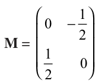
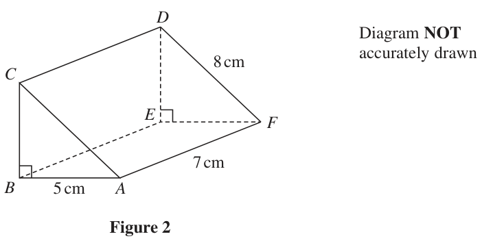
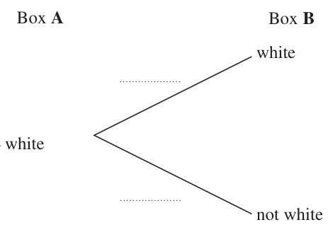
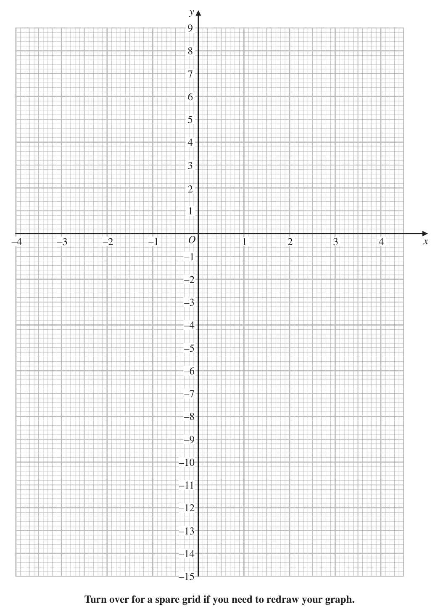
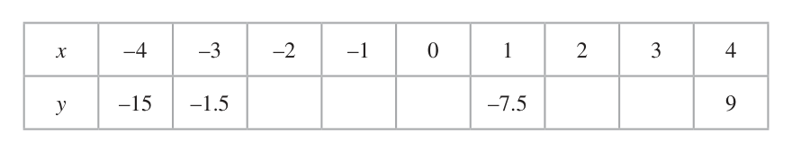

# 4MB1/02R — 2023-01 (official extraction)

> schema `syllabai.official-paper-questions/0.2` · paper_id `pearson-edexcel:international-gcse:mathematics-b:4mb1:2023-01:4MB1/02R` · qp sha256 `f4cfffbed6743ece…` · extraction is the disclosed baseline (ADR-039)

## Question 1 (9 marks)

Rory buys and sells jewellery. Rory buys a necklace for $180 He sells the necklace for $230

### 1(a) [2]

Calculate, to 3 significant figures, Rory’s percentage profit. Rory sells a bracelet for $203 This price represents a 16% profit on his cost price.

**Mark scheme answer**

> 230 − 180 230 2 M1 Correct method to find percentage profit award for 28% with
> ×100 or ×100 − 100 oe no incorrect working seen
> 180 180
> the ×100 or −100 may be inferred eg 127.8% ⇒ 27.8% implies
> –100
> 27.8(%) A1 accept awrt 27.8

- **(2)** 230 − 180 230 2 M1 Correct method to find percentage profit award for 28% with

### 1(b) [2]

Calculate the cost price of the bracelet. Rory travelled by plane from New York to Dubai to buy some jewellery. The total flight time for the journey was 12 hours 48 minutes. The average speed for the journey was 860 km/h

**Mark scheme answer**

> 203 ÷ 1.16 or 203 ÷ 116 ×100 oe 2 M1 Fully correct method to find the cost price
> 203 − x
> allow for = 0.16 oe do not allow 203 ÷ (1+16%) or
> x
> 203 ÷ 116% without further correct working or a correct answer.
> ($)175 A1 cao

- **(2)** 203 ÷ 1.16 or 203 ÷ 116 ×100 oe 2 M1 Fully correct method to find the cost price

### 1(c) [3]

Calculate the total distance, in kilometres, travelled by the plane. Rory bought some earrings for a total cost of 91 750 dirhams. Using the exchange rate, 1 dollar = 3.67 dirhams

**Mark scheme answer**

> Use of 12 hrs 48 mins = 12.8 hrs or 3
> B1 Convert time to hours or minutes only, accept
> 768 mins
> 860 M1 for use of time × distance (allow use of their time eg 12.48)
> 860 × “12.8” or × "768"
> 11 008 (km) A1 allow an answer of 11 000 from correct working

- **(3)** Use of 12 hrs 48 mins = 12.8 hrs or 3

### 1(d) [2]

calculate the total cost of the earrings in dollars.

**Mark scheme answer**

> 91 750 ÷ 3.67 2 M1 Correct method to find cost in dollars
> ($)25 000 A1 cao
> Correct answers scores full marks Total 9 marks
> (unless from obviously incorrect
> working)

- **(2)** 91 750 ÷ 3.67 2 M1 Correct method to find cost in dollars

## Question 2 (7 marks)
### 2(a) [1]

Write 76 000 000 in standard form.

**Mark scheme answer**

> 7.6 × 107 1 B1 cao

- **(1)** 7.6 × 107 1 B1 cao

### 2(b) [1]

Write 8.3 × 10–4 as an ordinary number.

**Mark scheme answer**

> 0.000 83 1
> B1 cao do not accept
> 100 000

- **(1)** 0.000 83 1

### 2(c) [2]

Calculate (3 × 10147 ) ÷ (6 × 10122 ) Give your answer in standard form.

**Mark scheme answer**

> 0.5 × 1025 oe 2 M1 also accept 5 ×10n or x ×1024 where n is an integer and
> 1 ≤ x < 10 or 1025 ÷ 2 or
> 5 000 000 000 000 000 000 000 000 oe
> 5 × 1024 A1
> (unless from obviously incorrect
> working)

- **(2)** 0.5 × 1025 oe 2 M1 also accept 5 ×10n or x ×1024 where n is an integer and

### 2(d) [3]

Write 1.6 × 1041 as a product of its prime factors. Show your working clearly.

**Mark scheme answer**

> [ 1.6 ×1041 =] 16 × 1040 3 M1 For any one of:
> or 1.6 ×1041 expressed as the product of an integer and a
> 16 = 24 or 1.6 = 23 × 5−1 oe power of 10 eg 160 ×1039 or
> or Express 1.6, 16, 160 etc as a product of prime factors,
> 1040 = (2 × 5) 40 or 1041 = (2 × 5)41 oe
> Condone 1.6 = × 23 or 1.6 = 23 × 0.2 or
> Express 10 = (2 × 5)n
> n
> For any two of: M1 dep on M1 For any two of:
> [ 1.6 ×1041 =] 16 × 1040 1.6 ×1041 expressed as the product of an integer and a
> or power of 10 or
> 16 = 24 or 1.6 = 23 × 5−1 oe Express 1.6, 16, 160 etc as a product of prime factors or
> or Express 10n = (2 × 5)n
> 1040 = (2 × 5) 40 or 1041 = 241 × 541 oe
> 244 × 540 A1 dependent on both method marks gained

- **(3)** [ 1.6 ×1041 =] 16 × 1040 3 M1 For any one of:

## Question 3 (5 marks)

Diagram NOT accurately drawn 8 cm Figure 1 Figure 1 shows a solid right circular cone. The radius of the base of the cone is 8 cm. The volume of the cone is 320π cm3 The total surface area of the cone is kπ cm2 Calculate the value of k (5) ⎡ ⎤ 1 2 ⎡ ⎤ ⎢ ⎥ Volume of a cone = πr h ⎢ ⎥ ⎢ ⎥ ⎢ ⎥ ⎢⎣ Curved ⎥⎦ ⎣⎢ ⎦⎥ surface area of cone = πrl

### 3 [5]

Diagram NOT accurately drawn 8 cm Figure 1 Figure 1 shows a solid right circular cone. The radius of the base of the cone is 8 cm. The volume of the cone is 320π cm3 The total surface area of the cone is kπ cm2 Calculate the value of k ⎡ ⎤ 1 2 ⎡ ⎤ ⎢ ⎥ Volume of a cone = πr h ⎢ ⎥ ⎢ ⎥ ⎢ ⎥ ⎢⎣ Curved ⎥⎦ ⎣⎢ ⎦⎥ surface area of cone = πrl

> 🖼 crop required: diagram (qp.pdf p.6)

**Mark scheme answer**

> 1 5 M1 for a correct equation to find the height of the cone
> × π × 82 × h = 320π oe
> allow an equation with π cancelled eg = 320
> 320 × 3 M1 dep on previous M mark for a correct calculation to
> [ h =] [ = 15] find the height of the cone
> M1 for a correct calculation for the slant height, l
> [l =] "15"2 + 82 [ = 17]
> π × 82 + π × 8 × "17" oe M1 for a correct total area follow through their l. May use
> their slant height which must be distinct from their height
> (or for an answer of 628 – 629 without 200π seen)
> (NB: an answer of 628 – 629 with no obvious
> incorrect working seen gains 4 marks)
> Condone [ k = ] 82 + 8 × "17" without π
> 200 A1 allow 200π
> Correct answers scores full marks (unless Total 5 marks
> from obviously incorrect working)

- **(5)** 1 5 M1 for a correct equation to find the height of the cone

## Question 4 (10 marks)

Trapeziums P and Q are drawn on the grid opposite.

### 4(a) [3]

Describe fully the single transformation that maps trapezium P onto trapezium Q ⎛ 2⎞ Trapezium P is transformed to trapezium A under the translation ⎜ ⎟ ⎝ −3⎠

**Mark scheme answer**

> Enlargement 3 B1 with no mention of any other transformation
> Scale factor 2 B1
> Centre (6, –2) B1

- **(3)** Enlargement 3 B1 with no mention of any other transformation

### 4(b) [2]

On the grid, draw and label trapezium A Trapezium P is transformed to trapezium B by a rotation of 90° clockwise about the point (5, 2)

**Mark scheme answer**

> (3, –2), (4, –1), (5, –1), (7, –2) A correctly shown 2 B2 for A shown in the correct position.
> (B1 for 2 points plotted correctly or 3 points listed
> correctly or for the correct translation for one direction
> only)
> SC For a correct transformation applied to Q (vertices
> (–2, 1), (0, 3), (2, 3) and (6, 1) drawn) Award B1

- **(2)** (3, –2), (4, –1), (5, –1), (7, –2) A correctly shown 2 B2 for A shown in the correct position.

### 4(c) [2]

On the grid, draw and label trapezium B Trapezium C is the image of trapezium Q under the transformation with matrix M where ⎛ 1⎞ 0 − ⎜ 2⎟ M= ⎜ ⎟ ⎜1 0⎟ ⎝2 ⎠

**Mark scheme answer**

> (4, 6), (5, 5), (5, 4), (4, 2) B correctly shown 2 B2 for B shown in the correct position
> (B1 for 2 points plotted correctly or 3 points listed
> correctly or a shape the correct size and shape with the
> correct orientation or shape with vertices (5, –1), (5, 0),
> (6, 2) and (6, –2) drawn)

- **(2)** (4, 6), (5, 5), (5, 4), (4, 2) B correctly shown 2 B2 for B shown in the correct position

### 4(d) [3]

On the grid, draw and label trapezium C y Q P –5 –4 –3 –2 –1 O 1 2 3 4 5 6 7 8 x –1 –2 –3 for a spare grid if you need to redraw your trapeziums. Only use this grid if you need to redraw your trapeziums. y Q P –5 –4 –3 –2 –1 O 1 2 3 4 5 6 7 8 x –1 –2 –3

**Mark scheme answer**

> ⎛ 1⎞ 3 M1 for the transformation matrix followed by a either
> ⎜0 − ⎟
> 2 ⎛ −4 −2 0 4 ⎞ correct coordinate matrix or 4 correct position vectors of
> ⎜ ⎟⎜ ⎟ object (NB: any order of coordinates) or 3 correct points of
> ⎜1 ⎟⎝
> 0⎟
> 4 6 6 4⎠
> image listed or 2 correct points of image plotted
> ⎜
> ⎝2 ⎠ For this mark allow transformation of P by matrix eg.
> ⎛ 0 − 0.5 ⎞⎛1 2 3 5 ⎞
> ⎜ ⎟⎜ ⎟
> ⎝ 0.5 0 ⎠⎝1 2 2 1 ⎠
> ⎛ −2 −3 −3 −2 ⎞ M1 dep on M1 awarded, at least 3 correct points of image
> ⎜ ⎟ listed (may be seen in a single matrix) or 3 correct points
> ⎝ −2 −1 0 2 ⎠ of image plotted
> ⎛ −0.5 −1 −1 −0.5 ⎞
> For this mark allow ⎜ ⎟
> ⎝ 0.5 1 1.5 2.5 ⎠
> (–2, –2), (–3, –1), (–3, 0), (–2, 2) C correctly shown A1 for a fully correct shape drawn on the grid
> Correct answers scores full marks (unless from obviously incorrect Total 10 marks
> working)

- **(3)** ⎛ 1⎞ 3 M1 for the transformation matrix followed by a either

## Question 5 (8 marks)

D Diagram NOT accurately drawn 8 cm C E F 7 cm B 5 cm A Figure 2 Figure 2 shows right triangular prism ABCDEF AB = 5 cm DF = 8 cm AF = 7 cm ∠CBA = 90°

### 5(a) [4]

Calculate the volume, in cm3 to the nearest whole number, of the triangular prism. P Q Diagram NOT accurately drawn 20° 12 cm T S 25 cm R Figure 3 Figure 3 shows a shaded shape made by removing triangle PTQ from rectangle PQRS QR = 12 cm SR = 25 cm ∠PTQ = 90° ∠TQR = 20°

**Mark scheme answer**

> 82 − 52 [ = 39] or 4 M1 Correct use of Pythagoras’ theorem or other
> method to find BC oe
> [ ∠BAC =] cos −1 ⎛⎜ ⎞⎟ [ = 51.3...] and 8 × sin("51.3") Allow 82 = x 2 + 52 oe
> ⎝8⎠
> 82 − 52 ⎡⎣ = 39 = 6.24...⎤⎦ M1 Correct method to find BC oe
> 1 M1 Must use a length which is their BC or DE, may
> × 5 × "6.24..."× 7 be on diagram if not labelled must be correct.
> Correct formula for volume of prism.
> 109 A1 109 – 109.3
> [cm3] (if no marks awarded, SCB1 for
> 1
> × 5 × 8 × 7 [ = 140] or × 5 × 52 + 82 × 7 [ = 165...] )
> 2

- **(4)** 82 − 52 [ = 39] or 4 M1 Correct use of Pythagoras’ theorem or other

### 5(b) [4]

Calculate the perimeter, in cm to the nearest whole number, of the shaded shape.

**Mark scheme answer**

> QT = 25cos 70 [ = 8.55...] or QT = 25sin 20 [ = 8.55...] or 4 M1 for a correct method to find QT or PT
> PT = 25sin 70 [ = 23.49...] or PT = 25cos 20 [ = 23.49...] or
> 25sin 70
> PT = oe
> sin 90
> QT = 25cos 70 [ = 8.55...] and PT = 252 − "8.55"2 M1 for a correct method to find QT and PT
> [=23.49…] oe
> “8.55…” + ”23.49…” + 12 + 12 + 25 M1 for a fully correct method to find the perimeter
> 81[cm] A1 awrt 81
> Correct answers scores full marks (unless from obviously Total 8 marks
> incorrect working)

- **(4)** QT = 25cos 70 [ = 8.55...] or QT = 25sin 20 [ = 8.55...] or 4 M1 for a correct method to find QT or PT

## Question 6 (9 marks)

Ted has two boxes of buttons, Box A and Box B There are 20 buttons in Box A and 20 buttons in Box B There are 13 white buttons in Box A There are 9 white buttons in Box B Ted takes at random a button from Box A and a button from Box B

### 6(a) [2]

Complete the probability tree diagram. Box A Box B white white not white white not white not white

**Mark scheme answer**

> 2 13
> 9 B1 For Box A correct, and
> 20
> 13 20 9
> 20 11 B1 For Box B correct, and
> 20
> 20 Ignore any additions to the right of the
> 9 diagram
> 20

- **(2)** 2 13

### 6(b) [3]

Calculate the probability that Ted takes at least one white button. Ted also has a bag of buttons. There are 30 buttons in the bag. There are x white buttons in the bag. Ted takes at random a button from Box A, a button from Box B and a button from the bag. 337 The probability that of the 3 buttons Ted has, 2 of the buttons are white is 1000

**Mark scheme answer**

> ⎛ 13 ⎞ ⎛ 9 ⎞ ⎡ 117 ⎤ ⎛ 13 ⎞ ⎛ 11 ⎞ ⎡ 143 ⎤ 3 M1Correct product of probabilities ft
> " ⎜ ⎟ "× " ⎜ ⎟ " ⎢ = or " ⎜ ⎟ "× " ⎜ ⎟ " ⎢ = or their tree diagram
> ⎝ 20 ⎠ ⎝ 20 ⎠ ⎣ 400 ⎦⎥ ⎝ 20 ⎠ ⎝ 20 ⎠ ⎣ 400 ⎦⎥
> Do not ft any probability greater than 1
> ⎛ 7 ⎞ ⎛ 9 ⎞ ⎡ 63 ⎤ ⎛ 7 ⎞ ⎛ 11 ⎞ ⎡ 77 ⎤
> " ⎜ ⎟ "× " ⎜ ⎟ " ⎢ = ⎥ or " ⎜ ⎟ "× " ⎜ ⎟ " ⎢ =
> ⎝ 20 ⎠ ⎝ 20 ⎠ ⎣ 400 ⎦ ⎝ 20 ⎠ ⎝ 20 ⎠ ⎣ 400 ⎦⎥
> 117 143 63 13 63 M1 fully correct method to find P(at
> " "+ " "+ " " or " "+ " " least one W) ft their tree diagram
> 400 400 400 20 400
> 9 143 77 Do not ft any probability greater than 1
> or " "+ " " or 1 − " " dep on previous M mark
> 20 400 400
> 323 A1 Allow awrt 0.81 oe
> 400

- **(3)** ⎛ 13 ⎞ ⎛ 9 ⎞ ⎡ 117 ⎤ ⎛ 13 ⎞ ⎛ 11 ⎞ ⎡ 143 ⎤ 3 M1Correct product of probabilities ft

### 6(c) [4]

Work out the value of x Show clear algebraic working.

**Mark scheme answer**

> ⎛ 13 ⎞ ⎛ 9 ⎞ 30 − x ⎡ 39(30 − x) 1170 − 39 x ⎤ 4 M1for a correct product of 3
> " ⎜ ⎟ "× " ⎜ ⎟ "× = = or probabilities
> ⎝ 20 ⎠ ⎝ 20 ⎠ 30 ⎣⎢ 4000 4000 ⎦⎥
> ft their tree diagram
> ⎛ 13 ⎞ ⎛ 11 ⎞ x ⎡ 143x ⎤ ⎛ 7 ⎞ ⎛ 9 ⎞ x ⎡ 21x ⎤ If total in bag is incorrect but consistent
> " ⎜ ⎟ "× " ⎜ ⎟ "× ⎢ = ⎥ or " ⎜ ⎟ "× " ⎜ ⎟ "× ⎢ = oe
> ⎝ 20 ⎠ ⎝ 20 ⎠ 30 ⎣ 12000 ⎦ ⎝ 20 ⎠ ⎝ 20 ⎠ 30 ⎣ 4000 ⎦⎥ allow this mark.
> ⎛ 13 ⎞ ⎛ 9 ⎞ 20 − x
> Eg " ⎜ ⎟ "× " ⎜ ⎟ "×
> ⎝ 20 ⎠ ⎝ 20 ⎠
> Do not ft any probability greater than 1
> x
> If using x rather than do not award
> until attempting to find number of
> counters rather than probability
> ⎛ 1170 − 39 x ⎞ ⎛ 143x ⎞ ⎛ 21x ⎞ M1for a fully correct probability
> "⎜ ⎟ " + "⎜ ⎟ "+ " ⎜ ⎟ " oe ft their tree diagram
> ⎝ 4000 ⎠ ⎝ 12000 ⎠ ⎝ 4000 ⎠ If total in bag is incorrect but consistent
> allow this mark.
> Do not ft any probability greater than 1
> Need not be simplified
> dep on previous M mark
> 3 × "1170"− 3 × "39" x + "143" x + 3 × "21" x 337 89 1170 337 M1 ft their tree diagram
> = or x+ =
> 12 000 1000 12 000 4000 1000 Do not ft any probability greater than 1
> for a correct equation with no brackets
> or 3 × "1170"− 3 × "39" x + "143" x + 3 × "21" x = 337 ×12 or 89x = 534 oe
> (but can be a fraction)
> dep on previous M mark
> 6 A1
> Correct answers scores full marks (unless from obviously incorrect working) Total 9 marks

- **(4)** ⎛ 13 ⎞ ⎛ 9 ⎞ 30 − x ⎡ 39(30 − x) 1170 − 39 x ⎤ 4 M1for a correct product of 3

## Question 7 (10 marks)

The function g is defined as g:x ↦ 2x − 3

### 7(a) [1]

Find the value of x that must be excluded from the domain of g

**Mark scheme answer**

> 3 1
> B1 oe accept 1.5 allow x ≠
> 2

- **(1)** 3 1

### 7(b) [3]

Solve g(x) = 5 The function f is defined as f : x ↦ 3x 2 + 9x – 7 for x > – ⎛ 1⎞

**Mark scheme answer**

> 5(2 x − 3) = 10 oe 3 M1 Setting g(x) = 5 and gaining a correct equation with no
> fractions
> 10 M1dep on previous M mark
> 10 x = 10 + 15 or 2 x − 3 = For removing any brackets, allow a maximum of 1
> numerical error
> 2.5 A1 oe

- **(3)** 5(2 x − 3) = 10 oe 3 M1 Setting g(x) = 5 and gaining a correct equation with no

### 7(c) [2]

Find f ⎜ − ⎟ ⎝ 2⎠

**Mark scheme answer**

> ⎛ 1⎞
> 1 2 M1
> 3 ⎜ − ⎟ + 9 × − − 7 oe
> ⎝ 2⎠
> 43 A1 oe accept –10.75
> −

- **(2)** ⎛ 1⎞

### 7(d) [4]

Express the inverse function f –1 in the form f –1 : x ↦ ... ⎡ −b ± b 2 − 4ac ⎤ ⎢Solutions of ax + bx + c = 0 are x = ⎥ ⎢⎣ 2a ⎥⎦

**Mark scheme answer**

> ⎛⎛
> 3⎞ 9⎞ 4 M1 for a start to completing the square As a minimum
> y = 3 ⎜ ⎜ x + ⎟ − ⎟ − 7 or
> ⎜⎝ 2 ⎠ 4 ⎟⎠ ⎛ 3⎞
> ⎝ must see y = 3 ⎜ x + ⎟ + c where c is a number or
> 2 ⎝ 2⎠
> ⎛ 3 ⎞ 27 numerical expression not equal to –7
> y = 3⎜ x + ⎟ − − 7
> ⎝ 2⎠
> 3 y 55 ⎛ 3⎞
> ( x + )2 = + M1dep on previous M mark isolating ⎜ x + ⎟
> 2 3 12 ⎝ 2⎠
> 3 y 55 M1 dep on previous M mark removing square and
> x=− + + isolating x could be +/– at this stage
> 2 3 12
> 3 x 55 ⎛ 55 ⎞
> − + + ⎜ x+ ⎟
> 2 3 12 3 4 ⎠
> A1oe eg − + ⎝ but must have only + before
> 2
> square root and must be in terms of x
> eg 3x 2 + 9 x + ( −7 − y ) = 0 4 M1 Writing as a 3 term quadratic equation in terms of x
> −9 + 92 − 4 × 3(−7 − y ) M1 dep on previous M mark. Substitution into a correct
> ( x =) oe quadratic formula, allow one sign error in the substitution
> 2×3 could be +/–at this stage
> −9 + 165 + 12 y M1 dep on previous M mark. Expand and combine terms
> x= in the square root could be +/–at this stage
> −9 + 165 + 12 x 3 165 + 12 x
> A1 oe eg − + oe but must have only +
> 6 2
> before square root and must be in terms of x
> Do not ISW
> Correct answers scores full marks Total 10 marks
> (unless from obviously incorrect
> working)

- **(4)** ⎛⎛

## Question 8 (9 marks)

The equation of a curve is y = x – 5x – 3 1 3

### 8(a) [3]

Complete the table of values for y = x – 5x – 3 x –4 –3 –2 –1 0 1 2 3 4 y –15 –1.5 –7.5 9

> 🖼 crop required: table (qp.pdf p.None)

**Mark scheme answer**

> 3, 1.5, –3, –9, –4.5 3 B3 for all 5 correct (B2 for 3 or 4 correct, B1 for 1 or 2
> correct)

- **(3)** 3, 1.5, –3, –9, –4.5 3 B3 for all 5 correct (B2 for 3 or 4 correct, B1 for 1 or 2

### 8(b) [3]

On the grid opposite, plot the points from your completed table and join them to form a smooth curve.

**Mark scheme answer**

> 3 M1 Attempts to plot at least 7 of their points with at
> least 5 correct ±1 small square. (Allow if curve goes
> through the points) ft their values from (a)
> M1 drawing a smooth curve through at least 5 of their
> plotted points. Do not allow if straight lines used. Allow
> ±1 small square from their point.
> A1ft A fully correct curve ft their values from (a). All
> Points plotted correctly, ± 1 small square, with a
> smooth curve through all the points ±1 small square.
> Penalise a curve for which there are clearly multiple y
> values for any x in a range of size at least 0.2

- **(3)** 3 M1 Attempts to plot at least 7 of their points with at

### 8(c) [3]

By drawing a suitable straight line on your grid, find estimates, to one decimal place, of the solutions to the equation 1 3 1 x – 5x – 3 = 1 – x in the interval –4 ≤ x ≤ 4 2 2 y –4 –3 –2 –1 O 1 2 3 4 x –1 –2 –3 –4 –5 –6 –7 –8 –9 –10 –11 –12 –13 –14 –15 for a spare grid if you need to redraw your graph. Only use this grid if you need to redraw your graph. y –4 –3 –2 –1 O 1 2 3 4 x –1 –2 –3 –4 –5 –6 –7 –8 –9 –10 –11 –12 –13 –14 –15

**Mark scheme answer**

> 1 3 M1 for the correct line drawn (If extended must go
> y = 1 − x drawn through (–4, 3) and (4, –1) ±1 small square
> –2.4, –1, 3.4 A2ft for all 3 correct solutions do not allow coordinates
> (A1ft for 2 correct solutions, condone coordinates)
> tolerance of 1 small square
> Dep on M1 in this part and at least M1 scored in (b) and
> a “curve” drawn condone straight line segments for this.
> Values given must follow through their graph, do not
> allow values listed if they do not match up with their
> 1
> graph Be particularly careful if x3 − x − 4 = 0
> 2
> followed by results is seen.
> Penalise any value given to more than 2 dp.

- **(3)** 1 3 M1 for the correct line drawn (If extended must go

## Question 9 (7 marks)
### 9(a)(i) [2]

Solve the inequality 5y – 7 > 2y – 13

**Mark scheme answer**

> 5y – 2y > –13 + 7 oe 2 M1 or for an answer of –2 or
> y and incorrect inequality sign with –2
> y > –2 A1 oe eg (–2, ∞)

- **(2)** 5y – 2y > –13 + 7 oe 2 M1 or for an answer of –2 or

### 9(a)(ii) [1]

Hence, represent on the number line at the top of the next page, the values of y for which 5y – 7 > 2y – 13

**Mark scheme answer**

> Correct 1 B1 for an open circle at –2 with a line to the right as far as 5 if no arrow, or any
> inequality length with an arrow. Allow alternative notation.
> shown Condone two or three inequalities seen on number line, give bod if this is seen.

- **(1)** Correct 1 B1 for an open circle at –2 with a line to the right as far as 5 if no arrow, or any

### 9(b)(i) [3]

Solve the inequality 4x 2 + 4x – 35 < 0

**Mark scheme answer**

> (2 x + 7)(2 x − 5) 3 M1 for a correct method to solve the quadratic equation If factorising, allow
> brackets which when expanded give 2 out of 3 terms correct
> If using formula must use a fully correct formula allow one sign error when
> −4 ± 42 − 4 × 4 × ( −35 )
> substituting in oe
> 2× 4
> ⎛ 1⎞
> If completing the square need to see 4 ⎜ x + ⎟ + c [ < 0] or ( 2 x + 1) + c [< 0] oe
> ⎝ 2⎠
> where c is a numerical expression that does not equal –35 or to see
> ⎛ 1⎞
> x + x − 8.75 < 0 leading to ⎜ x + ⎟ + k [ < 0] oe where k does not equal –8.75
> ⎝ 2⎠
> 2.5, –3.5 A1 correct critical values or an inequality of the form a < x < b where a < b
> –3.5 < x < 2.5 A1 oe
> Do not penalise incorrect inequalities if replaced with the correct inequality
> isw if the correct answer is followed by a list of integers

- **(3)** (2 x + 7)(2 x − 5) 3 M1 for a correct method to solve the quadratic equation If factorising, allow

### 9(b)(ii) [1]

Hence find the values of x for which 5x – 7 > 2x – 13 and 4x 2 + 4x – 35 < 0 ⎡ −b ± b 2 − 4ac ⎤ ⎢Solutions of ax + bx + c = 0 are x = ⎥ ⎢⎣ 2a ⎥⎦ –5 –4 –3 –2 –1 0 1 2 3 4 5

**Mark scheme answer**

> –2 < x < 2.5 1 B1oe ft from (a)(i) and (b)(i)
> Correct answer scores full marks regardless of previous answers
> ft dep on overlap between the results from (a)(i) and (b)(i) and the inequality in
> (b)(i) being of the form a < x < b or x < a, x > b where a < b
> Condone y rather than x Do not isw if the correct answer is followed by a list of
> integers
> Correct answers scores full marks (unless from obviously incorrect working)
> Total 7 marks

- **(1)** –2 < x < 2.5 1 B1oe ft from (a)(i) and (b)(i)

## Question 10 (6 marks)
### 10(a) [3]

Express in the form a where a is a number to be found. Show your working clearly.

**Mark scheme answer**

> 98 + 18 = 7 2 + 3 2 ⎡⎣ = 10 2 ⎤⎦ or 3 M1 Expressing 98 and 18 in terms of 2 or
> 98 + 18 5
> × rationalising the denominator may imply × by eg
> 5 5
> 490 + 90
> "10 2 " 5 200 M1 dep on previous M mark, expressing surds in
> × or = 40 or appropriate form to add and rationalising the
> 5 5
> denominator or dividing two square roots may imply
> 98 + 18 5 7 10 + 3 10 5 10 2 10 10
> × = × by eg =
> 5 5 5
> 5
> 40 A1 dep on M2

- **(3)** 98 + 18 = 7 2 + 3 2 ⎡⎣ = 10 2 ⎤⎦ or 3 M1 Expressing 98 and 18 in terms of 2 or

### 10(b) [3]

Given that 4 × 3 = 3x 813 find the value of x, giving your answer as a fraction in its simplest form. Show your working clearly.

**Mark scheme answer**

> 3
> 3 M1 dealing with the
> 27 = 3 or 27 × 3 = 9 = 32 or
> 27 = 3 3 and 3 3 × 3 = 32 or
> 81 −
> 27 × 3 = 81 and
> = 81
> oe
> 813
> 16
> ( 3 81) 4 = 3 3 M1 dealing with 813 allow for 81a = 34 a where a ≠ 1
> 10 −
> − A1 condone 3 3 dep on M2
> isw if the correct answer is then given as a decimal
> Working required Total 6 marks

- **(3)** 3

## Question 11 (10 marks)

A curve C and a straight line L are drawn on a grid. C has equation y = 5x 2 – 16x – 5 L has equation y + 5x = 7

### 11(a) [5]

Find the coordinates of the points of intersection of C and L Show clear algebraic working. P is the point on the curve with equation y = 5x 2 – 16x – 5 with x coordinate 2 The line Q is the tangent to the curve at the point P The line Q crosses the x‑axis at the point X and the y‑axis at the point Y The point M lies on Q and is such that XM = MY

**Mark scheme answer**

> 7 − 5 x = 5 x 2 − 16 x − 5 or 5 M1 for a correct substitution to gain an equation in one
> 2 variable
> ⎛7− y⎞ ⎛7− y⎞
> y = 5⎜ ⎟ − 16 ⎜ ⎟−5
> ⎝ 5 ⎠ ⎝ 5 ⎠
> 5 x 2 − 11x − 12 [ = 0] or y 2 − 3 y − 88 [ = 0] oe M1 dep on previous M mark for writing as 3 term
> quadratic in one variable, allow one sign error
> (5 x + 4)( x − 3) or ( y − 11) ( y + 8) M1 for a correct method to solve their quadratic
> equation dep on having a three term quadratic in one
> ([ −]11) − 4 × 5 × (−12) or
> − ( −11) ± variable, do not allow 5 x 2 − 16 x − 5 = 0
> 2×5 If factorising, allow brackets which when expanded
> give 2 out of 3 terms correct
> ([ −] 3) − 4 ×1× ( −88) oe
> − ( −3) ± If using formula must use a fully correct formula allow
> 2 ×1 one sign error when substituting
> If completing the square need to see
> ⎛ 11 ⎞
> 5 ⎜ x − ⎟ + a [ = 0] oe where a is a numerical
> ⎝ 10 ⎠
> ⎛ 3⎞
> expression that does not equal –12 or ⎜ y − ⎟ + b [ = 0]
> ⎝ 2⎠
> oe where b is a numerical expression that does not equal
> –88 or to see x 2 − 2.2 x − 2.4 = 0 leading to
> ( x − 1.1) + c [ = 0] oe where c does not equal –2.4
> x= –0.8, x = 3 or A1 oe both x values or both y values or one correct pair
> y = 11, y = –8 of x and y dep on at least first 2 M marks gained
> NB M1M1M0A1 may be awarded
> (3, –8), A1 oe both coordinates, dep on M3.
> (–0.8, 11) Allow written as
> x = 3, y = –8 x = –0.8, y = 11 as long as correctly
> paired

- **(5)** 7 − 5 x = 5 x 2 − 16 x − 5 or 5 M1 for a correct substitution to gain an equation in one

### 11(b) [5]

Calculate the coordinates of the point M Give your coordinates as exact values. ⎡ −b ± b 2 − 4ac ⎤ ⎢Solutions of ax 2 + bx + c = 0 are x = ⎥ ⎢⎣ 2a ⎥⎦

**Mark scheme answer**

> dy 5 M1 for differentiating with at least one nonzero term
> = 10 x − 16 correct
> dx
> 10 × 2 – 16 [= 4] dy
> M1 for substituting 2 into their for gradient of
> dx
> tangent dep on M1
> y = 5 × 2² – 16 × 2 – 5 [= –17] M1 indep for y coordinate of P
> "− 17" = "4"× 2 + c or c = −25 oe M1 correctly substituting into formula for equation of
> y − " ( −17 ) " = "4"( x − 2) or a correct equation eg straight line parallel to curve at P – ft correct use of
> their gradient and y value dep on first M1
> y − 4 x + 25 = 0
> Both must be numerical
> If 2nd M1 awarded do not allow use of perpendicular
> gradient.
> ⎛ 25 25 ⎞ A1 oe eg(3.125, –12.5)
> ⎜ 8 ,− 2 ⎟
> ⎝ ⎠
> from obviously incorrect working)

- **(5)** dy 5 M1 for differentiating with at least one nonzero term

## Question 12 (10 marks)

C Diagram NOT accurately drawn B D A E F Figure 4 Figure 4 shows a regular hexagon ABCDEF Given that the area of hexagon ABCDEF = 150 3 cm2

### 12(a) [4]

find the perimeter, in cm, of the hexagon. Diagram NOT K L accurately drawn C B J D I E A F H G Figure 5 Figure 5 shows a shape AGHIJKLBCDEF made from a regular octagon GHIJKLBA and the regular hexagon ABCDEF from part (a).

> 🖼 crop required: diagram (qp.pdf p.None)

**Mark scheme answer**

> 1 1 3 3 3d 2 4 M1 for area of one triangle or trapezium or the
> × x × x × sin 60 or × x × x or or whole hexagon (allow use of their “60” from a
> 2 2 2
> correct method for method marks)
> 1 3 1 1 d represents a length of the edge
> ( d + 2d ) × d or × y × 3 y or × 4 y × y × sin 30 oe
> 2 2 2 2 x represents either the length of an edge or a
> diagonal such as AC
> y represents a length of half an edge.
> If unsure of a variables meaning give bod
> 150 3 1 2 150 3 1 2 M1 for a correct equation for the area of the whole
> eg = × x × sin 60 or = × x × sin 60 or hexagon or for a trapezium or triangle within the
> 6 2 2
> hexagon.
> 3 3d 150 3 1
> 150 3 = or = ( d + 2d ) × d or
> 2 2 2
> 3 2
> 150 3 = 12 × y or oe
> d 2 = 100 or x 2 = 300 or y 2 = 25 oe M1 for a correct method to find a length or its
> square
> 60(cm) A1 accept awrt 60.0

- **(4)** 1 1 3 3 3d 2 4 M1 for area of one triangle or trapezium or the

### 12(b) [6]

Work out the length, in cm to one decimal place, of the straight line KF ⎡ ⎤ 1 Area of triangle = ab sin C ⎡ ⎤ ⎢ ⎥ 2 ⎢ ⎥ ⎢ ⎥ ⎢ ⎥ ⎢⎣ Sum ⎣⎢ ⎦⎥ ⎥⎦ of interior angles of polygon is (2n – 4) right angles

**Mark scheme answer**

> Hexagon int ∠ = 120 or ext ∠ = 60, 6 B1 For sight of int or ext ∠ of either shape
> Octagon int ∠ = 135 or ext ∠ = 45 May be seen on diagram and allow sight of 120 in
> working of part(a)
> Horizontal or vertical distance of L from B = “10” sin”45” or M1 One of the horizontal or vertical displacement
> [ KA =]"10"+ 2 × "10"sin"45" ⎡⎣= 10 + 10 2 = 24.14...⎦⎤ or of L from B or length KA or KB or KG
> Use of their “60” ÷ 6 for all method marks.
> "45" (allow use of their angles in a hexagon or octagon
> [ KB =] 2 × "10"cos [ = 18.47...] or
> 2 from a correct method for method marks)
> [ KG =] [ = 26.13]
> ⎛ "135" ⎞
> cos ⎜ ⎟
> ⎝ 2 ⎠
> Height of A above F = “10”sin30 or “10”cos60 or M1 One of the vertical or horizontal
> Horizontal distance of A from F = “10”cos30 or “10”sin60 or displacements of A from F or angle KAF or
> [Angle KAF =] “120” + “45” [ = 165] or length FB or FG
> "60" ⎡
> [ FB =] 2 × "10"× cos = 10 3 = 17.32...⎤⎦ or
> 2 ⎣
> 180 − "60"− "45 ⎞
> [ FG =] 2 × "10"× cos ⎛⎜ ⎟ [ = 15.86...]
> ⎝ 2 ⎠
> Height of K above F = “10”sin45 + “10” + “10”sin30 M1 dep on previous two M marks Both of the
> [= 15 + 5 2 =22.07…] and vertical or horizontal displacements of A from
> Horizontal distance of F or equation involving KF
> K from F = “10” + “10”sin45+”10”sin60
> ⎡ = 10 + 5 2 + 5 3 = 25.73...⎤ or
> ⎣ ⎦
> KF 2 = "24.14"2 + "10"2 − 2 × "24.14"× "10"× cos"165" or
> KF 2 = "18.47"2 + "17.32"2 − 2 × "18.47"× "17.32"× cos (142.5 ) or
> KF 2 = "26.13"2 + "15.86"2 − 2 × "26.13"× "15.86"× cos (105)
> M1 Expression to find KF dep on previous
> [ KF =] "22.07..."2 + "25.73..."2 or 3 M marks.
> [ KF =] "24.14"2 + "10"2 − 2 × "24.14"× "10"× cos"165" or
> [ KF =] "18.47"2 + "17.32"2 − 2 × "18.47"× "17.32"× cos (142.5 ) or
> [ KF =] "26.13"2 + "15.86"2 − 2 × "26.13"× "15.86"× cos (105 )
> 33.9(cm) A1 awrt 33.9
> Correct answers scores full marks (unless from obviously Total 10 marks
> incorrect working)
> Pearson Education Limited. Registered company number 872828
> with its registered office at 80 Strand, London, WC2R 0RL, United Kingdom

- **(6)** Hexagon int ∠ = 120 or ext ∠ = 60, 6 B1 For sight of int or ext ∠ of either shape

