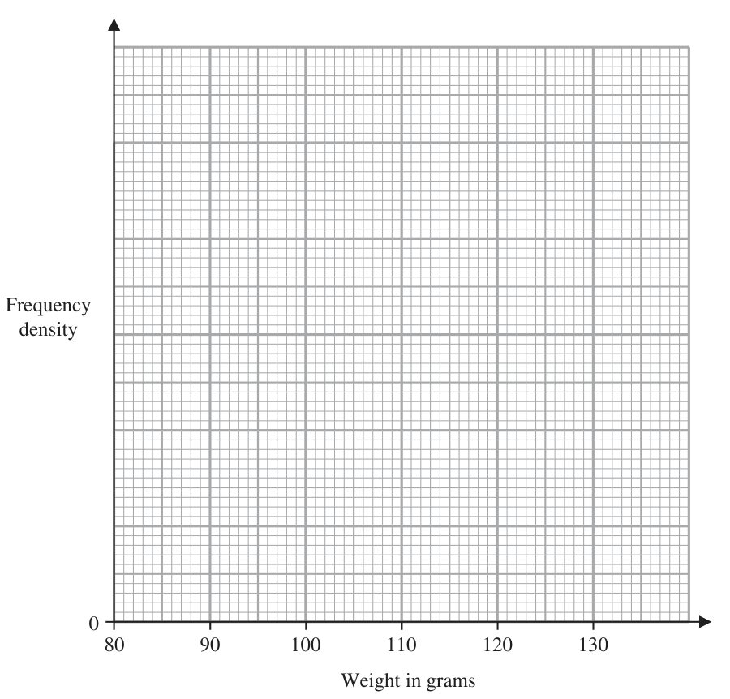
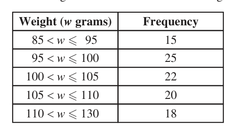

# 4MB1/01 — 2023-06 (official extraction)

> schema `syllabai.official-paper-questions/0.2` · paper_id `pearson-edexcel:international-gcse:mathematics-b:4mb1:2023-06:4MB1/01` · qp sha256 `a9b33cd495d77136…` · extraction is the disclosed baseline (ADR-039)

## Question 1 (2 marks)

Write down two of the following six numbers that are irrational numbers. 36 0.2 3 −1 18 .............................. . , ...............................

### 1 [2]

Write down two of the following six numbers that are irrational numbers. 36 0.2 3 −1 18 ,

**Mark scheme answer**

> 3π 2 B2 both correct with no incorrect given do not allow misreads.
> 2 and 18 B1 one correct with maximum of one extra incorrect one
> given or both correct with one extra incorrect
> SC B1 for awrt 4.71 and 4.24 and no other values
> Mark what is on the answer line, only check working or the
> list if the answer line is blank.
> Total 2 marks
> Question Working Answer Mark Notes

- **(2)** 3π 2 B2 both correct with no incorrect given do not allow misreads.

## Question 2 (2 marks)

The nth term of a sequence is given by 12 − 5n Find the sum of the 2nd term and the 6th term of the sequence.

### 2 [2]

The nth term of a sequence is given by 12 − 5n Find the sum of the 2nd term and the 6th term of the sequence.

**Mark scheme answer**

> (12 − 5 × 2 ) + (12 − 5 × 6 ) 2 M1 allow for both terms correct eg. 2 and – 18 but not added
> or a correct method to find both terms (which may be
> incorrectly calculated) and then added.
> −16 A1 cao ISW if –16 seen in working and 16 written on answer
> line
> Correct answer scores full marks (unless Total 2 marks
> from obvious incorrect working)
> Question Working Answer Mark Notes

- **(2)** (12 − 5 × 2 ) + (12 − 5 × 6 ) 2 M1 allow for both terms correct eg. 2 and – 18 but not added

## Question 3 (2 marks)

Find the value of k 2 − 5k when k = − 4

### 3 [2]

Find the value of k 2 − 5k when k = − 4

**Mark scheme answer**

> ( −4 ) − 5 × −4
> 2 M1 must have brackets around the −4 unless recovered later
> must clearly indicate multiplication of –4 and –5 unless
> recovered later.
> Allow 16 + 20
> 36 A1 cao
> Correct answer scores full marks (unless Total 2 marks
> from obvious incorrect working)
> Question Working Answer Mark Notes

- **(2)** ( −4 ) − 5 × −4

## Question 4 (2 marks)

Using ruler and compasses only and showing all your construction lines, construct the perpendicular bisector of AB A B

### 4 [2]

Using ruler and compasses only and showing all your construction lines, construct the perpendicular bisector of AB A B

**Mark scheme answer**

> Correct 2 B2 correct line with construction arcs shown ie 2 sets of 2
> bisector with intersecting arcs or 1 pair of arcs intersecting twice. Condone
> arcs a bisector only drawn on one side of line. If the bisector does
> not go through the whole space between the lines on the
> overlay penalise if it would go out of tolerance if extended.
> Condone dotted line.
> B1 for a correct line without the required construction arcs or
> the required construction arcs without the line. Condone a
> bisector only drawn on one side of line
> Working required Total 2 marks
> Question Working Answer Mark Notes

- **(2)** Correct 2 B2 correct line with construction arcs shown ie 2 sets of 2

## Question 5 (2 marks)

Diagram NOT A accurately drawn D B E C The diagram shows the triangle ABC D is a point on the line AC E is a point on the line BC BA is parallel to ED BC = 10.8 cm EC = 8.1 cm DE = 3.6 cm Work out the length, in cm to one decimal place, of BA ................................... . . . . . . . . . . . . . . . . . . . . . . . . . . . cm

### 5 [2]

Diagram NOT A accurately drawn D B E C The diagram shows the triangle ABC D is a point on the line AC E is a point on the line BC BA is parallel to ED BC = 10.8 cm EC = 8.1 cm DE = 3.6 cm Work out the length, in cm to one decimal place, of BA cm

> 🖼 crop required: diagram (qp.pdf p.None)

**Mark scheme answer**

> 10.8 2 AB 4
> [ AB =] 3.6 × oe M1 for a fully correct equation including AB eg = or a
> 8.1 3.6 3
> correct expression for AB
> 4.8 A1 allow awrt 4.8
> NB correct answer from incorrect assumptions (eg use of right
> angled trigonometry) scores no marks
> Total 2 marks
> Question Working Answer Mark Notes

- **(2)** 10.8 2 AB 4

## Question 6 (2 marks)

Solve the inequality 4 x 3 6 x

### 6 [2]

Solve the inequality 4 x 3 6 x

**Mark scheme answer**

> 4 x – 6 x < 5 + 3 or −3 − 5 < 6 x − 4 x oe 2 M1 for isolating terms in x allow any of <, > or = for this
> mark. Allow simplified expressions eg − 2 x < 8 or −8 < 2x
> or x = −4 or x < −4 or just −4 without x
> x > −4 A1 accept −4 < x must be –4 do not ISW
> Correct answer scores full marks (unless Total 2 marks
> from obvious incorrect working)
> Question Working Answer Mark Notes

- **(2)** 4 x – 6 x < 5 + 3 or −3 − 5 < 6 x − 4 x oe 2 M1 for isolating terms in x allow any of <, > or = for this

## Question 7 (2 marks)

The price of a cup of coffee is decreased by 8% The price of a cup of coffee after the price decrease is $2.53 Calculate, in $, the price of this cup of coffee before the decrease. $......................... . . . . . . . . . . . . . . . . . . . . . . . . . . . . . . . . . . . . .

### 7 [2]

The price of a cup of coffee is decreased by 8% The price of a cup of coffee after the price decrease is $2.53 Calculate, in $, the price of this cup of coffee before the decrease. $

**Mark scheme answer**

> 2.53 8 2 2.53
> or 2.53 + 2.53 × oe M1 full correct method to find the original price condone
> 0.92 92 92%
> 2.75 A1 cao
> Correct answer scores full marks (unless from obvious Total 2 marks
> incorrect working)
> Question Working Answer Mark Notes

- **(2)** 2.53 8 2 2.53

## Question 8 (2 marks)

y 3x + 2y = −2 O R x The diagram shows the shaded finite region R which has three straight boundary lines. Write down the three inequalities that define the shaded region R

### 8 [2]

y 3x + 2y = −2 O R x The diagram shows the shaded finite region R which has three straight boundary lines. Write down the three inequalities that define the shaded region R

> 🖼 crop required: diagram (qp.pdf p.None)

**Mark scheme answer**

> 3x + 2 y − 2 oe 2 B1 3x + 2 y − 2 allow a 3x + 2 y − 2 where a 0 oe
> x 0 3 2
> Accept equivalents eg y − x − 1 or x − y − oe
> y 0 2 3
> Allow > for
> B1 for x 0 and y 0 accept b x 0 or c y
> where b − and c −1
> Allow < for
> Total 2 marks
> Question Working Answer Mark Notes

- **(2)** 3x + 2 y − 2 oe 2 B1 3x + 2 y − 2 allow a 3x + 2 y − 2 where a 0 oe

## Question 9 (2 marks)

Given that, for all values of x, x2 − 6x + 5 = (x − a)2 + b find the value of a and the value of b a = ......................... . . . . . . . . . . . . . . . . . . . . . . . . . . . . . . . . . . . . . b = ......................... . . . . . . . . . . . . . . . . . . . . . . . . . . . . . . . . . . . . .

### 9 [2]

Given that, for all values of x, x2 − 6x + 5 = (x − a)2 + b find the value of a and the value of b a = b =

**Mark scheme answer**

> a=3 2 B1 for a = 3 on answer line, if answer line is blank or contains
> b = −4 a = –3 award for ( x − 3) ± n where n is numerical in their
> working
> B1 for b = −4 on answer line, if answer line is blank or contains
> b = 4 award for ( x ± m ) − 4 where m is numerical in their
> working
> Total 2 marks
> Question Working Answer Mark Notes

- **(2)** a=3 2 B1 for a = 3 on answer line, if answer line is blank or contains

## Question 10 (3 marks)

Without using a calculator and showing all your working, work out 3 5 2 +3 5 7 Give your answer as a mixed number in its simplest form.

### 10 [3]

Without using a calculator and showing all your working, work out 3 5 2 +3 5 7 Give your answer as a mixed number in its simplest form.

**Mark scheme answer**

> 13 26 3 M1 for writing the fractions as improper fractions (addition
> + or
> 5 7 sign not required) or for writing the fraction part of the
> 3× 7 5× 5 ⎡ 21 25 ⎤ values over a common denominator (integer parts and
> [ 2] + [3] ⎢ = [ 2] + [3] ⎥ addition signs not required)
> 35 35 ⎣ 35 35 ⎦
> 13 26 13 × 7 26 × 5 ⎡ 91 130 ⎤ M1 for writing their improper fractions over a common
> + = + = + or denominator (may be written as a single fraction with 2
> 5 7 35 35 ⎢⎣ 35 35 ⎥⎦
> terms on the numerator), numerators need not be evaluated at
> 3× 7 5× 5 ⎡ 21 25 ⎤
> 2+3+ + ⎢ = 2+3+ + ⎥ this point ft their improper fractions if their denominators are
> 35 35 ⎣ 35 35 ⎦ different.
> or for adding the whole number parts and the fraction parts
> over a common denominator. ft their mixed numbers with
> common denominators
> 221 11 A1 for completion to the correct answer with full working
> = 6 or
> 35 35 221
> shown, must gain both M marks and or 5 or
> 46 11 35
> 5 = 6 or
> 35 35
> 5 + 1 must be seen in their working
> 11 11
> 5 +1 = 6
> 35
> Working required Total 3 marks
> Question Working Answer Mark Notes

- **(3)** 13 26 3 M1 for writing the fractions as improper fractions (addition

## Question 11 (3 marks)

Make x the subject of y

### 11 [3]

Make x the subject of y

**Mark scheme answer**

> 3x 15 4y 3 M1 Fully expanded, equation with no brackets.
> 4 y = 3x − 15 or y = − or = x −5
> 4 4 3 3x − 15
> NB we consider y = to still contain an implied
> oe
> bracket
> 3x 15 4y M1 isolating the term in x ft their 3-term equation
> 3x = 4 y + 15 or = y+ or x = +5
> 4 4 3 involving x, y and a constant. Allow a maximum of 1 sign
> error
> 4 y + 15 4y 4 y + 15
> x= A1 oe eg x = + 5 condone expression oe on
> 3 3
> answer line as long as correct equation seen in working.
> Do not isw.
> Correct answer scores full marks (unless Total 3 marks
> from obvious incorrect working)
> Question Working Answer Mark Notes

- **(3)** 3x 15 4y 3 M1 Fully expanded, equation with no brackets.

## Question 12 (3 marks)

Calculate 2 10 180 4 10 182 Give your answer in standard form.

### 12 [3]

Calculate 2 10 180 4 10 182 Give your answer in standard form.

**Mark scheme answer**

> 204 ×10−182 or 2.04 ×10−180 oe 3 M1 for a correct denominator Allow in any form
> 0.125 ×10190 or 12.5 ×10188 or M1 Allow a correct answer in any form
> 1.25 ×10n or m×10189
> 1.25 ×10189 A1 cao
> Correct answer scores full marks (unless Total 3 marks
> from obvious incorrect working)
> Question Working Answer Mark Notes

- **(3)** 204 ×10−182 or 2.04 ×10−180 oe 3 M1 for a correct denominator Allow in any form

## Question 13 (4 marks)
### 13(a) [2]

Factorise fully 8ab + 28b 2

**Mark scheme answer**

> 4b ( 2a + 7b ) 2 B2 fully correct
> B1 for 4 ( 2ab + 7b2 ) or b ( 8a + 28b ) or
> 2b ( 4a + 14b ) or 4b ( pa + qb ) where p and q
> are integers or correct factorisation followed
> by incorrect subsequent working.

- **(2)** 4b ( 2a + 7b ) 2 B2 fully correct

### 13(b) [2]

Factorise 5 y 2 9 y

**Mark scheme answer**

> ( 5 y − 6 )( y + 3) 2 B2 fully correct
> B1 for a factorisation that gives 2 correct
> terms when multiplied out. Condone
> consistent use of x instead y must involve
> integer values.
> NB If a candidate goes on to give solutions as
> their final answer award a maximum of B1
> Total 4 marks
> Q Working Answer Mark Notes

- **(2)** ( 5 y − 6 )( y + 3) 2 B2 fully correct

## Question 14 (3 marks)

A E B Diagram NOT accurately drawn D C The diagram shows the trapezium ABCD E is the midpoint of AB and DEC is an equilateral triangle. Prove that Δ AED is congruent to ΔBEC

### 14 [3]

A E B Diagram NOT accurately drawn D C The diagram shows the trapezium ABCD E is the midpoint of AB and DEC is an equilateral triangle. Prove that Δ AED is congruent to ΔBEC

> 🖼 crop required: diagram (qp.pdf p.None)

**Mark scheme answer**

> ED = EC equilateral triangle or 3 M1 Only one of these needed for this mark. Must
> AE = EB E midpoint of AB be explicitly stated, showing on the diagram is not
> sufficient.
> Reasons not needed for this mark.
> ∠EDC = ∠ECD isosceles or equilateral triangle M1 ∠AED = ∠BEC with at least alternate angle
> and ∠AED = ∠EDC and ∠BEC = ∠ECD given.
> alternate angles are equal so ∠AED = ∠BEC Must establish ∠AED = ∠CDE = ∠DCE = ∠BEC
> All reasons and both sides for 2nd M mark SAS A1 dep on both M marks. All underlined words
> (or unambiguous abbreviations) needed. Withhold
> if any incorrect statement seen
> Working required Total 3 marks
> Q Working Ans Mark Notes

- **(3)** ED = EC equilateral triangle or 3 M1 Only one of these needed for this mark. Must

## Question 15 (3 marks)

Without using a calculator and showing all your working express 3 180 − 2 245 in the form a where a is an integer.

### 15 [3]

Without using a calculator and showing all your working express 3 180 − 2 245 in the form a where a is an integer.

**Mark scheme answer**

> 3 36 × 5 − 2 49 × 5 3 M1 Both surds written correctly. Allow
> 3 4 × 9 × 5 − 2 49 × 5 or 3 × 6 5 − 2 × 7 5 or with
> values further decomposed
> 18 5 − 14 5 or 4 5 M1 dep on M1. Simplify each surd correctly
> 80 A1 dep on M2 cao
> SC B1 80 given as answer and no marks gained
> Working required Total 3 marks
> ALT 180 × 9 − 245 × 4 ⎡⎣ = 1620 − 980 ⎤⎦ 3 M1 Both surds written as square roots. Allow
> 180 × 32 − 245 × 22
> 324 × 5 − 196 × 5 = 18 5 − 14 5 ⎡⎣ = 4 5 ⎤⎦ or M1 dep on M1 simplify each surd correctly, may see
> further decomposition eg
> 81× 20 − 49 × 20 = 9 20 − 7 20 ⎡⎣ = 2 20 ⎤⎦ 22 × 34 × 5 − 22 × 5 × 72 = 32 22 × 5 − 7 22 × 5 ⎡⎣= 2 20 ⎤⎦
> must see both a decomposition within the surd and two
> multiples either of 5 or 20
> 80 A1 dep on M2 cao
> SC B1 80 given as answer and no marks gained
> Working required Total 3 marks
> Question Working Answer Mark Notes

- **(3)** 3 36 × 5 − 2 49 × 5 3 M1 Both surds written correctly. Allow

## Question 16 (3 marks)

The position vector of A is The point B has coordinates ( 2, − 4) → Find ½ AB ½ → ½ AB ½= ......................... . . . . . . . . . . . . . . . . . . . . . . . . . . . . . . . . . . . . .

### 16 [3]

The position vector of A is The point B has coordinates ( 2, − 4) → Find ½ AB ½ → ½ AB ½=

**Mark scheme answer**

> ⎛ 2 ⎞ ⎛ −3 ⎞ ⎛ −3 ⎞ ⎛ 2 ⎞ 3 ⎛ 5⎞
> ⎜ ⎟ − ⎜ ⎟ or ⎜ ⎟ − ⎜ ⎟ M1 oe ⎜ ⎟ accept (5, –12) or 5 horizontally and 12
> ⎝ −4 ⎠ ⎝ 8 ⎠ ⎝ 8 ⎠ ⎝ −4 ⎠ ⎝ −12 ⎠
> vertically shown on a diagram or indicated in writing or any
> other equivalent form.
> ⎛ −5 ⎞
> Also accept any of the above for BA Eg ⎜ ⎟
> ⎝ 12 ⎠
> M1 ft their AB or BA, a correct expression implies the
> 52 + ([ −]12 )
> previous M mark if not already awarded. Give benefit of
> doubt for ±5 and ±12 unless their 5 and 12 clearly come
> from incorrect working.
> Do not award for modulus of OA or OB
> 13 A1 cao
> Correct answer scores full marks (unless Total 3 marks
> from obvious incorrect working)
> Question Working Answer Mark Notes

- **(3)** ⎛ 2 ⎞ ⎛ −3 ⎞ ⎛ −3 ⎞ ⎛ 2 ⎞ 3 ⎛ 5⎞

## Question 17 (3 marks)

The table gives information about the weights, in grams, of 100 birds. Weight (w grams) Frequency 85 < w ≤ 95 15 95 < w ≤ 100 25 100 < w ≤ 105 22 105 < w ≤ 110 20 110 < w ≤ 130 18 Use the information in the table to draw a histogram on the grid below. Frequency density 80 90 100 110 120 130 Weight in grams

### 17 [3]

The table gives information about the weights, in grams, of 100 birds. Weight (w grams) Frequency 85 < w ≤ 95 15 95 < w ≤ 100 25 100 < w ≤ 105 22 105 < w ≤ 110 20 110 < w ≤ 130 18 Use the information in the table to draw a histogram on the grid below. Frequency density 80 90 100 110 120 130 Weight in grams

**Mark scheme answer**

> 15 25 22 3 M2 for correct methods to find all of the FD which may be
> fd [ = 1.5] [ = 5] [ = 4.4] on graph
> 10 5
> 20 18 M1 for at least 4 FDs which may be on graph
> [ = 4] [ = 0.9] If no values listed and there is not a scale on the y-axis we
> 5
> will allow if the bars are drawn at correct height, in relation
> to the bar for 95 < w 100
> Correct A1 completely correct histogram including correct width and
> graph placement of bars, including a correct scale with at least one
> correct value on the y-axis.
> Correct answer scores full marks (unless Total 3 marks
> from obvious incorrect working)
> Commonly seen correct Histograms
> 1
> Question Working Answer Mark Notes

- **(3)** 15 25 22 3 M2 for correct methods to find all of the FD which may be

## Question 18 (4 marks)

Here are eight numbers written in ascending order. −20 −15 3 5 x 77 85 90 The mean of the eight numbers is 2 more than the median of the eight numbers. Find the value of x x = ......................... . . . . . . . . . . . . . . . . . . . . . . . . . . . . . . . . . . . . .

### 18 [4]

Here are eight numbers written in ascending order. −20 −15 3 5 x 77 85 90 The mean of the eight numbers is 2 more than the median of the eight numbers. Find the value of x x =

**Mark scheme answer**

> x+5 4 M1 for a correct expression for the median or for the mean
> or
> 2 in terms of x
> −20 + −15 + 3 + 5 + x + 77 + 85 + 90 ⎡ 225 + x ⎤
> ⎢⎣ =
> oe
> 8 8 ⎥⎦
> 225 + x x+5 M1 dep on previous M mark forming an equation in x, (need
> " " = 2 +" " oe
> 8 2 not be simplified) must contain at least one of the correct
> expression for the median or the correct expression for the
> mean. Accept one incorrect expression in terms of x but do
> not accept just x as either median or mean.
> Must see + 2 or –2 for this mark.
> Accept methods relating to the total eg
> ⎛ x+5 ⎞
> −15 + 3 + 5 + x + 77 + 85 + 90 = 8 ⎜ + 2⎟
> ⎝ 2 ⎠
> 225 5 x x M1 isolating terms in x ft their linear equation in x. Condone
> 225 − 16 − 20 = 4x − x or −2− = −
> 8 2 2 8 one sign or numerical error Dep on gaining an equation in
> terms of x using at least 2 of
> correct mean, or
> correct median, or
> 2 added to median/subtracted from mean.
> 63 A1 cao
> Correct answer scores full marks (unless from Total 4 marks
> obvious incorrect working)
> Question Working Answer Mark Notes

- **(4)** x+5 4 M1 for a correct expression for the median or for the mean

## Question 19 (4 marks)

A biased dice has six faces numbered 2, 4, 6, 8, 10 and 12 The table below shows information about the probability that, when the dice is thrown once, it will land on each of the numbers. Number 2 4 6 8 10 12 Probability a 0.22 − a 0.20 1.5a a + 0.03 2a + 0.01 The dice is thrown once.

### 19(a) [1]

Calculate the probability that the number the dice lands on is less than 7 The dice is thrown 80 times.

**Mark scheme answer**

> 0. 42 1
> B1 accept or 42% oe Do not isw

- **(1)** 0. 42 1

### 19(b) [3]

Calculate the expected number of times the dice will land on 12

**Mark scheme answer**

> a + 0.22 − a + 0.2 + 1.5a + a + 0.03 + 2a + 0.01 = 1 3 M1 Form a correct equation in a Using Σ p = 1
> [⇒ 4.5a + 0.46 = 1 ⇒ a = 0.12] oe This may be seen in part (a) or by the table
> 80 × ( ( 2 × "0.12"+ 0.01) ) oe M1 correct method to find expected value using their
> numerical value of a which must be 0 < a < 1
> 20 A1 cao
> Correct answer scores full marks (unless from obvious Total 4 marks
> incorrect working)
> Question Working Answer Mark Notes

- **(3)** a + 0.22 − a + 0.2 + 1.5a + a + 0.03 + 2a + 0.01 = 1 3 M1 Form a correct equation in a Using Σ p = 1

## Question 20 (4 marks)

y is directly proportional to w Given that y = 10 when w = 25

### 20(a) [3]

find a formula for y in terms of w x is inversely proportional to t3

**Mark scheme answer**

> y = k1 w or k2 y = w or y = k3 w
> M1 for k w oe allow other constants and use of ∝
> 10 = k1 25 or 10k2 = 25 or 10 = 25k3 oe
> M1method to find k. Accept k1 = 2 or k2 = or
> k3 = 4 unless from obviously incorrect working
> condone use of ∝
> If form is not clear assume they are finding k1 ,
> Award of this mark implies the previous M mark if not
> already awarded.
> y=2 w A1 accept y = 4w must be an equation (do not
> accept ∝ symbol in place of =)
> 1 y2
> do not accept y = w or w = do not isw
> 2

- **(3)** y = k1 w or k2 y = w or y = k3 w

### 20(b) [1]

Write down an expression for x in terms of t and c where c is a constant.

**Mark scheme answer**

> c 1
> x= 3 B1 allow x = ct −3 or x = 3 must be an equation (do
> t ct
> c
> not accept ∝ symbol in place of = but condone x ∝ 3
> t
> oe if use of ∝ symbol penalised in (a))
> c k
> Condone use of k instead of c or x = 3 or x = 3
> kt ct
> do not isw
> Correct answer scores full marks (unless from Total 4 marks
> obvious incorrect working)
> Question Working Answer Mark Notes

- **(1)** c 1

## Question 21 (4 marks)

The curve C has equation y x 2 5 where b is a constant. x C has a stationary point when x = 1.5 Find the value of b b = ......................... . . . . . . . . . . . . . . . . . . . . . . . . . . . . . . . . . . . . .

### 21 [4]

The curve C has equation y x 2 5 where b is a constant. x C has a stationary point when x = 1.5 Find the value of b b =

**Mark scheme answer**

> −1
> y = ... − bx ... 4 b
> M1 writing the second term so can differentiate. Implied by + oe
> x2
> dy b M1 one non constant term differentiated correctly – need not be
> = 2x + 2
> dx x simplified (eg −b × − x −2 )
> b M1 dep on previous M mark being awarded. Substitute x =1.5 into
> 2 ×1.5 + 2 = 0 oe
> 1.5 dy
> their and equating to zero
> dx
> −6.75
> A1oe eg −
> Correct answer scores full marks Total 4 marks
> (unless from obvious incorrect
> working)
> Question Working Answer Mark Notes

- **(4)** −1

## Question 22 (5 marks)

E F Diagram NOT accurately drawn H G D C A B A solid cylinder with diameter x cm and height x cm is placed inside a hollow cube ABCDEFGH of side x cm. Given that AF = 27 cm, find the volume, in cm3 to 3 significant figures, of the space inside the cube that is not taken up by the cylinder. ..................................... . . . . . . . . . . . . . . . . . . . . . . . . . cm3

### 22 [5]

E F Diagram NOT accurately drawn H G D C A B A solid cylinder with diameter x cm and height x cm is placed inside a hollow cube ABCDEFGH of side x cm. Given that AF = 27 cm, find the volume, in cm3 to 3 significant figures, of the space inside the cube that is not taken up by the cylinder cm3

> 🖼 crop required: diagram (qp.pdf p.None)

**Mark scheme answer**

> x 2 + x 2 + x 2 = 729 ⎡⎣⇒ x = 9 3 = 15.6 ⎤⎦ 5 729
> M1 forming an equation to find x Allow x = or x = 243 or
> or x = 27sin(35.3) oe
> x = awrt 15.6
> M1 An attempt to find the volume of the cylinder.
> π x3
> ft their x or allow a correct formula eg oe
> Accept 3.14 or for π
> Commonly seen values of x and the required expression are:
> ⎛ "9 3 " ⎞ 19.1 ⇒ π × 9.52 ×19.1[ = 5465.6]
> π ⎜⎜ ⎟⎟ × "9 3 "[ = 2975.084...]
> ⎝ 2 ⎠ 3 ⇒ π ×1.52 × 3[ = 21.2]
> 18.8 ⇒ π × 9.42 ×18.8 [ = 5255.0]
> 3.4 ⇒ π ×1.72 × 3.4 [ = 31.8]
> All given to 1dp.
> NB Value in bracket above are for guidance only, we would need to
> see valid working
> ("9 3 ") [ = 3787.995...] M1 An attempt to find the volume of the cube. ft their x which must
> be numerical
> ⎛ "9 3 " ⎞
> ( ) M1 dep on previous 2 M marks correct expression for the volume
> "9 3 " − π ⎜⎜ ⎟⎟ × "9 3 "
> ⎝ 2 ⎠ required, must be numerical ft their x
> 813 A1 allow awrt 813, 814, or 815
> Correct answer scores full marks Total 5 marks
> (unless from obvious incorrect working)
> Question Working Answer Mark Notes

- **(5)** x 2 + x 2 + x 2 = 729 ⎡⎣⇒ x = 9 3 = 15.6 ⎤⎦ 5 729

## Question 23 (5 marks)

Express 2 as a single fraction in its simplest form. y 3 3 y 6 y 7 y 20 Show clear algebraic working.

### 23 [5]

Express 2 as a single fraction in its simplest form. y 3 3 y 6 y 7 y 20 Show clear algebraic working.

**Mark scheme answer**

> ( 3 y + 4 )( 2 y − 5) 5
> M1 factorise 6 y − 7 y − 20 or their cubic if done later. Must
> achieve ( 3 y ± 4 )( 2 y ± 5 ) or ( 3 y ± 4 )( 2 y ± 5 )( 3 y + 17 )
> NB throughout question allow x used in place of y for all
> method marks
> 2 ( 3 y + 4 ) − 3 ( y − 3) M1 Correct method to subtract 2 fractions to gain one
> oe fraction. Must have correct denominator. Numerator may
> ( y − 3)( 3 y + 4 )
> contain a single sign error if expanded (may be seen across 2
> fractions with a common denominator) but allow recovery if
> brackets initially omitted.
> May be seen after attempt to multiply.
> 3 y + 17 ⎛ 6 y 2 − 7 y − 20 ⎞ M1 invert divisor which must be an algebraic fraction and use
> " "× ⎜ oe
> ( y − 3)( 3 y + 4 ) ⎝ 6 y + 34 ⎟⎠ this to multiply their other fraction. Must be only the divisor
> which is inverted. If attempted before fractions added, must
> attempt to multiply both the fractions in the first bracket by
> the inverted fraction
> ( 6 y − 7 y − 20 ) ( 3 y + 17 )
> 2 M1 Correct single fraction with a maximum of 1 error in any
> form. Count any xs as ys for the purpose of this mark.
> ( y − 3) ( 3 y + 4 ) (6 y + 34)
> 2y −5 A1oe dep on any 3 of the M marks. In which case the 4th M
> 2y − 6 mark can be implied by this answer. Do not isw allow
> 2y −5
> equivalent simplified form must be in terms of y
> 2 ( y − 3)
> only
> Working required Total 5 marks
> Question Working Answer Mark Notes

- **(5)** ( 3 y + 4 )( 2 y − 5) 5

## Question 24 (6 marks)

9.8 m A B Diagram NOT accurately drawn D C 20.4 m The diagram shows a horizontal garden ABCD in the shape of a trapezium with AB parallel to DC AB = 9.8 m DC = 20.4 m AD = BC Point B is due east of point A The area of the garden is 392.6 m2 Calculate the bearing, in degrees to the nearest degree, of D from A ............................ . . . . . . . . . . . . . . . . . . . . . . . . . . . . . . . . . . °

### 24 [6]

9.8 m A B Diagram NOT accurately drawn D C 20.4 m The diagram shows a horizontal garden ABCD in the shape of a trapezium with AB parallel to DC AB = 9.8 m DC = 20.4 m AD = BC Point B is due east of point A The area of the garden is 392.6 m2 Calculate the bearing, in degrees to the nearest degree, of D from A °

> 🖼 crop required: diagram (qp.pdf p.None)

**Mark scheme answer**

> 1 6 M1 Correct method to find area of trapezium
> h ( 9.8 + 20.4 ) [ = 15.1h] or
> 2 h = AX where X is the base of a perpendicular to CD from A mark
> 1 awarded award for h = 26, may be marked on the diagram
> ×10.6 × h + 9.8h [ = 15.1h] or
> 2 × × 5.3 × h + 9.8h [ = 15.1h] oe
> "15.1h " = 392.6 [⇒ h = 26] M1 dep on previous M mark awarded award for
> h = 26, may be marked on the diagram
> (20.4 − 9.8) M1 allow for 5.3 shown on the diagram or 5.3 used in subsequent
> [ = 5.3] calculations
> "26" M1 indep Method to find ∠ADC (78) or ∠DAX (12) Allow awrt
> tan x = [ = 4.90566... ⇒ x = 78] or 78 or 12 may see more complex method to find an appropriate
> "5.3"
> "5.3" angle.
> tan x = [ = 0.21538... ⇒ x = 12] "26"
> Eg. AD = ("26") + ("5.3") = 26.53... and cos x =
> 2
> "26" or
> "26.53"
> sin x sin 90
> = oe ft their 26 and their 5.3, only allow 10.6 for
> "5.3" "26.53"
> (20.4 − 9.8)
> 5.3 from or labelled or marked on the diagram as the
> length DX Allow angle labelled on diagram
> 180 + "12" oe M1 correct method to find bearing. Correct answer seen in their
> or 270 – "78" oe working gains this mark. Must see
> 180 + their angle less than 45 oe or
> 270 – their angle greater than 45 oe
> 192 A1 awrt 192 do not isw anything other than rounding
> Correct answer scores full marks (unless Total 6 marks
> from obvious incorrect working)
> Question Working Answer Mark Notes

- **(6)** 1 6 M1 Correct method to find area of trapezium

## Question 25 (6 marks)

A 1 4 Find

### 25(a) [2]

A − B

**Mark scheme answer**

> ⎛ −4 −1⎞ 2 B2 Fully correct
> ⎜ ⎟ (B1 for 2 or 3 terms correct)
> ⎝1 8⎠

- **(2)** ⎛ −4 −1⎞ 2 B2 Fully correct

### 25(b) [2]

5A + 2B

**Mark scheme answer**

> ⎛ −15 10 ⎞ ⎛ 2 6 ⎞ 2 M1 for correct two matrices added or allow for 2 or 3 terms correct
> ⎜ ⎟+⎜ ⎟ in final answer
> ⎝ −5 20 ⎠ ⎝ −4 −8 ⎠
> ⎛ −13 16 ⎞ A1 cao
> ⎜ ⎟
> ⎝ −9 12 ⎠

- **(2)** ⎛ −15 10 ⎞ ⎛ 2 6 ⎞ 2 M1 for correct two matrices added or allow for 2 or 3 terms correct

### 25(c) [2]

B−1

**Mark scheme answer**

> Det = 1× ( −4 ) − 3 × ( −2 ) [ = 2] oe or 2 M1 correct method to find the determinant or correct matrix without
> the determinant
> ⎛ −4 −3 ⎞
> ⎜ ⎟
> ⎝2 1⎠
> 1 ⎛ −4 −3 ⎞ ⎛ −2 −1.5 ⎞
> ⎜ ⎟ A1 Allow ⎜ ⎟ oe
> 2⎝ 2 1 ⎠ ⎝ 1 0.5 ⎠
> 1
> isw incorrectly multiplying through of matrix by or if omitted
> 2
> on the answer line but seen in the working
> Correct answer scores full marks Total 6 marks
> (unless from obvious incorrect
> working)
> Q Working Answer M Notes

- **(2)** Det = 1× ( −4 ) − 3 × ( −2 ) [ = 2] oe or 2 M1 correct method to find the determinant or correct matrix without

## Question 26 (6 marks)

Solve the simultaneous equations 3 x 4 y x 2 y 2 Show clear algebraic working.

### 26 [6]

Solve the simultaneous equations 3 x 4 y x 2 y 2 Show clear algebraic working.

**Mark scheme answer**

> 2 ⎛ 3x − 25 ⎞
> 2
> ⎛ 25 + 4 y ⎞
> 6 M1 For substituting a correct expression for x or y into the quadratic
> x +⎜ ⎟ = 26 or ⎜ ⎟ + y = 26 oe equation to form a quadratic (may be un-simplified) equation in
> ⎝ 4 ⎠ ⎝ 3 ⎠
> either x or y.
> ⎛ 3x − 25 ⎞ 25 + 4 y ⎞
> ⎜ ⎟ = 26 − x
> or ⎛⎜ ⎟ = 26 − y
> ⎝ 4 ⎠ ⎝ 3 ⎠
> ⎛ 9 150 625 ⎞ M1 For a correct method to expand their brackets which must be of
> x2 + ⎜ x2 − x+ ⎟ = 26 or
> form ( ax + c ) or ( ay + c ) resulting with 3 or 4 terms. Condone 1
> 2
> ⎝ 16 16 16 ⎠
> ⎛ 625 200 16 ⎞ error (Numerical or sign). This must then be substituted into the
> ⎜ + y + y 2 ⎟ + y 2 = 26 oe
> ⎝ 9 9 9 ⎠ correct equation. A correct equation with bracket expanded implies
> both this and the previous M mark
> 16 x 2 − 150
> 16 x + 16 = 0
> 209
> or 25 x 2 − 150 x + 209 = 0 or A1 For a correct 3 term quadratic dep on either previous mark being
> 2 awarded.
> 9 y 2 + 200
> 9 y + 9 = 0 or
> 391
> 25 y + 200 y + 391 = 0 oe
> ⎡⎣161 ⎤⎦( 5 x − 19 )( 5 x − 11) or M1 Indep Solving their 3-term quadratic equation using any correct
> method - if factorising, allow brackets which expanded give 2 out of
> ⎡⎣ 19 ⎤⎦( 5 y + 23)( 5 y + 17 ) 3 terms correct. If using formula or completing the square allow one
> sign error. Working must be seen if quadratic incorrect. By
> completing the square must see eg 25 ( x − 3) [ ±...] = 0 Can be
> implied by x = 2.2 and x = 3.8 or y = −4.6 and y = −3.4
> x = 2.2 and x = 3.8 or A1 dep on at least 2 M marks awarded Both x values correct or both
> y = −4.6 and y = −3.4 oe y values correct or one correct pair. Allow any correct form eg
> x = 11 5 and x = 19 5 or y = − 23 5 and y = − 17 5
> A1 dep on all M marks awarded Both pairs correct. Allow as
> x = 2.2, y = –4.6 coordinates ( 2.2, −4.6 ) and ( 3.8, −3.4 ) Must show unambiguous
> and
> x =3.8, y = –3.4 pairings of x and y isw transcription errors eg exchanging x and y
> values. Accept x = 11 5 , y = − 23 5 and x = 19 5 , y = − 17 5
> Working required Total 6 marks
> Question Working Ans Mark Notes

- **(6)** 2 ⎛ 3x − 25 ⎞

## Question 27 (7 marks)

Diagram NOT A B accurately drawn 3.8 cm C H O 4.5 cm D E 5 cm G F In the diagram B, C, E and F are points on a circle centre O ABOFGH is a regular hexagon such that OB and OF are radii of the circle. BCD and FED are straight lines. BC = 3.8 cm CD = 4.5 cm ED = 5 cm Calculate the area, in cm2 to 3 significant figures, of triangle CDF ..................................... . . . . . . . . . . . . . . . . . . . . . . . . . cm2

### 27 [7]

Diagram NOT A B accurately drawn 3.8 cm C H O 4.5 cm D E 5 cm G F In the diagram B, C, E and F are points on a circle centre O ABOFGH is a regular hexagon such that OB and OF are radii of the circle. BCD and FED are straight lines. BC = 3.8 cm CD = 4.5 cm ED = 5 cm Calculate the area, in cm2 to 3 significant figures, of triangle CDF cm2

> 🖼 crop required: diagram (qp.pdf p.None)

**Mark scheme answer**

> ∠BOF = 120° 7 B1 May be seen on the diagram
> "120" M1 Correct method to find angle BCF (must be
> ∠BCF = [ = 60°] numerical) may be seen on the diagram. Correct
> answer here not from obviously incorrect working
> implies the B1 for ∠BOF = 120° if not awarded
> 4.5 × ( 4.5 + 3.8) = 5 × FD [⇒ FD = 7.47 ] or M1 Method to find FD or FE allow for unambiguous
> indication on the diagram
> 4.5 × ( 4.5 + 3.8) = 5 × ( 5 + FE ) [⇒ FE = 2.47 ]
> ˆ
> sin CFD sin (180 − "60") M1 Method to find ∠CFD allow for awrt 31 on
> = [⇒ ∠CFD = 31.446...] or diagram or use of cosine rule to find quadratic in CF
> 4.5 "7.47"
> allow for awrt 4.1 on diagram ft their DF (do not allow
> ("7.47") = CF 2 + 4.52 − 2 × 4.5 × CF cos (180 − "60")
> 5) and their ∠BCF
> ⎡⎣⇒ CF 2 + 4.5CF − 35.5509 = 0⎤⎦
> ∠CDF = 180 − 120 − "31.446"[ = 28.55...] or M1 dep on previous M mark. Method to find ∠CDF
> allow awrt 29 on diagram or method to find CF from
> −4.5 + 4.52 − 4 [×1] × ( −35.5509 ) their quadratic allow for awrt 4.1 on diagram
> CF = [ = 4.12...]
> 2 [×1]
> 1 M1 method to find the area of CDF ft their FD (do not
> × "7.47"× 4.5sin"28.55" or
> 2 allow 3.8 or 5) and ∠CDF (do not allow 30, 60 or 120
> 1 give bod on any other acute angle) or ft their CF (do
> × "4.12"× 4.5sin (180 − "60")
> 2 not allow 3.8 or 5) and ∠BCF (Give bod on any
> obtuse angle)
> 8.03 A1 awrt 8.03 accept awrt 8.04 or 8.05
> Correct answer scores full marks (unless from Total 7 marks
> obvious incorrect working)
> Que Working An M Notes

- **(7)** ∠BOF = 120° 7 B1 May be seen on the diagram

## Question 28 (6 marks)

for Question 28 C Diagram NOT accurately drawn E F B A D The diagram shows a triangle ABC and a circle DEF BEC is the tangent to the circle at the point E with BC = 16 cm. CFA is the tangent to the circle at the point F with CA = 10 cm. ADB is the tangent to the circle at the point D with BA = 20 cm. Calculate the radius, in cm to one decimal place, of the circle. ................................... . . . . . . . . . . . . . . . . . . . . . . . . . . . cm

### 28 [6]

for Question 28 C Diagram NOT accurately drawn E F B A D The diagram shows a triangle ABC and a circle DEF BEC is the tangent to the circle at the point E with BC = 16 cm. CFA is the tangent to the circle at the point F with CA = 10 cm. ADB is the tangent to the circle at the point D with BA = 20 cm. Calculate the radius, in cm to one decimal place, of the circle cm

> 🖼 crop required: diagram (qp.pdf p.None)

**Mark scheme answer**

> 102 = 162 + 202 − 2 ×16 × 20cos CBA 6 M1 using cosine rule to find an angle
> 162 = 102 + 202 − 2 ×10 × 20cos CAB
> 202 = 162 + 102 − 2 ×16 ×10cos BCA
> 162 + 202 − 102 M1 this mark implies the previous mark Allow ∠CBA = awrt 29.7 ,
> cos CBA = or
> 2 ×16 × 20 ∠CAB = awrt 52.4 , ∠BCA = awrt 97.9 , Allow for angles on diagram
> 102 + 202 − 162 1 1
> cos CAB = or Allow ∠CBA = awrt 14.8 or ∠CAB = awrt 26.2 or ∠BCA = awrt 49.0
> 2 ×10 × 20 2 2
> 162 + 102 − 202
> cos BCA =
> 2 ×16 ×10
> a + b = 20, a + c = 10, b + c = 16 oe M1 Any 3 of the equations linking a, b, c and r
> r r r Where AD = AF = a, BD = BE = b, CE = CF = c Take what they have labelled on
> = tan"26.2" , = tan"14.8" , = tan"49.0" oe
> b c their diagram or in their working.
> May be implied by an equivalent expression.
> eg BD = 20 – a which may be seen on the diagram as the length BD is equivalent
> r
> to a + b = 20. These may then be used in further working eg = tan"14.8"
> 20 − a
> May be implied by correct value of a, b or c
> Possible equivalent formulae are:
> a − 4 = 10 − a , a + 6 = 20 − a , b − 6 = 20 − b , b − 10 = 16 − b , c + 10 = 16 − c and
> c + 4 = 10 − c
> a = 7 or b = 13 or c = 3 M1 Any correct value for a, b or c
> Give if any of these values seen in working even if it is not clear which length is
> which.
> This implies the previous mark.
> r = "13"tan ("14.8") or r = "7"tan ("26.2") or M1 Method to find r ft their numerical length or angle which may be seen on the
> r "7"
> r = "3"tan ("49.0") diagram allow alternative method eg =
> sin"26.2" sin(90 − "26.2")
> 3.4 A1 accept answer between 3.4 and 3.5 inclusive
> Correct answer scores full marks Total 6 marks
> ALT 102 = 162 + 202 − 2 ×16 × 20cos CBA 6 M1 using cosine rule to find an angle
> 1 162 = 102 + 202 − 2 ×10 × 20cos CAB
> 202 = 162 + 102 − 2 ×16 ×10cos BCA
> 162 + 202 − 102 M1 this mark implies the previous mark Allow ∠CBA = awrt 29.7 ,
> cos CBA = or
> 2 ×16 × 20 ∠CAB = awrt 52.4 , ∠BCA = awrt 97.9 , Allow for angles on diagram
> 102 + 202 − 162 1 1
> cos CAB = or Allow ∠CBA = awrt 14.8 or ∠CAB = awrt 26.2 or ∠BCA = awrt 49.0
> 2 ×10 × 20 2 2
> 162 + 102 − 202
> cos BCA =
> 2 ×16 ×10
> 1 M1 Method to find area of ABC
> Area = × 20 ×16 × sin("29.7") = [79.2...] or
> Area = ×10 ×16 × sin("97.9") = [79.2...] or
> Area = ×10 × 20 × sin("52.4") = [79.2...] oe
> 1 1 1 M1 Use area to form an equation involving r
> 16r + 10r + 20r = "79.2"
> 2 2
> "79.2" = "23"r M1 Method to find r
> 3.4 A1 awrt 3.4
> Correct answer scores full marks Total 6 marks
> Que Working Ans M Notes
> ALT 102 = 162 + 202 − 2 ×16 × 20cos CBA 6 M1 using cosine rule to find an angle
> 2 162 = 102 + 202 − 2 ×10 × 20cos CAB
> 202 = 162 + 102 − 2 ×16 ×10cos BCA
> 162 + 202 − 102 M1 this mark implies the previous mark Allow ∠CBA = awrt 29.7 ,
> cos CBA = or
> 2 ×16 × 20 ∠CAB = awrt 52.4 , ∠BCA = awrt 97.9 , Allow for angles on diagram
> 102 + 202 − 162 1
> cos CAB = or Allow ∠CBA = awrt 14.8 or ∠CAB = awrt 26.2 or
> 2 ×10 × 20 2
> 162 + 102 − 202
> cos BCA = ∠BCA = awrt 49.0
> 2 ×16 ×10
> OA 10 M1 Fully correct method to find OA, OB or OC from their angles
> ∠AOC = 180 − "49"− "26.2"[ = 105] and = or found
> sin ("49") sin"105"
> OB
> ∠AOB = 180 − "14.8"− "26.2"[ = 139] and = or
> sin ("26.2") sin"139"
> OC
> ∠BOC = 180 − "14.8"− "49"[ = 116] and =
> sin ("14.8") sin"116"
> OA = awrt 7.8 or OB = awrt 13.5 or OC = awrt 4.6 M1 any of OA, OB or OC to at least 1 decimal place
> r = "7.8"sin ("26.2") or r = "4.6"sin ("49.0") or r = "13.5"sin ("14.8") M1 Method to find r
> 3.4 A1 awrt 3.4
> Correct answer scores full marks Total 6 marks
> ALT 16 + 10 + 20 6 M1 Find semiperimeter
> [ = 23]
> 3
> Herons
> "23" ("23"− 16 )("23"− 10 )("23"− 20 ) [ = 79.2...] M2 Find area
> 1 1 1 M1 Use area to form an equation involving r
> Area of triangle ABC = 16r + 10r + 20r
> 2 2
> "79.2" = "23"r M1 Method to find r
> 3.4 A1 awrt 3.4
> Correct answer scores full marks Total 6 marks
> Pearson Education Limited. Registered company number 872828
> with its registered office at 80 Strand, London, WC2R 0RL, United Kingdom

- **(6)** 102 = 162 + 202 − 2 ×16 × 20cos CBA 6 M1 using cosine rule to find an angle

