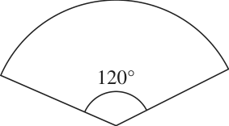
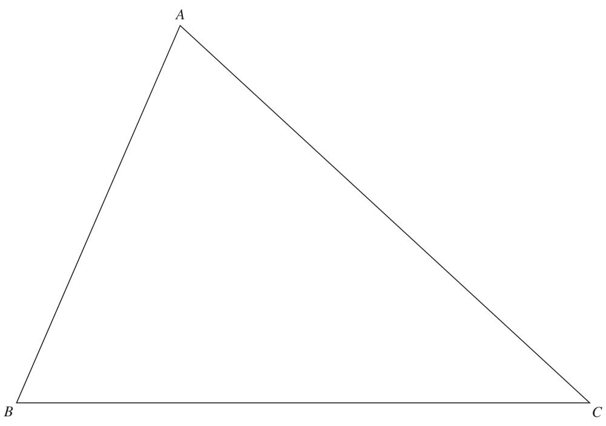
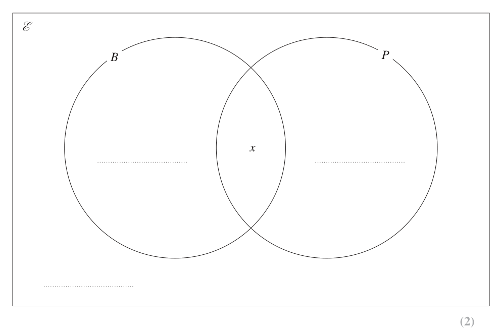
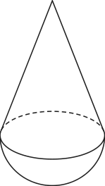
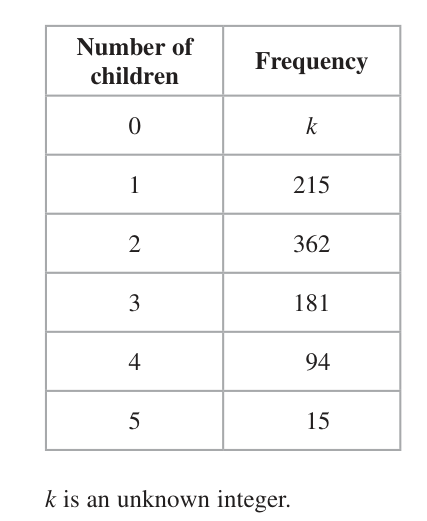

# 4MB1/01R — 2023-06 (official extraction)

> schema `syllabai.official-paper-questions/0.2` · paper_id `pearson-edexcel:international-gcse:mathematics-b:4mb1:2023-06:4MB1/01R` · qp sha256 `01d9685cf4dab24c…` · extraction is the disclosed baseline (ADR-039)

## Question 1 (2 marks)

Find the Lowest Common Multiple (LCM) of 12, 14 and 15 Show your working clearly.

### 1 [2]

Find the Lowest Common Multiple (LCM) of 12, 14 and 15 Show your working clearly.

**Mark scheme answer**

> Two from 2 M1 for correct prime factors for 12 and one of 14 or 15. We are
> 12 = 22 × 3 (or 12 = 4 × 3 ), 14 = 2 × 7 or accepting 12 = 4 × 3 (may be seen on factor tree)
> 15 = 3 × 5 or a list of at least 5 multiples including 420 for 12 and one of 14 or
> or
> 12 14 15 or

- **(2)** Two from 2 M1 for correct prime factors for 12 and one of 14 or 15. We are

## Question 2 (2 marks)

Without using your calculator and showing each stage of your working, calculate 1 7 1 × 5 12 Give your answer as a fraction in its simplest form.

### 2 [2]

Without using your calculator and showing each stage of your working, calculate 1 7 1 × 5 12 Give your answer as a fraction in its simplest form.

**Mark scheme answer**

> 6 7 Use of table method for 12 and one of 14 or 15. Do not need all the

- **(2)** 6 7 Use of table method for 12 and one of 14 or 15. Do not need all the

## Question 3 (2 marks)
### 3(a) [1]

Simplify 5x2 + 3x2

**Mark scheme answer**

> 8x2 1 B1 cao Do not ISW

- **(1)** 8x2 1 B1 cao Do not ISW

### 3(b) [1]

Simplify 2y2 × 3y3

**Mark scheme answer**

> 6y5 1 B1 cao Do not ISW

- **(1)** 6y5 1 B1 cao Do not ISW

## Question 4 (2 marks)

The shape above is made from four squares. Two of the squares are shaded.

### 4(a) [1]

Draw, on the shape above, all the lines of symmetry of the shape. The shape above is made from four identical equilateral triangles. Three of the triangles are half shaded.

**Mark scheme answer**

> 1 B1 cao two lines(allow dashed or dotted) joining opposite corners
> drawn on diagram. No extra incorrect lines must be drawn unless
> clearly crossed out

- **(1)** 1 B1 cao two lines(allow dashed or dotted) joining opposite corners

### 4(b) [1]

Write down the order of rotational symmetry of the shape.

**Mark scheme answer**

> 3 1 B1 cao must be a single number

- **(1)** 3 1 B1 cao must be a single number

## Question 5 (2 marks)

Here are the first 5 terms of a sequence 3 10 17 24 31

### 5(a) [1]

Write down the next 2 terms of the sequence , The 15th term of the sequence is 101

**Mark scheme answer**

> 38, 45 1 B1 Ignore extra terms. Accept 45, 38

- **(1)** 38, 45 1 B1 Ignore extra terms. Accept 45, 38

### 5(b) [1]

Find the 12th term of the sequence.

**Mark scheme answer**

> 80 1 B1

- **(1)** 80 1 B1

## Question 6 (2 marks)

Factorise x2 – 5x – 14

### 6 [2]

Factorise x² – 5x – 14

**Mark scheme answer**

> ( x – 7 )( x + 2) 2 M1 Factorised form must expand to give 2 terms of the quadratic.
> eg ( x – 2)( x + 7 ) = x + 5x − 14
> ( x – 7 )( x + 2) A1 Do not ISW This must be the answer on the answer line or if no
> answer on the answer line their final answer which may be shown
> or ( x + 2)( x – 7 ) for example by circling or underlining.

- **(2)** ( x – 7 )( x + 2) 2 M1 Factorised form must expand to give 2 terms of the quadratic.

## Question 7 (3 marks)

Here are ten numbers 3 5 8 5 2 7 9 11 5 10

### 7(a) [1]

Write down the mode.

**Mark scheme answer**

> 5 1 B1 cao no other numbers must be given

- **(1)** 5 1 B1 cao no other numbers must be given

### 7(b) [2]

Find the median.

**Mark scheme answer**

> 2,3,5,5,5,7,8,9,10,11 2 M1 place numbers in order (at least 6 with none missing) or sight of
> 5+7
> May be seen in part (a) or in question. Allow with signs eg + between
> Correct answer scores full marks (unless 6 A1 cao
> from obvious incorrect working)

- **(2)** 2,3,5,5,5,7,8,9,10,11 2 M1 place numbers in order (at least 6 with none missing) or sight of

## Question 8 (3 marks)

A regular polygon has 24 sides. Calculate the size, in degrees, of each interior angle of the regular polygon. °

### 8 [3]

A regular polygon has 24 sides. Calculate the size, in degrees, of each interior angle of the regular polygon.

…………… °

**Mark scheme answer**

> 360 ÷ 24 [= 15] oe or 3 M1 for a correct method to find an exterior angle or total of the
> 24 ×180 – 360 [= 3960] or interior angles. Implied by seeing 15 or 3960 or 165
> ( 2 × 24 − 4 ) × 90 [= 3960] or
> (24 − 2) ×180 [ = 3960] oe
> 180 – "15" or "3960" oe M1 dep on M1 correct method to find one interior angle. This may
> 24 be implied by seeing 165
> Correct answer scores full marks 165 A1 cao do not ISW This must be the answer on the answer line or if
> (unless from obvious incorrect no answer on the answer line their final answer which may be
> working) shown for example by circling or underlining.

- **(3)** 360 ÷ 24 [= 15] oe or 3 M1 for a correct method to find an exterior angle or total of the

## Question 9 (2 marks)

Make g the subject of T = g

### 9 [2]

Make g the subject of T = g

**Mark scheme answer**

> 2r 2 M1 correctly remove square root sign or make root g the
> 2r or 2 g=
> T2 = T g = 2r or subject.
> g T
> Correct answer scores full marks g=
> 2r A1 cao Condone missing "g =" on answer line if fully correct
> (unless from obvious incorrect working) T2
> expression seen in working. Allow g = 2r or g = 2rT −2
>  T 

- **(2)** 2r 2 M1 correctly remove square root sign or make root g the

## Question 10 (3 marks)

Given that y = 5x4 + x2 (3x + 1) dy find dx dy = . . . . . . . . . . . . . . . . . . . . .. . . . . . . . . . . . . . . . . . . . . . . . . . . . . . . . . dx

### 10 [3]

Given that y = 5x4 + x² (3x + 1) dy find dx dy = ……………dx

Given that y = 5x4 + x² (3x + 1) dy find dx dy = dx

**Mark scheme answer**

> ⎡⎣ x (3 x + 1) = ⎤⎦ 3 x + x
> 2 3 2 3 M1 correct expansion of brackets before
> differentiating. eg 3x3 + 1x 2
> ⎡ dy ⎤ 3 2 M1 at least one correct term
> ⎢ dx = ⎥ 20 x + 9 x + 2 x
> ⎣ ⎦
> Correct answer scores full marks (unless from 20 x³ + 9 x² + 2 x A1 oe eg 20 x³ + 9 x² + 2 x1
> obvious incorrect working)

- **(3)** ⎡⎣ x (3 x + 1) = ⎤⎦ 3 x + x

## Question 11 (3 marks)

B Diagram NOT accurately drawn A 120° C O ABC is an arc of a circle centre O Angle AOC is 120° Sector OABC has an area of 48π cm2 Find, in terms of π, the length of the perimeter of OABC ...................................................... cm

### 11 [3]

ABC is an arc of a circle centre O Angle AOC is 120° Sector OABC has an area of 48π cm² Find, in terms of π, the length of the perimeter of OABC cm

> *Figure not shown in this reconstruction — the printed paper includes a diagram (not drawn accurately).*
> Labels in the original figure: B, A, C, O · Figure values: 120°.

**Mark scheme answer**

> 120
> π r 2 = 48π [⇒ r = 12]
> 3 M1 for forming an equation involving the radius using the given
> 360 area. eg 1 π r 2 = 48π or 1 r 2 = 48
> 3
> 120 M1 Find an expression for the arc length ABC, ft their radius.
> [ Arc length =] × 2π × "12"[ = 8π ]
> Allow awrt 25.1 May be seen as part of working eg
> 360
> × 2 × π × "12"+ 2 × "12" where 12 is their radius
> Correct answer scores full marks 8π + 24 A1 oe eg 8(3 + π ) allow awrt 15.6π (need not be simplified) eg
> (unless from obvious incorrect 120
> working) × 2π × 12 + 12 + 12 ISW
> 360

- **(3)** 120

## Question 12 (3 marks)

Solve 6 4 Show clear algebraic working. x = ......................................................

### 12 [3]

Solve 6 4 Show clear algebraic working. x = ……………Solve 6 4 Show clear algebraic working. x =

**Mark scheme answer**

> eg 2 ( x + 2 ) + 3 ( x – 3) = 60 or 3 M1 Clear intention to multiply all terms by a multiple of 12
> If correct expression with brackets in is not seen allow a maximum
> 4 ( x + 2 ) + 6 ( x – 3) = 120 or of one incorrect term if the brackets are expanded or
> 2( x + 2) 3( x − 3) express the LHS as two fractions over a multiple of 12 or as a
> + [ = 5] or single fraction with a denominator which is a multiple of 12 eg
> 4( x + 2) 6( x − 3) 2( x + 2) + 3( x − 3)
> + [ = 5] or = 5 If correct expression with brackets in is not
> 24 24
> seen allow a maximum of one incorrect term if the brackets are
> expanded No need for = 5 or
> x 1 x 3
> + + − [ = 5] oe
> 6 3 4 4 expressing the LHS as 4 fractions. No need for = 5
> 5 x = 60 – 4 + 9 or 10 x = 120 – 8 + 18 M1 indep for a correct equation with the terms in x combined
> 5x 1 3
> = 5 − + oe eg 5 x − 5 = 5 or 5 x = 65 or 5 x = 65
> Working required x = 13 A1 dependent on at least one M mark being awarded

- **(3)** eg 2 ( x + 2 ) + 3 ( x – 3) = 60 or 3 M1 Clear intention to multiply all terms by a multiple of 12

## Question 13 (3 marks)

For the two non-zero, non-parallel vectors a and b 5 (3a – b) – p (a + 2b) = qb where p and q are scalars. Find the value of p and the value of q p = . . . . . . . . . . . . . . . . . . . . .. . . . . . . . . . . . . . . . . . . . . . . . . . . . . . . . . q = . . . . . . . . . . . . . . . . . . . . .. . . . . . . . . . . . . . . . . . . . . . . . . . . . . . . . .

### 13 [3]

For the two non-zero, non-parallel vectors a and b 5 (3a – b) – p (a + 2b) = qb where p and q are scalars. Find the value of p and the value of q p = q =

**Mark scheme answer**

> p = 15 3 B1 cao
> –5 – 2 p or –5 – 2 × "15" M1 compare coefficients of b Allow one sign error in –5 – 2 p eg
> or −5b − 2 pb = qb –5 + 2 p or allow ft of their p value and one sign error ie 5 – 2 × "15" or
> or 2 p + q = −5 oe −5 + 2 × "15" or −5b + 2 pb = qb or 5b − 2 pb = qb or −5b − 2 pb = −qb oe Allow
> p = "15" subst
> Correct answer scores full marks q = –35 A1
> (unless from obvious incorrect
> working)
> SC if p and q are correct but not written on the answer line, at least one must
> be labelled in their working to award full marks. If both values are correct
> but neither labelled or they are on the wrong answer lines they get 2/3 marks

- **(3)** p = 15 3 B1 cao

## Question 14 (4 marks)

A factory makes bottles. Of all the bottles the factory made on Monday 7% are made by machine A 12% are made by machine B Let y be the total number of bottles that the factory made on Monday.

### 14(a) [1]

Write down an expression, in terms of y, for the number of bottles that machine A made on Monday. On Monday machine B made 60 more bottles than machine A

**Mark scheme answer**

> 0.07y 1 ⎛ 7 ⎞
> B1 cao oe ⎜ y 100 ⎠

- **(1)** 0.07y 1 ⎛ 7 ⎞

### 14(b) [3]

Find the value of y y =

**Mark scheme answer**

> number bottle B = 0.12y 1 M1 for sight of 0.12y or 12 y or 0.05y or 5 y or 5% 12% − 7%
> increase = 0.05y or 5% 100 100
> or 12% y − 7% y
> 0.12 y – "0.07 y " = 60 or 1 M1 oe follow through their result from part (a)
> 0.05 y = 60 or
> 60 ÷ 5 ×100 or
> 5% = 60 or 5% y = 60 or
> 12% − 7% = 60 or 12% y − 7% y = 60
> 1200 1 A1 cao Must come from a correct equation
> Correct answer with no working gains full marks

- **(3)** number bottle B = 0.12y 1 M1 for sight of 0.12y or 12 y or 0.05y or 5 y or 5% 12% − 7%

## Question 15 (4 marks)

Solve the simultaneous equations 20x + 7y = 4 2x – 2y = –5 Show clear algebraic working. x = . . . . . . . . . . . . . . . . . . . . .. . . . . . . . . . . . . . . . . . . . . . . . . . . . . . . . . y = . . . . . . . . . . . . . . . . . . . . .. . . . . . . . . . . . . . . . . . . . . . . . . . . . . . . . .

### 15 [4]

Solve the simultaneous equations 20x + 7y = 4 2x – 2y = –5 Show clear algebraic working. x = y =

**Mark scheme answer**

> 20x + 7y = 4 40x + 14y = 8 4 M1 eliminating either x or y (equate coefficient and use correct
> 20x – 20y = –50 14x – 14y = –35 operation) Allow 1 error either one incorrect term in equating the
> 27y = 54 54x = –27 coefficients eg –4 instead of 8 or one error when eliminating either
> or x or y
> ⎛ 2y −5 ⎞ or
> 20 + 7 y = 4 or substitute for x or y to form an equation in only one variable. Allow
> ⎝ 2 ⎠ 1 sign slip only
> ⎛ 2x + 5 ⎞
> 20 x + 7 = 4 or
> ⎝ 2 ⎠
> ⎛ 4−7y ⎞
> 2 − 2 y = −5 or
> ⎝ 20 ⎠
> ⎛ 4 − 20 x ⎞
> 2x − 2 = −5 oe
> ⎝ 7 ⎠
> x = − 1 or A1 dep on M1
> y=2
> 20 × "− 1 " + 7y = 4 or M1dep on previous method mark
> 2 For repeating first method (allow one sign error) or
> 20x +7 × "2" = 4 or substitute their x or y into a correct equation
> 2 × "− 1 " – 2y = –5 or
> 2x – 2× "2" = –5 oe
> Working required x= −1 A1 dep on M1 M1
> and y = 2

- **(4)** 20x + 7y = 4 40x + 14y = 8 4 M1 eliminating either x or y (equate coefficient and use correct

## Question 16 (4 marks)

16 208 students travelled to school by bus, which is 10.4% of the students in the school. 510 students walk to school. The remaining students travel to school by car. Calculate the percentage of students who travel to school by car. ...................................................... %

### 16 [4]

16 208 students travelled to school by bus, which is 10.4% of the students in the school. 510 students walk to school. The remaining students travel to school by car. Calculate the percentage of students who travel to school by car

…………… %

**Mark scheme answer**

> Let t = total number of students and c = number of students who travel by car Allow any letters for t and c
> 208 or 4 M1 correct method to find t or c or correct equation (any form)
> [t = ] in terms of t or c or correct method to find the % that represents
> 0.104
> [t =] 718 + 0.896t − 510 or 510 students
> May be implied by seeing 25.5 or 1282 or 2000
> 208
> = 0.104 or
> 208 + 510 + c
> 208
> [ c =] – 208 – 510 or
> 0.104
> 208 208
> [c =] 0.896 × − 510 or [ c =] − 718
> 0.104 0.104
> or 0.896 × ( 718 + c ) = 510 + c or
> 510
> ×10.4
> 208
> [t =] 2000 or [c =] 1282 or 25.5 A1 correct value for t or c or percentage
> "1282"
> ×100 or
> "1282"
> ×100 or
> M1 For an attempt at a correct method to find the percentage.
> 2000 "1282"+ 208 + 510 n n
> Allow ×100 or ×100 where n < 2000 or
> 1282 2000 n + 718
> ×100 or 100 – 10.4 – "25.5" or
> "2000" 1282 r − 718
> ×100 where m > 1282 or ×100 where r > 718 or
> 510 m r
> 100 – 10.4 – ×100
> "2000" 510
> 100 – 10.4 – ×100 where p > 510 or 100 –10.4 – q
> " p"
> where 20 < q < 30 may be implied by 64.1 Condone rounded
> figures.
> Correct answer scores full marks (unless from 64.1 A1 cao Allow 64 Do not ISW This must be the answer on the
> obvious incorrect working) answer line or if no answer on the answer line their final answer
> which may be shown for example by circling or underlining.

- **(4)** Let t = total number of students and c = number of students who travel by car Allow any letters for t and c

## Question 17 (5 marks)

A model of a train is made to a scale of 1 : 48 The engine of the train has a length of 16.1 m

### 17(a) [2]

A model of a train is made to a scale of 1 : 48 The engine of the train has a length of 16.1 m

Calculate, in cm to 3 significant figures, the length of the engine of the model cm The volume of a carriage on the model is 995

…………… cm³

**Mark scheme answer**

> eg 16.1 [= 0.335] or 1610 or 2 M1 correct method or equation to find length in m or cm. Implied
> 48 48 by 0.335
> 16.1 or x 1 or x = 1
> =
> 12 16.1 48 1610 48
> or x 25 oe
> =
> 16.1 12
> Correct answer scores full marks 33.5 A1 awrt 33.5
> (unless from obvious incorrect
> working)

- **(2)** eg 16.1 [= 0.335] or 1610 or 2 M1 correct method or equation to find length in m or cm. Implied

### 17(b) [3]

Calculate, in m³ to 3 significant figures, the volume of this carriage on the train

…………… m³

**Mark scheme answer**

> 483 [= 110 592] or 3 M1 Consideration of cube of 995
> M2 for × 483
> 0.483 [= 0.110 592]
> 1003
> scale factor seen. eg 16.1 or
> ⎝ (a) ⎠
> ⎛ 1610 ⎞ 995 ( a)³
>  or =
> ⎝ (a) ⎠ V 16103
> 995 M1 for unit conversion by
> [ = 0.000995] or dividing by 1003
> 1003
> [995 × "110 592"] ÷1003
> 0.483 [= 0.110 592]
> Correct answer scores full marks 110 A1 awrt 110
> (unless from obvious incorrect
> working)

- **(3)** 483 [= 110 592] or 3 M1 Consideration of cube of 995

## Question 18 (4 marks)

The diagram shows triangle ABC A B C The point P is inside the triangle ABC such that P is the same distance from AB and BC P is 10 cm from the point C Using ruler and compasses only and showing all your construction lines, find and label the point P

### 18 [4]

The diagram shows triangle ABC A B C The point P is inside the triangle ABC such that P is the same distance from AB and BC P is 10 cm from the point C Using ruler and compasses only and showing all your construction lines, find and label the point P

**Mark scheme answer**

> angle bisector 4 B2 for a line within the limits and a pair of suitable arcs.
> constructed One arc centred on a point D on BC and one centred on the
> accurately point E on AB such that BE = BD or 2 arcs centred at B
> with the cross to find the middle.
> (B1 for a line within the limits (Can be any length - does
> not need to cross AC but should remain within the
> guidelines if it were to be extended) or a pair of suitable
> arcs
> Accurate arc drawn B1 for an arc within the limits indicated. It does not need to
> from C cross AC or BC
> P correctly labelled B1ft dependent on at least B1 for the angle bisector and B1
> for the arc. Must clearly identify it is the point.

- **(4)** angle bisector 4 B2 for a line within the limits and a pair of suitable arcs.

## Question 19 (5 marks)

In a class of 30 students 15 have a black pen (B) 16 have a pencil (P) 3 have no black pen and no pencil x have a black pen and a pencil

### 19(a) [2]

Use the information above to complete the Venn diagram, giving answers in terms of x where necessary. E B P x

**Mark scheme answer**

> 2 B2 15 − x , 16 − x and 3 in correct regions on Venn diagram
> B1 2 of 15 − x , 16 − x and 3 in correct regions or all 3 values
> B P correct, one in correct region.
> Allow 11 for 15 – x and 12 for 16 – x
> 15 – x x 16 – x
> SC B1 x is replaced with a number x ≠ 4 and they use this incorrect
> value, to find 15 – x and 16 – x

- **(2)** 2 B2 15 − x , 16 − x and 3 in correct regions on Venn diagram

### 19(b) [2]

Find the value of x x =

**Mark scheme answer**

> 3 + "15 – x "+ x + "16 – x " = 30 oe 2 M1 Correct equation formed, in x, ft their values for B ∩ P and
> B ∩ P May see only one of these values used eg
> 3 + 15 + "16 – x " = 30
> Correct answer scores full marks 4 A1 cao
> (unless from obvious incorrect
> working)

- **(2)** 3 + "15 – x "+ x + "16 – x " = 30 oe 2 M1 Correct equation formed, in x, ft their values for B ∩ P and

### 19(c) [1]

One of these 30 students is chosen at random. Write down the probability that this student has a black pen but does not have a pencil.

**Mark scheme answer**

> 11 1 B1 ft follow through their answer to part (b), if 0 < part(b) < 15 only
> 30 ie 15 − " their (b)" with numerator a single number. Allow awrt 0.367

- **(1)** 11 1 B1 ft follow through their answer to part (b), if 0 < part(b) < 15 only

## Question 20 (5 marks)

cm The diagram shows a solid shape made by fixing a solid right circular cone of diameter 20 cm to the circular face of a solid hemisphere of diameter 20 cm. The centre of the base of the cone coincides with the centre of the circular face of the hemisphere. The overall height of the shape is h cm. Given that for this shape volume of cone : volume of hemisphere = 3 : 4 find the value of h h = . . . . . . . . . . . . . . . . . . . . .. . . . . . . . . . . . . . . . . . . . . . . . . . . . . . . . .

### 20 [5]

cm The diagram shows a solid shape made by fixing a solid right circular cone of diameter 20 cm to the circular face of a solid hemisphere of diameter 20 cm. The centre of the base of the cone coincides with the centre of the circular face of the hemisphere. The overall height of the shape is h cm. Given that for this shape volume of cone : volume of hemisphere = 3 : 4 find the value of h h =

> *Figure not shown in this reconstruction — the printed paper includes a diagram (not drawn accurately). Use the text description to work through it.*

**Mark scheme answer**

> Throughout this question condone mis-labelling. eg if they label the volume of the cone as being the hemisphere
> 2 ⎡ 2000π ⎤ 5 4 3 ⎡ 4000π ⎤
> π ×103 ⎢ = = 2094.395...⎥ M1 Allow for π ×10 ⎢ = = 4188.790…⎥
> 3 ⎣ 3 ⎦ 3 ⎣ 3 ⎦
> Allow sight of 4189, awrt 4190 or awrt 2090 or exact fraction
> May be embedded within other working. Ignore labelling
> 1 ⎡ 100π ⎤ M1 or 1 π 102 ( h − 10 ) Allow sight of 104, awrt 105 or exact fraction.
> π ×102 x ⎢ = x = 104.719… x ⎥
> 3 ⎣ 3 ⎦ Allow any letter for x. (Condone h for x) Ignore labelling
> 1 3 ⎛2 ⎞ M1 using Vcone = 3 × Vhemisphere oe
> π 102 ( h − 10 ) 3
> π ×102 x = × ⎜ π ×103 ⎟ or 4
> 3 4 ⎝3 ⎠ M2 for =
> with at least one of the volumes correct 2
> 100π 3 ⎛ 2000π ⎞ π ×10
> " " x = × ⎜" " ⎟ or Allow h – 10 or any letter for x (condone
> 3 4 ⎝ 3 ⎠ h) 100π
> You may ft their values eg ( h − 10 ) 3
> 1 or 3 = oe
> π ×102 x 3 3 2000π
> 3 "2094" x = × "105" NB x = 15
> = oe 4
> 2
> π ×103
> NB useful number
> 3 ⎛2 ⎞
> × ⎜ π ×103 ⎟ = 1570.795...
> 4 ⎝3 ⎠
> "15"+ 10 M1 For using h – 10 anywhere
> OR if all 3 previous method marks
> awarded allow for "their x" + 10
> Correct answer scores full marks 25 A1 awrt 25
> (unless from obvious incorrect working)
> SC r = 10 not substituted could get M1 M1 M0 M1 A0
> 1 π r2x x 3 x
> 1 M1 for 3 3 = (allow sphere)
> st
> 2nd M1 = or = 4th M1 for using h – 10 or adding 10 A0
> 2 πr x 4 2× r 4 4× r 4

- **(5)** Throughout this question condone mis-labelling. eg if they label the volume of the cone as being the hemisphere

## Question 21 (5 marks)

E F Diagram NOT accurately drawn 3 cm C D G H 4 cm A 12 cm B The diagram shows the cuboid ABCDEFGH AB = 12 cm BG = 4 cm FG = 3 cm

### 21(a) [3]

Show that AF = 13 cm

**Mark scheme answer**

> ⎡⎣ AG 2 = ⎤⎦ 122 + 42 ( = 160 ) or 3 M1 A correct method to find AG2, AC2, AE2, AG,
> AC or AE. Allow use of trig but must be fully
> ⎡⎣ AC 2 = ⎤⎦ 122 +32 ( = 153) or correct method eg M2 for
> 4⎞ ⎡⎣ AF 2 = ⎤⎦ 32 + 122 + 42
> ⎡⎣ AE 2 = ⎤⎦ 42 + 32 ( = 25)
> [∠GAB =] tan −1 [ = 18.434....] and
> ⎝ 12 ⎠
> 12 Ignore incorrect labels
> [ AG =]
> cos"18.434..."
> labels
> ( ) M1 full method to find AF 2
> ⎡⎣ AF 2 = ⎤⎦ 32 + "160" or 32 + "4 10 "
> For this mark allow values correct to 3sf. but
> ⎡⎣ AF = ⎤⎦ 4 + "153" or 4 + ("3 17 ")
> condone truncation eg 42 + ( awrt 12.3) or
> 2 2
> 32 + ( awrt 12.64 ) Ignore incorrect labels
> ⎡⎣ AF 2 = ⎤⎦ 122 + "25" or
> ⎡⎣ AF 2 = ⎤⎦ 169 NB 160 = 12.649... 153 = 12.369...
> Working required 13 A1dependedent on both method marks awarded. For a full method to find
> AF with no incorrect working seen and 13 stated
> Must see 169 or a correct expression for AF 2 with exact values used.

- **(3)** ⎡⎣ AG 2 = ⎤⎦ 122 + 42 ( = 160 ) or 3 M1 A correct method to find AG2, AC2, AE2, AG,

### 21(b) [2]

Find, in degrees to one decimal place, the size of angle GAF ° ∠GAF =

**Mark scheme answer**

> 3 2 M1 A correct method to find ∠GAF or trig ratio of ∠GAF
> 3 or tan GAF =
> sin GAF = May ft values from part (a) including their AF if it is not 13 if it is clearly
> "13" " 160 "
> labelled or comes from a correct calculation
> " 160 " 160 160
> or cos GAF = oe Allow ( tan AFG = or sin AFG = or cos AFG = 3 ) and
> "13" 3 13
> 90 − ∠AFG
> 2
> Allow use of cosine or sine rule eg 3$^2$ = 160 + $13^2$ − 2 × 160 ×13cosGAF
> Correct answer scores full marks (unless 13.3 A1 awrt 13.3 Allow awrt 13.4
> from obvious incorrect working)

- **(2)** 3 2 M1 A correct method to find ∠GAF or trig ratio of ∠GAF

## Question 22 (5 marks)

Given that (x + k) is a factor of x3 + 4x2 –20x + k where k is a non-zero constant, find the possible values of k k = ......................................................

### 22 [5]

Given that (x + k) is a factor of x³ + 4x2 –20x + k where k is a non-zero constant, find the possible values of k k =

**Mark scheme answer**

> ( – k ) + 4 ( −k ) − 20 ( −k ) − ( −k ) [ = 0] or
> 3
> 5 M1 substitutes x = –k Allow 1 sign error if brackets removed
> or
> – k 3 + 4k 2 + 20k + k [ = 0] oe long division to obtain 2 correct terms x² + (4 – k)x + (–20 – 4k + k2)
> or two of 1 or 4 − k or −20k − 4k + k 2
> attempt to expand ( x + k ) ( x 2 + gx + 1) with at least 4 out of 6 terms
> 3 2
> correct cubic is x + kx + gx + gkx + x + k oe
> – k 3 + 4k 2 + 21k = 0 or A1 correct simplified 3 term cubic equation or a correct quadratic
> –20 – 4k + k 2 = 1 or equation or both correct equations from comparing x² and x
> k + g = 4 and 1 + kg = –20 oe coefficients.
> (k) (–k2 + 4k + 21) = 0 or M1 dep on first M mark. Divide by or take k out as a common factor
> k 2 – 4k − 21 = 0 oe from a cubic in k to form a 3-term quadratic equation. An answer of 7
> or –3 can imply this mark
> ( k )( –k + 7 )( k + 3) = 0 or M1dep on second M mark. Correct method for solving their 3-term
> quadratic – either by formula, completing the square or factorising.
> ( k – 7 )( k + 3) = 0 By factorising: brackets must expand to give 2 out of 3 correct
> terms
> By formula: correct substitution into fully correct formula (allow 1
> sign error)
> By completing the square: must see ( k − 2 ) ± ...
> An answer of 7 or –3 can imply this mark
> Correct answer scores full marks 7, −3 A1 cao (both) condone 0, 7, −3 but do not allow any other incorrect
> (unless from obvious incorrect extras
> working)

- **(5)** ( – k ) + 4 ( −k ) − 20 ( −k ) − ( −k ) [ = 0] or

## Question 23 (6 marks)

B Diagram NOT accurately drawn 19.5 cm O N E A C 8 cm D A, B, C and D are points on a circle with centre O and radius 19.5 cm AEC and BNED are chords of the circle. ∠BEC = ∠BNO = 90° BD = 36 cm ED = 8 cm

### 23(a) [2]

Show that ON = 7.5 cm

**Mark scheme answer**

> ⎡$ON^2$ = ⎤ $19.5^2$ − $18^2$ or $19.5^2$ = $ON^2$ + $18^2$ 2 M1 use of Pythagoras or trig seen – allow angles given to at
> ⎣ ⎦
> least 3sf
> or $39^2$ − $36^2$ or [ON =]19.5 cos ( 67.3801…)
> Allow XD = $39^2$ − $36^2$ where BX is the diameter
> or [ON =]19.5 sin ( 22.6198…) oe
> Working required
> $19.5^2$ − $18^2$ = 7.5 A1 allow ( )
> 56.25 = 7.5 or 19.5cos 67.3801… = 7.5 or
> $39^2$ − $36^2$
> ( )
> oe or 19.5sin 22.6198… = 7.5 or
> $ON^2$ = 56.25 ⇒ ON= 7.5 Allow angles given to 3sf
> NB verification using 7.5 is M0 A0

- **(2)** ⎡$ON^2$ = ⎤ $19.5^2$ − $18^2$ or $19.5^2$ = $ON^2$ + $18^2$ 2 M1 use of Pythagoras or trig seen – allow angles given to at

### 23(b) [4]

Calculate the length, in cm to 3 significant figures, of AC AC = cm

**Mark scheme answer**

> EN = 36 –18 – 8[ = 10] or EN = 36 − 8 4 M1 Find EN either labelled or comes from correct working
> 2 may be seen on diagram or AE × EC = 224 or AC + 7.5 and
> AE × EC = 8 × 28 or AE × EC = 224
> AC – 7.5 identified as AB and BC or used in a formula.
> AC + 7.5 and AC – 7.5
> 2 2 Allow x + 7.5 and x – 7.5 may be implied by the 2nd M1
> [$AM^2$ =] $19.5^2$ – "10"$^2$ [ = 280.25] or M1 correct use of Pythagoras involving AM where M is the
> 2
> mid-point of AC NB AM = 280.25 [ = 16.7406…]
> ft their 10 if clearly labelled or comes from 36 − 18 − 8
> ⎛ AC ⎞⎛ AC ⎞ Correct use of intersecting chord theorem Allow
> ⎜ + 7.5 − 7.5 ⎟ = 8 × 28 ( x + 7.5)( x − 7.5) = 8 × 28
> ⎝ 2 ⎠⎝ 2 ⎠
> [ AC ] = 2 × $19.5^2$ − "10"$^2$ or M1 dep on previous method marks awarded. For using
> AC = 2 × "their AM " ft their 10 if clearly labelled or comes
> 8 × 28
> [ AC =] + ("16.7406..."+ 7.5 ) from 36 − 18 − 8 or their awrt 16.7 if clearly labelled or comes
> ("16.7406..."+ 7.5) from $19.5^2$ – "10"$^2$
> ⎛ AC ⎞
> ( )
>  = 224 + 7.5 or find value for AC 2
> ⎝ 2 ⎠
> Correct answer scores full marks (unless 33.5 A1 awrt 33.5
> from obvious incorrect working) Total 6 marks

- **(4)** EN = 36 –18 – 8[ = 10] or EN = 36 − 8 4 M1 Find EN either labelled or comes from correct working

## Question 24 (6 marks)

The table shows the number of children in each of the families from a town. Number of Frequency children 0 k 1 215 2 362 3 181 4 94 5 15 k is an unknown integer. The mean number of children in a family = 2.0 to 2 significant figures. Find the range of possible values of k

### 24 [6]

The table shows the number of children in each of the families from a town. Number of Frequency children 0 k 1 215 2 362 3 181 4 94 5 15 k is an unknown integer. The mean number of children in a family = 2.0 to 2 significant figures. Find the range of possible values of k

**Mark scheme answer**

> 1.95 or 2.05 seen 6 B1
> 215[×1] + 362 × 2 + 181× 3 + M1 Find total number of children, at least 4 correct
> 94 × 4 + 15 × 5 [ = 1933] products seen added (215 + 724 + 543 + 376 + 75) or
> 1933 seen
> "1933"
> = 1.95 or
> "1933"
> − 867 or M1 for "1933" = b where 1.5 b 2.5 or
> 867 + k 1.95 867 + k
> "1933" "1933" "1933"
> = 2.05 or − 867 oe − 867 oe Allow < or > or or for =
> 867 + k 2.05 b
> Allow equivalent
> NB k + 215 + 362 + 181 + 94 + 15 ≡ k + 867
> "1933" M1 Form two equations/expression for their mean.
> = 1.95 or "1933" − 867 oe and "1933" "1933"
> 867 + kmin 1.95 = b or − 867 where 1.95 b< 2 for one
> 867 + k b
> "1933"
> = 2.05 or "1933" − 867 oe and "1933" = b or
> "1933"
> − 867 where 2 < b 2.05 for
> 867 + kmax 2.05 867 + k b
> the other equation. Allow < or > or or for =
> 1933 ⎡ 4847 ⎤ A1 both equations fully correct followed by awrt 124
> [ k =] − 867 ⎢ = or 124.282...⎥ and and awrt 75.9 or for a fully correct expression for both
> 1.95 ⎣ 39 ⎦ values of k seen
> 1933 ⎡ 3113 ⎤ allow 2.0499 for 2.05
> [ k =] − 867 ⎢ = or 75.926...⎥
> 2.05 ⎣ 41 ⎦
> 76 k 124 A1 The 3rd M1 must be awarded. Allow [76, 124]

- **(6)** 1.95 or 2.05 seen 6 B1

## Question 25 (7 marks)

3 1 5 1 2 1 A B C 5 2 5 4 5 3

### 25(a) [2]

Show that C is the inverse of A AB = D

**Mark scheme answer**

> ⎛ 3 1 ⎞⎛ 2 −1 ⎞ 2 M1 for writing down either of the
> [ AC =] or multiplications or the correct method
> ⎝ 5 2 ⎠⎝ −5 3 ⎠ shown to find the determinant of A or
> ⎛ 2 −1 ⎞⎛ 3 1 ⎞ C.
> [CA=] or
> ⎝ −5 3 ⎠⎝ 5 2 ⎠
> 3 × 2 –1× 5 or
> 3 × 2 – ( −1) × ( −5) or 6 – 5
> working must be shown ⎛ 2 −1 ⎞ ⎛ 3 1⎞ A1 for writing down an inverse
>  or or or matrices multiplied = identity
> ⎝ −5 3 ⎠ ⎝ 5 2⎠ matrix
> ⎛ 3 1 ⎞⎛ 2 −1 ⎞ ⎛ 1 0 = or
> ⎝ 5 2 ⎠⎝ −5 3 ⎠ ⎝ 0 1 ⎠
> ⎛ 2 −1 ⎞⎛ 3 1 ⎞ ⎛ 1 0 = −5 3 ⎠⎝ 5 2 ⎠ ⎝0 1⎠

- **(2)** ⎛ 3 1 ⎞⎛ 2 −1 ⎞ 2 M1 for writing down either of the

### 25(b)(i) [2]

Find D D

**Mark scheme answer**

>  (B1 2 numbers correct)
> ⎝ 35 13 ⎠ ignore order of matrices

- **(2)** ⎜ ⎟ (B1 2 numbers correct)

### 25(b)(ii) [1]

Show that BA = D

**Mark scheme answer**

> ⎛ 5 1 ⎞⎛ 3 1 ⎞ 1 B1 for seeing the matrices given in the
>  correct order
> ⎝ 5 4 ⎠⎝ 5 2 ⎠

- **(1)** ⎛ 5 1 ⎞⎛ 3 1 ⎞ 1 B1 for seeing the matrices given in the

### 25(c) [2]

Using part (a) and part (b), show that BC = CB

**Mark scheme answer**

> AB = BA or C−1B = BC−1 2 M1 for either expression implied by a
> fully correct expression required for
> the A1 (no need to see BC = CB )
> A –1ABA–1 = A–1BAA –1 or CABC = CBAC A1 multiplies equation by C or A –1
> or CC–1BC = CBC–1C or AC–1BA = ABC–1A both before and after (allow mixture)
> oe AC = CA = I and/or C = A –1 and/or
> followed by BC = CB C–1 = A leading to correct equation

- **(2)** AB = BA or C−1B = BC−1 2 M1 for either expression implied by a

## Question 26 (8 marks)

P Q Diagram NOT accurately drawn T R S P, Q, S and R are points on a circle. T is the point where PS intersects QR PQ is parallel to RS

### 26(a) [4]

P Q Diagram NOT accurately drawn T R S P, Q, S and R are points on a circle. T is the point where PS intersects QR PQ is parallel to RS

Prove that PT = QT Give a reason for each stage of your working. The area of triangle PQT = 1 cm² and the area of triangle RST = 4

…………… cm²

**Mark scheme answer**

> Method 1 for c = d or ∠SRT = ∠QPT oe angles in the same 4 M1 For one pair of angles equated from these 6
> Method 2 for a = b or ∠PQT = ∠RST oe segment are equal M1 For both pairs of angles for the same method equated
> Method 3 for z = w or ∠RPT = ∠SQT oe
> Method 1 for a = c or ∠PQT = ∠SRT oe alternate angles
> Method 2 for b = d or ∠RST = ∠QPT oe are equal
> Method 3 for y = x or ∠PRT = ∠QSP oe angles in the same
> segment are equal
> Method 1 and Method 2 base angles of
> for a = d or ∠PQT = ∠QPT isosceles triangles ∠PQT = ∠QPT
> are equal
> Method 3 for PR = QS ASA congruent
> PT = QT A1 3 correct statements for the same method with conclusion
> B1 At least 2 relevant reasons for the method used. Need
> words in bold. For first reason allow Equal chords subtend
> equal angles at the circumference (Allow on the circle)
> Allow the symbol for ‘triangle’ and ∠ for angle, opp, Alt

- **(4)** Method 1 for c = d or ∠SRT = ∠QPT oe angles in the same 4 M1 For one pair of angles equated from these 6

### 26(b) [4]

Find the area of quadrilateral PQSR

…………… cm²

**Mark scheme answer**

> PT : TS = 1:2 or TQ : RT =1:2 or realising ratio of sides 1:2 4 M1 eg RT/TQ = 2 Allow any 2 sides. Implied by 2nd M
> [Area of PTR or QTS =] M1 for a correct method to find the area of triangle PTR or
> 1 ⎛ 2 ⎞ QTS
> eg × 6 − 1[ = 2] or 0.5 y × 2 y × sin ⎜180 − sin −1 2 ⎟ [=2] y > 0 or finding the area of the trapezium in terms of MT and PQ
> 2 ⎝ y ⎠ or using area of triangle for PQT and RST with both height
> [Area of trapezium PQRS =] and base in the ratio 1:2 eg
> eg ( 2 PQ + PQ)(MT + 2MT ) where M = midpoint of PQ Implied by the 3rd M
> 2 ×1 4× 2
> or = 1 and = 4 oe
> 2
> eg 2 + 2 + 1 + 4 or 0.5 × 9 × 2 or 3 × 3 × × × a or (
> 1 2 2 + 4) M1 Full method to find area of ABCD. eg
> × (2 + 1)
> 2 a 2 1⎛2 4 + ⎟ ( b + 2b ) where b > 0
> 2⎝b b⎠
> Correct answer scores full marks 9 A1 cao ISW

- **(4)** PT : TS = 1:2 or TQ : RT =1:2 or realising ratio of sides 1:2 4 M1 eg RT/TQ = 2 Allow any 2 sides. Implied by 2nd M

