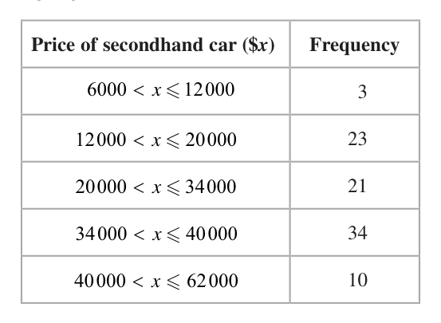
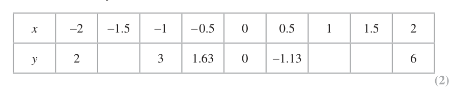
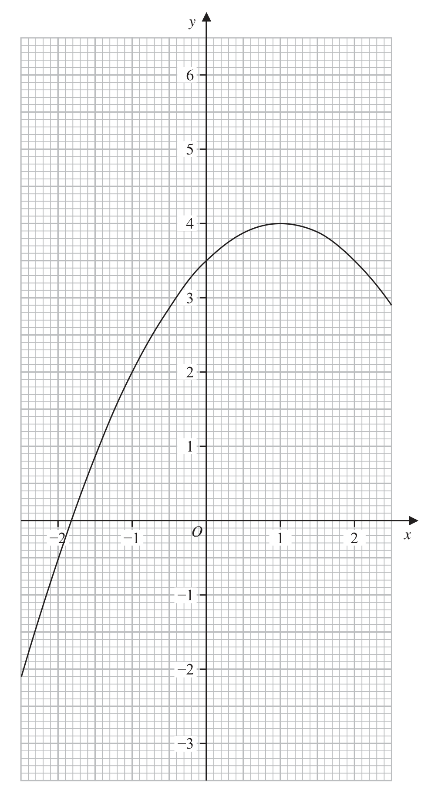
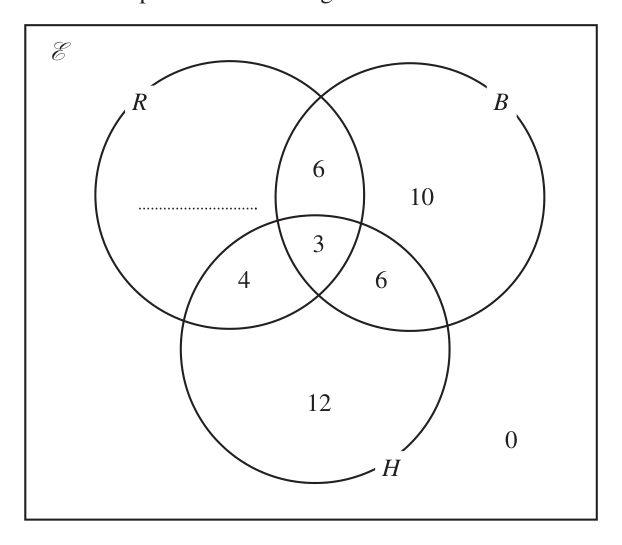
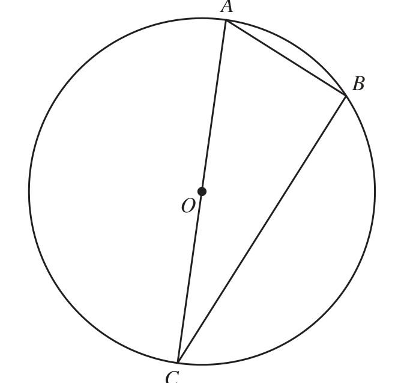
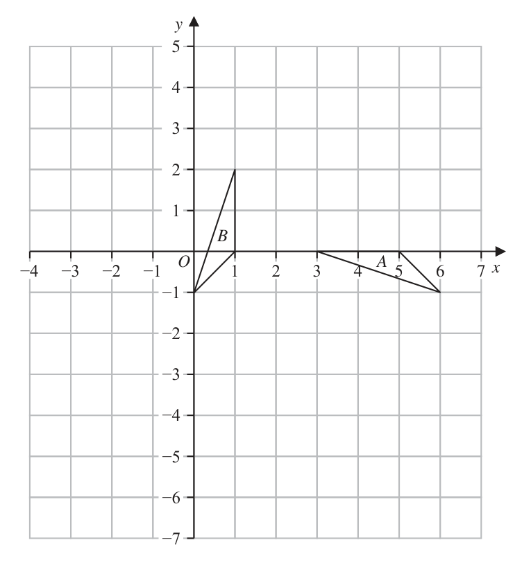

# 4MB1/02 — 2023-06 (official extraction)

> schema `syllabai.official-paper-questions/0.2` · paper_id `pearson-edexcel:international-gcse:mathematics-b:4mb1:2023-06:4MB1/02` · qp sha256 `db358a65167770fd…` · extraction is the disclosed baseline (ADR-039)

## Question 1 (6 marks)

Please check the examination details below before entering your candidate information Candidate surname Other names Centre Number Candidate Number Pearson Edexcel International GCSE Tuesday 6 June 2023 Afternoon (Time: 2 hours 30 minutes) Paper reference 4MB1/02 Mathematics B PAPER 2 You must have: Ruler graduated in centimetres and millimetres, Total Marks protractor, pair of compasses, pen, HB pencil, eraser, calculator. Tracing paper may be used. Instructions •• Use black ink or ball-point pen. Fill in the boxes at the top of this page with your name, centre number and candidate number. •• Answer all questions. Answer the questions in the spaces provided – there may be more space than you need. • Calculators may be used. Information •• The total mark for this paper is 100. The marks for each question are shown in brackets – use this as a guide as to how much time to spend on each question. Advice •• Read each question carefully before you start to answer it. Check your answers if you have time at the end. • Without sufficient working, correct answers may be awarded no marks. P72920A ©2023 Pearson Education Ltd. N:1/1/1/1/1/1/1/1/1/1/1/ Answer all TWELVE questions. Write your answers in the spaces provided. You must write down all the stages in your working. Colour Number of bricks red red 72° yellow green 50 Total 130 A bag contains red bricks, yellow bricks and green bricks only. The incomplete table and an incomplete pie chart give information about the colours of the bricks in the bag.

### 1(a) [2]

Colour Number of bricks red red 72° yellow green 50 Total 130 A bag contains red bricks, yellow bricks and green bricks only. The incomplete table and an incomplete pie chart give information about the colours of the bricks in the bag.

Find the number of red bricks. A box contains 9 red bricks and 6 green bricks only. Asha takes a brick from the bag and a brick from the box.

**Mark scheme answer**

> 72 360 2 M1 correct calculation or equation to find the number of
> ×130 or x = 72 oe red bricks
> 360 130
> 26 A1 cas check the table for the answer

- **(2)** 72 360 2 M1 correct calculation or equation to find the number of

### 1(b) [2]

Complete the tree diagram opposite.

**Mark scheme answer**

> 2 M1 for 2 correct probabilities.
> Allow as decimals 0.62 (actual 0.61538…), 0.6, 0.4, 0.6
> Fully A1 oe fully correct with exact probabilities
> correct

- **(2)** 2 M1 for 2 correct probabilities.

### 1(c) [2]

Calculate the probability that exactly one of the bricks is green. Bag Box 15 green green 130 not green green not green not green

**Mark scheme answer**

> 50 9 80 6 2 3 16
> × " "+ " "× " " or M1ft their Tree diagram. Allow + May be seen on
> 130 15 130 15 13 65
> tree diagram at the end but must be added.
> 50 6 80 9 If tree diagram is incorrect they need to show working.
> 1− × − " "× " "
> 130 15 130 15
> 31 A1 cas oe awrt 0.48 (actual answer 0.47692…)
> 65 ignore subsequent incorrect changes to decimal form

- **(2)** 50 9 80 6 2 3 16

## Question 2 (12 marks)

A farmer grows 300 pumpkins. The pumpkins are small or medium or giant. It cost the farmer $1.25 to grow each small pumpkin. He sells each small pumpkin for $1.30

### 2(a) [2]

A farmer grows 300 pumpkins. The pumpkins are small or medium or giant. It cost the farmer \$1.25 to grow each small pumpkin. He sells each small pumpkin for \$1.30

Calculate the percentage profit the farmer makes on each small pumpkin he sells. The farmer sells each medium pumpkin for 20% more than he sells each small pumpkin.

**Mark scheme answer**

> 1.3 1.3 − 1.25 2 1.3n − 1.25n
> or oe M1 Allow or 1.04 or 104
> 1.25 1.25 1.25n
> 4 A1 cas

- **(2)** 1.3 1.3 − 1.25 2 1.3n − 1.25n

### 2(b) [2]

Calculate the price, in \$, that the farmer sells each medium pumpkin for. Of the 300 pumpkins, 28% are small.

**Mark scheme answer**

> 1.3 ×1.2 or 1.30 + 0.2 ×1.3 2 M1 Condone 1.25 × 1.2 or 1.25 + 0.2 ×1.25
> 1.56 A1 cas

- **(2)** 1.3 ×1.2 or 1.30 + 0.2 ×1.3 2 M1 Condone 1.25 × 1.2 or 1.25 + 0.2 ×1.25

### 2(c) [2]

Calculate the number of small pumpkins the farmer grows. The remaining pumpkins are medium or giant. The ratio of medium pumpkins to giant pumpkins is 3 : 5

**Mark scheme answer**

> 0.28 × 300 2 M1
> 84 A1 cas

- **(2)** 0.28 × 300 2 M1

### 2(d) [2]

Calculate the number of giant pumpkins the farmer grows. The farmer sells all of his giant pumpkins for the same price. The farmer’s profit from giant pumpkins is 30% of the selling price of the first 50 giant pumpkins sold, 60% of the selling price of the next 40 giant pumpkins sold, 90% of the selling price of the remaining giant pumpkins sold.

**Mark scheme answer**

> 5 2 M1 ft their answer to part (c)
> × ( 300 − "84") or
> 3+5
> ( 300 − "84") − × ( 300 − "84")
> 3+5
> 135 A1 cas

- **(2)** 5 2 M1 ft their answer to part (c)

### 2(e) [4]

Calculate the percentage of the total selling price of the giant pumpkins that is the farmer’s profit from giant pumpkins. Give your answer to the nearest whole number.

**Mark scheme answer**

> ( 50 × 0.3) [×P = 15P ] and 40 × 0.6 [×P = 24 P ] 4 M1 working out the profit for the first 90 pumpkins where P
> can be omitted or can be any value (providing both have same
> oe
> value for P).
> Do not allow 30 % × 50 and /or 60% × 40 unless followed by
> 15P and 24 P or 39 P
> ("135"− 50 − 40) × 0.9 [×P ] [ = 40.5P ] oe M1 working out the profit for the remaining pumpkins where P
> can be omitted or can be any value (providing same as value
> used for previous method). Ft their part (d) for indicating need
> 90% of ("their 135"− 50 − 40) or 90% of 45P or 0.9 × 45 but
> do NOT allow 40.5 if it comes from incorrect working eg
> 0.3 ×135 = 40.5 which will be M0
> 79.5 with no incorrect working will gain the 1st and 2nd M1
> ("39" P + "40.5" P ) ×100 M1 dep on both method marks awarded ft their part (d) P can
> [ ] be omitted or can be any value providing the same value
> "135" P
> throughout
> 59 A1 awrt 59 (actual answer 58.888…)
> See next page for alternative for (e) Total 12 marks
> ALT
> where C can be omitted or can be any value (providing both
> oe
> have same value for C).
> Do not allow 130 % × 50 and /or 160% × 40 unless followed
> by 65C and 64C or 129C
> ("135"− 50 − 40) ×1.9 [×C ] [ = 85.5C ] oe M1 working out the selling price for the remaining pumpkins
> where P can be omitted or can be any value (providing same as
> value used for previous method). Ft their part (d) for indicating
> need 90% of ("their 135"− 50 − 40) or 190% of 45C or 1.9 × 45
> but
> 214.5 with no incorrect working will gain the 1st and 2nd M1
> ("129" C + "85.5" C ) ×100 M1 dep on both method marks awarded ft their part (d) C can
> [ ] be omitted or can be any value providing the same value
> "135" C
> throughout
> 59 A1 awrt 59 (actual answer 58.888…)

- **(4)** ( 50 × 0.3) [×P = 15P ] and 40 × 0.6 [×P = 24 P ] 4 M1 working out the profit for the first 90 pumpkins where P

## Question 3 (4 marks)

The table below shows information about the prices of secondhand cars for sale at a garage. Price of secondhand car ($x) Frequency 6000 < x ≤ 12000 3 12000 < x ≤ 20000 23 20000 < x ≤ 34000 21 34000 < x ≤ 40000 34 40 000 < x ≤ 62 000 10 Calculate an estimate, in dollars, for the mean price of a secondhand car at this garage. (4)

### 3 [4]

The table below shows information about the prices of secondhand cars for sale at a garage. Price of secondhand car (\$x) Frequency 6000 < x ≤ 12000 3 12000 < x ≤ 20000 23 20000 < x ≤ 34000 21 34000 < x ≤ 40000 34 40 000 < x ≤ 62 000 10 Calculate an estimate, in dollars, for the mean price of a secondhand car at this garage.

**Mark scheme answer**

> 9000 × 3 + 16000 × 23 + 27 000 × 21 + 37 000 × 34 + 51000 ×10⁴ M2 for at least 4 correct products using midpoints with
> [ = 2 730 000] intention to add. Allow 27000 + 368000 + 567000 +
> 1258000 + 510000 or seeing 2730000
> M1 for
> • at least 4 products using frequency and a value
> within the interval with intention to add. Condone
> use of the lower class bound.
> • at least 4 correct products using midpoints
> without adding.
> Allow consistent use of changed size of number eg
> 9 × 3 + 16 × 23 + 27 × 21 + 37 × 34 + 51×10
> "2 730 000" M1 dep on M1 for forming an equation ft their product
> 9 × 3 + 16 × 23 + 27 × 21 + 37 × 34 + 51×10
> oe
> 3 + 23 + 21 + 10 + 34
> 30 000 A1 cas

- **(4)** 9000 × 3 + 16000 × 23 + 27 000 × 21 + 37 000 × 34 + 51000 ×10⁴ M2 for at least 4 correct products using midpoints with

## Question 4 (8 marks)

Each interior angle of a regular polygon is 172°

### 4(a) [2]

Calculate the number of sides of the polygon. The length of each side of the regular polygon is 5.2 cm to 2 significant figures.

**Mark scheme answer**

> Exterior angle = 180° − 172° = 8°
> 
> n = 360 ÷ 8 = **45**

- **(1)** exterior = 8° oe
- **(1)** 45

### 4(b) [6]

Calculate, in cm² to 3 significant figures, the upper bound of the area of the polygon. Sum of interior angles of polygon 2n 4 right angles

**Mark scheme answer**

> [UB =] 5.25 or [LB =] 5.15 B1 A correct upper or lower bound seen or used. Allow [UB/2 =] 2.625 or [LB/2 =] 2.575
> tan(86) = h/(UB/2) or tan(4) = (UB/2)/h or h/sin(86) = (UB/2)/sin(4) M1 for setting up an equation to find the height of the triangle (h) or side length (S)
> cos(86) = (UB/2)/S or sin(90 − 86 [= 4]) = (UB/2)/S or S/sin(86) = UB/sin(8) or 5.25² = S² + S² − 2S²cos(8) allow 5.1 ≤ UB ≤ 5.3 or 2.55 ≤ UB/2 ≤ 2.65
> condone if use 171.5 ≤ angle ≤ 172.5
> h = (UB/2)tan(86) [= 37.539…] or h = (UB/2)/tan(4) or h = (UB/2)/sin(4) × sin(86) M1 for correct method to find h or S
> S = (UB/2)/cos(86) [= 37.63…] or S = (UB/2)/sin(90 − 86) [= 37.63] or S = (UB/sin(8)) × sin(86) Allow 5.1 ≤ UB ≤ 5.3 or 2.55 ≤ UB/2 ≤ 2.65 or awrt 37.5 or awrt 37.6
> or S = √(5.25²/(2 − 2cos(8))) If previous method mark is awarded allow for awrt 36.5 ≤ h ≤ awrt 37.9 or awrt 36.5 ≤ S ≤ awrt 40.0
> This mark implies the previous M1
> Area of triangle = ½ × UB × "h" [Area = 98.54…] or ½ × "h" × "S" × sin(4) M1 for finding the area of the triangle
> or ½ × UB × "S" × sin(86) or ½ × "S" × "S" × sin(8) where 5.1 ≤ UB ≤ 5.3 and S < 5 or S > 5.5 or h < 5 or h > 5.5 allow awrt 98.5
> NB 0.5 × UB × UBsin172 is M0
> or R = (UB + UB + S)/2 and √(R(R − UB)(R − UB)(R − S))
> Area of polygon = "45" × "98.54…" or 2 × "45" × "49.27…" M1 dep on the 3rd M mark being awarded
> 4430 A1 dep on seeing 5.25 or 2.625 for UB throughout awrt 4430

## Question 5 (10 marks)

Part of the curve C with equation y x 2 x is drawn on the grid. 2 2

### 5(a) [2]

Part of the curve C with equation y x 2 x is drawn on the grid. 2 2

By drawing a suitable straight line on the grid, find estimates, to one decimal place, for the solutions of the equation 1 1 x x 1 2 2 The equation of curve D is given by y x³ x 2 3x

**Mark scheme answer**

> Line y = 3 drawn 2 M1 line drawn.
> −0.4, 2.4 A1

- **(2)** Line y = 3 drawn 2 M1 line drawn.

### 5(b) [2]

Complete the table of values for y x³ x 2 3 x, giving your values to 2 decimal places where necessary. x −2 −1.5 −1 −0.5 0 0.5 1 1.5 2 y 2 3 1.63 0 −1.13 6

**Mark scheme answer**

> 3.38, −1, 2 B2 for all 3 correct. Allow 3.375 / 1.125
> 1.13 (B1 for 2 correct we will allow 3.4 or 3.3 or 3.37 for 3.38 and 1.1 or
> 1.12 for 1.13 for B1 only)

- **(2)** 3.38, −1, 2 B2 for all 3 correct. Allow 3.375 / 1.125

### 5(c) [2]

On the grid opposite, plot the points from your completed table and join them to form a smooth curve. Curve C and curve D intersect twice in the range −2 ≤ x ≤ 2

> *Figure not shown in this reconstruction — the printed paper includes a diagram (not drawn accurately). Use the text description to work through it.*

**Mark scheme answer**

> Correct 2 B2 Fully correct graph.
> graph (B1 All points plotted correctly or 4 points plotted correctly with
> drawn smooth line joining them.) if you are unable to see the points then
> allow if the lines goes through them within/on the circles.

- **(2)** Correct 2 B2 Fully correct graph.

### 5(d)(i) [1]

Write down the coordinates, to one decimal place, of these 2 points of intersection.

**Mark scheme answer**

> (1.8, 3.7) 1 B1 ft their graph allow values within ±0.1 (inclusive) or allow "their
> and ( −0.8, values " within ±0.1 (inclusive)
> 2.4) ignore incorrect extras

- **(1)** (1.8, 3.7) 1 B1 ft their graph allow values within ±0.1 (inclusive) or allow "their

### 5(d)(ii) [3]

Work out the equation of the line that passes through these 2 points of intersection. Give your answer in the form y = mx + c where the values of m and c are given to one decimal place. Show your working clearly.

**Mark scheme answer**

> "3.7"− "2.4" 3 M1 correct method to find the gradient (allow figures within ±0.1
> m= or
> "1.8"− ("− 0.8") (inclusive)) or y = ( values within 0.5 ± 0.1(inclusive) ) x ± ... or their
> y = 0.5x + … coordinates which may be from part(d)(i) or any coordinates on
> their line from the graph. Full working for finding the gradient from
> 2 points must be seen if line is incorrect.
> y = …x + 2.8 or M1 point of intersection with y-axis (ft values within ± 0.1
> "3.7"− "2.4" (inclusive) where their line crosses y–axis) or
> y − "3.7" = ( x − "1.8")
> "1.8"− ( − "0.8") y1 = "0.5"× x1 + c where ( x1 , y1 ) is a point on their line or
> y = ...x + ( values within 2.8 ± 0.1(inclusive) ) or
> correct equation for their coordinates if working shown
> y = 0.5 x + 2.8 A1 allow any value in the ranges 0.4 m 0.6 and / or 2.7 c 2.9
> Allow fractions providing they lie in the range

- **(3)** "3.7"− "2.4" 3 M1 correct method to find the gradient (allow figures within ±0.1

## Question 6 (6 marks)

The Venn diagram shows information about the numbers of students who play Rugby (R), Basketball (B) or Hockey (H). The number of students who do not play Basketball is 35

**(b)** Find

### 6(a) [1]

Use this information to complete the Venn diagram. E R B 4 6 H

**Mark scheme answer**

> 19 1 B1

- **(1)** 19 1 B1

### 6(b)(i) [1]

n H B

**Mark scheme answer**

> 9 1 B1

- **(1)** 9 1 B1

### 6(b)(ii) [1]

n H B

**Mark scheme answer**

> 41 1 B1

- **(1)** 41 1 B1

### 6(b)(iii) [1]

n R B H One of the students is selected at random. Given that this student plays Hockey …………… , ……………

**Mark scheme answer**

> 35 1 B1
> SC for (b) answers of (i) 2, (ii) 6, (iii) 5
> Allow B1 for all 3 of these values – mark as 100 for(i) and 0 for
> (ii) and (iii).

- **(1)** 35 1 B1

### 6(c) [2]

calculate the probability that they also play Rugby. m Give your answer in the form where m and n are integers. n

**Mark scheme answer**

> 3+ 4 2 7 m
> M1 Allow with (integer n) > 7 or with (integer m) < 25
> 12 + 6 + 3 + 4 n
> but must see the 7 or 25 in the fraction
> 7 A1 cas oe Do not allow 0.28

- **(2)** 3+ 4 2 7 m

## Question 7 (8 marks)

The functions f, g and h are defined as f : x ↦ x 2 − 2 x g : x 1 x 0 x 5x 4 h : x ↦ x x

### 7(a) [1]

Find f (−3)

**Mark scheme answer**

> 15 1 B1

- **(1)** 15 1 B1

### 7(b) [3]

Find the inverse function h 1, xgiving your answer in the form h −1 : x ↦ ... x

**Mark scheme answer**

> y( x + 3) = 5 x − 4 or x( y + 3) = 5 y − 4 oe 3 M1 for multiplying by (x + 3) other letters may be
> used. Condone missing brackets if recovered
> xy − 5 x = −3 y − 4 or M1 Isolating term in x. Other letters may be used
> xy − 5 y = −3x − 4 oe Allow 1 sign error. This implies the previous method
> mark
> −3x − 4 3x + 4
> ⎡⎣ h−1 : x ⎤⎦ A1 cas oe eg must be in terms of x Do not ISW
> x −5 5− x

- **(3)** y( x + 3) = 5 x − 4 or x( y + 3) = 5 y − 4 oe 3 M1 for multiplying by (x + 3) other letters may be

### 7(c) [4]

Solve fg(x) = −1 54

**Mark scheme answer**

> ⎛ 2⎞
> ⎛ 2⎞ 4 M1 correct expression for fg(x) or f −1 ( x ) = x + 1 + 1
> ⎜1 + ⎟ − 2 ⎜1 + x⎠ ⎝ x ⎠ or
> ⎛ x+2⎞ ⎛ x+2 − 2 x ⎠ ⎝ x ⎠
> ⎛ 4 4 ⎞ ⎛ 4 ⎛2⎞ ⎞
> 2 M1 dep on 1st M1 being awarded. Correct method to
> ⎜ 1 + + 2 ⎟ or ⎜
> 1 + + multiply out the squared brackets leading to 3 or 4
>  x x x x x
> terms or correct expression for ⎡⎣f −1 ( g ) = ⎤⎦ +1 −1 +1
>  x² + 4x + 4 oe
> ⎝ x² ⎠
> 4 x 4 x M1for simplifying down to get a correct equation with
> = or 2 − =0
> x 2
> 54 x 54 x³
> a maximum of 2 algebraic terms eg 4 = or a
> or x³ = 216
> correct expression for x
> 6 A1 cas Allow x = 3 216

- **(4)** ⎛ 2⎞

## Question 8 (7 marks)

A Diagram NOT B accurately drawn O C Figure 1 Figure 1 shows three points A, B and C on a circle with centre O where AOC is a diameter of the circle. The length of AB is 2 cm less than the length of BC Given that AC ≤ BC calculate the range of possible values for the length, in cm to one decimal place, of BC (7)

### 8 [7]

Figure 1 Figure 1 shows three points A, B and C on a circle with centre O where AOC is a diameter of the circle. The length of AB is 2 cm less than the length of BC Given that AC ≤ BC calculate the range of possible values for the length, in cm to one decimal place, of BC

> *Figure not shown in this reconstruction — the printed paper includes a diagram (not drawn accurately).*
> Labels in the original figure: A, B, O, C.

**Mark scheme answer**

> ∠ABC = 90° 7 M1 using circle theorem. May be seen on diagram with right angle symbol or 90°
> [let x = BC then] M1 using Pythagoras where AB is 2 less than BC eg
> ⎡⎣ AC 2 = ⎤⎦ x 2 + ( x − 2 ) or
> = y + ( y + 2 )
> 2 ⎛5 ⎞
> [let y = AB then] AC
> 2
> or ⎣⎡ BC = ( y + 2 ) ⎟ − y 2 Allow if square
> 2 ⎝4 ⎠
> ⎛5 ⎞
> ⎡⎣ BC 2 = x ⎟ − ( x − 2 ) or
> rooted
> ⎝4 ⎠ or if finding angles must clear which angle 4/5 is.
> 4
> cos ∠ACB = or sin ∠CAB = This implies the previous method mark
> 5
> 3
> sin ∠ACB = or cos ∠CAB = Note that Students may use BC or any letter instead of x throughout the question
> 5
> ( ) where AB is 2 less than
> 2
> ( x − 2) + x
> 2 2 ⎛ 5 x ⎞ or M1 Allow any inequality or = sign. For using AB + BC 2
>  
> BC
> ⎝4 ⎠
> BC and all 3 terms are in terms of the same letter. Allow if square rooted eg
> 4 ( x − 2)
> ( ( ))
> cos ∠CAB = or 5
> 5x ( x − 2) + x
> 2
> x or y + ( y + 2 )
> 2
> y+2 (implies the previous M mark) or for
> 4 ( x − 2) 4
> sin ∠ACB = 4 ( x − 2)
> 5x seen. If x + ( x − 2 ) oe seen allow their multiplied out version. Condone
> 2
> x
> 5x
> 7 x − 64 x + 64 [ 0] or
> 2 M1 Allow any inequality or = sign. reducing to a correct 3 term quadratic eg
> 7 x 2 − 4 x + 4 [ 0] . No need for 0 eg 7 y 2 − 36 y − 36 or setting up a correct
> 4 ( x − 2) 3
> oe linear equation. Implies the previous 3 method marks
> 5x
> ( 7 x − 8)( x − 8) 0 or M1 eg ( 7 y + 6 )( y − 6 ) 0 correct method to solve their 3TQ – Must multiply out to give 2
> 4 ( x − 2 ) = 3x of their terms. Allow use of correct formula or completing the square/ Allow 1 sign error
> for both methods. Working must be shown if quadratic is incorrect Implied by [ x =] or 8
> or [ y =] − or 6 or remove x from the denominator to form a correct linear equation
> x 8 M1 for the single inequality x 8 on its own with no other given. For x 8 allow
> n x 8 (or x n and x 8 ) where 0 < n < 8 Allow < for
> 2< x 8 A1 cas Total 7 marks

- **(7)** ∠ABC = 90° 7 M1 using circle theorem. May be seen on diagram with right angle symbol or 90°

## Question 9 (8 marks)

f ( x) 3 x3 ax 2 20 x b where a and b are integers. (x + 4) is a factor of f(x) (x − 2) is a factor of f(x)

### 9(a) [3]

f ( x) 3 x³ ax 2 20 x b where a and b are integers. (x + 4) is a factor of f(x) (x − 2) is a factor of f(x)

Use the factor theorem to find the value of a and the value of b One solution of the equation 8 x³ 18 x 2 5 x 0 is

**Mark scheme answer**

> (x + 4) a factor ⇒ f(−4) = 0:  3(−64) + 16a + 80 + b = 0 ⇒ 16a + b = 112
> 
> (x − 2) a factor ⇒ f(2) = 0:  24 + 4a − 40 + b = 0 ⇒ 4a + b = 16
> 
> Subtract: 12a = 96 ⇒ a = 8, and b = 16 − 4 × 8 = −16

- **(1)** f(−4) = 0 and f(2) = 0 oe (factor theorem)
- **(1)** a = 8
- **(1)** b = −16

### 9(b) [5]

Without using a calculator and showing all your working, find the other 2 solutions of the equation. Give your answers in exact form.

**Mark scheme answer**

> ( 2 x − 3) 5 B1 ( 2 x − 3) seen or used
> 4 x 2 ± nx − 2 M1 for a quadratic with any value of n seen. Allow multiples
> 4 x 2 − 3x − 2 A1 for a correct quadratic seen. Allow multiples
> −(−3) ± (−3) 2 − 4 × 4 × ( −2 ) M1 dep on the 1st M1 for correctly solving their 3 term quadratic. Condone
> x= 3 ± 9 + 32
> 2× 4 missing brackets around the –3. Allow simplified as far as x = oe
> ⎛⎛ 3⎞ ⎛ 3⎞ 1 ⎞
> 2 2
> ⎛ 3⎞ ⎛ 9 ⎞
> Allow completing the square. 4 x − ⎟ − − or 4 ⎜ x − ⎟ − − 2
> ⎝⎝ 8⎠ ⎝8⎠ 2⎠ ⎝ 8 ⎠ ⎝ 16 ⎠
> oe
> 3 ± 41 A1wr dep on B1 and 2 M awarded – needs to be simplified ignore subsequent
> x= changes to decimal form if exact form seen. Ignore extra root of 3/2
> ALT ⎛ 3 ⎞
> x− B1 x − seen or used
> 8x2 − 6 x − 4 A1 allow multiples eg 4 x² − 3x − 2
> − ( −6 ) ± ( −6 ) − 4 × 8 × ( −4 )
> 6 ± 36 + 128
> x= M1 dep on the 1st M1 Allow simplified as far as x =
> 2×8
> 3 ± 41 A1wr dep on B1 and 2 M awarded
> x= ignore subsequent changes to decimal form if exact form seen

## Question 10 (14 marks)

Triangle A and triangle B are drawn on the grid opposite.

### 10(a) [3]

Describe fully the single transformation that maps triangle A onto triangle B Triangle A is transformed to triangle C under an enlargement with scale factor 3 and centre of enlargement (6, −2)

**Mark scheme answer**

> Rotation 3 B1 condone rotated. Do not allow if multiple transformations given.
> Multiple transformation are when more than one of reflection,
> rotation (turn), translation(move), enlargement(stretch/squash)
> is stated. Giving an equation of a line, SF, vector does not
> count as multiple transformations
> 90° clockwise B1allow 270 anticlockwise
> Centre (3, 2) B1allow for just (3, 2)

- **(3)** Rotation 3 B1 condone rotated. Do not allow if multiple transformations given.

### 10(b) [2]

On the grid, draw and label triangle C Triangle A is transformed to triangle D under a reflection in the line with equation y = −3

**Mark scheme answer**

> Correct triangle 2 B2 Fully correct triangle drawn
> drawn (−3, 4) (3, 4) (B1 for triangle drawn with same orientation and sides 3 times the
> (6, 1) length of A (implies SF of 3 used) or 2 correct points plotted)

- **(2)** Correct triangle 2 B2 Fully correct triangle drawn

### 10(c) [2]

On the grid, draw and label triangle D Triangle B is transformed to triangle E under the transformation with matrix P where k 1 P= k 3 0 Triangle E is transformed to triangle F under the transformation with matrix Q where k 1 Q= k 1 k Triangle F is the image of triangle B under the matrix N Given that the determinant of N is 2

**Mark scheme answer**

> Correct triangle 2 B2 Fully correct triangle drawn
> drawn (B1 2 correct points plotted or triangle reflected in any horizontal
> (3, −6) (5, −6) (6, −5) line)

- **(2)** Correct triangle 2 B2 Fully correct triangle drawn

### 10(d) [7]

find the coordinates of the vertices of triangle F.

[Determinant of matrix $\begin{pmatrix} a & b \\ c & d \end{pmatrix} = ad-bc$]

**Mark scheme answer**

> ⎛ k 1 ⎞⎛ − k 1 ⎞ 7 M1 matrices in terms of k in correct order. Implied by fully correct
> N= 2 matrix for N
> ⎝ k − 1 k ⎠⎝ k − 3 0 ⎠
> ⎛ −k 2 + k − 3 k ⎞ M1 for a 2 by 2 matrix with at least 2 correct entries
> N =⎜ 3 2 2 −1 0 ⎞
> ⎝ − k + k + k − 3k k − 1 ⎠ If matrices in incorrect order it gives ⎜ 2 ⎟ allow for at
> ⎝ k − 3k k − 3 ⎠
> least 2 non zero entries correct
> Det N = M1 Correct method for determinant of their 2 x 2 matrix
> ( −k + k − 3)( k − 1) − k ( −k + k + k − 3k )
> 2 2 3 2 ft their matrix N (need not be labelled) as long as at least 2 entries in
> the matrix are in terms of k (Allow max of 1 zero)
> −k 4 + k 3 − 3k 2 + k 2 − k + 3 + k 4 − k 2 − k 3 + 3k 2 = 2 M1 dep on previous M being awarded for equating their det to 2
> k =1 A1 dep on 1st M1 this does not imply the previous marks
> ⎛ "− 12 + 1 − 3" "1" ⎞ ⎛ 1 0 1 ⎞ M1 ft their value of k and their 2 × 2 matrix N Must show working
> N= 3 if k is incorrect. Points can be in any order. May be implied by
> ⎝ "− 1 + 1 + 1 − 3 × 1" "1 − 1" ⎠ ⎝ 0 −1 2 ⎠
> 2
> correct points
> (−1, −2), (−3, −2), A1 dependent on all previous marks being awarded. Allow
> (−1, 0) ⎛ −1 −3 −1 ⎞ or correct triangle drawn. Points can be in any order
>  −2 −2 0 
> NEXT PAGE for alternative method for (d) Total 14 marks
> Use the MS that gives the highest mark. but do not use both
> ALT
> or clearly labelled P and Q
> Det N = −(k − 3) × (k 2 − k 2 + 1) M1dep on 1st M1being awarded. For multiplying their det P by det Q
> −(k − 3) × (k 2 − k 2 + 1) = 2 oe M1dep on previous M being awarded for equating their det to 2 eg
> −k + 3 = 2
> k =1 A1dep on 2nd M1 this does not imply the previous marks
> ⎛ − k 1 ⎞⎛ 0 1 1 ⎞ ⎛ −1 − k − k + 2 ⎞ M1 for attempt to multiply matrices. Must be a 2 by 3 or a 2 by 2
> ⎜ k − 3 0 −1 0 2 ⎟ = ⎜ 0 k − 3 k − 3 ⎟ or matrix and have at least 2 correct entries in terms of k or with their k
> ⎝ ⎠⎝ ⎠ ⎝ ⎠ value substituted. Points can be in any order
> ⎛ k 1 ⎞⎛ − k 1 ⎞ ⎛ −k 2 + k − 3 k ⎞ ⎛ − 1 −1 1 ⎞ ⎛ − 3 1 k 2 − 1 k k − 3 0 ⎟ = ⎜ 3 ⎟ If k = 1 then matrices are or − k + k + k − 3k k − 1 ⎠
> 2
> ⎝ 0 −2 −2 ⎠ ⎝ −2 0 ⎠
> ⎛ k 1 ⎞⎛ − k 1 ⎞⎛ 0 1 1 ⎞ M1 matrices in correct order with either k or their k value substituted
> ⎜ k 2 − 1 k k − 3 0 −1 0 2 1 1 ⎞⎛ −1 1 ⎞⎛ 0 1 1 ⎞
> ⎝ ⎠⎝ ⎠⎝ ⎠ eg may be done in steps
> ⎝ 0 1 ⎠⎝ −2 0 ⎠⎝ −1 0 2 ⎠
> Points can be in any order. May be implied by correct points
> (−1, −2), (−3, −2), A1 dependent on all previous marks being awarded. Allow
> (−1, 0) ⎛ −1 −3 −1 ⎞ or correct triangle drawn. Points can be in any order
>  −2 −2 0 

- **(7)** ⎛ k 1 ⎞⎛ − k 1 ⎞ 7 M1 matrices in terms of k in correct order. Implied by fully correct

## Question 11 (9 marks)
### 11(a) [2]

Differentiate 4 10t 6t 2 A rocket moves vertically so that at time t seconds, the velocity, v m/s is given by v 4 10t 6t 2

**Mark scheme answer**

> 10 or ±12t 2 M1 one non zero term correct
> 10 − 12t A1 cas

- **(2)** 10 or ±12t 2 M1 one non zero term correct

### 11(b) [2]

Find the time, in seconds, when the rocket stops accelerating vertically. The vertical displacement, d metres, of the rocket at time t seconds, is given by d 4t 5t 2 2t 3 t≥0 The rocket is launched from a height of k metres above horizontal ground. The height, in metres, above ground when the rocket is first instantaneously at rest is 20 metres.

**Mark scheme answer**

> "10 − 12t " = 0 2 M1 ft for equating their expression in t from part (a) to 0
> 5 A1 cas oe awrt 0.83
> 6 ignore subsequent changes to decimal form if a correct exact form
> seen

- **(2)** "10 − 12t " = 0 2 M1 ft for equating their expression in t from part (a) to 0

### 11(c) [5]

Find the value of k

**Mark scheme answer**

> 0 = 4 + 10t − 6t 2 5 M1 for equating 4 + 10t − 6t 2 to 0
> This may be awarded if seen in part (b) This could be implied by gaining
> either 2 or − as a solution
> d = 4 × "2"+ 5 × "2"2 − 2 × "2"3 [ = 12] M1 substituting a positive time into d Working must be seen if t is
> incorrect. This can be any value including 5/6
> d = 4 × 2 + 5 × 22 − 2 × 23 [ = 12] or M1 substituting t = 2 in to find the distance travelled, d or
> 20 = k + d
> for realising 20 = k + d
> M1 Setting up the equation using d and substituting t = 2
> 20 = k + 4 × 2 + 5 × 22 − 2 × 23
> 8 A1 cas

- **(5)** 0 = 4 + 10t − 6t 2 5 M1 for equating 4 + 10t − 6t 2 to 0

## Question 12 (8 marks)

O Diagram NOT accurately drawn M N A C B Figure 2 → → Figure 2 shows the triangle OAB in which OA = 3a and OB = 15b → 1 → C is the point on AB such that AC AC == ABAB → 3 → N is the point on OC such that ON ON == OC OC →

### 12(a) [3]

Find and simplify an expression for BN in terms of a and b M is the point on OA such that B, N and M are collinear.

**Mark scheme answer**

> ⎡→ ⎤ 1 3 → →
> ⎢OC = ⎥ 3a + 3 (15b − 3a ) [ = 2a+5b ] M1 A correct method to find OC or CO
> or
> ⎣ ⎦ →
> ⎡→ ⎤ 2 May be embedded in BN
> ⎢OC = ⎥ 15b + 3 ( 3a − 15b ) [ = 2a+5b ] → →
> or
> ⎣ ⎦ condone OC for CO
> ⎡→ ⎤
> ⎢CO = ⎥ − 3a − 3 (15b − 3a ) [ = −2a − 5b ]
> ⎣ ⎦
> ⎡→ ⎤ 3 → →
> M1 Correct method to find BN or NB Allow any correct
> ⎢ BN = ⎥ − 15b + 4 ("2a + 5b") or →
> ⎣ ⎦ method ft their OC
> ⎡ → ⎤ 1 2 → →
> ⎢ BN = ⎥ − 4 ("2a + 5b") + 3 ( 3a − 15b )
> or
> ⎣ ⎦
> condone BN for NB
> ⎡→ ⎤
> ⎢ BN = ⎥ 2a − 10b + 4 ("− 2a − 5b")
> ⎣ ⎦
> 3 45 A1 cas oe
> a− b
> 2

- **(3)** ⎡→ ⎤ 1 3 → →

### 12(b) [5]

Find the ratio OM : MA Show your working clearly.

**Mark scheme answer**

> → → 5 → → → →
> OM = 3λa or OM = μa M1 Allow OM or MO or AM or MA = ±3λa or ± μa
> This may be embedded in working
> eg → →
> → M1 A correct method to find a second expression for OM or MO
> ⎛ 3 45 ⎞ → →
> OM = 15b + β ⎜ " a − b " ⎟ or
> ⎝ 2 4 ⎠ or AM or MA (has to be the same vector as for M1) eg
> → ⎛ 3 45 ⎞ → 3 ⎛ 3 45 ⎞
> AM = −3a + 15b+φ ⎜ " a − b " ⎟ or OM = ("2a + 5b ") + α ⎜ " a − b" 2 4 ⎠ 4 ⎝ 2 4 ⎠
> → → → 3 → → → →
> using MN = MO + ON gives γ ( −3λa + 15b ) = 3λa + ("2a + 5b") or using resultant vectors using OM or MO or AM or MA to gain an
> 4 equation in terms of a and b
> → → → ⎛ 3 45 ⎞
> using OM = OB + BM gives 3λa = 15b + β ⎜ " a − b" ⎟ or for 2 correct expressions in terms of a and b for the same vector
> ⎝ 2 4 ⎠ → → → →
> → → → 3 ⎛ 3 45 ⎞ with at least one involving OM or MO or AM or MA
> using OM = ON + NM gives 3λ a = ("2a + 5b ") + α ⎜ " a − b" ⎟
> 4 ⎝ 2 4 ⎠ → → ⎛ 3 45 ⎞
> → → → ⎛ 3 45 ⎞ eg OB = 15b and OB = 3λ a − β ⎜ " a − b" ⎟
> using BA = BM + MA gives 3a − 15b = μ ⎜ " a − b" ⎟ + 3λa ⎝ 2 4 ⎠
> ⎝ 2 4 ⎠
> eg
> M1 equating coefficients of b eg 15 = 45 β = 0 ⎡⎢⇒ β = 4 ⎤⎥
> 45 ⎡ 4⎤ 4 ⎣ 3⎦
> 15 − β = 0 ⎢⇒ β = ⎥ or
> 4 ⎣ 3⎦
> 15 45 ⎡ 1⎤
> − α = 0 ⎢⇒ α = ⎥
> 4 4 ⎣ 3⎦
> → → →
> OM = 2a A1 Correct vector for OM or AM Implied by correct ratio
> 2:1 A1 dependent on at least one method mark being awarded.
> → →
> ft their OM or AM providing it is < 3a Allow equivalent eg 4 : 2
> NB If they gain any method mark then get 2 : 1 is full marks

- **(5)** → → 5 → → → →

